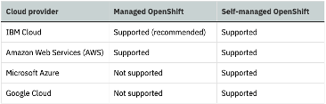
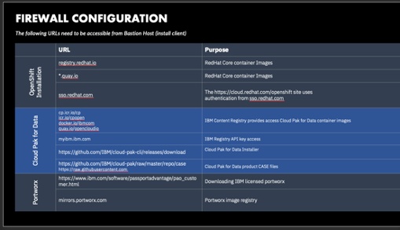

# IBM Cloud Pak for Data

<!--- cSpell:ignore OADP Velero Invenio automations hyperautomation unmanaged practioners Pak Paks Quickstart qube cntk autoplay allowfullscreen -->

## Enterprise Consumption of Cloud Pak for Data Services Begins with OpenShift
While Cloud Pak for Data is an innovative delivery mechanism for Data Fabric capabilities, many of those capabilities will be familiar to those implementing it, at least in part. OpenShift, on the other hand, is more likely to be mostly or entirely new to those installing Cloud Pak for Data. 

Such a deployment requires that many choices be made regarding security, networking, and accessibility to data. If you are deploying on an existing OpenShift cluster, you will still need awareness of the choices made in the underlying deployment. 
 
Following is a list of questions, roughly in the order required, to arrive at a completed installation configuration: 

•	What hardware platforms support the CPD services I wish to install?
•	Where is the data located, that CPD will manage?
•	How will the CPD Cluster reach that data efficiently?
•	Can/will I use OpenShift as a Service?
o	If not, where will I install the OpenShift Cluster?
•	How will OpenShift and CPD reach software images needed for installation?
•	Will I perform the installation with Installer Provisioned Infrastructure (IPI) or User Provisioned Infrastructure (UPI )?
•	What are the storage requirements for the CPD services selected?
•	How will users be authenticated and access the system?
•	How will the cluster be updated and maintained over time?

The process for answering these questions is iterative and nonlinear. Some questions will be answered by existing policy or direction. Many may be answered by committee. The intention of this document is to illuminate the concepts underlying the questions so any gaps can be filled quickly. 

This document does not purport to list all the possible combinations of configurations for either OpenShift or Cloud Pak for Data but is intended to cover the most common implementation scenarios. The finest details, including installation commands, are left to the online documentation for either product, as these may change more rapidly with versions and patch sets. 

##OpenShift Cluster Architecture
OpenShift can be installed on typical customer-maintained infrastructure, including multiple hardware platforms: 
•	Intel
•	IBM Power
•	Linux on IBM Z or LinuxONE

Running OpenShift in a commercial cloud generally suggests Intel based hardware. In some cases, a customer may wish to deploy on a fully-managed OpenShift product, such as IBM ROKS, AWS Rosa, or Azure Red Hat OpenShift. Again, the hardware underlying the service is likely Intel based. In every case, Red Hat CoreOs will be the underlying operating system. Note: At this writing, some legacy systems may still employ Red Hat Linux, but CoreOs is the clear direction and requirement for new and forthcoming versions of OpenShift. 

Clusters are made up of Master nodes and Worker nodes. Many configurations are possible, but most start with 3 Master nodes and at least 3 Worker nodes. A Bastion server is also recommended. While an installation can be initiated from many properly configured workstations, a Bastion server makes installations easily and repeatedly accessible to a larger collection of potential administrators. It’s a much simpler server than either Masters or Workers. The cluster will also likely employ a Load Balancer node. During installation, OpenShift will utilize a Bootstrap server, to bring the cluster up. Once installation is complete, the Bootstrap server can be dispensed with.

##Cloud Providers
Some infrastructure providers support managed vs. unmanaged (self-managed) environments to run RHOS. See https://ibm.biz/BdfuwM for more detailed info. 

{: style="max-height:720px"}

Information is available at the following links, for each of the managed environments mentioned above: 
IBM ROKS (Managed OpenShift) 

- [Red Hat OpenShift On IBM Cloud tutorial](https://www.redhat.com/en/technologies/cloud-computing/openshift/ibm)

- [Welcome to Red Hat OpenShift Service on AWS (ROSA)](https://console.redhat.com/openshift/create/rosa/wizard)
- [AWS QuickStart](https://aws-quickstart.github.io/quickstart-ibm-icp-for-data/)

- [Azure Red Hat OpenShift](https://azure.microsoft.com/en-us/services/openshift/#overview)

- [OpenShift on Google Cloud](https://cloud.google.com/architecture/partners/openshift-on-gcp)

OpenShift documentation also contains details for all supported providers [here](https://docs.openshift.com/container-platform/4.7/installing/index.html). 

##Cloud Pak for Data - Cluster Configuration
Cloud Pak for Data does not yet support all cartridges on all forms of infrastructure. Be sure that the services your customer needs are supported on the hardware platform under consideration. Additionally, some services have additional requirements, particularly with regard to storage. The full requirements and cartridge availability on each hardware platform are detailed here, along with storage needs.  

Licensing concerns only apply to Worker nodes. As the name implies, Workers actually carry out the application workloads. Workers can vary in size and number and must be fully licensed according to the appropriate metrics for all cartridges or services. Master nodes are administrative and do not require licenses. However, your configuration must include sufficient infrastructure resources to support the Master nodes. 

OpenShift schedules, deploys, and coordinates the work of the many pods which make up Cloud Pak for Data. Thus, almost anything that Cloud Pak for Data requires must be visible to OpenShift first. Storage, for instance, must generally be configured in OpenShift before it is attached to a database or other service. Similarly, if a pod in Cloud Pak for Data is to be accessible, a route to that pod must exist in OpenShift. For example, Db2 Warehouse may be provisioned and display connection information directing users to port 37182. That port must be reachable in any proxy configuration, open in the intervening firewall, and properly configured in an OpenShift route. Only then will a call to that port yield a connection to the database. 

##Network Connectivity
Many commonly documented installation methods for OpenShift are dependent on publicly accessible image repositories to which the installer must connect to retrieve software images. Few customers are willing to open systems to the unfiltered internet, even if those connections are strictly outgoing. It is likely that any system you work with a customer to install will be partially or fully restricted from external network access. The image below denotes the addresses which must be accessible for various install operations, should you seek to perform an install directly from the internet. 

Even if a customer allows broader connections from the new (and thus empty) cluster, those connections are quite likely to be limited once the system contains a customer's proprietary workload ---even a non-production one. Once an initial install is completed directly from the internet, you may be unable to update the installation in the same manner over time. 

In a restricted environment, you must employ a private container registry, and mirror the images needed for that installation. While the process is not detailed here, it involves downloading images from an internet connected bastion or workstation, then using various means to load a private registry in a location accessible to the servers in the isolated cluster. Depending on the restrictions in a particular environment, that process may even include physical transportation of images on detachable media, for instance. As new images are required over the life of the cluster, the private registry will need to be maintained in the same manner. 

The process for performing a restricted network installation of OpenShift is [here](https://docs.openshift.com/container-platform/4.7/installing/installing-mirroring-installation-images.html#installing-mirroring-installation-images).
The process for creating a private registry for Cloud Pak for Data is detailed [here](https://www.ibm.com/docs/en/cloud-paks/cp-data/4.0?topic=tasks-mirroring-images-your-private-container-registry).

##User Authentication
OpenShift and Cloud Pak for Data will likely need to be configured to use the customer’s LDAP/Active Directory for user authentication. Then appropriate roles will have to be assigned. 

OpenShift begins with a default ID (kubeadmin) and a password stored in plain text. Creating other ID’s requires configuring an “Identity provider”. That can be accomplished from the OpenShift Console or from a command line client. 

In Cloud Pak for Data, once authentication is established Cloud Pak for Data roles can be granted to users or groups. There are roles in place by default which can be modified or replaced based on the customer’s needs. The roles are a combination of capabilities documented here. Individual services may also have roles and permissions which need to be granted, I.e. Data Virtualization or Db2 Warehouse. 

##Storage
Let’s look at the multiple storage needs of a Cloud Pak for Data cluster. 
1.	OpenShift Private Registry Storage
Creating a private registry requires space to store images used in installing and updating both OpenShift and Cloud Pak for Data. Such images can be quite large and numerous, with hundreds of containers used in even apparently simple configurations. You can reduce that space by filtering or limiting images to the required platform only (by default, you get Intel/Power/Linux on IBM Z/etc. all at once), but the process is non-trivial. The images will need to be obtained from an internet-connected host or workstation. The registry must then either be accessible from the network-restricted cluster. The details will determine at one point in the process a registry is created and loaded, and by what method it is made available to the restricted cluster.  
2.	OpenShift Cluster Storage
Naturally, OpenShift needs storage for its operations. Some will be ephemeral; meaning, it will be addressed strictly inside a container, and its contents only exist while the container exists. Other storage needs are persistent, and will take up space while containers come and go. Persistent Volumes (PV) and Persistent Volume Claims (PVC) are the methods OpenShift uses to declare and designate persistent storage on the cluster. Ephemeral storage is managed as containers are created or destroyed. 
3.	Cloud Pak for Data Storage
CPD can have multiple, complex storage requirements, depending on what services are provisioned. A database is the most obvious storage consumer, but other services will need space too, for storing anything that persists outside a container. These could consist of configurations, jobs, catalogs, projects or work products. See CPD documentation for the requirements of each service. In general CPD supports: 
•	OpenShift Data Foundation (ODF, formerly OCS)
ODF connects to many different storage sources (storage systems, disks, etc) and allocates them at an OpenShift level that can be made available to CPD in multiple forms. For instance, you can create a storage group on top of disk attached locally to worker nodes and quickly make that space available as block storage, file storage, or even object storage. ODF is powerful and has many options. As Red Hat’s preferred storage mechanism, it is also the safest, strategically, for long term support.
•	Portworx
Portworx is another software method for clustering and presenting underlying storage to the cluster. It is still currently supported but is not strategic directionally. 
•	NFS
Network File Storage can be appealing for its comparative simplicity; almost every Linux administrator will have set up and administered NFS file systems at some point. It must be properly configured to provide adequate performance for a production or highly used environment. Such implementations are more likely to include a storage appliance that incidentally uses NFS, rather than a simple NFS export from a Linux server.
•	Cloud Specific Storage
Many cloud providers have their own storage mechanisms. For example, IBM File Storage Gold is also NFS storage, specifically designed for use on the IBM Cloud. See OpenShift documentation specific to your chosen provider to be sure a particular storage method will be supported and any additional steps required to make it available.

##The OpenShift Installer 
OpenShift uses the same installer no matter what platform you’ve chosen for deployment. That means it’s very versatile, and thus has potentially a great many options to choose from.  The simplest installation mode (as a user of the installer utility) is to select Installer Provisioned Infrastructure (IPI)—in which the installer utility will actually do the work of deploying compute based on your cloud or VMware credentials. In other words, it will request that new hosts be created based on your install command. Alternatively, you can select User Provisioned Infrastructure (UPI) which requires that the specified servers exist already with the appropriate specifications. 

###Installer Provisioned Infrastructure
Complexity is like matter; it can’t really be destroyed. It can only be moved around. While IPI installs appear easier, they come with security barriers that must be overcome and implications that must be understood. First, you must have a space in which programmatic deployment of multiple servers is possible. That can be a vSphere environment, Linux on IBM Z space, or any popular cloud platform. The documentation lists the possible environments here. Second, you must be willing (and authorized) to share an administrative ID with the installer utility. It’s likely obvious why: the installer utility will be creating multiple hosts within the target environment and must have permission to do so. That means it will take up “space” in that environment and, in a commercial cloud service, incur costs. Thirdly, and IPI install will require access to the internet, both for accessing images and for accessing any internet-based cloud service. 

There’s a clear tradeoff: Use of IPI requires fewer choices at installation, but also offers less in terms of customization. If you have a high degree of freedom in your access to and use of compute resources, it may be a great way to provision a cluster quickly.  

Bottom Line: IPI installs can be great for experimental environments, but you’re likely to want to enact more detailed specifications on any environment that will be around for the long haul—even if that cluster will be completely open to the internet. 

###User-Provisioned Infrastructure
The user here is you and/or your team. A UPI install requires that the compute resources needed by OpenShift be deployed and already named. That means creating them ahead of time on your platform of choice, ensuring networking and DNS are in place, connecting storage, etc. With that hosts required for the cluster in place, the installer utility will help you create ignition files necessary to bootstrap the cluster.  The ignition files specify the role each host will play in the cluster—a temporary bootstrap node, master nodes, and worker nodes. 

Documentation is your friend. Red Hat OpenShift documentation is detailed and accurate—but not always communicated in the order you expect. You are encouraged to read whole topics before acting. Build your understanding rather than following a checklist blindly. 

What you get in trade for selecting UPI (and giving up the simplest us of the installer utility) is complete control over compute and related resources. It also requires less in the way of user authority, which may be a comfort to most security and system administrators. 

Bottom Line: UPI is the installation method you’re most likely to employ in a persistent, non-experimental environment. 

##Where to Place Your Cluster
We’ve already noted OpenShift’s great flexibility regarding hardware platforms and multiple cloud compute providers. So where should you build your cluster?

The reality is that this decision has likely already been made by the time you review this document for a particular project, by broader direction and customer decisions about infrastructure handling for the systems of which OpenShift and Cloud Pak for Data will be a part. If you are at the earliest stages of project consideration, here are some of the factors to consider in choosing your cluster’s location: 

1.	Network Access and Proximity to the Data

Cloud Pak for Data must be able to reach the data sources it will act on. It must also be able act on that data in a timely and efficient manner. Co-location with that data is the easiest means of reducing any network bottlenecks, both for CPD’s management and eventual user access to that data. But in a hybrid environment, it is likely there will be multiple data sources which are not already co-located—for instance, legacy data on a company mainframe and a database service running in the cloud, or files residing in an object store. Put simply, your cluster must have a connection to the data that will be managed with sufficient bandwidth to match your proposed use case. 

2.	Convenience and Cost
These are listed together, as they often coincide. Generally, less management overhead (as with OpenShift as a Service) comes with higher platform cost. Of course, ultimately those costs (for the infrastructure, management, upkeep, education, etc.) will be paid one way or the other. But where to allocate that expense may be governed by the current availability of skills (see Skills below) and the time available to complete the project. 

3.	Security
In fact, none of the platforms outlined needs to be a security risk with the right configuration. But the steps for securing a cloud platform—and getting all parties to agree on the security of that cloud platform—may certainly differ from those for “local” infrastructure, which likely lives in long-approved environments. As an example, if your use case calls for the cluster to be physically inaccessible from the internet, you cannot place it with a cloud provider. Again, in such cases the requirements are likely to be known well in advance, with the cluster’s location already established. 

4.	Skills
No IT organization can be static regarding skills, so this element is really a consideration of the availability of required skills in the timeframe dictated by the project. If you do not possess a skill, how long will it take you to get it, and how much will that acquisition cost? Those questions are the same whether you intend to hire or educate. At a minimum, you will need to consider skills in: 
•	Hardware provisioning
•	Linux Administration
•	Networking and DNS
•	Containerization
•	Storage
•	Security
Naturally, use of a SaaS service is not without its skills requirements too. Using SaaS effectively requires an understanding of security and networking, but much less in terms of day-to-day administration. It may also call for a deeper understanding of contract terms and costs, especially when things like automatic scaling are involved. 
Sizing and Licensing – Cloud Pak for Data - Sales Configurator 
To complete planning and sizing for a customer’s environment, the technology seller or brand specialist will likely need to gather information from the customer, related to size of data and applications/services that will be residing on the Cloud Pak for Data platform.  The IBM Sales Configurator tool is provided to the IBM specialist to “shop” for the individual components that will make up the complete solution. The tool will provide guidance for total licensing requirements (VPCs) and compute resources (vCPUs) to complete pricing for the customer.  The IBM Sales Configurator application portal is located at https://app.ibmsalesconfigurator.com/#/.

Note: For more detailed information on Cloud Pak for Data Pricing and Licensing info, the IBM Seismic page for Cloud Pak for Data, Seller Essentials – Pricing and Sizing, can be found [here](https://ibm.seismic.com/app#/doccenter/f6bc8873-d580-4ee8-a903-c4e0d3a7eee9/doc/%252Fdd0ab3871f-9594-50fd-73b1-7f6c58815c13%252Fdd4d2d23ab-1147-1d0f-f305-1f89def2f716%252Fdd2a34ba71-9ab7-3dbb-84a9-4d3867372983%252Flfab702985-8687-4358-8d34-a4a2bc693365//?mode=view&parentPath=sessionStorage&anchorId=23bf566d-be6f-4eec-92dc-231c14f7056c). There are also a number of enablement sessions on sizing and pricing, including the March 23, 21 session of Cloud Pak for Data Office Hours. 

#Additional Content under Development 
##Installing Cloud Pak for Data on an existing OpenShift Cluster
##Installing Alongside Other Cloud Paks
##Best Practices for Dev, Test, And QA Environments
##Best Practices for Backup and Restore
##Best Practices for High Availability

