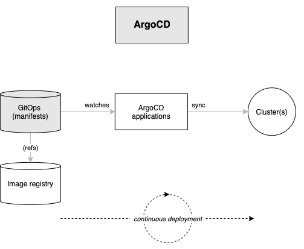

# GitOps and ArgoCD

<!--- cSpell:ignore CICD qube cntk autoplay allowfullscreen clusterrole clusterrolebinding walkthrough Walkthrough webkitallowfullscreen msallowfullscreen -->

## Overview

CP4D services are defined, configured and changed using a [GitOps](https://www.openshift.com/blog/introduction-to-gitops-with-openshift) model. GitOps puts git repositories and git commands such as **git push** (to request a change) and **git merge** (to approve a change) at the heart of configuration management. A GitOps approach helps an organization implement best practices in version control and release governance based on a widely used open standard -- **git**.

The following diagram outlines the major components in a GitOps CD process:

**ArgoCD (OpenShift GitOps)**  applications watch a Git config repository for changes built as a result of successful pipeline runs. This repository identifies the latest version of the application using information stored in Git and an image repository. OpenShift GitOps applies the Kubernetes resources thus identified to the cluster, resulting in new or updated Kubernetes resources that represent the changed CP4D resources and its ecosystem, such as pods, routes etc. OpenShift GitOps changes are durable; they remain as defined unless and until they are explicitly changed or deleted in the GitOps repository. Moreover, if the cluster resources drift from their Git config values, ArgoCD will restore them to their desired values; only changes that are applied to the Git config repository affect the long term state of the cluster.

In this section of the tutorial, we're going to set up the GitOps repository, and install ArgoCD.

In this topic, we're going to:

* Create a Github Organization
* Download a sample GitOps repository and briefly review it
* Install ArgoCD
* Customize ArgoCD
* Login in to the ArgoCD UI

By the end of this topic we'll have a all the basic components in place to
perform GitOps in our cluster.

---

## Pre-requisites

Before attempting this section, you must have completed the following tasks:

* You have created an OCP cluster instance.

!!! tip inline end
    In macOS, many of these utilities can be installed using [Homebrew](https://brew.sh/)

* You have installed on your local machine the `oc` command that matches the version of your cluster. Use these [instructions](https://docs.openshift.com/container-platform/4.8/cli_reference/openshift_cli/getting-started-cli.html) to get the latest version of `oc`. Use `oc version` to confirm that you have
    * `Client Version: 4.8` or higher
    * `Server Version: 4.8` or higher
* You have also installed [`git`](https://git-scm.com/){:target="_blank" .external}, [`tree`](http://mama.indstate.edu/users/ice/tree/){:target="_blank" .external}, [`jq`](https://stedolan.github.io/jq/){:target="_blank" .external} and [`gh`](https://cli.github.com/){:target="_blank" .external} commands.

Please see these [instructions](/references/prerequisites/instructions) for more information about how to install these prerequisites.

---

--8<-- "gitops-sample-repo-creation.md"

---

--8<-- "gitops-install-argocd.md"

---

!!! success "Congratulations!"
    You've created the GitOps repository for your cluster and examined its high level structure. You also installed ArgoCD. You created a specific **clusterrole** and **clusterrolebinding** for the ArgoCD service account to ensure that it manages the cluster in a well governed manner. Finally, you launched the UI for ArgoCD; you'll make extensive use of it during this tutorial.

    In the next topic of this chapter, we're going to customize the GitOps repository for your cluster and use ArgoCD to create and manage the Kubernetes resources for our CP4D deployment.
