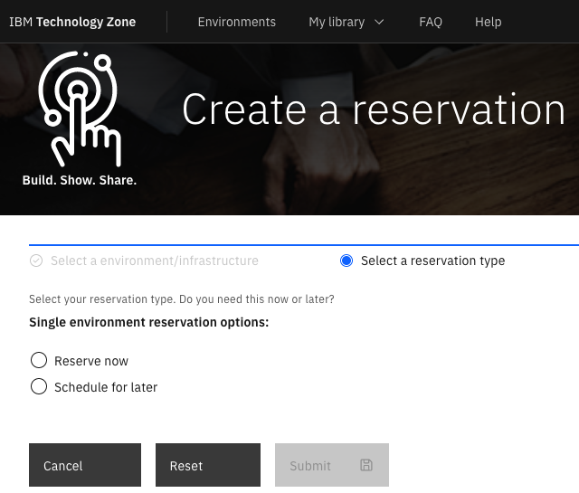
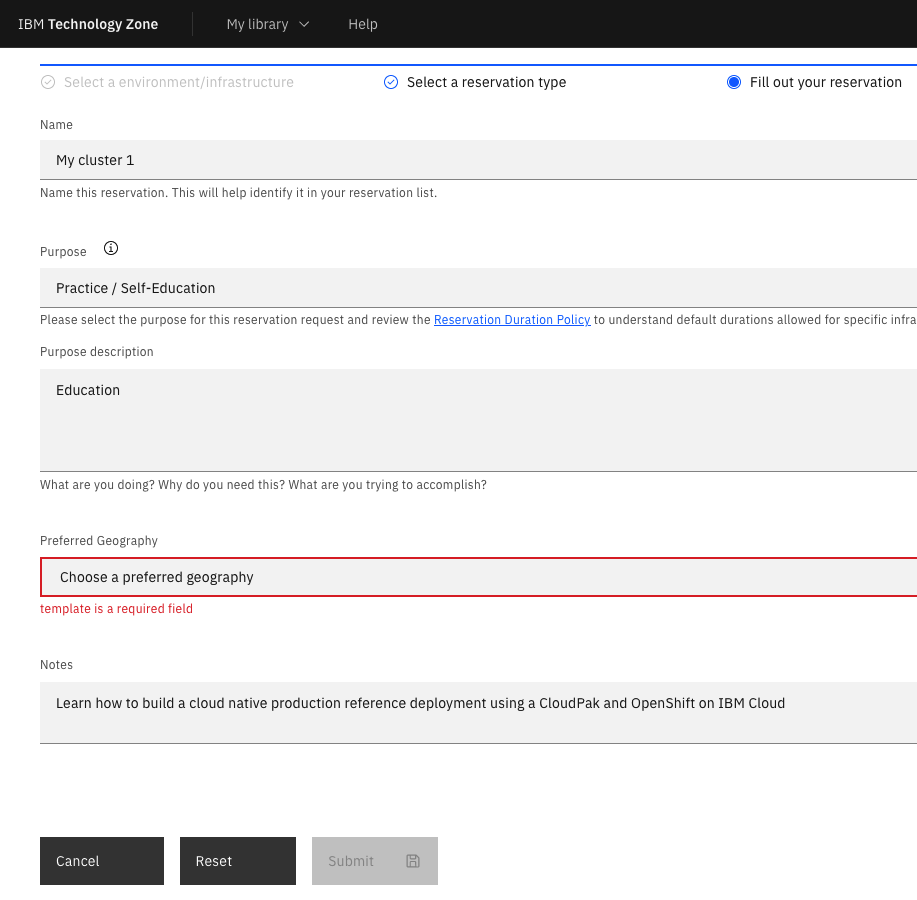
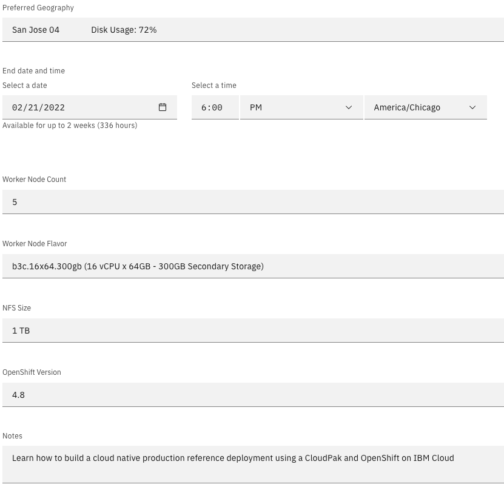
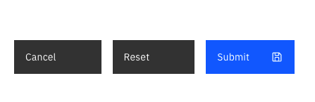
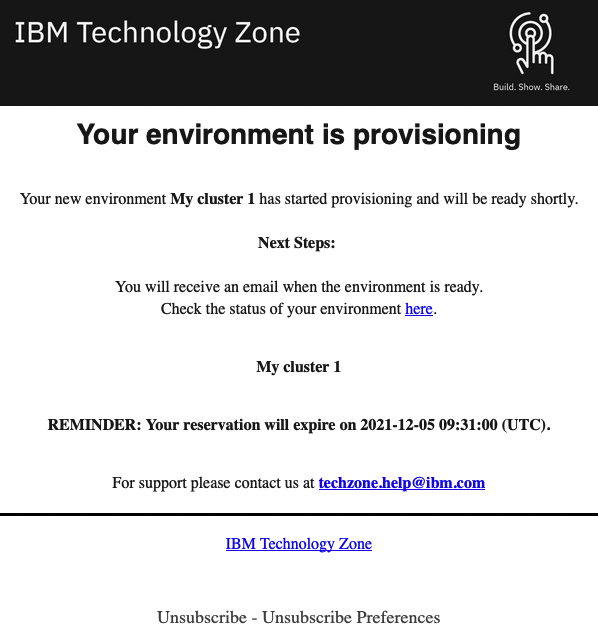
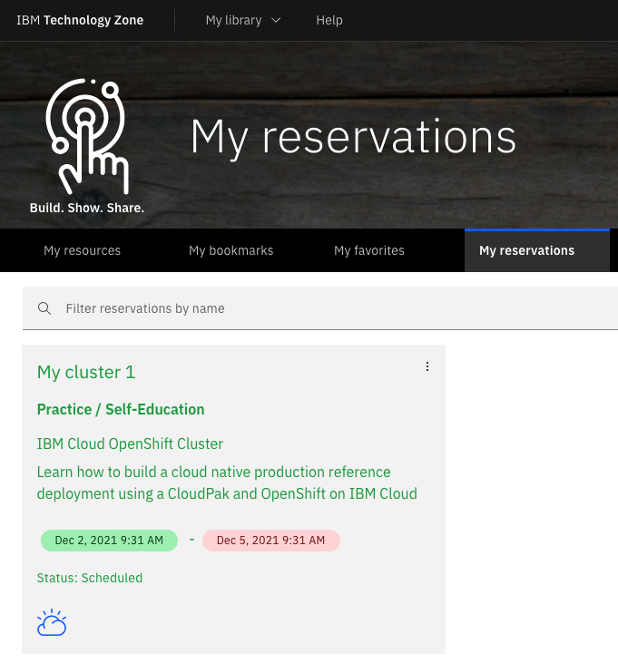
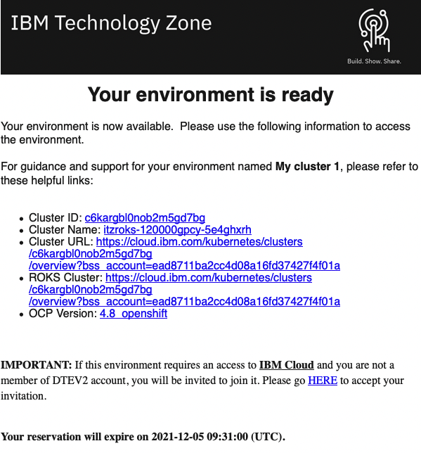
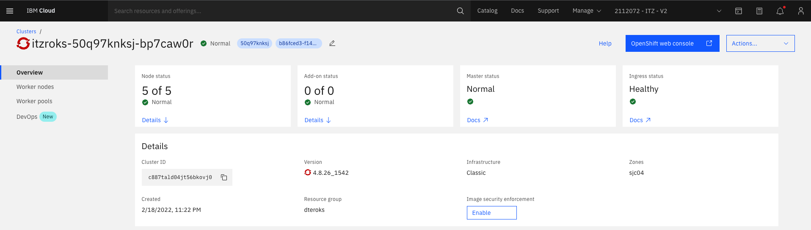
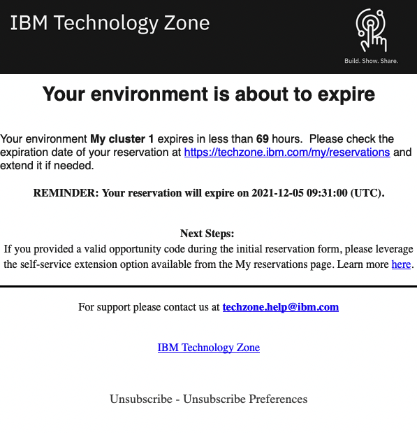

# Creating a cluster on IBM Cloud

<!--- cSpell:ignore  -->

## Overview

---

[IBM Technology Zone](https://techzone.ibm.com/) is the one-stop shop to get access to technical environments and software for demos, prototyping, and deployment.

---

## OpenShift on IBM Cloud

1. *Navigate to the* [IBM Technology
    Zone](https://techzone.ibm.com/my/reservations/create/619e5691425423001fcc192e){:target="_blank" .external}

    In your browser, navigate to the [IBM Technology
    Zone](https://techzone.ibm.com/my/reservations/create/619e5691425423001fcc192e){:target="_blank" .external}
    to create your cluster.

    - You will need to sign-in with your IBM credentials if your browser has not
      authenticated.
    - You will need to read and accept `Terms and conditions` to proceed to
      the IBM Technology Zone.

2. *Reserve a cluster*

    You can reserve a cluster immediately on IBM Cloud.

    You'll see the following options:

    {: style="max-height:400px"}

    - Click the `Reserve now` radio button.

    !!! info
        It takes between 30 and 60 minutes to provision a cluster. Moreover, once a cluster has been provisioned, by default, it will be deleted after 3 days -- unless you renew it. It can therefore be helpful to schedule the environment to be created later if you are not going to be using it for a while -- such as for a future demonstration or classroom session.

3. *Complete reservation details - step 1*

    You will be asked to complete your reservations details in two steps.

    Firstly, when you make a cluster reservation, you can supply a set of
    details that describe:

    - The cluster name
    - The purpose of the reservation from a pre-defined set
    - A description, which will appear for a `Practice/Self-Education` reservation
    - Notes to help you identify this reservation

    {: style="max-height:600px"}

    Complete the details as follows:

    - Type a helpful `Name` such as `My cluster 1`
    - Select `Practice/Self-Education` from the `Purpose` drop-down list
    - Type a helpful `Purpose Description` such as `Education`
    - Do not select `Preferred Geography` yet; we will do that in a moment
    - Add some helpful `Notes` such as `Learn how to build a cloud native
      production reference deployment using a CloudPak and OpenShift on IBM
      Cloud`

4. *Complete reservation details - step 2*

    The second step in registration is to specify the physical details of the
    compute infrastructure for your cluster.

    When you make a cluster reservation, you can supply a set of details that
    describe:

    - The cluster's geographical location
    - The version of OpenShift Container Platform used by the cluster
    - The number of CPUs in the cluster and their memory size
    - The number of Kubernetes worker nodes in the cluster
    - The NFS storage size for the cluster
    - The End date and time for the cluster

    {: style="max-height:600px"}

    Complete the details as follows:

    - Select your `Preferred Geography` such as `London 5`, `HongKong 2` or `San Jose 04`
    - Under `End date and time`, select a date and specify the time along with its time zone. 
    - Select `Worker Node Count` as `5` from the drop-down list
    - Select `Worker Node Flavor` as `b3c.16x64.300gb (16 vCPU x 64GB - 300GB Secondary Storage)` from the drop-down list
    - Select `NFS Size` as `1 TB` from the drop-down list
    - Select `OpenShift Version` as `4.8` from the drop-down-list

    !!! info
        By default, your cluster will be reserved for **three days**, after which time it will be deleted. This is more than enough time to complete this tutorial. If required, you can increase the cluster lifetime by configuring the `End date and time`. Don't do this unless you really need to do so; as you'll learn in the tutorial, the use of GitOps makes it quick and easy to provision a cluster when you need to do so.

5. *Create the cluster*

    Check your reservation details and press `Submit` when you're ready to create the cluster:

    {: style="max-height:400px"}

    !!! info
        The cluster provisioning process will take between 30 and 60 minutes to complete on IBM Cloud.

6. *Provisioning email*

    As the provisioning process starts, you will receive an email to
    confirm that the provisioning process has started:

    {: style="max-height:427px"}

7. *Checking the cluster provisioning status*

    You can also view the status of your provisioning request on IBM Technology Zone.

    Click on [My reservations](https://techzone.ibm.com/my/reservations){:target="_blank" .external}
    to see:

    {: style="max-height:400px"}

    Note:

    - The `Status:` field will be `Ready` when the cluster has been provisioned.
    - The creation and expiry date-time for your cluster.

    You can return to the reservation at any time to get the details of your cluster.

8. *Cluster provisioned email*

    You will receive another email once your cluster is ready:

    {: style="max-height:500px"}

    !!! success
        Your cluster is now provisioned and ready to use.

    !!! note
        Note the expiry date-time.

    !!! warning
        Be sure to read the **IMPORTANT:** clause at the end of the email. If your cluster has been provisioned to an IBM Cloud account you have not used before, and you have not accepted the invitation to that account, you will not be able to see your cluster when you click on the **Cluster URL** link in the following step. It is recommended to always click on the **HERE** link in the clause to see if you need to accept an invitation.

9. *Navigate to your cluster*

    You can use the information in the notification email to access your cluster.

    Click on the `Cluster URL` link to login to IBM Cloud and locate your
    OpenShift cluster:

    {: style="max-height:400px"}

    Note:

    - The `Cluster ID` that has been assigned by IBM Cloud.
    - The `Zone` matches your requested geography.
    - The OCP `Version` matches your requested version of OCP.
    - The `Node status` identifies the 5 worker nodes in the `Normal` state.

    Feel free to explore this web page.

10. *Receiving cluster deletion email and extending your cluster's lifetime*

    When your cluster is within 3 days of deletion, you will receive a daily email:

    {: style="max-height:400px"}

    Note:

    - You can extend your cluster if required.
    - This option may be limited to certain types of reservations.
    - The [My reservations](https://techzone.ibm.com/my/reservations){:target="_blank" .external}
      page allows you to manage your cluster reservation

!!! success "Congratulations!"
    You've now created your cluster.  In the next topic, we're going to configure the cluster for GitOps, so that we can manage it quickly, easily and effectively.