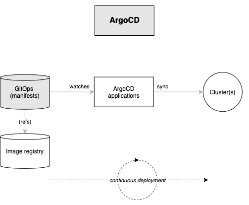

# Deploying Cloud Pak for Data platform with ArgoCD

<!--- cSpell:ignore Progesssing Artificatory resyncs rolebindings configmaps CICD qube cntk autoplay allowfullscreen webkitallowfullscreen msallowfullscreen Walkthrough walkthrough-->

## Overview

In the [previous section](../cluster-config/gitops-config.md) of this chapter, we used GitOps to
create the ArgoCD applications that installed and managed the `tools` and
`ibm-common-services` namespaces in the cluster.

In this section we're going to complete the installation of all the necessary
services required by Cloud Pak for Data platform:

We'll examine these highlighted components in more detail throughout this
section of the tutorial; here's an overview of their function.

**ArgoCD applications** will be created for each of these resources.
Specifically, ArgoCD applications will keep the cluster synchronized with the
application YAML definitions stored in Git.

This section will reinforce our understanding of GitOps. We will then be ready
to create CP4D applications that use the infrastructure we
previously created and these services we are going to install further.

In this topic, we're going to:

* Deploy services to the cluster using GitOps
* Explore the ArgoCD applications that manage these services
* Review how ArgoCD projects work
* See how `infra` and `services` ArgoCD applications manage the
  **infrastructure** and **services** layers in our architecture.

By the end of this topic we'll have a CP4D platform installed.

---

## Pre-requisites

!!! tip inline end
    In macOS, many of these utilities can be installed using [Homebrew](https://brew.sh/).

    Please see these [instructions](/references/prerequisites/instructions) for more information about how to install these utilities.

Before attempting this section, you must have completed the following tasks:

* You have created an [OCP cluster instance](../cluster-create/ibm-setup.md).

* You have completed the [tutorial section](../cluster-config/gitops-argocd.md) to customize the GitOps repository, install ArgoCD and have installed command line utilities such as `oc`, `git`, `tree` etc.
* You have installed [`watch`](https://gitlab.com/procps-ng/procps){:target="_blank" .external} command.
* You have completed the [tutorial section](../cluster-config/gitops-config.md) to create the `tools` and `ibm-common-services`
  namespaces using GitOps.

Please see the previous sections of this guide for information on how to do
these tasks.

---

--8<-- "gitops-cluster-post-tasks-cp4d.md"

---

--8<-- "gitops-deploy-cp4d-services.md"

---

--8<-- "gitops-argocd-features.md"

---

!!! success "Congratulations!"
    You've installed IBM Cloud Pak for Data platform. We installed it into the `tools`
    namespaces we created previously.

    This chapter is now complete. In the following chapters, we're going to use
    this platform to deploy further services to the cluster.

---
