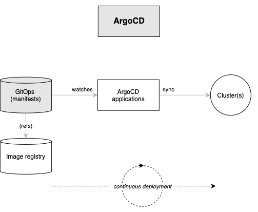

# Deploying Watson Studio on Cloud Pak for Data with ArgoCD

<!--- cSpell:ignore Progesssing Artificatory resyncs rolebindings configmaps CICD qube cntk autoplay allowfullscreen webkitallowfullscreen msallowfullscreen Walkthrough walkthrough-->

## Overview

In this section we're going to complete the installation of Watson Studio
on Cloud Pak for Data using GitOps and ArgoCD.

**ArgoCD applications** will be created for each of these resources.
Specifically, ArgoCD applications will keep the cluster synchronized with the
application YAML definitions stored in Git.

By the end of this topic we'll have a Watson Studio enabled on Cloud Pak for Data.

---

## Pre-requisites

!!! tip inline end
    In macOS, many of these utilities can be installed using [Homebrew](https://brew.sh/).

    Please see these [instructions](/references/prerequisites/instructions) for more information about how to install these utilities.

Before attempting this section, you must have completed the following tasks:

* You have reviewed [Cloud Pak for Data tutorial](../platform/overview.md) and have created an [OCP cluster instance](../cluster-create/ibm-setup.md).
* You have completed the [tutorial section](../cluster-config/gitops-argocd.md) to customize the GitOps repository, install ArgoCD and have installed command line utilities such as `oc`, `git`, `tree` etc.
* You have completed the [tutorial section](../cluster-config/gitops-config.md) to create the `tools` and `ibm-common-services`
  namespaces using GitOps.
* You have completed the [tutorial section](../platform/deployment.md) to deploy Cloud Pak for Data platform using GitOps.

Please see the previous sections of this guide for information on how to do these tasks.

---

--8<-- "gitops-deploy-cp4d-ws-services.md"

---

!!! success "Congratulations!"
    You've installed Watson Studio on Cloud Pak for Data. We installed it into the `tools`
    namespaces we created previously.

    This chapter is now complete.

---
