# Configure IBM API Connect

<!--- cSpell:ignore APIC apic apiconnectcluster OIDC ibmc Mailtrap decentralised pOrg pOrgs -->

## Overview

In this section you are going to:

1. Work with the IBM API Connect Cloud Manager component.
2. Review the out of the box IBM API Connect Cloud Topology when IBM API Connect is installed as part of the IBM Cloud Pak for Integration.
3. Configure IBM API Connect notifications.
4. Create a Provider Organization to develop APIs for and publish to.

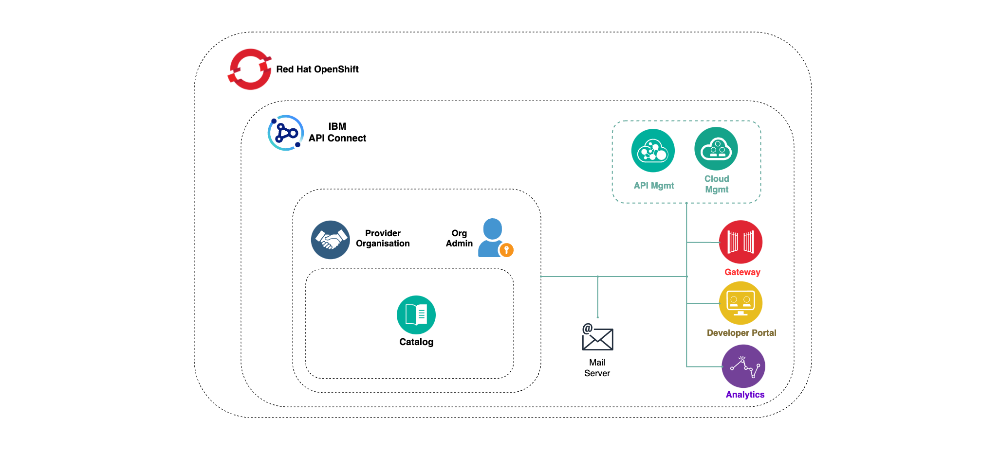{: style="max-height:600px"}

---

## IBM API Connect Cloud Manager

In the previous section of this tutorial, you managed to deploy an IBM API Connect Cluster instance into the `tools` namespace of your Red Hat OpenShift cluster. Also in that previous section, you checked after the installation that you were able to open the IBM Cloud Pak Platform Navigator and see your IBM API Connect Cluster instance displayed as a new available integration capability.

In this section, you are going to have a look at the infrastructure side of the IBM API Connect brain, which is the IBM API Connect Cloud Manager component. The reason for doing so is because getting IBM API Connect deployed on your cluster as another capability of your acquired IBM Cloud Pak for Integration comes with certain automation that not only integrates your IBM API Connect capability into the IBM Cloud Pak Platform Navigator, as you saw in the previous section, but it also comes with certain IBM API Connect post install configuration automatically done out of the box (the IBM API Connect post install configuration documentation can be found [here](https://www.ibm.com/docs/en/api-connect/10.0.x?topic=environment-cloud-manager-configuration-checklist)). Hence, you are going to inspect that auto configuration as well as complete some other configuration bits for you IBM API Connect instance for it to actually be ready to be used.

Open your IBM API Connect Cloud Manager web console by pointing your browser to its url which you can retrieve with:

```bash
oc get apiconnectcluster <APIC_NAME> -n <PROJECT> -o=jsonpath='{.status.endpoints[?(@.name=="admin")].uri}'
```

where `<APIC_NAME>` is the name of your IBM API Connect Cluster instance and `<PROJECT>` is the RedHat OpenShift Project where it is deployed (review the [IBM API Connect Endpoints section](../deploy-apic/#ibm-api-connect-endpoints) for more details).

If you have not logged into your IBM Cloud Pak Platform Navigator, you will be requested to do so first:

{: style="max-height:700px"}

Select `IBM provided credentials (admin only)` to log in with the IBM Cloud Pak Common Services administrator OIDC credentials that were created when installing the IBM Cloud Pak Foundational Services as a result of installing IBM Message Queue and IBM Cloud Pak Platform Navigator. To retrieve such credentials execute:

```bash
oc extract -n ibm-common-services secrets/platform-auth-idp-credentials --keys=admin_username,admin_password --to=-
```

{: style="max-height:700px"}

If you had logged into your IBM Cloud Pak Platform Navigator recently, you would get to the IBM API Connect Cloud Manager login page directly.

As explained in the [IBM API Connect User Registries section](../deploy-apic/#ibm-api-connect-user-registries) you will use the default **`Cloud Administrator`** user created out of the box in the **Cloud Manager User Registry**, which was referred to as the admin Local User Registry (LUR). Therefore, click on the **Cloud Manager User Registry** button.

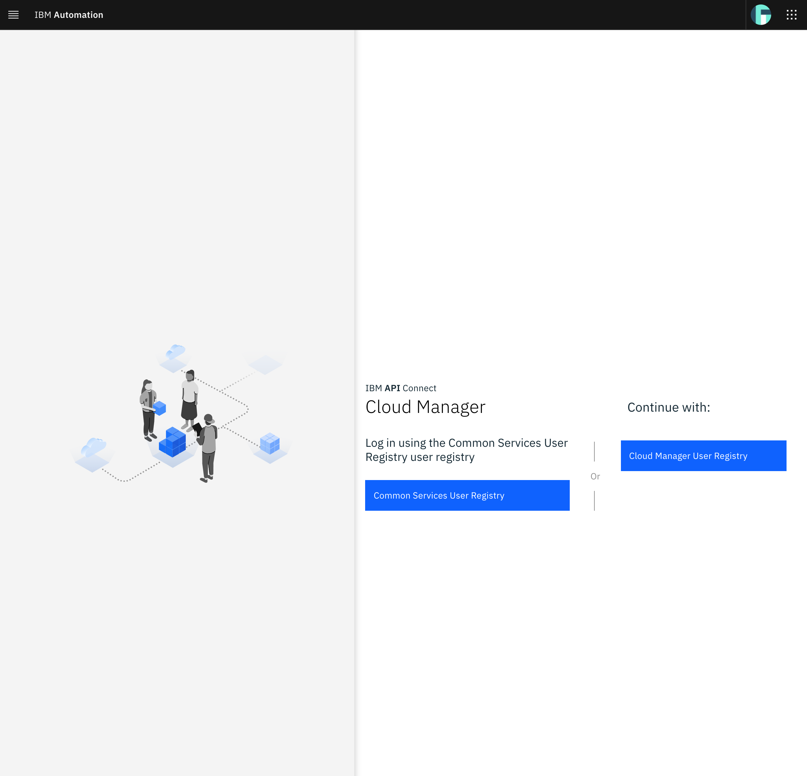{: style="max-height:1000px"}

You will be prompted to provide your credentials:

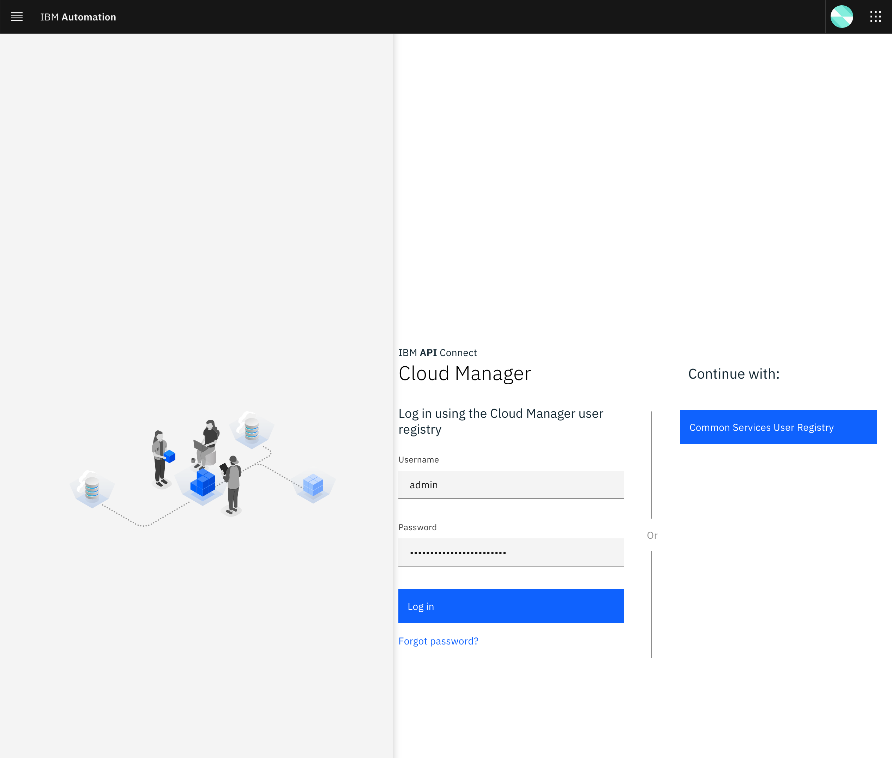{: style="max-height:900px"}

As explained in the [IBM API Connect User Registries section](../deploy-apic/#ibm-api-connect-user-registries), the username is `admin` and you can retrieve the password executing:

```bash
oc extract -n <PROJECT> secret/<APIC_NAME>-mgmt-admin-pass --keys=password --to=-
```

where `<APIC_NAME>` is the name of your IBM API Connect Cluster instance and `<PROJECT>` is the RedHat OpenShift Project where it is deployed. If you followed this tutorial it should be `apic-cluster` and `tools` respectively.

Once you successfully get authenticated, you should get to the IBM API Connect Cloud Manager dashboard. 

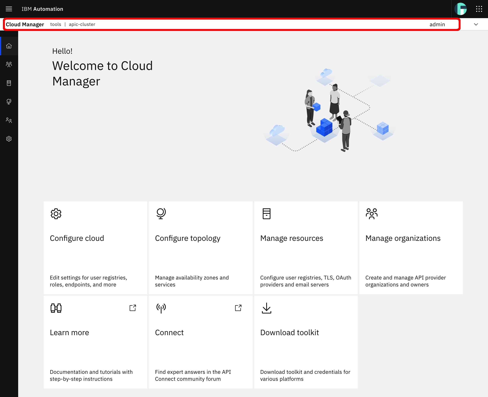{: style="max-height:1000px"}

Notice the following from your context bar at the top of your IBM API Connect Cloud Manager dashboard:

1. The IBM Cloud Pak for Integration product or capability you are working with (for IBM API Connect it does actually display what component of it). In this case, the `IBM API Connect Cloud Manager`.
2. The project where this product or capability has been installed into or deployed to. In this case, `tools`.
3. The IBM API Connect Cluster instance this IBM API Connect Cloud Manager component belongs to. In this case, `apic-cluster`.
4. The user you are logged in as (at the very right end of the bar). In this case, `admin` (do not get confused between the admin user in the Common Services User Registry and the Cloud Manager User Registry despite having the same username).

### IBM API Connect Cloud Topology

The first thing you are going to visit is the `Configure topology` option in your IBM API Connect Cloud Manager. Here, you are provided with the capacity to define logical availability zones for your IBM API Connect Cloud Topology where register IBM API Connect components to. IBM API Connect components such as Gateway, Developer Portal and Analytics services.

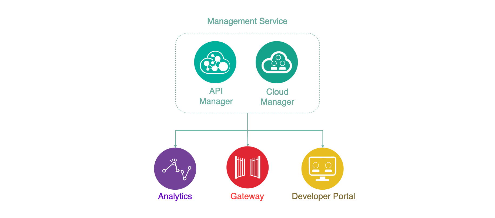{: style="max-height:400px"}

Click on `Configure topology`

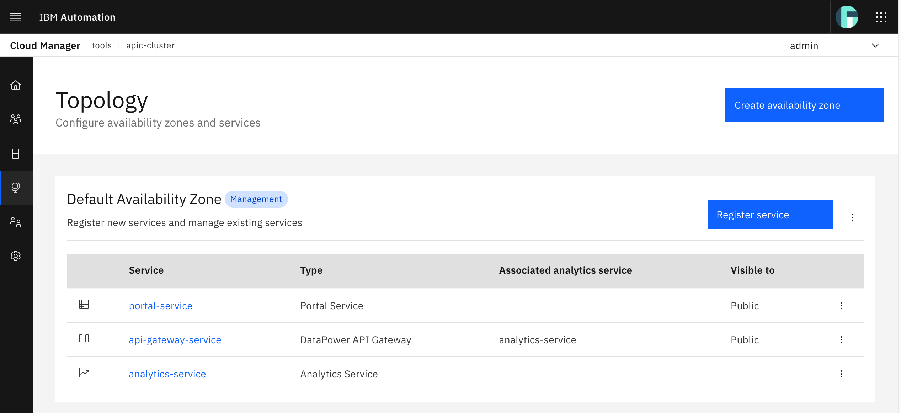{: style="max-height:500px"}

You can see another of the IBM API Connect post install auto configurations being done out of the box when IBM API Connect is installed as part of the IBM Cloud Pak for Integration. You can see that each of the components the IBM API Connect Operator got deployed and installed on your Red Hat OpenShift cluster have been registered with your IBM API Connect Cloud Manager so that these can be used by the IBM API Connect API Manager. Out of the box, you have your Gateway service registered so that you expose and secure the access to your APIs, the Analytics service registered and associated to the Gateway service so that you are provided with analytics on your APIs usage and access and the Developer Portal service registered too so that you can create developer portals for the catalogs on your IBM API Connect API Manager and get the APIs and Products on those catalogs published in their catalog's respective developer portal.

### Notifications

IBM API Connect requires of an email notification server in order to send owners, admins, users, etc relevant notifications. You will see some of these notifications later on in this section.

From the IBM API Connect Cloud Manager home dashboard (click on the home icon on the left hand side shortcut menu), click on `Manage resources` and then on the `Notifications` section on the left hand side menu.

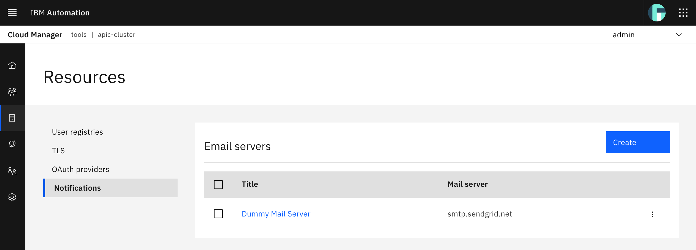{: style="max-height:400px"}

You can see that the same IBM API Connect post install auto configuration mentioned already has created a dummy notification email server. However, you would actually need a working email server in order to be able to receive required notifications to set up things like developer portals, register users, etc.

If you do not have a working email server, you can create a free testing email server at <http://mailtrap.io> in only few steps. We are using this tool as an example for this tutorial. If you create a free account in Mailtrap, you will be presented with the following in your inbox.

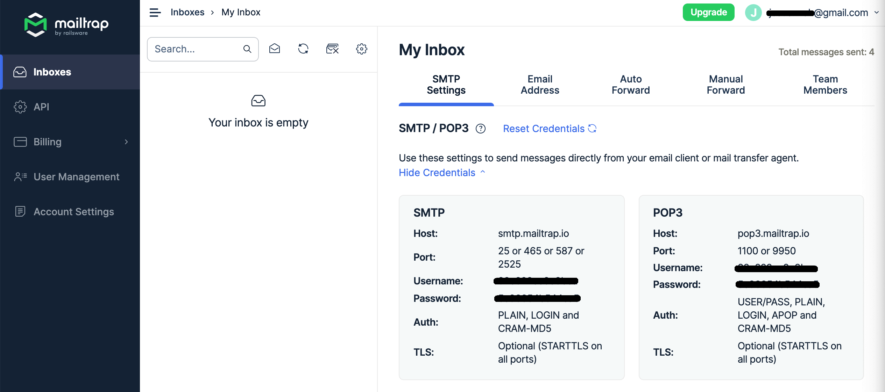{: style="max-height:500px"}

Use that information to configure your email notification server in your IBM API Connect Cloud Manager. Go back there and click on the blue `Create` button at the top right corner and fill in the configuration.

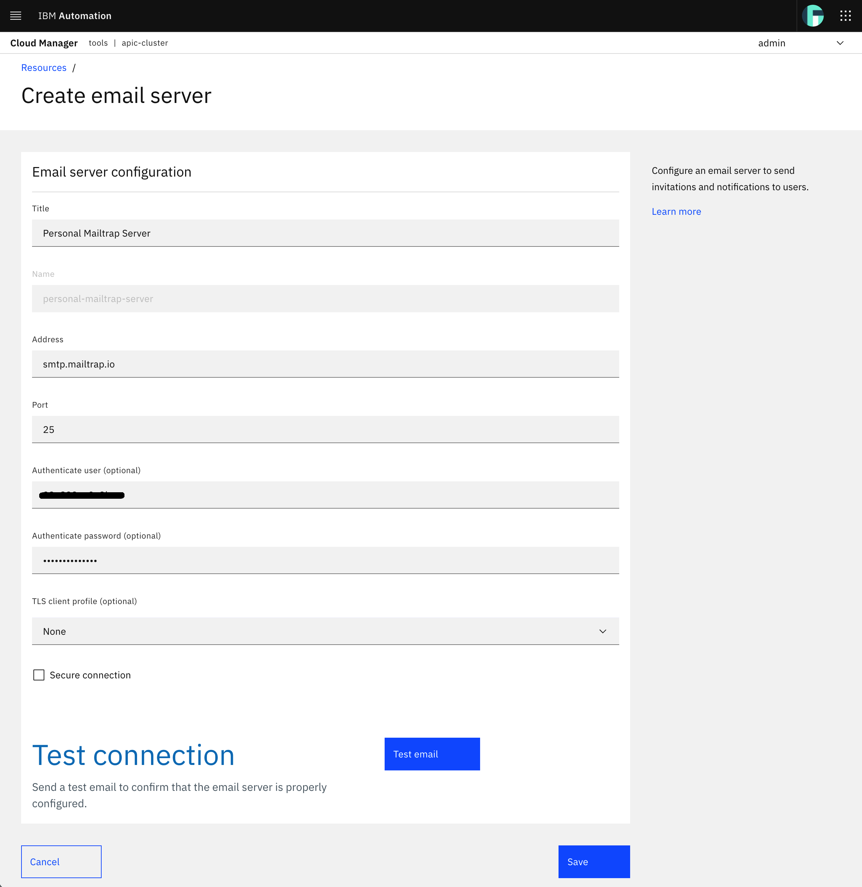{: style="max-height:1200px"}

Click on the 'Test email' button at the bottom. On the pop up menu introduce any email address and click on `Send test email`. You should see the following message asking you to check your email for the test email sent.

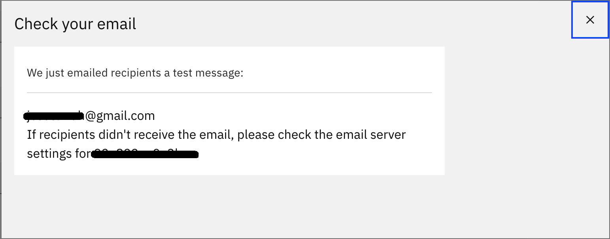{: style="max-height:300px"}

!!! warning
    If you get a `400 Time Out` error try using another port for your Mailtrap Email Server

Make sure you have received an email testing from the `APIC Administrator` in your Mailtrap inbox.

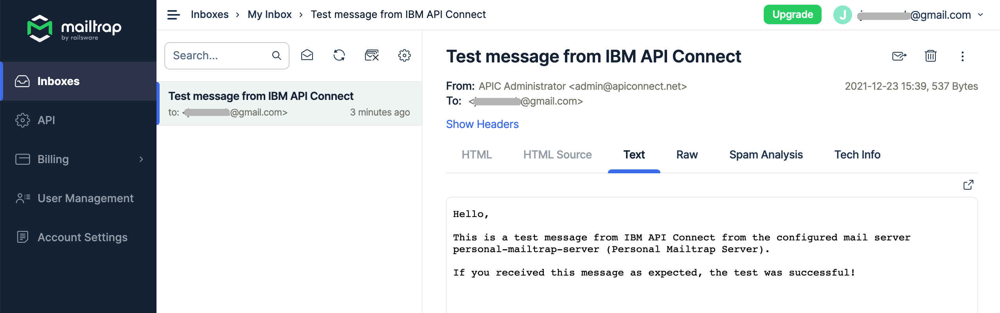{: style="max-height:400px"}

If so, it means that your email server configuration is correct. Click on `Save`. You should now be able to see the two notification email servers.

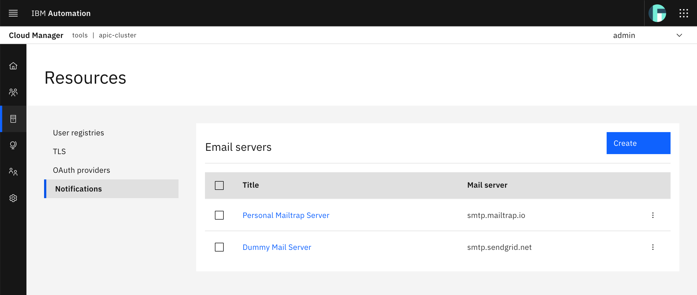{: style="max-height:500px"}

Next, you need to set up your Mailtrap notification email server as the notification email server to be used by the APIC Administrator to send invitations and notifications to users. For that, go to your IBM API Connect Cloud Manager dashboard (click on the home icon on the left hand side shortcut menu) and click on the `Configure cloud` option and then go to the `Notifications` section on the left hand side menu.

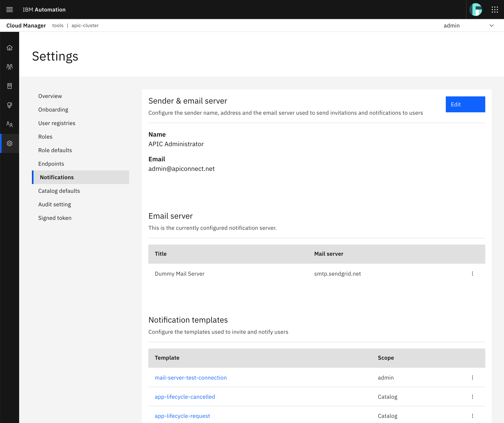{: style="max-height:1000px"}

Here you should see that the notification email server associated to the APIC Administrator isn't the one you have just configured. To change that, click on the blue `Edit` button on the top right corner, select the Mailtrap email server you have just configured and click on `Save`.

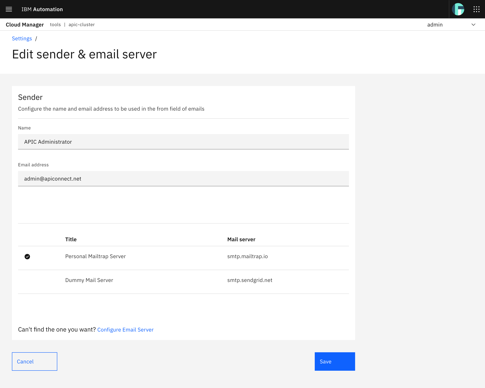{: style="max-height:900px"}

You should now see your Mailtrap email server being used as the email server for the APIC Administrator.

### User Registries

Click on the `Resources` section on the very left hand side IBM API Connect Cloud Manager menu. You will be presented with a list of the different User Registries available for your IBM API Connect Cluster instance to be used.

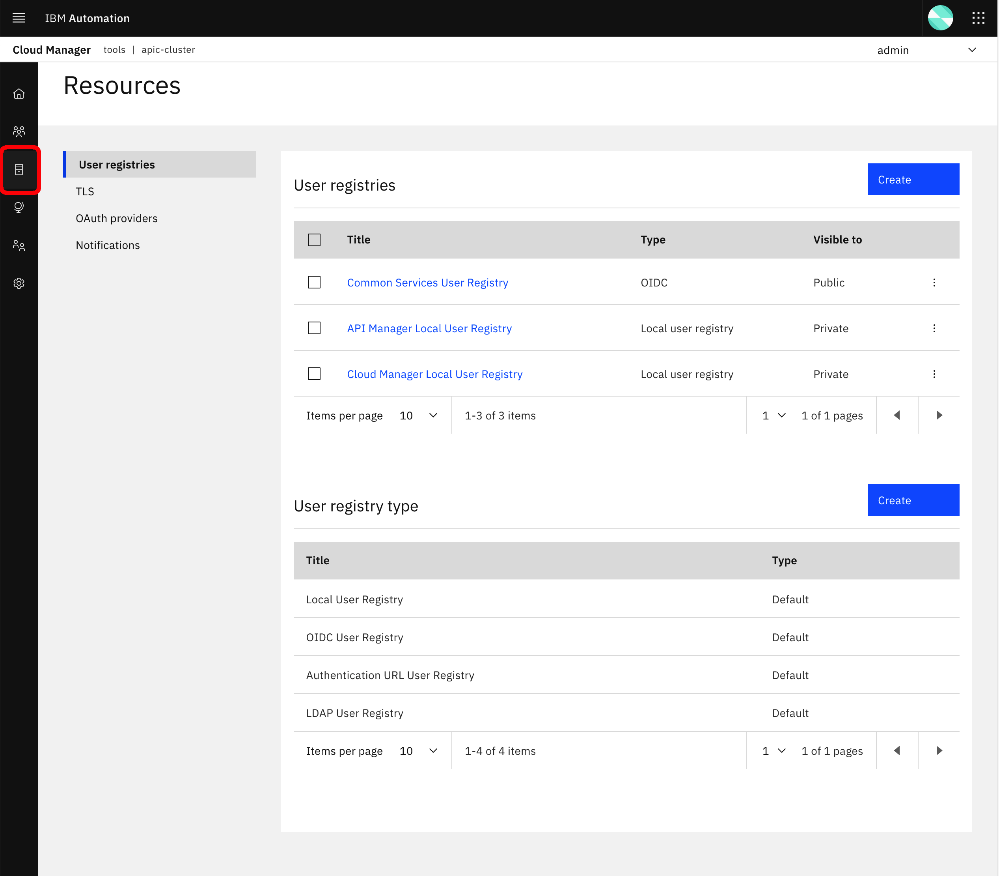{: style="max-height:1100px"}

You can see the three User Registries explained in the previous [IBM API Connect User Registries](../deploy-apic/#ibm-api-connect-user-registries) section.

* The `Common Services User Registry` which is an OIDC User Registry that integrates with the Identity and Access Management (IAM) Operator provided by the IBM Cloud Pak Foundational Services that enables single sign-on and contains the `admin` IBM Common Services user.
* The `API Manager Local User Registry` which is one of the two default Local User Registries that IBM API Connect comes out of the box with. This will be a Provider Organizations user registry as you will see below. It does not contain any user out of the box.
* The `Cloud Manager Local User Registry` which is one of the two default Local User Registries that IBM API Connect comes out of the box with. This will be a Administration Organization user registry as you will see below. It comes with the `admin` **`Cloud Administrator`** user you are logged into IBM API Connect Cloud Manager right now out of the box.

Click now on the `Settings` option of the very left hand side IBM API Connect Cloud Manager menu bar and then click on `User Registries`. You should see what User Registries are made available for authentication for what IBM API Connect component.

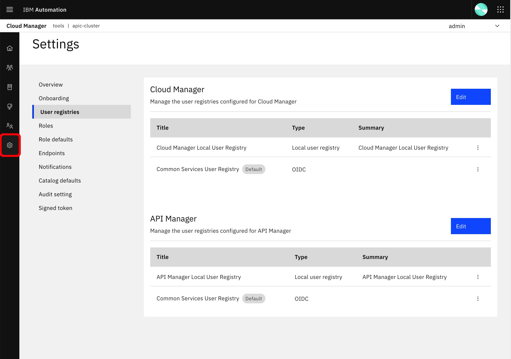{: style="max-height:900px"}

As you can see, the `Common Services User Registry` is made available for authentication to both the IBM API Connect Cloud Manager as well as the IBM API Connect API Manager so that a consistent single sign-on experience is available across components. However, the `Cloud Manager Local User Registry` and the `API Manager Local User Registry` are made available to the IBM API Connect Cloud Manager and IBM API Connect API Manager respectively to handle users and their authentication separately. This will allow/enforce you to have separate admin users on both user registries to represent the **`Cloud Administrator`** and the **`Provider Organization Owner`** as already explained.

<!-- 
#### admin user email

In this short subsection, you are going to provide an email for the `admin` user of the IBM Cloud Pak for Integration Common Services User Registry you have logged into your IBM Cloud Pak Platform Navigator with, and therefore to your IBM API Connect Cloud Manager and API Manager components too, so that this user (and do not get confused by the IBM APIC Administrator above) has an email associated to it for the notifications being sent by the APIC Administrator. As mentioned earlier, this APIC Administrator will be sending notifications to IBM API Connect users, such as `admin`. You will see this in a minute in the following Provider Organization section below.

Click on the `admin` user drop down menu on the context top bar and then in `My account`

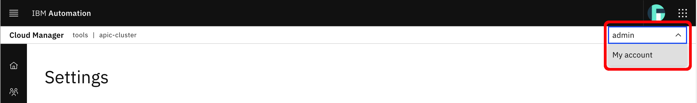{: style="max-height:200px"}

You will be presented with a form with the configuration for the `admin` account where the `Email` property is empty. Provide an email (it does not necessarily need to be your personal email since the emails will go to your Mailtrap Email Server regardless) and click `Save`.

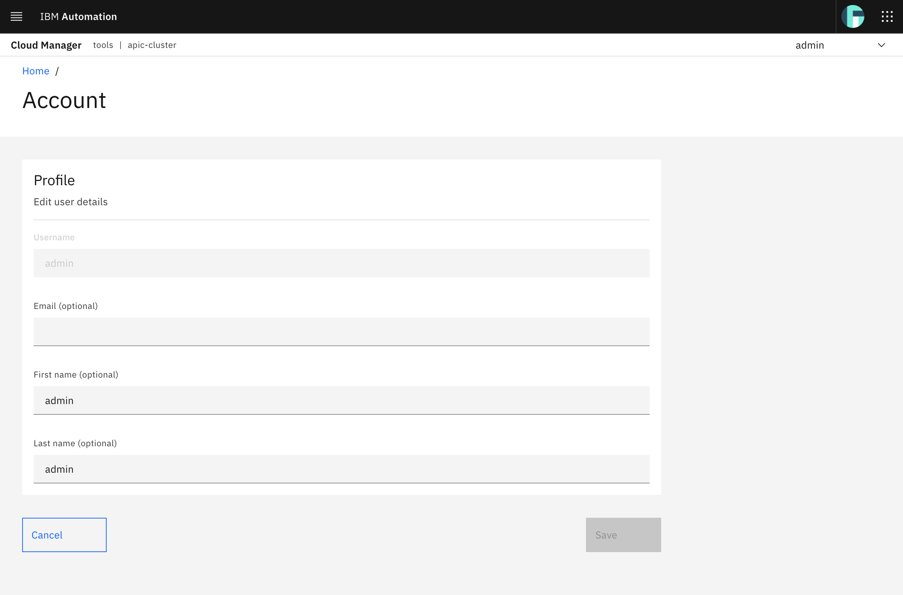{: style="max-height:700px"}

You should see a success message on the top right corner of your IBM API Connect Cloud Manager dashboard.

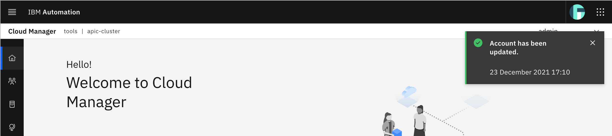{: style="max-height:300px"}

-->

### Provider Organization

Last step to be able to start using the IBM API Connect API Manager and work with and develop your applications APIs is to create a Provider Organization. This is an IBM API Connect specific logical construct to manage APIs.

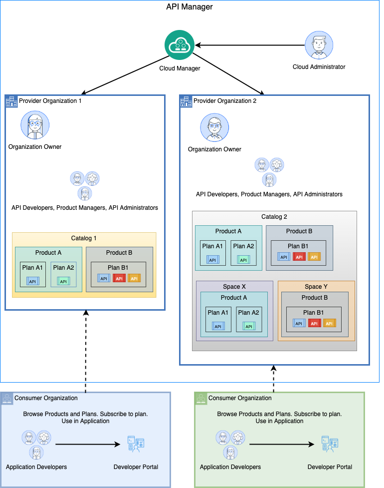{: style="max-height:1000px"}

The IBM API Connect logical topology consists of:

* **API Cloud** which includes one API Manager Service, one or more Gateway Services, and zero or more Portal Services and Analytics Services.
* An **Application Programming Interface (API)** is an industry-standard software technology, which comprise a set of routines for building software applications. An API is composed of operations which are defined as REST APIs or SOAP APIs.
* A **Plan** is a packaging strategy that determines which APIs an application can use and controls which operations from an API are available. In order to enable monetization and affect quality of service, a Plan specifies rate limits for the APIs under its control.
* A **Product** is a package that comprises a set of Plans and APIs. There is a strict relationship between Products and Plans. A Plan can belong to only one Product. A Product can have multiple Plans that each contain a different set of APIs. A Plan in one Product can share APIs with Plans in another Product.
* A **Catalog** is a collection of Products. Products, with their Plans and APIs, are contained within a Catalog. Select Products in the Catalog are published to the Developer Portal. A Catalog has a one-to-one relationship with a Developer Portal, i.e. each Catalog is associated with one, and only one, Developer portal. Thus catalogs are used to separate Products and APIs between environments, such as development, QA and production, within a Provider Organization. As an example, an API provider uses a Development Catalog when developing and testing APIs, and a Production Catalog for publishing APIs that are ready for external use.
* A **Space** represents a partition within a catalog. Each line of business within an organization may want to socialize their APIs on a single developer portal to provide API consumers a single API marketplace. Each line of business may also have different development groups to independently maintain their APIs and control their product and API lifecycle. To accomplish this, spaces are created within a Catalog to logically separate development groups while preserving a unified Development Portal across the Provider Organization.
* A **Provider Organization** is responsible for the complete lifecycle of an API, i.e. developing, publishing, and maintaining APIs. It is also responsible for managing its membership. A Provider Organization is created for each product team or department. In smaller environments a single Provider Organization is used to manage multiple teams. The Cloud Administrator uses the Cloud Manager user interface to create a Provider Organization. Alternatively, a Cloud Administrator can invite a user to self-provision a Provider Organization. Each Provider Organization has an organization owner who is responsible for the organization's configuration and user onboarding. Users can belong to one or more organizations with different roles and permissions.
* A **Consumer Organization** is an entity that develops applications that consume APIs produced by the provider organization.

As you could read in the description of the different IBM API Connect logical topology components above, what you would need to create in order to have a catalog where publish your APIs and Products to is a Provider Organization. In order to create a Provider Organization, go to your IBM API Connect Cloud Manager dashboard and click on the `Manage organizations` option. You should not have any Provider Organization already created.

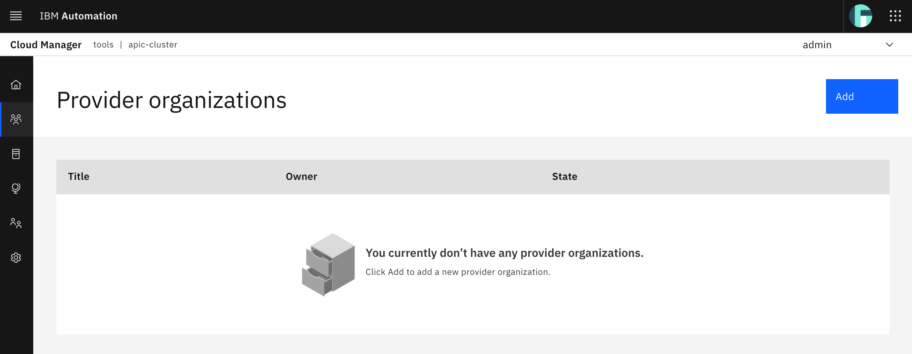{: style="max-height:400px"}

Click on the blue `Add` button on the top right corner that will display a drop down menu. Select the `Create organization` option.

On the Provider Organization configuration form, provide a name for your Provider Organization. Then, for the owner of this Provider Organization, make sure you select the **`API Manager Local User Registry`** for the User Registry that will contain the **`Provider Organization Owner`** as opposed to using the other `Common Services User Registry` as explained above in the [User Registries](#user-registries) section. As explained in the [IBM API Connect User Registries](../deploy-apic/#ibm-api-connect-user-registries) section from the previous chapter, the `API Manager Local User Registry` does not contain any user out of the box. As a result, select `New user`. Fill in the form to create a new user bearing in mind that you must remember the `Username` and `Password` for logging into the IBM API Connect API Manager later on.

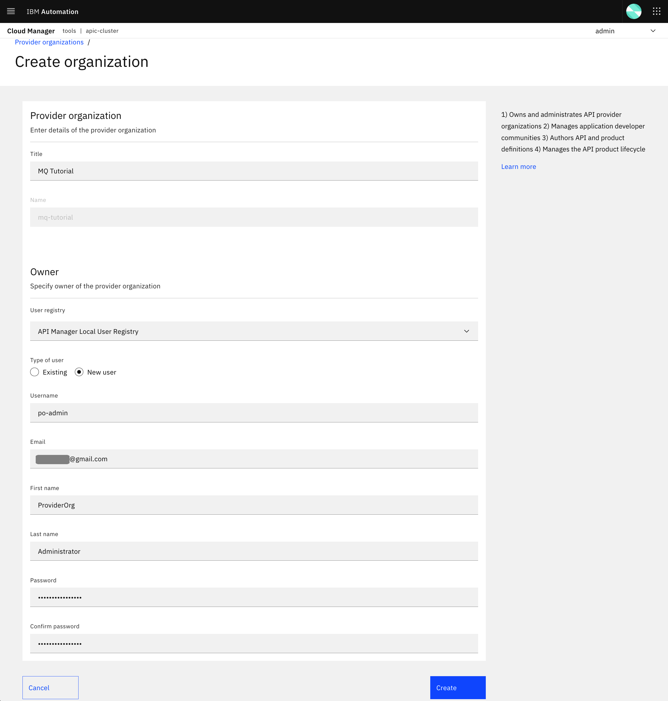{: style="max-height:1200px"}

!!! tip
    Even though your IBM Common Services administrator, IBM API Connect API Cloud manager and your IBM API Connect API Manager Provider Organization owner could all be technically the same user (i.e. any user in the `Common Services User Registry`) it is **strongly recommended** to have, at least, separate users for those roles (since the person could potentially be the same). Depending on how large your IT environment is you might collapse the IBM Common Services administrator and IBM API Connect API Cloud manager roles into one (for small IT environment) but you should have clear role separation with the IBM API Connect Provider Organization owner:

    * **The Cloud Manager** is in charge of the IT administration at his/her organization. He/She works with his/her team to deploy the API Connect software, configure the API Connect cloud, and then gives the Provider Organization owner access to the resources he/she needs to get the API initiative off the ground.
    * **The Provider Organization Owner** is in charge of coordinating the delivery of APIs across multiple lines of business and development groups. Making sure each group has the resources that they need and that they are publishing their APIs to the appropriate environments.

Click `Create`. After few seconds, you should see your new Provider Organization created.

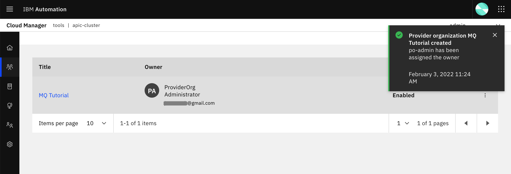{: style="max-height:400px"}

!!! info
    For this tutorial, it is assumed the simplest topology scenario for an enterprise, which consists of this enterprise having only one development and operation team with no different lines of business and a unique channel for publishing APIs. That is, you would only need one Provider Organization (pOrg) that all your developers will be part of. Then, all APIs will be external facing APIs (i.e. only one channel) and published through a single and unique Developer Portal. Also, as you will see later in the [Promote APIs](./promote-apis.md) section, given the limitation of having only one RedHat OpenShift cluster for your dev, test and production applications and therefore only one API Cloud instance, you will segregate APIs at the catalog level. Catalogs provide isolated API run-time environments within a pOrg. There are permission sets within a pOrg and those permissions can be scoped to the pOrg, Catalog or Space level. Users can belong to multiple pOrgs, Catalogs, and Spaces with different permission sets in each. As a result, even though you will only have one Provider Organization, you will restrict access to the `Prod` catalog to the appropriate admins, managers and automation tools that will be responsible for promoting APIs. For more information about API and environment segregation and separation plus their governance, please visit the following links:

    * [IBM API Connect v10.x Deployment WhitePaper](https://community.ibm.com/community/user/integration/viewdocument/api-connect-deplyoment-whitepaper-v) by Chris Phillips.
    * [Applying API Governance Part 2 – How do I optimize my teams and infrastructure to provide the best API factory with decentralised teams?](https://chrisphillips-cminion.github.io/apiconnect/2020/08/26/APIGov2.html) by Chris Phillips.
    * [Get the most out of your API strategy](https://developer.ibm.com/videos/get-the-most-out-of-your-api-strategy/) video by Chris Phillips.

Now that you have created your Provider Organization, let's have a look at your IBM API Connect API Manager. 

Open your IBM API Connect API Manager web console by pointing your browser to its url which you can retrieve with:

```bash
oc get apiconnectcluster <APIC_NAME> -n <PROJECT> -o=jsonpath='{.status.endpoints[?(@.name=="ui")].uri}'
```

where `<APIC_NAME>` is the name of your IBM API Connect Cluster instance and `<PROJECT>` is the RedHat OpenShift Project where it is deployed (review the [IBM API Connect Endpoints section](../deploy-apic/#ibm-api-connect-endpoints) for more details).

If you have not logged into your IBM Cloud Pak Platform Navigator, you will be requested to do so first:

{: style="max-height:700px"}

Select `IBM provided credentials (admin only)` to log in with the IBM Cloud Pak Common Services administrator OIDC credentials that were created when installing the IBM Cloud Pak Foundational Services as a result of installing IBM Message Queue and IBM Cloud Pak Platform Navigator. To retrieve such credentials execute:

```bash
oc extract -n ibm-common-services secrets/platform-auth-idp-credentials --keys=admin_username,admin_password --to=-
```

{: style="max-height:700px"}

If you had logged into your IBM Cloud Pak Platform Navigator recently, you would get to the IBM API Connect API Manager login page directly.

You will use your recently and newly created **`Provider Organization Owner`** user above and as explained back then this user exists in the **API Manager User Registry**. Therefore, click on the **API Manager User Registry** button.

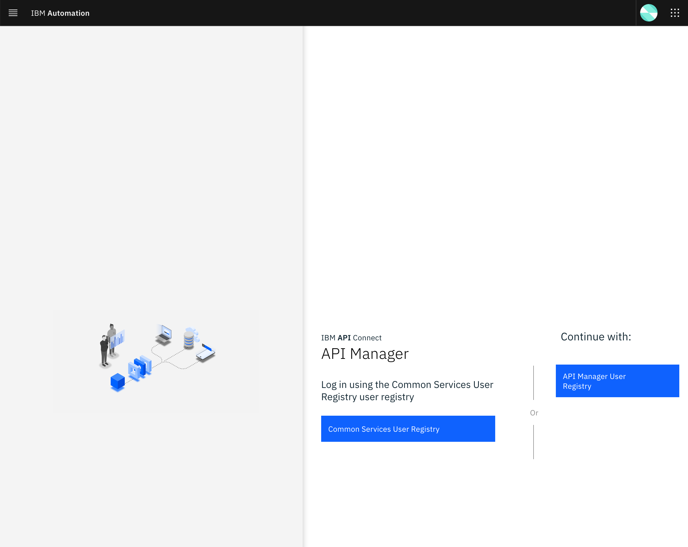{: style="max-height:1000px"}

You will be prompted to provide the credentials for the `Provider Organization Owner`. Use the `Username` and `Password` you set when creating the `Provider Organization Owner`:

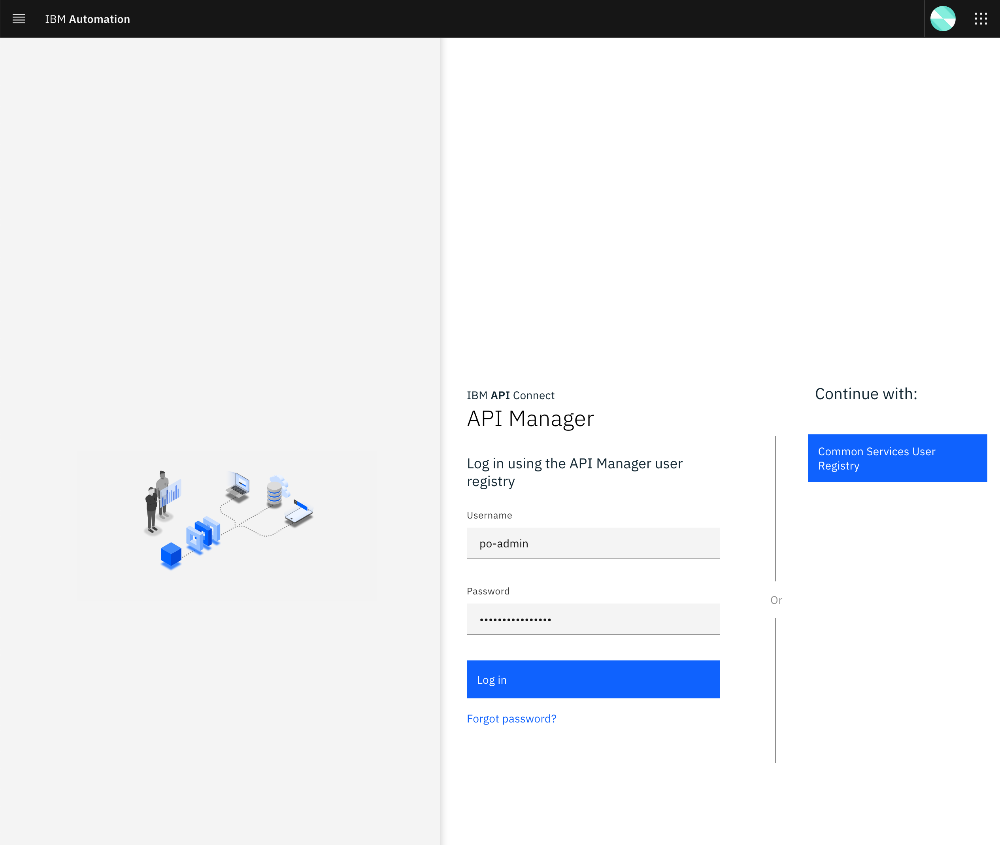{: style="max-height:1100px"}

Once you successfully get authenticated, you should get to the IBM API Connect API Manager dashboard. 

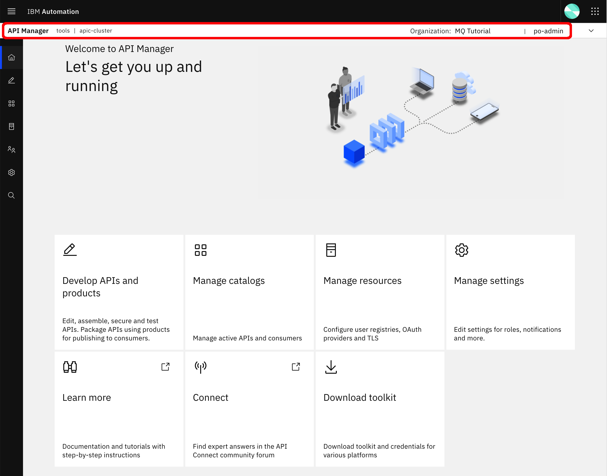{: style="max-height:1000px"}

Notice the following from your context bar at the top of your IBM API Connect API Manager dashboard:

1. The IBM Cloud Pak for Integration product or capability you are working with (for IBM API Connect it does actually display what component of it). In this case, the `IBM API Connect Cloud Manager`.
2. The project where this product or capability has been installed into or deployed to. In this case, `tools`.
3. The IBM API Connect Cluster instance this IBM API Connect API Manager component belongs to. In this case, `apic-cluster`.
4. The Provider Organization your Provider Organization Owner is logged into. In this case, `MQ Tutorial`.
5. The user you are logged in as (at the very right end of the bar). In this case, `po-admin`.

---

!!! success "Congratulations"
    You have successfully configured your IBM API Connect Cluster instance and it is now ready to be used by your APIs managers and API developers. Go to the next [Publish APIs](./publish-apis.md) chapter to start looking at how to publish your Spring MQ Application APIs to your IBM API Connect Cluster instance.

!!! tip
    If you did not install IBM API Connect as a capability of the IBM Cloud Pak for Integration, that is in standalone mode, you might want to review the [Configure APIC](../../apic/configuration/ibm-cloud.md) section of the in-depth IBM API Connect tutorial of this Cloud Pak Production Deployment Guides. In that section, you will be presented with automation through Red Hat OpenShift Pipelines to get your IBM API Connect cluster instance appropriately configured on an automated manner.

## Links

Here are some interesting links used to create this section of the tutorial:

* [Red Hat OpenShift Solution Design Guidance - API Connect](https://pages.github.ibm.com/IBMAoT/i-openshift-guides/03-cloud-paks/cloud-pak-for-integration/api-connect)
* [Cloud Manager configuration checklist - IBM API Connect Knowledge Center](https://www.ibm.com/docs/en/api-connect/10.0.x?topic=environment-cloud-manager-configuration-checklist))
* [IBM API Connect v10.x Deployment WhitePaper](https://community.ibm.com/community/user/integration/viewdocument/api-connect-deplyoment-whitepaper-v) by Chris Phillips.
* [Applying API Governance Part 2 – How do I optimize my teams and infrastructure to provide the best API factory with decentralised teams?](https://chrisphillips-cminion.github.io/apiconnect/2020/08/26/APIGov2.html) by Chris Phillips.
* [Get the most out of your API strategy](https://developer.ibm.com/videos/get-the-most-out-of-your-api-strategy/) video by Chris Phillips.
* [User registries overview - IBM API Connect Knowledge Center](https://www.ibm.com/docs/en/api-connect/10.0.x?topic=security-user-registries-overview)