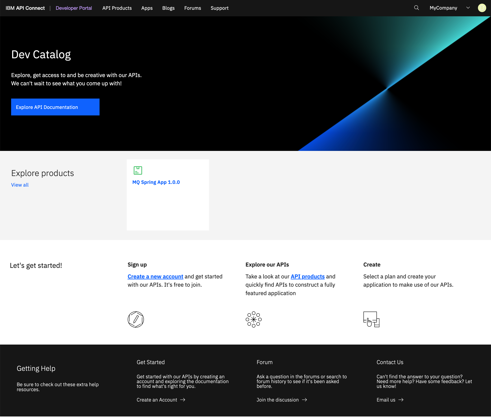
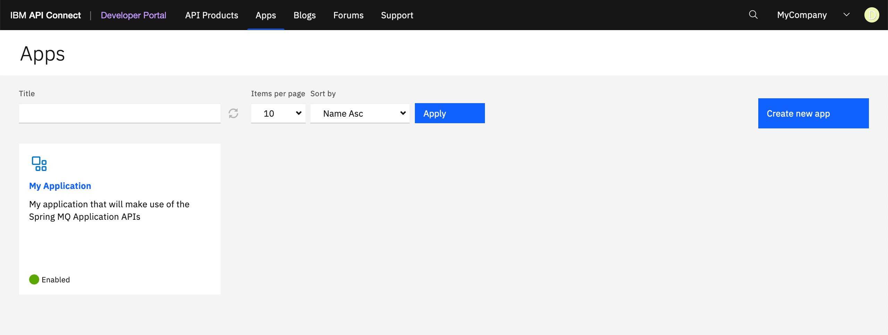
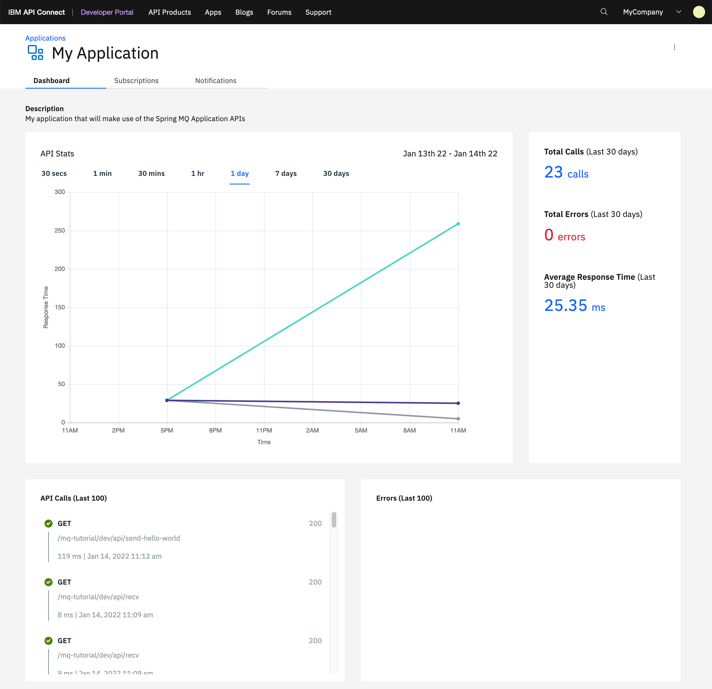
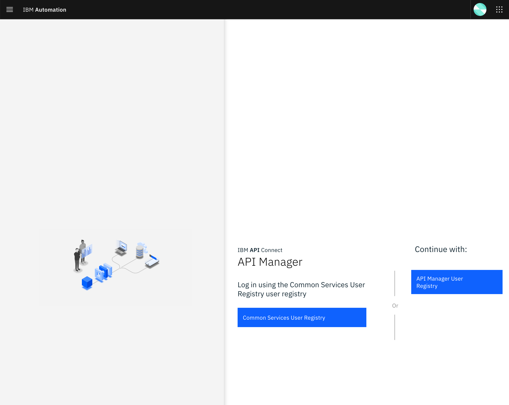
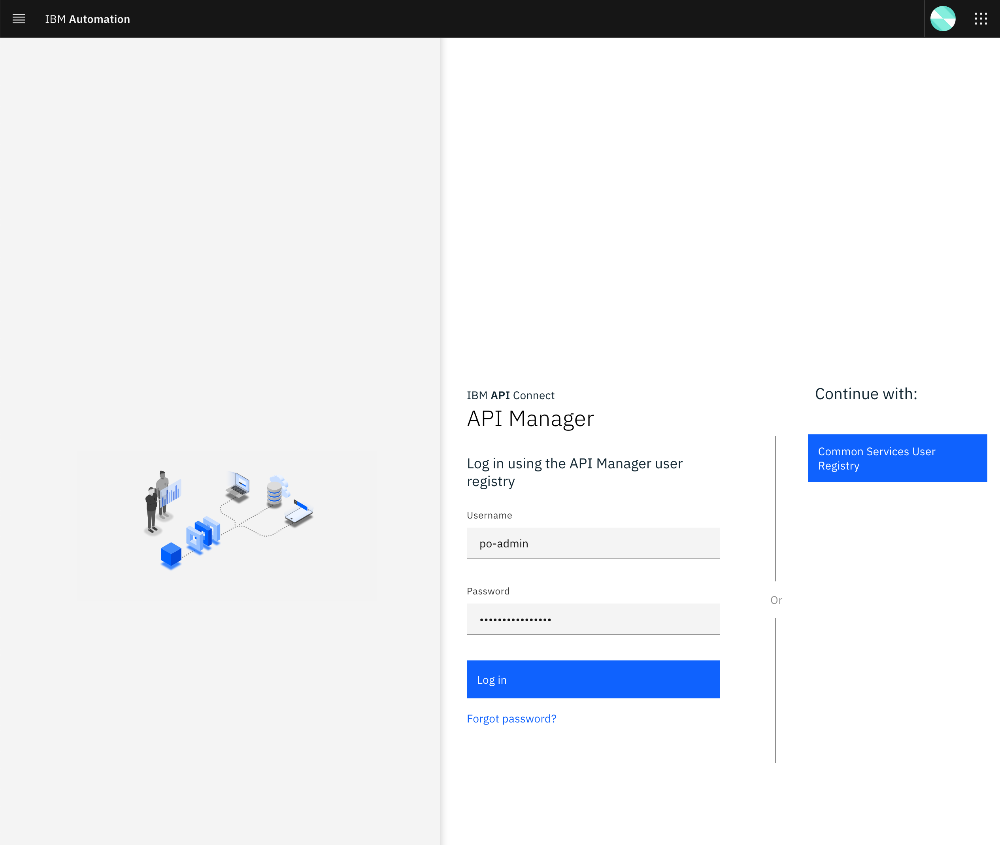
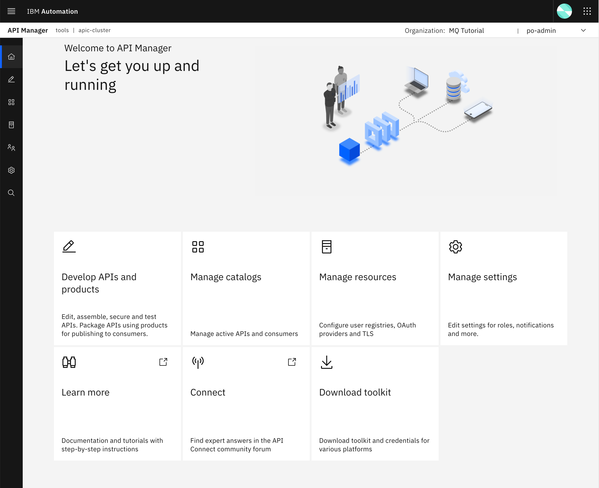
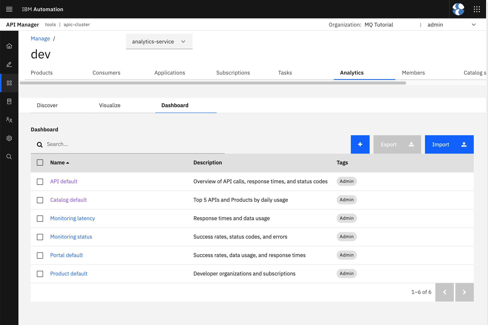
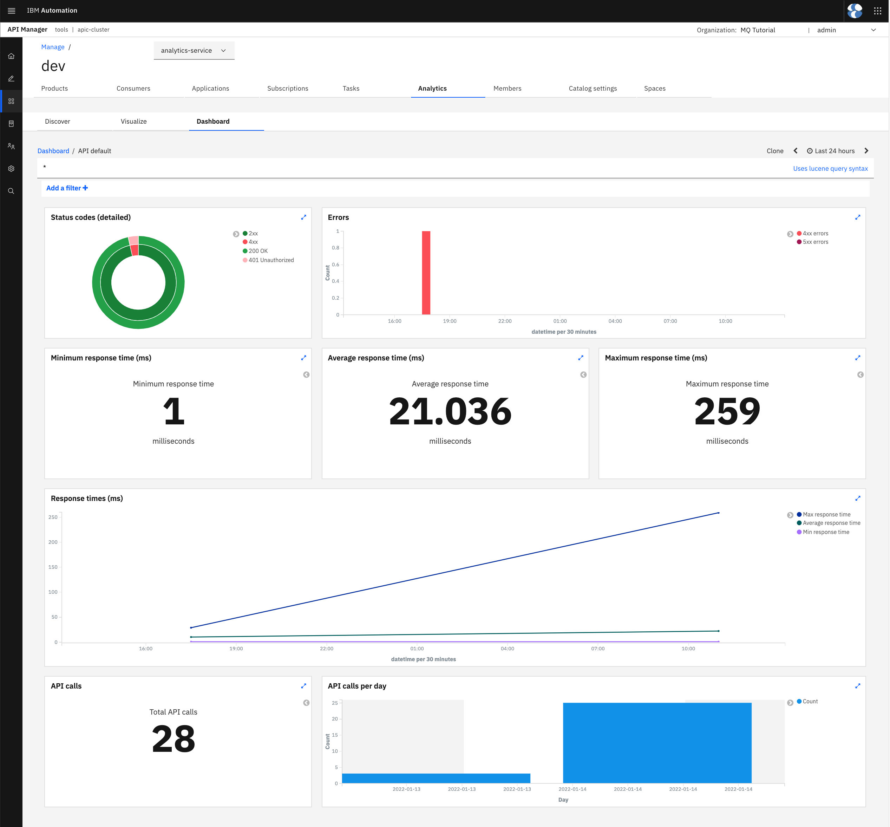
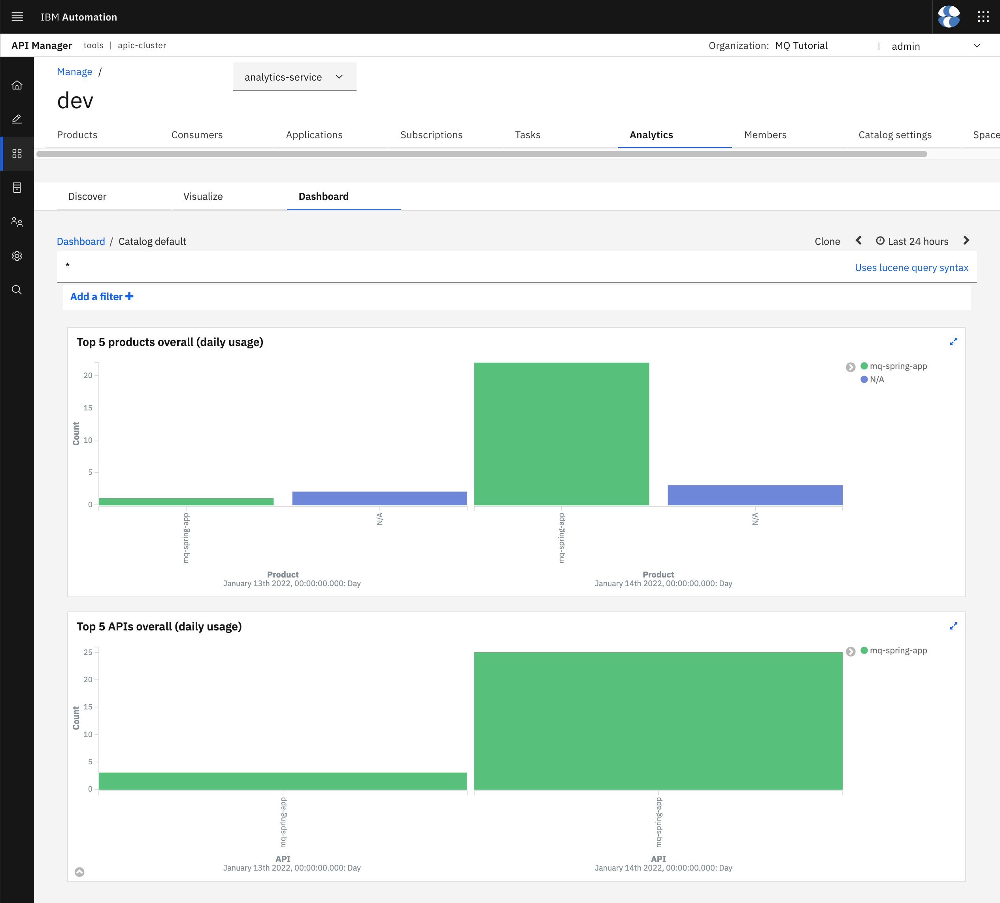

# Monitor APIs in IBM API Connect

<!--- cSpell:ignore APIC apic OIDC -->

## Overview

So far you have been able to successfully go through what it takes to make use of a rich API management solution like IBM API Connect from different angles: from realizing that such a capability is essential to your business and technical goals to being able to deploy, configure and use it. Even you played the role of an external developer wanting to consume existing APIs from an API catalog.

In this chapter, you will go even a step further and play the role of an SRE/API Manager who will be interested in monitoring the use of APIs. From the side of the third party developer, you would be interested in the monitoring and metrics of the APIs your application is consuming so that you can assess how good these are serving your purposes. From the side of the API provider or system administrator of the API management solution, you would want to monitor your system to see how good it is serving request and coping with the demand.

For all those roles or angles to monitoring APIs, IBM API Connect comes with a rich set of analytics capabilities that will provide any interested party full detailed metrics of the system's behavior and state.

## Developer Portal

You will start off from having a look at what the IBM API Connect Developer Portal offers API consumers in terms of monitoring or metrics. As an API consumer, you would want to see what APIs your applications are consuming and how good or bad that is going. For that, open up your IBM API Connect Developer Portal and log into it (check the previous [Consume APIs](consume-apis.md) chapter if you don't remember how to reach and log into your IBM API Connect Developer Portal)

{: style="max-height:900px"}

From your Developer Portal dashboard, click on the `Apps` tab at the menu bar on the top of the screen. You should see your `My Application` application.

{: style="max-height:500px"}

Click on your `My Application` application. You would be presented with a monitoring dashboard where you can see the metrics of the API calls your application has recently made. You will see things like the total calls, errors and average response time, etc.

{: style="max-height:1000px"}

!!! info
    You can also check the `Subscriptions` and `Notifications` of your applications by clicking on their respective tabs at the top.

## IBM API Connect API Manager

Now, you will play the role of a system administrator, SRE or API manager that wants to monitor IBM API Connect to see how the system is doing.

For that, open up your IBM API Connect API Manager web console by pointing your browser to its url which you can retrieve with:

```bash
oc get apiconnectcluster <APIC_NAME> -n <PROJECT> -o=jsonpath='{.status.endpoints[?(@.name=="ui")].uri}'
```

where `<APIC_NAME>` is the name of your IBM API Connect Cluster instance and `<PROJECT>` is the RedHat OpenShift Project where it is deployed (review the [IBM API Connect Endpoints section](../deploy-apic/#ibm-api-connect-endpoints) for more details).

If you have not logged into your IBM Cloud Pak Platform Navigator, you will be requested to do so first:

{: style="max-height:700px"}

Select `IBM provided credentials (admin only)` to log in with the IBM Cloud Pak Common Services administrator OIDC credentials that were created when installing the IBM Cloud Pak Foundational Services as a result of installing IBM Message Queue and IBM Cloud Pak Platform Navigator. To retrieve such credentials execute:

```bash
oc extract -n ibm-common-services secrets/platform-auth-idp-credentials --keys=admin_username,admin_password --to=-
```

{: style="max-height:700px"}

If you had logged into your IBM Cloud Pak Platform Navigator recently, you would get to the IBM API Connect API Manager login page directly.

You will use your `Provider Organization Owner` user that exists in the `API Manager User Registry`. Therefore, click on the `API Manager User Registry` button.

{: style="max-height:1000px"}

You will be prompted to provide the credentials for the `Provider Organization Owner`. Use the `Username` and `Password` you set when creating the `Provider Organization Owner`:

{: style="max-height:1100px"}

Once you successfully get authenticated, you should get to the IBM API Connect API Manager dashboard. 

{: style="max-height:1000px"}

Once you are in your IBM API Connect API Manager, click on `Manage catalogs` and then on the `dev` catalog. Then, click on the `Analytics` tab that is a top. You will see a list of monitoring dashboards that come with IBM API Connect out of the box.

{: style="max-height:800px"}

Click on the `API default` dashboard at the top of the list to open up this dashboard and check what it shows. You should see the following dashboard.

{: style="max-height:1200px"}

!!! tip
    Make sure you select an appropriate time range on the top right corner.

In this dashboard, as an example, you will be able to monitor the amount of calls being made to the APIs published on your IBM API Connect instance, the status codes, errors, average response time, etc...

Go back and select the `Catalog default` dashboard. You will see that this dashboard will help you monitoring the products and APIs that are being used the most.

{: style="max-height:1000px"}

Feel free to check out the rest of the monitoring dashboards that come with IBM API Connect out of the box.

!!! success "Congratulations!"
    You have successfully explored the monitoring capabilities that IBM API Connect offers out of the box.