# Publish Application APIs to IBM API Connect

<!--- cSpell:ignore Codegen openapi SpringFox mailtrap apic APIC Subscribability OIDC -->

## Overview

In this section you are going to:

1. Review the Spring MQ application APIs, services and routes.
2. Import MQ application APIs definition into IBM API Connect API Manager.
3. Publish MQ application APIs definition into the development catalog of your Provider Organization to securely expose it through the IBM API Connect Gateway Service associated to it.
4. Socialize and consume the MQ application APIs through the IBM API Connect Developer Portal for your development catalog.

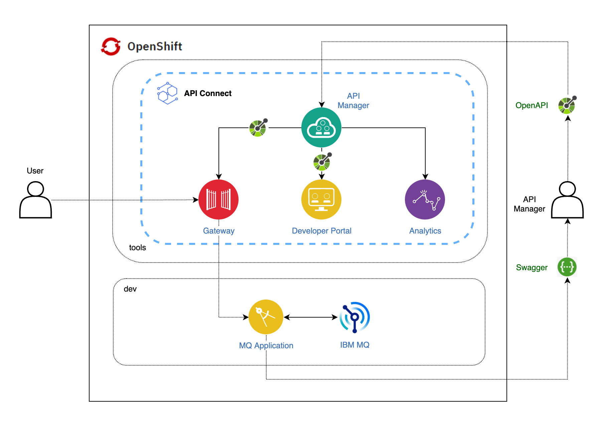{: style="max-height:700px"}

## Review the Spring MQ Application

In the previous [Build MQ application](../app-pipeline/topic1.md) section of this tutorial, you went through the steps to get a Spring based Java application that consumes messaging services provided by an MQ queue manager server deployed. If you recall, the application being deployed by the Tekton pipelines is what is defined in `multi-tenancy-gitops-apps/mq/environments/dev/mq-spring-app` which is no other than a Helm chart:

``` { .text .no-copy }
mq/environments/dev/mq-spring-app/
├── Chart.yaml
├── requirements.yaml
└── values.yaml
```

If you inspect that Helm chart and more precisely the `requirements.yaml` file you will find that the Helm chart you are pointing ArgoCD to in order to deploy the Spring MQ Application depends on yet another Helm chart:

``` { .yaml .no-copy }
dependencies:
  - name: mq-spring-app
    version: 0.0.12
    repository: http://artifactory-artifactory.tools:8082/artifactory/generic-local/ci
```

And that is the Helm chart the Tekton pipeline builds and stores in your artifactory service with your latest development changes. If you inspect such Helm chart, you would see the following that this Helm chart not only deploys the Spring MQ Application but also creates an OpenShift service and route to it so that it is reachable and accessible from within and outside the cluster: 

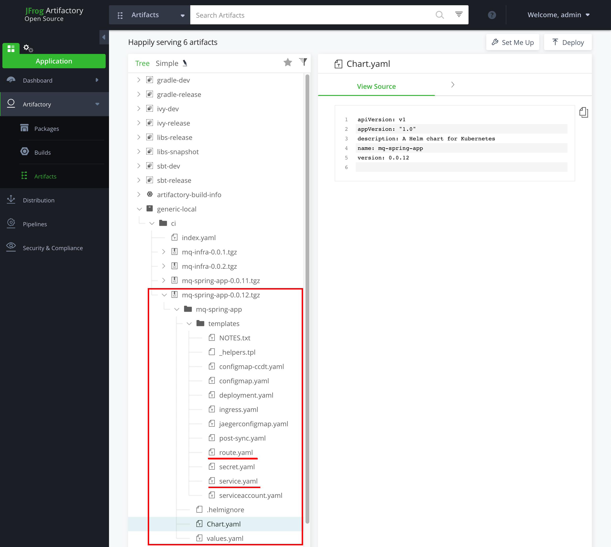{: style="max-height:900px"}

You can inspect that OpenShift service and route with:

``` bash
oc describe service mq-spring-app -n dev
oc describe route mq-spring-app -n dev
```

And, as you already saw earlier, you can check the status of your application by using its OpenShift route and service above to reach the Spring MQ Application:

```bash
export APP_URL=$(oc get route -n dev mq-spring-app -o jsonpath="{.spec.host}")
curl -X GET https://$APP_URL/actuator/health
```

where you should see a similar output than:

``` { .json .no-copy }
{"status":"UP","components":{"HeathEndPointMain":{"status":"UP"},"diskSpace":{"status":"UP","details":{"total":105552732160,"free":66972737536,"threshold":10485760,"exists":true}},"jms":{"status":"UP","details":{"provider":"IBM MQ JMS Provider"}},"livenessState":{"status":"UP"},"ping":{"status":"UP"},"readinessState":{"status":"UP"}},"groups":["liveness","readiness"]}
```

Now, as you also saw in the Spring MQ Application section of this tutorial, this application exposes a REST interface, making it easy to consume by other applications and services both inside and outside the cluster. More precisely, it exposes the following REST services endpoints:

* `/api/send-hello-world` - puts a default *'Hello World!'* message to a queue.
* `/api/recv` - gets a message from the queue.
* `/api/send-json` - puts a JSON message to a queue.
* `/api/send-to-queue` - puts a *'Hello World!'* message to the queue specified as parameter.
* `/health` - checks the application is running.

Similarly to the check you made above, you can check some of these services too:

``` bash
curl -X GET https://$APP_URL/health    
```
``` { .json .no-copy }
{"status":"UP"}
```
``` bash
curl -X GET https://$APP_URL/api/recv
```
``` { .json .no-copy }
{"status":"OK","statusMessage":"Successfully received record from MQ","data":"Hello World!"}
```
``` bash
curl -X GET https://$APP_URL/api/send-hello-world
```
``` { .json .no-copy }
{"status":"OK","statusMessage":"Successfully sent record to MQ","data":"Hello World!"}
```

And these Spring MQ Application services are the APIs you want to get published in your IBM API Connect instance in order to securely socialize and expose them.

## Swagger and OpenAPI

[Swagger](https://swagger.io/) started out as a simple, open source specification for designing RESTful APIs in 2010. Open source tooling like the [Swagger UI](https://swagger.io/tools/swagger-ui/), [Swagger Editor](https://swagger.io/tools/swagger-editor/) and the [Swagger Codegen](https://swagger.io/tools/swagger-codegen/) were also developed to better implement and visualize APIs defined in the specification. The Swagger project, consisting of the specification and the open source tools, became immensely popular, creating a massive ecosystem of community driven tools. In 2015, the Swagger project was acquired by SmartBear Software. [The Swagger Specification](https://swagger.io/specification/) was donated to the Linux foundation and renamed [The OpenAPI Specification](https://spec.openapis.org/oas/v3.1.0).

The OpenAPI Specification (OAS) defines a standard, programming language-agnostic interface description for HTTP APIs, which allows both humans and computers to discover and understand the capabilities of a service without requiring access to source code, additional documentation, or inspection of network traffic. When properly defined via OpenAPI, a consumer can understand and interact with the remote service with a minimal amount of implementation logic. Similar to what interface descriptions have done for lower-level programming, the OpenAPI Specification removes guesswork in calling a service.

[The OpenAPI Initiative](https://www.openapis.org/) was created to guide the development of The OpenAPI Specification in an open and transparent manner.

{: style="max-height:300px"}

As introduced in the paragraphs above, it is essential to have proper specifications for the back-end APIs. At the same time, the API documentation should be informative, readable, and easy to follow. Moreover, reference documentation should simultaneously describe every change in the API. Accomplishing this manually is a tedious exercise, so automation of the process is more than desirable.

In this tutorial, you have looked at Swagger 2 for the Spring MQ Application REST web services, using the SpringFox implementation of the Swagger 2 specification. You can see that by checking the [Maven](https://maven.apache.org/) dependencies for the Spring MQ Application in its `pom.xml` file under the `mq-spring-app` folder:

``` { .xml .no-copy }
<!-- https://mvnrepository.com/artifact/io.springfox/springfox-swagger2 -->
<dependency>
    <groupId>io.springfox</groupId>
    <artifactId>springfox-swagger2</artifactId>
    <version>2.9.2</version>
</dependency>
<!-- https://mvnrepository.com/artifact/io.springfox/springfox-swagger-ui -->
<dependency>
    <groupId>io.springfox</groupId>
    <artifactId>springfox-swagger-ui</artifactId>
    <version>2.9.2</version>
</dependency>
```

The [SpringFox](http://springfox.github.io/springfox/) suite of java libraries are all about automating the generation of machine and human readable specifications for JSON APIs written using the spring family of projects. SpringFox works by examining an application, once, at runtime to infer API semantics based on spring configurations, class structure and various compile time java Annotations. Annotations that you have added to the Spring MQ Application to enrich the API documentation that Swagger will auto-generate for us. You can find those annotations in the Spring MQ Application code at the controller layer in `mq-spring-app/src/main/java/com/ibm/mqclient/controller/MQClientController.java`. 

This is an example of the Swagger annotations for the `/api/send-hello-world` rest service:

``` { .java .no-copy hl_lines="2-3" }
@GetMapping("/api/send-hello-world")
@ApiOperation(value = "Put a hello world message on the MQ queue.", notes = "This api puts a hello world text message on the MQ queue.")
@ApiResponses(value = {@ApiResponse(code = 200, message = "Successfully put message on queue."), @ApiResponse(code = 500, message = "Error putting message on queue.")})	
ResponseData send() {
    String dataSentToQueue = mqService.sendHelloWorld();
    ResponseData responseData = new ResponseData("OK", "Successfully sent record to MQ", dataSentToQueue);
    return responseData;
}
```

So now, you know what is Swagger, OpenAPI and their specifications in order to formally standardize the way REST APIs are described to allow both humans and computers to discover and understand the capabilities of their services. You have also seen how to integrate tools like SpringFox, that helps you automating the generation of machine and human readable specifications for APIs, into your Spring application. However, you have not yet seen those API definitions document. And you are going to access those through the Swagger UI, whose Maven dependency has been added to the `pom.xml` file, as you can see above, in order to be able for your Spring MQ Application to make use of it. 

Swagger UI allows anyone — be it your development team or your end consumers — to visualize and interact with the API’s resources without having any of the implementation logic in place. It’s automatically generated from your OpenAPI (formerly known as Swagger) Specification, with the visual documentation making it easy for back end implementation and client side consumption.

In order to access the Spring MQ Application Swagger UI, you only need to point your browser to your Spring MQ Application OpenShift route to reach the context route of it, which Spring will automatically redirect you to the Swagger UI (`/swagger-ui.html`):

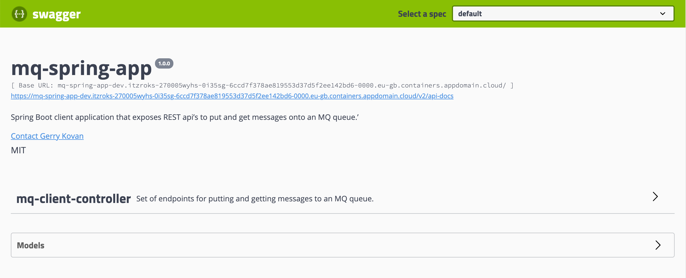{: style="max-height:500px"}

Remember you can get your Spring MQ Application OpenShift route with

```bash
APP_URL=$(oc get route -n dev mq-spring-app -o jsonpath="{.spec.host}"); echo "https://$APP_URL"
```

If you expand the `mq-client-controller` section, you should be able to see the REST API services defined in that Java class from your Spring MQ Application as you saw in its code earlier.

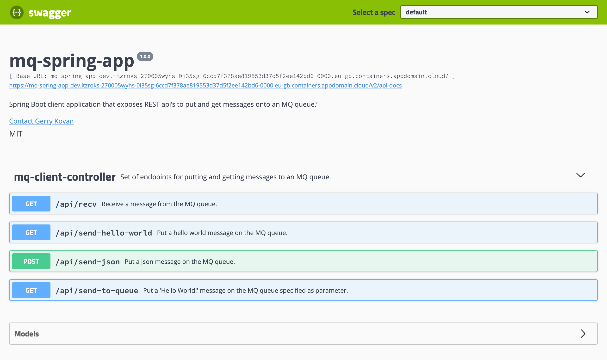{: style="max-height:700px"}

You can already see how powerful is to have well documented APIs since you can see at a glance what your application exposed services are and what these are meant to accomplish. In this case, you Spring MQ Application is a demo application that does not expose many services and, overall, you are only running and managing one application. As you can imagine, this gets very complicated, despite well documented APIs, when you are running tens or even hundreds of applications (or microservices) all of them exposing services. And here is where having an API management system, such as IBM API Connect, not only starts to make sense but also becomes critical. Even more so if you want to have certain security and governance on top of all those services your applications and/or microservices expose.

Let's see what else Swagger, through SpringFox, has done for you and what capabilities this Swagger UI provides us...

First, let's check the status of your queue manager:

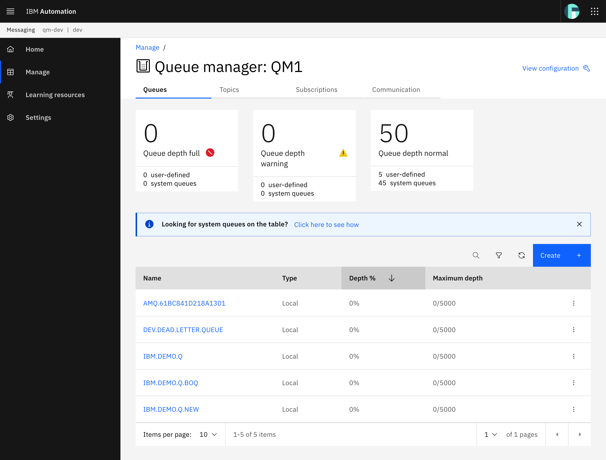{: style="max-height:900px"}

At this moment, it does not contain any message in any of the queues (it does not matter if yours contain messages, just remember this state before playing with the APIs). Let's try to send a new *"Hello World!"* message to the `IBM.DEMO.Q` queue. For that, click on the `/api/send-hello-world` API to expand it.

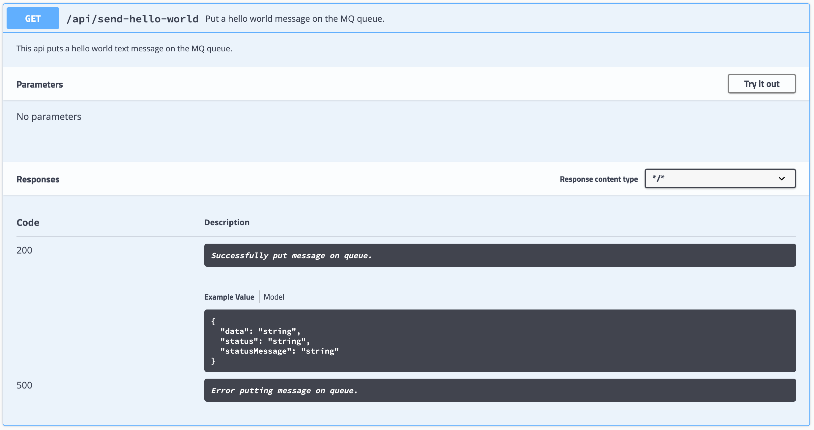{: style="max-height:700px"}

You can see the documentation for this API with a description of what the API does (it is not a very long and detailed description since it is a very simple dummy demo API. However, this description could be as long and detailed as your service might require), what are the parameters it needs to be provided and the possible responses from the service.

What is also very interesting from the testing point of view that Swagger UI offers out of the box is the possibility to try out the APIs through the `Try it out` button. Click on that button.

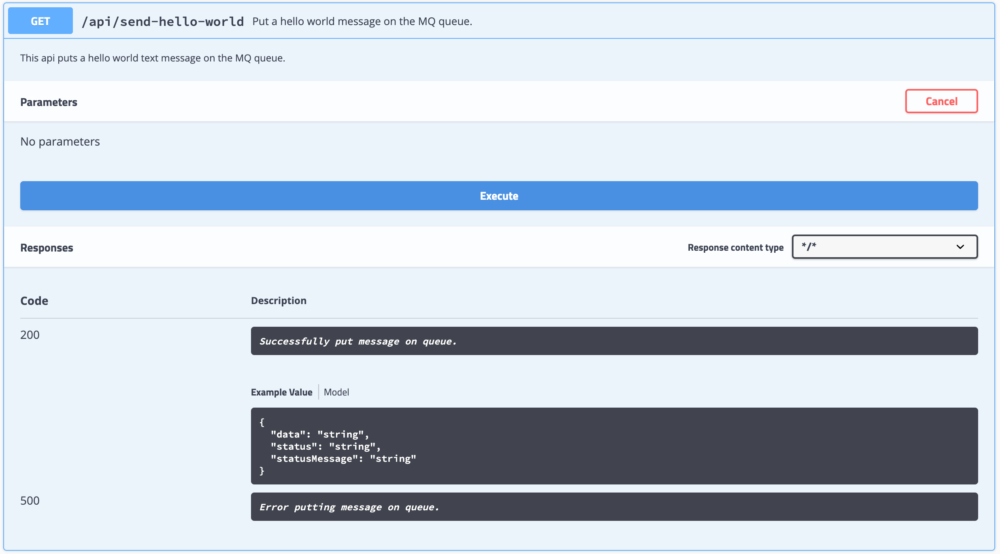{: style="max-height:700px"}

In this case it seems like it only provides you with the `Execute` button but, in fact, it would have provided you with a text box also if this API required/expected any parameters (you can check it out later with the `/api/send-to-queue` API). Click on execute.

Once Swagger UI has executed the API call for you, you will be presented on the `Responses` section with:

1. The `Curl` command used for the API call execution
2. The `Request URL`
3. And the `Server response` which contains the `Code`, `Response body` and `Response header`

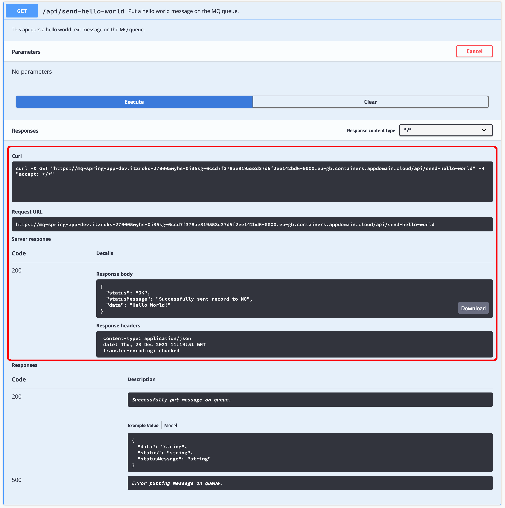{: style="max-height:1200px"}
   
Let's check the queue manager to make sure Swagger UI has successfully executed the expected API call.

You should see a new message in your message queue of your queue manager which means that Swagger UI has, indeed, successfully executed the expected API call. As a result, Swagger UI does not only serve to visualize the documentation of your application APIs but also a testing tool for these.

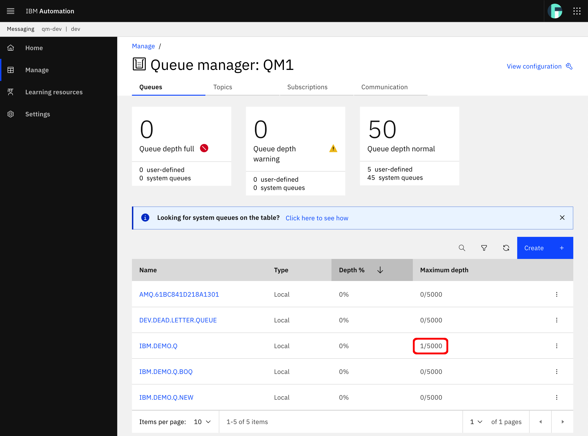{: style="max-height:900px"}

You can now try to receive/read the message you have just sent by executing the `api/recv` API:

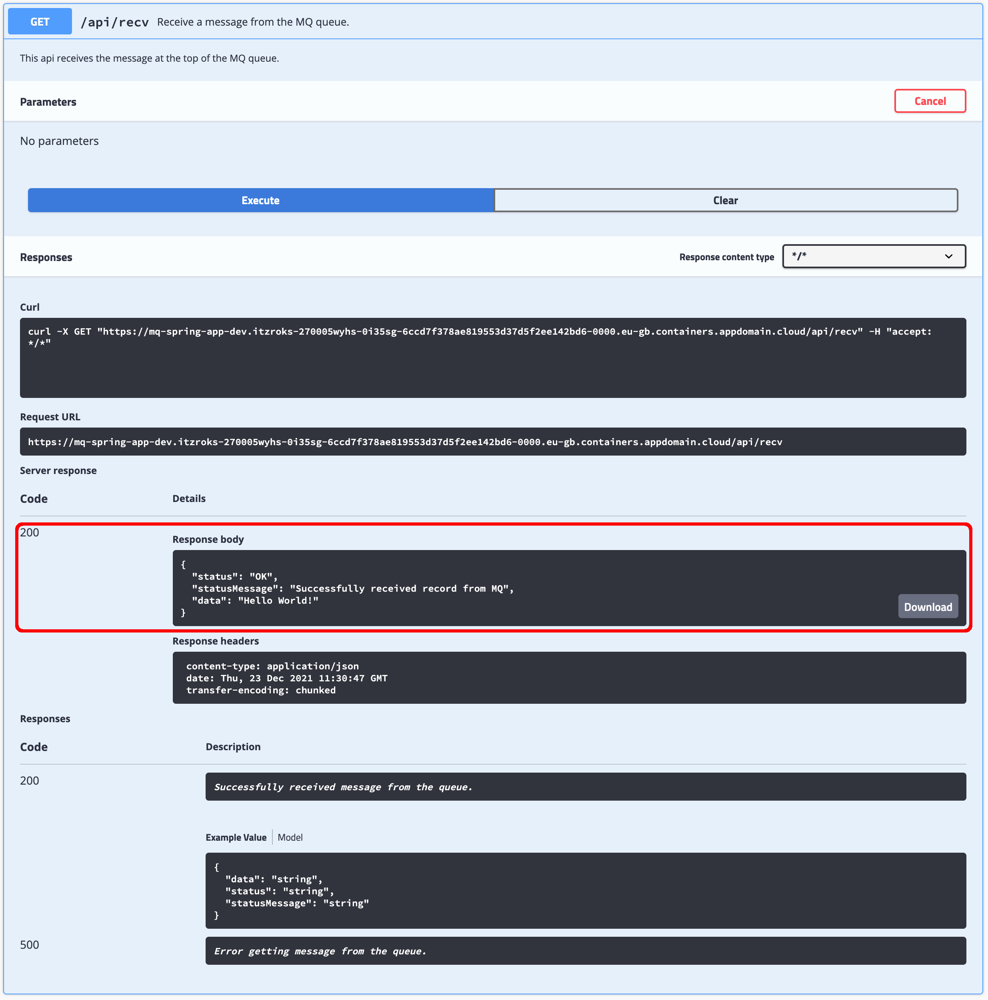{: style="max-height:1200px"}

{: style="max-height:900px"}

Finally, the one last thing you are going to see in this Swagger and OpenAPI section is the actual Spring MQ Application APIs documentation that Swagger, through SpringFox, has built for you. Swagger exposes such documentation through your application's `/v2/api-docs` endpoint. You are also presented with the full url for retrieving your application's Swagger documentation at the top of your Swagger UI:

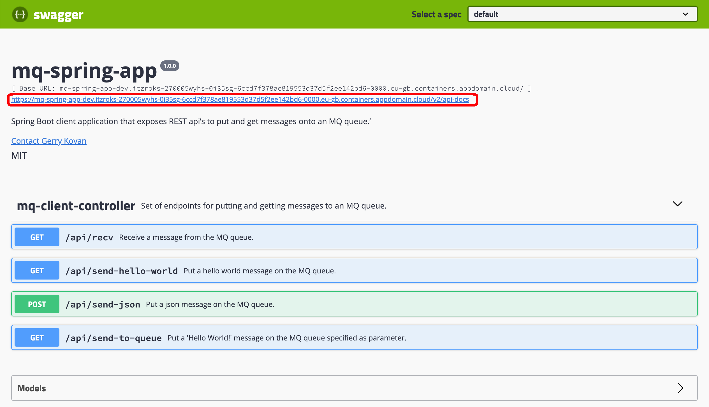{: style="max-height:700px"}

Click on that link to see the document.

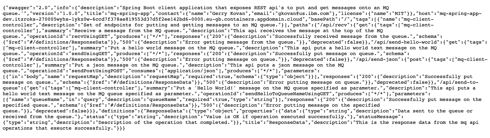{: style="max-height:400px"}

!!! tip
    For a prettier display of the document, you can use Firefox (that prettifies JSON objects) or you can use [jq](https://stedolan.github.io/jq/) on your terminal:
    
    ```bash
    curl -X GET https://$APP_URL/v2/api-docs | jq .
    ```

Make sure you save this document into a file in your local workstation. You will use it in the following section to get it imported into your IBM API Connect instance. You can save it by executing:

```bash
curl -X GET https://$APP_URL/v2/api-docs > mq-spring-app-swagger.json
```

## IBM API Connect API Manager

The following diagram shows a high level overview of the sequence an organization would go through for getting IBM API Connect at the heart of its API management strategy:

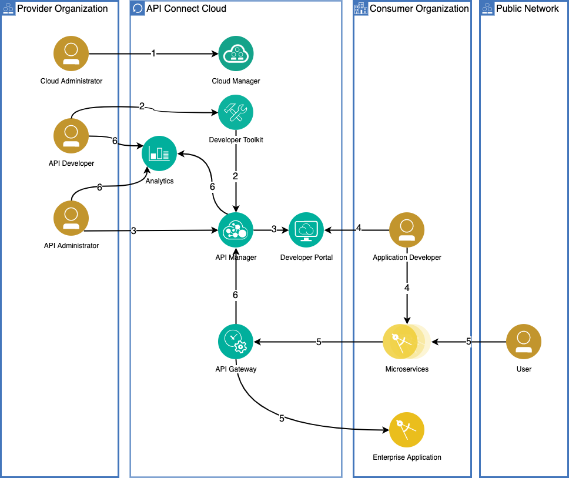{: style="max-height:900px"}

where

1. The Cloud Administrator manages the IT functions of the enterprise including deployment and configuration of the API Connect cluster and topology. They monitor the health of the cluster and manage provider organizations.
2. An API developer uses the API developer toolkit (or the API Manager user interface) to create APIs, implement the business logic, integrate the API to back-end services and publish these artifacts to the API Management subsystems in relevant test, QA, or production environments, preferably using a DevOps pipeline.
3. An API Administrator, or Provider Organization Owner, uses the API management cloud services to create API products and plans and specifies access control roles. The APIs are then published to the developer portal for external discovery and consumption by application developers.
4. An application developer logs in to the developer portal to search and discover APIs, creates an application (microservice or mobile App), that uses the APIs.
5. An end-user of the application starts a process that invokes a managed API. The request is handled by the API gateway, which performs load balancing and security validation. It also enforces access policies specified by API Management before invoking the API. Most API endpoints are configured to integrate with enterprise backend systems. The API Gateway calls the backend on behalf of the API and returns the response to the calling application.
6. The API gateway reports usage metrics and analytics to the Analytics subsystem. API developers can view application-specific analytics within the Developer Portal and Provider Organization Owners use the analytics visualization component in API Manager to view API usage metrics across the entire organization.

So far you have completed step number 1. Now, let's have a look at how to complete the rest of the steps.

Let's see how can you create APIs in your IBM API Connect API Manager for your Spring MQ Application by using its OpenAPI compliant APIs definition you grabbed and stored in the previous section above, which was automatically generated by Swagger as already explained. 

First, open up your IBM API Connect API Manager web console by pointing your browser to its url which you can retrieve with:

```bash
oc get apiconnectcluster <APIC_NAME> -n <PROJECT> -o=jsonpath='{.status.endpoints[?(@.name=="ui")].uri}'
```

where `<APIC_NAME>` is the name of your IBM API Connect Cluster instance and `<PROJECT>` is the RedHat OpenShift Project where it is deployed (review the [IBM API Connect Endpoints section](../deploy-apic/#ibm-api-connect-endpoints) for more details).

If you have not logged into your IBM Cloud Pak Platform Navigator, you will be requested to do so first:

{: style="max-height:700px"}

Select `IBM provided credentials (admin only)` to log in with the IBM Cloud Pak Common Services administrator OIDC credentials that were created when installing the IBM Cloud Pak Foundational Services as a result of installing IBM Message Queue and IBM Cloud Pak Platform Navigator. To retrieve such credentials execute:

```bash
oc extract -n ibm-common-services secrets/platform-auth-idp-credentials --keys=admin_username,admin_password --to=-
```

{: style="max-height:700px"}

If you had logged into your IBM Cloud Pak Platform Navigator recently, you would get to the IBM API Connect API Manager login page directly.

You will use your `Provider Organization Owner` user that exists in the `API Manager User Registry`. Therefore, click on the `API Manager User Registry` button.

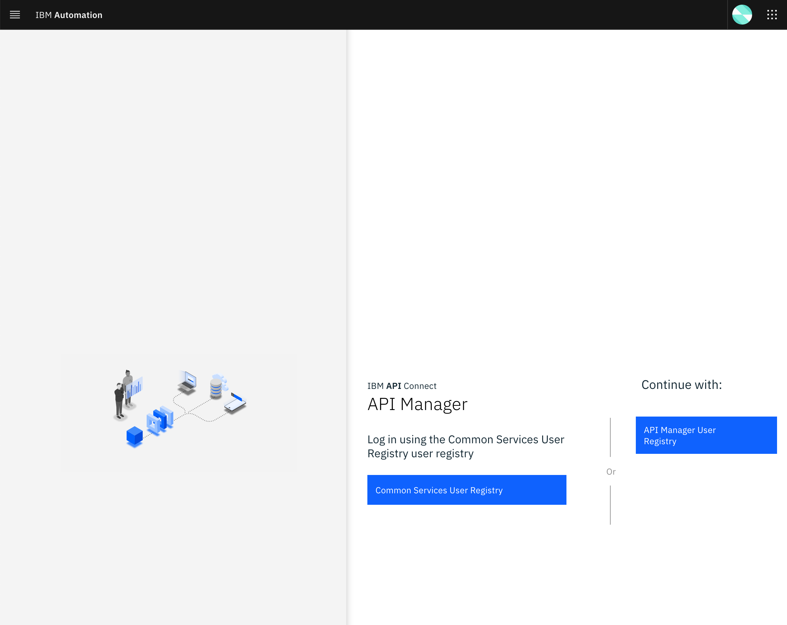{: style="max-height:1000px"}

You will be prompted to provide the credentials for the `Provider Organization Owner`. Use the `Username` and `Password` you set when creating the `Provider Organization Owner`:

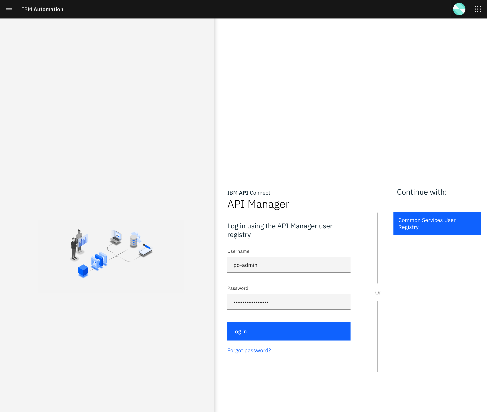{: style="max-height:1100px"}

Once you successfully get authenticated, you should get to the IBM API Connect API Manager dashboard. 

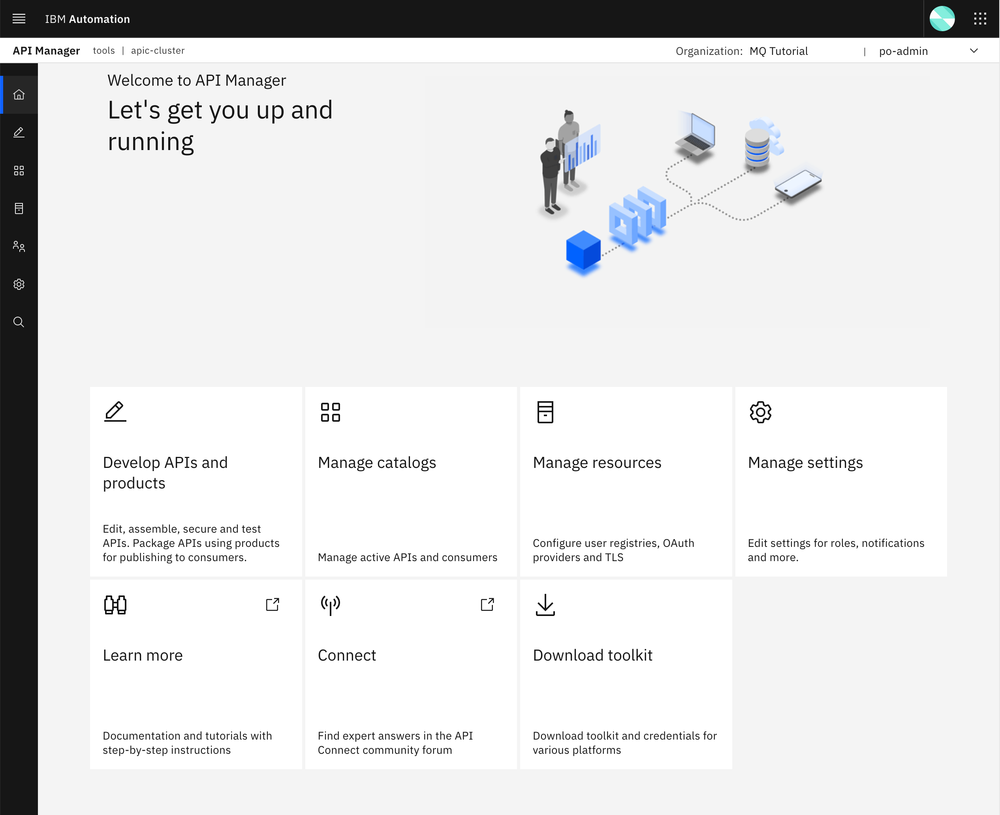{: style="max-height:1000px"}

From your IBM API Connect API Manager dashboard, select `Manage catalogs`. You should see there is a default `Sandbox` catalog.

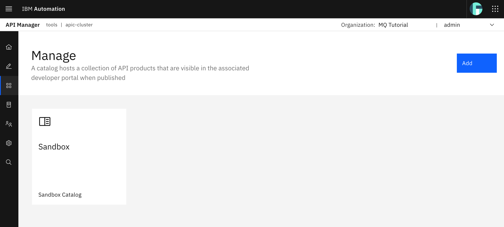{: style="max-height:600px"}

However, you prefer to create a more meaningful catalog for the work you are doing at the moment which is developing your APIs (not developing per se, since these are already created in your Spring MQ Application but creating these in your IBM API Connect API Manager). So let's create a `dev` catalog. Click on the `Add` button at the top right corner and then select `Create catalog`.

In the form you are presented with, select the `po-admin` user (in fact, you can not select any other user since there should not be any other user) in order to create your new catalog. Then provide `dev` as the name for your new catalog.

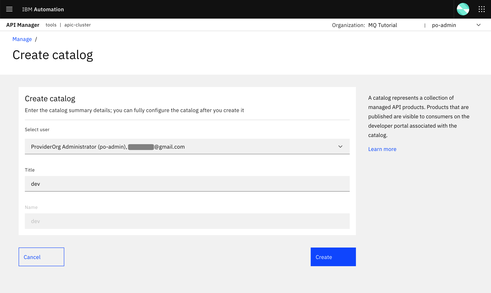{: style="max-height:700px"}

You should now see your `dev` catalog as well

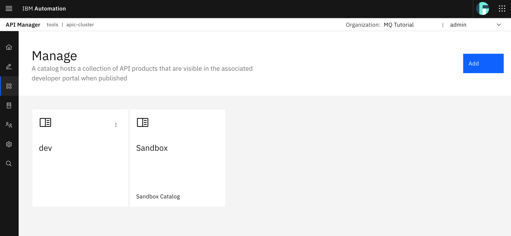{: style="max-height:600px"}

Click on the `dev` catalog and then on the `Catalog settings` tab on the bar at the top. Then, click on the `Gateway services` section on the left hand side menu. In here, you should see the Gateway service the IBM API Connect post install configuration automation had already configured for you when you visited your IBM API Connect Cloud Topology in the previous section of this tutorial. That Gateway service the IBM API Connect Operator had deployed and that the later post install configuration automation, since you are installing IBM API Connect as a capability part of your IBM Cloud Pak for Integration, had registered in your IBM API Connect Cloud Topology is set as the default Gateway service that any API published to your `dev` catalog will get published to and therefore exposed through. And you can also see the `URL` for the Gateway service for your `dev` catalog in there. That `URL` will allow you to reach, in a secure manner, your Spring MQ Application APIs.

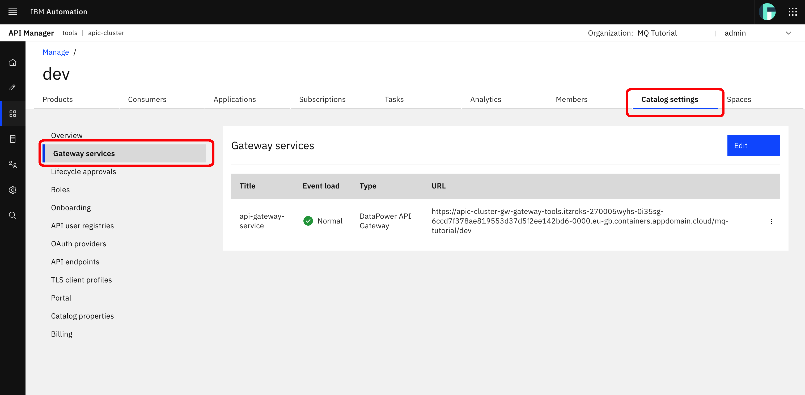{: style="max-height:800px"}

!!! tip
    Have a closer look to the Gateway Services `URL` value for your `dev` catalog which will be the endpoint all your APIs published to the `dev` catalog will be accessed through. It follows the pattern:
    
    ``` {.text .no-copy }
    https://<gateway_service_route>/<provider_organization>/<catalog>
    ```

    This is how IBM API Connect will separate and segregate APIs within your API Cloud.

Go back to your IBM API Connect API Manager dashboard by clicking on the home icon on the left hand side menu and click on `Develop APIs and products`.

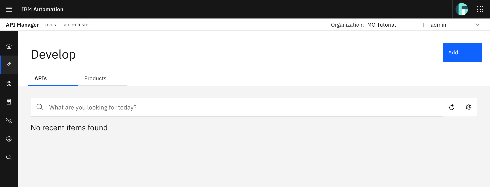{: style="max-height:500px"}

As you have probably guessed, there is no API already created in your `dev` catalog. Click on the `Add` button at the top right corner and select `API (from REST, GraphQL or SOAP)` option.

In the following screen, you can see the many different options you have for creating/importing a new API as well as the possibility to create/import such API following either the `OpenAPI 2.0` or the `OpenAPI 3.0` API definition Specification. In your case, you will stick to the `OpenAPI 2.0` option since Swagger created an `OpenAPI 2.0` compliant API definition file (remember it started with `"swagger": "2.0"`). Then, you will select the option `From existing OpenAPI service` under the `Create section`. Then, click `Next`.

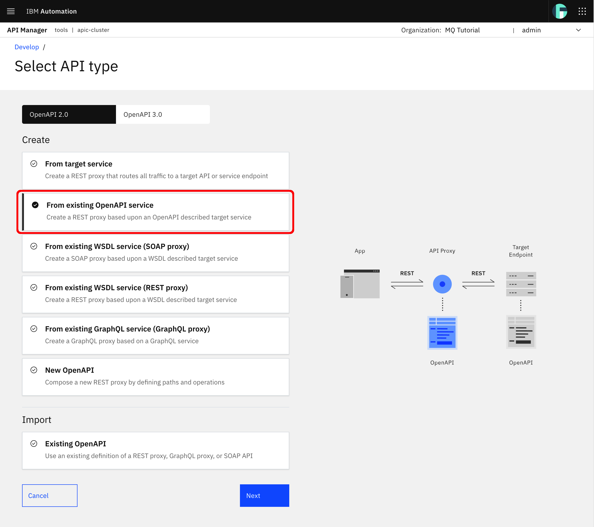{: style="max-height:1000px"}

In the following step, you are presented with the option to upload your OpenAPI definition file.

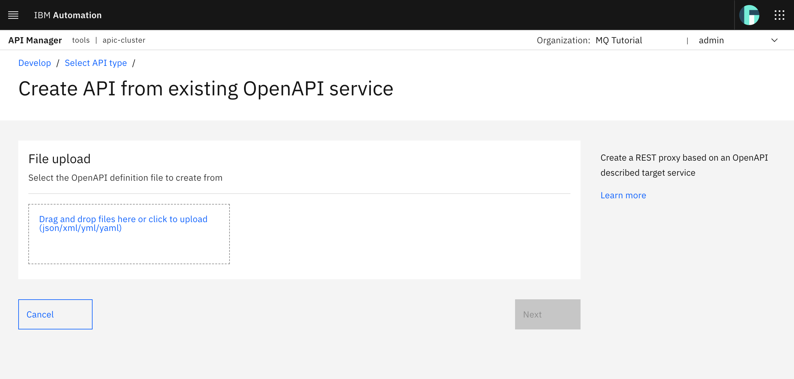{: style="max-height:600px"}

Drag and drop, or use the link to upload, the OpenAPI defining your Spring MQ Application APIs you grabbed and stored in the previous section above. Click `Next`.

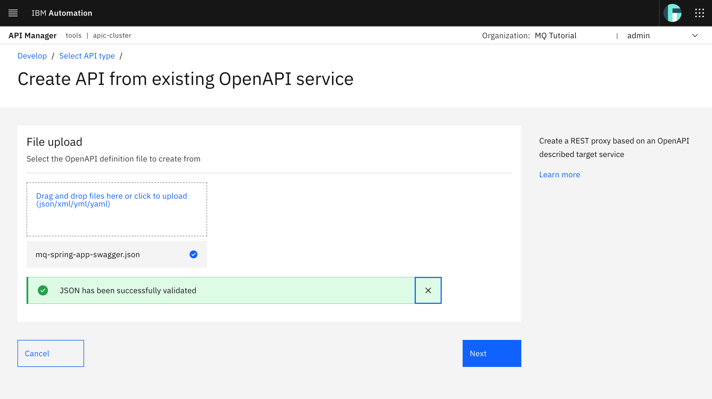{: style="max-height:700px"}

Leave the `Title` presented in the form as is. You could change it if you wanted to provide better or more accurate description or name to what Swagger created for you based on your application but be aware that the rest of the tutorial will use the defaults presented in the following picture. 

!!! info "Base Path"

    It is very important that you understand and follow good practices and standards for defining good API interfaces. Having a clear and good strategy for your API interfaces will help you not only to manage and understand all your APIs but also eliminate contamination issues (when two or more APIs have conflicting paths). It may seem not important at the beginning but it will become crucial as you start having tens, hundreds or even thousand APIs. An API interface is nothing but the path to it. In IBM API Connect, an API interface follows the pattern:

    ```
    /<Provider Org>/<Catalog>/<Base Path>/<Path> ?<Query String>
    ```

    As you can imagine, it isn't very difficult for an enterprise that runs tens or more applications that expose APIs to find themselves in the situation where two applications expose APIs with the exact same name or path. For instance, it will not be very difficult to imagine that more than one application might expose APIs such as `/health`, `/status`, `/info`, etc. 

    Base Path can help you remove the above limitations more easily. Base Path is the URL prefix for all API paths, relative to the host root. Base Path is the unique name (i.e. identifier) for the API. It is strongly recommended to include the major version of the API to your Base Path. Using a good Base Path strategy will help you eliminate API path contamination issues as well as help you organize, manage and understand your APIs at a glance. 

Set the `Base path` attribute for your API to `mq-spring-app` (since that is the `Title` and `Name` you are providing to your API. Again, you could use a different more meaningful names for your APIs) plus the major version for the API. That is, set your `Base path` attribute to `/mq-spring-app/v1`. Click `Next`.

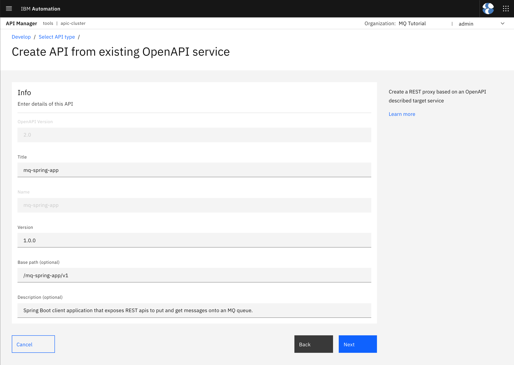{: style="max-height:1000px"}

Make sure you keep the `Secure using Client ID` option checked. This will add security to your Spring MQ Application APIs automatically by having the IBM API Connect Gateway Service, which your Spring MQ Application APIs will get exposed and accessed through, request a client ID in order to let request pass through. The client ID will be provided to your Spring MQ Application APIs consumers later on through the IBM API Connect Developer Portal, once these are registered and authorized. There are other security mechanisms your IBM API Connect Gateway Service can request and work with to secure your application APIs you can check out [here](https://www.ibm.com/docs/en/api-connect/10.0.x?topic=definition-enforcing-security-requirements-api). Leave the [`CORS`](https://en.wikipedia.org/wiki/Cross-origin_resource_sharing) option also checked. Click `Next`.

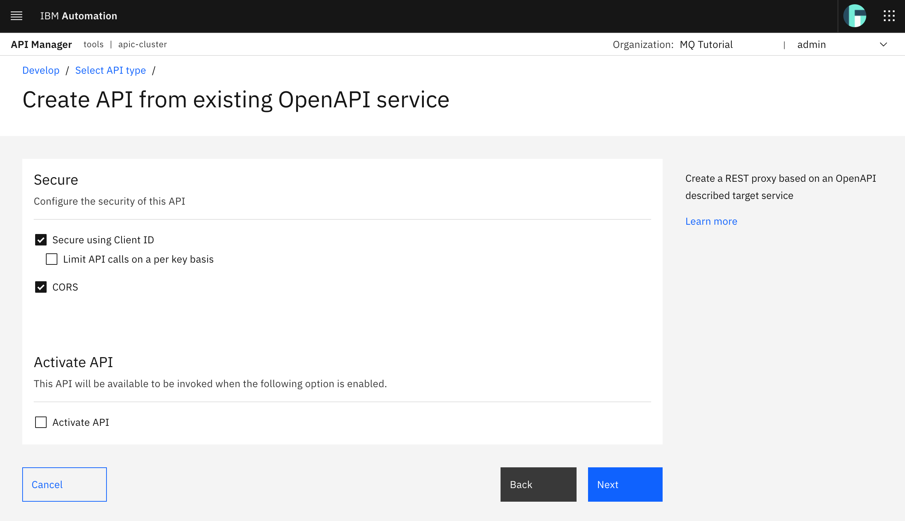{: style="max-height:800px"}

You should see successful messages for your OpenAPI 2.0 definition being successfully created as well as security successfully being applied to such definition. Click `Edit API`.

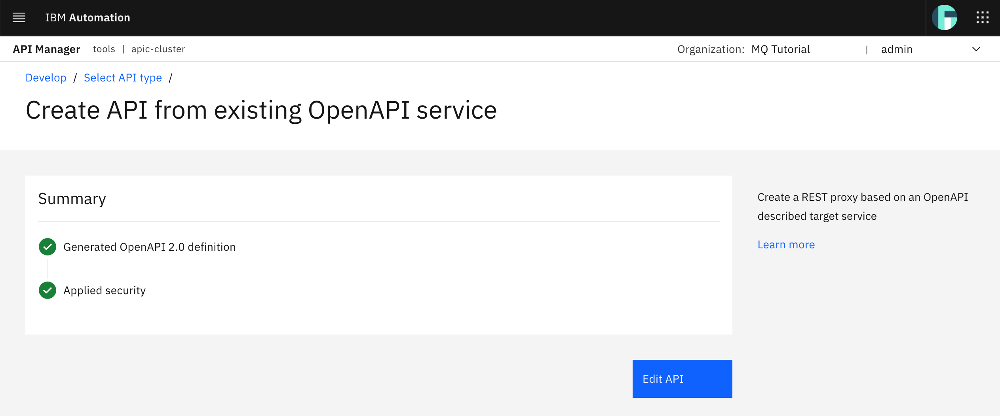{: style="max-height:500px"}

The IBM API Connect API Manager API Editor displays.

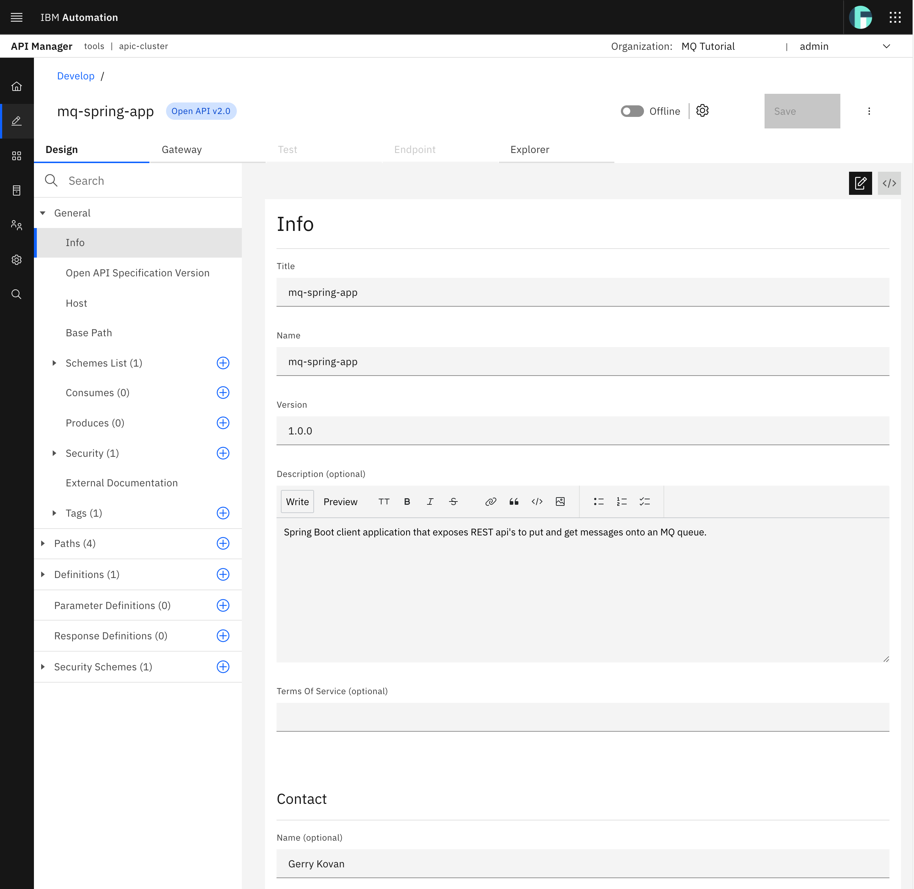{: style="max-height:1100px"}

You can also see your Spring MQ Application APIs OpenAPI definition code by clicking on the source button.

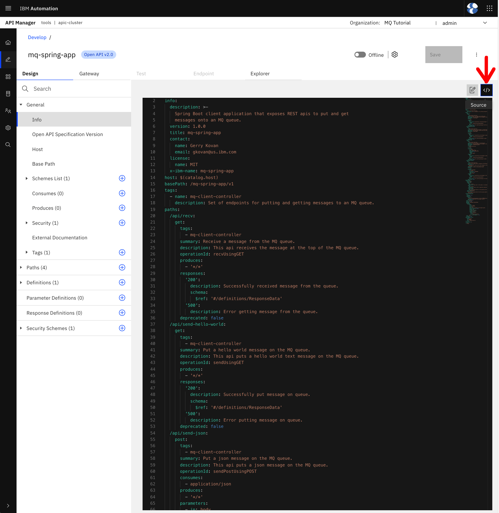{: style="max-height:1200px"}

You can see that your Spring MQ Application APIs OpenAPI definition code looks pretty much like the OpenAPI definition Swagger automatically created for your Spring MQ Application APIs. However, there is a small change and few new sections added by IBM API Connect.

You can see that the value for the `host` property has changed to `$(catalog.host)`, which is an internal variable to IBM API Connect that resolves to the catalog's OpenShift route IBM API Connect created to expose such catalog. Since your Spring MQ Application APIs OpenAPI definition will be published to a catalog, and therefore consumed through such catalog, the `host` property for those APIs has now changed to be the `$(catalog.host)` OpenShift route.

!!! info
    The host of the APIs being now the catalog where these are published to does not have nothing to do with such request being then handled by the IBM API Connect Gateway Services and the redirection to the appropriate service (the Spring MQ Application in this case) afterwards as you will see below 

Since the host will change based on the catalog the APIs are published to and are part of, the `host` attribute gets parametrized. You saw in a previous section of this IBM API Connect subsection of the MQ in-depth tutorial that IBM API Connect will segregate per catalog.

If you scroll down, you should see new sections on your Spring MQ Application APIs OpenAPI definition.

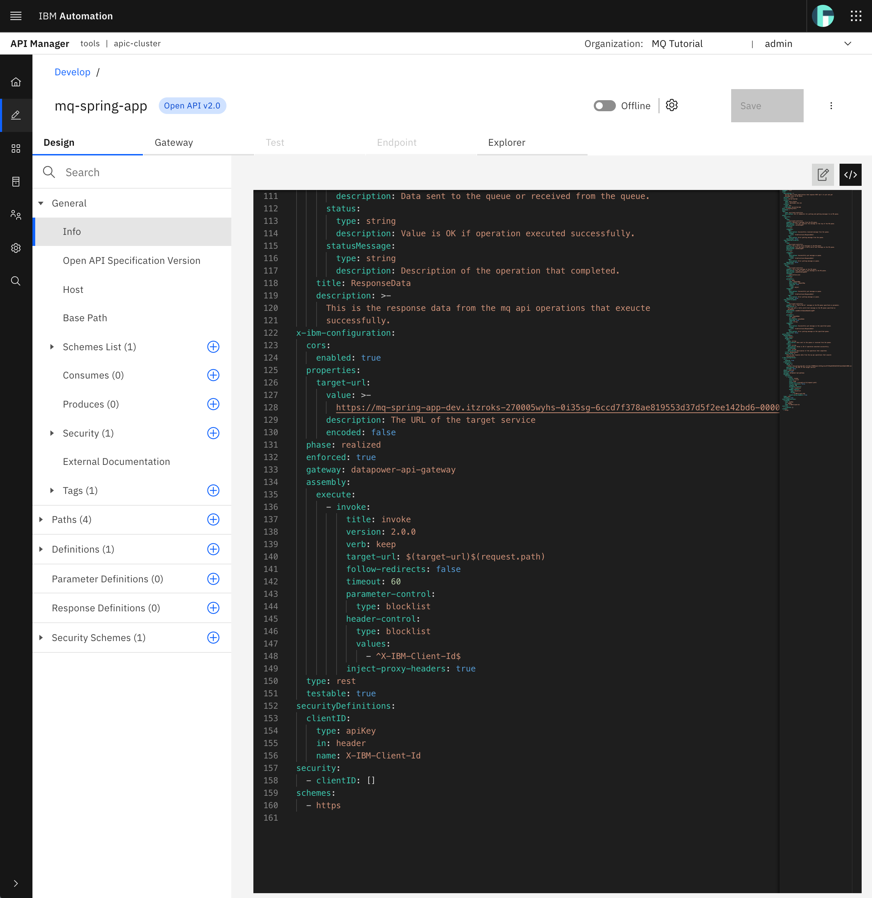{: style="max-height:1200px"}

You should be able to identify the following new sections on your Spring MQ Application APIs OpenAPI definition:

* `x-ibm-configuration` - which is one of the [IBM extensions to the OpenAPI specification](https://www.ibm.com/docs/en/api-connect/10.0.x?topic=file-extensions-openapi-specification) specific to IBM API Connect. This extension adds additional configuration for the IBM API Connect Gateway Service in relation with your APIs definition. Within this extension, you should pay attention to the following extensions:
    * `properties` - define properties for referencing in an API. You can see the **`target-url`** property that will be of vital importance on the assembly subsection below as will hold the base url where requests to any of the Spring MQ Application APIs defined in this OpenAPI definition will be redirected to.
    * `gateway` - specifies which type of gateway to be used.
    * `assembly` - describes [the application of policies and logic to an API](https://www.ibm.com/docs/en/api-connect/10.0.x?topic=specification-execute). It contains an `execute` field that contains an array of policies that are applied in order. It can contain a `catch` field that contains an array of error cases to be caught. Here you can see that the only policy or logic that will be applied to any request to any of the Spring MQ Application APIs defined in this OpenAPI definition is **`invoke`**, which simply calls an API. And that API being called is defined by the `target-url` attribute of `invoke`. This `target-url` attribute of `invoke` uses the `target-url` property explained above to redirect or make a call to **`$(target-url)$(request.path)`**. You will see what this resolves to later on.
* `Security` - lists all the `securityDefinitions` that are to be applied to the Spring MQ Application APIs defined in this OpenAPI definition. 
* `SecurityDefinitions` - describes different security definitions. As you can see, there is only one security definition called `clientID` which defines that an `apiKey` type attribute named `x-IBM-Client-Id` must be provided in the API request header. Your IBM API Connect Gateway Services will then use this `x-IBM-Client-Id` attribute for authentication and authorization purposes. You can check other API security strategies [here](https://www.ibm.com/docs/en/api-connect/10.0.x?topic=SSMNED_v10cd/com.ibm.apic.toolkit.doc/tapim_sec_api_config.html). For instance, for better security, you could also ask for the client's secret as well.
* `schemes` - defines the scheme used for the request. In this case, you will require `https`.

!!! tip
    **The source code for your `mq-spring-app` API above will be used to promote APIs** to testing, QA, production, etc environments through GitHub and automation (that is, GitOps!) so that there is no manual intervention and all objects and its changes are defined as code in GitHub and therefore are trackable and auditable. You will see this in the [Promote APIs](./promote-apis.md) section later on.

Go back to form view again and click on the Gateway tab. 

Here you are presented with a graphical view of the [IBM extensions to the OpenAPI specification](https://www.ibm.com/docs/en/api-connect/10.0.x?topic=file-extensions-openapi-specification) specific to IBM API Connect and therefore only understood by your IBM API Connect Gateway Services. Here you should be able to see all the policies and logic that will be applied to the Spring MQ Application APIs defined in this OpenAPI definition. You can use this graphical editor on a drag and drop fashion to develop more complex policies and logic for your IBM API Connect Gateway Services to apply to the incoming requests. As explained above, there will be just one policy to be applied to any of the APIs which is `invoke` and if you click on that `invoke` icon from the editor you should also see the `URL` that will be called as a result.

Now, you already know that `$(target-url)` refers to a property defined in this OpenAPI definition. However, you know nothing about `$(request.path)` yet. If you check the [API Connect context variables](https://www.ibm.com/docs/en/api-connect/10.0.x?topic=reference-api-connect-context-variables) section in the official IBM API Connect documentation, you will see that `request.path` will hold the value for the path section of the `request.uri` (i.e. full url used in the request) that starts with the base path of the API, including the `/` character that begins the base path. So, in your case, `$(request.path)` will include `/mq-spring-app/v1` which you added for a better API interface definition strategy but that will not resolve to any of your Spring MQ Application APIs. That is, if you let your IBM API Connect Gateway Service to invoke `http://<your_internal_application_route>/$(request.path)` you will not reach your Spring MQ Application APIs because of the Base Path in between. As a result, you need a way to strip the base path off of the `request.path` value since that has only been added for API management reasons. And there is a solution for that. If you check the [API Connect context variables](https://www.ibm.com/docs/en/api-connect/10.0.x?topic=reference-api-connect-context-variables) section in the official IBM API Connect documentation again, you will find `api.operation.path` which holds the path of the operation (i.e., what comes after the base path). So that is what you need to use in your `invoke` policy. Therefore, change the `URL` value of `invoke` to be `$(target-url)$(api.operation.path)`.

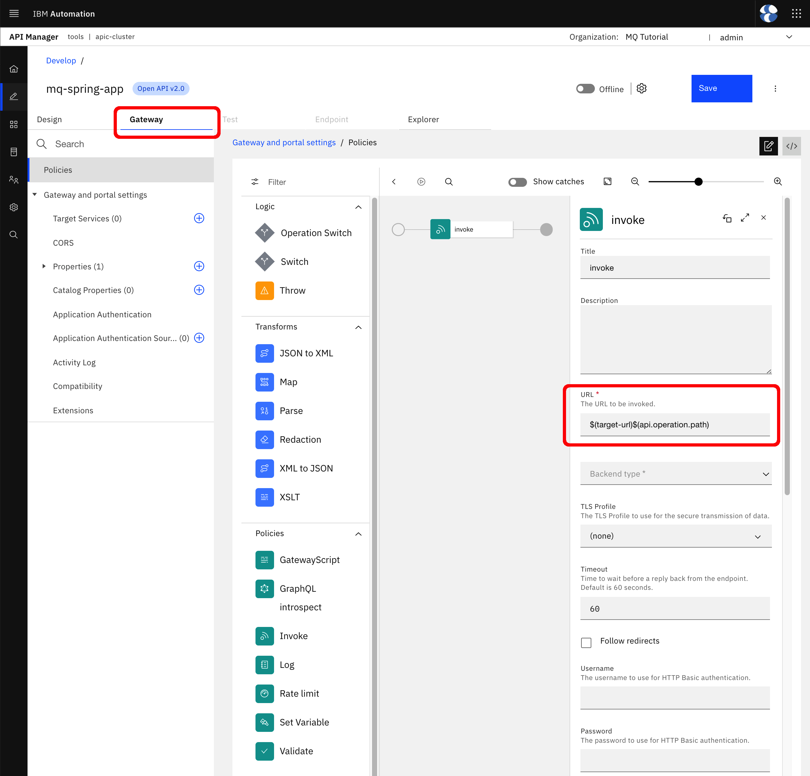{: style="max-height:1000px"}

Go to `Properties --> target-url` on the left hand side.

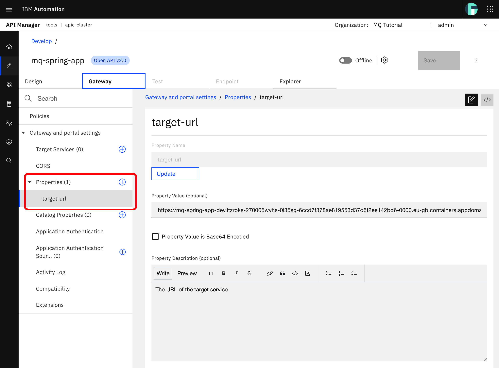{: style="max-height:900px"}

Here you can see and edit the `target-url` property value that will then be used by the `invoke` policy to redirect any incoming request to any of your Spring MQ Application APIs. Out of the box, as you can see in this graphical view and code view of your Spring MQ Application APIs OpenAPI definition, the value of the `target-url` property is set to the original `host` property of the OpenAPI definition Swagger initially created for you, which is the OpenShift route your Spring MQ Application is exposed through. However, that OpenShift route will disappear as it is publicly accessible (within the network where your OpenShift cluster resides) and, as said during this IBM API Connect section of the MQ tutorial, you would like to expose your Spring MQ Application APIs on a secure manner.

Therefore, since you don't want to use externally accessible unsecured OpenShift routes and your Spring MQ Application is hosted on the same OpenShift cluster where your IBM API Connect and its subsystems (like the IBM API Connect Gateway Service) are, you can and should now use the internal OpenShift service for your Spring MQ Application. Once your Spring MQ Application APIs can be accessed through the IBM API Connect Gateway Services you can then delete your Spring MQ Application OpenShift route to have its APIs completely secured.

You can find the service for your Spring MQ Application with

```bash
oc get services -n dev
```

which should return the following:

``` { .text .no-copy hl_lines="2" }
NAME                    TYPE        CLUSTER-IP      EXTERNAL-IP   PORT(S)             AGE
mq-spring-app           ClusterIP   172.21.169.15   <none>        80/TCP              7d4h
qm1-ibm-mq              ClusterIP   172.21.107.11   <none>        9443/TCP,1414/TCP   7d5h
qm1-ibm-mq-metrics      ClusterIP   172.21.173.15   <none>        9157/TCP            7d5h
```

Your Spring MQ Application service is called `mq-spring-app`. To make sure of the `selectors` for this service and the protocol (http/https) and `port` for the service you can do


```bash
oc describe service mq-spring-app -n dev
```

which should return something like:

``` { .text .no-copy hl_lines="8 13" }
Name:              mq-spring-app
Namespace:         dev
Labels:            app=dev-mq-spring-app-instance
                   app.kubernetes.io/instance=dev-mq-spring-app-instance
                   app.kubernetes.io/name=mq-spring-app
                   helm.sh/chart=mq-spring-app-0.0.13
Annotations:       <none>
Selector:          app.kubernetes.io/instance=dev-mq-spring-app-instance,app.kubernetes.io/name=mq-spring-app
Type:              ClusterIP
IP Families:       <none>
IP:                172.21.169.15
IPs:               172.21.169.15
Port:              http  80/TCP
TargetPort:        8080/TCP
Endpoints:         172.30.130.57:8080
Session Affinity:  None
Events:            <none>
```

where you are able to see that the `selectors` make sense and that the protocol is `http` and the port is `80`.

As a result, to get the `target-url` property to use the internal OpenShift service for your Spring MQ Application, you need to set its value to:

``` { .text .no-copy }
<protocol>://<openshift-service-name>.<openshift-project>:<port>
```

which, in your case, would resolve to:

```bash
http://mq-spring-app.dev:80
```

!!! warning "Important"
    The value for `target-url` might change accordingly to the environment the API you are creating to expose your Spring MQ Application APIs is developed for or deployed on. That is, the value for `target-url` might change accordingly in the API you define within IBM API Connect API Manager depending on whether such API exposes the dev, test or production Spring MQ Application instance. For instance, in your actual case where you are segregating dev, test and prod environments using RedHat OpenShift projects given the infrastructure limitations of this tutorial, the value of `target-url` will change its `<openshift-project>` part. However, in cases where your dev, test and prod environment are physically segregated and therefore these are completely different RedHat OpenShift clusters, the value of `target-url` might not change since the Spring MQ Application might get deployed in those environments in the same manner. Anyway, what is important here is that checks like the value of `<openshift-project>` in `target-url` depending on the environment you are creating/developing your API on can be and should be automated in your API promotion pipeline.

Change the `target-url` property value to be `http://mq-spring-app.dev:80`

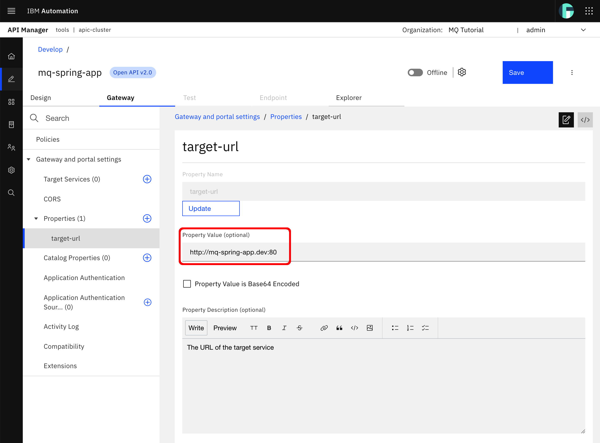{: style="max-height:900px"}

Click Save. A successful message should appear on the top right corner of your screen.

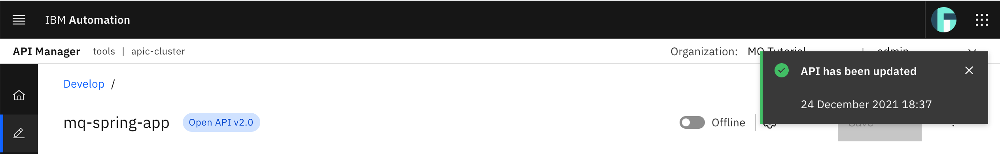{: style="max-height:200px"}

Switch your Spring MQ Application APIs OpenAPI definition, which has now become an IBM API Connect API called `mq-spring-app`, to online. A successful message should appear on the top right corner of your screen and your `mq-spring-app` API displays as online.

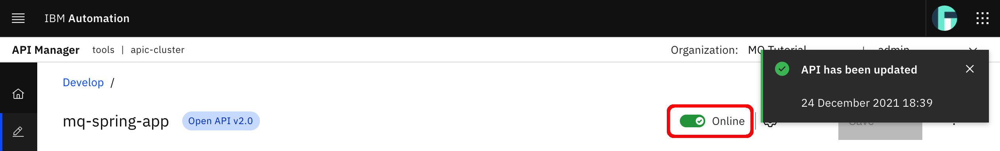{: style="max-height:200px"}

You should also be able to see that the `Test` and `Endpoint` tabs of your `mq-spring-app` should be enabled now. This is because your `mq-spring-app` API has now been published to your IBM API Connect Gateway Service. 

Click on the `Endpoint` tab.

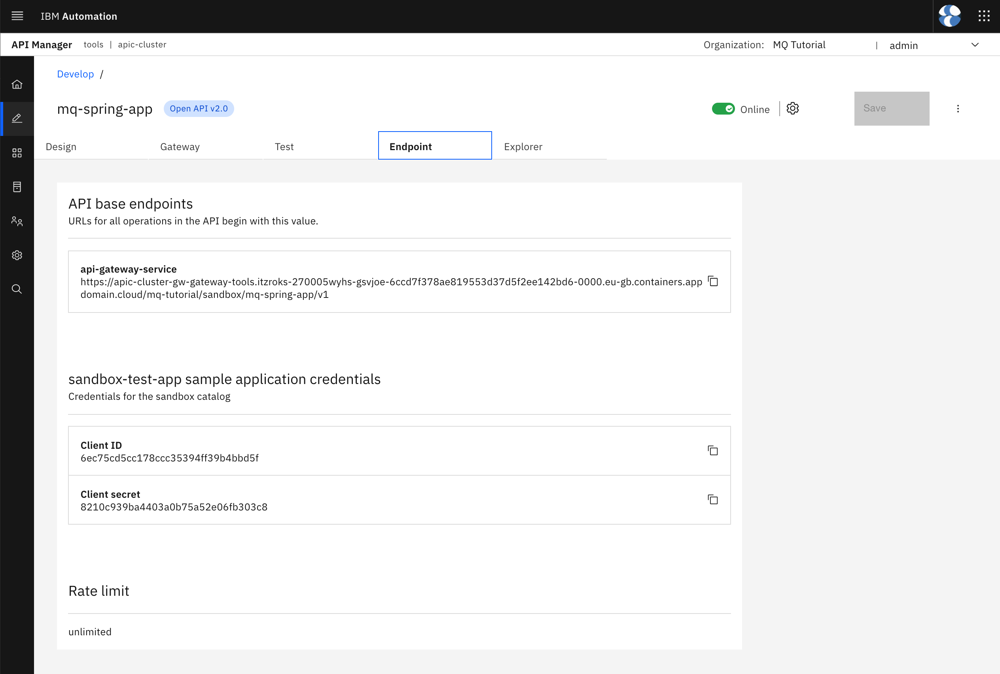{: style="max-height:1000px"}

In the screen above you are seeing several interesting pieces of information such as the `api-gateway-service` **url** and an application credentials needed to access and test your APIs. But first, let's understand that for an API, like your `mq-spring-app` API, to be accessible there are several things that must happen first.

1. Have your API created in IBM API Connect API Manager.
2. Have your API published within a product into a catalog.
3. Have an application created in the IBM API Connect Developer Portal that subscribes to available Product's APIs and provides users with credentials to use such APIs.

You have just completed step number 1 when you created your `mq-spring-app` API within your IBM API Connect API Manager. Step number 2 and 3 were automatically done as part of the IBM API Connect out of the box configuration. That is, your IBM API Connect API Manager has been configured out of the box to get all newly created APIs into products (of the same name) that get published to the `Sandbox` catalog. A `sandbox-test-app` sample application that subscribes to all product's APIs of the `Sandbox` catalog is also created automatically. Because of all this out of the box IBM API Connect API Manager configuration that automated the aforementioned actions is that, as soon as you created your `mq-spring-app` API, your API got published into the `Sandbox` catalog and your are able to test it through the `sandbox-test-app`.

!!! warning "Important"
    Of course, the aforementioned out of the box configuration and automation might not be desired in certain development environments and definitely prohibited in QA and production environments. However, configuring IBM API Connect not to apply that out of the box configuration and automation is out of the scope of this tutorial.

Despite the warning above, let's take advantage of the IBM API Connect API Manager out of the box configuration and automation to give it a try and see if you can access your Spring MQ Application APIs through the IBM API Connect Gateway Service on a secure manner.

First, let's have a closer look to the `api-gateway-service` **url** you are presented with in the `Endpoint` tab you can see in the picture above. More precisely, pay attention to its structure that follows the pattern:

``` { .text .no-copy }
https://<ibm-apic-gateway-service-openshift-route>/<provider-organization>/<catalog>/<base-path>
```

You can see that:

* `<ibm-apic-gateway-service-openshift-route>` will be the same for everyone using the same IBM API Connect Cluster instance.
* `<provider-organization>` will segregate per Provider Organization (review the previous [Configure API Connect](./configure-apic.md) chapter for more information).
* `<catalog>` will segregate per Catalog.
* `<base-path>` will segregate per OpenAPI definition (remember that an OpenAPI definition can contain multiple application APIs as it is the case for your Spring MQ Application) and major version.

With that, let's have a try at one of your Spring MQ Application APIs. Use the following curl command to access your Spring MQ Application `send-hello-world` API from your terminal:

``` bash
curl -k https://<api-gateway-service-url>/api/send-hello-world
```

where `<api-gateway-service-url>` is the `api-gateway-service` **url** displayed under your `Endpoint` tab as seen in the pic above.

In our case, this curl command would be:

``` { .bash .no-copy }
curl -k https://apic-cluster-gw-gateway-tools.itzroks-270005wyhs-gsvjoe-6ccd7f378ae819553d37d5f2ee142bd6-0000.eu-gb.containers.appdomain.cloud/mq-tutorial/sandbox/mq-spring-app/v1/api/send-hello-world
```

You should get back the following response:

``` { .json .no-copy }
{"httpCode":"401","httpMessage":"Unauthorized","moreInformation":"Invalid client id or secret."}
```

As the message itself explains, the reason why you are not able to access your Spring MQ Application `send-hello-world` API is that you are not authorized. And the reason why you are not authorized is that you are not providing your application's `Client ID` in the header of the request as a parameter called `X-IBM-Client-Id` which is required as explained earlier when creating your `mq-spring-app` API from your Spring MQ Application APIs OpenAPI definition. 

Now, let's try providing the default `sandbox-test-app` sample application's `Client ID` on the request. Use the following curl command:

```bash
curl -k --header "X-IBM-Client-Id: <your-application-client-id>" \
        --url https://<api-gateway-service-url>/<provider-organization>/<catalog>/<base-path>/api/send-hello-world
```

where `<your-application-client-id>` is the `sandbox-test-app` sample application's `Client ID` displayed under your `Endpoint` tab as seen in the pic above.

In our case, this curl command would be:

```{ .bash .no-copy }
curl -k --header "X-IBM-Client-Id: 6ec75cd5cc178ccc35394ff39b4bbd5f" \
        --url https://apic-cluster-gw-gateway-tools.itzroks-270005wyhs-gsvjoe-6ccd7f378ae819553d37d5f2ee142bd6-0000.eu-gb.containers.appdomain.cloud/mq-tutorial/sandbox/mq-spring-app/v1/api/send-hello-world
```

You should get back the following response:

``` { .json .no-copy }
{"status":"OK","statusMessage":"Successfully sent record to MQ","data":"Hello World!"}
```

If you check your IBM MQ `QM1` web console, you should also see a new message:

{: style="max-height:1000px"}

Try to reach your Spring MQ Application `recv` API to read a message from MQ with the following curl command:

```bash
curl -k --header "X-IBM-Client-Id: <your-application-client-id>" \
        --url https://<api-gateway-service-url>/<provider-organization>/<catalog>/<base-path>/api/recv
```

In our case, this curl command would be:

``` { .bash .no-copy }
curl -k --header "X-IBM-Client-Id: 6ec75cd5cc178ccc35394ff39b4bbd5f" \
        --url https://apic-cluster-gw-gateway-tools.itzroks-270005wyhs-gsvjoe-6ccd7f378ae819553d37d5f2ee142bd6-0000.eu-gb.containers.appdomain.cloud/mq-tutorial/sandbox/mq-spring-app/v1/api/recv
```

You should get back the following response:

``` { .json .no-copy }
{"status":"OK","statusMessage":"Successfully received record from MQ","data":"Hello World!"}
```

If you check your IBM MQ `QM1` web console, you should now see there is no messages in the queue at all:

{: style="max-height:1000px"}

!!! success "Congratulations"
    You have just seen how IBM API Connect helps you secure your application APIs.

If you are not a terminal person, let's explore the `Test` tab of your `mq-spring-app` API. Click on the `Test` tab.

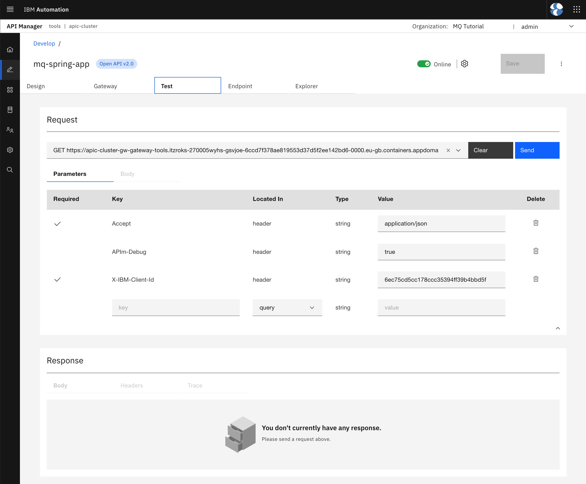{: style="max-height:1000px"}

Here, you can see a testing tool pretty similar to the Swagger UI that you saw earlier at the beginning of this chapter. You can see a `Request` section at the top for the request you want to make. Below that section, you have the `Response` section that will output the response of your request.

The `Request` section will allow you to chose from all the APIs you have defined in your OpenAPI definition, that is all the Spring MQ Application APIs you have defined in the OpenAPI definition you have created this `mq-spring-app` API from. You will then be presented with a `Parameters` form that will help and allow you to define any parameters you must or might want to include in your request. As you can see, some of the required parameters such as the `X-IBM-Client-Id` has already been added and filled in for you.

Make sure you select the `send-hello-world` API by hovering over the options listed in the drop down menu of the available endpoints to test with your mouse.

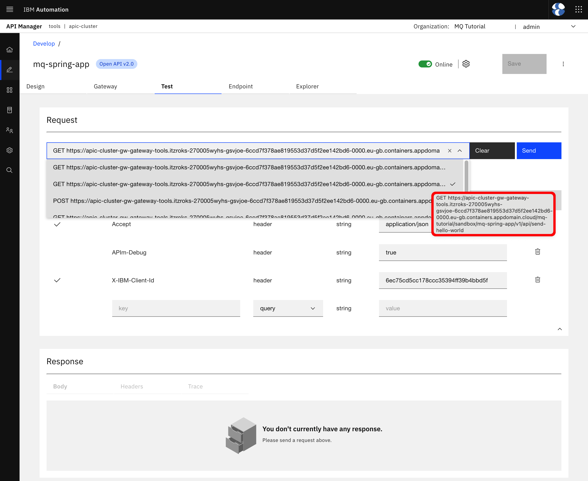{: style="max-height:1000px"}

Click `Send`.

!!! info
    If you see an error like the following, click the `here` link that is displayed in the popup dialog and accept the un-trusted certificate in the new tab that will open. You may need to resend the request.

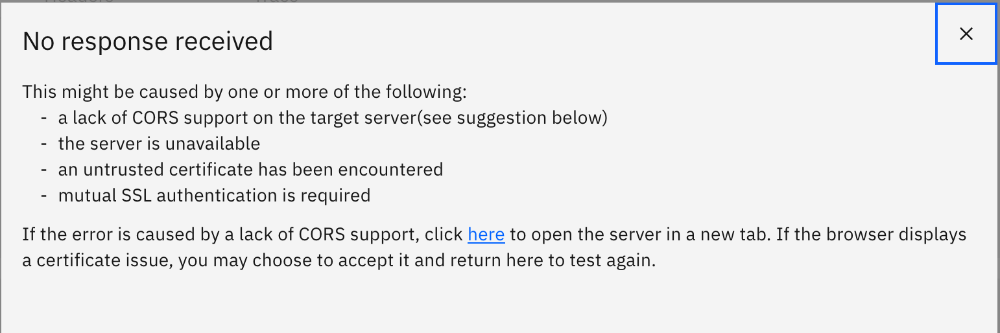{: style="max-height:300px"}

After the request has been successfully made, you will see the response for it. You should see the status of the response and the response time on the top right corner of the `Response` section as well as the returned object in the body of the response which is the expected JSON object.

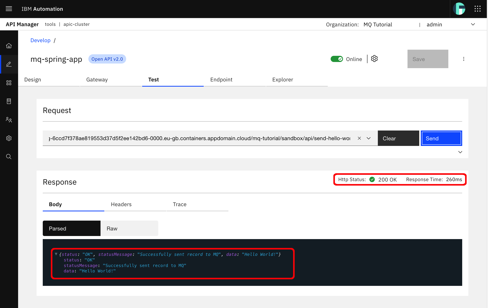{: style="max-height:900px"}

You could also check your IBM MQ `QM1` web console again to make sure that a message has make it to the appropriate queue.

Try receiving messages by sending a request to the `recv` Spring MQ Application API. Select such API from the drop down menu and click `Send`. You should again see an successful response.

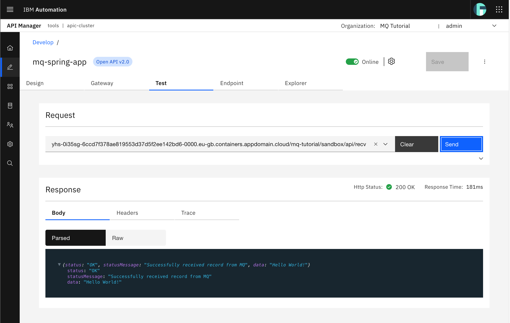{: style="max-height:900px"}

And that the message is gone from the appropriate queue in your IBM MQ `QM1` web console.

!!! success "Congratulations!"
    You have successfully created/developed your `mq-spring-app` API from your Spring MQ Application APIs OpenAPI definition. You have also made sure your Spring MQ Application APIs are now securely exposed through your IBM API Connect Gateway Services by using the testing capability within your IBM API Connect API Manager.

Now, it is time to **publish** this `mq-spring-app` API to the desired catalog which is `dev`. However, as already mentioned earlier, you first need to create a product that "offers" your API to then publish that product into a catalog.

Click on the hamburger button of your `mq-spring-app` at the top right corner and select `Publish`

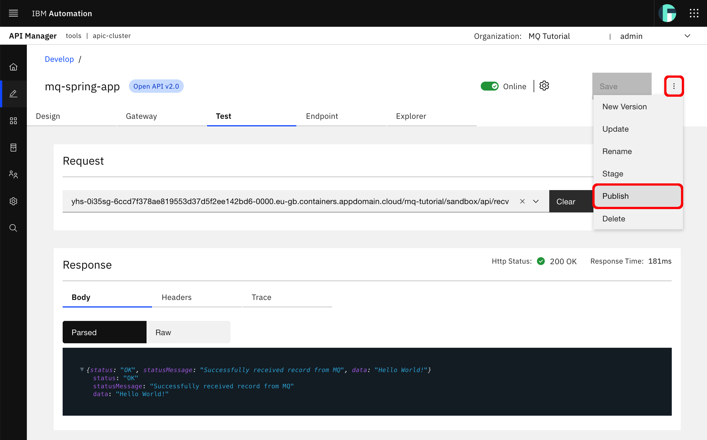{: style="max-height:900px"}

You will be driven to a `Publish API` form.

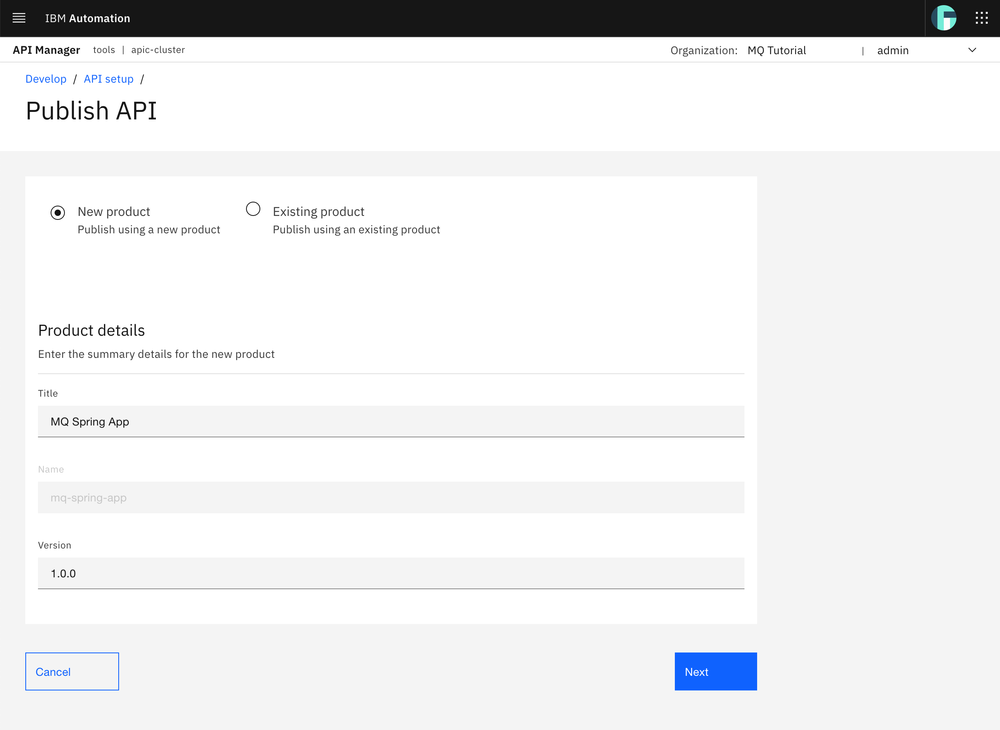{: style="max-height:900px"}

Make sure you select `New Product` since you want to publish your `mq-spring-app` into a new product. Then, provide a meaningful `Title` for your product and you can leave the version value to `1.0.0`. Click `Next`.

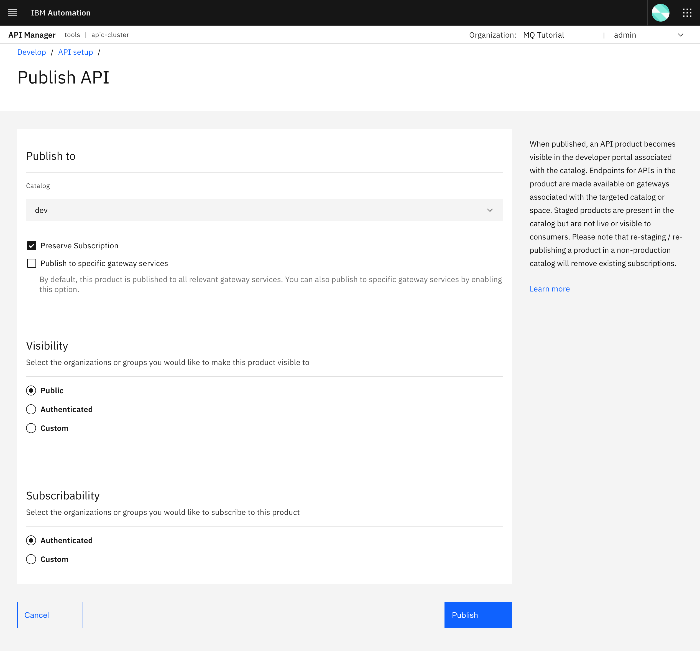{: style="max-height:1000px"}

In this second part or screen of the `Publish API` form, leave everything as is. That is, leave `dev` as the catalog where you want your product to be published to and do not check the `Publish to specific gateways services` option, mainly because you only have one IBM API Connect Gateway Service, the default for the catalog, and therefore you won't be able to select any other. If you had a more complex IBM API Connect Topology you could here select what IBM API Connect Gateway Services this product will actually be published to (review the previous [Configure API Connect](./configure-apic.md) chapter for more information). Leave the `Visibility` of your product as `Public` for now for simplicity so everyone can see that product in your catalog for information and socialization. However, select `Authenticated` for the `Subscribability` as you would only want authenticated users to be able to subscribe to your product to use it. Click `Publish`. A successful message should appear on the top right corner afterwards.

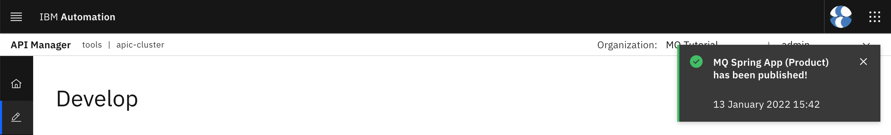{: style="max-height:200px"}

After the product has been successfully published, you should get redirected to the `Develop` section of your IBM API Connect API Manager.

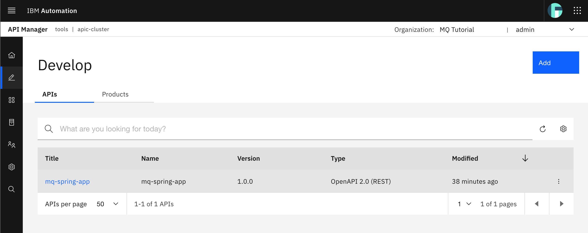{: style="max-height:500px"}

Here you can see your all your APIs. You will only see your recently created `mq-spring-app` API as expected. Now, click on the `Products` tab.

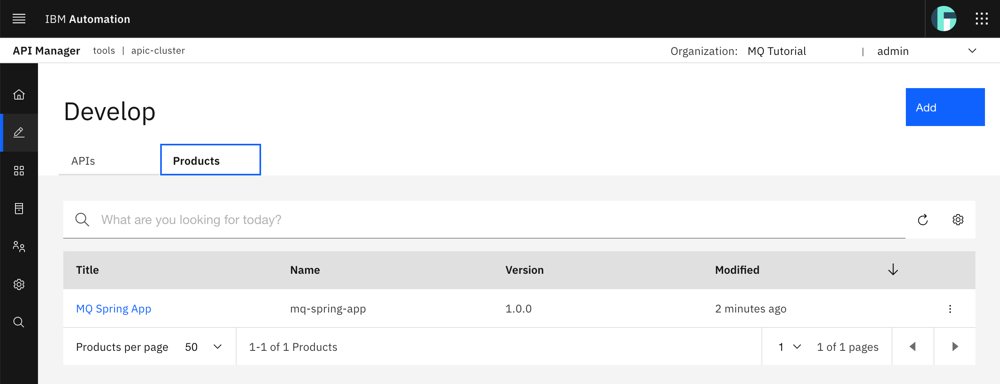{: style="max-height:500px"}

You should see your recently created `MQ Spring App` product listed. Click on your `MQ Spring App` product to see its details.

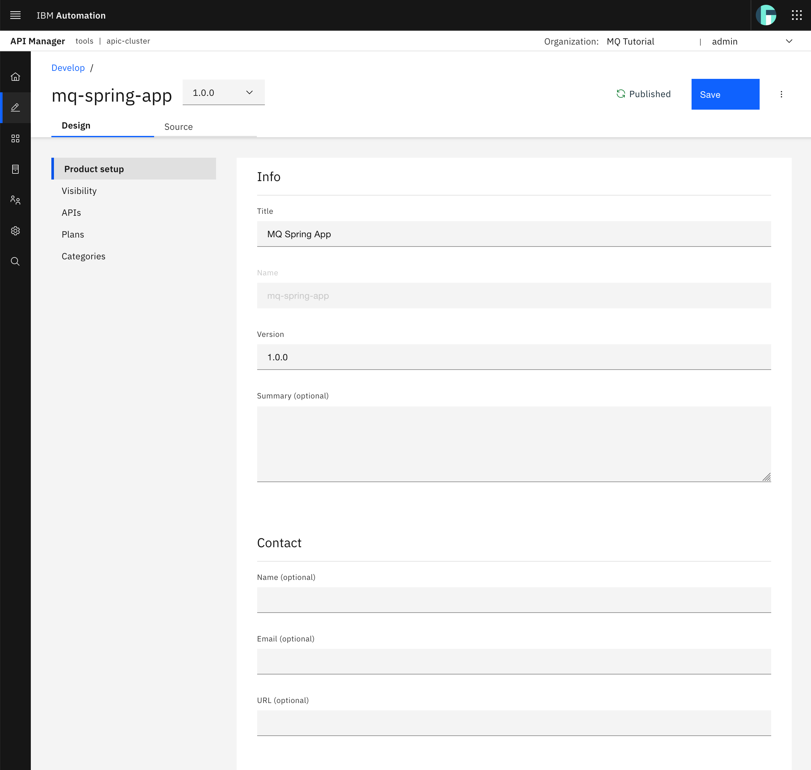{: style="max-height:1000px"}

You should see a graphical view for your `MQ Spring App` product details. You could inspect the `Plans` section of your product as it is an important capability for [monetizing your products](https://www.ibm.com/docs/en/api-connect/10.0.x?topic=products-monetizing-your). However, this is out of the scope for this tutorial. You can read more on plans [here](https://www.ibm.com/docs/en/api-connect/10.0.x?topic=products-editing-draft-product).

Click on the `Source` tab to see the definition of your `MQ Spring App` product as code. And more precisely, you can see that your `MQ Spring App` product source definition is in a YAML format.

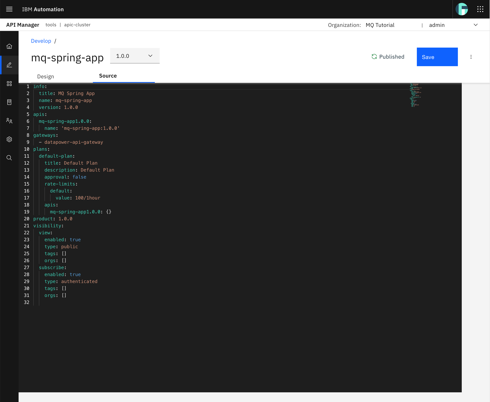{: style="max-height:1000px"}

!!! tip
    **The source code for your `MQ Spring App` product above will be used to promote products** to testing, QA, production, etc environments through GitHub and automation (that is, GitOps!) so that there is no manual intervention and all objects and its changes are defined as code in GitHub and therefore are trackable and auditable.

!!! success "Congratulations!"
    You have created your `MQ Spring App` product that includes your `mq-spring-app` API and published it to the `dev` catalog. Now, you only need to create a IBM API Connect Developer Portal for your `dev` catalog to start consuming your Spring MQ Application APIs. Go to the next [Consume APIs](./consume-apis.md) chapter to see how to do so.

## Links

Here are some interesting links used to create this section of the tutorial:

* [Red Hat OpenShift Solution Design Guidance - API Connect](https://pages.github.ibm.com/IBMAoT/i-openshift-guides/03-cloud-paks/cloud-pak-for-integration/api-connect)
* [Swagger](https://swagger.io/)
* [OpenAPI](https://www.openapis.org/)
* [Setting Up Swagger 2 with a Spring REST API](https://www.baeldung.com/swagger-2-documentation-for-spring-rest-api)
* [SpringFox](http://springfox.github.io/springfox/)
* [Enforcing security requirements on an API - IBM API Connect Knowledge Center](https://www.ibm.com/docs/en/api-connect/10.0.x?topic=definition-enforcing-security-requirements-api)
* [IBM extensions to the OpenAPI specification - IBM API Connect Knowledge Center](https://www.ibm.com/docs/en/api-connect/10.0.x?topic=file-extensions-openapi-specification) 
* [Configuring API security - IBM API Connect Knowledge Center](https://www.ibm.com/docs/en/api-connect/10.0.x?topic=SSMNED_v10cd/com.ibm.apic.toolkit.doc/tapim_sec_api_config.html)
* [Editing a draft Product - IBM API Connect Knowledge Center](https://www.ibm.com/docs/en/api-connect/10.0.x?topic=products-editing-draft-product).
* [API Connect context variables - IBM API Connect Knowledge Center](https://www.ibm.com/docs/en/api-connect/10.0.x?topic=reference-api-connect-context-variables) 