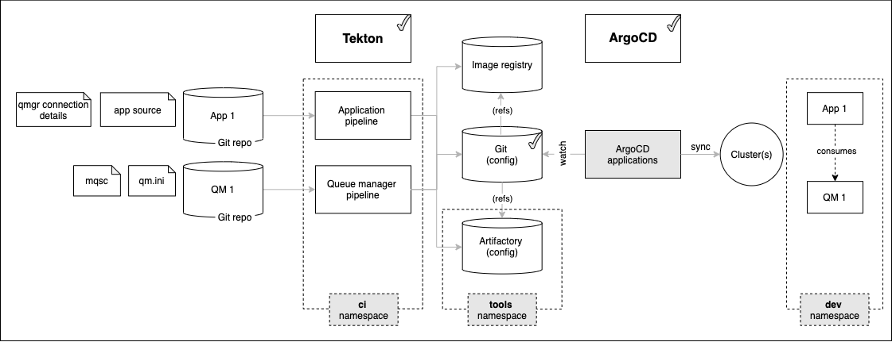

# Configuring the cluster infrastructure

<!--- cSpell:ignore resynched consolenotification subfolders rolebindings rolebinding CICD qube cntk autoplay allowfullscreen walkthrough Walkthrough webkitallowfullscreen msallowfullscreen -->

**Audience**: Architects, Application developers, Administrators

## Overview

In this topic, we're going to:

* Explore the sample GitOps repository in a little more detail
* Customize the GitOps repository for our cluster
* Connect ArgoCD to the customized GitOps repository
* Bootstrap the cluster
* Explore how the `ci` namespace was created
* Try out some dynamic changes to the cluster with ArgoCD
* Explore how ArgoCD manages configuration drift

By the end of this topic we'll have a cluster up and running, having used GitOps
to do it. We'll fully understand how ArgoCD manages cluster change and
configuration drift.

## Introduction

In the [cluster configuration](gitops-tekton-argocd.md) topic of this tutorial,
we installed the fundamental components that enabled continuous integration and
continuous deployment. These components included a sample GitOps repository and
ArgoCD.

In this topic we're going to customize the GitOps repositories, and point ArgoCD
at it. ArgoCD will then install the highlighted **infrastructure** components
that are used by our MQ CICD process:

We'll examine these components in more detail throughout this section of the
tutorial; here's an initial overview of their function:

* `ci-namespace` provide an execution namespace for our pipelines
* `tools-namespace` provide an execution namespace for tools such as
  Artifactory
* `dev-namespace` provide an execution namespace for our deployed
  MQ applications and queue managers when running in the development
  environment. Later in the tutorial, we'll add `staging` and `prod` namespaces.
* `ArgoCD applications` manage the `ci`,`tools` and `dev` namespaces.

You may have already noticed that the `multi-tenancy-gitops` repository contains
YAMLs that refer to the ArgoCD and namespaces in the diagram above. We're now
going to use these YAMLs to configure the cluster resources using GitOps.
Becoming comfortable with the concepts by practicing GitOps will help us in
later chapters when we create MQ applications and queue managers using the same
approach.

---

## Pre-requisites

Before attempting this topic, you must have completed the following tasks:

- You have completed the previous sections of this tutorial.
- You have installed all the command line tools.

See these [instructions](/references/prerequisites/instructions) about how install these
prerequisites.

---

## Video walkthrough

The following video walkthrough takes you through this topic step by step:

??? note "Click to watch the video"
    
<iframe width="560" height="315" src="https://www.youtube.com/embed/huF26UUvQlk" title="YouTube video player" frameborder="0" allow="accelerometer; autoplay; clipboard-write; encrypted-media; gyroscope; picture-in-picture" allowfullscreen></iframe>

---

--8<-- "gitops-sample-repo-structure.md"

---

--8<-- "gitops-sample-repo-kustomize.md"

---

--8<-- "gitops-repo-argocd-connect.md"

---

--8<-- "gitops-argocd-cm-gov.md"

!!! success "Congratulations!"
    You've used ArgoCD and the GitOps repository to
    set up `ci`, `tools` and `dev` namespaces. You've seen how to create ArgoCD
    applications that watch their respective GitOps namespace folders for
    details of the namespace resources they should apply to the cluster. You've
    seen how you can dynamically change deployed resources by updating the
    resource definition in the GitOps repository. Finally, you've experience how
    ArgoCD keeps the cluster synchronized with the GitOps repository as a source
    of truth; any unexpected configuration drift will be corrected without
    intervention.

    In the next section of this tutorial, we're going to deploy some services into the infrastructure namespaces we've created in this topic. These services will include Artifactory and the MQ operator.
