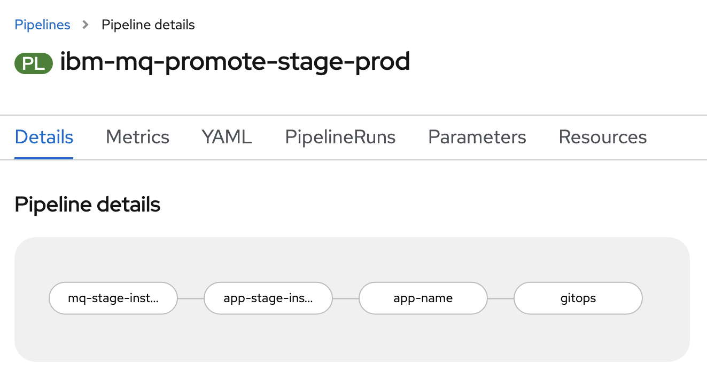

# Performance Testing

<!--- cSpell:ignore qube cntk autoplay allowfullscreen usecases queuemanager cphtestp jmeter Jmeter QMGR cphtestp   appdomain -->

## Overview

**Audience**: Architects, Application developers

Performance testing is the process of testing the behavior of an application under load. During performance testing, attributes like the system's scalability, reliability, and resource usage are assessed. Basically, it is a non-functional testing approach used to measure system parameters according to their responsiveness and stability under various workload conditions.

In this topic, we're going to look into the below:

* Performance Testing Pipeline
* Performance Testing for QueueManager
* Performance Testing for MQ Sample application

???+ note
     The contents in this guide are only examples. We demonstrated some of the practices using some sample usecases. For real world scenarios, it should be used in conjunction with existing performance practices and this content is not a replacement. For assistance, CSMs should reach out to performance SMEs.

---

## Performance Testing Pipeline

{: .center}

**mq-stage-instance-tests**

- Clones the source repositories.
- Validates if the deliverable is Queue Manager.
- Performs [load testing](#performance-testing-for-queuemanager) on Queue Manager using cphtestp tool.

**app-stage-instance-tests**

- Clones the source repositories.
- Grabs the route of the deliverable.
- Performs [load testing](#performance-testing-for-mq-sample-application) on the MQ sample spring application using jmeter test scripts.

**app-name**

- Returns the name of the deliverable.

**gitops**

- Clones the gitops apps repository.
- Copies the deliverables from staging to prod.
- Updates the helm chart with latest resources.
- Generate a Pull Request with the changes to gitops apps repository.

### Performance Test Task

In our sample performance test task, we are using

- [IBM MQ C Performance Harness (MQ-CPH)](https://github.com/ibm-messaging/mq-cph) tool to perform tests on the QueueManager. The live data from MQ-CPH tool can be visualized using charts.
- [Jmeter](https://jmeter.apache.org/) to perform tests on the sample Spring Boot application. The live data from Jmeter will be fed into a datastore. Based on this data, the metrics can be visualized using Grafana dashboard.

We will take a deep look into the task definition in the coming sections.

## Performance Testing for QueueManager

### IBM MQ C Performance Harness

IBM MQ C Performance Harness Tool is a native MQI interface performance test tool. It is built on top of C/C++ and is largely based on the function and externals of the JMSPerfHarness Performance Harness for Java Message Service application. Basically, MQ-CPH is designed to test the native, proprietary IBM MQ interface (MQI).

- It provides a complete set of performance messaging functionality as well as many other features such as throttled operation (a fixed rate and/or number of messages), multiple destinations, live performance reporting.
- It will print the current throughput rate on a user-selected periodic basis.
- It also output summary statistics at the end of a test.

### Sample tests

Our tests for the Queue Manager include the below configurations.

- `MQ_QMGR_NAME`, Queue Manager Name - `name of the queue manager`
- `MQ_QMGR_HOSTNAME`, Hostname where QM is running - `queue manager host name`
- `MQ_QMGR_PORT`, Port where QM listener is running - `queue manager port`
- `MQ_QMGR_CHANNEL`, Channel name to use to connect to QM - `channel name`
- `MQ_RESPONDER_THREADS`, Number of responder threads to run - `64`
- `MQ_NON_PERSISTENT`, QOS to be used by connecting clients - `0` or `1`
- `MQ_RESULTS_CSV`, Log results to csv file and send to stdout at end - `true` or `false`
- `MQ_RESULTS`, Log results to stdout at end of tests - `true` or `false`

### Running tests

This tool runs as a container. For more details on how to build it, check [cphtestp](https://github.com/ibm-messaging/cphtestp) repository.

For running this cphtestp performance tests inside Red Hat OpenShift container platform, we defined the tests as a kubernetes [job](https://kubernetes.io/docs/concepts/workloads/controllers/job/) and the details can be found in the next section.

### Task definition for cphtestp performance tests

In the performance test task definition, the following `step` defines the performance tests for the Queue Manager.

``` { .yaml .no-copy }
- name: cphtestp
  image: quay.io/openshift/origin-cli:latest
  workingDir: $(params.source-dir)
  script: |
    #!/usr/bin/env bash
    set -ex
    SRC_ENV=$(echo $(params.src-environment) | cut -d "-" -f2)
    if [ ! -f /source/route.txt ]; then
      QMGR_NAME=$(oc get qmgr -n ${SRC_ENV} | awk 'NR>1 { printf sep $1; sep=" "}')
      MQ_QM_NAME=$(oc get qmgr ${QMGR_NAME} -o jsonpath='{.spec.queueManager.name}' -n ${SRC_ENV})
      QMGR_HOST_NAME=$(oc get svc ${QMGR_NAME}-ibm-mq -o jsonpath='{.metadata.name}' -n ${SRC_ENV})
      QMGR_HTTP_PORT=$(oc get svc ${QMGR_NAME}-ibm-mq -o jsonpath='{.spec.ports[1].port}' -n ${SRC_ENV})
      oc delete job cphtestp -n ${SRC_ENV} || true
    cat <<EOF | oc apply -f -
    apiVersion: batch/v1
    kind: Job
    metadata:
      labels:
        run: cphtestp
      name: cphtestp
      namespace: ${SRC_ENV}
    spec:
      template:
        metadata:
          labels:
            run: cphtestp
        spec:
          containers:
          - env:
            - name: LICENSE
              value: accept
            - name: MQ_QMGR_HOSTNAME
              value: ${QMGR_HOST_NAME}
            - name: MQ_QMGR_PORT
              value: "${QMGR_HTTP_PORT}"
            - name: MQ_USERID
              value:
            - name: MQ_PASSWORD
              value:
            - name: MQ_QMGR_CHANNEL
              value: IBM.APP.SVRCONN
            - name: MQ_RESPONDER_THREADS
              value: "64"
            - name: MQ_NON_PERSISTENT
              value: "0"
            - name: MQ_QMGR_NAME
              value: ${MQ_QM_NAME}
            - name: MQ_DATA
              value:
            - name: MQ_RESULTS_CSV
              value: "true"
            - name: MQ_RESULTS
              value: "false"
            image: quay.io/cloudnativetoolkit/cphtestp:v1
            imagePullPolicy: Always
            name: cphtestp
            resources:
              requests:
                memory: "2Gi"
                cpu: "2"
              limits:
                memory: "2Gi"
                cpu: "2"
            terminationMessagePath: /dev/termination-log
            volumeMounts:
              - name: cphdata
                mountPath: /var/cph
          dnsPolicy: ClusterFirst
          restartPolicy: OnFailure
          securityContext: {}
          terminationGracePeriodSeconds: 30
          volumes:
          - name: cphdata
            emptyDir: {}
    EOF
      oc get pods -n ${SRC_ENV}
      oc get jobs -n ${SRC_ENV}
      while true; do
      if oc wait --for=condition=complete --timeout=0 job/cphtestp -n ${SRC_ENV} 2>/dev/null; then
        job_result=0
        break
      fi
      if oc wait --for=condition=failed --timeout=0 job/cphtestp -n ${SRC_ENV} 2>/dev/null; then
        job_result=1
        break
      fi
      sleep 3
    done
    if [[ $job_result -eq 1 ]]; then
        echo "Job failed!"
        exit 1
    fi
    echo "Job succeeded"
    oc logs job/cphtestp -n ${SRC_ENV}
    else
      echo "Skipping tests ... This is not a QueueManager"
    fi
```

The details for the above task are as follows:

  - `cphtestp` is the name of the step in the tekton task.
  - The base image being used for this task is `quay.io/openshift/origin-cli:latest`.
  - This step initially validates if the workload is `QueueManager`. If so, this task will be run. Otherwise, this task will be skipped.
  - Later this will grab queue manager name, queue name, queue manager host and queue manager port.
  - Then the test job in the `staging` environment will be removed if it is already existing.
  - Currently, the job definition for `cphtestp` tool only works for a non-secure queue manager. Based on the security definition of the queue manager `params.qm-security`, existing job will be created in the `staging` environment if the security is `disabled`. Otherwise, these tests will be skipped.
???+ note
     Work is under progress for enabling the tests on secure queue manager as well. This section will soon be updated once we have it in place.
  - This job is responsible for performing the load tests on the queue manager residing in the `staging` environment.
  - Once the job is created, it keeps waiting till its completion.
  - If the job is successful, we can see the test results in the logs. If the job fails, pipeline will halt.

### Test Results

For your reference, when the above task runs as part of our performance test pipeline, the results in the logs are as follows.

```
# CSV Results
# TLS Cipher:
# Thu Jan 27 16:03:34 UTC 2022
# Persistence, Msg Size, Threads, Rate (RT/s), Client CPU, IO Read (MB/s), IO Write (MB/s), Net Recv (Gb/s), Net Send (Gb/s), QM CPU
1,2048,1,195.79,9.78,0.00,0.10,0.01,0.01,2.89
1,2048,2,371.78,13.88,0.00,0.10,0.02,0.02,3.32
1,2048,4,608.14,14.45,0.00,0.10,0.03,0.03,3.77
1,2048,8,776.10,15.78,0.00,0.09,0.04,0.04,4.50
1,2048,16,798.97,20.22,0.00,0.11,0.04,0.04,4.86
1,2048,32,800.73,19.22,0.00,0.10,0.04,0.04,5.52
1,2048,64,782.41,16.35,0.00,0.09,0.04,0.04,5.79
1,20480,1,171.81,14.08,0.00,0.10,0.06,0.06,3.10
1,20480,2,321.83,14.18,0.00,0.10,0.11,0.10,3.66
1,20480,4,540.08,14.22,0.00,0.10,0.18,0.18,4.32
1,20480,8,650.67,15.72,0.00,0.09,0.21,0.21,5.01
1,20480,16,702.72,16.35,0.00,0.10,0.23,0.23,5.17
1,20480,32,678.45,15.65,0.00,0.34,0.22,0.22,7.01
1,20480,64,672.25,16.08,0.00,0.10,0.22,0.22,6.13
1,204800,1,82.52,13.25,0.00,0.11,0.26,0.26,3.74
1,204800,2,152.81,14.39,0.00,0.10,0.47,0.47,4.76
1,204800,4,243.68,14.60,0.00,0.11,0.75,0.75,6.40
1,204800,8,282.68,19.51,0.00,0.13,0.88,0.88,13.82
1,204800,16,298.54,18.80,0.00,0.12,0.93,0.92,8.25
1,204800,32,288.77,18.82,0.00,0.35,0.89,0.89,8.76
1,204800,64,270.29,19.40,0.00,0.09,0.84,0.83,9.10
----------------------------------------
cph testing finished--------------------
----------------------------------------
```

## Performance Testing for MQ Sample application

### Apache Jmeter

Jmeter is an open source java based tool. It helps us to measure the performance of the application. We can basically analyze the load functional behavior of the application.

- Jmeter simulates the load, for instance it simulates a group of users and keep sending requests to the target server.
- We can define a test plan script. All the necessary configurations will be provided here.
- Once we run the Jmeter tests, results will be available.

### Sample test plan

Our sample app test plan can be accessed [here](https://github.com/cloud-native-toolkit/mq-spring-app/blob/master/jmeter/mq-spring-app.jmx).

If you have a look at the test plan, you will see different configuration elements.

For example, you can see `__P(route,mq-spring-app-dev.gitops-mq-ha-6ccd7f378ae819553d37d5f2ee142bd6-0000.tor01.containers.appdomain.cloud)` in one of the `ThreadGroup` elements. The default route here is `mq-spring-app-dev.gitops-mq-ha-6ccd7f378ae819553d37d5f2ee142bd6-0000.tor01.containers.appdomain.cloud`, but the route url is parameterized. We will be passing this information as part of pipeline.

### Running jmeter tests

Below is the jmeter command we used as part of our tests.

```bash
${JMETER_BIN}/jmeter.sh \
    -n -t $(params.test-plan) \
    -Jroute=$route \
    -l /source/report.jtl
```

Here we are providing the test plan script along with the route to the Jmeter. Once the command is executed successfully, it loads the results into `/source/report.jtl` file.

### Task definition for Jmeter performance tests

In the performance test task definition, the following `step` defines the performance tests for the sample Spring Boot application.

``` { .yaml .no-copy }
- name: jmeter-it
  image: quay.io/cloudnativetoolkit/jmeter-11:latest
  workingDir: $(params.source-dir)
  script: |
    #!/usr/bin/env bash
    set -ex
    if [ ! -f /source/route.txt ]; then
      echo "This is a QueueManager ... Skipping this step"
      exit 0
    fi
    route=$(cat /source/route.txt)
    echo $route
    test_plan="$(params.test-plan)"
    ls
    if [ -e $test_plan ]; then
      # note: the export does not like the - sign
      ${JMETER_BIN}/jmeter.sh \
        -n -t $(params.test-plan) \
        -Jroute=$route \
        -l /source/report.jtl
      cat /source/report.jtl
      echo "checking for the existence of errors .."
      LINES=$(grep false /source/report.jtl | wc -l)
      TOTAL_LINES=$(cat /source/report.jtl | wc -l)
      if [ $LINES -eq 0 ] ; then
        echo "no errors in jmeter test -> ready to promote the code"
        exit 0
      else
        echo "oops, errors were found."
        exit 1
      fi
    else
      echo "Skipping tests ... Jmeter test plan does not exist"
    fi
```

The details for the above task are as follows:

  - `jmeter-it` is the name of the step in the tekton task.
  - The base image being used for this task is `quay.io/cloudnativetoolkit/jmeter-11:latest`.
  - This task initially validates if the workload is `QueueManager`. If so, this task will be skipped.
  - Later this task will grab the `route` of the sample spring application.
  - The test plan (jmx file) will be passes as a param `params.test-plan`.
  - It also validates if the test plan file is existing. If it does not exist, this tests will be skipped.
  - Jmeter uses this test plan to validate the load on the sample spring application and saves the results to `/source/report.jtl`.
  - Based on that report, this task will check for any existence of errors.
  - If errors exist, pipeline will halt. Otherwise, it moves to the next step.

### Test Results

For your reference, when the above task runs as part of our performance test pipeline, the logs are as follows.

``` { .text .no-copy }
STEP-JMETER-IT

+ '[' '!' -f /source/route.txt ']'
++ cat /source/route.txt
+ route=mq-spring-app-staging.itzroks-5500068atp-0u2fwd-6ccd7f378ae819553d37d5f2ee142bd6-0000.eu-gb.containers.appdomain.cloud
mq-spring-app-staging.itzroks-5500068atp-0u2fwd-6ccd7f378ae819553d37d5f2ee142bd6-0000.eu-gb.containers.appdomain.cloud
+ echo mq-spring-app-staging.itzroks-5500068atp-0u2fwd-6ccd7f378ae819553d37d5f2ee142bd6-0000.eu-gb.containers.appdomain.cloud
+ test_plan=jmeter/mq-spring-app.jmx
+ ls
Dockerfile
README.md
architecture
chart
jmeter
local
mvnw
mvnw.cmd
pom.xml
postman
route.txt
sonar-project.properties
src
+ '[' -e jmeter/mq-spring-app.jmx ']'
+ /opt/apache-jmeter-5.4.1/bin/jmeter.sh -n -t jmeter/mq-spring-app.jmx -Jroute=mq-spring-app-staging.itzroks-5500068atp-0u2fwd-6ccd7f378ae819553d37d5f2ee142bd6-0000.eu-gb.containers.appdomain.cloud -l /source/report.jtl
Jan 18, 2022 12:02:22 PM java.util.prefs.FileSystemPreferences$1 run
INFO: Created user preferences directory.
Creating summariser <summary>
Created the tree successfully using jmeter/mq-spring-app.jmx
Starting standalone test @ Tue Jan 18 12:02:22 GMT 2022 (1642507342857)
Waiting for possible Shutdown/StopTestNow/HeapDump/ThreadDump message on port 4445
Warning: Nashorn engine is planned to be removed from a future JDK release
summary +   1488 in 00:00:07 =  217.2/s Avg:     9 Min:     2 Max:   480 Err:     0 (0.00%) Active: 3 Started: 3 Finished: 0
Generate Summary Results +    321 in 00:00:07 =   46.8/s Avg:    20 Min:    10 Max:   480 Err:     0 (0.00%) Active: 3 Started: 3 Finished: 0
summary +   8599 in 00:00:28 =  304.8/s Avg:     8 Min:     2 Max:   161 Err:     0 (0.00%) Active: 0 Started: 3 Finished: 3
summary =  10087 in 00:00:35 =  287.7/s Avg:     8 Min:     2 Max:   480 Err:     0 (0.00%)
Generate Summary Results +   1355 in 00:00:28 =   48.0/s Avg:    17 Min:     7 Max:   139 Err:     0 (0.00%) Active: 0 Started: 3 Finished: 3
Generate Summary Results =   1676 in 00:00:35 =   47.8/s Avg:    17 Min:     7 Max:   480 Err:     0 (0.00%)
Tidying up ...    @ Tue Jan 18 12:02:58 GMT 2022 (1642507378217)
... end of run
+ cat /source/report.jtl
timeStamp,elapsed,label,responseCode,responseMessage,threadName,dataType,success,failureMessage,bytes,sentBytes,grpThreads,allThreads,URL,Latency,IdleTime,Connect
1642507343336,480,POST send-json,200,,Thread Group 1-1,text,true,,400,378,1,2,https://mq-spring-app-staging.itzroks-5500068atp-0u2fwd-6ccd7f378ae819553d37d5f2ee142bd6-0000.eu-gb.containers.appdomain.cloud/api/send-json,475,0,265
1642507343336,480,GET send-hello-world,200,,Thread Group 2-1,text,true,,355,281,1,2,https://mq-spring-app-staging.itzroks-5500068atp-0u2fwd-6ccd7f378ae819553d37d5f2ee142bd6-0000.eu-gb.containers.appdomain.cloud/api/send-hello-world,479,0,266
1642507343818,11,GET send-hello-world,200,,Thread Group 2-1,text,true,,355,281,1,2,https://mq-spring-app-staging.itzroks-5500068atp-0u2fwd-6ccd7f378ae819553d37d5f2ee142bd6-0000.eu-gb.containers.appdomain.cloud/api/send-hello-world,11,0,0
1642507343830,10,GET send-hello-world,200,,Thread Group 2-1,text,true,,355,281,1,2,https://mq-spring-app-staging.itzroks-5500068atp-0u2fwd-6ccd7f378ae819553d37d5f2ee142bd6-0000.eu-gb.containers.appdomain.cloud/api/send-hello-world,10,0,0
1642507343818,25,POST send-json,200,,Thread Group 1-1,text,true,,400,378,1,2,https://mq-spring-app-staging.itzroks-5500068atp-0u2fwd-6ccd7f378ae819553d37d5f2ee142bd6-0000.eu-gb.containers.appdomain.cloud/api/send-json,25,0,14
.....
.....
.....
1642507378177,4,GET receive,200,,Thread Group 3-1,text,true,,361,269,1,1,https://mq-spring-app-staging.itzroks-5500068atp-0u2fwd-6ccd7f378ae819553d37d5f2ee142bd6-0000.eu-gb.containers.appdomain.cloud/api/recv,4,0,0
1642507378181,5,GET receive,200,,Thread Group 3-1,text,true,,361,269,1,1,https://mq-spring-app-staging.itzroks-5500068atp-0u2fwd-6ccd7f378ae819553d37d5f2ee142bd6-0000.eu-gb.containers.appdomain.cloud/api/recv,5,0,0
1642507378186,4,GET receive,200,,Thread Group 3-1,text,true,,361,269,1,1,https://mq-spring-app-staging.itzroks-5500068atp-0u2fwd-6ccd7f378ae819553d37d5f2ee142bd6-0000.eu-gb.containers.appdomain.cloud/api/recv,4,0,0
1642507378190,6,GET receive,200,,Thread Group 3-1,text,true,,361,269,1,1,https://mq-spring-app-staging.itzroks-5500068atp-0u2fwd-6ccd7f378ae819553d37d5f2ee142bd6-0000.eu-gb.containers.appdomain.cloud/api/recv,6,0,0
1642507378196,5,GET receive,200,,Thread Group 3-1,text,true,,411,269,1,1,https://mq-spring-app-staging.itzroks-5500068atp-0u2fwd-6ccd7f378ae819553d37d5f2ee142bd6-0000.eu-gb.containers.appdomain.cloud/api/recv,5,0,0
1642507378201,6,GET receive,200,,Thread Group 3-1,text,true,,361,269,1,1,https://mq-spring-app-staging.itzroks-5500068atp-0u2fwd-6ccd7f378ae819553d37d5f2ee142bd6-0000.eu-gb.containers.appdomain.cloud/api/recv,6,0,0
1642507378207,4,GET receive,200,,Thread Group 3-1,text,true,,361,269,1,1,https://mq-spring-app-staging.itzroks-5500068atp-0u2fwd-6ccd7f378ae819553d37d5f2ee142bd6-0000.eu-gb.containers.appdomain.cloud/api/recv,4,0,0
1642507378211,4,GET receive,200,,Thread Group 3-1,text,true,,411,269,1,1,https://mq-spring-app-staging.itzroks-5500068atp-0u2fwd-6ccd7f378ae819553d37d5f2ee142bd6-0000.eu-gb.containers.appdomain.cloud/api/recv,4,0,0
+ echo 'checking for the existence of errors ..'
checking for the existence of errors ..
++ grep false /source/report.jtl
++ wc -l
+ LINES=0
++ cat /source/report.jtl
++ wc -l
+ TOTAL_LINES=10088
+ '[' 0 -eq 0 ']'
no errors in jmeter test -> ready to promote the code
+ echo 'no errors in jmeter test -> ready to promote the code'
+ exit 0
```
