# Building Configurations

<!--- cSpell:ignore webui  pbcopy rolebinding backendurl policyxml soapserver realpath setdbparms truststores pipelinerun resyncs mqsc runmqsc dockerconfigjson queuemanager QMID podman ibmgaragecloud cntk cnkt eventid gitrevision gitrepositoryurl odowdaibm MQSC replicaset eventlistener triggerbinding triggertemplate mqcicd qmgr Artifactory configmaps OIDC CHLAUTH templating sealedsecret -->

## Overview

In this topic, we will build `Configuration`s required by our AppConnect Integration Server.

<figure markdown>
  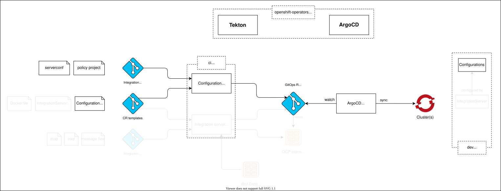
  <figcaption>Building Configuration</figcaption>
</figure>

We will start by going over an overview of **Configuration** objects. We will then describe the Tekton pipeline that builds the **Configuration** objects from configuration sources.

We will created the needed Git repositories, one that contains the sources of our configurations and one that contains the templates of the **Configuration** custom resources.

We will then install CI/CD ArgoCD application.

To install the pipeline, we will first install the needed Tekton tasks and then install the pipeline itself.

Before we can execute the pipeline we will create the needed resources, which includes SSH keys to access our Git repositories and the PVC resource.

And finally we will conclude by executing the pipeline and verifying the result.

---

## Pre-requisites

Before attempting this topic, you should have successfully completed the [Cloud Native AppConnect Enterprise GitOps](../cluster-config/gitops-tekton-argocd.md).

---

## Creating the **Configuration** objects

Environment-specific settings can be decoupled from an Integration Server or a BAR file so that it can can be deployed in various environments. These settings, which includes contents of `server.conf.yaml`, `setdbparms`, policy projects, keystores, etc. are represented as **Configuration** custom Kubernetes resources (CR) and processed by ACE operator.

For example, consider the following a `server.conf.yaml`, a plain text YAML file:

``` { .yaml .no-copy }
ResourceManagers:
  JVM:
    truststoreType: 'JKS'
    truststoreFile: '/home/aceuser/truststores/ibm-ca.jks'
    truststorePass: 'setdbparms::truststore'

    keystoreType: 'JKS'
    keystoreFile: '/home/aceuser/keystores/ibm-ace-server.jks'
    keystorePass: 'setdbparms::keystore'

  HTTPSConnector:
    ReqClientAuth: true
    CipherSpec: 'TLS_ECDHE_ECDSA_WITH_AES_256_GCM_SHA384'

Defaults:
  Policies:
    HTTPSConnector: 'HTTPS'
```

which configures an Integration server with TLS and requires client authentication to set up Mutual Authentication. The settings and the referred keystore (and truststore) can be decoupled from the Integration Server image by creating a **Configuration** CR (and referred in an **IntegrationServer** CR).

The **Configuration** CR of the above `server.conf.yaml` is created by encoding the content with base64 and creating a YAML of:

``` { .yaml .no-copy }
apiVersion: appconnect.ibm.com/v1beta1
kind: Configuration
metadata:
  name: ibm-example-serverconf
spec:
  type: serverconf
  data: UmVzb3VyY2VNYW5hZ2VyczoKICBKVk06CiAgICB0cnVzdHN0b3JlVHlwZTogJ0pLUycKICAgIHRydXN0c3RvcmVGaWxlOiAnL2hvbWUvYWNldXNlci90cnVzdHN0b3Jlcy9pYm0tY2EuamtzJwogICAgdHJ1c3RzdG9yZVBhc3M6ICdzZXRkYnBhcm1zOjp0cnVzdHN0b3JlJwoKICAgIGtleXN0b3JlVHlwZTogJ0pLUycKICAgIGtleXN0b3JlRmlsZTogJy9ob21lL2FjZXVzZXIva2V5c3RvcmVzL2libS1hY2Utc2VydmVyLmprcycKICAgIGtleXN0b3JlUGFzczogJ3NldGRicGFybXM6OmtleXN0b3JlJwoKICBIVFRQU0Nvbm5lY3RvcjoKICAgIFJlcUNsaWVudEF1dGg6IHRydWUKICAgIENpcGhlclNwZWM6ICdUTFNfRUNESEVfRUNEU0FfV0lUSF9BRVNfMjU2X0dDTV9TSEEzODQnCgpEZWZhdWx0czoKICBQb2xpY2llczoKICAgIEhUVFBTQ29ubmVjdG9yOiAnSFRUUFMnCg==

```

Similarly, policy project configurations can be decoupled from a BAR, and stored in a **Configuration** CR. 

There are also configurations that contains sensitive information, such a `setdbparms`, keystores and truststores. Contents of these sensitive configurations are instead stored in **Secret**s, with the help of **SealedSecret**s, and the secret is then referred in the **Configuration** CR.

To automated the process converting integration configuration to **Configuration** CR, we can store the configurations to a Git repository. The templates for the **Configuration** CR are also stored in Git repository. We then make use of the configuration pipeline to create the **Configuration** CR on the GitOps repository. 

Subsequently the GitOps operator deploys the **Configuration** CR on to a OpenShift cluster.

For more information about **Configuration**, see [Configuration reference](https://www.ibm.com/docs/en/app-connect/containers_cd?topic=resources-configuration-reference)


## Overview of the configuration pipeline

<figure markdown>
  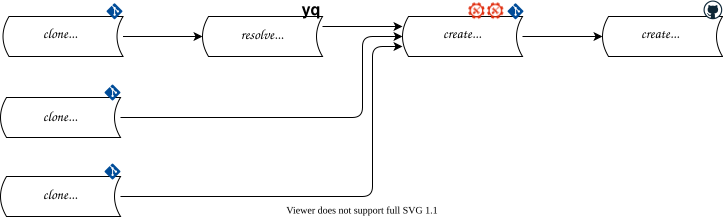{ width="900" }
  <figcaption>Configuration pipeline</figcaption>
</figure>

The pipeline has 6 tasks:

**clone config repo**
**clone infra repo**
**clone gitops repo**

:   Based on [git-clone](https://github.com/tektoncd/catalog/tree/main/task/git-clone/0.4) cluster task, 
    execution of these tasks will clone the required repositories:
    
    * Configuration Repository

        Contains the configuration sources in plain text. For instance, a `serverconf` for the Integration Server is maintained as a YAML file.

        The pipeline needs read-only access to this repository.

    * Infrastructure Repository

        Contains templates for [**Configuration**](https://www.ibm.com/docs/en/app-connect/containers_cd?topic=resources-configuration-reference) custom resources. These are plain YAML files, with templated place holder.

        The pipeline needs read-only access to this repository.

    * GitOps repository

        The multi-tenancy apps repository. This is the repository the GitOps operator watches for any desire state of the application. **Configuration**s for ACE application concern, and therefore the CRs are maintained in the The multi-tenancy apps repository. The pipeline will write the generated  **Configuration**s to this GitOps repository.

        The pipeline needs write access to this repository.

    The tasks will clone the repositories on shared workspace. Subsequent tasks will make use the workspace to access content of the repositories.

    The tasks will require secure access to the repositories. We will use SSH based authentication by using
    GitHub's deploy key.

**resolve props**

:   Pipeline properties list the **Configuration**s and their metadata that are to be deployed from the configuration repository. These properties are maintained in, `pipeline_properties.yaml` file. The **resolve props** custom task parses these properties from the properties file and emit them as results to be used by subsequent tasks.

    The tasks makes use of [`yq`](https://mikefarah.gitbook.io/yq/) command line (CLI) tool. We will create a custom image, `sh-tools` which will contain the `yq` CLI tool.

    As this is a custom task, we would need to deploy them before the pipeline is deployed. 

**create config**

:   This custom task have three steps:

    1. Create the **Configuration**s YAML files

        The configuration sources from the configuration repository is converted to **Configuration**s YAML based on the templates maintained in the infrastructure repository. 

        The steps makes use of `yq` and `zip` CLI. Custom image, `sh-tools`, will contains these tools.

    2. Update the `kustomization.yaml` file.

        **Configuration**s that are to be deployed by GitOps operator is driven by kustomize. Once the pipeline creates the **Configuration**s, the `kustomization.yaml` lists the resources that are to be deployed. Therefore, the pipeline need update the `kustomization.yaml` file.

        The steps makes use of `yq` and `realpath` CLI. Custom image, `sh-tools`, will contains these tools.

    3. Push the changes to GitOps repository.

        The **Configuration**s resources and the updated `kustomization.yaml` file is then pushed to the GitOps repository, under a new branch. `bitnami/git` image is used for this step.

    Before the pipeline can execute this custom task need to be deployed.

**Create Pull Request**

:   A custom task that that create a pull request to pull the changes to GitOps repository. The task is from tekton catalog, [github-open-pr](https://github.com/tektoncd/catalog/tree/main/task/github-open-pr/0.2), but it is not part of the ClusterTask that comes with OpenShift pipeline operator.

## Create the Git repositories from template

We will create Configuration and Infrastructure git repositories from cloud-native-toolkit-demos organization to you organization. 

The GitOps repository, which in our case is the `multi-tenancy-apps` repository should already been created from the template as part of the [GitOps, Tekton & ArgoCD](../cluster-config/gitops-tekton-argocd.md) section.

In the subsequent sections, we will modify our versions of the repositories.

### Create Configuration repository

1. *Create the Configuration repository in your GitHub organization*

    Let's start by making our own copy of the Configuration repository.

    In your browser, navigate to [https://github.com/cloud-native-toolkit-demos/ace-config](https://github.com/cloud-native-toolkit-demos/ace-config) 

    Click on **Use this template** and select your organization, name the repository and click **Create repository from template**. 

    <figure markdown>
      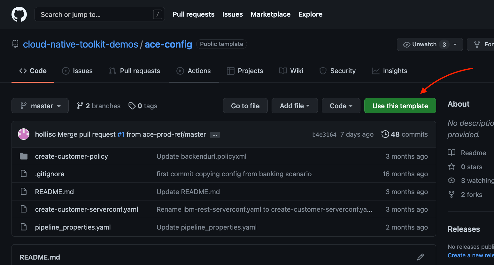{ width="1024" }
      <figcaption>Configuration Template</figcaption>
    </figure>
    
    After a few seconds the repository will be present in your chosen account.


1. *Review the repository*

    In this section we do not need to make any changes to the Configuration repository. So instead of cloning the repository on our local workspace, we can take a look at it in the github.com on the browser with vscode. 
    
    If you press dot (.) key while you are in your github repository, it will open vscode on the browser. See [The dot](https://www.youtube.com/watch?v=ywUZOOzLX3c) for a demo how it works.

    On the `ace-config` repository within your organization, press the dot (`.`) key:

    <figure markdown>
      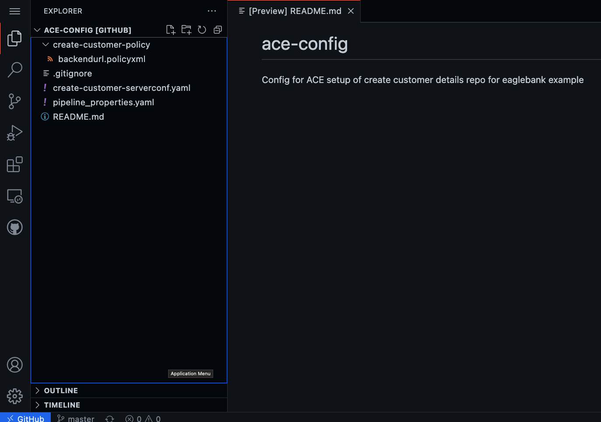{width=1024}
      <figcaption>ACE config on github</figcaption>
    </figure>

    As we can see, there are three important files to consider:

    1. `backendurl.policyxml`: a policy file, defining the URL of the backend service.

        ``` { .xml .no-copy }
        <?xml version="1.0" encoding="UTF-8"?>
        <policies>
          <policy policyType="UserDefined" policyName="backendurl" policyTemplate="UserDefined">
            <soapEndpoint>http://soapserver.tools.svc:8080/ws</soapEndpoint>
          </policy>
        </policies>
        ```

        This defines a user-defined policy to configure the backend soapserver endpoint. Instead of hard-coding the endpoint in our AppConnect message flow, we de-coupled the endpoint as configuration, so that we can point to different soapserver endpoint.

        The file is stored in a folder, `create-customer-policy`. The folder name would be the name of our policy project.

    1. `create-customer-serverconf.yaml`: is the `serverconf` configuration

        ``` { .yaml .no-copy }
        Defaults:
          policyProject: 'create-customer-policy'
        ```

        In our message flow, we are using the policy project as the default policy project. This way, in the message flow, we do not need to fully qualify the policy.

        !!! note

            There is nothing wrong in fully qualifying the policy project in a message flow. In this tutorial we have chosen to make use of default policy project to demonstrate a configuration using serverconf.

    2. `pipeline_properties.yaml`

        ``` { .yaml .no-copy }
        integrationServer:
            configurations:
                serverconf:
                - create-customer-serverconf.yaml
                policyproject:
                - create-customer-policy
        ```

        Lists the configurations and their type. The pipeline will parse this YAML file and deploy only the listed configurations.

### Create Infrastructure repository

1. *Create the Infrastructure repository in your GitHub organization*

    Let's start by making our own copy of the Configuration repository.

    In your browser, navigate to [https://github.com/cloud-native-toolkit-demos/ace-infra](https://github.com/cloud-native-toolkit-demos/ace-infra)

    Click on **Use this template** and select your organization, name the repository and click **Create repository from template**. After a few seconds the repository will be present in your chosen account.

1. *Review the repository*

    Similar to the Configuration repository, open the Infrastructure repository in the browser with vscode by pressing the dot (`.`) key:

    <figure markdown>
      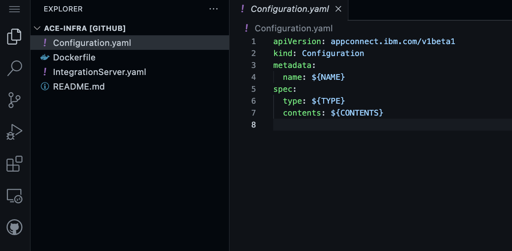{ width="1024" }
      <figcaption>ACE infrastructure repository</figcaption>
    </figure>


    For this section, we are only concerned with the `Configuration.yaml` template file

    The template will be used by the pipeline to render **Configuration**s custom resources.


## Set Environment variables

Throughout this chapter we will make use of two environment variables, 

* `GIT_ORG`: an environment variable that identifies your GitHub organization
* `GIT_ROOT`: an environment variable that identifies the root folder for your cloned git repositories

We will make use of these environment variable to save typing and reduce errors. We have made use of these variable in the chapter, [GitOps, Tekton & ArgoCD](../../cluster-config/gitops-tekton-argocd).

Start a terminal window, we need to keep this terminal and the shell running throughout this chapter.

In the following command, replace `<git-organization>` with the GitHub organization name you've just chosen (e.g. tutorial-org-123):

``` { .bash }
export GIT_ORG=<git-organization>
```

You can verify your $GIT_ORG as follows:

``` { .bash }
echo $GIT_ORG 
```

Next, set `GIT_ROOT` to the root folder for your cloned git repositories. For example:

```bash
export GIT_ROOT=$HOME/git/$GIT_ORG-root
```

You can verify your $GIT_ROOT folder as follows:

```bash
echo $GIT_ROOT
```


## Install CI/CD ArgoCD Application

In this first section, we will install the CI/CD ArgoCD application which watches over resources related to CI/CD from the gitOps-apps repository. Specifically, it watches of [`ace/config/argocd/ci`](https://github.com/cloud-native-toolkit-demos/multi-tenancy-gitops-apps/tree/master/ace/config/argocd/ci) sub-folder from the "multi-tenancy-gitops-apps" repository.


1. *Change to root level GitOps repository*

    Issue the following command to change to your GitOps repository:

    ```bash
    cd $GIT_ROOT/multi-tenancy-gitops
    ``` 

2. Install ACE CI/CD ArgoCD Application

    Open `0-bootstrap/single-cluster/3-apps/kustomization.yaml` and uncomment `argocd/ace/cicd.yaml` resource

    If you take diff of your changes:

    ```bash
    git diff --unified=0
    ```

    you should see:

    ``` { .bash .no-copy }
    diff --git a/0-bootstrap/single-cluster/3-apps/kustomization.yaml b/0-bootstrap/single-cluster/3-apps/kustomization.yaml
    index c695ae5..bdbfc37 100644
    --- a/0-bootstrap/single-cluster/3-apps/kustomization.yaml
    +++ b/0-bootstrap/single-cluster/3-apps/kustomization.yaml
    @@ -2 +2 @@ resources:
    -#- argocd/ace/cicd.yaml
    +- argocd/ace/cicd.yaml
    ```

    commit your changes:

    ```bash
    git commit -am "Install ACE CI/CD"
    ```

    and push your changes to the origin:

    ```bash
    git push
    ```

    ``` { .bash .no-copy }
    Enumerating objects: 11, done.
    Counting objects: 100% (11/11), done.
    Delta compression using up to 16 threads
    Compressing objects: 100% (6/6), done.
    Writing objects: 100% (6/6), 490 bytes | 490.00 KiB/s, done.
    Total 6 (delta 5), reused 0 (delta 0)
    remote: Resolving deltas: 100% (5/5), completed with 5 local objects.
    To github.com:ace-prod-ref/multi-tenancy-gitops.git
       ae9c78c..9eabc94  master -> master
    ```

1. *On the ArgoCD UI, verify the reconciliation*

    Soon after ArgoCD will reconcile the new changes. You should see the commit message that made the change, as well as the `apps-ace-ci` application:

    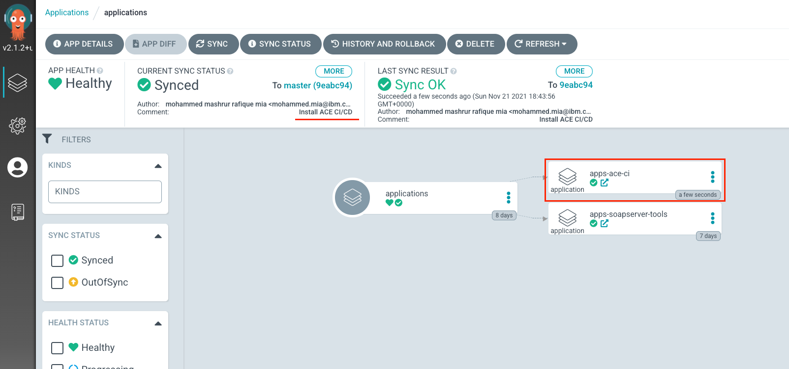  

    Open the `apps-ace-ci` application (either by going to **Applications > apps-ace-ci** or by clicking on the external ink icon from the `apps-ace-ci` application icon):

    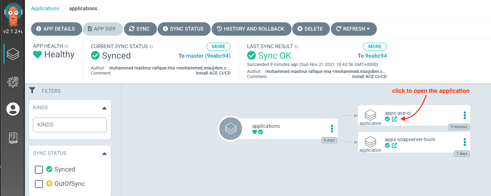

    You should see the `apps-ace-ci`, which in turn install three ArgoCD applications:

    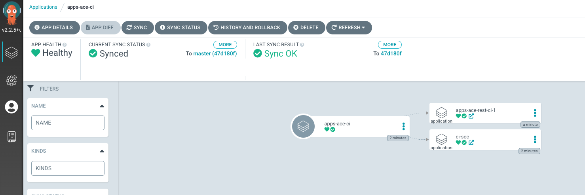  


## Deploy Tekton tasks

There are three custom tasks to deploy:

1. Resolve properties, `resolve-props`
1. Create configurations, `create-config`
1. Create pull request, `github-open-pr`


### Deploy resolve properties task, `resolve-props`

1. *Change to CI environment directory*

    ```bash
    cd $GIT_ROOT/multi-tenancy-gitops-apps/ace/environments/ci
    ```

1. *Update kustomization to enable resolve-props tasks*

    Open `kustomization.yaml` (`$GIT_ROOT/multi-tenancy-gitops-apps/ace/environments/ci/kustomization.yaml`) and uncomment:

    ``` {.yaml .no-copy}
    - tasks/resolve-props.yaml
    ```

    If you take a diff now with

    ```{.bash}
    git diff --unified=0
    ```

    the result should be see:

    ``` { .diff .no-copy}
    diff --git a/ace/environments/ci/kustomization.yaml b/ace/environments/ci/kustomization.yaml
    index bfdfc20..cd96b8d 100644
    --- a/ace/environments/ci/kustomization.yaml
    +++ b/ace/environments/ci/kustomization.yaml
    @@ -27 +27 @@ resources:
    -# - tasks/resolve-props.yaml
    +- tasks/resolve-props.yaml
    ```

2. *Commit the and push the change*

    ```bash
    git commit -am "Deploy resolve-props task" && git push
    ```

3. *Check the deployment of the task in ArgoCD UI*

    Under "apps-ace-rest-ci-1" project, you should see that the task has been deployed:

    <figure markdown>
      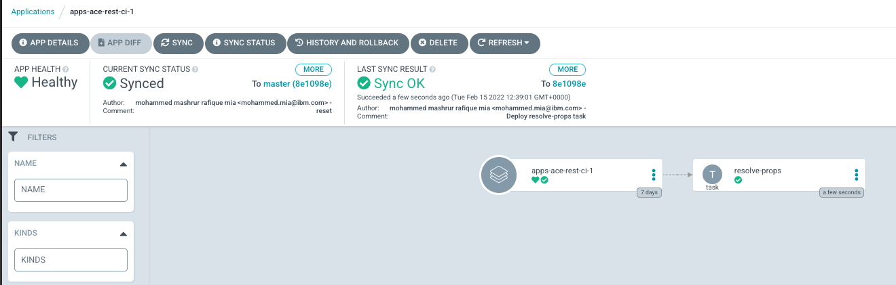{ width="1024" }
      <figcaption>`resolve-props` synched by ArgoCD</figcaption>
    </figure>

4. *Check the deployment of the task in OpenShift UI*

    You can also verify the deploy on OpenShift UI. From **Pipelines > Tasks**, make sure Project `ci` is selected from the drop down menu:

    <figure markdown>
      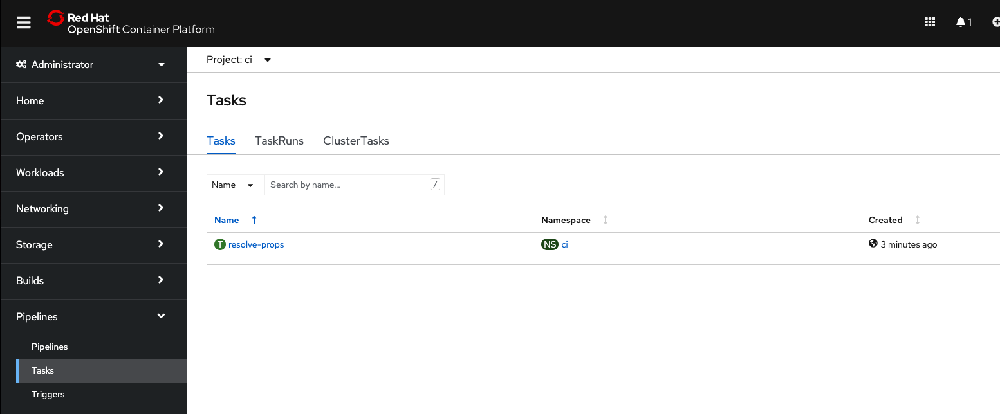{ width="1024" }
      <figcaption>`resolve-props` task in OpenShift UI</figcaption>
    </figure>

### Deploy create configuration task, `create-config`

The `create-config` custom task makes use of [`yq`](https://mikefarah.gitbook.io/yq/) and `zip` utility. This requires custom image to be created. Therefore, before we can deploy the task, we will create the image.

We will make use of OpenShift Build to create the custom image first, and then deploy the `create-config` custom task.

1. *Change to CI environment directory*

    ```bash
    cd $GIT_ROOT/multi-tenancy-gitops-apps/ace/environments/ci
    ```

1. *Update kustomization enable build of image stream, `sh-tools`**

    Open `kustomization.yaml` (`$GIT_ROOT/multi-tenancy-gitops-apps/ace/environments/ci/kustomization.yaml`) and uncomment:

    ``` {.yaml .no-copy}
    - imagestreams/sh-tools.yaml
    - buildconfig/sh-tools.yaml
    - roles/custom-images-builder-role.yaml
    - roles/custom-images-builder-rolebinding.yaml
    ```

    We are enabling OpenShift build config and image stream resource to build the `yq-zip` image. We also need to enable a role and rolebinding so that ArgoCD service account can manipulate build configs and image stream.

    If you take a diff now with

    ```{.bash}
    git diff --unified=0
    ```

    the result should be:

    ``` { .diff .no-copy }
    diff --git a/ace/environments/ci/kustomization.yaml b/ace/environments/ci/kustomization.yaml
    index cd96b8d..6fe7d6c 100644
    --- a/ace/environments/ci/kustomization.yaml
    +++ b/ace/environments/ci/kustomization.yaml
    @@ -2 +2 @@ resources:
    -# - buildconfig/sh-tools.yaml
    +- buildconfig/sh-tools.yaml
    @@ -5 +5 @@ resources:
    -# - imagestreams/sh-tools.yaml
    +- imagestreams/sh-tools.yaml
    @@ -13,2 +13,2 @@ resources:
    -# - roles/custom-images-builder-role.yaml
    -# - roles/custom-images-builder-rolebinding.yaml
    +- roles/custom-images-builder-role.yaml
    +- roles/custom-images-builder-rolebinding.yaml
    ```

2. *Commit the change*

    ```bash
    git commit -am "Deploy build for sh-tools"
    ```

3. *Update kustomization to enable custom task, `create-config`**

    Open `kustomization.yaml` (`$GIT_ROOT/multi-tenancy-gitops-apps/ace/environments/ci/kustomization.yaml`) and uncomment:

    ``` {.yaml .no-copy}
    - tasks/create-config.yaml
    ```

    If you take a diff now with

    ```{.bash}
    git diff --unified=0
    ```

    the result should be see:

    ``` { .diff .no-copy}
    diff --git a/ace/environments/ci/kustomization.yaml b/ace/environments/ci/kustomization.yaml
    index 6fe7d6c..ca4d257 100644
    --- a/ace/environments/ci/kustomization.yaml
    +++ b/ace/environments/ci/kustomization.yaml
    @@ -26 +26 @@ resources:
    -# - tasks/create-config.yaml
    +- tasks/create-config.yaml
    ```

4. *Commit the change*

    ```bash
    git commit -am "Deploy create-config task"
    ```

5. *Push both changes*

    ```bash
    git push
    ```

You can verify that ArgoCD deployed the resource using the ArgoCD UI:

<figure markdown>
  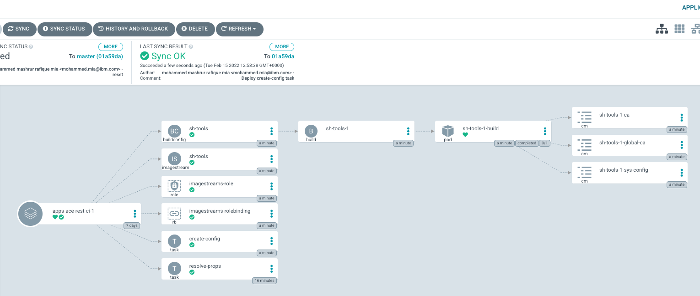{ width="1024" }
  <figcaption>`sh-tools` and `create-config` on ArgoCD UI</figcaption>
</figure>

??? note "If you do not see change right away"

    try **Refresh**ing

    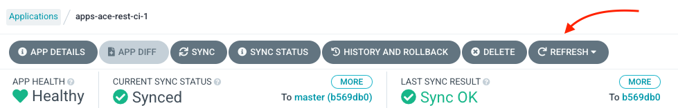  

Once the build finished the image stream will be created. You can verify it in the OpenShift Web Console UI. Navigate to **Builds > ImageStreams**, making sure project **ci** selected in the Project dropdown:

<figure markdown>
  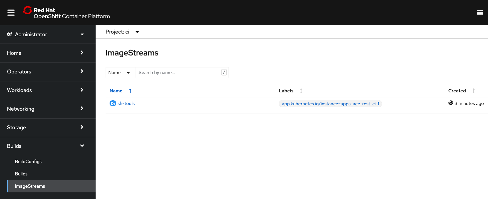{ width="1024" }
  <figcaption>Image Stream in OpenShift Web UI</figcaption>
</figure>

Or from command line:

``` { .bash }
oc get is -n ci
```

``` { .bash .no-copy }
NAME       IMAGE REPOSITORY                                               TAGS     UPDATED
sh-tools   image-registry.openshift-image-registry.svc:5000/ci/sh-tools   latest   4 minutes ago
```

As for the `create-config` task, you can verify the deployment from the OpenShift UI via **Pipelines > Tasks**, make sure Project `ci` is selected from the drop down menu:

<figure markdown>
  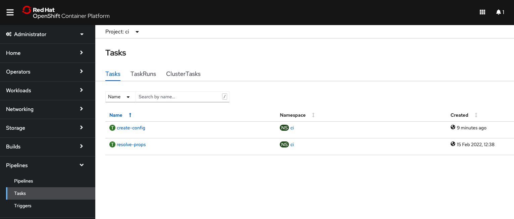{ width="1024" }
  <figcaption>`create-config` task in OpenShift Web UI</figcaption>
</figure>

### Deploy Github Open Pull Request task, `github-open-pr`

1. *Change to CI environment directory*

    ```bash
    cd $GIT_ROOT/multi-tenancy-gitops-apps/ace/environments/ci
    ```

1. *Update kustomization enable Github Open Pull Request, `github-open-pr`**

    Open `kustomization.yaml` (`$GIT_ROOT/multi-tenancy-gitops-apps/ace/environments/ci/kustomization.yaml`) and uncomment:

    ``` {.yaml .no-copy}
    - tasks/github-open-pr.yaml
    ```

    If you take a diff now with

    ```{.bash}
    git diff --unified=0
    ```

    the result should be see:

    ``` { .bash .no-copy }
    diff --git a/ace/environments/ci/kustomization.yaml b/ace/environments/ci/kustomization.yaml
    index ca4d257..00f254a 100644
    --- a/ace/environments/ci/kustomization.yaml
    +++ b/ace/environments/ci/kustomization.yaml
    @@ -29 +29 @@ resources:
    -# - tasks/github-open-pr.yaml
    +- tasks/github-open-pr.yaml
    ```
1. *Commit the change*

    ```bash
    git commit -am "Deploy github-open-pr task"
    ```

1. *Push both changes*

    ```bash
    git push
    ```

You can verify that ArgoCD deployed the resource using the ArgoCD UI:

<figure markdown>
  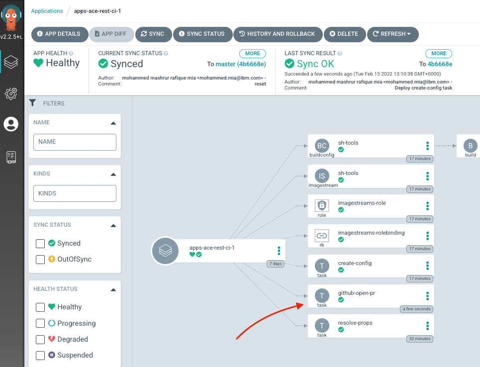{ width="1024" }
  <figcaption>`github-open-pr` task on ArgoCD UI</figcaption>
</figure>

You can verify the tasks are deployed using OpenShift Web UI. 

<figure markdown>
  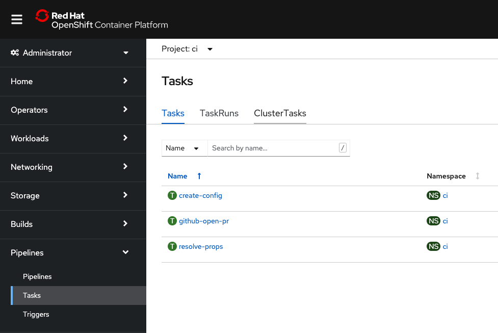{ width="1024" }
  <figcaption>`github-open-pr` task on OpenShift UI</figcaption>
</figure>


You can also do it with `oc` CLI:

```bash
oc get tasks -n ci
```

and expect the following output

``` { .bash .no-copy }
NAME             AGE
create-config    20m
github-open-pr   3m20s
resolve-props    34m
```

## Deploy the pipeline definition

We are now ready to deploy the configuration pipeline.

1. *Change to CI environment directory*

    ```bash
    cd $GIT_ROOT/multi-tenancy-gitops-apps/ace/environments/ci
    ```

1. *Update kustomization to enable resolve-props tasks*

    Open `kustomization.yaml` (`$GIT_ROOT/multi-tenancy-gitops-apps/ace/environments/ci/kustomization.yaml`) and uncomment:

    ``` {.yaml .no-copy}
    - pipelines/ace-config.yaml
    ```

    If you take a diff now with

    ```{.bash}
    git diff --unified=0
    ```

    the result should be see:

    ``` { .diff .no-copy}
    diff --git a/ace/environments/ci/kustomization.yaml b/ace/environments/ci/kustomization.yaml
    index 00f254a..4946bfe 100644
    --- a/ace/environments/ci/kustomization.yaml
    +++ b/ace/environments/ci/kustomization.yaml
    @@ -9 +9 @@ resources:
    -# - pipelines/ace-config-pipeline.yaml
    +- pipelines/ace-config-pipeline.yaml
    ```

2. *Commit the and push the change*

    ```bash
    git commit -am "Deploy ace-config pipeline" && git push
    ```

3. *Check the deployment of the pipeline in ArgoCD UI*

    Under "apps-ace-rest-ci-1" project, you should see that the task has been deployed:


    <figure markdown>
      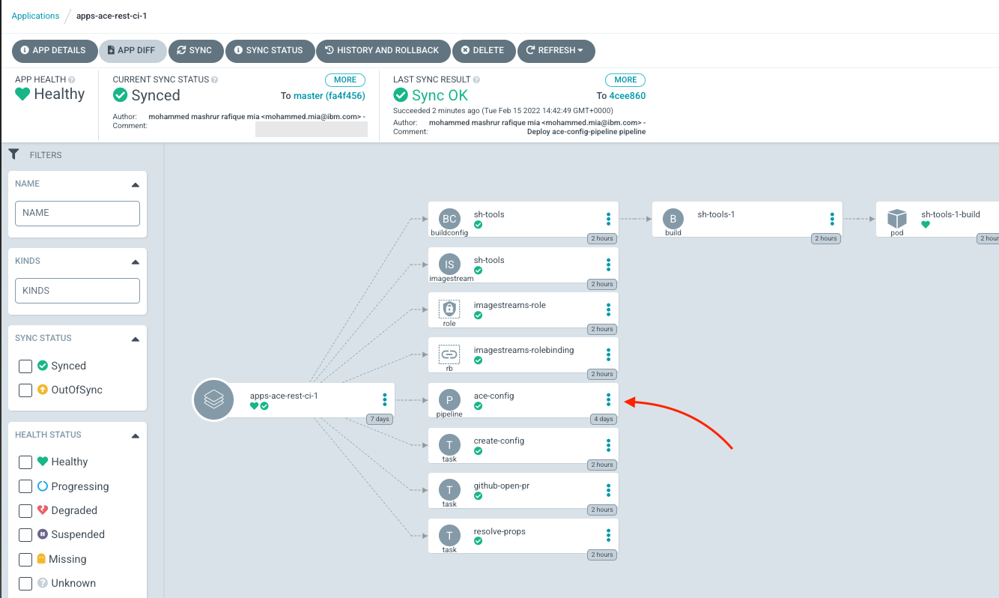{ width="1024" }
      <figcaption>`ace-config` pipeline synched by ArgoCD</figcaption>
    </figure>

4. *Check the deployment of the pipeline in OpenShift UI*

    You can also verify the deploy on OpenShift UI. From **Pipelines > Pipelines**, make sure Project `ci` is selected from the drop down menu:

    <figure markdown>
      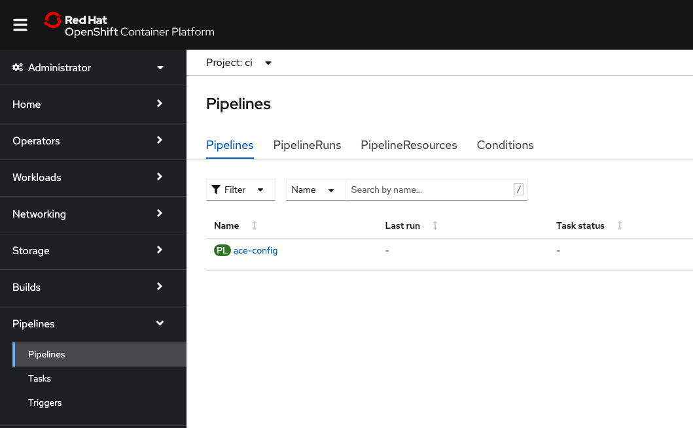{ width="1024" }
      <figcaption>`ace-config` pipeline in OpenShift UI</figcaption>
    </figure>


## Set up `SealedSecret` for pipeline access to git repository

Our configuration pipeline would need to access Git repositories for source of the configuration files and the templates for the **Configuration**s objects. In this tutorial we will assume that our configuration repository is a private repository. As noted in this blog, [Private Git Repositories](https://cloud.redhat.com/blog/private-git-repositories-part-2a-repository-ssh-keys), the preferred mechanism for accessing a private Git repository is to create a unique repository SSH key. In this section we will set up this mechanism.

### Create SSH key pairs

We will create three pairs for SSH keys, one for the configuration repository, one for the infrastructure repository and one for our `multi-tenancy-gitops-apps` repository.

1. *Change to a directory outside the git repositories*

    We will generate a pair of SSH keys (public and private) but we do not want to store these in a git repositories. In this tutorial, we will assume to create and store the SSH keys in `$HOME/keys` directory.

    Create the directory:

    ```bash
    mkdir -p $HOME/keys
    ```

    Change working directory to `$HOME/keys`

    ```bash
    cd $HOME/keys
    ```

2. *Create ssh key pairs*

    Using `ssh-keygen`, we can create ssh key pair for the configuration repository:

    ```bash
    ssh-keygen -C "gitops-pipeline/ace-config@github.com/ace-prod-ref" -f ace-config-at-ace-prod-ref-github -N ''
    ```

    filenames for the keys will start with `ace-config-at-ace-prod-ref-github` and we are not setting a passphrase. 

    Similarly, for the infrastructure repository:

    ```bash
    ssh-keygen -C "gitops-pipeline/ace-infra@github.com/ace-prod-ref" -f ace-infra-at-ace-prod-ref-github -N ''
    ```

    and for the `multi-tenancy-gitops-apps`

    ```bash
    ssh-keygen -C "gitops-pipeline/multi-tenancy-gitops-apps@github.com/ace-prod-ref" -f multi-tenancy-gitops-apps-at-ace-prod-ref-github -N ''
    ```

    If you list the files that are created in the current directory, you should see:

    ``` { .bash }
    tree .
    ```

    ``` { .bash .no-copy }
    .
    ├── ace-config-at-ace-prod-ref-github
    ├── ace-config-at-ace-prod-ref-github.pub
    ├── ace-infra-at-ace-prod-ref-github
    ├── ace-infra-at-ace-prod-ref-github.pub
    ├── multi-tenancy-gitops-apps-at-ace-prod-ref-github
    └── multi-tenancy-gitops-apps-at-ace-prod-ref-github.pub

    0 directories, 6 files
    ```

### Upload the public ssh-key

1. *Upload the public ssh-key to the Configuration Git repository*

    The public keys of our pairs need to be uploaded to our Git repositories, as Deploy keys.

    Visit your repository, go to Settings, and then to choose **Deploy keys** on the left hand side menu. For example, for  `ace-config` repository:

    <figure markdown>
      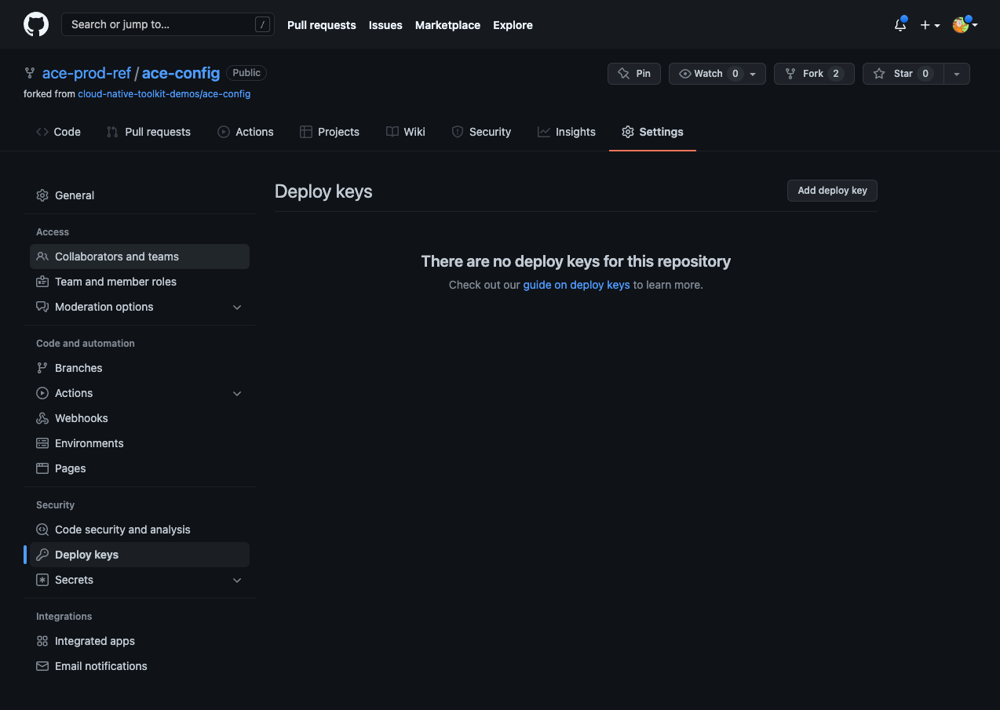{ width="1024" }
      <figcaption>Deploy Key Settings</figcaption>
    </figure>

    Click on **Add deploy key** button, give a title (say "gitops-pipeline") and copy the content of public key (for example, `ace-config-at-ace-prod-ref-github.pub` for ace-config repository).

    ??? tip "Use `pbcopy` in MacOS"

        If you are using MacOS, you can use `pbcopy` CLI to copy the public key on your clipboard:

        ```bash
        cat ~/keys/ace-config-at-ace-prod-ref-github.pub | pbcopy
        ```

    <figure markdown>
      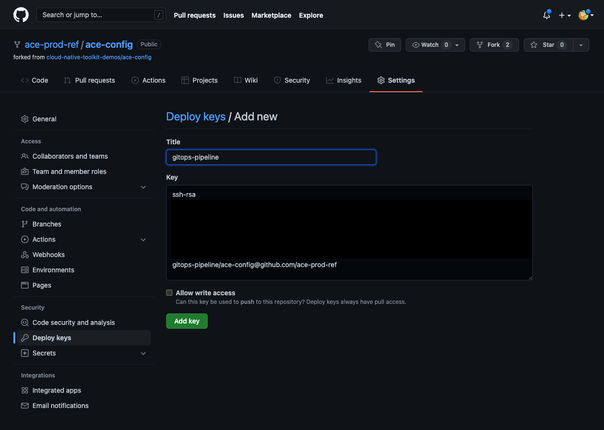{ width="1024" }
      <figcaption>Deploy Key for ACE Configuration Repository</figcaption>
    </figure>


    Click on **Add key** button to the add the deploy key.

1. *Upload the public ssh-key to the Infrastructure Git repository*

    Similarly, for `ace-infra` repository, use content of `ace-infra-at-ace-prod-ref-github.pub` for the ace-infra repository.

    <figure markdown>
      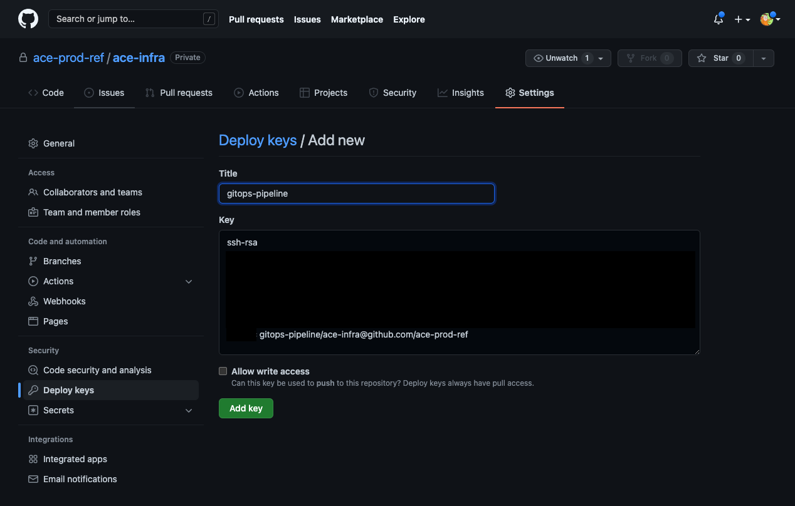{ width="1024" }
      <figcaption>Deploy Key for ACE Infrastructure Repository</figcaption>
    </figure>

1. *Upload the public ssh-key to the GitOps Git repository*

    And finally, for `multi-tenancy-gitops-apps` repository, use content of `multi-tenancy-gitops-apps-at-ace-prod-ref-github.pub` for the ace-infra repository. Make sure to check "Allow write access". The pipeline will write to this repository

    <figure markdown>
      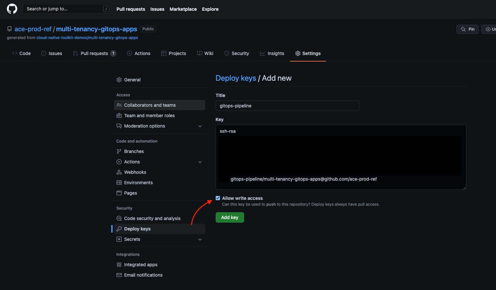{ width="1024" }
      <figcaption>Deploy Key for GitOps Repository</figcaption>
    </figure>


### Create a "machine user"

The pipeline will not only make use of git operations, but it will also make use of GitHub APIs. Once the **Configuration**s objects are created and pushed to GitOps repository on a specific branch, the pipeline will make a pull request to merge the changes to the main (master) branch. 

This requires pipeline to make use of GitHub APIs. We would need a GitHub user for this. It is recommend to make use of a "Machine User" for this purpose. The Machine User will have limited access to your repositories. Create a machine user following GitHub documentation.

In the following we will assume our "Machine User" is `cicd.acme`.


### Create access token for the Machine User

This can be done by logging into github.com as the machine user, going to **Settings > Developer Settings > Personal access tokens** and clicking **Generate new token**:

<figure markdown>
  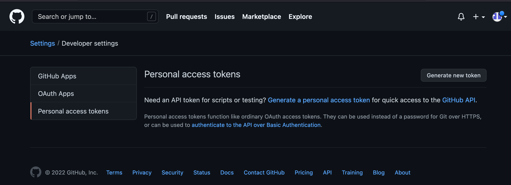{ width="1024" }
  <figcaption>Generate new Token</figcaption>
</figure>

On the "New personal access token" page, name your token and give **repo** access:

<figure markdown>
  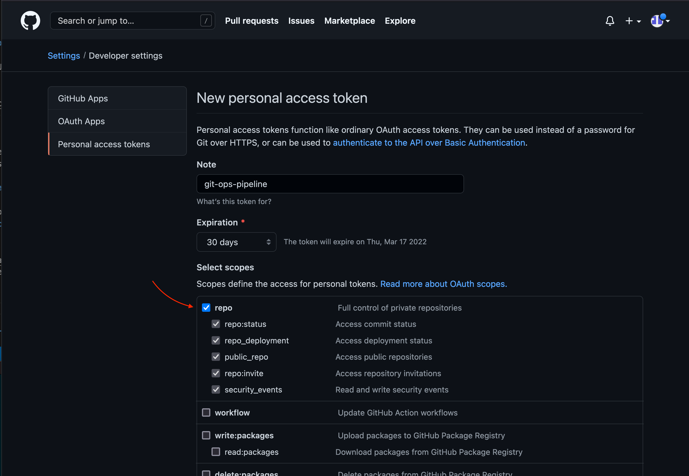{ width="1024" }
  <figcaption>New personal access token</figcaption>
</figure>

Store the access token in a safe place for now.

### Give GitHub API access to GitOps repository

1. *Browse to the GitOps repository, `multi-tenancy-gitops-apps`, Settings page*

    <figure markdown>
      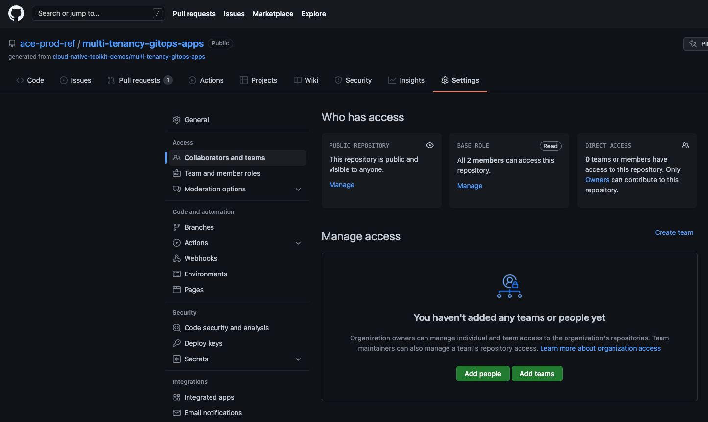{ width="1024" }
      <figcaption>Settings of `multi-tenancy-gitops-apps` repository</figcaption>
    </figure>

1. *Add Machine User*

    Click on **Add People** button

    Use your Machine User. For instance, we will choose `cicd-acme` as our Machine User:

    <figure markdown>
      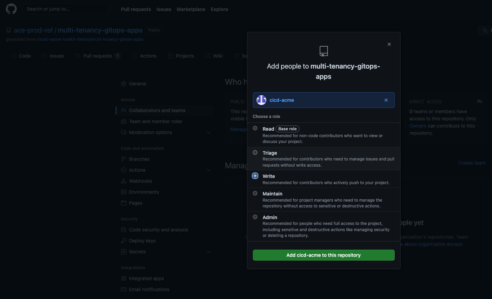{ width="1024" }
      <figcaption>Add `cicd-acme` to GitOps Repository</figcaption>
    </figure>

    Make sure that the Machine User has write permission. Our pipeline will use this user to create pull request to the repository.


### Create sealed secrets

The private part of the SSH key need to be used by our pipeline to authenticate itself when cloning the repository. Moreover, the personal access token of the machine user will also be used the pipeline. 

The keys and the token can be accessed via a kubernetes secret object. The secret object can be created by GitOps operator, but instead of storing the SSH key in a `Secret` manifest yaml, we will store it as `SealedSecret`. 

A `Secret` manifest encodes it's data, but does not encrypts it. Therefore it is not a good idea to store a plain `Secret` manifest yaml in a git repository. Instead, we will use `SealedSecret` manifest, which encrypts a `Secret` manifest and generates a encrypted version of its data content. We can store this encrypted `SealedSecret` manifest in a Git repository. Once GitOps operator reconciles this object on to the cluster, `SealedSecret` operator will decrypt it and store it as a secret in the namespace. Only `SealedSecret` operator decrypt the `SealedSecret` manifest.

1. *Create sealed secret for the private SSH key*

    Sealed Secret operator from bitnami has already been deployed as part of work in section, [Deploy services to the cluster](../cluster-config/services.md#deploy-services-to-the-cluster). We will now create a sealed secret for the private SSH key.

    For this, we need to have `kubeseal` installed on our local environment. If you don't have have it installed, on MacOs, you can use homebrew:

    ```bash
    brew install kubeseal
    ```

    !!! note

        For more details (and installation for Linux), see [kubeseal releases](https://github.com/bitnami-labs/sealed-secrets/releases)

1.  *Change to GitOps apps repository*

    ```bash
    cd $GIT_ROOT/multi-tenancy-gitops-apps
    ```

    This repository maintains application manifests. The private key of our SSH key-pair is an application specific artifact, and therefore it is to be maintained in the application repository.

    Change to the directory where sealed secrets are stored

    ```bash
    cd ace/environments/ci/secrets
    ```

1.  *Run the `gitops-repo-pk-secret.sh` script to generate `SealedSecret`s for SSH deploy keys*

    `gitops-repo-pk-secret.sh` script make use of three environment variables

    * `GITOPS_PK_SECRET_NAME`: Name of the secret. The name is also used in creating the `SealedSecret` manifest yaml file

    * `GIT_BASEURL`: Base URL of the git repository. This is needed for the tekton specific annotation on the `Secret` object. It is also needed to generate the host keys.

    * `SSH_PRIVATE_KEY_PATH`: full path to the private key.

    Assuming our private key is kept in `$HOME/keys` directory, then to generate the `SealedSecret` manifest, we can execute the script as follows for private key of `ace-config` deploy key:

    ```bash
    GITOPS_PK_SECRET_NAME=ace-config-at-github \
        GIT_BASEURL=github.com \
        SSH_PRIVATE_KEY_PATH=$HOME/keys/ace-config-at-ace-prod-ref-github \
        ./gitops-repo-pk-secret.sh
    ```

    A new file, named `git-ssh-pk-ace-config-at-github.yaml` will be created on the `ace/environments/ci/secrets` directory.

    !!! note "Convention over configuration"

        Throughout this guide we will make use of certain naming convention. For example the secret for storing private key `ace-config` is called `ace-config-at-github`. In the later sections, some scripts will make use of this naming convention to require less configurations. If you choose to use different naming conventions, you may need to update those scripts.

    Similarly, for private key of `ace-infra` deploy key:

    ```bash
    GITOPS_PK_SECRET_NAME=ace-infra-at-github \
        GIT_BASEURL=github.com \
        SSH_PRIVATE_KEY_PATH=$HOME/keys/ace-infra-at-ace-prod-ref-github \
        ./gitops-repo-pk-secret.sh
    ```

    And, for private key of `multi-tenancy-gitops-apps` deploy key:

    ```bash
    GITOPS_PK_SECRET_NAME=multi-tenancy-gitops-apps-at-github \
        GIT_BASEURL=github.com \
        SSH_PRIVATE_KEY_PATH=$HOME/keys/multi-tenancy-gitops-apps-at-ace-prod-ref-github \
        ./gitops-repo-pk-secret.sh
    ```

1. *Run the `gitops-repo-pk-secret.sh` script to generate `SealedSecret`s for GitHub access token*

    `gitops-repo-pk-secret.sh` script make use of two environment variables

    * `TOKEN_SECRET_NAME`: Name of the secret. The name is also used in creating the `SealedSecret` manifest yaml file

    * `TOKEN`: The Personal Access Token that will be used to authenticate a user to GitHub.

    To generated the **SealedSecret** for our Machine User's access token, run:

    ```bash
    TOKEN_SECRET_NAME=cicd-acme \
        TOKEN=<PUT_ACCESS_TOKEN_HERE> \
        ./gitops-repo-token-secret.sh
    ```

    replacing `<PUT_ACCESS_TOKEN_HERE>` with the token you have created for the Machine User earlier.

2. *Check git status*
    if you check git status with

    ```bash
    git status
    ```
    you should be able to confirm that:

    ``` { .bash .no-copy }
    On branch master
    Your branch is up to date with 'origin/master'.

    Untracked files:
    (use "git add <file>..." to include in what will be committed)
        github-user-token-secret-cicd-acme.yaml
        gitops-repo-pk-secret-ace-config-at-github.yaml
        gitops-repo-pk-secret-ace-infra-at-github.yaml
        gitops-repo-pk-secret-multi-tenancy-gitops-apps-at-github.yaml

    nothing added to commit but untracked files present (use "git add" to track)
    ``` 

3. *Commit the `SealedSecret` manifest to application repository*

    ```bash
    git add gitops-repo-pk-secret-ace-config-at-github.yaml
    git commit -m 'Add SealedSecret for ace-config private key'
    ```

    ```bash
    git add gitops-repo-pk-secret-ace-infra-at-github.yaml
    git commit -m 'Add SealedSecret for ace-infra private key'
    ```

    ```bash
    git add  gitops-repo-pk-secret-multi-tenancy-gitops-apps-at-github.yaml
    git commit -m 'Add SealedSecret for multi-tenancy-gitops-apps private key'
    ```

    ```bash
    git add github-user-token-secret-cicd-acme.yaml
    git commit -m 'Add SealedSecret for access token for cicd.acme'
    ```

4.  Add the `SealedSecret`s on `apps-ace-rest-ci-1` ArgoCD application

    CI/CD related manifests are configure by `apps-ace-rest-ci-1` ArgoCD application, which is configured by `ace/environments/ci/kustomization.yaml`. To add the `SealedSecret` on the cluster, add the following item under `resources` field:

    ```yaml
    - secrets/github-user-token-secret-cicd-acme.yaml
    - secrets/gitops-repo-pk-secret-ace-config-at-github.yaml
    - secrets/gitops-repo-pk-secret-ace-infra-at-github.yaml
    - secrets/gitops-repo-pk-secret-multi-tenancy-gitops-apps-at-github.yaml
    ```

    if you take a difference of changes on the repository:

    ```bash
    git diff --unified=0
    ```

    you should see the following:

    ``` { .bash .no-copy }
    diff --git a/ace/environments/ci/kustomization.yaml b/ace/environments/ci/kustomization.yaml
    index 5f7b008..db70c64 100644
    --- a/ace/environments/ci/kustomization.yaml
    +++ b/ace/environments/ci/kustomization.yaml
    @@ -24,0 +25,4 @@ resources:
    +- secrets/github-user-token-secret-cicd-acme.yaml
    +- secrets/gitops-repo-pk-secret-ace-config-at-github.yaml
    +- secrets/gitops-repo-pk-secret-ace-infra-at-github.yaml
    +- secrets/gitops-repo-pk-secret-multi-tenancy-gitops-apps-at-github.yaml
    ```

    Commit the change

    ```bash
    git commit -am 'Enable sealed secrets for repositories access'
    ```

5. Push the changes

    ```bash
    git push
    ```

### Verify the addition of SSH private key `Secret`

Open up `apps-ace-rest-ci-1` on ArgoCD UI:

<figure markdown>
  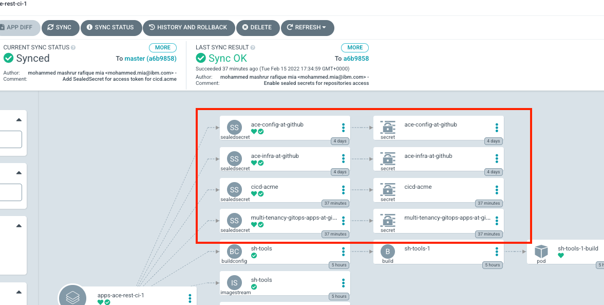{ width="1024" }
  <figcaption>Sealed Secret and Secret</figcaption>
</figure>

As you can see, we have the four **SealedSecret**s deployed. The SealedSecret operator then decrypted them and created kubernetes **Secret** objects (which are owned by the corresponding **SealedSecret**s objects).

You can also verify that the secret is created from the OCP UI. Go to **Workloads > Secrets**, make sure `ci` project is selected. Select Label to filter the secrets and put in `created-by=pipeline` is the Search box:

<figure markdown>
  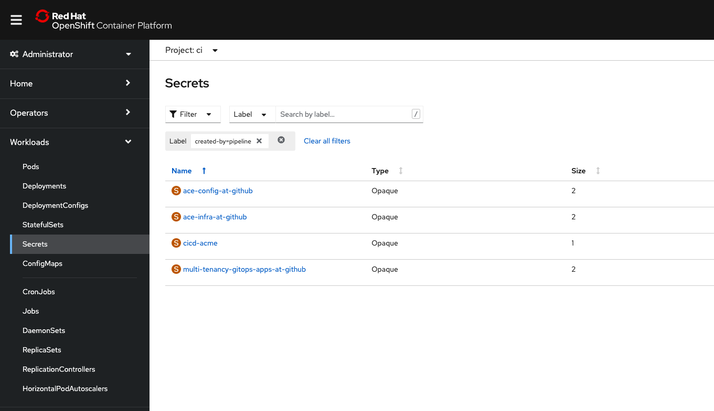{ width="1024" }
  <figcaption>Secrets in OpenShift Web UI</figcaption>
</figure>


## Create PVC

1. *Change to CI environment directory*

    ```bash
    cd $GIT_ROOT/multi-tenancy-gitops-apps/ace/environments/ci
    ```

1. *Update kustomization to enable ace-config pvc*

    Open `kustomization.yaml` (`$GIT_ROOT/multi-tenancy-gitops-apps/ace/environments/ci/kustomization.yaml`) and uncomment:

    ``` {.yaml .no-copy}
    - pvc/ace-config-pvc.yaml
    ```

    If you take a diff now with

    ```{.bash}
    git diff --unified=0
    ```

    the result should be see:

    ``` { .diff .no-copy}
    diff --git a/ace/environments/ci/kustomization.yaml b/ace/environments/ci/kustomization.yaml
    index db70c64..410fc80 100644
    --- a/ace/environments/ci/kustomization.yaml
    +++ b/ace/environments/ci/kustomization.yaml
    @@ -10 +10 @@ resources:
    -# - pvc/ace-config-pvc.yaml
    +- pvc/ace-config-pvc.yaml
    ```

1. *Commit the and push the change*

    ```bash
    git commit -am "Deploy ace-config pvc" && git push
    ```

1. *Check the deployment of the task in ArgoCD UI*

    Under "apps-ace-rest-ci-1" project, you should see that the task has been deployed:

    <figure markdown>
      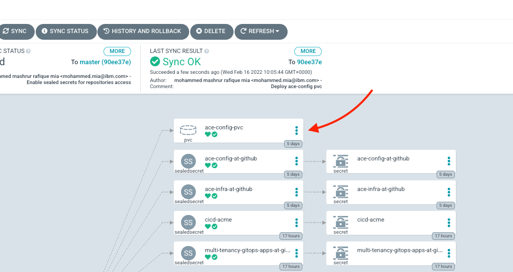{ width="1024" }
      <figcaption>`ace-config` PVC synched by ArgoCD</figcaption>
    </figure>


1. *Check the deployment of the PVC in OpenShift UI*

    You can also verify the deploy on OpenShift UI. From **Storage > PersistentVolumeClaims**, make sure Project `ci` is selected from the drop down menu:

    <figure markdown>
      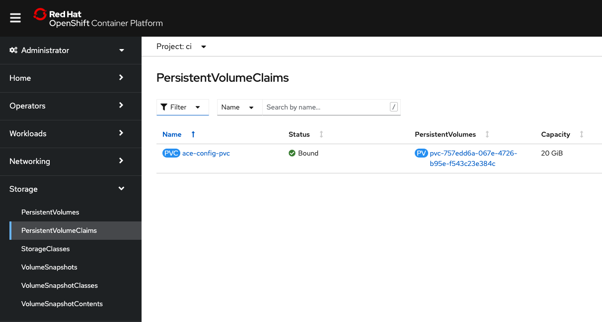{ width="1024" }
      <figcaption>`ace-config` PVC in OpenShift UI</figcaption>
    </figure>

    wait until the PVC bound.

## Enable `apps-ace-rest-dev-1` ArgoCD application

We need to activate `apps-ace-rest-dev-1` ArgoCD application so that ArgoCD watches for changes for the development folder (`ace/environments/overlays/dev`) of the `multi-tenancy-gitops-apps` repository. Our pipeline will store custom resources and activate them in the `ace/environments/base` folder which referred in the `ace/environments/overlays/dev/kustomization.yaml`.

1. *Change to root level GitOps repository*

    Issue the following command to change to your GitOps repository:

    ```bash
    cd $GIT_ROOT/multi-tenancy-gitops
    ``` 

2. Install ACE Dev ArgoCD Application

    Open `0-bootstrap/single-cluster/3-apps/kustomization.yaml` and uncomment 
    
    ``` { .bash .no-copy }
    - argocd/ace/dev.yaml
    ```
    If you take diff of your changes:

    ```bash
    git diff --unified=0
    ```

    you should see:

    ``` { .diff .no-copy }
    diff --git a/0-bootstrap/single-cluster/3-apps/kustomization.yaml b/0-bootstrap/single-cluster/3-apps/kustomization.yaml
    index bdbfc37..5279be1 100644
    --- a/0-bootstrap/single-cluster/3-apps/kustomization.yaml
    +++ b/0-bootstrap/single-cluster/3-apps/kustomization.yaml
    @@ -3 +3 @@ resources:
    -#- argocd/ace/dev.yaml
    +- argocd/ace/dev.yaml
    ```

    commit your changes:

    ```bash
    git commit -am "Install ACE Dev"
    ```

    and push your changes to the origin:

    ```bash
    git push
    ```


1. *On the ArgoCD UI, verify the reconciliation*

    Soon after ArgoCD will reconcile the new changes. You should see the commit message that made the change, as well as the `applications` application:


    <figure markdown>
      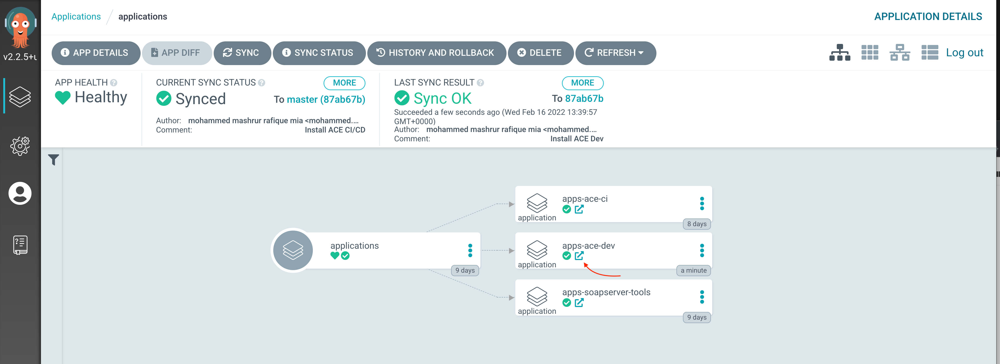{ width="1024" }
      <figcaption>Update in `applications` application</figcaption>
    </figure>

    Open the `apps-ace-dev` application (either by going to **Applications > apps-ace-ci** or by clicking on the external ink icon from the `apps-ace-dev` application icon):

    <figure markdown>
      { width="1024" }
      <figcaption>Icon to open `apps-ace-dev` application</figcaption>
    </figure>

    You should see the `apps-ace-ci`, which in turn installs the `apps-ace-rest-dev-1` application:


    <figure markdown>
      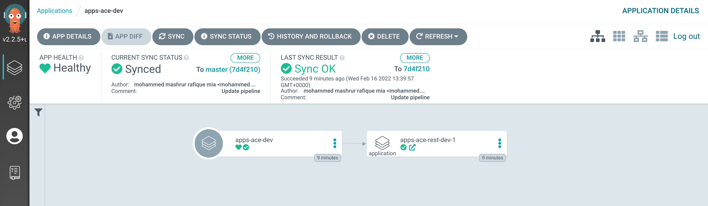{ width="1024" }
      <figcaption>`apps-ace-dev` application</figcaption>
    </figure>

    and when you open `apps-ace-rest-dev-1` application, it will have an empty deployment for now:

    <figure markdown>
      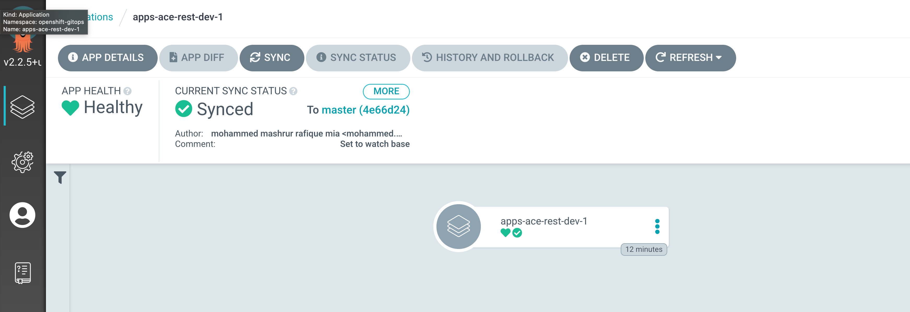{ width="1024" }
      <figcaption>`argocd-ui-apps-ace-rest-dev-1.png` application</figcaption>
    </figure>

## Run the pipeline

Now that all the tasks, pipeline, and required resources are deployed, we can run the pipeline. We do this by creating a **PipelineRun** resource which refers to a **Pipeline** resource. A **PipelineRun** resource is a running instance of a **Pipeline**.

Our configuration pipeline has the following parameters:

| Parameter | Description |
| ----------- | ------------------------------------ |
| `is-config-repo-url` | URL of the Configuration repository. In this tutorial we are making use of SSH based URL. |
| `is-infra-repo-url` | URL of the Infrastructure repository. In this tutorial we are making use of SSH based URL. |
| `git-ops-repo-url` | URL of the GitOps repository. In this tutorial we are making use of SSH based URL.  |
| `gitops-apps-repo-full-name` | Full repository name of the GitOps repository |
| `github-pr-title` | Title of the pull request. Default is set to a string with the name of the pipeline run. Feel free to update it. |
| `github-pr-body` | Body of the pull request. Default is set to a string with the name of the pipeline run. Feel free to update it.  |
| `github-pr-token-secret-name` | Name of the secret that contains the access token of the machine user the pipeline will use to make the pull request. Default is `cicd-acme` as that's how we set up the secret earlier. |

The pipeline has the following workspaces:

| Workspace | Description |
| ----------- | ------------------------------------ |
| `shared-workspace` | The PVC where the `git-clone` task will clone the repositories and other task make use of them. Set to `ace-config` PVC in this tutorial  |
| `ace-config-repo-secret` | The secret that contains the SSH private key to authenticate with Configuration repository.  |
| `ace-infra-repo-secret` | The secret that contains the SSH private key to authenticate with Infrastructure repository. |
| `gitops-repo-secret` | The secret that contains the SSH private key to authenticate with GitOps repository. |


A **PipelineRun** instantiates a **Pipeline** by setting its parameters and workspaces. Some of the parameters have default values (mostly based on values used in this tutorial), but they can be overridden when creating the **PipelineRun** instance.

One way to instantiates a **Pipeline** is to use the OpenShift Web Console. Alternatively you can manually create a [**PipelineRun**](https://github.com/tektoncd/pipeline/blob/main/docs/pipelineruns.md) resource YAML and apply it on the cluster (using `oc apply -f`), or you can make use of [`tkn`](https://github.com/tektoncd/cli) CLI.

??? note "Run pipeline with OpenShift Web Console"

    To start the pipeline, on OpenShift Web Console, navigate to **Pipelines > Pipelines** and then click on **ace-config** pipeline. This will open the pipeline details page. Choose **Start** from the **Actions** dropdown:

    <figure markdown>
      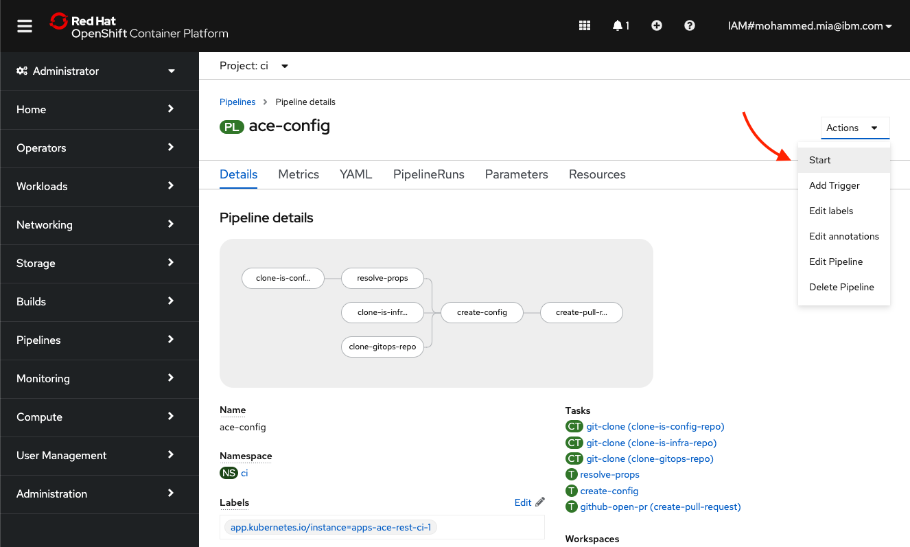{ width="1024" }
      <figcaption>Start a Pipeline</figcaption>
    </figure>

    <figure markdown>
      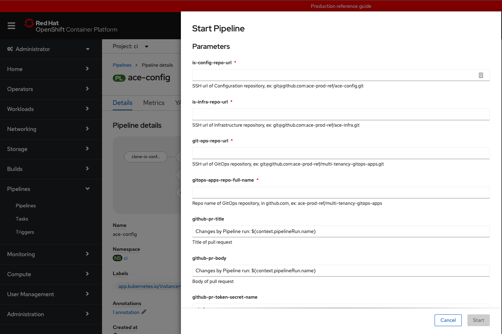{ width="1024" }
      <figcaption>Pipeline Start</figcaption>
    </figure>


    Set the parameters to the appropriate values. If you are following this tutorial, you would need update the `is-config-repo-url`, `is-infra-repo-url` , `git-ops-repo-url` and `gitops-apps-repo-full-name` value.

    As for workspaces, 

    * For `shared-workspace` choose **PersistentVolumeClaim** from the dropdown and then select `ace-config` from the dropdown.

    * For `ace-config-repo-secret` choose **Secret** from the dropdown and then select `ace-config-at-github` from the dropdown.

    * For `ace-infra-repo-secret` choose **Secret** from the dropdown and then select `ace-infra-at-github` from the dropdown.

    * For `gitops-repo-secret` choose **Secret** from the dropdown and then select `gitops-repo-at-github` from the dropdown.


    <figure markdown>
      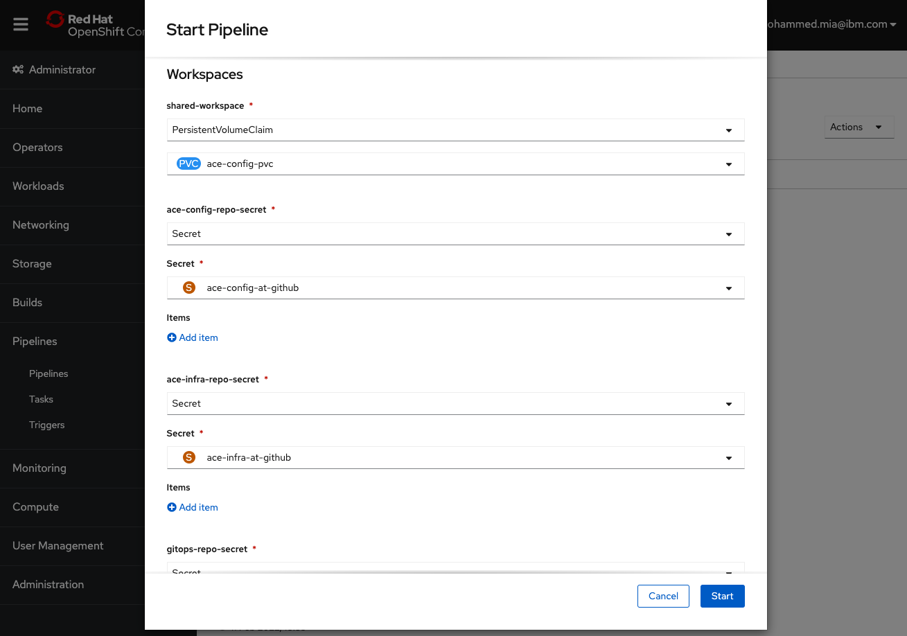{ width="1024" }
      <figcaption>Workspace value for `shared-workspace`, `ace-config-repo-secret`, `ace-infra-repo-secret`</figcaption>
    </figure>


    <figure markdown>
      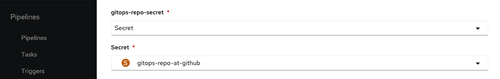{ width="1024" }
      <figcaption>Workspace value for `gitops-repo-secret`</figcaption>
    </figure>

    Click **Start** to start the pipeline.

    If everything goes well, the pipeline will successfully run:

    <figure markdown>
      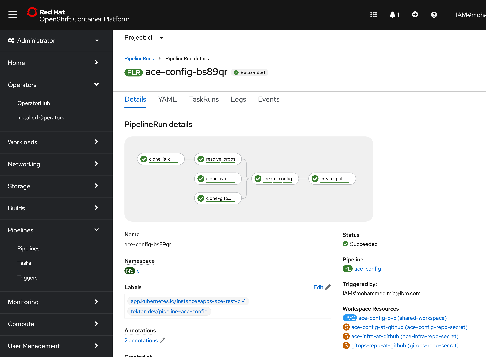{ width="1024" }
      <figcaption>Successful run of `ace-config` pipeline run</figcaption>
    </figure>


??? note "Run the pipeline with `tkn` CLI"

    1. *Install `tkn` CLI*

        On MacOS you can use Homebrew to install `tkn`

        ```bash
        brew install tektoncd-cli
        ```

        For other operating systems, see [`tkn`](https://github.com/tektoncd/cli)
 
    1. *Change to root level GitOps repository*
 
        Issue the following command to change to your GitOps repository and the pipeline directory
 
        ```bash
        cd $GIT_ROOT/multi-tenancy-gitops-apps/ace/environments/ci/pipelines
        ``` 
 
    1. *Run the script `run-ace-config-pipeline.sh`*
 
        The script, `run-ace-config-pipeline.sh`, depends only on the `GIT_ORG`. The script sets all the parameters and workspaces values when issuing `tkn` command to start the pipeline. As mentioned before, we assume certain naming conventions. If you are following this guide as is, you would not need to change the script.
        
        Nevertheless, review the script to make sure they have right values. 
 
        To start the pipeline, issue the following
 
        ```bash
        ./run-ace-config-pipeline.sh
        ```
 
        You will get an output like the following:
 
        ``` { .bash .no-copy }
        PipelineRun started: ace-config-run-7plnb

        In order to track the PipelineRun progress run:
        tkn pipelinerun logs ace-config-run-7plnb -f -n ci
        ```
 
        You can use `tkn` CLI to check the status of the pipeline, with `tkn pipelinerun describe` command. For example, for the above:
 
        ``` { .bash }
        tkn pipelinerun describe ace-config-run-7plnb -n ci
        ```
 
        You will see the various task runs.
 
        You can also check the pipeline run from OpenShift Web Console. Navigate to **Pipelines > Pipelines**, and click on the pipeline run link for the pipeline, `ace-config`:
 
        <figure markdown>
          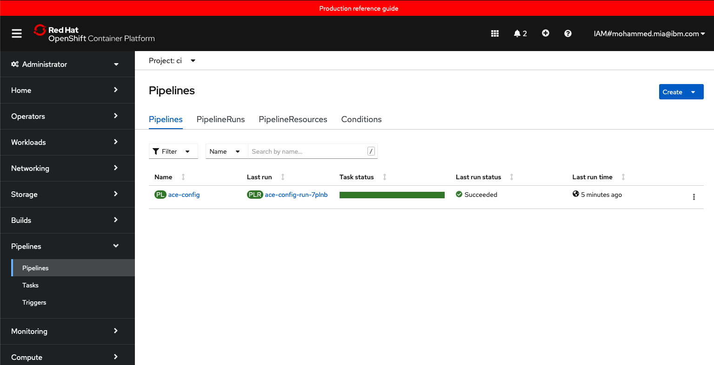{ width="1024" }
          <figcaption>Pipeline run in OpenShift Web Console</figcaption>
        </figure>


       <figure markdown>
         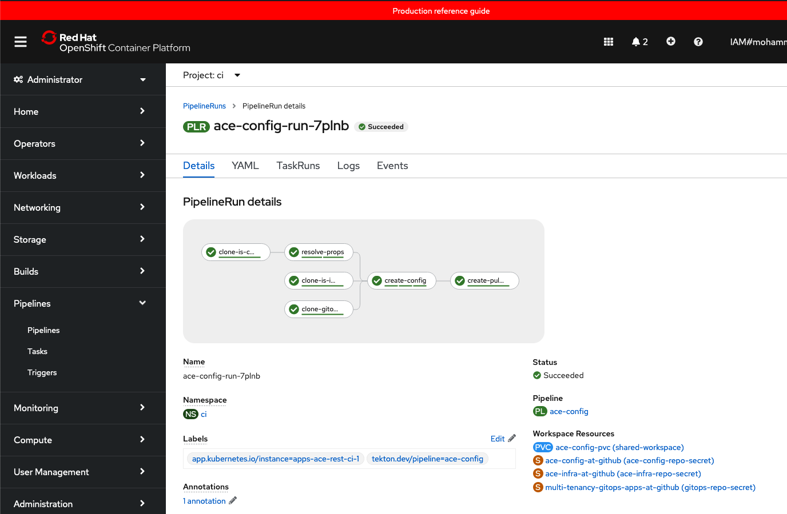{ width="1024" }
         <figcaption>Pipeline run status in OpenShift Web Console</figcaption>
       </figure>


If you now go to your `multi-tenancy-gitops-apps` repository, you will see a pull request created:

<figure markdown>
  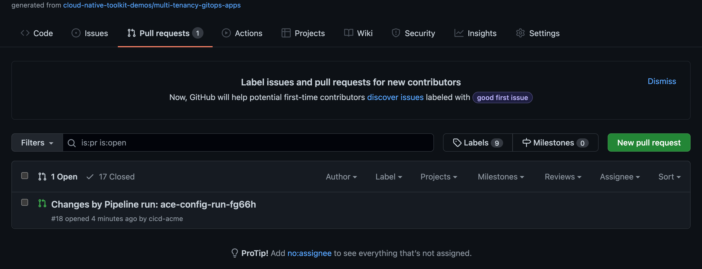{ width="1024" }
  <figcaption>Pull request in `multi-tenancy-gitops-apps` repository</figcaption>
</figure>

If you click on the pull request and check the commit, you should see the **Configuration**s object that being pushed and update to the `kustomization.yaml` file.


<figure markdown>
  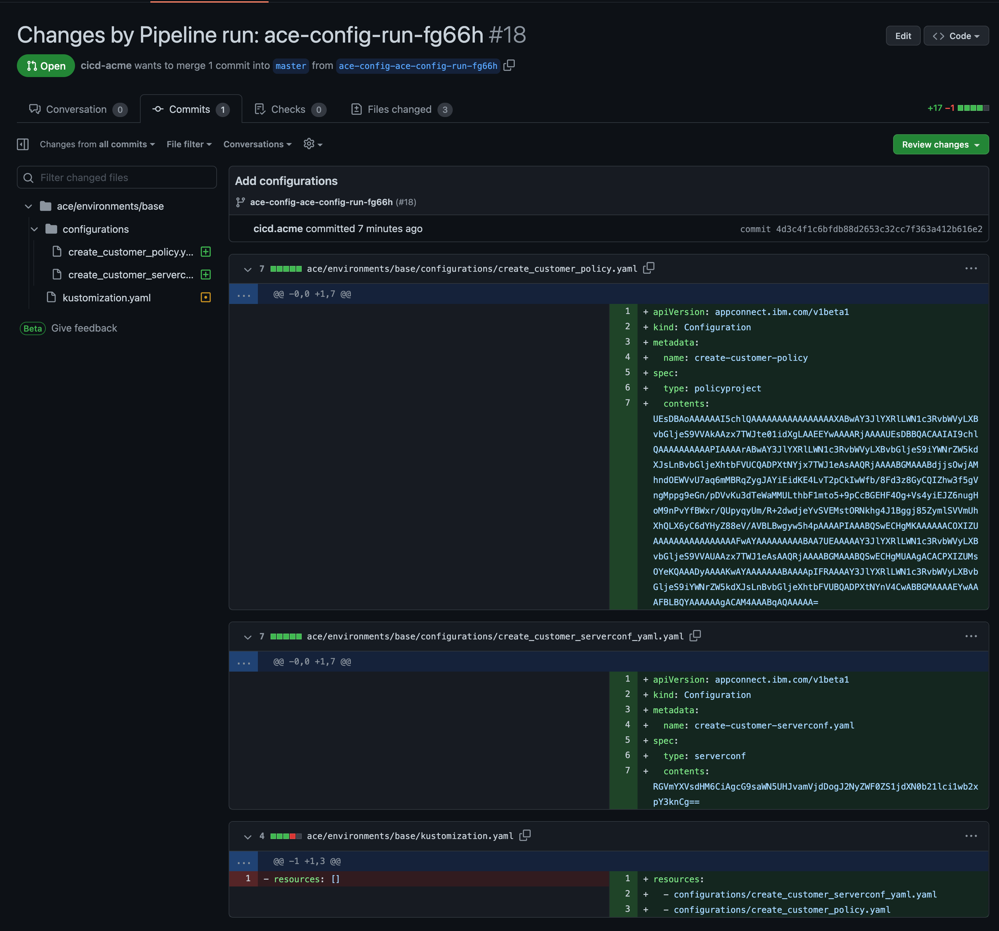{ width="1024" }
  <figcaption>Commit in the pull request</figcaption>
</figure>

If you merge the pull request, ArgoCD will update the change to and deploy the Configuration.

<figure markdown>
  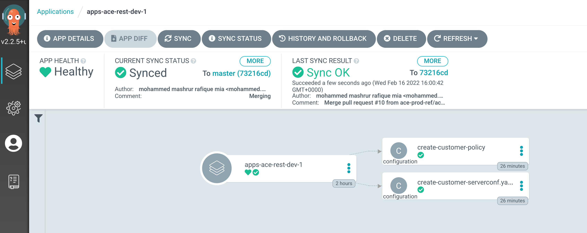{ width="1024" }
  <figcaption>Configurations deployed by ArgoCD</figcaption>
</figure>

And you can also verify the **Configuration**s object in OpenShift Web UI. On the OpenShift Web Console, navigate to **Home > Search**, select **Configuration** on the **Resources** dropdown, and make sure project **dev** selected in the **Project** dropdown:

<figure markdown>
  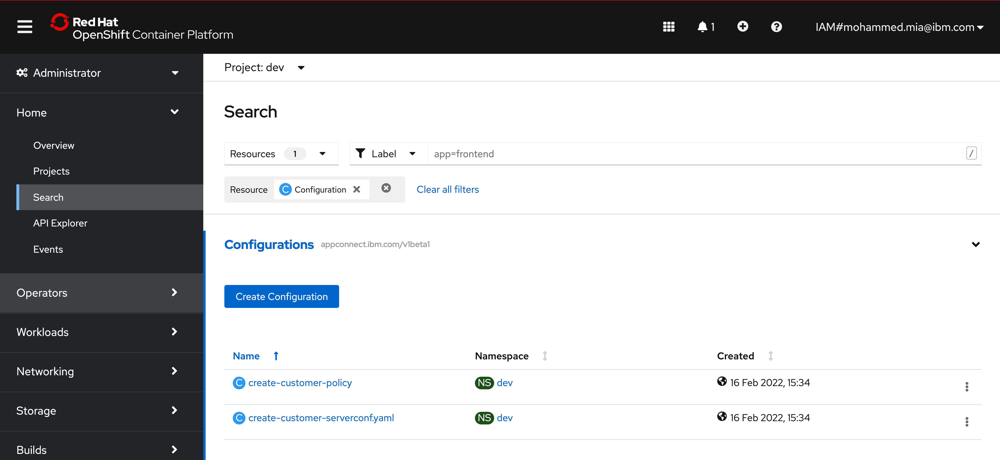{ width="1024" }
  <figcaption>Configurations object in OpenShift UI</figcaption>
</figure>

This concludes the building of **Configuration**s. In the next section we will build **IntegrationServer**.