# Building Integration Server

<!--- cSpell:ignore messageflow createcustomerrestcallingws createcustomer envsubst subflow subflows msgflow ibmint webui  pbcopy rolebinding backendurl policyxml soapserver realpath setdbparms truststores pipelinerun resyncs mqsc runmqsc dockerconfigjson queuemanager QMID podman ibmgaragecloud cntk cnkt eventid gitrevision gitrepositoryurl odowdaibm MQSC replicaset eventlistener triggerbinding triggertemplate mqcicd qmgr Artifactory configmaps OIDC CHLAUTH templating sealedsecret openapi -->

## Overview

In this topic, we will build `IntegrationServer` Custom Resource, which defines our AppConnect Integration Server.

<figure markdown>
  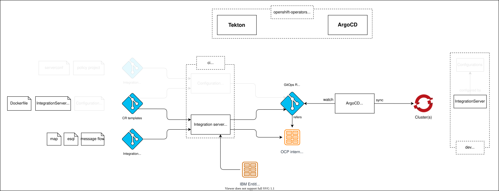
  <figcaption>Building Integration Server</figcaption>
</figure>

As mentioned in the [Overview](overview.md) section, the `IntegrationServer` Custom Resource (CR) is produced by the Integration Server pipeline. The pipeline takes AppConnect application resources, such as message flows (.messageflow), sub-flows (.subflow), ESQL (.esql), mapping (.map), etc. creates a BAR file, bakes in the BAR file to a custom container image, pushes the container image to OpenShift internal registry. It then creates the `IntegrationServer` CR which refers to the custom container image. The CR also refers to he `Configuration`s object needed for the message flow and the integration server.


---

## Pre-requisites

Before attempting this topic, you should have successfully completed the [Building Configurations](build-configurations.md). This section relies on the resources that have been already deployed as part of the **Building Configurations** section.

## Creating the **BAR** file

To deploy an integration solution to a production environment on OpenShift, we need to package the App Connect Enterprise (ACE) resources into a broker archive (BAR) file. 

Consider the our Create Customer Integration application. The source code of the application is maintained in a Git template, [](https://github.com/cloud-native-toolkit-demos/create-customer). The template contains resources such as message flows (.messageflow), sub-flows (.subflow), ESQL (.esql), mapping (.map), etc. as well as supporting Java Application with `.java` files code. The Java application need to be complied and packaged with all the resources to a BAR.

The BAR file can be created from the source via [`ibmint package`](https://www.ibm.com/docs/en/app-connect/12.0?topic=commands-ibmint-package-command) command. The command is available  on the App Connect Enterprise container image. We will make use of this command in our pipeline to build the BAR file from ACE source.

## Creating the custom container image

The BAR file will be "backed in" in a custom container image. The image URI will then be referred in the `IntegrationServer` CR. Our pipeline will build this image and push it to the internal OpenShift registry.

We will use base our custom container image on a IBM App Connect Enterprise server image, located in the IBM Cloud Container Registry, `cp.icr.io`. Our pipeline would therefore need access to this registry. We will make use of `ibm-entitlement-key` container registry `Secret` to provide us access to the IBM Cloud Container Registry.

## Overview of the pipeline

<figure markdown>
  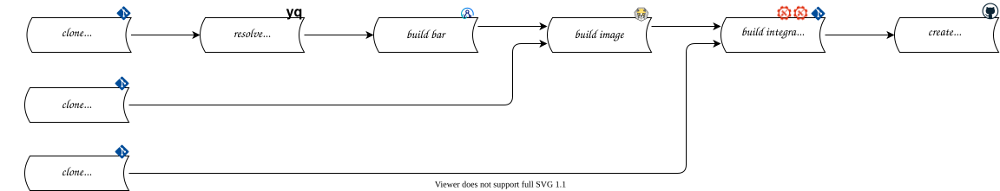{ width="1024" }
  <figcaption>Integration Server pipeline</figcaption>
</figure>

The pipeline has 6 tasks:

**clone source repo**
**clone infra repo**
**clone gitops repo**

:   Based on [git-clone](https://github.com/tektoncd/catalog/tree/main/task/git-clone/0.4) cluster task, 
    execution of these tasks will clone the required repositories:
    
    * ACE Source Repository

        Contains the ACE application resources, such message flows and subflows (`.msgflow`, `.subflow`), maps (`.map`), ESQL code (`.esql`), supporting Java application code (`.java`), XML schemas (e.g. WSDL files) and any other resources (e.g. `openapi.json`).

        The pipeline needs read-only access to this repository.

    * Infrastructure Repository

        Contains template for [**IntegrationServer**](https://www.ibm.com/docs/en/app-connect/containers_cd?topic=resources-integration-server-reference) custom resource and Dockerfile for our custom integration server container image. These files are plain text template file that container place holders. 

        The pipeline needs read-only access to this repository.

    * GitOps repository

        The multi-tenancy apps repository. This is the repository the GitOps operator watches for any desire state of the application. **Configuration**s for ACE application concern, and therefore the CRs are maintained in the The multi-tenancy apps repository. The pipeline will write the generated  **Configuration**s to this GitOps repository.

        The pipeline needs write access to this repository.

    The tasks will clone the repositories on shared workspace. Subsequent tasks will make use the workspace to access content of the repositories.

    The tasks will require secure access to the repositories. We will use SSH based authentication by using
    GitHub's deploy key.

**resolve props**

:   Pipeline properties maintains properties of the IntegrationServer we are to deploy. It contains metadata such as name of the application, release name of the Integration Server, licensing information, version of the server, and the type of endpoint. It also contains the URI of the image our custom integration server container image is going to be based upon.

    It also lists  **Configuration**s that the IntegrationServer requires as it gets deployed. These configurations will be referenced in the `IntegrationServer` custom resource.
    
    The task is the same one that was deployed as part of the [Building Configurations](build-configurations.md) section. But it reads the `pipeline_properties.yaml` from the source repository.


**build bar**

:   A custom task that builds the ACE BAR file from ACE resources. It makes use of `ibmint package` command. The command is available in the ACE server and ACE for Developers container image. We will make use of ACE server container image. For list of ACE server and ACE for Developer images see [IBM App Connect Enterprise server image from the IBM Cloud Container Registry](https://www.ibm.com/docs/en/app-connect/containers_cd?topic=obtaining-app-connect-enterprise-server-image-from-cloud-container-registry)

**build image**

:   A container image based on IBM App Connect Enterprise server image is created that bakes in the BAR file generated in the previous pipeline task. The [Dockerfile](https://github.com/cloud-native-toolkit-demos/ace-infra/blob/master/Dockerfile) located in the Infrastructure repository is used, replacing the base image. The base image URI is taken from the pipeline properties located on the source repository. See [pipeline_properties.yaml](https://github.com/cloud-native-toolkit-demos/create-customer/blob/master/pipeline_properties.yaml) for an example.


**build integration server**

:   This custom task have three steps:

    1. Create **IntegrationServer**s YAML file

        Generates an `IntegrationServer` CR. The templated `IntegrationServer` CR from the infrastructure repository is used by substituting the the parameters. In particular, custom container image and required `Configuration`s are referenced in the generated CR. 

        The steps makes use of `yq` and `envsubst` CLI. Custom image, `sh-tools`, will contains these tools.

    2. Update the `kustomization.yaml` file.

        **IntegrationServer**s that are to be deployed by GitOps operator is driven by kustomize. Once the pipeline creates a **IntegrationServer**, the `kustomization.yaml` lists it so that it can be deployed. Therefore, the pipeline need update the `kustomization.yaml` file.

        The steps makes use of `yq` and `realpath` CLI. Custom image, `sh-tools`, will contains these tools.

    3. Push the changes to GitOps repository.

        The **IntegrationServer** resource and the updated `kustomization.yaml` file is then pushed to the GitOps repository, under a new branch. `bitnami/git` image is used for this step.

    Before the pipeline can execute this custom task need to be deployed.


**Create Pull Request**

:   A custom task that that create a pull request to pull the changes to GitOps repository. The task is from tekton catalog, [github-open-pr](https://github.com/tektoncd/catalog/tree/main/task/github-open-pr/0.2), but it is not part of the ClusterTask that comes with OpenShift pipeline operator.

## Create the Git repositories from template

We will need to create Source and Infrastructure git repositories from cloud-native-toolkit-demos organization to you organization. 

The Infrastructure repository should already been created on your organization as part of the Build Configuration section. See [Create Infrastructure repository](../build-configurations/#create-infrastructure-repository).

The GitOps repository, which in our case is the `multi-tenancy-apps` repository should already been created from the template as part of the [GitOps, Tekton & ArgoCD](../cluster-config/gitops-tekton-argocd.md) section.

### Create Source repository

1. *Create the Configuration repository in your GitHub organization*

    Let's start by making our own copy of the Configuration repository.

    In your browser, navigate to [https://github.com/cloud-native-toolkit-demos/create-customer](https://github.com/cloud-native-toolkit-demos/create-customer) 

    Click on **Use this template** and select your organization, name the repository and click **Create repository from template**. 

    <figure markdown>
      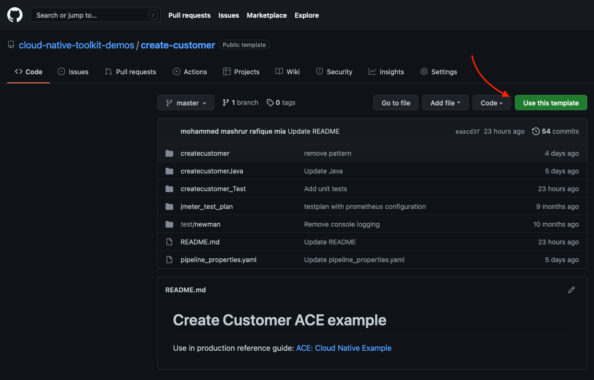{ width="1024" }
      <figcaption>Source Template</figcaption>
    </figure>
    
    After a few seconds the repository will be present in your chosen account.


1. *Review the repository*

    We can take a look at the content of the repository in the github.com on the browser with vscode.
    
    If you press dot (.) key while you are in your github repository, it will open vscode on the browser. See [The dot](https://www.youtube.com/watch?v=ywUZOOzLX3c) for a demo how it works.

    On the `create-customer` repository within your organization, press the dot (`.`) key:

    <figure markdown>
      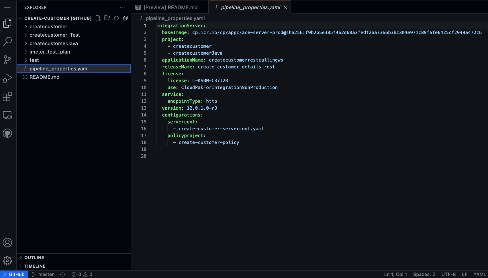{width=1024}
      <figcaption>ACE source on github</figcaption>
    </figure>

    The folders `createcustomer`, `createcustomerJava`, and `createcustomer_Test` have been directly pushed from ACE toolkit via the Git plugin.

    The pipeline properties file, `pipeline_properties.yaml`, sets up the various properties for the integration server that is to be built. In particular, 

    | Property | Description |
    | ----------- | ------------------------------------ |
    | `baseImage` | URI of the base image to be used in building the custom integration server image. See [IBM App Connect Enterprise server image](https://www.ibm.com/docs/en/app-connect/containers_cd?topic=obtaining-app-connect-enterprise-server-image-from-cloud-container-registry) for various image URIs |
    | `project` | Lists the project folders of the ACE application. |
    | `applicationName` | Name of the application to be built. This name will used in the URI of the custom integration server |
    | `releaseName` | Name of the integration server |
    | `license` | Licensing information, which includes the License and the use. See [Licensing reference for IBM App Connect Operator](https://www.ibm.com/docs/en/app-connect/containers_cd?topic=resources-licensing-reference-app-connect-operator) for more information |
    | `service.endpointType` | Either `http` or `https`. In this section of the tutorial we will use `http` |
    | `version` | Version of the integration server |
    | `configurations` | The configurations required for this integration server |


## Set Environment variables

Throughout this chapter we will make use of two environment variables, 

* `GIT_ORG`: an environment variable that identifies your GitHub organization
* `GIT_ROOT`: an environment variable that identifies the root folder for your cloned git repositories

We will make use of these environment variable to save typing and reduce errors. We have made use of these variable in the chapter, [GitOps, Tekton & ArgoCD](../../cluster-config/gitops-tekton-argocd).

Start a terminal window, we need to keep this terminal and the shell running throughout this chapter.

In the following command, replace `<git-organization>` with the GitHub organization name you've just chosen (e.g. tutorial-org-123):

``` { .bash }
export GIT_ORG=<git-organization>
```

You can verify your $GIT_ORG as follows:

``` { .bash }
echo $GIT_ORG 
```

Next, set `GIT_ROOT` to the root folder for your cloned git repositories. For example:

```bash
export GIT_ROOT=$HOME/git/$GIT_ORG-root
```

You can verify your $GIT_ROOT folder as follows:

```bash
echo $GIT_ROOT
```

## Install CI/CD ArgoCD Application

This should be already enabled as part of the Build Configuration section. See [Install CI/CD ArgoCD Application](../build-configurations/#install-cicd-argocd-application).

## Deploy Tekton tasks

There are four custom tasks to deploy:

1. Resolve properties, `resolve-props`. 

1. Building BAR, `build-bar`

1. Build integration server, `build-is`. 

1. Create pull request, ``github-open-pr`


### Deploy create configuration task, `resolve-props`

Should have been already enabled as part of the Build Configuration section. See [Deploy resolve properties task, `resolve-props`](../build-configurations/#deploy-resolve-properties-task-resolve-props)

### Deploy create configuration task, `build-bar`

1. *Change to CI environment directory*

    ```bash
    cd $GIT_ROOT/multi-tenancy-gitops-apps/ace/environments/ci
    ```

1. *Update kustomization to enable custom task, `build-bar`**

    Open `kustomization.yaml` (`$GIT_ROOT/multi-tenancy-gitops-apps/ace/environments/ci/kustomization.yaml`) and uncomment:

    ``` {.yaml .no-copy}
    - tasks/build-bar.yaml
    ```

    If you take a diff now with

    ```{.bash}
    git diff --unified=0
    ```

    the result should be see:

    ``` { .diff .no-copy}
    diff --git a/ace/environments/ci/kustomization.yaml b/ace/environments/ci/kustomization.yaml
    index 4cd95fc..f87951d 100644
    --- a/ace/environments/ci/kustomization.yaml
    +++ b/ace/environments/ci/kustomization.yaml
    @@ -42 +42 @@ resources:
    -# - tasks/build-bar.yaml
    +- tasks/build-bar.yaml
    ```

4. *Commit the change*

    ```bash
    git commit -am "Deploy build-bar task"
    ```

5. *Push both changes*

    ```bash
    git push
    ```

You can verify that ArgoCD deployed the resource using the ArgoCD UI, for `apps-ace-rest-ci-1`:

<figure markdown>
  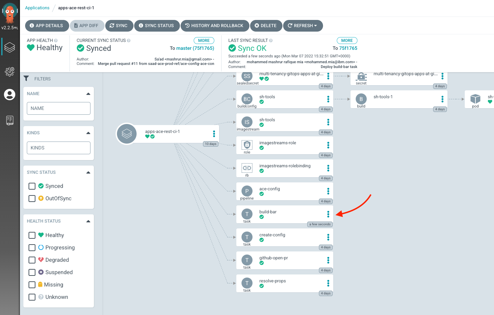{ width="1024" }
  <figcaption>`build-bar` on ArgoCD UI</figcaption>
</figure>


### Deploy create configuration task, `build-is`

The `create-is` custom task makes use of [`yq`](https://mikefarah.gitbook.io/yq/) and `envsubst` utility. This requires custom image to be created. The image should have been already created as part of the Build Configuration section. See [Deploy create configuration task, `create-config`](../build-configurations/#deploy-create-configuration-task-create-config).

1. *Change to CI environment directory*

    ```bash
    cd $GIT_ROOT/multi-tenancy-gitops-apps/ace/environments/ci
    ```

1. *Update kustomization to enable custom task, `build-is`**

    Open `kustomization.yaml` (`$GIT_ROOT/multi-tenancy-gitops-apps/ace/environments/ci/kustomization.yaml`) and uncomment:

    ``` {.yaml .no-copy}
    - tasks/build-is.yaml
    ```

    If you take a diff now with

    ```{.bash}
    git diff --unified=0
    ```

    the result should be see:

    ``` { .diff .no-copy}
    diff --git a/ace/environments/ci/kustomization.yaml b/ace/environments/ci/kustomization.yaml
    index 74b9831..6ba6b2b 100644
    --- a/ace/environments/ci/kustomization.yaml
    +++ b/ace/environments/ci/kustomization.yaml
    @@ -43 +43 @@ resources:
    -# - tasks/build-is.yaml
    +- tasks/build-is.yaml
    ```

4. *Commit the change*

    ```bash
    git commit -am "Deploy build-is task"
    ```

5. *Push both changes*

    ```bash
    git push
    ```

You can verify that ArgoCD deployed the resource using the ArgoCD UI:

<figure markdown>
  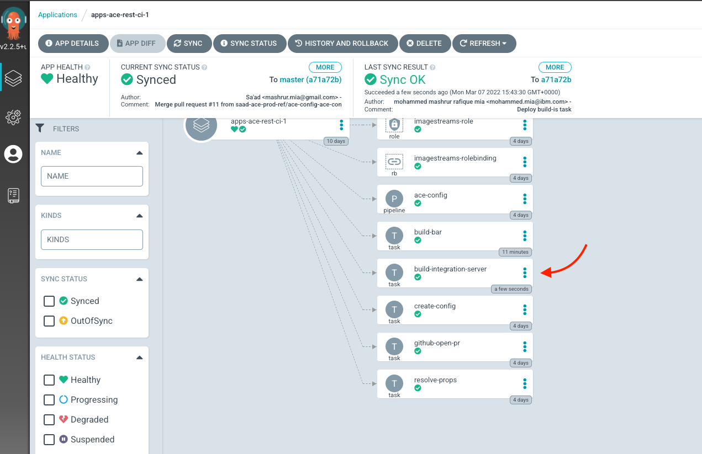{ width="1024" }
  <figcaption>`build-is` on ArgoCD UI</figcaption>
</figure>

### Deploy create configuration task, `github-open-pr`


Should have been already enabled as part of the Build Configuration section. See [Deploy Github Open Pull Request task, `github-open-pr`](../build-configurations/#deploy-github-open-pull-request-task-github-open-pr).

## Deploy the pipeline definition

We are now ready to deploy the integration server pipeline.

1. *Change to CI environment directory*

    ```bash
    cd $GIT_ROOT/multi-tenancy-gitops-apps/ace/environments/ci
    ```

1. *Update kustomization to enable resolve-props tasks*

    Open `kustomization.yaml` (`$GIT_ROOT/multi-tenancy-gitops-apps/ace/environments/ci/kustomization.yaml`) and uncomment:

    ``` {.yaml .no-copy}
    - pipelines/ace-integration-server.yaml
    ```

    If you take a diff now with

    ```{.bash}
    git diff --unified=0
    ```

    the result should be see:

    ``` { .diff .no-copy}
    diff --git a/ace/environments/ci/kustomization.yaml b/ace/environments/ci/kustomization.yaml
    index b302a59..41b8f9b 100644
    --- a/ace/environments/ci/kustomization.yaml
    +++ b/ace/environments/ci/kustomization.yaml
    @@ -6 +6 @@ resources:
    -# - pipelines/ace-integration-server.yaml
    +- pipelines/ace-integration-server.yaml
    ```

2. *Commit the and push the change*

    ```bash
    git commit -am "Deploy ace-integration-server pipeline" && git push
    ```

3. *Check the deployment of the pipeline in ArgoCD UI*

    Under "apps-ace-rest-ci-1" project, you should see that the task has been deployed:

    <figure markdown>
      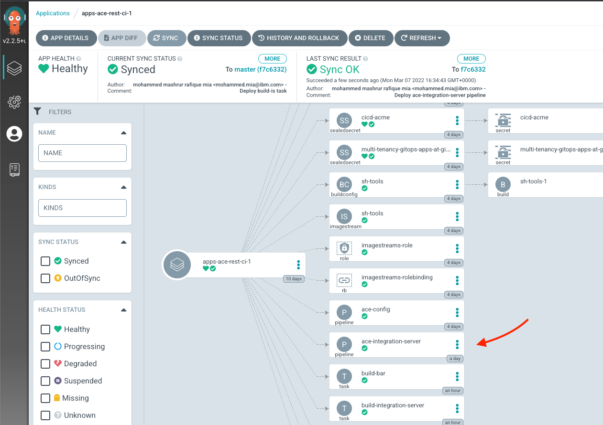{ width="1024" }
      <figcaption>`ace-integration-server` pipeline synched by ArgoCD</figcaption>
    </figure>

4. *Check the deployment of the pipeline in OpenShift UI*

    You can also verify the deploy on OpenShift UI. From **Pipelines > Pipelines**, make sure Project `ci` is selected from the drop down menu:

    <figure markdown>
      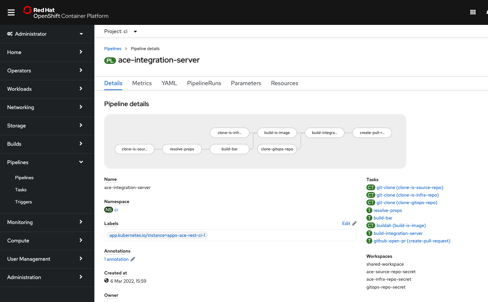{ width="1024" }
      <figcaption>`ace-integration-server` pipeline in OpenShift UI</figcaption>
    </figure>

## Set up `SealedSecret` for pipeline access to git repository

Our integration server pipeline would need to access Git repositories for source of the ACE application files and the templates for the **IntegrationServer**s objects. In this tutorial we will assume that our configuration repository is a private repository. As noted in this blog, [Private Git Repositories](https://cloud.redhat.com/blog/private-git-repositories-part-2a-repository-ssh-keys), the preferred mechanism for accessing a private Git repository is to create a unique repository SSH key. In this section we will set up this mechanism.

### Create SSH key pairs

We will will need two pairs for SSH keys, one for the ACE source repository, one for the infrastructure repository and one for our `multi-tenancy-gitops-apps` repository. The keys for the infrastructure repository and `multi-tenancy-gitops-apps` repository should already be created as part of completion of the Build Configuration section. See [Create SSH key pairs](../build-configurations/#create-ssh-key-pairs).

In this sub-section, we will create the key pair for ACE source repository.

1. *Change to a directory outside the git repositories*

    We will generate a pair of SSH keys (public and private) but we do not want to store these in a git repositories. In this tutorial, we will assume to create and store the SSH keys in `$HOME/keys` directory.

    Create the directory:

    ```bash
    mkdir -p $HOME/keys
    ```

    Change working directory to `$HOME/keys`

    ```bash
    cd $HOME/keys
    ```

2. *Create ssh key pairs*

    Using `ssh-keygen`, we can create ssh key pair for the configuration repository:

    ```bash
    ssh-keygen -C "gitops-pipeline/create-customer@github.com/ace-prod-ref" -f create-customer-at-ace-prod-ref-github -N ''
    ```

    filenames for the keys will start with `create-customer-at-ace-prod-ref-github` and we are not setting a passphrase. 

    If you list the files that are created in the current directory, you should see:

    ``` { .bash }
    tree .
    ```

    ``` { .bash .no-copy }
    .
    ├── ace-config-at-ace-prod-ref-github
    ├── ace-config-at-ace-prod-ref-github.pub
    ├── ace-infra-at-ace-prod-ref-github
    ├── ace-infra-at-ace-prod-ref-github.pub
    ├── create-customer-at-ace-prod-ref-github
    ├── create-customer-at-ace-prod-ref-github.pub
    ├── multi-tenancy-gitops-apps-at-ace-prod-ref-github
    └── multi-tenancy-gitops-apps-at-ace-prod-ref-github.pub

    0 directories, 8 files
    ```

    The file `create-customer-at-ace-prod-ref-github` and `create-customer-at-ace-prod-ref-github.pub` is created in this step. The others were created in the Build Configuration section.

### Upload the public ssh-key

1. *Upload the public ssh-key to the ACE source Git repository*

    The public keys of our pairs need to be uploaded to our Git repositories, as Deploy keys.

    Visit your repository, go to Settings, and then to choose **Deploy keys** on the left hand side menu. For example, for  `create-customer` repository:


    <figure markdown>
      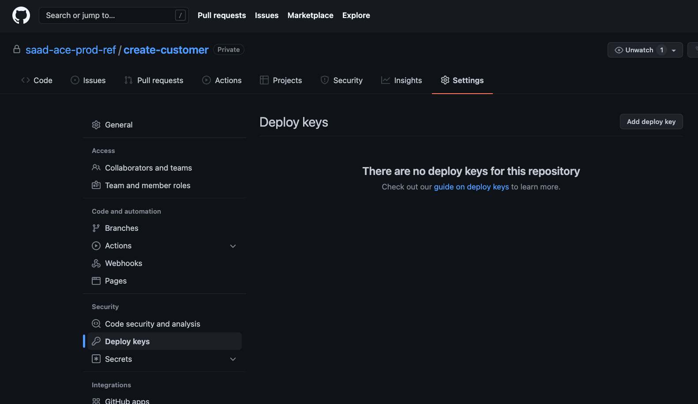{ width="1024" }
      <figcaption>Deploy Key Settings</figcaption>
    </figure>

    Click on **Add deploy key** button, give a title (say "gitops-pipeline") and copy the content of public key (for example, `create-customer-at-ace-prod-ref-github.pub` for ace-config repository).

    ??? tip "Use `pbcopy` in MacOS"

        If you are using MacOS, you can use `pbcopy` CLI to copy the public key on your clipboard:

        ```bash
        cat ~/keys/create-customer-at-ace-prod-ref-github.pub | pbcopy
        ```

    <figure markdown>
      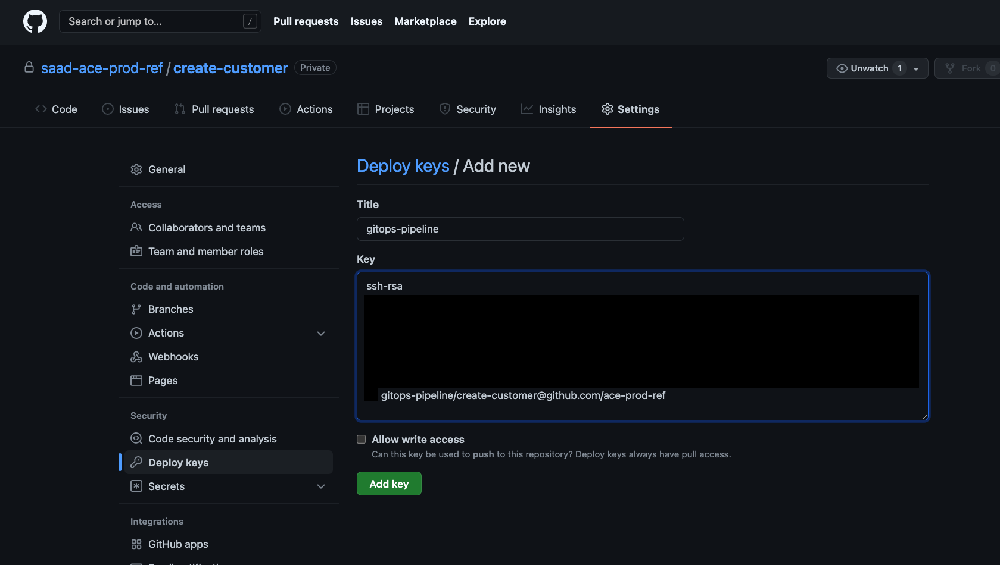{ width="1024" }
      <figcaption>Deploy Key for ACE Source Repository</figcaption>
    </figure>


    Click on **Add key** button to the add the deploy key.

1. *Upload the public ssh-key to the Infrastructure Git repository*

    Should already be created as part of completion of Build Configuration section. See [Upload the public ssh-key](../build-configurations/#upload-the-public-ssh-key).

1. *Upload the public ssh-key to the GitOps Git repository*

    Should already be created as part of completion of Build Configuration section. See [Upload the public ssh-key](../build-configurations/#upload-the-public-ssh-key).


### Create a "machine user"

The pipeline will not only make use of git operations, but it will also make use of GitHub APIs. Once the **IntegrationServer**s object is created and pushed to GitOps repository on a specific branch, the pipeline will make a pull request to merge the changes to the main (master) branch. 

This requires pipeline to make use of GitHub APIs. We would need a GitHub user for this. It is recommend to make use of a "Machine User" for this purpose. 

The machine user should already be created as part of the completion of Build Configuration section. See  [Create a "machine user"](../build-configurations/#create-a-machine-user).

In the following we will assume our "Machine User" is `cicd.acme`.


### Create access token for the Machine User

Access token for the machine user should already been created as part of the completion of Build Configuration section. See [Create access token for the Machine User](../build-configurations/#create-access-token-for-the-machine-user)

### Give GitHub API access to GitOps repository

Access to the GitHub API for GitOps repository should already been done as part of the completion of Build Configuration section. See [Create access token for the Machine User](../build-configurations/#create-access-token-for-the-machine-user)

### Create sealed secrets

The private part of the SSH key need to be used by our pipeline to authenticate itself when cloning the repository. Moreover, the personal access token of the machine user will also be used the pipeline. 

The keys and the token can be accessed via a kubernetes secret object. The secret object can be created by GitOps operator, but instead of storing the SSH key in a `Secret` manifest yaml, we will store it as `SealedSecret`. 

A `Secret` manifest encodes it's data, but does not encrypts it. Therefore it is not a good idea to store a plain `Secret` manifest yaml in a git repository. Instead, we will use `SealedSecret` manifest, which encrypts a `Secret` manifest and generates a encrypted version of its data content. We can store this encrypted `SealedSecret` manifest in a Git repository. Once GitOps operator reconciles this object on to the cluster, `SealedSecret` operator will decrypt it and store it as a secret in the namespace. Only `SealedSecret` operator decrypt the `SealedSecret` manifest.

1. *Create sealed secret for the private SSH key*

    Sealed Secret operator from bitnami has already been deployed as part of work in section, [Deploy services to the cluster](../cluster-config/services.md#deploy-services-to-the-cluster). We will now create a sealed secret for the private SSH key.

    For this, we need to have `kubeseal` installed on our local environment. This should have already been installed as part of the completion of Build Configuration section. See [Create sealed secrets](../build-configurations/#create-sealed-secrets)

1.  *Change to GitOps apps repository*

    ```bash
    cd $GIT_ROOT/multi-tenancy-gitops-apps
    ```

    This repository maintains application manifests. The private key of our SSH key-pair is an application specific artifact, and therefore it is to be maintained in the application repository.

    Change to the directory where sealed secrets are stored

    ```bash
    cd ace/environments/ci/secrets
    ```

1.  *Run the `gitops-repo-pk-secret.sh` script to generate `SealedSecret`s for SSH deploy keys*

    `gitops-repo-pk-secret.sh` script make use of three environment variables

    * `GITOPS_PK_SECRET_NAME`: Name of the secret. The name is also used in creating the `SealedSecret` manifest yaml file

    * `GIT_BASEURL`: Base URL of the git repository. This is needed for the tekton specific annotation on the `Secret` object. It is also needed to generate the host keys.

    * `SSH_PRIVATE_KEY_PATH`: full path to the private key.

    Assuming our private key is kept in `$HOME/keys` directory, then to generate the `SealedSecret` manifest, we can execute the script as follows for private key of `create-customer` deploy key:

    ```bash
    GITOPS_PK_SECRET_NAME=create-customer-at-github \
        GIT_BASEURL=github.com \
        SSH_PRIVATE_KEY_PATH=$HOME/keys/create-customer-at-ace-prod-ref-github \
        ./gitops-repo-pk-secret.sh
    ```

    A new file, named `git-ssh-pk-create-customer-at-github.yaml` will be created on the `ace/environments/ci/secrets` directory.

    !!! note "Conventions over configurations"

        Like the previous section, this guide will follow certain naming convention. For example, the private key for our ACE source GitHub repository, `create-customer` will be stored in a secret named `create-customer-at-github`. In the later sub-sections, we have scripts that make use of this naming convention. You are free to use any naming conventions, but if you do verify the content of the script before running them.

    `SealedSecret` CR for private key of `ace-infra` and `multi-tenancy-gitops-apps` should have already been installed as part of the completion of Build Configuration section. See [Create sealed secrets](../build-configurations/#create-sealed-secrets)


2. *Check git status*
    if you check git status with

    ```bash
    git status
    ```
    you should be able to confirm that:

    ``` { .bash .no-copy }
    On branch up-to-configuration
    Your branch is up to date with 'origin/master'.

    Untracked files:
      (use "git add <file>..." to include in what will be committed)
            gitops-repo-pk-secret-create-customer-at-github.yaml

    nothing added to commit but untracked files present (use "git add" to track)
    ``` 

3. *Commit the `SealedSecret` manifest to application repository*

    ```bash
    git add  gitops-repo-pk-secret-create-customer-at-github.yaml
    git commit -m 'Add SealedSecret for create-customer private key'
    ```

4.  Add the `SealedSecret`s on `apps-ace-rest-ci-1` ArgoCD application

    CI/CD related manifests are configure by `apps-ace-rest-ci-1` ArgoCD application, which is configured by `ace/environments/ci/kustomization.yaml`. To add the `SealedSecret` on the cluster, add the following item under `resources` field:

    ```yaml
    - secrets/gitops-repo-pk-secret-create-customer-at-github.yaml
    ```

    if you take a difference of changes on the repository:

    ```bash
    git diff --unified=0
    ```

    you should see the following:

    ``` { .bash .no-copy }
    diff --git a/ace/environments/ci/kustomization.yaml b/ace/environments/ci/kustomization.yaml
    index 41b8f9b..5d79428 100644
    --- a/ace/environments/ci/kustomization.yaml
    +++ b/ace/environments/ci/kustomization.yaml
    @@ -28,0 +29 @@ resources:
    +- secrets/gitops-repo-pk-secret-create-customer-at-github.yaml
    ```

    Commit the change

    ```bash
    git commit -am 'Enable sealed secrets for create-customer access'
    ```

5. Push the changes

    ```bash
    git push
    ```

!!! note "`SealedSecret`s for GitHub access token"

    `SealedSecret` CR for personal access token of the machine user should have already been installed as part of the completion of Build Configuration section. See [Create sealed secrets](../build-configurations/#create-sealed-secrets)


### Verify the addition of SSH private key `Secret`

Open up `apps-ace-rest-ci-1` on ArgoCD UI:

<figure markdown>
  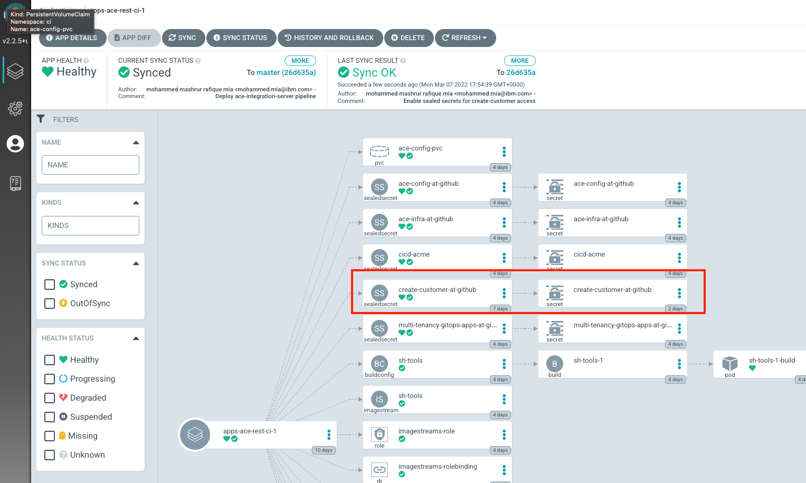{ width="1024" }
  <figcaption>Sealed Secret and Secret of create-customer private key</figcaption>
</figure>

As you can see, we have a new **SealedSecret** deployed. The SealedSecret operator then decrypted them and created kubernetes **Secret** object (which are owned by the corresponding **SealedSecret** objects).

You can also verify that the secret is created from the OCP UI. Go to **Workloads > Secrets**, make sure `ci` project is selected. Select Label to filter the secrets and put in `created-by=pipeline` is the Search box:


<figure markdown>
  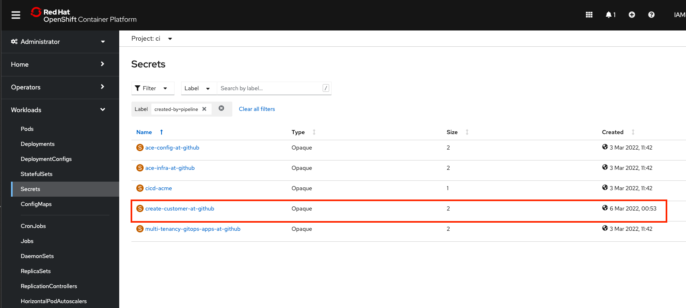{ width="1024" }
  <figcaption>Secret for create customer repository in OpenShift Web UI</figcaption>
</figure>


## Create PVC

1. *Change to CI environment directory*

    ```bash
    cd $GIT_ROOT/multi-tenancy-gitops-apps/ace/environments/ci
    ```

1. *Update kustomization to enable ace-config pvc*

    Open `kustomization.yaml` (`$GIT_ROOT/multi-tenancy-gitops-apps/ace/environments/ci/kustomization.yaml`) and uncomment:

    ``` {.yaml .no-copy}
    - pvc/ace-integration-server.yaml
    ```

    If you take a diff now with

    ```{.bash}
    git diff --unified=0
    ```

    the result should be see:

    ``` { .diff .no-copy}
    diff --git a/ace/environments/ci/kustomization.yaml b/ace/environments/ci/kustomization.yaml
    index baa34d0..b92dcfd 100644
    --- a/ace/environments/ci/kustomization.yaml
    +++ b/ace/environments/ci/kustomization.yaml
    @@ -11 +11 @@ resources:
    -# - pvc/ace-integration-server.yaml
    +- pvc/ace-integration-server.yaml
    ```

1. *Commit the and push the change*

    ```bash
    git commit -am "Deploy ace-integration-server pvc" && git push
    ```

1. *Check the deployment of the task in ArgoCD UI*

    Under "apps-ace-rest-ci-1" project, you should see that the task has been deployed:

    <figure markdown>
      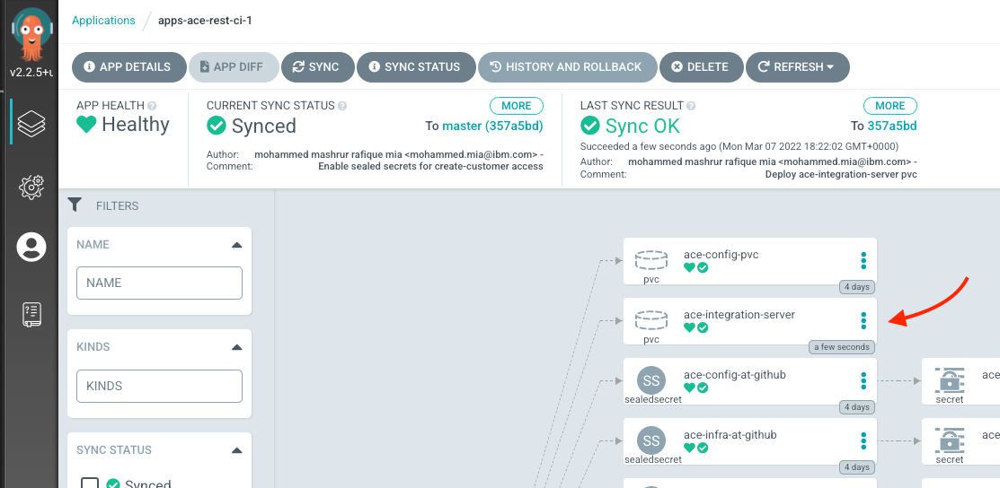{ width="1024" }
      <figcaption>`ace-integration-server` PVC synched by ArgoCD</figcaption>
    </figure>


1. *Check the deployment of the PVC in OpenShift UI*

    You can also verify the deploy on OpenShift UI. From **Storage > PersistentVolumeClaims**, make sure Project `ci` is selected from the drop down menu:

    <figure markdown>
      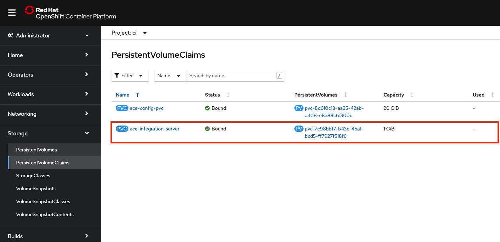{ width="1024" }
      <figcaption>`ace-integration-server` PVC in OpenShift UI</figcaption>
    </figure>

    wait until the PVC bound.

## Enable `apps-ace-rest-dev-1` ArgoCD application

`apps-ace-rest-dev-1` ArgoCD application should have already been installed as part of the completion of Build Configuration section. See [Enable apps-ace-rest-dev-1 ArgoCD application](../build-configurations/#enable-apps-ace-rest-dev-1-argocd-application)


## Deploy `ibm-entitlement-key` on `ci` namespace

We will make use of ACE server container image which is located in the IBM Cloud Container Registry. You will need an IBM entitlement key to access this registry. We will create a sealedsecret for the entitlement key secret.

1. *Object the key**

    Follow the instruction to copy the entitlement key from [Access your container software](https://myibm.ibm.com/products-services/containerlibrary).

1. *Change to secret environment directory*

    ```bash
    cd $GIT_ROOT/multi-tenancy-gitops-apps/ace/environments/ci/secrets
    ```

1. *Run the script, `ibm-entitled-key-secret.sh`*

    ```bash
    IBM_ENTITLEMENT_KEY="<PUT YOUR KEY HERE>" ./ibm-entitlement-key-secret.sh
    ```

    replacing the `<PUT YOUR KEY HERE>` with the value of your key.

    this will create a file, `ibm-entitlement-key-secret.yaml`, which you can verify by

    ```bash
    git status
    ```

    which should display the following:

    ``` { .bash .no-copy }
    On branch up-to-configuration
    Your branch is up to date with 'origin/master'.

    Changes not staged for commit:
    (use "git add <file>..." to update what will be committed)
    (use "git restore <file>..." to discard changes in working directory)
            modified:   ibm-entitlement-key-secret.yaml

    no changes added to commit (use "git add" and/or "git commit -a")
    ```

1. *Add and commit the sealed secret*

    ```bash
    git add ibm-entitlement-key-secret.yaml
    git commit -m "Add IBM entitlement key"
    ```

1. *Update kustomization to enable IBM entitlement key*

    Open `kustomization.yaml` (`$GIT_ROOT/multi-tenancy-gitops-apps/ace/environments/ci/kustomization.yaml`) and add:

    ``` {.yaml .no-copy}
    - secrets/ibm-entitlement-key-secret.yaml
    ```

    If you take a diff now with

    ```{.bash}
    git diff --unified=0
    ```

    the result should be see:

    ``` { .diff .no-copy}
    diff --git a/ace/environments/ci/kustomization.yaml b/ace/environments/ci/kustomization.yaml
    index b92dcfd..7ea68d2 100644
    --- a/ace/environments/ci/kustomization.yaml
    +++ b/ace/environments/ci/kustomization.yaml
    @@ -30,0 +31 @@ resources:
    +- secrets/ibm-entitlement-key-secret.yaml
    ```

1. *Commit the change*

    ```bash
    git commit -am "Deploy IBM entitlment key"
    ```

1. *Push the change*

    ```bash
    git push
    ```

1. *Verify that the key is deployed*

    <figure markdown>
      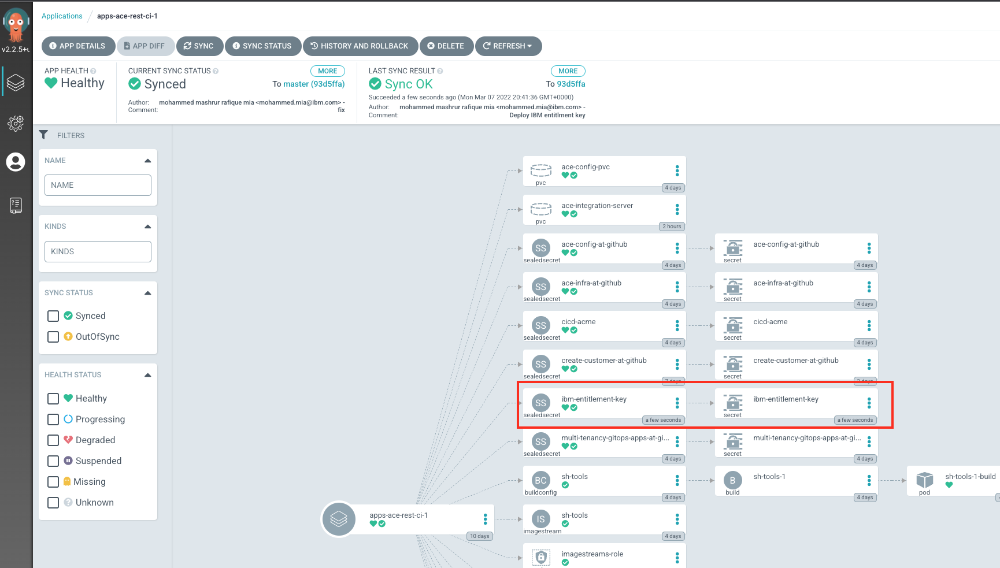{ width="1024" }
      <figcaption>`ibm-entitlement-key` on ArgoCD UI</figcaption>
    </figure>


## Add `ibm-entitlement-key` to `pipeline` service account

Our pipeline by defaults run under `pipeline` service account. In order for our pipeline task, `build-is-image` to access the ACE server container image from IBM Cloud Container Registry, the `ibm-entitlement-key` secret needed to added in the service account.

1. *Edit the `pipeline` service account*

    ```bash
    oc edit sa pipeline -n ci
    ```
1. *Add `ibm-entitlement-key` as a new secret*

    Scroll to the bottom, where you would see something like

    ``` { .yaml .no-copy }
    secrets:
    - name: pipeline-token-XXXXX
    - name: pipeline-dockercfg-XXXXX
    ```

    add the `ibm-entitlement-key` secret

    ``` { .yaml .no-copy }
    secrets:
    - name: pipeline-token-XXXXX
    - name: pipeline-dockercfg-XXXXX
    - name: ibm-entitlement-key
    ```

    save and exit the editor

1. *Verify that the secret has been added*

    Run 

    ```bash
    oc get sa pipeline -n ci -o jsonpath='{.secrets[*].name}{"\n"}'
    ```

    and you should see

    ``` { .bash .no-copy }
    pipeline-token-XXXXX pipeline-dockercfg-XXXXX ibm-entitlement-key
    ```


## Deploy App Connect Dashboard

Although not strictly necessary, the dashboard is a nice UI to verify your Integration Server deployment and view the metadata.

The Dashboard requires to pull down images from IBM Cloud Container Registry. Therefore, we will also need to deploy `ibm-entitlement-key` secret.


### Deploy `ibm-entitlement-key` on the dev namespace

1. *Change to base secrets directory*

    ```bash
    cd $GIT_ROOT/multi-tenancy-gitops-apps/ace/environments/base/secrets
    ```

1. *Run the script, `ibm-entitled-key-secret.sh`*

    ```bash
    IBM_ENTITLEMENT_KEY="<PUT YOUR KEY HERE>" ./ibm-entitlement-key-secret.sh
    ```

    replacing the `<PUT YOUR KEY HERE>` with the value of your key.

    this will create a file, `ibm-entitlement-key-secret.yaml`, which you can verify by

    ```bash
    git status
    ```

    which should display the following:

    ``` { .bash .no-copy }
    On branch up-to-configuration
    Your branch is up to date with 'origin/master'.

    Changes not staged for commit:
    (use "git add <file>..." to update what will be committed)
    (use "git restore <file>..." to discard changes in working directory)
            modified:   ibm-entitlement-key-secret.yaml

    no changes added to commit (use "git add" and/or "git commit -a")
    ```

1. *Add and commit the sealed secret*

    ```bash
    git add ibm-entitlement-key-secret.yaml
    git commit -m "Add IBM entitlement key"
    ```

1. *Update kustomization to add IBM entitlement key*

    Open `kustomization.yaml` (`$GIT_ROOT/multi-tenancy-gitops-apps/ace/environments/base/kustomization.yaml`) and add:

    ``` {.yaml .no-copy}
    - secrets/ibm-entitlement-key-secret.yaml
    ```

    If you take a diff now with

    ```{.bash}
    git diff --unified=0
    ```

    the result should be see:

    ``` { .diff .no-copy}
    diff --git a/ace/environments/base/kustomization.yaml b/ace/environments/base/kustomization.yaml
    index 0a78042..ab27435 100644
    --- a/ace/environments/base/kustomization.yaml
    +++ b/ace/environments/base/kustomization.yaml
    @@ -2,0 +3 @@ resources:
    +  - secrets/ibm-entitlement-key-secret.yaml
    ```

1. *Commit the change*

    ```bash
    git commit -am "Deploy IBM entitlment key"
    ```

1. *Push the change*

    ```bash
    git push
    ```

1. *Verify that the key is deployed*

    On the ArgoCD application, `apps-ace-rest-dev-1`, you should now see the secret

    <figure markdown>
      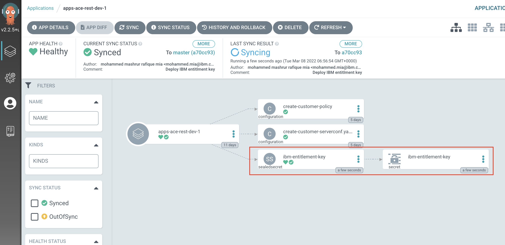{ width="1024" }
      <figcaption>`ibm-entitlement-key` on ArgoCD UI</figcaption>
    </figure>

### Deploy ACE Dashboard

1. *Change to base environment directory*

    ```bash
    cd $GIT_ROOT/multi-tenancy-gitops-apps/ace/environments/base
    ```


1. *Update kustomization to add ACE dashboard*

    Open `kustomization.yaml` (`$GIT_ROOT/multi-tenancy-gitops-apps/ace/environments/base/kustomization.yaml`) and add:

    ``` {.yaml .no-copy}
    - dashboard/ace-dashboard.yaml
    ```

    If you take a diff now with

    ```{.bash}
    git diff --unified=0
    ```

    the result should be see:

    ``` { .diff .no-copy}
    diff --git a/ace/environments/base/kustomization.yaml b/ace/environments/base/kustomization.yaml
    index d8255c0..7cf00d3 100644
    --- a/ace/environments/base/kustomization.yaml
    +++ b/ace/environments/base/kustomization.yaml
    @@ -4,0 +5 @@ resources:
    +  - dashboard/ace-dashboard.yaml
    ```

1. *Commit the change*

    ```bash
    git commit -am "Deploy ACE Dashboard"
    ```

1. *Push the change*

    ```bash
    git push
    ```

1. *Verify that the Dashboard is deployed*

    On `apps-ace-rest-dev-1` argo application application

    <figure markdown>
      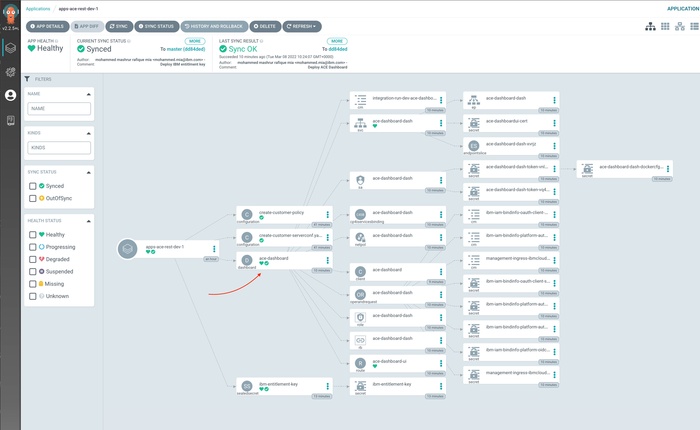{ width="1024" }
      <figcaption>ACE Dashboard on ArgoCD UI</figcaption>
    </figure>

    The URL for the dashboard can be found on the deployed Dashboard CR:

    ```bash
    oc get dashboard ace-dashboard -n dev -o jsonpath='{.status.endpoints[0].uri}{"\n"}'
    ```

    It uses the same username/password as that of the Platform Navigator. The user name is `admin` and you can extract the password with:

    ```bash
    oc extract secret/ibm-iam-bindinfo-platform-auth-idp-credentials --keys=admin_password -n ibm-common-services --to=-
    ```

    Once you log in, you can see the Dashboard:

    <figure markdown>
      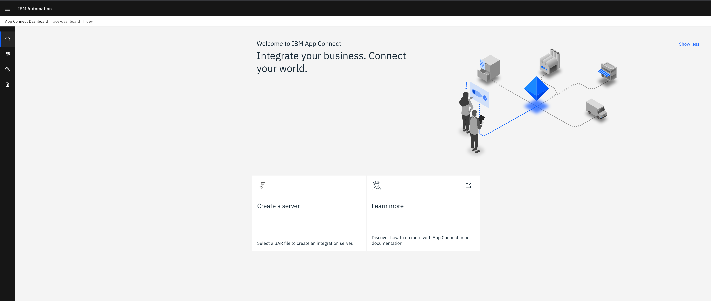{ width="1024" }
      <figcaption>ACE Dashboard</figcaption>
    </figure>

    Currently it has no integration server.
    

## Run the pipeline

Now that all the tasks, pipeline, and required resources are deployed, we can run the pipeline. We do this by creating a **PipelineRun** resource which refers to a **Pipeline** resource. A **PipelineRun** resource is a running instance of a **Pipeline**.

A **PipelineRun** instantiates a **Pipeline** by setting its parameters and workspaces. Some of the parameters have default values (mostly based on values used in this tutorial), but they can be overridden when creating the **PipelineRun** instance.

The pipeline has the following parameters:

| Parameter | Description |
| ----------- | ------------------------------------ |
| `is-source-repo-url` | URL of the ACE application source repository. In this tutorial we are making use of SSH based URL. |
| `is-infra-repo-url` | URL of the Infrastructure repository. In this tutorial we are making use of SSH based URL. |
| `git-ops-repo-url` | URL of the GitOps repository. In this tutorial we are making use of SSH based URL.  |
| `gitops-apps-repo-full-name` | Full repository name of the GitOps repository |
| `github-pr-title` | Title of the pull request. Default is set to a string with the name of the pipeline run. Feel free to update it. |
| `github-pr-body` | Body of the pull request. Default is set to a string with the name of the pipeline run. Feel free to update it.  |
| `github-pr-token-secret-name` | Name of the secret that contains the access token of the machine user the pipeline will use to make the pull request. Default is `cicd-acme` as that's how we set up the secret earlier. |

We will need to set the parameters to the appropriate values. If you are following this tutorial, you would need set the `is-source-repo-url`, `is-infra-repo-url` , `git-ops-repo-url` and `gitops-apps-repo-full-name` as they do not have a default. Rest of the parameters you can leave them as default for now.

On the other hand, the pipeline has the following workspaces:

| Workspace | Description |
| ----------- | ------------------------------------ |
| `shared-workspace` | The PVC where the `git-clone` task will clone the repositories and other task make use of them. Set to `ace-config` PVC in this tutorial  |
| `ace-source-repo-secret` | The secret that contains the SSH private key to authenticate with ACE application source repository.  |
| `ace-infra-repo-secret` | The secret that contains the SSH private key to authenticate with Infrastructure repository. |
| `gitops-repo-secret` | The secret that contains the SSH private key to authenticate with GitOps repository. |


For the workspaces, 

* For `shared-workspace` we will set it to PVC, `ace-integration-server`

* For `ace-source-repo-secret` we will set it to **Secret**, `create-customer-at-github`

* For `ace-infra-repo-secret` we will set it to **Secret**, `ace-infra-at-github`

* For `gitops-repo-secret` we will set it to **Secret**, `gitops-repo-at-github`


One way to instantiates a **Pipeline** is to use the OpenShift Web UI. When running the Configuration pipeline, we used this method. See [Run the pipeline](../build-configurations/#run-the-pipeline)

<a id="tkn"></a>The other method is to use `tkn`. We will use that in this section

1. *Install `tkn` CLI*

    On MacOS you can use Homebrew to install `tkn`

    ```bash
    brew install tektoncd-cli
    ```

    For other operating systems, see [`tkn`](https://github.com/tektoncd/cli)

1. *Change to pipeline directory*

    Issue the following command to change to your GitOps repository and the pipeline directory

    ```bash
    cd $GIT_ROOT/multi-tenancy-gitops-apps/ace/environments/ci/pipelines
    ``` 

1. *Run the script `run-ace-is-pipeline.sh`*

    The script, `run-ace-is-pipeline.sh`,

    <a id="run-ace-is-pipeline.sh"></a>
    ``` { .bash .no-copy }
    #!/usr/bin/env bash

    if [ -z ${GIT_ORG} ]; then echo "Please set GIT_ORG when running script"; exit 1; fi
    if [ -z ${SOURCE_REPO} ]; then echo "Please set SOURCE_REPO when running script"; exit 1; fi

    tkn -n ci pipeline start \
        ace-integration-server \
        --param is-source-repo-url=git@github.com:${GIT_ORG}/${SOURCE_REPO}.git \
        --param is-infra-repo-url=git@github.com:${GIT_ORG}/ace-infra.git \
        --param git-ops-repo-url=git@github.com:${GIT_ORG}/multi-tenancy-gitops-apps.git \
        --param gitops-apps-repo-full-name=${GIT_ORG}/multi-tenancy-gitops-apps \
        --workspace name=shared-workspace,claimName=ace-integration-server \
        --workspace name=ace-infra-repo-secret,secret=ace-infra-at-github \
        --workspace name=gitops-repo-secret,secret=multi-tenancy-gitops-apps-at-github \
        --workspace name=ace-source-repo-secret,secret=${SOURCE_REPO}-at-github
    ```

    depends on two parameters, `GIT_ORG` and `SOURCE_REPO`. The script sets all the parameters and workspaces values when issuing `tkn` command to start the pipeline. If you are following this guide as is, due to our naming conventions, you would not need to change the script.
    
    Nevertheless, review the script to make sure they have right values. 

    To start the pipeline, issue the following

    ```bash
    SOURCE_REPO=create-customer ./run-ace-is-pipeline.sh
    ```

    !!! note "what about `GIT_ORG`?"

        It is already part of the shell environment, as we set it up earlier.

    You will get an output like the following:

    ``` { .bash .no-copy }
    PipelineRun started: ace-integration-server-run-w4x8d

    In order to track the PipelineRun progress run:
    tkn pipelinerun logs ace-integration-server-run-w4x8d -f -n ci
    ```

    You can use `tkn` CLI to check the status of the pipeline, with `tkn pipelinerun describe` command. For example, for the above:

    ``` { .bash .no-copy }
    tkn pipelinerun describe ace-integration-server-run-w4x8d -n ci
    ```

    You will see the various task running, as well as the parameters and workspaces that have been set:

    ``` { .bash .no-copy }
    Name:              ace-integration-server-run-w4x8d
    Namespace:         ci
    Pipeline Ref:      ace-integration-server
    Service Account:   pipeline
    Timeout:           1h0m0s
    Labels:
    app.kubernetes.io/instance=apps-ace-rest-ci-1
    tekton.dev/pipeline=ace-integration-server

    🌡️  Status

    STARTED         DURATION   STATUS
    7 minutes ago   ---        Running

    📦 Resources

    No resources

    ⚓ Params

    NAME                           VALUE
    ∙ git-ops-repo-url             git@github.com:ace-prod-ref/multi-tenancy-gitops-apps.git
    ∙ gitops-apps-repo-full-name   ace-prod-ref/multi-tenancy-gitops-apps
    ∙ is-infra-repo-url            git@github.com:ace-prod-ref/ace-infra.git
    ∙ is-source-repo-url           git@github.com:ace-prod-ref/create-customer.git

    📝 Results

    No results

    📂 Workspaces

    NAME                       SUB PATH   WORKSPACE BINDING
    ∙ shared-workspace         ---        PersistentVolumeClaim (claimName=ace-integration-server)
    ∙ ace-infra-repo-secret    ---        Secret (secret=ace-infra-at-github)
    ∙ gitops-repo-secret       ---        Secret (secret=multi-tenancy-gitops-apps-at-github)
    ∙ ace-source-repo-secret   ---        Secret (secret=create-customer-at-github)

    🗂  Taskruns

    NAME                                                            TASK NAME              STARTED         DURATION     STATUS
    ∙ ace-integration-server-run-csvfx-build-is-image-7v75z         build-is-image         6 minutes ago   ---          Running
    ∙ ace-integration-server-run-csvfx-build-bar-rnwb2              build-bar              6 minutes ago   14 seconds   Succeeded
    ∙ ace-integration-server-run-csvfx-resolve-props-cmgps          resolve-props          6 minutes ago   30 seconds   Succeeded
    ∙ ace-integration-server-run-csvfx-clone-gitops-repo-vmrmk      clone-gitops-repo      6 minutes ago   13 seconds   Succeeded
    ∙ ace-integration-server-run-csvfx-clone-is-infra-repo-tr9dk    clone-is-infra-repo    6 minutes ago   10 seconds   Succeeded
    ∙ ace-integration-server-run-csvfx-clone-is-source-repo-xjjkt   clone-is-source-repo   6 minutes ago   12 seconds   Succeeded
    ```

    ??? tip "On OCP UI"

        You can also check the pipeline run from OpenShift Web Console. Navigate to **Pipelines > Pipelines**, and click on the pipeline run link for the pipeline, `ace-integration-server`:

        <figure markdown>
          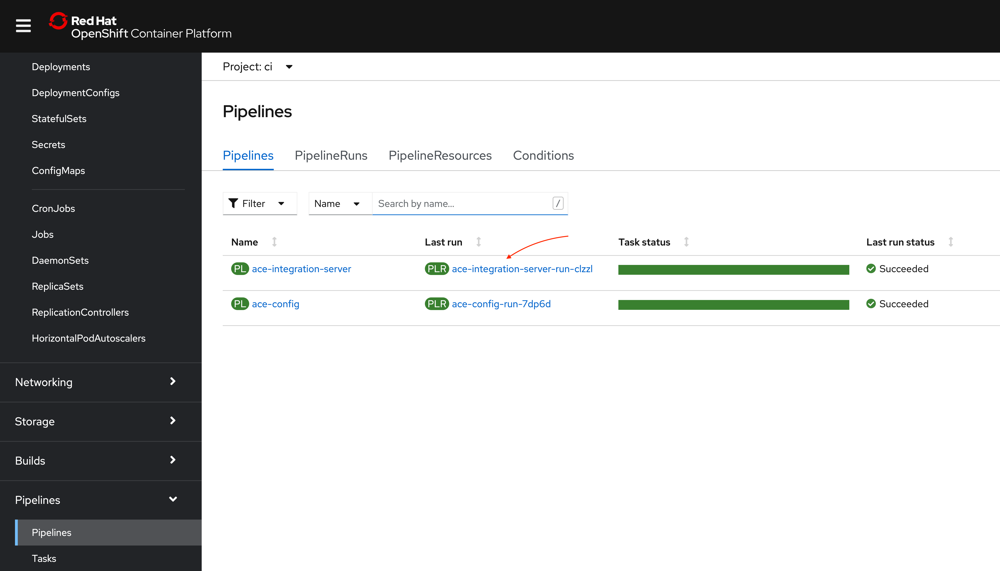{ width="1024" }
          <figcaption>Pipeline run in OpenShift Web Console</figcaption>
        </figure>

        <figure markdown>
          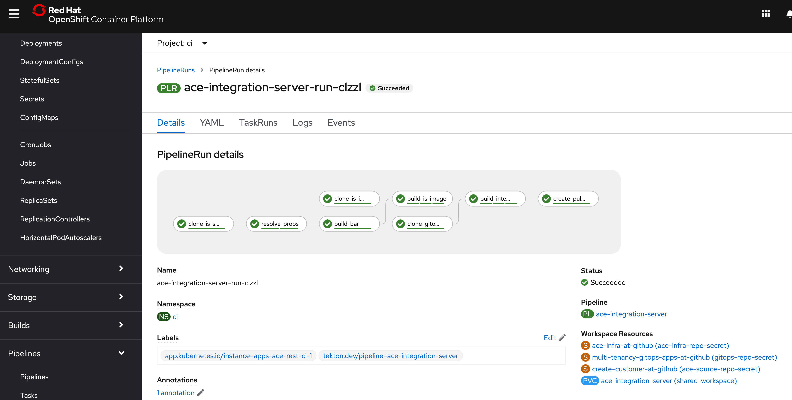{ width="1024" }
          <figcaption>Pipeline run status in OpenShift Web Console</figcaption>
        </figure>

    
    Once the pipeline run finishes, a pull request will be created for the to add the `IntegrationServer` CR on `multi-tenancy-gitops-apps` repository.

    <figure markdown>
      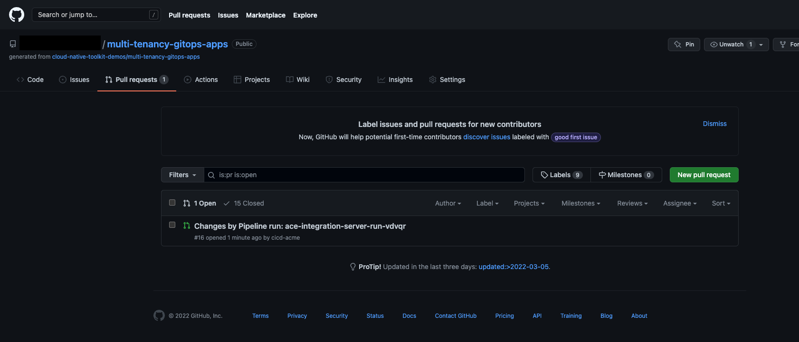{ width="1024" }
      <figcaption>Pull request for ACE integration server</figcaption>
    </figure>

    And if you check the commits within the pull request, you will see creation of the `IntegrationServer` CR and activating in `kustomization.yaml`

    <figure markdown>
      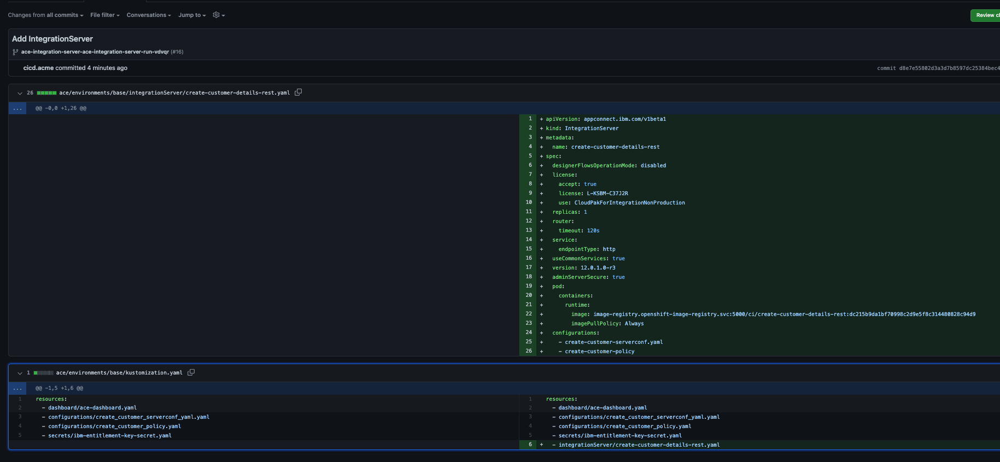{ width="1024" }
      <figcaption>Commit in pull request</figcaption>
    </figure>

1. *Merge the pull request*

    From Github Web UI merge the pull request.

1. *Verify ArgoCD syncs the `IntegrationServer` CR*

    On on the ArgoCD application, `apps-ace-rest-dev-1`, you should see the `IntegrationServer` CR:

    <figure markdown>
      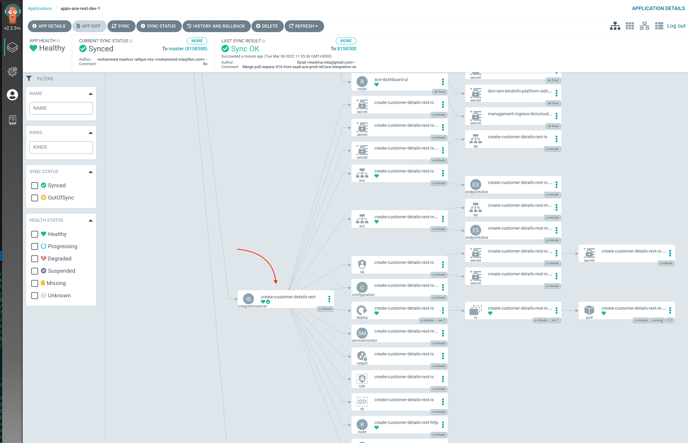{ width="1024" }
      <figcaption>`IntegrationServer` CR on ArgoCD</figcaption>
    </figure>

1. *Verify the integration server in ACE Dashboard*

    On ACE Dashboard, you will now see a new Integration Server: 

    <figure markdown>
      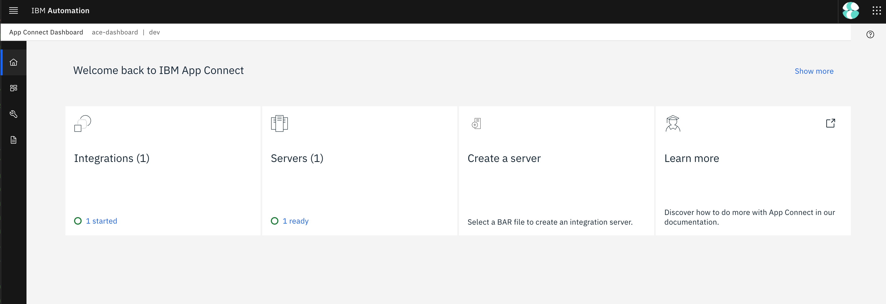{ width="1024" }
      <figcaption>Integration server in ACE Dashboard</figcaption>
    </figure>

    <figure markdown>
      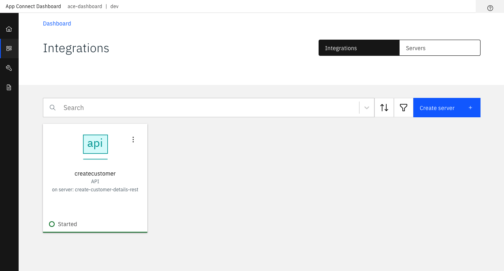{ width="1024" }
      <figcaption>`createcustomer` API on ACE dashboard</figcaption>
    </figure>

    You can explore the API on the dashboard. The API will be presented based on the OpenAPI document, currently deployed as part of the `createcustomer` ACE server. 

    Open the API and navigate to API method, `POST /createcustomer`, and click on *Try it* tab

    <figure markdown>
      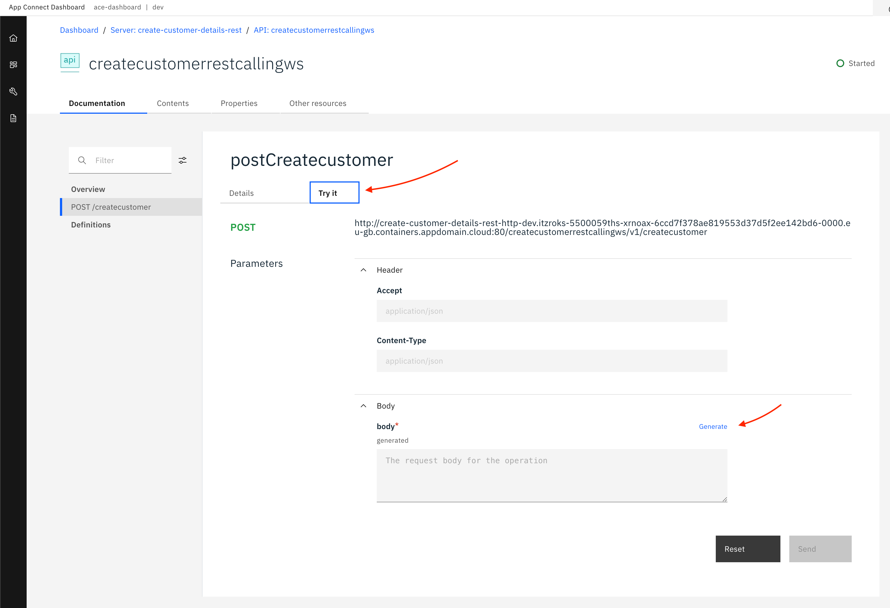{ width="1024" }
      <figcaption></figcaption>
    </figure>

    You can write your own payload, or simply generate one. Click **Generate** to generate a payload:

    <figure markdown>
      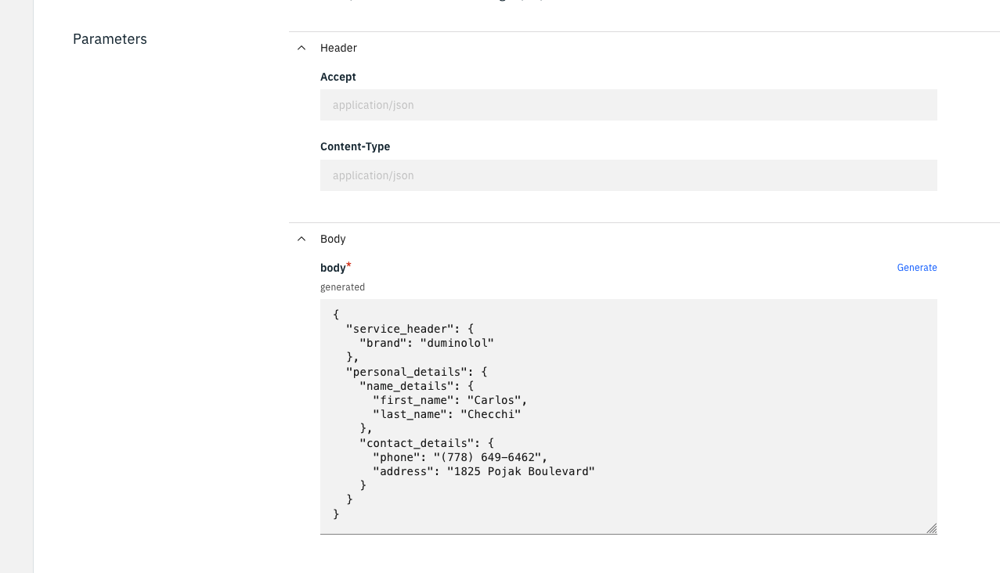{ width="1024" }
      <figcaption>Incorrect phone number generated</figcaption>
    </figure>

    <a name="wrong_format"></a>  Notice the phone number format. This is not the format our SOAP server accepts. If we send this request, our SOAP server will send an error back. For instance:

    <figure markdown>
      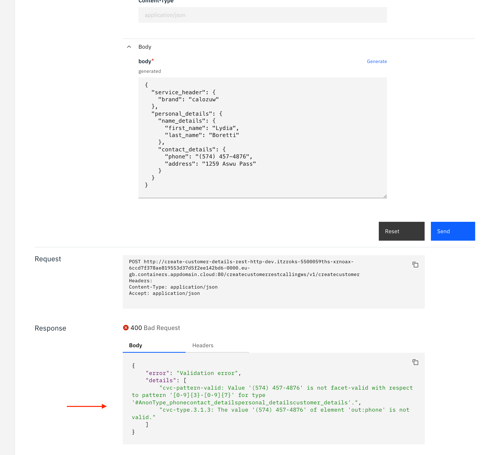{ width="1024" }
      <figcaption>Incorrect phone number format</figcaption>
    </figure>

    !!! note "Updating OpenAPI definition for phone number"

        We will fix the generation of the phone number in the right format in the next section.


    You can send a valid request but the setting the phone number in the right format:

    <figure markdown>
      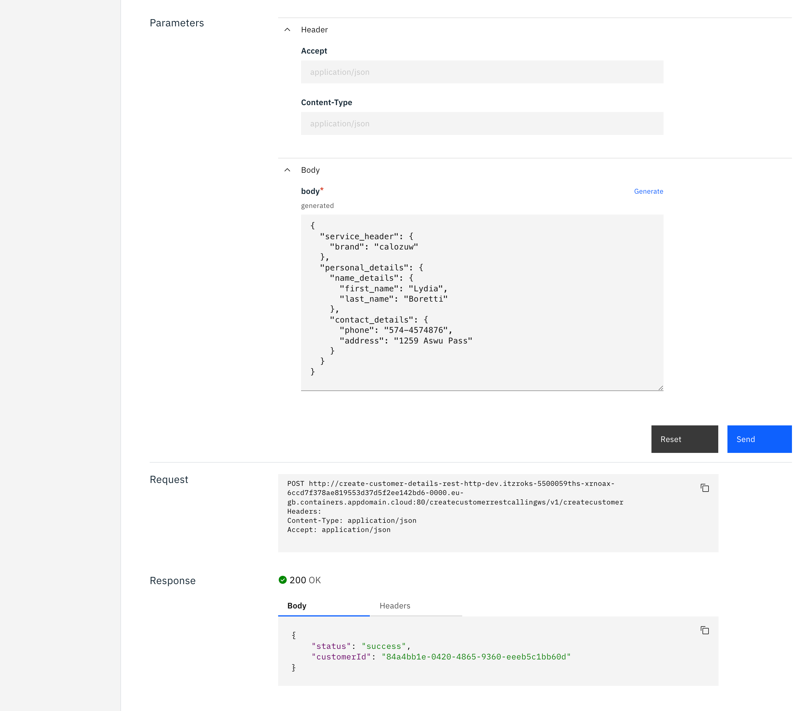{ width="1024" }
      <figcaption>Valid request</figcaption>
    </figure>


This concludes this section.