# Continuous Update

<!--- cSpell:ignore messageflow createcustomerrestcallingws createcustomer envsubst subflow subflows msgflow ibmint webui  pbcopy rolebinding backendurl policyxml soapserver realpath setdbparms truststores pipelinerun resyncs mqsc runmqsc dockerconfigjson queuemanager QMID podman ibmgaragecloud cntk cnkt eventid gitrevision gitrepositoryurl odowdaibm MQSC replicaset eventListener triggerbinding triggertemplate mqcicd qmgr Artifactory configmaps OIDC CHLAUTH templating sealedsecret openapi -->

## Overview

In the previous sub-section, *Building Integration Server*, when we tested our API for our Integration Server we had noticed that the phone number that gets generated from the OpenAPI definition is in the wrong format, see [Wrong phone number format](../build-integration-server/#wrong_format). We can fix this by adding a "pattern" (see [pattern, OpenAPI](https://swagger.io/docs/specification/data-models/data-types/#pattern)) to the phone number schema in our OpenAPI document, in our ACE source repository.

To integrate and deploy this change, instead of manually running the *Integration Server* pipeline, in this section we will automate it. In doing so, as changes submitted to the ACE source repository, *Integration Server* pipeline will be triggered automatically.

!!! note "What about *Configuration* pipeline?"

    The changes we will make in this section does not require any new **Configuration**s. When we introduce security for our Cloud Native example ACE flow, we will update the Configuration repository as well and we will automate the *Configuration* pipeline.

To automate running of pipelines, we will make use of GitHub Webhook. GitHub Webhook is mechanism to subscribe to "push events" from GitHub repositories. As changes are "pushed" to a repository, events from GitHub.com will be emitted as HTTPS POST Payload. We will set up an **EventListener** custom resource to receive the payload and in turn will trigger pipeline. For more information on triggering pipeline from GitHub events, see [Triggering Pipeline Execution From GitHub](https://cloud.redhat.com/blog/guide-to-openshift-pipelines-part-6-triggering-pipeline-execution-from-github)

In this section, we will cover the following:

1. Deploy a **TriggerTemplate** resource to create to a PipelineRun template referring to our *Integration Server* pipeline. 

1. Deploy a **TriggerBinding** resource to bind values in the above template from the WebHook payload

1. Deploy an **EventListener** to receive the WebHook payload and trigger the *Integration Server* pipeline using the **TriggerTemplate** and **TriggerBinding**

1. Set up a WebHook on ACE source repository, pointing the endpoint of the **EventListener** so that payloads are sent to it.

## Set Environment variables

Throughout this chapter we will make use of two environment variables, 

* `GIT_ORG`: an environment variable that identifies your GitHub organization
* `GIT_ROOT`: an environment variable that identifies the root folder for your cloned git repositories

We will make use of these environment variable to save typing and reduce errors. We have made use of these variable in the chapter, [GitOps, Tekton & ArgoCD](../../cluster-config/gitops-tekton-argocd).

Start a terminal window, we need to keep this terminal and the shell running throughout this chapter.

In the following command, replace `<git-organization>` with the GitHub organization name you've just chosen (e.g. tutorial-org-123):

``` { .bash }
export GIT_ORG=<git-organization>
```

You can verify your $GIT_ORG as follows:

``` { .bash }
echo $GIT_ORG 
```

Next, set `GIT_ROOT` to the root folder for your cloned git repositories. For example:

```bash
export GIT_ROOT=$HOME/git/$GIT_ORG-root
```

You can verify your $GIT_ROOT folder as follows:

```bash
echo $GIT_ROOT
```

## Deploy **TriggerTemplate** 

A pipeline instance is run with an creation of **PipelineRun** resource. When we executed our *Integration Server* pipeline, in the previous section, we essentially created the instance, either by the Web UI or via `tkn` CLI tool [Using `tkn` to instantiate pipeline](../build-integration-server/#tkn).

To automatically trigger a pipeline, therefore, **PipelineRun** resource need to be created. A **EventListener** creates **PipelineRun**. It makes use of a template, a **TriggerTemplate**, which contains a template for the **PipelineRun**:

``` { .yaml .no-copy hl_lines="14-44" linenums="1"}
apiVersion: triggers.tekton.dev/v1alpha1
kind: TriggerTemplate
metadata:
  name: ace-integration-server
spec:
  params:
    - name: source-repo
      description: name of the repository
    - name: git-org
      description: Login name of the origanisation
  resourcetemplates:
    - apiVersion: tekton.dev/v1beta1
      kind: PipelineRun
      metadata:
        generateName: ace-integration-server-$(tt.params.repository-name)-
        namespace: ci
      spec:
        params:
          - name: is-source-repo-url
            value: git@github.com:$(tt.params.git-org)/${tt.params.source-repo}.git
          - name: is-infra-repo-url
            value: git@github.com:$(tt.params.git-org)/ace-infra.git
          - name: git-ops-repo-url
            value: git@github.com:$(tt.params.git-org)/multi-tenancy-gitops-apps.git
          - name: gitops-apps-repo-full-name
            value: $(tt.params.git-org)/multi-tenancy-gitops-apps
        pipelineRef:
          name: ace-integration-server
        serviceAccountName: pipeline
        workspaces:
          - name: shared-workspace
            persistentVolumeClaim:
              claimName: ace-integration-server
          - name: ace-infra-repo-secret
            secret:
              secretName: ace-infra-at-github
          - name: gitops-repo-secret
            secret:
              secretName: multi-tenancy-gitops-apps-at-github
          - name: ace-source-repo-secret
            secret:
              secretName: $(tt.params.source-repo)-at-github
```

Notice that similarities of the parameters and workspaces to that of the `tkn` script, `run-ace-is-pipeline.sh` (see [`run-ace-is-pipeline.sh`](../build-integration-server/#run-ace-is-pipeline.sh)) we used in the previous section. The variables, `GIT_ORG` and `SOURCE_REPO` from the script corresponds to `git-org` and `source-repo` parameters of the above **TriggerTemplate**. These parameters are bound from event payload received from GitHub by **EventListener** with the definition of **TriggerBinding**.

Lets deploy this **TriggerTemplate**.

1. *Change to multi-tenancy-gitops-apps ci directory*

    Issue the following command to change to your GitOps repository and the pipeline directory

    ```bash
    cd $GIT_ROOT/multi-tenancy-gitops-apps/ace/environments/ci
    ```

1. *Update kustomization to enable trigger template, `ace-integration-server`**

    Open `kustomization.yaml` (`$GIT_ROOT/multi-tenancy-gitops-apps/ace/environments/ci/kustomization.yaml`) and uncomment:

    ``` {.yaml .no-copy}
    - triggertemplates/ace-integration-server.yaml
    ```

    If you take a diff now with

    ```{.bash}
    git diff --unified=0
    ```

    the result should be see:

    ``` { .diff .no-copy}
    diff --git a/ace/environments/ci/kustomization.yaml b/ace/environments/ci/kustomization.yaml
    index a7a71c3..e403972 100644
    --- a/ace/environments/ci/kustomization.yaml
    +++ b/ace/environments/ci/kustomization.yaml
    @@ -60 +60 @@ resources:
    -# - triggertemplates/ace-integration-server.yaml
    +- triggertemplates/ace-integration-server.yaml
    ```

1. *Commit the change*

    ```bash
    git commit -am "Deploy ace-integration-server trigger template"
    ```

1. *Push the change*

    ```bash
    git push
    ```

You can verify that ArgoCD deployed the resource using the ArgoCD UI, for `apps-ace-rest-ci-1`:

<figure markdown>
  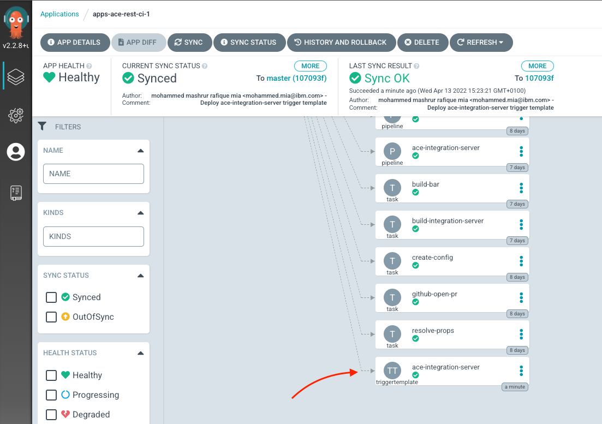{ width="1024" }
  <figcaption>TriggerTemplate, ace-integration-server, on ArgoCD UI</figcaption>
</figure>

## Deploy **TriggerBinding**

**EventListener** upon receiving an event payload from GitHub make use of **TriggerBinding** to bind parameters of **TriggerTemplate** by parsing the payload.

For instance, our **TriggerBinding**:

``` { .yaml .no-copy linenums="1"}
apiVersion: triggers.tekton.dev/v1alpha1
kind: TriggerBinding
metadata:
  name: ace-integration-server
spec:
  params:
  - name: source-repo
    value: $(body.repository.name)
  - name: git-org
    value: $(body.organization.login)
```

Parameters to bind are, `source-repo` and `git-org`, which matches the parameter specification of our **TriggerTemplate** above. As an example of push payload from GitHub, **EventListener** will receive something like:

``` { .json .no-copy }
{
  "ref": "refs/heads/master",
  "repository": {
    ...
    "name": "create-customer",
    ...
    "owner": {
      ...
    },
    ...
  },
  "pusher": {
    ...
  },
  "organization": {
    "login": "ace-prod-ref",
    ...
  },
  ...
}
```

From above, expression `body.repository.name` maps to `source-repo` name and `body.organization.login` maps to `git-org` name.

!!! note "Push Payload"

    Once we set up our WebHook and **EventListener**, we can examine the payloads that are sent from GitHub. We will examine that later in this section.

Lets deploy this **TriggerBinding**.

1. *Change to multi-tenancy-gitops-apps ci directory*

    Issue the following command to change to your GitOps repository and the pipeline directory

    ```bash
    cd $GIT_ROOT/multi-tenancy-gitops-apps/ace/environments/ci
    ```

1. *Update kustomization to enable trigger binding, `ace-integration-server`**

    Open `kustomization.yaml` (`$GIT_ROOT/multi-tenancy-gitops-apps/ace/environments/ci/kustomization.yaml`) and uncomment:

    ``` {.yaml .no-copy}
    - triggerbindings/ace-integration-server.yaml
    ```

    If you take a diff now with

    ```{.bash}
    git diff --unified=0
    ```

    the result should be see:

    ``` { .diff .no-copy}
    diff --git a/ace/environments/ci/kustomization.yaml b/ace/environments/ci/kustomization.yaml
    index 1462e2a..29e9a7c 100644
    --- a/ace/environments/ci/kustomization.yaml
    +++ b/ace/environments/ci/kustomization.yaml
    @@ -59 +59 @@ resources:
    -# - triggerbindings/ace-integration-server.yaml
    +- triggerbindings/ace-integration-server.yaml
    ```

1. *Commit the change*

    ```bash
    git commit -am "Deploy ace-integration-server trigger binding"
    ```

1. *Push the change*

    ```bash
    git push
    ```

You can verify that ArgoCD deployed the resource using the ArgoCD UI, for `apps-ace-rest-ci-1`:

<figure markdown>
  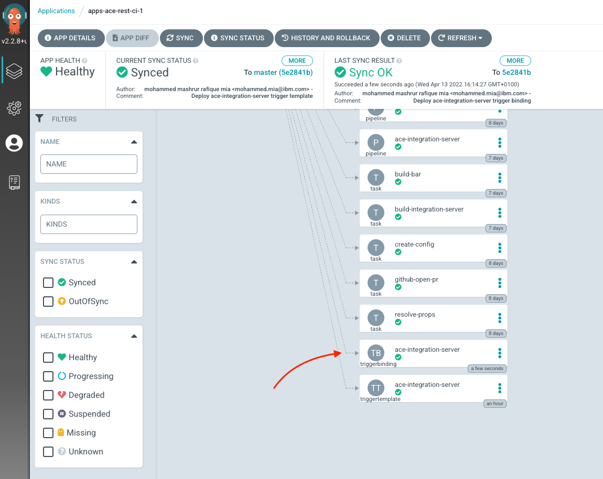{ width="1024" }
  <figcaption>TriggerBinding, ace-integration-server, on ArgoCD UI</figcaption>
</figure>

## Deploy **EventListener**

In order for GitHub to send events to **EventListener**, it need to accessible publicly. But once the **EventListener** is exposed anyone can send a payload which will cause the pipeline to run. Therefore, we would want to secure the communication between GitHub webhook and **EventListener**.

We can do this by setting up *Interceptors* in the **EventListener**. With *Interceptors* **EventListener** can verify payload, filter payload and implement other useful processing. For more information, see [EventListener](https://github.com/tektoncd/triggers/blob/main/docs/interceptors.md#github-interceptors) and [Interceptors](https://github.com/tektoncd/triggers/blob/main/docs/interceptors.md).

To verify the payload, we will set up GitHub Webhook with a secret token. The token is sent out alongside the payload and **EventListener** can use an *Interceptors* to verify the token against an OpenShift secret. See [Securing your webhooks](https://docs.github.com/en/developers/webhooks-and-events/webhooks/securing-your-webhooks) for more information.

We will also want to configure our **EventListener** to communicate over TLS. Otherwise the payload from GitHub will be sent out in plaintext and will essentially defeat the use to secret verification.

Therefore in this sub-section, we will

1. Deploy a TLS key and certificate pair

1. Deploy a string secret to be used a token to verify GitHub payload, and finally

1. Deploy the **EventListener**, making use of *Interceptors* to verify and filter payload

1. Create GitHub WebHook, setting up secret token

### Deploy TLS Key and certificate

We will make use of `cert-manager.io` to generate TLS key and certificate for us. `cert-manager.io` is already installed as part of IBM Foundation Service installation, that we enabled in a previous section.

We will make use of self-signed certificate Authority (CA) certificate to sign our certificate. We will first create a self-signed **Issuer**, and then generate a CA key and certificate pair from this **Issuer**. We will then create a new **Issuer** based on the CA key and certificate pair. Thereafter, this new **Issuer** will be used to generate key and certificate pair for our **EventListener**. For more information on self-signed issuer, see [SelfSigned Issuer](https://cert-manager.io/docs/configuration/selfsigned/)

!!! note "Got CA?"

    If you have a proper CA, you can use that to create your **Issuer**. See [CA Issuer](https://cert-manager.io/docs/configuration/ca/)

Lets deploy self-signed **Issuer**.

1. *Change to multi-tenancy-gitops-apps ci directory*

    Issue the following command to change to your GitOps repository and the pipeline directory

    ```bash
    cd $GIT_ROOT/multi-tenancy-gitops-apps/ace/environments/ci
    ```

1. *Update kustomization to enable self-signed **Issuer**, `prod-ref-ss.yaml`**

    Open `kustomization.yaml` (`$GIT_ROOT/multi-tenancy-gitops-apps/ace/environments/ci/kustomization.yaml`) and uncomment:

    ``` {.yaml .no-copy}
    - issuer/prod-ref-ss.yaml
    ```

    If you take a diff now with

    ```{.bash}
    git diff --unified=0
    ```

    the result should be see:

    ``` { .diff .no-copy}
    diff --git a/ace/environments/ci/kustomization.yaml b/ace/environments/ci/kustomization.yaml
    index 3ffb009..acd1005 100644
    --- a/ace/environments/ci/kustomization.yaml
    +++ b/ace/environments/ci/kustomization.yaml
    @@ -8 +8 @@ resources:
    -# - issuer/prod-ref-ss.yaml
    +- issuer/prod-ref-ss.yaml
    ```

1. *Commit the change*

    ```bash
    git commit -am "Deploy self-signed Issuer"
    ```

1. *Push the change*

    ```bash
    git push
    ```

You can verify that ArgoCD deployed the resource using the ArgoCD UI, for `apps-ace-rest-ci-1`:

<figure markdown>
  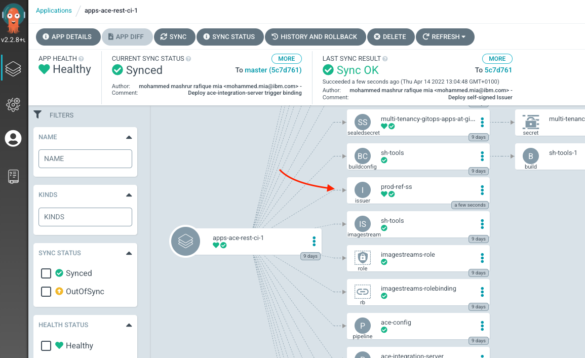{ width="1024" }
  <figcaption>Self-signed Issuer, prod-ref-ss, on ArgoCD UI</figcaption>
</figure>

Now that we have the **Issuer**, we can provision a CA key, certificate pair. 

1. *Change to multi-tenancy-gitops-apps certificate directory*

    Issue the following command to change to your GitOps repository and the pipeline directory

    ```bash
    cd $GIT_ROOT/multi-tenancy-gitops-apps/ace/environments/ci/certificates
    ```

1. *Run `generate-cert.sh` to generate Certificate*

    We will `generate-cert.sh` to generate **Certificate** for us. We want to put our cluster's ingress URL, prepend with wildcard in the Subject Alternative Name field of our certificate so that hostname verification can be performed by the clients.

    ```bash
    CERTIFICATE=prod-ref-ss-ca ./generate-cert.sh
    ```

    this will generate a file, named, `prod-ref-ss-ca.yaml`. If we look at the status of our repository now:

    ```bash
    git status
    ```

    You should see something like this:

    ``` { .bash .no-copy }
    On branch master
    Your branch is up to date with 'origin/master'.

    Untracked files:
      (use "git add <file>..." to include in what will be committed)
      prod-ref-ss-ca.yaml

    nothing added to commit but untracked files present (use "git add" to track)
    ```

    Add the newly generated YAML file to the repository and commit:

    ```bash
    git add prod-ref-ss-ca.yaml
    git commit -m 'Add self-signed CA certificate'
    ```

1. *Change to multi-tenancy-gitops-apps ci directory*

    Issue the following command to change to your GitOps repository and the pipeline directory

    ```bash
    cd $GIT_ROOT/multi-tenancy-gitops-apps/ace/environments/ci
    ```

1. *Add `prod-ref-ss-ca.yaml` kustomization to deploy certificate, `prod-ref-ss-ca`**

    Open `kustomization.yaml` (`$GIT_ROOT/multi-tenancy-gitops-apps/ace/environments/ci/kustomization.yaml`) and add:

    ``` {.yaml .no-copy}
    - certificates/prod-ref-ss-ca.yaml
    ```

    If you take a diff now with

    ```{.bash}
    git diff --unified=0
    ```

    the result should be see:

    ``` { .diff .no-copy}
    diff --git a/ace/environments/ci/kustomization.yaml b/ace/environments/ci/kustomization.yaml
    index 6078bab..2a5b35b 100644
    --- a/ace/environments/ci/kustomization.yaml
    +++ b/ace/environments/ci/kustomization.yaml
    @@ -4,0 +5 @@ resources:
    +- certificate/prod-ref-ss-ca.yaml
    ```

1. *Commit the change*

    ```bash
    git commit -am "Deploy prod-ref-ss-ca certificate"
    ```

1. *Push the change*

    ```bash
    git push
    ```

You can verify that ArgoCD deployed the resource using the ArgoCD UI, for `apps-ace-rest-ci-1`:

<figure markdown>
  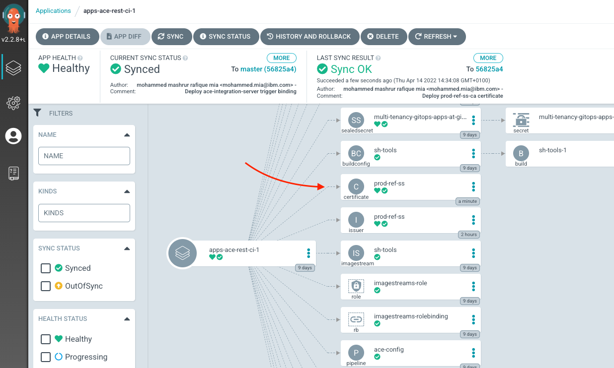{ width="1024" }
  <figcaption>CA Certificate, prod-ref-ss-ca, on ArgoCD UI</figcaption>
</figure>

The certificate and key is generated and maintained in a secret, `prod-ref-ss-tls-ca-key-pair`. We can examine this either on the OCP Web Console, via `oc` CLI. Let's use the CLI:

```bash
oc -n ci describe secret prod-ref-ss-tls-ca-key-pair
```

Which should output the following:

```bash
Name:         prod-ref-ss-tls-ca-key-pair
Namespace:    ci
Labels:       operator.ibm.com/watched-by-cert-manager=
Annotations:  cert-manager.io/alt-names: *.itzroks-5500059ths-bwukw7-6ccd7f378ae819553d37d5f2ee142bd6-0000.eu-gb.containers.appdomain.cloud
              cert-manager.io/certificate-name: prod-ref-ss
              cert-manager.io/common-name: appdomain.cloud
              cert-manager.io/ip-sans: 
              cert-manager.io/issuer-group: 
              cert-manager.io/issuer-kind: Issuer
              cert-manager.io/issuer-name: prod-ref-ss
              cert-manager.io/uri-sans: 

Type:  kubernetes.io/tls

Data
====
ca.crt:   1578 bytes
tls.crt:  1578 bytes
tls.key:  1675 bytes
```

Now lets make a **Issuer** with this CA key and certificate:

1. *Change to multi-tenancy-gitops-apps ci directory, if you are not already*

    Issue the following command to change to your GitOps repository and the pipeline directory

    ```bash
    cd $GIT_ROOT/multi-tenancy-gitops-apps/ace/environments/ci
    ```

1. *Update kustomization to enable **Issuer**, `prod-ref-ss-ca`**

    Open `kustomization.yaml` (`$GIT_ROOT/multi-tenancy-gitops-apps/ace/environments/ci/kustomization.yaml`) and uncomment:

    ``` {.yaml .no-copy}
    - issuer/prod-ref-ss-ca.yaml
    ```

    If you take a diff now with

    ```{.bash}
    git diff --unified=0
    ```

    the result should be see:

    ``` { .diff .no-copy}
    diff --git a/ace/environments/ci/kustomization.yaml b/ace/environments/ci/kustomization.yaml
    index 2a5b35b..f91cee7 100644
    --- a/ace/environments/ci/kustomization.yaml
    +++ b/ace/environments/ci/kustomization.yaml
    @@ -9 +9 @@ resources:
    -# - issuer/prod-ref-ss-ca.yaml
    +- issuer/prod-ref-ss-ca.yaml
    ```

1. *Commit the change*

    ```bash
    git commit -am "Deploy prod-ref-ss-ca issuer"
    ```

1. *Push the change*

    ```bash
    git push
    ```

You can verify that ArgoCD deployed the resource using the ArgoCD UI, for `apps-ace-rest-ci-1`:

<figure markdown>
  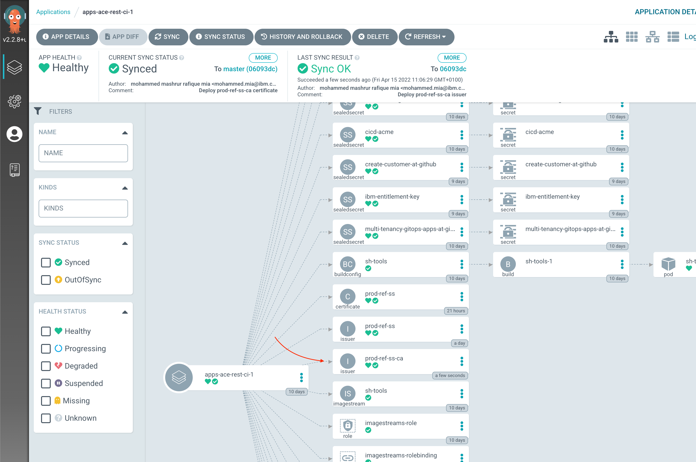{ width="1024" }
  <figcaption>Issuer, prod-ref-ss-ca, on ArgoCD UI</figcaption>
</figure>

And now we are ready to create a key and certificate via this **Issuer**. 

1. *Change to multi-tenancy-gitops-apps certificate directory*

    Issue the following command to change to your GitOps repository and the pipeline directory

    ```bash
    cd $GIT_ROOT/multi-tenancy-gitops-apps/ace/environments/ci/certificates
    ```

1. *Run `generate-cert.sh` to generate Certificate*

    We will `generate-cert.sh` to generate **Certificate** for us. We want to put our cluster's ingress URL, prepend with wildcard in the Subject Alternative Name field of our certificate so that hostname verification can be performed by the clients.

    ```bash
    CERTIFICATE=prod-ref-devops ./generate-cert.sh
    ```

    this will generate a file, named, `prod-ref-devops.yaml`. If we look at the status of our repository now:

    ```bash
    git status
    ```

    You should see something like this:

    ``` { .bash .no-copy }
    On branch master
    Your branch is ahead of 'origin/master' by 3 commits.
      (use "git push" to publish your local commits)

    Untracked files:
      (use "git add <file>..." to include in what will be committed)
            prod-ref-devops.yaml

    nothing added to commit but untracked files present (use "git add" to track)
    ```

    Add the newly generated YAML file to the repository and commit:

    ```bash
    git add prod-ref-devops.yaml
    git commit -m 'Add certificate for devops'
    ```

1. *Change to multi-tenancy-gitops-apps ci directory*

    Issue the following command to change to your GitOps repository and the pipeline directory

    ```bash
    cd $GIT_ROOT/multi-tenancy-gitops-apps/ace/environments/ci
    ```

1. *Add `prod-ref-ss-ca.yaml` kustomization to deploy certificate, `prod-ref-ss-ca`**

    Open `kustomization.yaml` (`$GIT_ROOT/multi-tenancy-gitops-apps/ace/environments/ci/kustomization.yaml`) and add:

    ``` {.yaml}
    - certificates/prod-ref-devops.yaml
    ```

    If you take a diff now with

    ```{.bash}
    git diff --unified=0
    ```

    the result should be see:

    ``` { .diff .no-copy}
    diff --git a/ace/environments/ci/kustomization.yaml b/ace/environments/ci/kustomization.yaml
    index 81a709a..29e9a7c 100644
    --- a/ace/environments/ci/kustomization.yaml
    +++ b/ace/environments/ci/kustomization.yaml
    @@ -5,0 +6 @@ resources:
    +- certificate/prod-ref-devops.yaml
    ```

1. *Commit the change*

    ```bash
    git commit -am "Deploy prod-ref-devops certificate"
    ```

1. *Push the change*

    ```bash
    git push
    ```

You can verify that ArgoCD deployed the resource using the ArgoCD UI, for `apps-ace-rest-ci-1`:

<figure markdown>
  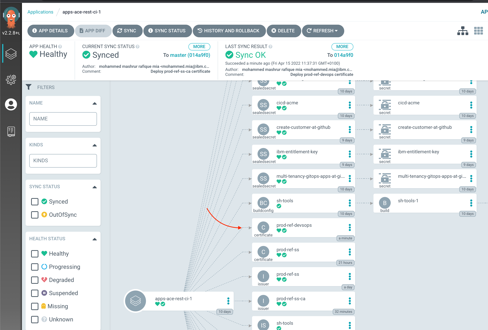{ width="1024" }
  <figcaption>CA Certificate, prod-ref-ss-ca, on ArgoCD UI</figcaption>
</figure>

The certificate and key is generated and maintained in a secret, `prod-ref-devops-tls-key-pair`. We can examine this either on the OCP Web Console, via `oc` CLI. Let's use the CLI:

```bash
oc -n ci describe secret prod-ref-devops-tls-key-pair
```

Which should output the following:

```bash
Name:         prod-ref-devops-tls-key-pair
Namespace:    ci
Labels:       operator.ibm.com/watched-by-cert-manager=
Annotations:  cert-manager.io/alt-names: *.itzroks-5500059ths-bwukw7-6ccd7f378ae819553d37d5f2ee142bd6-0000.eu-gb.containers.appdomain.cloud
              cert-manager.io/certificate-name: prod-ref-devsops
              cert-manager.io/common-name: appdomain.cloud
              cert-manager.io/ip-sans: 
              cert-manager.io/issuer-group: 
              cert-manager.io/issuer-kind: Issuer
              cert-manager.io/issuer-name: prod-ref-ss
              cert-manager.io/uri-sans: 

Type:  kubernetes.io/tls

Data
====
ca.crt:   1537 bytes
tls.crt:  1537 bytes
tls.key:  1675 bytes
```

### Deploy Secret Token

We will secure our webhook so that payload from GitHub is authenticated by the **EventListener** before pipeline is triggered. We will do this by setting up a secret token when we set up our WebHook. The token can then be verified by a *Interceptor* within the **EventListener** against an OpenShift secret.

In this sub-section we will generate an OpenShift secret with a generated token. In the subsequent section, we will use this generated token when setting up our WebHook.

1. *Change to multi-tenancy-gitops-apps secrets directory*

    Issue the following command to change to your GitOps repository and the pipeline directory

    ```bash
    cd $GIT_ROOT/multi-tenancy-gitops-apps/ace/environments/ci/secrets
    ```

1. *Run `gitops-webhook-token.sh` to generate SealedSecret with token*

    We will `gitops-webhook-token.sh` to generate a **SealedSecret**. 
    
    The script will first generate a random string, which we will use a token. The string token will then be used to content of **Secret** object, which will then be encrypted with sealed secret.

    ```bash
    ./gitops-webhook-token.sh
    ```

    this will generate a file, named, `gitops-webhook-token.yaml`. If we look at the status of our repository now:

    ```bash
    git status
    ```

    You should see something like this:

    ``` { .bash .no-copy }
    On branch master
    Your branch is ahead of 'origin/master' by 1 commit.
      (use "git push" to publish your local commits)

    Untracked files:
      (use "git add <file>..." to include in what will be committed)
            gitops-webhook-token.yaml

    nothing added to commit but untracked files present (use "git add" to track)
    ```

    Add the newly generated YAML file to the repository and commit:

    ```bash
    git add gitops-webhook-token.yaml
    git commit -m 'Add sealed secret for webook token'
    ```

1. *Change to multi-tenancy-gitops-apps ci directory*

    Issue the following command to change to your GitOps repository and the pipeline directory

    ```bash
    cd $GIT_ROOT/multi-tenancy-gitops-apps/ace/environments/ci
    ```

1. *Enable `gitops-webhook-token.yaml` kustomization to deploy the secret, `gitops-webhook-token.yaml`**

    Open `kustomization.yaml` (`$GIT_ROOT/multi-tenancy-gitops-apps/ace/environments/ci/kustomization.yaml`) and add:

    ``` {.yaml .no-copy}
    - secrets/gitops-webhook-token.yaml
    ```

    If you take a diff now with

    ```{.bash}
    git diff --unified=0
    ```

    the result should be see:

    ``` { .diff .no-copy}
    diff --git a/ace/environments/ci/kustomization.yaml b/ace/environments/ci/kustomization.yaml
    index d3f1656..5754fec 100644
    --- a/ace/environments/ci/kustomization.yaml
    +++ b/ace/environments/ci/kustomization.yaml
    @@ -26,0 +27 @@ resources:
    +- secrets/gitops-webhook-token.yaml
    ```

1. *Commit the change*

    ```bash
    git commit -am "Deploy Webhook secret create-customer"
    ```

1. *Push the change*

    ```bash
    git push
    ```

You can verify that ArgoCD deployed the resource using the ArgoCD UI, for `apps-ace-rest-ci-1`:

<figure markdown>
  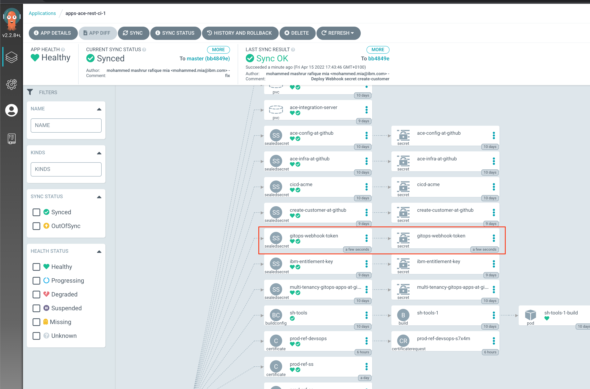{ width="1024" }
  <figcaption>WebHook token secret in ArgoCD UI</figcaption>
</figure>

### Deploy **EventListener**

We are now ready to deploy **EventListener** as we have deployed all of its pre-requisites resources.

Our **EventListener**, maintained in [multi-tenancy-gitops-apps](https://github.com/cloud-native-toolkit-demos/multi-tenancy-gitops-apps/tree/master/ace/environments/ci/eventlisteners/ace-integration-server.yaml), has two *interceptors* defined:

``` { .bash .no-copy linenums="1" hl_lines="9-23"}
apiVersion: triggers.tekton.dev/v1alpha1
kind: EventListener
metadata:
  name: ace-integration-server
spec:
  ...
  triggers:
    - name: ace-integration-server
      interceptors:
        - name: "Validate GitHub payload"
          ref:
            name: github
          params:
            - name: secretRef
              value:
                secretName: gitops-webhook-token
                secretKey: webhook-token
        - name: "CEL filter: only when coming from master branch"
          ref:
            name: cel
          params:
            - name: filter
              value: body.ref == 'refs/heads/master'
...
```

First, a **GitHub** interceptor that validates the GitHub webhook. It validates the webhook's origin by comparing the token against an OpenShift secret. If the token from the webhook does not match the secret value then pipeline is not triggered. For more information, see [GitHub Interceptors](https://github.com/tektoncd/triggers/blob/main/docs/interceptors..md#github-interceptors)

The second is a **cel** interceptor, which allows us to filter the webhook payloads. Here we are using a cel expression to match events coming only from the master branch. See [CEL interceptor](https://github.com/tektoncd/triggers/blob/main/docs/interceptors.md#cel-interceptors) for more information.

We also specify a `kubernetesResource` definition to enable TLS with our certificate and key, created earlier in this section:

``` { .bash .no-copy linenums="1" hl_lines="15-24" }
apiVersion: triggers.tekton.dev/v1alpha1
kind: EventListener
metadata:
  name: ace-integration-server
spec:
  ...
  resources:
    kubernetesResource:
      spec:
        template:
          spec:
            serviceAccountName: pipeline
            containers:
                env:
                - name: TLS_CERT
                  valueFrom:
                    secretKeyRef:
                      name: prod-ref-devops-tls-key-pair
                      key: tls.crt
                - name: TLS_KEY
                  valueFrom:
                    secretKeyRef:
                      name: prod-ref-devops-tls-key-pair
                      key: tls.key
```

Lets deploy this **TriggerBinding**.

1. *Change to multi-tenancy-gitops-apps ci directory*

    Issue the following command to change to your GitOps repository and the pipeline directory

    ```bash
    cd $GIT_ROOT/multi-tenancy-gitops-apps/ace/environments/ci
    ```

1. *Update kustomization to enable **EventLister**, `ace-integration-server`**

    Open `kustomization.yaml` (`$GIT_ROOT/multi-tenancy-gitops-apps/ace/environments/ci/kustomization.yaml`) and uncomment:

    ``` {.yaml .no-copy}
    - eventListeners/ace-integration-server.yaml
    ```

    If you take a diff now with

    ```{.bash}
    git diff --unified=0
    ```

    the result should be see:

    ``` { .diff .no-copy}
    diff --git a/ace/environments/ci/kustomization.yaml b/ace/environments/ci/kustomization.yaml
    index 2bbb829..dd17565 100644
    --- a/ace/environments/ci/kustomization.yaml
    +++ b/ace/environments/ci/kustomization.yaml
    @@ -7 +7 @@ resources:
    -# - eventlisteners/ace-integration-server.yaml
    +- eventlisteners/ace-integration-server.yaml
    ```

1. *Commit the change*

    ```bash
    git commit -am "Deploy ace-integration-server eventlistener"
    ```

1. *Push the change*

    ```bash
    git push
    ```

You can verify that ArgoCD deployed the resource using the ArgoCD UI, for `apps-ace-rest-ci-1`:

<figure markdown>
  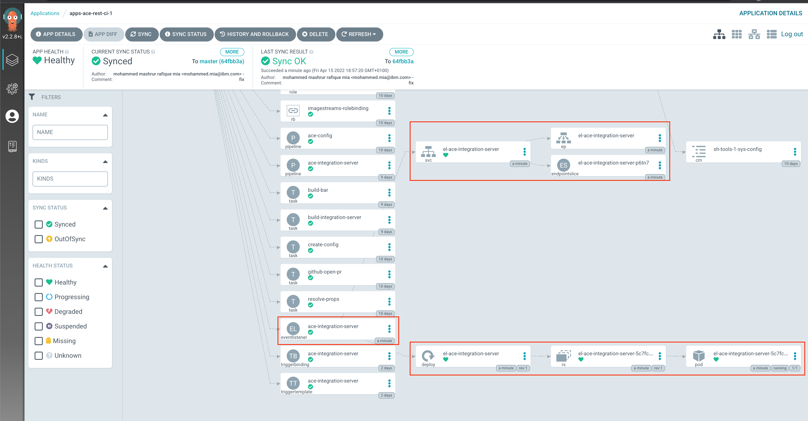{ width="1024" }
  <figcaption>EventListener, ace-integration-server, on ArgoCD UI</figcaption>
</figure>

Notice the deployment and service that got created along. But we do not have any route though. Since GitHub is outside of our cluster, we need to expose our **EventListener** via a **Route** resource:

1. *Change to multi-tenancy-gitops-apps ci directory*

    Issue the following command to change to your GitOps repository and the pipeline directory

    ```bash
    cd $GIT_ROOT/multi-tenancy-gitops-apps/ace/environments/ci
    ```

1. *Update kustomization to enable route, `el-ace-integration-server`**

    Open `kustomization.yaml` (`$GIT_ROOT/multi-tenancy-gitops-apps/ace/environments/ci/kustomization.yaml`) and uncomment:

    ``` {.yaml .no-copy}
    - routes/el-ace-integration-server.yaml
    ```

    If you take a diff now with

    ```{.bash}
    git diff --unified=0
    ```

    the result should be see:

    ``` { .diff .no-copy}
    diff --git a/ace/environments/ci/kustomization.yaml b/ace/environments/ci/kustomization.yaml
    index 4efe879..d70fb6d 100644
    --- a/ace/environments/ci/kustomization.yaml
    +++ b/ace/environments/ci/kustomization.yaml
    @@ -24 +24 @@ resources:
    -# - routes/el-ace-integration-server.yaml
    +- routes/el-ace-integration-server.yaml
    ```

1. *Commit the change*

    ```bash
    git commit -am "Deploy ace-integration-server eventlistener route"
    ```

1. *Push the change*

    ```bash
    git push
    ```

You can verify that ArgoCD deployed the resource using the ArgoCD UI, for `apps-ace-rest-ci-1`:

<figure markdown>
  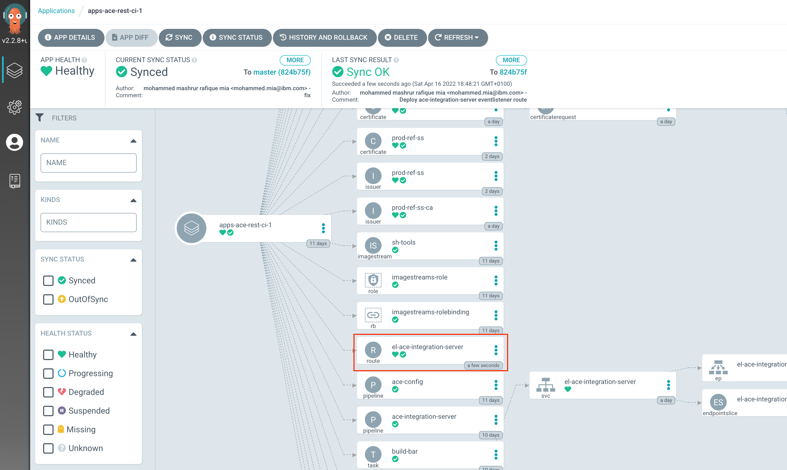{ width="1024" }
  <figcaption>Route for eventlistener, ace-integration-server, on ArgoCD UI</figcaption>
</figure>

## Create WebHook

We are not ready to create the WebHook in our ACE source repository. Visit the ACE source repository, `create-customer`, on your GitHub organization, navigate to to **Settings > Webhooks** and click **Add Webhook** button:

<figure markdown>
  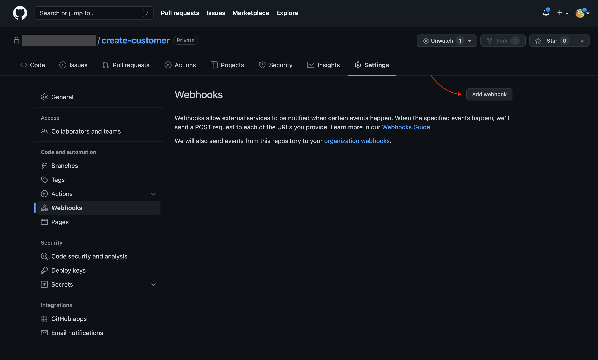{ width="1024" }
  <figcaption>Webhook at create-customer</figcaption>
</figure>

<figure markdown>
  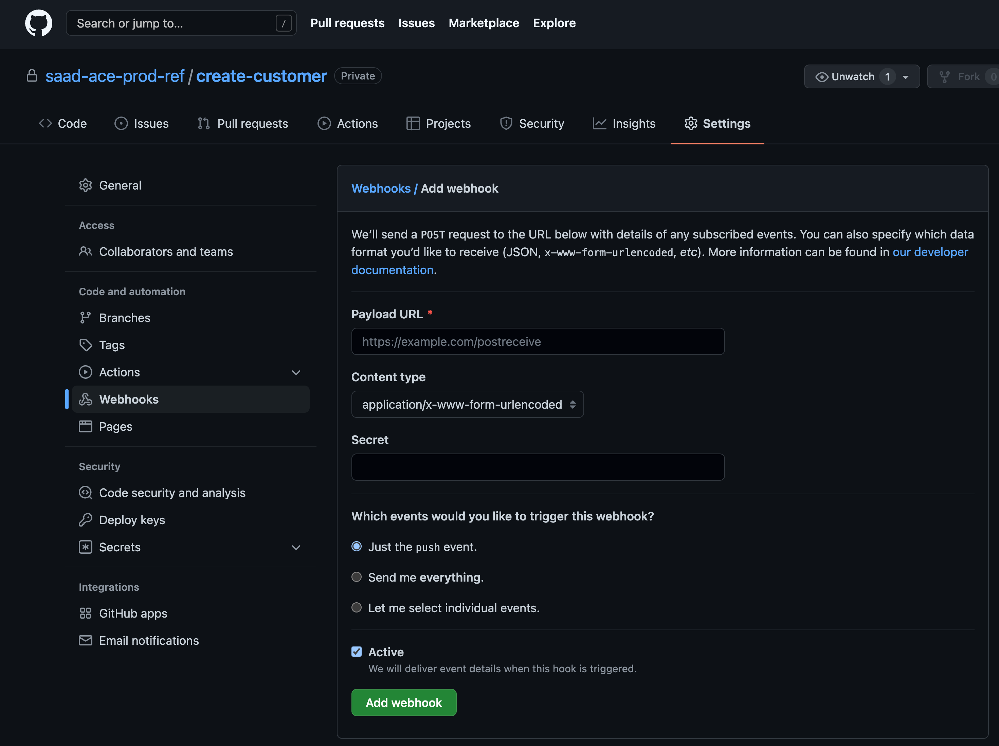{ width="1024" }
  <figcaption>Webhook details at create-customer</figcaption>
</figure>

On the form, we need to put our **EventListener** route and token. 

The route can be extracted with:

```bash
oc get route el-ace-integration-server -n ci --template='{{"https://"}}{{.spec.host}}{{"\n"}}'
```

and the secret string can be extracted with:

```bash
oc extract secret/gitops-webhook-token -n ci --to=-
```

Because we are using self-signed certificates in our EventListener, we will disable SSL verification:

<figure markdown>
  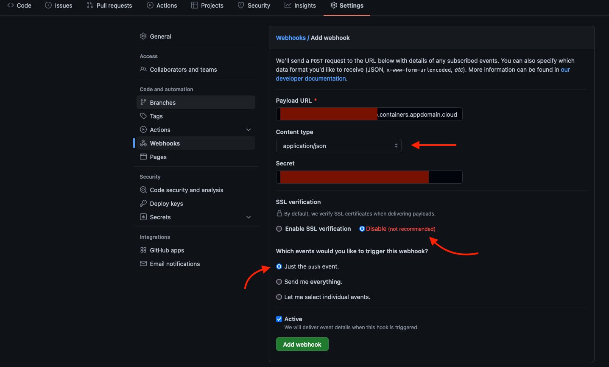{ width="1024" }
  <figcaption>Add WebHook disabling SSL verification</figcaption>
</figure>

After setting these values, click **Add webhook** to add the webhook.

## Test out the WebHook with a change

We will follow **GitHub flow** to contribute changes to our source code. It is out of scope of this guide to explain **GitHub flow** in details, but in brief, to contribute changes

1. We create a "feature" branch
1. Add our changes to this branch
1. Make a pull request
1. The pull request is reviewed
1. If everything looks good, pull request is merged

<figure markdown>
  { width="1024" }
  <figcaption></figcaption>
</figure>

To learn more about **GitHub flow**, see [GitHub flow](https://docs.github.com/en/get-started/quickstart/github-flow)

To make changes to our ACE source repository, we will be doing the following: 

1. Clone the `create-customer` repository
1. Create a branch
1. Make changes
1. Commit and push the branch to origin
1. Create a pull request
1. Merge the pull request

Let's get started

1. Change to our git root directory

    ```bash
    cd $GIT_ROOT
    ```

1. Clone the repository

    Following is an example of cloning the `create-customer` using SSH URL

    ```bash
    git clone git@github.com:ace-prod-ref/create-customer.git
    ```

    change the URL that suits your version of the repository.

1. Change to `create-customer` workspace

    ```bash
    cd $GIT_ROOT/create-customer
    ```

1. Create a "f branch

    We will make changes to the OpenAPI document to add pattern to the *phone number* of new customer. Therefore, we will create a branch named, `update-phone-number-pattern': 

    ```bash
    git checkout -b update-phone-number-pattern
    ```

1. Add a pattern for the phone number in OpenAPI document

    Open file, `createcustomer/openapi.json` and add the pattern `^\\d{3}-\\d{7}$` to the `phone` property of the `contact_details` object. If you take a diff:

    ```bash
    git diff
    ```

    you should see:

    ``` { .diff .no-copy }
    diff --git a/createcustomer/openapi.json b/createcustomer/openapi.json
    index aec8aa9..fe96719 100644
    --- a/createcustomer/openapi.json
    +++ b/createcustomer/openapi.json
    @@ -95,7 +95,8 @@
                    "type": "object",
                    "properties": {
                      "phone": {
    -                    "type": "string"
    +                    "type": "string",
    +                    "pattern": "^\\d{3}-\\d{7}$"
                      },
                      "address": {
                        "type": "string"
    ```

1. Add and commit the change

    ```bash
    git add createcustomer/openapi.json
    git commit -m "Add pattern to phone number"
    ```

1. Push the "feature" branch

    ```bash
    git push origin update-phone-number-pattern
    ```

1. Create the pull request

    If you navigate to the repository on your GitHub organization, you should see

    <figure markdown>
      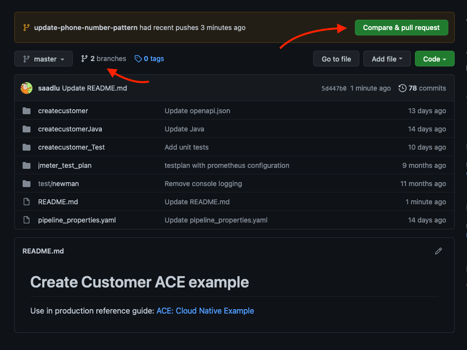{ width="1024" }
      <figcaption>New feature branch on create-customer</figcaption>
    </figure>

    From here you can create a pull request by either clicking on **Compare & pull request** or going the branch view.

    <figure markdown>
      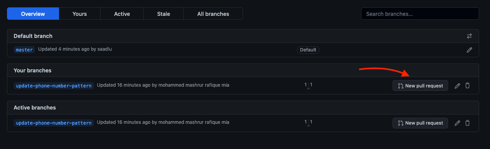{ width="1024" }
      <figcaption>New pull request from branch view</figcaption>
    </figure>

    click on **New pull request**. Fill up the paragraph to describe your change and click on **Create pull request**

    <figure markdown>
      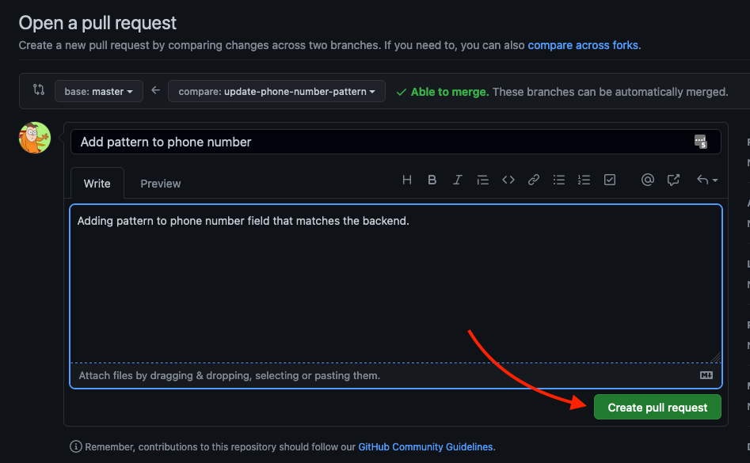{ width="1024" }
      <figcaption>Create pull request</figcaption>
    </figure>

    <figure markdown>
      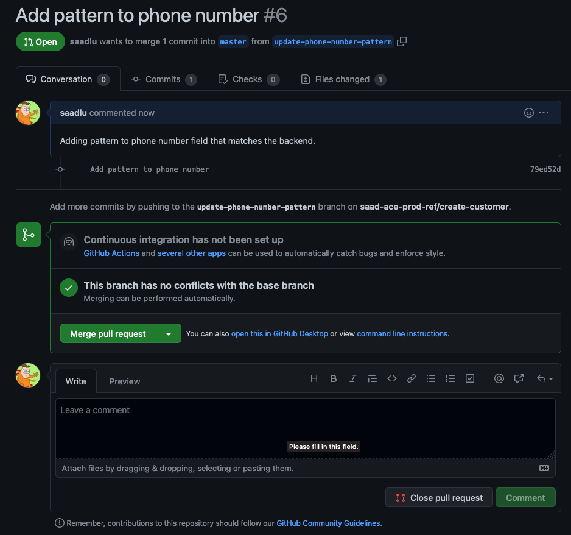{ width="1024" }
      <figcaption>Review pull request</figcaption>
    </figure>

    Ideally you want a reviewer to check your changes, someone from your team. In this example, we will simply look at the change and approve.

    Click on **Commits** tab and click on commit to see the `diff` of the changes:

    <figure markdown>
      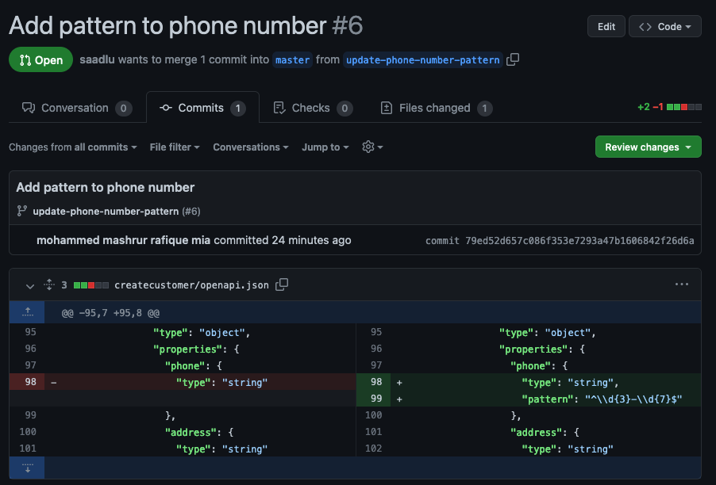{ width="1024" }
      <figcaption>Review the commit</figcaption>
    </figure>

    We will assume that we are happy with this change. Click on **Conversation** tab and click on **Merge pull request** to merge the request and confirm the merge.

    This should trigger a pipeline run.

1. Verify that the pipeline is running

    <figure markdown>
      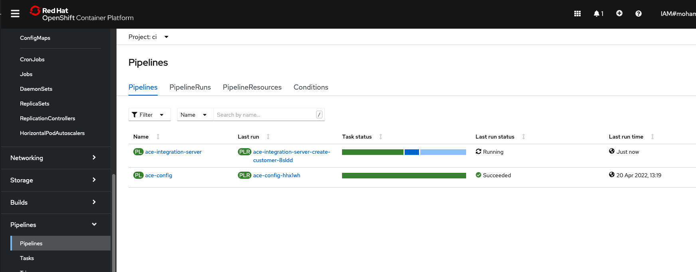{ width="1024" }
      <figcaption>Pipeline Run Triggered</figcaption>
    </figure>

    When the pipeline run completes, you will see a pull request in your `multi-tenancy-gitops-apps` repository

1. Verify pull request has been submitted by the pipeline

    <figure markdown>
      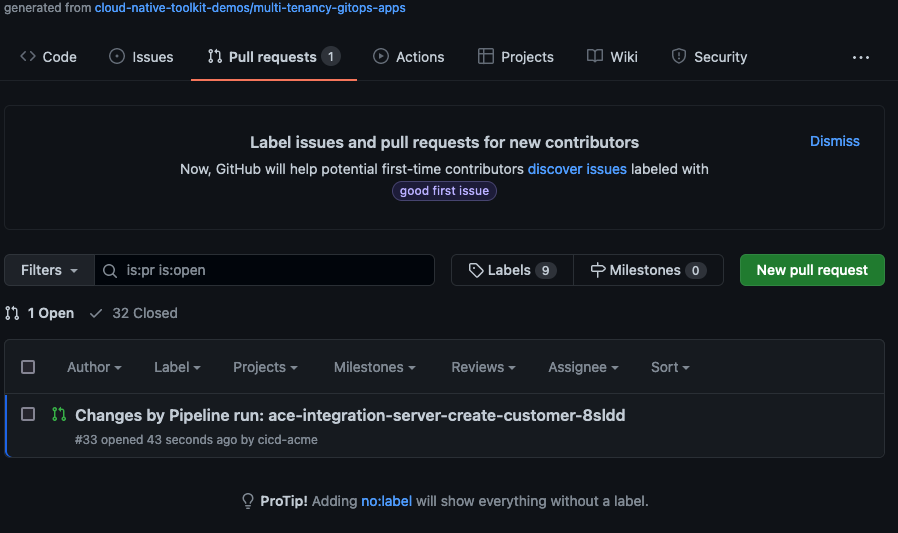{ width="1024" }
      <figcaption>Pull request from pipeline run</figcaption>
    </figure>

1. Examine the current version of our ACE integration server deployment

    Before we merge the pull request on `multi-tenancy-gitops-apps`, let us check the current version of our ACE application. Open up ACE dashboard:

    As a reminder the URL to the dashboard can be found by

    ```bash
    oc get dashboard ace-dashboard -n dev -o jsonpath='{.status.endpoints[0].uri}{"\n"}'
    ```

    while the `admin` password can be found by

    ```bash
    oc extract secret/ibm-iam-bindinfo-platform-auth-idp-credentials --keys=admin_password -n ibm-common-services --to=-
    ```

    On the dashboard, open our `createcustomer` API. You can either download the OpenAPI document to verify that `phone` field under `contact_details` does not have a `pattern` associated it, or, you can see the details of the `POST /createcustomer` operation and check the body that is generated:

    <figure markdown>
      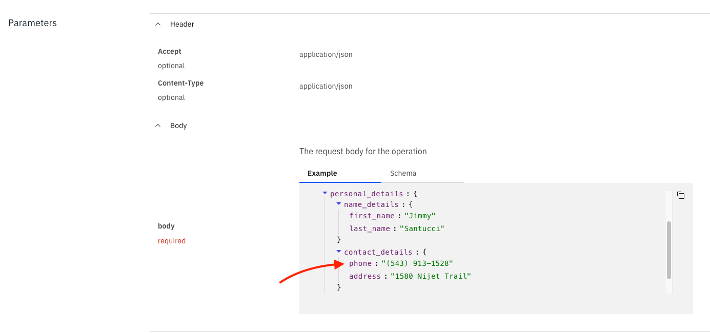{ width="1024" }
      <figcaption>Incorrectly formatted phone number</figcaption>
    </figure>

    As you can verify this is not the format we want.


1. Merge the pull request in `multi-tenancy-gitops-apps`

    Merge the pull request generated by the pipeline run on the `multi-tenancy-gitops-apps` repository. ArgoCD will notice the change and will update the deployment of ACE integration server. On the `apps-ace-rest-dev-1` ArgoCD application, verify that the syncing happened - refresh if it did not:

    <figure markdown>
      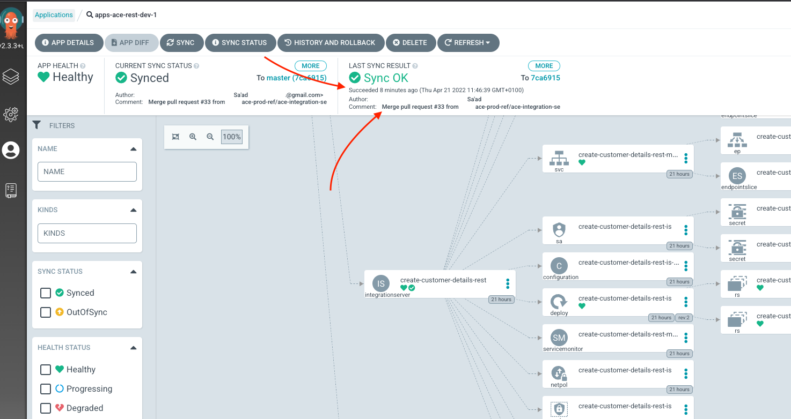{ width="1024" }
      <figcaption>Syncing in ArgoCD</figcaption>
    </figure>

1. Verify that the ACE application has been re-deployed with the change

    If you open up the ACE dashboard now, navigate to `createcustomer` API and to the details of `POST /createcustomer` operation, you would see generated body has been updated:

    <figure markdown>
      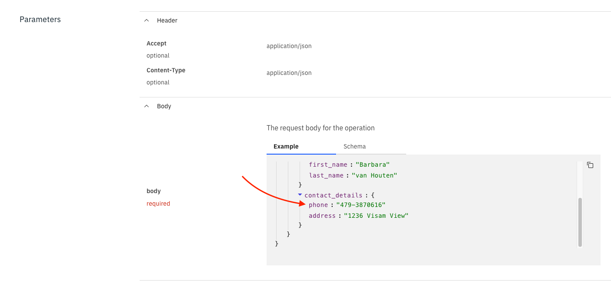{ width="1024" }
      <figcaption></figcaption>
    </figure>


This concludes this section of **Continuous Update**.