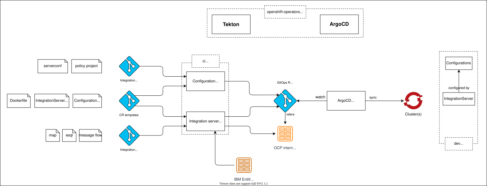

# Building AppConnect Integration Server

<!--- cSpell:ignore policyxml datasource messageflow subflow pipelinerun resyncs mqsc msqc runmqsc dockerconfigjson queuemanager QMID podman ibmgaragecloud cntk cnkt eventid gitrevision gitrepositoryurl odowdaibm MQSC replicaset eventlistener triggerbinding triggertemplate mqcicd qmgr Artifactory configmaps OIDC CHLAUTH templating sealedsecret -->

## Overview

In the [Cloud Native AppConnect Enterprise GitOps](../cluster-config/gitops-tekton-argocd.md) section of this guide, we  set up and configured GitOps for our cluster. We then used GitOps to install and manage Kubernetes infrastructure and services resources.

In this chapter, we're going to use these resources to build, deploy and run an AppConnect Integration Server. This will require us to install some more components into our cluster.

There are two kinds of resources to build in order to build an an AppConnect Integration Server, one or more `Configuration`s and an `IntegrationServer`. Consider the following diagrams:

We'll examine these components in more detail throughout this section of the tutorial; here's an overview of their function, from left to right:

* The Configuration pipeline takes AppConnect configurations files such as server configuration (`serverconf`), policy projects (`.policyxml`), loopback datasource (`datasource.json`), etc. from a git repository, and converts them to [Configuration](https://www.ibm.com/docs/en/app-connect/containers_cd?topic=resources-configuration-reference) resource.

    These are OpenShift Custom Resource (CR), which are looked after by AppConnect operator and ingested by [IntegrationServer](https://www.ibm.com/docs/en/app-connect/containers_cd?topic=resources-integration-server-reference) CR.

    The pipeline commits the `Configuration` resource manifests to GitOps manifest repository.

* The Integration Server pipeline takes AppConnect application files, such as message flows (`.messageflow`), sub-flows (`.subflow`), ESQL (`.esql`), mapping (`.map`), etc. creates a BAR file, bakes in the BAR file to a custom container image, pushes the container image to OpenShift internal registry and creates a [IntegrationServer](https://www.ibm.com/docs/en/app-connect/containers_cd?topic=resources-integration-server-reference) CR.

    The base image of the custom image is the IBM certified AppConnect container image, and therefore credential to the IBM Entitled Registry is required. The credential is supplied to the pipeline via the secret, `ibm-entitlement-key`, which we deployed in the cluster in section, [IBM Entitlement Key](../cluster-config/services.md#ibm-entitlement-key).

    The CR resource refers to the custom container image.

    The pipeline commits the `IntegrationServer` resource manifests to GitOps manifest repository.

* The pipelines require `secret`s to connect to GitHub. They contain GitHub access token used by the pipelines to access the configurations and Integration Application Git repository.

In the subsequent topics of this chapter:

* We will build the required `Configuration`s by running the Configuration pipeline
* We will build the `IntegrationServer` by running the Integration Server pipeline

---

## Pre-requisites

Before attempting this topic, you should have successfully completed the
[previous chapter](../cluster-config/gitops-tekton-argocd.md).

---
