# IBM API Connect configuration on IBM Cloud

<!--- cSpell:ignore apic auditability clust Mailtrap -->

In the previous chapter of this tutorial, you went through what needs to be done within your GitOps repository in order to get a highly available and production ready IBM API Connect Cluster deployed on a Red Hat OpenShift cluster on IBM Cloud. However, that deployment process, as the name indicates, only deploys the different subsystems that an IBM API Connect Cluster is made of.

## Overview

An IBM API Connect cluster (defined through its APIConnectCluster Custom Resource Definition - CRD), deploys the following subsystems:

* Management Cluster (ManagementCluster CRD)
* Portal Cluster (PortalCluster CRD)
* Gateway Cluster (GatewayCluster CRD)
* Analytics Cluster (AnalyticsCluster CRD)

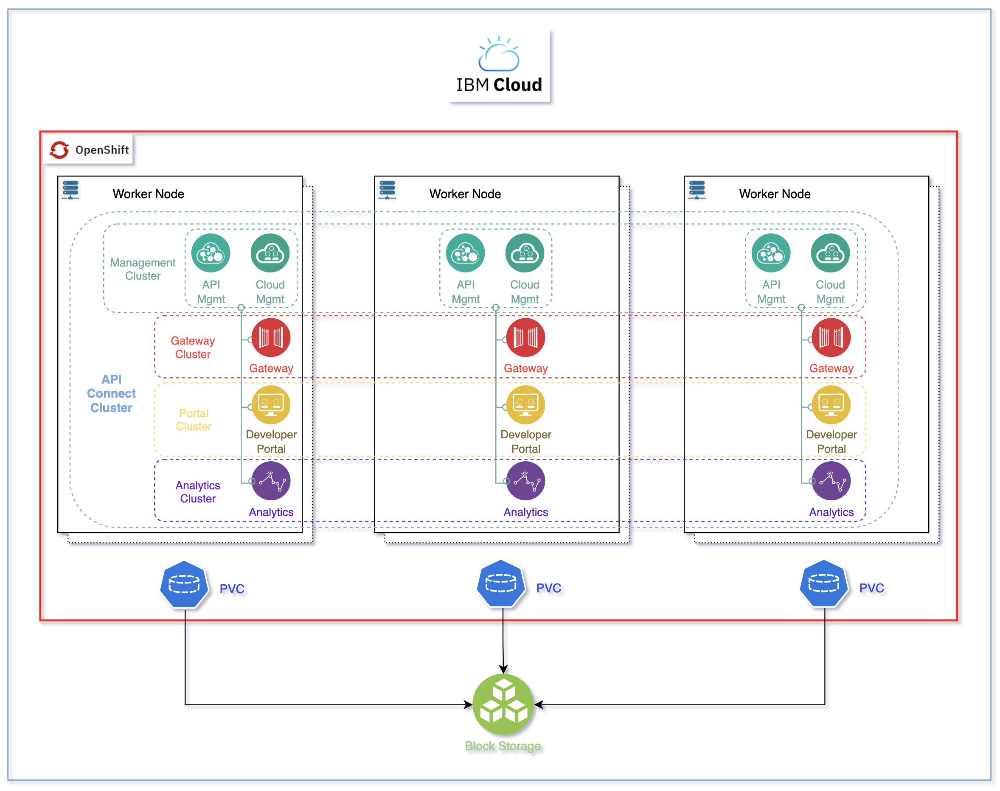{: style="max-height:800px"}

!!! tip
    The reason for the IBM API Connect subsystems to be called clusters is because each of those can be easily deployed highly available by using the `profile` property. As a result, it is common to see and strongly recommended, specially on production environments, to deploy all of these IBM API Connect subsystems using their highly available profile, which will deploy 3 replicas of each.

However, as already introduced, the deployment process will not configure all these IBM API Connect subsystems to work together straight away. Instead, you will need to complete the following [IBM API Connect Cloud Manager configuration checklist](https://www.ibm.com/docs/en/api-connect/10.0.x?topic=environment-cloud-manager-configuration-checklist) that will drive you through things like _Register a Gateway service, Register an Analytics service, Create a provider organization, etc_.

## Automation

Similarly to deploying any piece of software in production, you would like to be able to configure those pieces of software through a GitOps methodology as well. However, the configuration of some of those pieces of software might not yet be enabled be done following a GitOps methodology. Still, you would like to be able to configure any of those pieces of software or components through certain degree of automation. Automation will provide you with two major benefits: auditability and repetition (both of which are inherent to GitOps).

Since the configuration of theses pieces of software is done through automation and automation is nothing but code describing actions to be done/taken, that pieces of code that is automating the configuration of a piece of software is auditable and repeatable. These two properties allow you to see how exactly a piece of software has been configured in case you need to adjust anything and also give you that repeatability that provides you with a kind of disaster recovery mechanism that will allow you to configure another instance of that piece of software in the exact same manner as its sibling. Of course, these capabilities are a must in production environments.

The automation we are describing and looking for to automate the [IBM API Connect Cloud Manager configuration checklist](https://www.ibm.com/docs/en/api-connect/10.0.x?topic=environment-cloud-manager-configuration-checklist) can be achieved thanks to Tekton (OpenShift Pipelines) and, in the particular case of IBM API Connect, the rich set of [IBM API Connect administration APIs](https://apic-api.apiconnect.ibmcloud.com/v10/?_ga=2.233587928.752341463.1623867527-1939642083.1623276281#/documentation/introduction). With these two, we have managed to create an OpenShift pipeline that will automate the following actions for use to configure a new deployment of an IBM API Connect instance:

1. Configure an email server for notifications.
1. Register the default Gateway Service.
1. Register the default Analytics Service.
1. Associate the default Analytics Service with the default Gateway Service.
1. Register the default Portal Service.
1. Create a Provider Organization.
1. Associate the default Gateway Service with the default Sandbox catalog.

    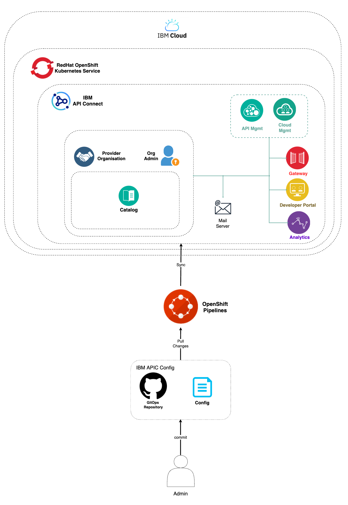{: style="max-height:1000px"}

!!! warning "Important"
    The IBM API Connect configuration automation provided in this Cloud Pak Production Guides should be use as reference and never as a production ready asset that will suit every client needs. Each client will have a particular set of requirements and architecture and, as a result, the automation presented here can be use as a template or starting point but it is not mean to provide a production ready solution by any means.

## OpenShift pipeline

Let's see how can you create and execute the OpenShift pipeline that will configure your recent deployment of an IBM API Connect instance on IBM Cloud.

1. Locate your GitOps repository

    If necessary, change to the root of your GitOps repository, which is stored
    in the `$GIT_ROOT` environment variable.

    Issue the following command to change to your GitOps repository:

    ```bash
    cd $GIT_ROOT
    cd multi-tenancy-gitops
    ```

1. Open the `0-bootstrap/single-cluster/1-infra/kustomization.yaml` file and un-comment the following resource, if this has not yet been done, in order to create the `ci` namespace where the OpenShift pipeline will get created and executed from:

    ```yaml
    - argocd/namespace-ci.yaml
    ```

1. Open the `0-bootstrap/single-cluster/2-services/kustomization.yaml` file and un-comment the following resource in order to install the Red Hat OpenShift Pipelines operator:

    ```yaml
    - argocd/operators/openshift-pipelines.yaml
    ```

1. Open the `0-bootstrap/single-cluster/3-apps/kustomization.yaml` file and un-comment the following resource in order to create the `apps-apic-single-cluster-pipelines` ArgoCD Application that will take care of creating the IBM API Connect Configuration Pipeline (as well as the IBM API Connect Publish Products and APIs pipeline that you will work with in the next chapter of this tutorial):

    ```yaml
    - argocd/apic/single-cluster-pipelines.yaml
    ```

1. Add all changes in the current folder to a git index, commit them, and push them to GitHub:

    ```bash
    git add .
    git commit -s -m "Creating APIC pipelines"
    git push origin $GIT_BRANCH
    ```

1. If you check your ArgoCD UI, you should now see few new ArgoCD Applications as a result of the changes above:

    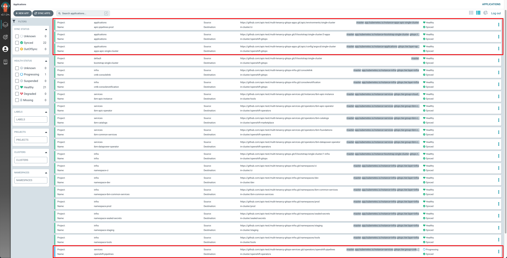{: style="max-height:1000px"}

1. If you go to `Pipelines --> Pipelines` on the left hand side menu of your OpenShift web console, you will see that two new OpenShift pipelines have been created as a result of the previous changes to your GitOps repository under the `ci` Project:

    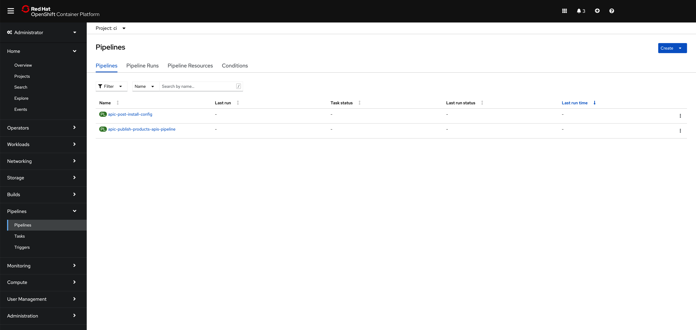{: style="max-height:800px"}

    !!! info
        The pipeline you are interested in for getting your instance of IBM API Connect configured is called **apic-post-install-config**

Before being able to execute the OpenShift pipeline that will configure your instance of IBM API Connect, you need to:

1. Fork the OpenShift Pipeline repositories to your GitHub organization where you already forked the other GitOps repositories you have used to deploy your IBM API Connect Cluster instance.
2. Create a GitHub Personal Access Token so that the IBM API Connect Configuration OpenShift Pipeline has permissions to access your IBM GitHub account (to the private repos you will fork the OpenShift Pipeline repositories to).
3. Provide your email server configuration for notifications.
4. Provide your IBM API Connect provider organization configuration

### 1. OpenShift Pipeline repositories

You need to fork the OpenShift Pipeline repositories to your GitHub organization where you already forked the other GitOps repositories you have used to deploy your IBM API Connect Cluster instance. You can review the creation of that GitHub organization in the [Configure the cluster - GitOps, Tekton & ArgoCD](../cluster-config/gitops-tekton-argocd.md) section. The OpenShift Pipeline repositories can be found at <https://github.com/cloud-native-toolkit>. Use the search bar to find the following three repositories:

* [apic-publish-pipeline](https://github.com/cloud-native-toolkit/apic-publish-pipeline)
* [apic-config-pipeline](https://github.com/cloud-native-toolkit/apic-config-pipeline)
* [apic-products-apis-yaml](https://github.com/cloud-native-toolkit/apic-products-apis-yaml)

!!! warning "Important"
    Fork **ALL three repositories** even though you will only use the `apic-config-pipeline` repository in this section. However, you will use the other two in the following section to publish application APIs in their respective products into IBM API Connect.

You can review how to fork a repository in he [Configure the cluster - GitOps, Tekton & ArgoCD](../cluster-config/gitops-tekton-argocd.md) section. However, make sure your forked repositories are **private**:

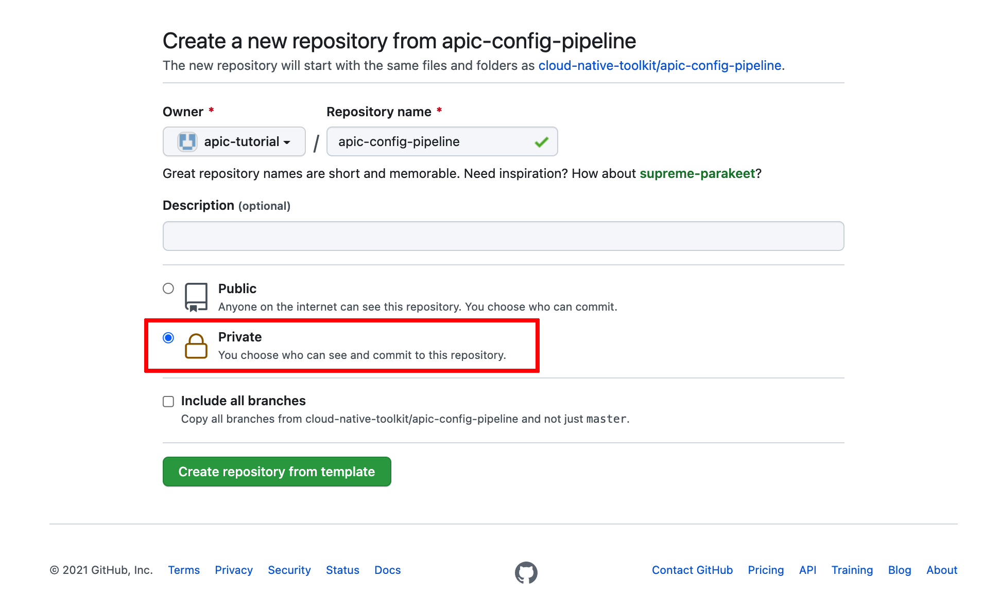{: style="max-height:600px"}

!!! info
    The reason to make these repositories private is to simulate more closely a real scenario where your assets would be behind a firewall. As a result, the OpenShift Pipelines and the script these execute were developed to expect authentication and authorization mechanisms.

By now you should have the following GitHub repositories in your GitHub organization:

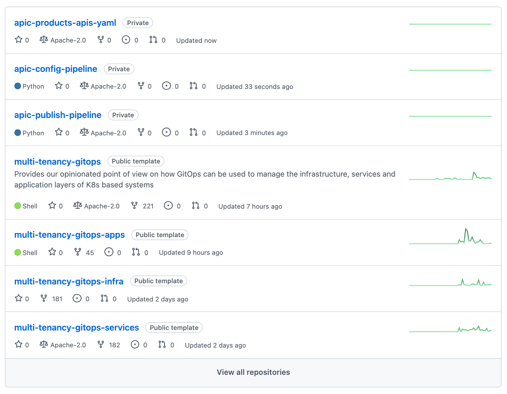{: style="max-height:600px"}

### 2. GitHub Personal Access Token

Create a GitHub Personal Access Token so that the IBM API Connect Configuration OpenShift Pipeline has permissions to access your IBM GitHub account (to the private OpenShift Pipeline repositories repos you forked).

Navigate to your [GitHub Developer Settings](https://github.com/settings/tokens) to generate a new token.

Click on `Generate new token`. Provide a name for your GitHub personal access token and make the following selections:

* Select `repo` to allow the pipeline access to private repository to enable git clone.
* Select `admin:repo_hook` so the pipeline can create a web hook

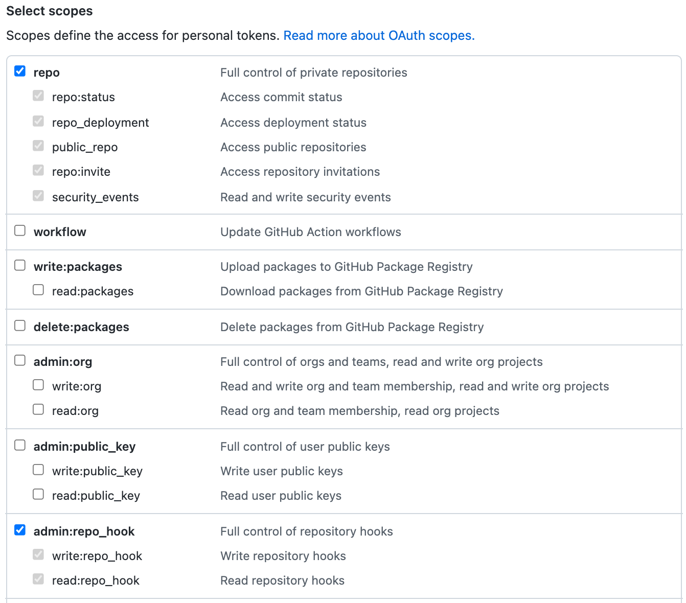{: style="max-height:800px"}

After you click `Generate token` to create the personal access token with these permissions, the GitHub UI will let you see the generated token once, but never again.

**Therefore, save the token somewhere safe -- so that you can use it later if required.**

Now, you are able to create the `apic-pipeline-git` containing your GitHub credentials (or personal access token to be more precise).

On your terminal, go to `multi-tenancy-gitops-apps/apic/environments/single-cluster/pipelines/secrets` and execute the following command to create the `apic-pipeline-git` sealed secret:

```bash
oc create secret generic apic-pipeline-git \
--from-literal=GIT_USERNAME=***** \
--from-literal=GIT_PRIV_TOKEN=***** \
--dry-run=true -o yaml > delete-apic-pipeline-git.yaml \
&& \
kubeseal -n ci --controller-name=sealed-secrets --controller-namespace=sealed-secrets -o yaml < delete-apic-pipeline-git.yaml > apic-pipeline-git.yaml \
&& \
rm delete-apic-pipeline-git.yaml
```

where

* `GIT_USERNAME` is your GitHub username
* `GIT_PRIV_TOKEN` is the personal access token you have just created.

Then, open `multi-tenancy-gitops-apps/apic/environments/single-cluster/pipelines/kustomization.yaml` and uncomment:

``` { .yaml .no-copy }
- secrets/apic-pipeline-git.yaml
```

so that the sealed secret you have just created gets created in the cluster too.

### 3. Email Server

IBM API Connect requires of an email notification server in order to send owners, admins, users, etc relevant notifications. Therefore, you need to provide the configuration of your working email server for notifications. You can read more about configuring an email server for notifications in the IBM API Connect documentation [here](https://www.ibm.com/docs/en/api-connect/10.0.x?topic=settings-configuring-email-server-notifications). 

If you do not have a working email server, you can create a free testing email server at <http://mailtrap.io> in only few steps. If you create a free account in Mailtrap, you will be presented with the following in your inbox.

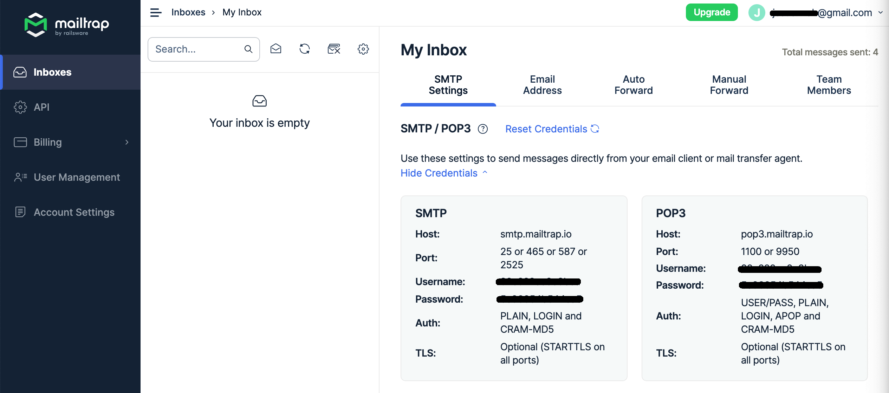{: style="max-height:500px"}

Use that information to create the following `apic-config-email-server` secret.

On your terminal, go to `multi-tenancy-gitops-apps/apic/environments/single-cluster/pipelines/secrets` and execute the following command to create the `apic-config-email-server` sealed secret:

```shell
oc create secret generic apic-config-email-server \
--from-literal=EMAIL_HOST=<your_email_server_host> \
--from-literal=EMAIL_PORT=<your_email_server_port> \
--from-literal=EMAIL_USERNAME=<your_email_server_username> \
--from-literal=EMAIL_PASSWORD=<your_email_server_password> \
--dry-run=true -o yaml > delete-apic-config-email-server.yaml \
&& \
kubeseal -n ci --controller-name=sealed-secrets --controller-namespace=sealed-secrets -o yaml < delete-apic-config-email-server.yaml > apic-config-email-server.yaml \
&& \
rm delete-apic-config-email-server.yaml
```

Then, open `multi-tenancy-gitops-apps/apic/environments/single-cluster/pipelines/kustomization.yaml` and uncomment:

``` { .yaml .no-copy }
- secrets/apic-config-email-server.yaml
```

so that the sealed secret you have just created gets created in the cluster too.

### 4. Provider Organization

To be able to use the IBM API Connect API Manager to develop, publish and expose your applications APIs you first need to create a Provider Organization. This is an IBM API Connect specific logical construct to manage APIs.

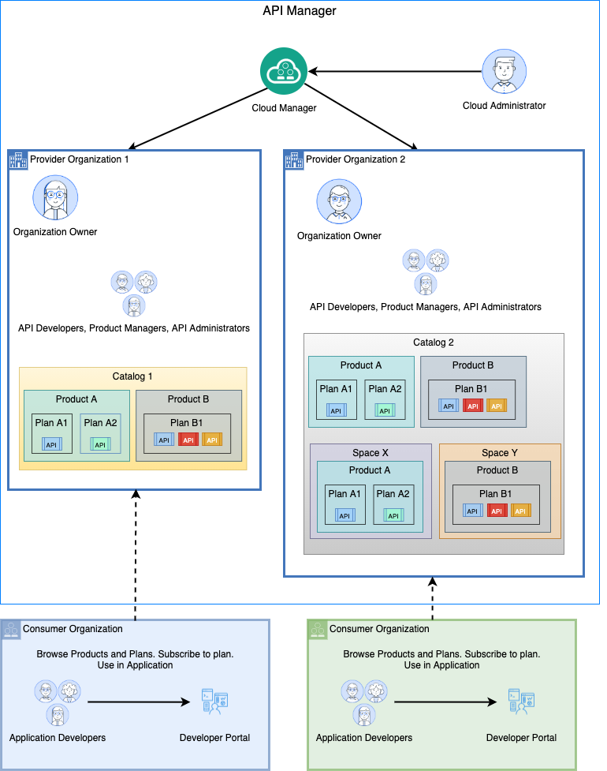{: style="max-height:1000px"}

The IBM API Connect logical topology consists of:

* **API Cloud** which includes one API Manager Service, one or more Gateway Services, and zero or more Portal Services and Analytics Services.
* An **Application Programming Interface (API)** is an industry-standard software technology, which comprise a set of routines for building software applications. An API is composed of operations which are defined as REST APIs or SOAP APIs.
* A **Plan** is a packaging strategy that determines which APIs an application can use and controls which operations from an API are available. In order to enable monetization and affect quality of service, a Plan specifies rate limits for the APIs under its control.
* A **Product** is a package that comprises a set of Plans and APIs. There is a strict relationship between Products and Plans. A Plan can belong to only one Product. A Product can have multiple Plans that each contain a different set of APIs. A Plan in one Product can share APIs with Plans in another Product.
* A **Catalog** is a collection of Products. Products, with their Plans and APIs, are contained within a Catalog. Select Products in the Catalog are published to the Developer Portal. A Catalog has a one-to-one relationship with a Developer Portal, i.e. each Catalog is associated with one, and only one, Developer portal. Thus catalogs are used to separate Products and APIs between environments, such as development, QA and production, within a Provider Organization. As an example, an API provider uses a Development Catalog when developing and testing APIs, and a Production Catalog for publishing APIs that are ready for external use.
* A **Space** represents a partition within a catalog. Each line of business within an organization may want to socialize their APIs on a single developer portal to provide API consumers a single API marketplace. Each line of business may also have different development groups to independently maintain their APIs and control their product and API lifecycle. To accomplish this, spaces are created within a Catalog to logically separate development groups while preserving a unified Development Portal across the Provider Organization.
* A **Provider Organization** is responsible for the complete lifecycle of an API, i.e. developing, publishing, and maintaining APIs. It is also responsible for managing its membership. A Provider Organization is created for each product team or department. In smaller environments a single Provider Organization is used to manage multiple teams. The Cloud Administrator uses the Cloud Manager user interface to create a Provider Organization. Alternatively, a Cloud Administrator can invite a user to self-provision a Provider Organization. Each Provider Organization has an organization owner who is responsible for the organization's configuration and user onboarding. Users can belong to one or more organizations with different roles and permissions.
* A **Consumer Organization** is an entity that develops applications that consume APIs produced by the provider organization.

As you could read in the description of the different IBM API Connect logical topology components above, what you would need to create in order to have a catalog where publish your APIs and Products to is a Provider Organization.

In order for the IBM API Connect Publish Products and APIs pipeline you deployed at the beginning of this section to create a Provider Organization, you must provide the configuration for that Provider Organization in the form of a sealed secret called `apic-pipeline-provider-org`.

On your terminal, go to `multi-tenancy-gitops-apps/apic/environments/single-cluster/pipelines/secrets` and execute the following command to create the `apic-pipeline-provider-org` sealed secret:


```shell
oc create secret generic apic-pipeline-provider-org \
--from-literal=PROV_ORG_OWNER_USERNAME=<provider_organization_owner_username> \
--from-literal=PROV_ORG_OWNER_PASSWORD=<provider_organization_owner_password> \
--from-literal=PROV_ORG_OWNER_EMAIL=<provider_organization_owner_email> \
--from-literal=PROV_ORG_OWNER_FIRST_NAME=<provider_organization_owner_first_name> \
--from-literal=PROV_ORG_OWNER_LAST_NAME=<provider_organization_owner_last_name> \
--from-literal=PROV_ORG_TITLE=<provider_organization_title> \
--dry-run=true -o yaml > delete-apic-pipeline-provider-org.yaml \
&& \
kubeseal -n ci --controller-name=sealed-secrets --controller-namespace=sealed-secrets -o yaml < delete-apic-pipeline-provider-org.yaml > apic-pipeline-provider-org.yaml \
&& \
rm delete-apic-pipeline-provider-org.yaml
```

where

* `PROV_ORG_OWNER_USERNAME` is your Provider Organization Owner username.
* `PROV_ORG_OWNER_PASSWORD` is your Provider Organization Owner password.
* `PROV_ORG_OWNER_EMAIL` is the Provider Organization Owner email (does not necessarily need to be a working email address).
* `PROV_ORG_OWNER_FIRST_NAME` is the Provider Organization Owner first name.
* `PROV_ORG_OWNER_LAST_NAME` is the Provider Organization Owner last name.
* `PROV_ORG_TITLE` is the Provider Organization title.

An example of a dummy provider organization could be:

``` { .text .no-copy }
PROV_ORG_OWNER_USERNAME = testorgadmin
PROV_ORG_OWNER_PASSWORD = passw0rd
PROV_ORG_OWNER_EMAIL = test@test.com
PROV_ORG_OWNER_FIRST_NAME = A_Name
PROV_ORG_OWNER_LAST_NAME = A_Last_Name
PROV_ORG_TITLE = Test Org
```

!!! warning "Important"
    The **PROV_ORG_OWNER_USERNAME** and **PROV_ORG_OWNER_PASSWORD** will be the credentials you will use later on to log into the IBM API Connect API Manager.

!!! info
    Make sure you enclose your Provider Organization Title between quotes if it is composed of more than one word

Then, open `multi-tenancy-gitops-apps/apic/environments/single-cluster/pipelines/kustomization.yaml` and uncomment:

``` { .yaml .no-copy }
- secrets/apic-pipeline-provider-org.yaml
```

so that the sealed secret you have just created gets created in the cluster too.

Finally, commit and deliver the three sealed secrets you created above so that ArgoCD picks these up and gets them created in your cluster for the IBM API Connect Publish Products and APIs pipeline to use them.

```bash
git add .
git commit -s -m "Creating IBM API Connect Publish Products and APIs pipeline secrets"
git push origin $GIT_BRANCH
```

If you check your `apic-pipelines-prod` ArgoCD Application, you should now see that the three sealed secrets and their respective generic secrets have been created and should be available to your IBM API Connect Publish Products and APIs pipeline as a result.

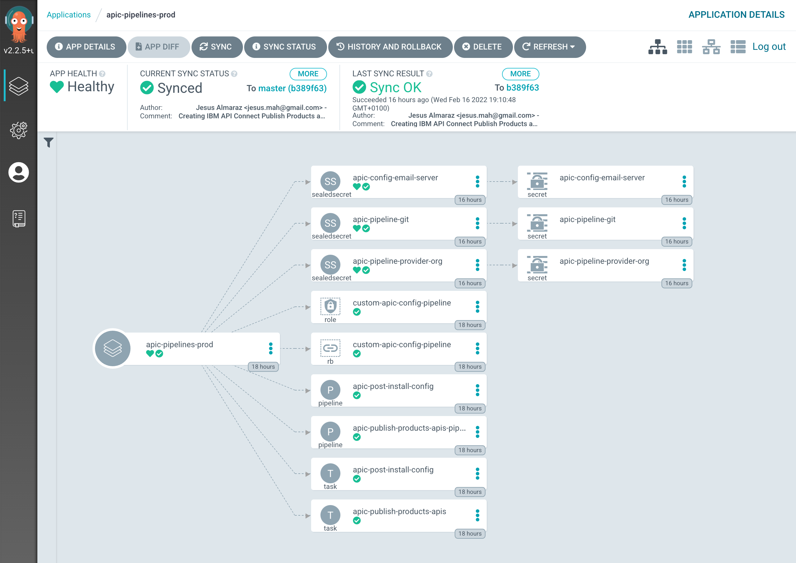{: style="max-height:900px"}

## Run the IBM API Connect Configuration Pipeline

You are now ready to execute the OpenShift pipeline that will configure your IBM API Connect instance.

Go again to `Pipelines --> Pipelines` on the left hand side menu of your OpenShift web console and click on the **`apic-post-install-config`** pipeline. Then, click on `Start` on the `Actions` drop down menu at the top right corner.

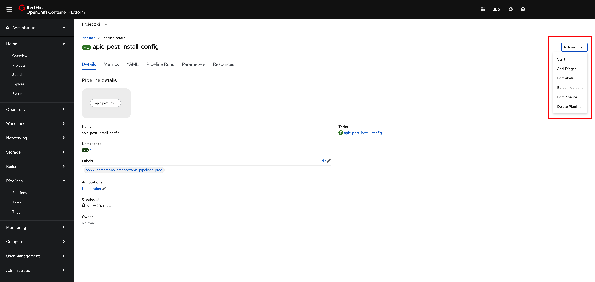{: style="max-height:800px"}

On the `Start Pipeline` OpenShift Pipeline configuration menu that pops up, make sure you provide the appropriate values for the following pipeline parameters:

* `git-apic-pipeline-git-url` which is the GitHub url where the pipeline scripts are stored. These are the scripts the pipeline will execute. This is the GitHub repository your forked into your GitHub organization earlier in this section.

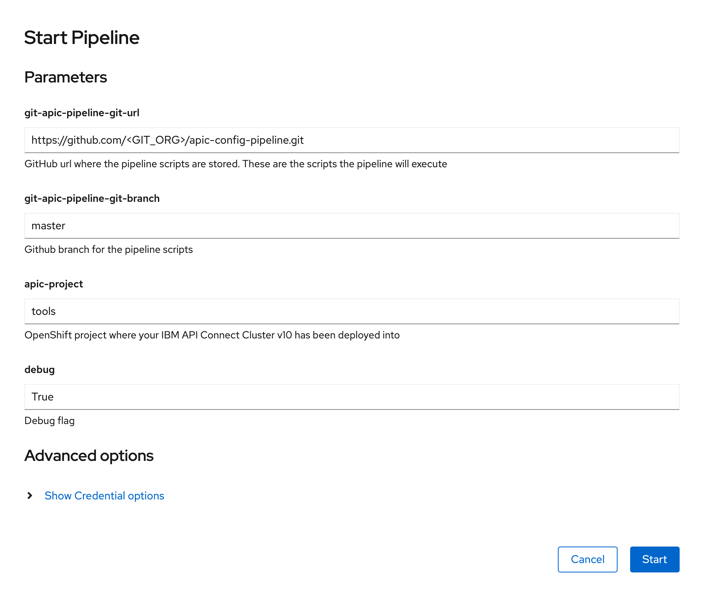{: style="max-height:700px"}

2. Click `Start`. This will create a `Pipeline Run` object that represents this specific execution of the pipeline.
   
You can follow along the execution of this OpenShift Pipeline Run by clicking the `Logs` tab at the top bar. If this execution of the IBM API Connect Configuration Pipeline finishes successfully you should see an `END` message at the bottom of the logs as well as a green check mark on the task the Pipeline Run has executed on the left hand side.

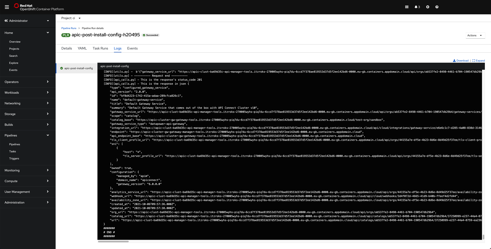{: style="max-height:800px"}

If you switch back to the `Details` tab of the `Pipeline Run`, you should also see green check marks both at the Pipeline Run name at the top and below it in the task that has been executed by this Pipeline Run that is displayed on the `Pipeline Run Details` section.

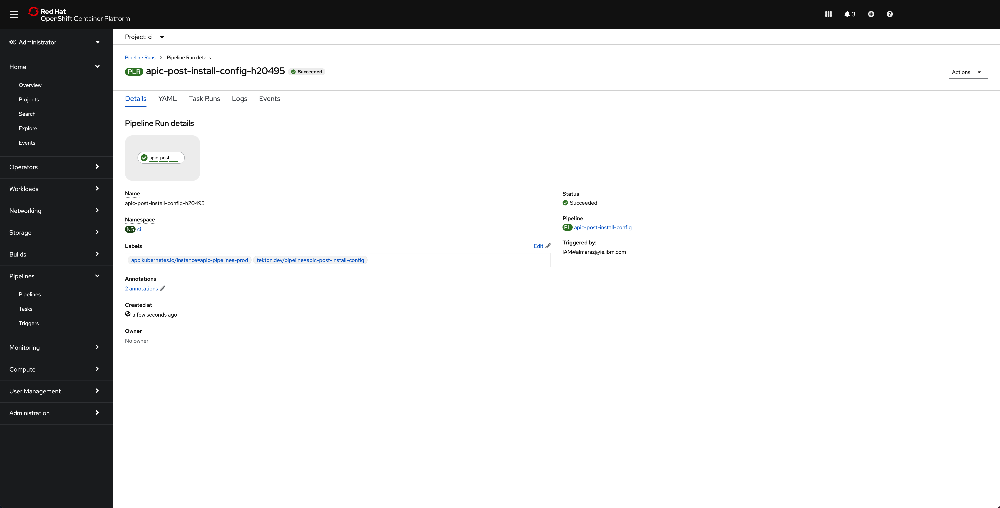{: style="max-height:800px"}

And in the main `Pipelines` section of your OpenShift web console you should also see the last `Pipeline Run` for the IBM API Connect config Pipeline in green

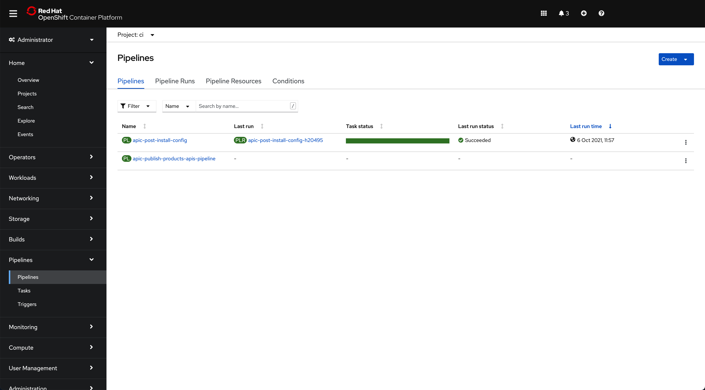{: style="max-height:800px"}

Finally, if you open your IBM API Connect Cloud Manager again, you will see that the IBM API Connect Configuration Pipeline has configured a `Topology` for you with the default IBM API Connect subsystems that get installed so that you now have a working IBM API Connect environment.

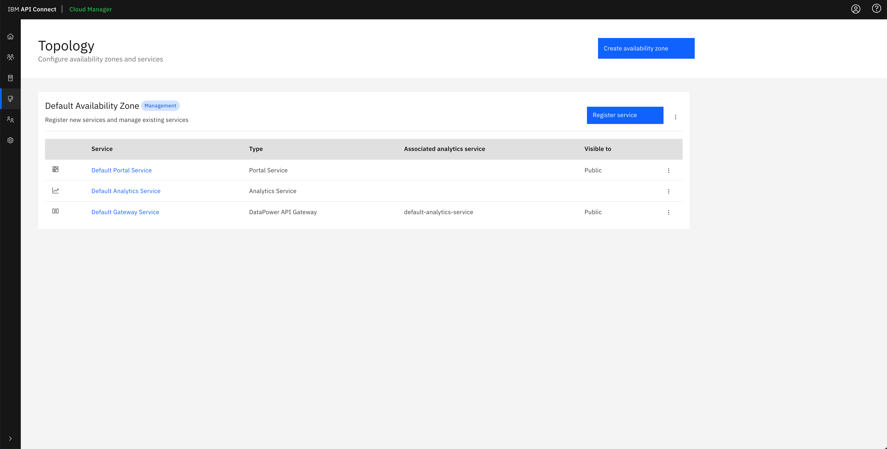{: style="max-height:800px"}

And in the IBM API Connect API Manager, you can see that the default Gateway service that has been configured in the IBM API Connect Cloud Manager Topology has been registered with the default `Sandbox` catalog, that gets created for the `Provider Organization` you specified in the IBM API Connect Configuration Pipeline, so that you can securely publish, expose and access your application APIs.

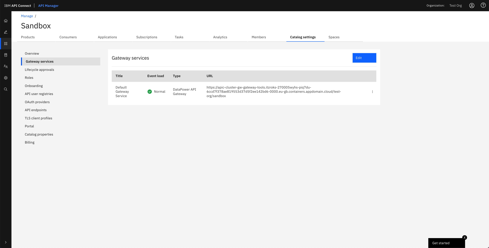{: style="max-height:800px"}

!!! tip
    You can open your IBM API Connect API Manager through your Red Hat OpenShift web console. Go to `Networking` --> `Routes` under the `tools` project and click on the `Location` value for the `apic-clust-xxxxx-api-manager` route. Then, use the credentials you specified in your provider organization configuration to log in.

!!! warning "Important"
    Do not execute the IBM API Connect Configuration Pipeline twice, even if the first attempt failed, as what the first run created **must** be manually removed for the second attempt to succeed. We do understand this is a limitation of the IBM API Connect Configuration Pipeline and something that could be fixed by implementing a previous cleanup task within the IBM API Connect Configuration Pipeline. However, this is out of the scope of this tutorial and, once again, the assets provided within this tutorial are meant to be a jump-start or a template to start from that should not be treated as production-ready assets. These assets can then be leveraged for a particular client, leaving the specific tailoring of these for the client to the team making use of the assets.


!!! success "Congratulations!"
    You have successfully created and executed the IBM API Connect Configuration Pipeline that configures all of the IBM API Connect subsystems that the IBM API Connect Operator creates for your IBM API Connect instance so that you now have your API Connect instance ready to start working with.