# Deployment on IBM Cloud

<!--- cSpell:ignore singl apiconnectcluster ibmc APIC Availability unmanaged practioners Pak Paks Quickstart qube cntk autoplay allowfullscreen clusterrole clusterrolebinding clust dockerconfigjson -->

In the previous chapter of this tutorial, we have worked with ArgoCD and the GitOps repository to understand what these are and how these work together and interact. We have seen how to create ArgoCD applications that watch their respective GitOps repository folders for details of the resources they should apply to the cluster. We have seen how we can dynamically change deployed resources by updating the resource definition in the GitOps repository. Finally, you've experience how ArgoCD keeps the cluster synchronized with the GitOps repository as a source of truth; any unexpected configuration drift will be corrected without intervention.

Now, in this section, we are going to look at what changes we need to do to that GitOps repository so that we get IBM API Connect and all the components it needs/depends on deployed in our cluster for having a highly available production ready deployment of IBM API Connect.

## Services

We have seen in the previous chapter of this tutorial that in the `0-bootstrap/single-cluster/kustomization.yaml` file we have defined what layers out of `infra`, `services` and `apps` we want the main `bootstrap-single-cluster` ArgoCD application to watch. Before, we had it set up to watch only the `infra` layer. However, we now need it to watch the `services` and `apps` layers too in order to deploy IBM API Connect and all the components it needs/depends on.

1. Ensure you are logged in to the cluster

    Start a terminal window and log into your OCP cluster, substituting the `--token` and `--server` parameters with your values:

    ```bash
    oc login --token=<token> --server=<server>
    ```

    If you are unsure of these values, click your user ID in the OpenShift web console and select "Copy Login Command".

2. Locate your GitOps repository

    If necessary, change to the root of your GitOps repository, which is stored
    in the `$GIT_ROOT` environment variable.

    Issue the following command to change to your GitOps repository:

    ```bash
    cd $GIT_ROOT
    cd multi-tenancy-gitops
    ```

3. Make sure the `infra`, `services` and `apps` layers are un-commented, and therefore active, for the main `bootstrap-single-cluster` ArgoCD application to watch them in the file `0-bootstrap/single-cluster/kustomization.yaml`

    ``` { .yaml .no-copy }
    resources:
    - 1-infra/1-infra.yaml
    - 2-services/2-services.yaml
    - 3-apps/3-apps.yaml
    ```

4. Add all changes in the current folder to a git index, commit them, and push them to GitHub:

    ```bash
    git add .
    git commit -s -m "Adding services and applications layers"
    git push origin $GIT_BRANCH
    ```

5. If you go to your ArgoCD UI, you will see two new ArgoCD applications, one that will watch for resources on the `services` layer and another that will watch for resources on the `apps` layer.

    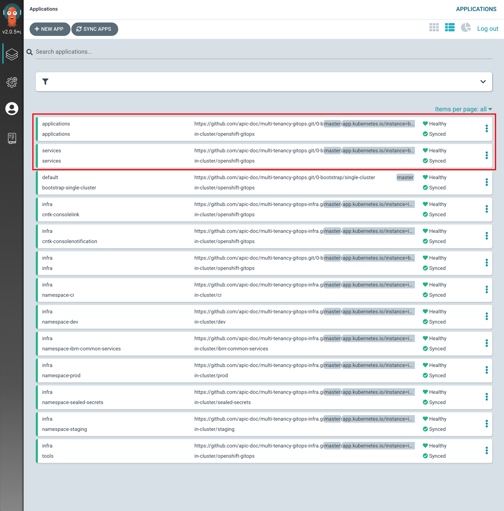{: style="max-height:900px"}

    !!! tip
        You might want to manually sync your ArgoCD applications, instead of waiting for changes to get automatically picked up. For manually synchronize ArgoCD applications, you can click on the `SYNC APPS` button at the top. Then, select all the ArgoCD applications you want to get synched (or all for easiness) and click `SYNC`

We are now all set to start deploying IBM API Connect and all the components it needs/depends on. However, we will do it in two steps. In the first one, we will deploy all of the components that IBM API Connect needs/depends on. These are things like an instance of the [Sealed Secrets](https://github.com/bitnami-labs/sealed-secrets) operator to be able to seal/unseal secrets such as the IBM Entitlement Key to pull IBM software down from IBM's software registry, the IBM Operators catalog to be able to install IBM Operators and, finally, the IBM Foundations, IBM DataPower and IBM API Connect operators where the first two are a dependency of the IBM API Connect operator.

To get all of this installed, all we need to do, in the same fashion we did for the components we wanted to get installed on the infra layer, is to un-comment these from the `0-bootstrap/single-cluster/2-services/kustomization.yaml` file.

1. Open the `0-bootstrap/single-cluster/2-services/kustomization.yaml` file and un-comment the following resources:

    ``` { .yaml .no-copy }
    - argocd/operators/ibm-apic-operator.yaml
    - argocd/operators/ibm-datapower-operator.yaml
    - argocd/operators/ibm-foundations.yaml
    - argocd/operators/ibm-catalogs.yaml
    - argocd/instances/sealed-secrets.yaml
    ```
    Your `0-bootstrap/single-cluster/2-services/kustomization.yaml` should look like

    ``` { .yaml .no-copy }
    resources:
    # IBM Software

    ## Cloud Pak for Integration
    #- argocd/operators/ibm-ace-operator.yaml
    - argocd/operators/ibm-apic-operator.yaml
    #- argocd/instances/ibm-apic-instance.yaml
    #- argocd/instances/ibm-apic-management-portal-instance.yaml
    #- argocd/instances/ibm-apic-gateway-analytics-instance.yaml
    #- argocd/operators/ibm-aspera-operator.yaml
    #- argocd/operators/ibm-assetrepository-operator.yaml
    #- argocd/operators/ibm-cp4i-operators.yaml
    - argocd/operators/ibm-datapower-operator.yaml
    #- argocd/operators/ibm-eventstreams-operator.yaml
    #- argocd/operators/ibm-mq-operator.yaml
    #- argocd/operators/ibm-opsdashboard-operator.yaml
    #- argocd/operators/ibm-platform-navigator.yaml
    #- argocd/instances/ibm-platform-navigator-instance.yaml

    ## Cloud Pak for Business Automation
    #- argocd/operators/ibm-cp4a-operator.yaml
    #- argocd/operators/ibm-db2u-operator.yaml
    #- argocd/operators/ibm-process-mining-operator.yaml
    #- argocd/instances/ibm-process-mining-instance.yaml

    ## Cloud Pak for Data
    #- argocd/operators/ibm-cpd-scheduling-operator.yaml
    #- argocd/instances/ibm-cpd-scheduling-instance.yaml
    #- argocd/operators/ibm-cpd-platform-operator.yaml
    #- argocd/instances/ibm-cpd-instance.yaml
    #- argocd/operators/ibm-cpd-ws-operator.yaml
    #- argocd/instances/ibm-cpd-ws-instance.yaml
    #- argocd/operators/ibm-cpd-wkc-operator.yaml
    #- argocd/instances/ibm-cpd-wkc-instance.yaml

    ## Cloud Pak for Security
    #- argocd/operators/ibm-cp4s-operator.yaml
    #- argocd/instances/ibm-cp4sthreatmanagements-instance.yaml

    ## IBM Foundational Services / Common Services
    - argocd/operators/ibm-foundations.yaml
    #- argocd/instances/ibm-foundational-services-instance.yaml
    #- argocd/operators/ibm-automation-foundation-core-operator.yaml
    #- argocd/operators/ibm-automation-foundation-operator.yaml
    #- argocd/operators/ibm-license-service-operator.yaml
    #- argocd/instances/ibm-license-service-instance.yaml

    ## IBM Catalogs
    - argocd/operators/ibm-catalogs.yaml


    # Required for IBM MQ
    #- argocd/instances/openldap.yaml
    # Required for IBM ACE, IBM MQ
    #- argocd/operators/cert-manager.yaml
    #- argocd/instances/cert-manager-instance.yaml

    # Sealed Secrets
    - argocd/instances/sealed-secrets.yaml

    # CICD
    #- argocd/operators/grafana-operator.yaml
    #- argocd/instances/grafana-instance.yaml
    #- argocd/instances/grafana-instana.yaml
    #- argocd/instances/artifactory.yaml
    #- argocd/instances/chartmuseum.yaml
    #- argocd/instances/developer-dashboard.yaml
    #- argocd/instances/swaggereditor.yaml
    #- argocd/instances/sonarqube.yaml
    #- argocd/instances/pact-broker.yaml
    # In OCP 4.7+ we need to install openshift-pipelines and possibly privileged scc to the pipeline serviceaccount
    #- argocd/operators/openshift-pipelines.yaml

    # Service Mesh
    #- argocd/operators/elasticsearch.yaml
    #- argocd/operators/jaeger.yaml
    #- argocd/operators/kiali.yaml
    #- argocd/operators/openshift-service-mesh.yaml
    #- argocd/instances/openshift-service-mesh-instance.yaml

    # Monitoring
    #- argocd/instances/instana-agent.yaml
    #- argocd/instances/instana-robot-shop.yaml

    # Spectrum Protect Plus
    #- argocd/operators/spp-catalog.yaml
    #- argocd/operators/spp-operator.yaml
    #- argocd/instances/spp-instance.yaml
    #- argocd/operators/oadp-operator.yaml
    #- argocd/instances/oadp-instance.yaml
    #- argocd/instances/baas-instance.yaml

    patches:
    - target:
        group: argoproj.io
        kind: Application
        labelSelector: "gitops.tier.layer=services,gitops.tier.source=git"
    patch: |-
        - op: add
        path: /spec/source/repoURL
        value: https://github.com/apic-refactor-48/multi-tenancy-gitops-services.git
        - op: add
        path: /spec/source/targetRevision
        value: master
    - target:
        group: argoproj.io
        kind: Application
        labelSelector: "gitops.tier.layer=applications,gitops.tier.source=git"
    patch: |-
        - op: add
        path: /spec/source/repoURL
        value: https://github.com/apic-refactor-48/multi-tenancy-gitops-apps.git
        - op: add
        path: /spec/source/targetRevision
        value: master
    - target:
        group: argoproj.io
        kind: Application
        labelSelector: "gitops.tier.layer=services,gitops.tier.source=helm"
    patch: |-
        - op: add
        path: /spec/source/repoURL
        value: https://charts.cloudnativetoolkit.dev
    - target:
        name: ibm-automation-foundation-operator
    patch: |-
        - op: add
        path: /spec/source/helm/parameters/-
        value:
            name: spec.channel
            value: v1.1
    ```

2. Add all changes in the current folder to a git index, commit them, and push them to GitHub:

    ```bash
    git add .
    git commit -s -m "Installing services"
    git push origin $GIT_BRANCH
    ```

3. If you go to your ArgoCD UI, you will now see new ArgoCD applications.
   
    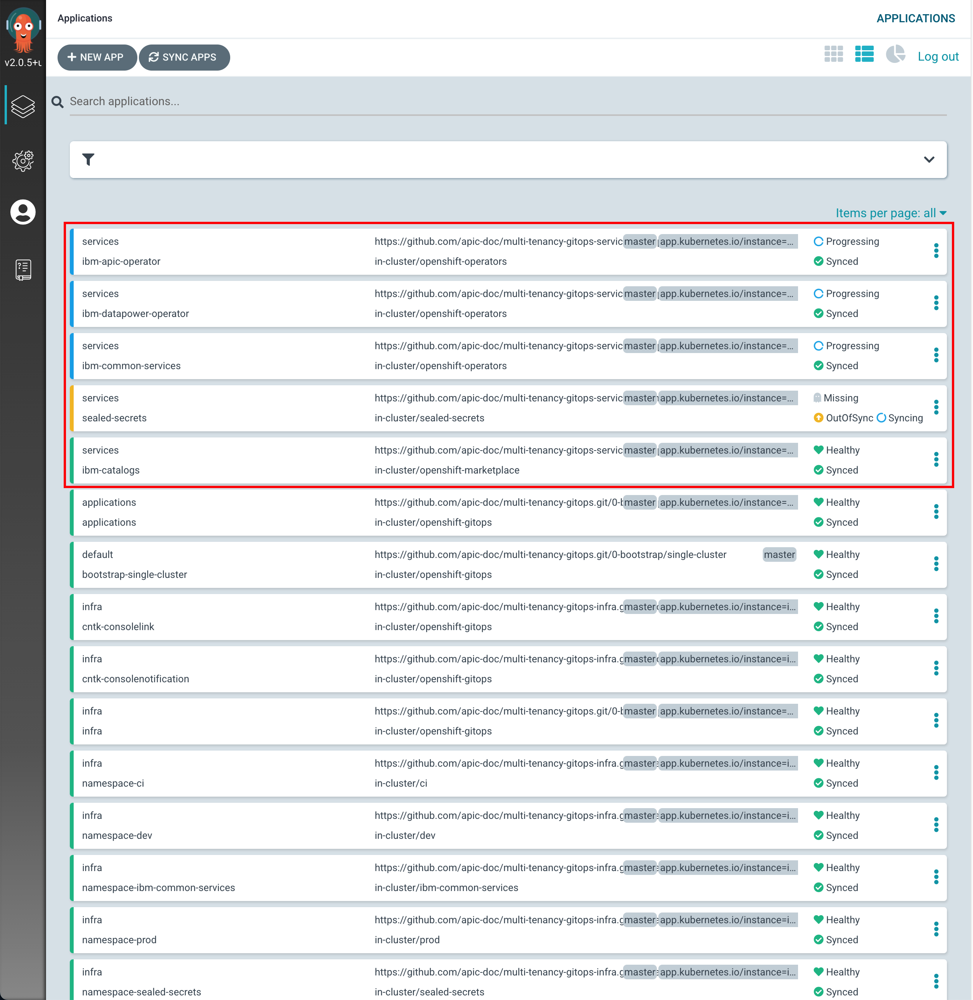{: style="max-height:900px"}

4. If you click on the `services` main ArgoCD application, you will see that it has created five new ArgoCD applications that correspond to each of the components we have un-commented and therefore bring to active state in the `0-bootstrap/single-cluster/2-services/kustomization.yaml` file.

    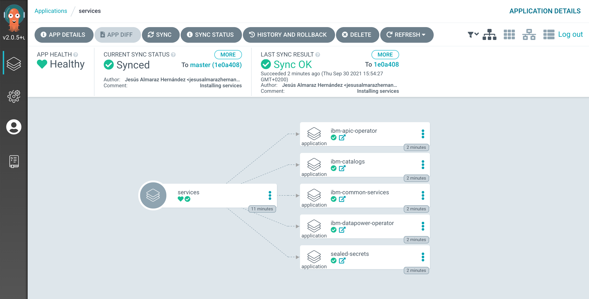{: style="max-height:600px"}

5. After 5-10 mins, if you go to your Red Hat OpenShift web console and click on `Operators --> Installed Operators` on the right hand side menu and select the the `tools` project on the pull down menu at the top bar, you will see that the IBM Foundations, IBM DataPower and IBM API Connect operators are being installed or have successfully installed already (apart from the OpenShift GitOps operator that was installed previously).

    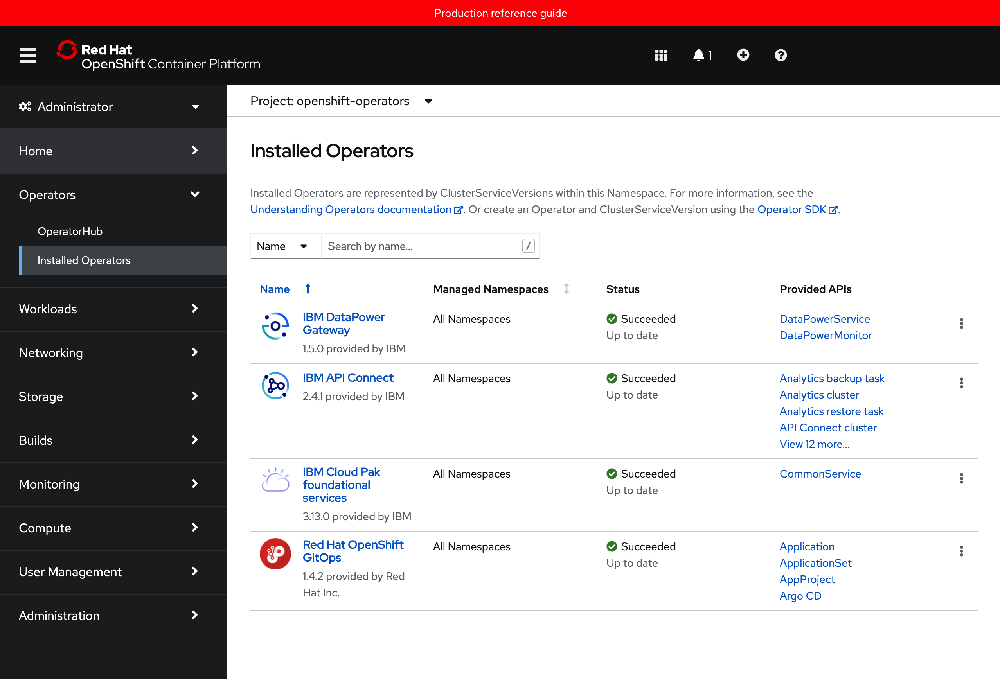{: style="max-height:700px"}

## Sealed Secrets

Very often a component has a Kubernetes secret associated with it. Inside the secret might be a private key to access the IBM entitled container registry for example. For obvious reasons, we don't want to store the secret in GitHub with the rest of our IBM API Connect configuration, since that GitHub repository might be public or accessible by people we would initially not want to.

A sealed secret solves this problem by introducing a new kind of Kubernetes resource. A sealed secret is created from a regular secret, and can be safely stored in a Git repository. 

Sealed Secrets is composed of two parts:

* A cluster-side controller / operator
* A client-side utility: `kubeseal`

The kubeseal utility uses asymmetric crypto to encrypt secrets that only the controller can decrypt.

These encrypted secrets are encoded in a SealedSecret resource, which you can see as a recipe for creating a secret. Once unsealed this will produce a regular Kubernetes secret. This normal kubernetes secret will appear in the cluster after a few seconds and you can use it, with the appropriate RBAC authority, as you would use any secret that you would have created directly (e.g. reference it from a Pod).

### Install the kubeseal operator into the cluster

1. Change to the Application GitOps directory

    Let's ensure we're in the correct folder.  Again, we've used typical defaults:

    ```bash
    cd $GIT_ROOT
    cd multi-tenancy-gitops-apps
    ```

    Verify that your `$GIT_ORG` and `$GIT_BRANCH` environment variables are set:

    ```bash
    echo $GIT_ORG
    echo $GIT_BRANCH
    ```

    For example:

    ``` { .bash .no-copy }
    ~/git/multi-tenancy-gitops-apps echo $GIT_ORG
    prod-ref-guide
    ~/git/multi-tenancy-gitops-apps echo $GIT_BRANCH
    master
    ```

    If either is not set, set them as follows.

    ```bash
    export GIT_ORG=<replace_with_gitops_apps_repo_organization>
    export GIT_BRANCH=<replace_with_gitops_apps_repo_branch>
    ```

2. Login to the cluster

    In the terminal window, log into your OCP cluster, substituting the `--token` and `--server` parameters with your values:

    ```bash
    oc login --token=<token> --server=<server>
    ```

    If you are unsure of these values, click your user ID in the OpenShift web console and select "Copy Login Command".

3. Install the `kubeseal` CLI

    Now that we've installed the sealed secret operator and instance, we can create a sealed secret. We install the Kubeseal CLI on our local machine to do this.

    ```bash
    brew install kubeseal
    ```

    This make take a minute or so to install:

    ``` { .text .no-copy }
    ==> Downloading https://homebrew.bintray.com/bottles/kubeseal-0.14.1.big_sur.bottle.tar.gz
    ...
    ==> Installing kubeseal
    ==> Pouring kubeseal-0.14.1.big_sur.bottle.tar.gz
    /usr/local/Cellar/kubeseal/0.14.1: 5 files, 31.9MB
    ```

    *The above installation is for MacOS. Use your favorite package manager to install the CLI on Linux distributions.*

### Configure access to IBM Entitled Registry

We need access credentials to interact with the IBM Entitled Registry to be able to pull IBM software down from into the Red Hat OpenShift project where we are deploying such IBM capability. We store these credentials in Kubernetes secrets. However, because of the sensitive nature of its contents, we don't want to store
these secret in our Git repository.

Instead, we are using **sealed secrets**. To create a sealed secret, we use the YAML for a regular secret to create a **sealed secret** which is a strongly encrypted form of the secret. We store this in our GitOps repository. When ArgoCD deploys the sealed secret, the sealed secret operator will create a regular, un-encrypted, secret in the appropriate namespace where it can be accessed when required.

The key point is that the deployed un-encrypted secret is never stored in the GitOps repository; only the sealed secret which is encrypted is stored in Git. Once created, the secret can only be accessed by users who have access to the appropriate namespace.

#### Configure connection to the IBM Entitled Registry

To install and use the relevant IBM API Connect containers in your cluster, an entitlement key is required to retrieve them from the IBM Entitled Registry. In this section, we retrieve your key, and store it in a secret in the cluster where it can be used to install containers at the appropriate time.

1. Discover your IBM Entitlement Key

    Your IBM entitlement key is used to access IBM software. By accessing the IBM Entitled Registry using this key, you can easily access the IBM container software you have licensed.

    Access your [IBM entitlement key](https://myibm.ibm.com/products-services/containerlibrary).

    Copy the key and store it in the `$IBM_ENTITLEMENT_KEY` environment variable where it will be used by subsequent commands in this tutorial:

    ```bash
    export IBM_ENTITLEMENT_KEY=<ibm-reg-key>
    ```

    You should keep this key private from other users.

2. Make sure you are in the `multi-tenancy-gitops-apps` folder.

3. Create the YAML for the IBM entitlement key and seal the IBM entitlement key secret

    Let us first run the below script and look into the details later.

    ```bash
    ./apic/environments/single-cluster/config/secrets/ibm-entitlement-key-secret.sh
    ```

    This script performs the below actions.

    - It initially creates the YAML for a regular secret using the `oc create secret` command with the `--dry-run` option; it creates the YAML, but doesn't apply it to the cluster.
    - Then, it seals the IBM entitlement key secret.

    We can examine the sealed secret YAML using the following command:

    ```bash
    cat ibm-entitlement-key-secret.yaml
    ```
    See how a sealed secret is very similar to a regular secret in structure:

    ``` { .yaml .no-copy }
    apiVersion: bitnami.com/v1alpha1
    kind: SealedSecret
    metadata:
    creationTimestamp: null
    name: ibm-entitlement-key
    namespace: tools
    spec:
    encryptedData:
        .dockerconfigjson: AgCJRzgubJmhtMbU6I3oTab9nxx0m7hMRfxeqKSQGCs/36Lh5HUVtBRq2OssjOTi3jTQC5MICpFAb7UMOYW1C/d/Ric4sANhyGuhAnP2DlPTONQZ4wa13+OE5ACv2kWSXW2Zogb3ZwGq+RNT23VFIc40pWNjNCOEDPpuFYXRiQMaT4uJedZaOnk1YxnNsfMeE/jX+UaJSNTCwZTh1tFGeRQnDYWpdutCO+U+nJDwxQCDI9tzDMrDhcy9ZSqdkJSoenHygicd+XZwv0vD/dVAvB9ZUQ9aViBL9uEX8FfO7gLb/X3oB5MEATV+z92xYY01N5O6eALg1AfvR32dHB/nuSBtm6yDYIYvOMweQztiv+ZPukpdyoBjjz3x/zwY2aoVgZ4WBdrB2EzdKKDsVQ6R7jEiq8DBl/9Gj3UV3MO+G7K9V7lcL5eK2DjUGJRBN+0IuDeY3UQEDQBNFrr1ssqSnyqWlEzDjuMNyDfjNt5xIWkVuj5n1P04Oh8eH5l4Ze0G3bdqoEYdW3CbdA6EOgXzqqNNslUXoYhtFcE47igPKEh0RSiokvzU9PnezhzVtXts6qQnWQtPYt4aQIKQITj+3V7DS/jeCEOGgK/nb4hcNjnsYFnva99A4+qBi0otSJpGEBjXOM043ughK2kVyfDBk221ZoQh2IhbPqD1vdBQ66nhOe8uO0uALxIPZRuG++YyDV4iCOZgv+gA1MsCqzFn4iz0+bsTB2kctpkMNh2TYieIYMFgaakt6DRbAn0IVkhFYq11hhRvNUnzuxiYhC8GpKStxg3jcon2eHt9gUpge3EeCNDEFAxKas5ZK+YO9GKaAsKp6BVZw4+rMerVPuLfd5NLjoFvk9shqaNfRF5hIz2V+ucb16FV2tlalc9hpj8v+efoB2H8qyAQ9bLtrSPJDxjHtl3/4ZSCvxAhtcJ4aNmqGURJEoPV1BU3LYlM3XUjRmPC1Gvy+rbHOzLPVLPBWnhDFOPhK9uvMytYmJZUzqsLjSte1T/w3nHcOSdlaj134qEh6SYBLuQj876FW6avVfwqo33SjhptJ9LUER4VGsKXHDG5Zon890CsNMA2znCaNPEMgbDnbiFqC5s9XZebKIs50izwl1I2jzfCb2Wdu/esomaNmmr3YBA4kwFL3fCG0CyXKWBtg4TliC1oGOaH09UjXvgmGRnW9Bh04dfyOWc9T58h+yukv1/1DT31hGYzWItIozsESTNof1qccfjQTEd+WFw/8j8REPGvMV5QruCXgpxNBMUF4sWtmLMCXKHYlXCD3zVvEUQorWQv8IcPX5adxAySDjTDUduVDWx+yoZwlXNFWfj7ye5o0SzvVNJKjUu0
    template:
        data: null
        metadata:
        creationTimestamp: null
        name: ibm-entitlement-key
        namespace: tools
        type: kubernetes.io/dockerconfigjson
    ```

    However, notice the following differences:

    * `apiVersion:` and `kind:` identify this as a sealed secret.
    * `.dockerconfigjson` has been encrypted using the public key of the sealed secret controller, meaning that it can only be decrypted by this controller.

    This sealed secret is safe to store in our GitOps repository, because it can only be decrypted by the sealed secret controller that was used to encrypt it.

    We haven't applied this sealed secret to the cluster yet -- we create the YAML file so that we can use the GitOps process to deploy it.

4. Commit and deliver the entitlement key to git

    We deploy this sealed secret into the `tools` namespace in the cluster. To do this, we need to place the sealed secret in the GitOps Application repository, within the folder `apic/environments/single-cluster/config/secrets`.

    ```bash
    mv ibm-entitlement-key-secret.yaml apic/environments/single-cluster/config/secrets/
    ```

    Push these changes to our GitOps repository:

    ```bash
    git add apic/environments/single-cluster/config/secrets
    git commit -s -m "Deliver the IBM entitled registry sealed secret"
    git push origin $GIT_BRANCH
    ```

5. Install the entitlement key into the cluster

    In the previous step you have created your sealed secret, placed it where it needs to be and committed and delivered all that to git. Now, you need to make the connection between the `multi-tenancy-gitops` and the `multi-tenancy-gitops-apps` repositories. That is, you need to tell ArgoCD on your `multi-tenancy-gitops` repository that there are new things to be installed in your cluster in the applications layer.
    
    Make sure you are in the `multi-tenancy-gitops`.

    ``` bash
    cd $GIT_ROOT
    cd multi-tenancy-gitops
    ```

    Select resources to deploy. Open `0-bootstrap/single-cluster/3-apps/kustomization.yaml` and uncomment the following:

    ``` { .yaml .no-copy }
    - argocd/apic/single-cluster-config.yaml
    ```
    
    so that it looks like:

    ``` { .yaml .no-copy }
    resources:
    #- argocd/ace/cicd.yaml
    #- argocd/ace/dev.yaml
    #- argocd/ace/stage.yaml
    #- argocd/ace/prod.yaml

    #- argocd/mq/cicd.yaml
    #- argocd/mq/dev.yaml
    #- argocd/mq/stage.yaml
    #- argocd/mq/prod.yaml

    #- argocd/apic/cicd.yaml
    #- argocd/apic/dev.yaml
    #- argocd/apic/stage.yaml
    #- argocd/apic/prod.yaml
    #- argocd/apic/single-cluster-pipelines.yaml
    - argocd/apic/single-cluster-config.yaml
    #- argocd/apic/single-cluster-cp4i.yaml
    #- argocd/apic/multi-cluster-app.yaml
    #- argocd/apic/multi-cluster-ops.yaml

    #- argocd/bookinfo/cicd.yaml
    #- argocd/bookinfo/dev.yaml
    #- argocd/bookinfo/stage.yaml
    #- argocd/bookinfo/prod.yaml

    #- argocd/soapserver/soapserver.yaml

    #- argocd/cp4a/cp4a.yaml

    patches:
    - target:
        group: argoproj.io
        kind: Application
        labelSelector: "gitops.tier.layer=applications"
    patch: |-
        - op: add
        path: /spec/source/repoURL
        value: https://github.com/prod-ref-guide/multi-tenancy-gitops-apps.git
        - op: add
        path: /spec/source/targetRevision
        value: master
    ```

    Let’s make these GitOps changes visible to the ArgoCD `bootstrap-single-cluster` application via GitHub. Push your changes to GitHub.

    Add all changes in the current folder to a git index, commit them, and push them to GitHub:

    ```bash
    git add .
    git commit -s -m "Deploying ArgoCD apps for the IBM Entitlement Key"
    git push origin $GIT_BRANCH
    ```

After a couple of minutes, you should see the following new ArgoCD Applications in your ArgoCD dashboard (*tip: filter by `applications` project*)

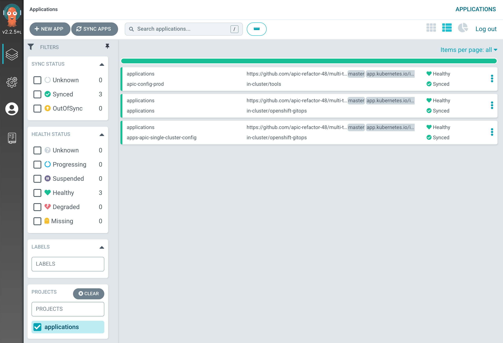{: style="max-height:900px"}

which correspond to the ArgoCD Applications defined within the `multi-tenancy-gitops-apps` repository. If you go into the final `apic-config-prod` application, you should see how the `sealedSecret` and the unsealed secret have been created in your cluster.

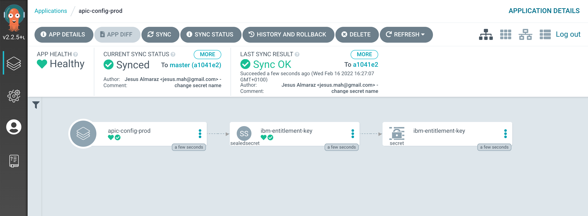{: style="max-height:450px"}

It will be the later unsealed secret the one the IBM operators you have deployed on your cluster will use to be allowed to pull IBM software down from the IBM entitled container registry.

## IBM API Connect

To get an IBM API Connect cluster instance created, all we need to do is to make sure that the definition of the IBM API Connect instance we want to deploy is correct on our GitOps repository and then, once again, tell the ArgoCD application that is watching over the `services` layer to activate such resource. This resource will, in turn, create another ArgoCD application that will watch over the resources specified in our definition of the IBM API Connect instance.

!!! info
    The IBM API Connect Cluster name might have changed from what the screenshots below show. Therefore, expect that `apic-single-cluster-production-classic` might not be the name for the IBM API Connect Cluster being deployed in your cluster. Instead, it might be something like `apic-cluster`.

1. Open the `0-bootstrap/single-cluster/2-services/kustomization.yaml` file and un-comment the following resource:

    ```yaml
    - argocd/instances/ibm-apic-instance.yaml
    ```

2. Make sure the **storage** settings for the IBM API Connect instance we are about to deploy are correct based on the IBM Cloud infrastructure your Red Hat OpenShift cluster is deployed on (review the [Create the cluster section](../cluster-create/ibm-cloud.md) if needed). You can adjust storage settings in in `0-bootstrap/single-cluster/2-services/argocd/instances/ibm-apic-instance.yaml`

    !!! warning "Storage"
        Make sure the **storageClassName** value, which **defaults to ibmc-block-gold**, corresponds to an available block storage class in your cluster. Make sure you understand block storage for Red Hat OpenShift clusters on IBM Cloud by reading IBM Cloud documentation [here](https://cloud.ibm.com/docs/openshift?topic=openshift-storage_planning) specially for clusters hosted on Virtual Private Clouds (VPC). Also, make sure you understand IBM API Connect production reference architecture on IBM Cloud [here](../architecture/ibm-cloud.md).

3. Make sure the **high availability** settings for the IBM API Connect instance we are about to deploy are correct based on your requirements (and cluster sizing. Review the [Create the cluster section](../cluster-create/ibm-cloud.md) if needed). You can adjust storage settings in in `0-bootstrap/single-cluster/2-services/argocd/instances/ibm-apic-instance.yaml`

    !!! warning "High availability"
        Make sure the **profile** value, which **defaults to n3xc14.m48**, corresponds to the desired profile: development vs production.
        
           * n1xc10.m48 - Deploys 1 replica of each pod, so this profile is most suitable for a small, non-HA system. Recommended use of this profile is for development and testing.

           * n3xc14.m48 - Deploys 3 or more replicas of each pod, so this profile is most suitable for larger systems and for production environments. This profile is supported for installation on a cluster with three or more nodes. It is not supported on a cluster with fewer than three nodes.

        Important: Make sure the Red Hat OpenShift cluster you are deploying this IBM API Connect recipe to has been sized appropriately based on the profiles above where:

           * n stands for the number of worker nodes.
           * c stands for the amount of CPU per worker node.
           * m stands for the amount of RAM per worker node.

4. Add all changes in the current folder to a git index, commit them, and push them to GitHub:

    ```bash
    git add .
    git commit -s -m "Installing an IBM API Connect instance"
    git push origin $GIT_BRANCH
    ```

5. If you go to your ArgoCD UI, you will now see the new `ibm-apic-instance` ArgoCD application.

    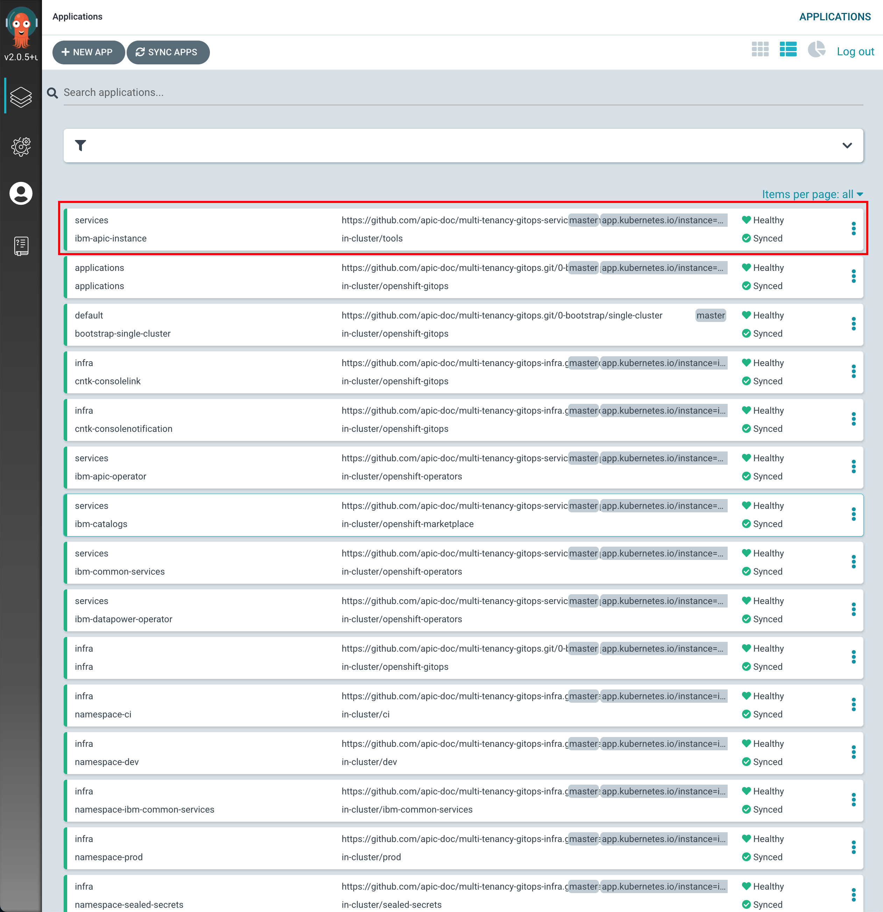{: style="max-height:900px"}

6. If you go into that ArgoCD application, you can monitor the IBM API Connect cluster instance installation. You will see how RedHat OpenShift resources are being created as a result of having the `ibm-apic-instance` ArgoCD application created the initial `APIConnectCluster` resource, which was then picked up by the IBM API Connect operator.

    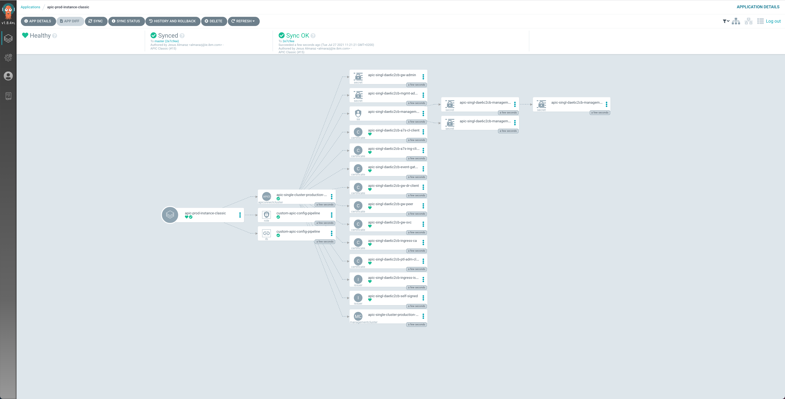{: style="max-height:1000px"}

7. If you go to `Operators --> Installed Operators` under the `tools` project, click on the `IBM API Connect` operator and then on the `All Instances` tab, you should see the `apic-cluster` `APIConnectCluster` object.

    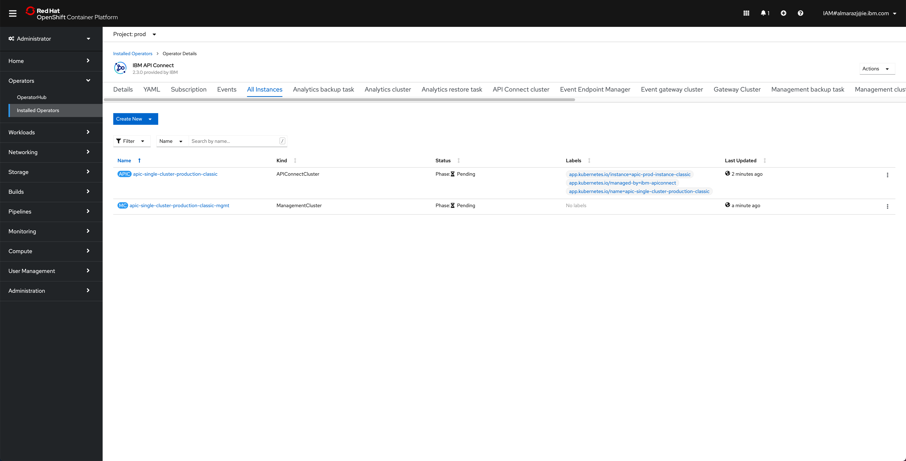{: style="max-height:1000px"}

    If you click on that `APIConnectCluster` object, you will be presented with the details about this object. In this page, you can see the name of the object, the namespace where it was created, the different attributes of the object but more importantly, you can follow along the installation/deployment of your IBM API Connect Cluster that this object represents by looking at its `Phase` and `State` attributes.

    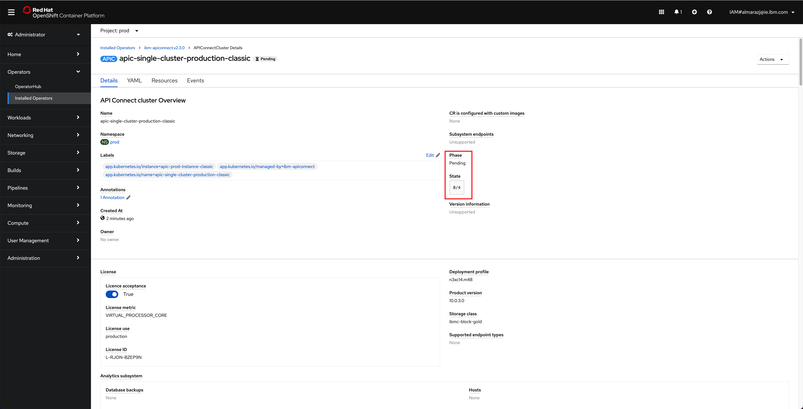{: style="max-height:1000px"}

    You can also open a terminal and execute the following command to follow the installation/deployment of your IBM API Connect Cluster along as far as the pods that get created

    ```
    watch -n 10 oc get pods -n tools
    ```

    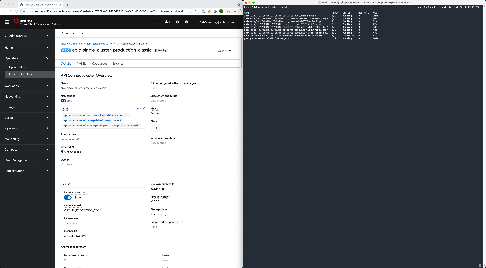{: style="max-height:1000px"}

8. After 30-40 minutes, the installation/deployment of your IBM API Connect Cluster should be done.

    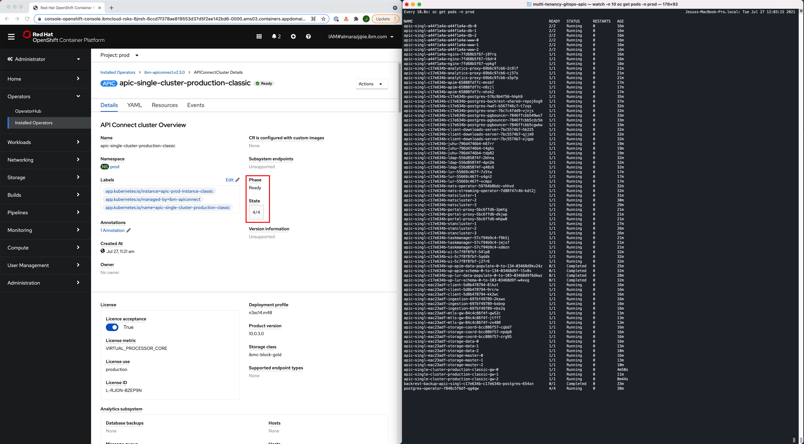{: style="max-height:1000px"}

9. If you go back to `Operators --> Installed Operators` under the `tools` project, click on the `IBM API Connect` operator and then on the `All Instances` tab, you should now be able to match the Custom Resource objects that the IBM API Connect operator has created, as a result of the installation/deployment of your IBM API Connect Cluster, with those IBM API Connect Cluster components presented at the [IBM API Connect Production Reference Architecture](../architecture/ibm-cloud.md). These objects are the `APIConnectCluster`, `AnalyticsCluster`, `GatewayCluster`, `ManagementCluster` and `PortalCluster` (amongst others).

    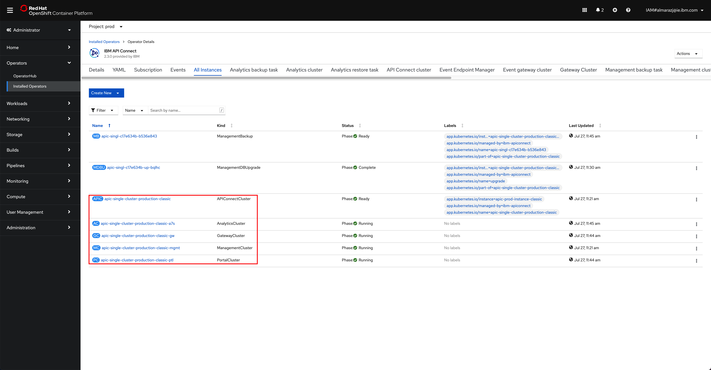{: style="max-height:1000px"}

### IBM API Connect Components

There are four different Components in IBM API Connect:

* Management Service (API Manager + Cloud Manager)
* Gateway Service
* Analytics Service
* Developer Portal Service

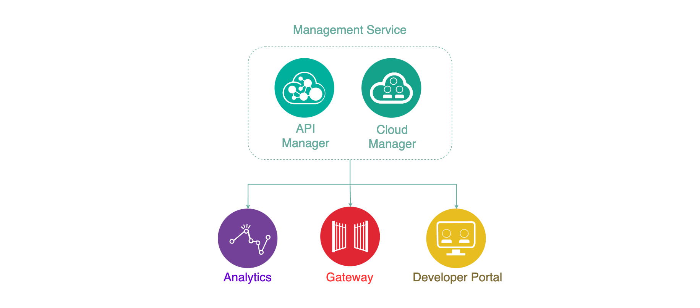{: style="max-height:400px"}

The **Management Service** is the central coordinator or *“brain”* of the whole solution and provides two functional roles and components:

* Cloud Manager - controls the infrastructure of the **API Cloud**. This is typically accessed by Infrastructure or Operation teams only.
* API Manager - controls the creation, publication, and management of APIs.

The **Analytics Service** provides aggregated metrics from API usage which allow API providers to monitor the health and consumption of their APIs.

The **Developer Portal** is a self-service web based portal available to application developers. Using an API consumer organization, developers are able to explore, discover and subscribe to APIs published by the provider organization.

The **Gateway Service** enforces runtime policies to secure and control API traffic. It plays the role of policy enforcement point by providing authentication (such as basic authentication and OAuth) and authorization for the API consumer calls. The Gateway Service also enforces rate limits, invokes server side calls, performs service orchestration and logs API interactions to the analytics engine for real-time and historical analytics and reporting.

#### API Cloud

The API Cloud is a physical segregation point. The API Cloud is made up of one Management Service, one or more Gateway Services, and zero or more Developer Portal Services and Analytics Services. The API Cloud is the **only** way to physically segregate the Management component.

Small enterprises typically have two API Clouds for the following purposes:

* Production
* Non-Production.

while for medium to large enterprises you could expect them to have three to four API Clouds:

* Production
* Non-Production – Where testing takes place
* Development – Where development takes place
* Infrastructure Sandbox - Where the infrastructure team can test patching and other changes to the infrastructure with minimum to zero impact on the developers, testers or customers.

!!! info
    It is out of the scope of this tutorial to dive deep into infrastructure/environment configuration and topology strategies. For more information on this, find the following resources:

    * [IBM API Connect v10.x Deployment WhitePaper](https://community.ibm.com/community/user/integration/viewdocument/api-connect-deplyoment-whitepaper-v) by Chris Phillips.
    * [Applying API Governance Part 2 – How do I optimize my teams and infrastructure to provide the best API factory with decentralized teams?](https://chrisphillips-cminion.github.io/apiconnect/2020/08/26/APIGov2.html) by Chris Phillips.
    * [Get the most out of your API strategy](https://developer.ibm.com/videos/get-the-most-out-of-your-api-strategy/) video by Chris Phillips.


## IBM API Connect Cloud Manager

Now, let's make sure that our API Connect Cluster is up and running. For doing that, we are going to make sure that we can open and access the IBM API Connect Cloud Manager web console.

1. In your Red Hat OpenShift we console, go to `Networking` --> `Routes` under the `tools` project and click on the `Location` value for the  `apic-clust-xxxx-admin` route.

    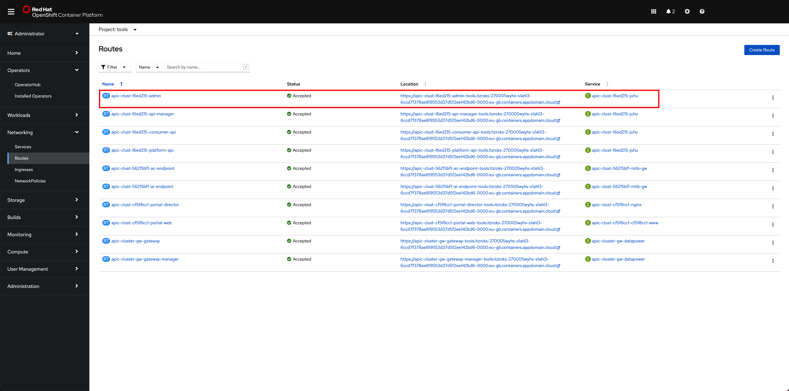{: style="max-height:1000px"}

    That should bring you to the IBM API Connect Cloud Manager web console login page.

    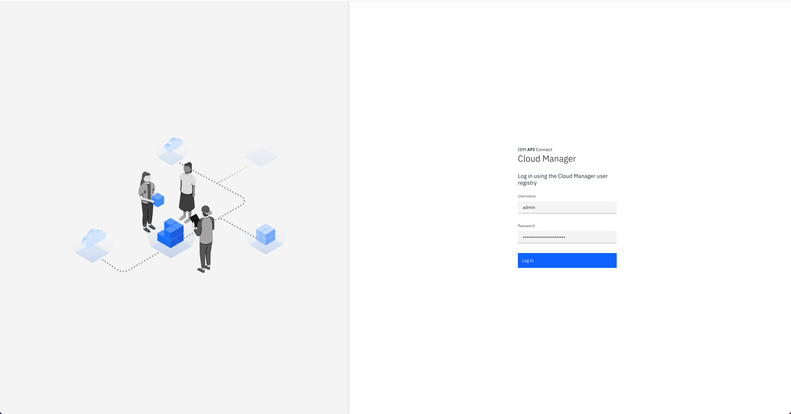{: style="max-height:1000px"}

1. Log into the IBM API Connect Cloud Manager web console by using `admin` as the username and getting it's password with the following command

    ```
    oc get secret `oc get secrets -n tools | grep mgmt-admin-pass | awk '{print $1}'` -n tools -o jsonpath='{.data.password}' | base64 -D
    ```

    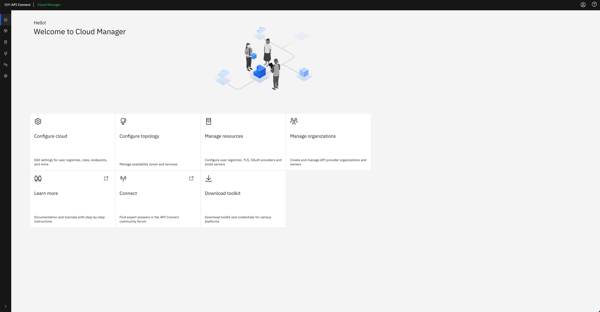{: style="max-height:1000px"}

1. Finally, click on the `Configure Topology` option presented in the IBM API Connect Cloud Manager web console. You should see that there is no topology configured at all.

    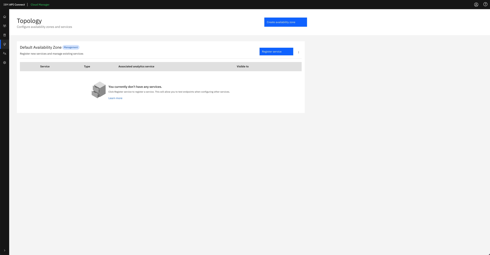{: style="max-height:1000px"}

You can follow the [IBM API Connect Cloud Manager configuration checklist](https://www.ibm.com/docs/en/api-connect/10.0.x?topic=environment-cloud-manager-configuration-checklist) documentation to manually proceed with the tasks you need to accomplish to get your IBM API Connect cluster ready to be used or you can go to the next section in this chapter where you will create an OpenShift Pipeline that gets your recently deployed IBM API Connect instance configured so that you can start working with it right away.

!!! success "Congratulations!"
    You have successfully deployed a highly available production ready IBM API Connect cluster on your RedHat OpenShift cluster on IBM Cloud using a GitOps methodology