# Deploy IBM API Connect

<!--- cSpell:ignore APIC apic apiconnectcluster OIDC ibmc decentralised -->

## Overview

In this section you are going to:

1. Deploy the IBM API Connect Operator and its dependencies
2. Deploy an IBM API Connect Cluster instance.
 
And you are going to do so using the same GitOps framework and methodology you have been using throughout this tutorial.

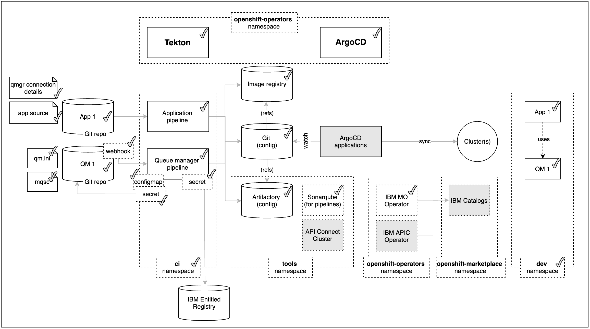{: style="max-height:700px"}

In the previous sections of this MQ tutorial you have learnt how to deploy the IBM Message Queue Operator (IBM MQ) and how to create a Queue Manager (QM1) as well as a demo application (App 1) that would interact with a message queue defined within that Queue Manager (QM1) to send and receive messages. And you have learnt how to deploy all these pieces along with many others using a GitOps methodology where you use code stored in GitHub to declare the desired state of your cluster plus all those pieces and let ArgoCD to make sure such desired state is realized.

Focusing on the MQ demo application (App 1), you have seen that it exposes REST APIs in order to send and receive messages to/from a message queue within an IBM Message Queue Queue Manager. Exposing functionality through REST APIs is very convenient for others to make use of it even more so in today's distributed microservices based system architectures. Moreover, in today’s world of ever-expanding inter-connectivity, application programming interfaces (APIs) have emerged as important tools for providing access to data and capabilities beyond the firewall. Organizations increasingly use APIs to bring together an ecosystem partners and unlock new sources of value. With that API usage increase the need for securing, managing, socializing, analyzing and monetizing all your enterprise's APIs from a single integrated platform has become a necessity:

!!! quote "IBM API Connect"
    IBM API Connect® is a scalable multi-cloud API management solution, that provides users with core capabilities to create, secure, manage, socialize, and analyze APIs from within a single integrated platform. In addition, it provides the ability to monitor the health and consumption of APIs, test API functionality and monetize API usage. It provides a mechanism to transform existing backend REST, SOAP or GRAPHQL services into managed services. These managed services are exposed as REST APIs for consumption by internal and external consumers.

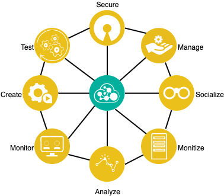

---

## IBM API Connect

There are four different Components in IBM API Connect:

* Management Service (API Manager + Cloud Manager)
* Gateway Service
* Analytics Service
* Developer Portal Service

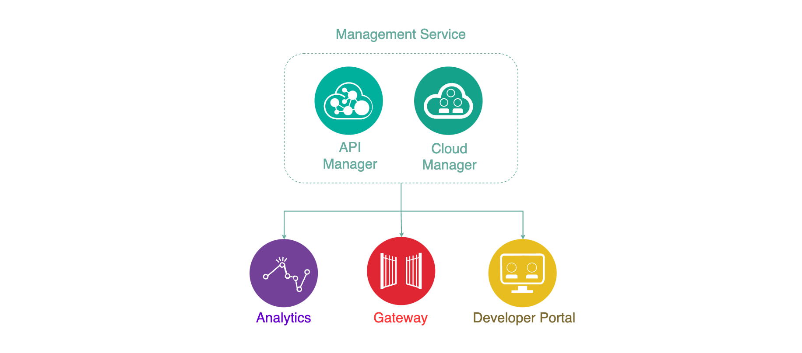{: style="max-height:400px"}

The **Management Service** is the central coordinator or *“brain”* of the whole solution and provides two functional roles and components:

* Cloud Manager - controls the infrastructure of the **API Cloud**. This is typically accessed by Infrastructure or Operation teams only.
* API Manager - controls the creation, publication, and management of APIs.

The **Analytics Service** provides aggregated metrics from API usage which allow API providers to monitor the health and consumption of their APIs.

The **Developer Portal** is a self-service web based portal available to application developers. Using an API consumer organization, developers are able to explore, discover and subscribe to APIs published by the provider organization.

The **Gateway Service** enforces runtime policies to secure and control API traffic. It plays the role of policy enforcement point by providing authentication (such as basic authentication and OAuth) and authorization for the API consumer calls. The Gateway Service also enforces rate limits, invokes server side calls, performs service orchestration and logs API interactions to the analytics engine for real-time and historical analytics and reporting.

### API Cloud

The API Cloud is a physical segregation point. The API Cloud is made up of one Management Service, one or more Gateway Services, and zero or more Developer Portal Services and Analytics Services. The API Cloud is the **only** way to physically segregate the Management component.

Small enterprises typically have two API Clouds for the following purposes:

* Production
* Non-Production.

while for medium to large enterprises you could expect them to have three to four API Clouds:

* Production
* Non-Production – Where testing takes place
* Development – Where development takes place
* Infrastructure Sandbox - Where the infrastructure team can test patching and other changes to the infrastructure with minimum to zero impact on the developers, testers or customers.

!!! info
    It is out of the scope of this tutorial to dive deep into infrastructure/environment configuration and topology strategies. For more information on this, find the following resources:

    * [IBM API Connect v10.x Deployment WhitePaper](https://community.ibm.com/community/user/integration/viewdocument/api-connect-deplyoment-whitepaper-v) by Chris Phillips.
    * [Applying API Governance Part 2 – How do I optimize my teams and infrastructure to provide the best API factory with decentralised teams?](https://chrisphillips-cminion.github.io/apiconnect/2020/08/26/APIGov2.html) by Chris Phillips.
    * [Get the most out of your API strategy](https://developer.ibm.com/videos/get-the-most-out-of-your-api-strategy/) video by Chris Phillips.

---

## Deploy IBM API Connect

You have seen in previous chapters of this tutorial how to use the *kustomization.yaml* in the *single-cluster* profile within your *multi-tenancy-gitops* GitHub repository fork in order to declare what you want to get deployed in your cluster. This time will be no difference as to how to get IBM API Connect deployed in your existing cluster. 

First, you will deploy all of the components that IBM API Connect needs/depends on. These are things like the IBM Entitlement Key to be able to pull IBM software down from IBM's software registry and the IBM Operators Catalog to be able to install IBM Operators such as the IBM Foundations, IBM DataPower and IBM API Connect operators, where the first two are a dependency of the IBM API Connect operator. Second, you will create the IBM API Connect Cluster instance.

### Deploy IBM API Connect Operator

If you remember from the previous sections where you deployed the IBM MQ Operator and other tools, the IBM Entitlement key, the IBM Operators Catalog and the IBM Foundations Operator have already been created/deployed in the **`tools`**, **`openshift-marketplace`** and **`openshift-operators`** namespaces respectively.

!!! info
    The IBM API Connect Operator will get cluster-wide installed in the **`openshift-operators`** namespace while the IBM API Connect Cluster will get deployed in the **`tools`** namespace and shared across all namespaces and applications.

As a result, the only two items left to get installed are the IBM DataPower and IBM API Connect Operators. To get these installed, all you need to do, is to un-comment these from the `0-bootstrap/single-cluster/2-services/kustomization.yaml` file.

1. Open the `0-bootstrap/single-cluster/2-services/kustomization.yaml` file and make sure that the following resources are un-commented:

    ``` { .yaml .no-copy }
    - argocd/operators/ibm-apic-operator.yaml
    - argocd/operators/ibm-datapower-operator.yaml
    - argocd/operators/ibm-foundations.yaml
    - argocd/operators/ibm-catalogs.yaml
    ```

2. Add all changes in the current folder to a git index, commit them, and push them to GitHub:

    ```bash
    git add .
    git commit -s -m "Installing APIC Operator"
    git push origin $GIT_BRANCH
    ```

3. If you go to your ArgoCD UI, you should now see two new ArgoCD applications for the IBM DataPower and IBM API Connect Operators.
   
    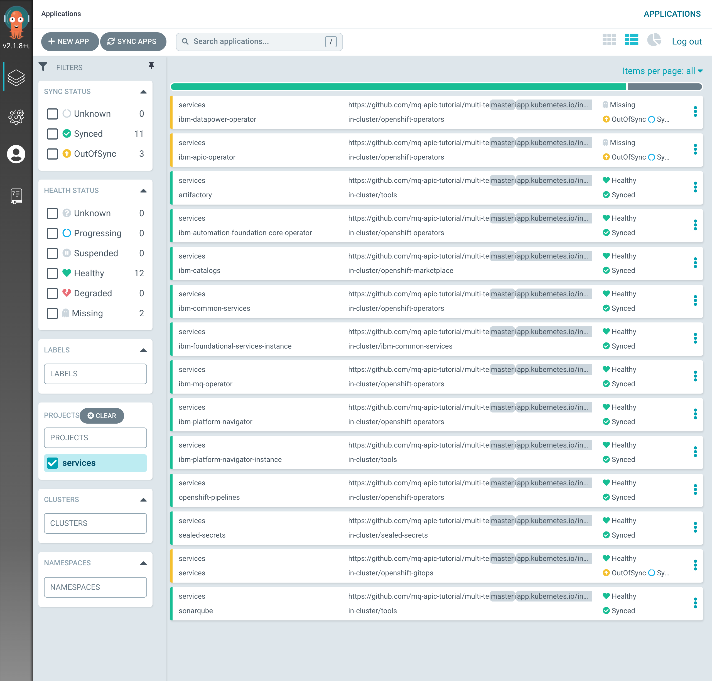{: style="max-height:1000px"}

4. After 5-10 mins, if you go to your Red Hat OpenShift web console and click on `Operators --> Installed Operators` on the right hand side menu and select the `tools` project on the pull down menu at the top bar, you will see that the IBM DataPower and IBM API Connect operators are being installed or have been successfully installed already (apart from all of the other Operators already installed on your cluster).

    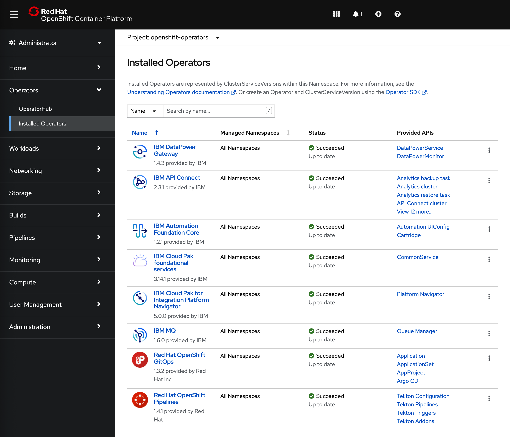{: style="max-height:800px"}

### Create an IBM API Connect Cluster

To get an IBM API Connect Cluster instance created, all you need to do is to make sure that the definition of the IBM API Connect Cluster instance you want to deploy looks correct on your GitOps repository.

1. Open the `0-bootstrap/single-cluster/2-services/kustomization.yaml` file and un-comment the following resource:

    ```yaml
    - argocd/instances/ibm-apic-instance.yaml
    ```

2. Make sure the **storage** settings for the IBM API Connect Cluster instance you are about to deploy are correct based on the infrastructure your Red Hat OpenShift cluster is deployed on. IBM API Connect **requires block storage**. You can adjust your IBM API Connect Cluster instance storage settings in `0-bootstrap/single-cluster/2-services/argocd/instances/ibm-apic-instance.yaml`

    !!! warning "Storage"
        If your Red Hat OpenShift cluster **was not** requested through IBM Technology Zone, make sure the **storageClassName** value of the IBM API Connect Cluster instance, which **defaults to `ibmc-block-gold`**, corresponds to an available block storage class in your cluster.

3. Make sure the **high availability** settings for the IBM API Connect Cluster instance you are about to deploy are correct based on your requirements (and **cluster available resources**). You can adjust your IBM API Connect Cluster instance deployment profile settings in `0-bootstrap/single-cluster/2-services/argocd/instances/ibm-apic-instance.yaml`

    !!! danger "Important"
        For the purpose of this tutorial, please do use the **development `n1xc10.m48` profile** as the RedHat OpenShift cluster you were asked to create would not have enough resources to deploy IBM API Connect with its production high availability profile. Make sure that development profile is specified in the file aforementioned.

    !!! success "High availability"
        The **profile** value, which **defaults to `n3xc14.m48`**, corresponds to the desired profile: development vs production.
        
           * `n1xc10.m48` - Deploys 1 replica of each pod, so this profile is most suitable for a small, non-HA system. Recommended use of this profile is for development and testing.

           * `n3xc14.m48` - Deploys 3 or more replicas of each pod, so this profile is most suitable for larger systems and for production environments. This profile is supported for installation on a cluster with three or more nodes. It is not supported on a cluster with fewer than three nodes.

        Important: Make sure the Red Hat OpenShift cluster you are deploying this IBM API Connect recipe to has been sized appropriately based on the profiles above where:

           * `n` stands for the number of worker nodes.
           * `c` stands for the amount of CPU per worker node.
           * `m` stands for the amount of RAM per worker node.

4. Add all changes in the current folder to a git index, commit them, and push them to GitHub:

    ```bash
    git add .
    git commit -s -m "Installing an IBM API Connect instance"
    git push origin $GIT_BRANCH
    ```

5. If you go to your ArgoCD UI, you will now see the new `ibm-apic-instance` ArgoCD application.

    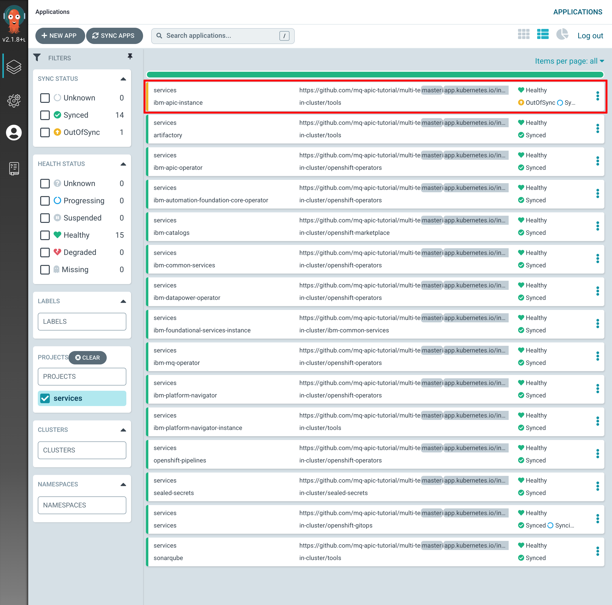{: style="max-height:1000px"}

6. If you go into that ArgoCD application, you can monitor the IBM API Connect cluster instance installation. You will see how Red Hat OpenShift resources are being created as a result of having the `ibm-apic-instance` ArgoCD application created the initial `APIConnectCluster` resource, which was then picked up by the IBM API Connect Operator.

    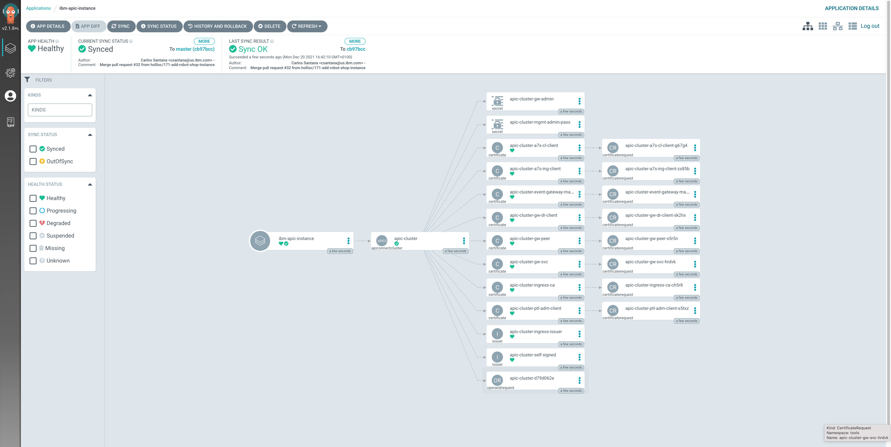{: style="max-height:900px"}

7. If you go to `Operators --> Installed Operators` under the `tools` project, click on the `IBM API Connect` operator and then on the `All Instances` tab, you should see the `apic-cluster` `APIConnectCluster` object.

    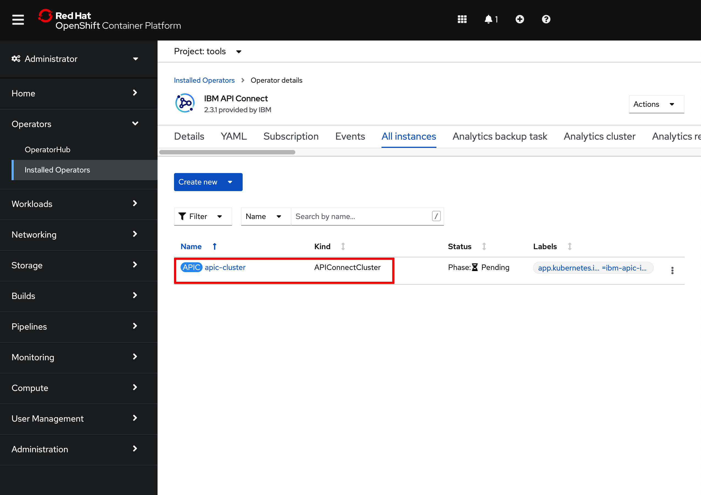{: style="max-height:900px"}

    If you click on that `APIConnectCluster` object, you will be presented with the details about this object. In this page, you can see the name of the object, the namespace where it was created, the different attributes of the object but more importantly, you can follow along the installation/deployment of your IBM API Connect Cluster that this object represents by looking at its `Phase` and `State` attributes.

    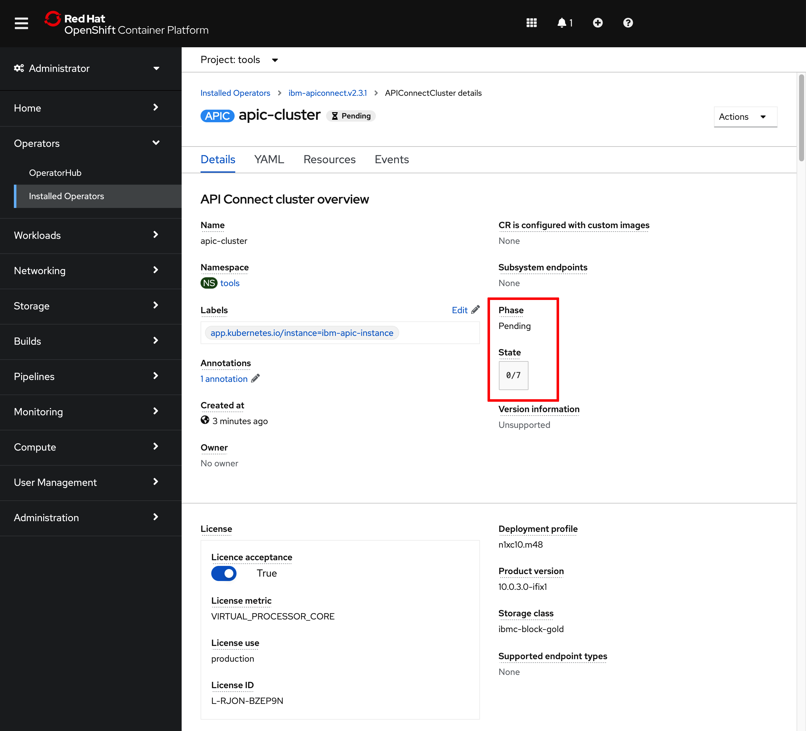{: style="max-height:1000px"}

    You can also open a terminal and execute the following command to follow the installation/deployment of your IBM API Connect Cluster along as far as the pods that get created

    ```
    watch -n 10 oc get pods -n tools
    ```

8. After 30-40 minutes, the installation/deployment of your IBM API Connect Cluster should be done.

    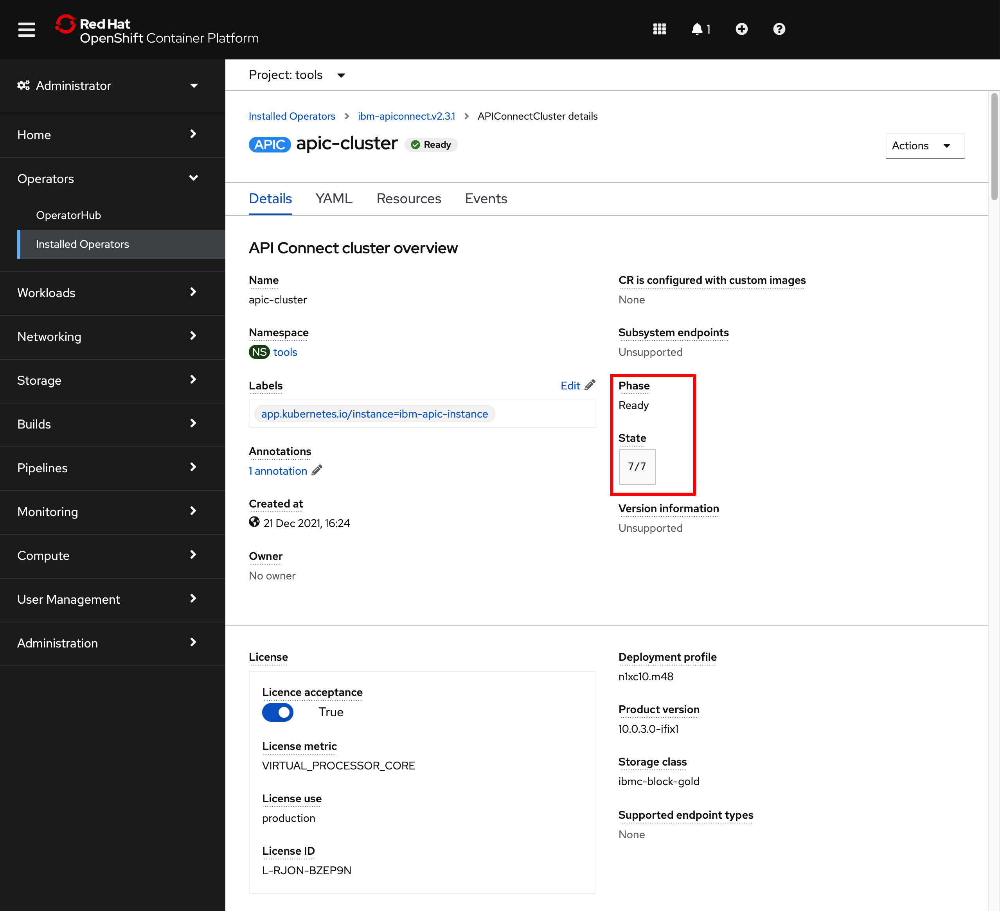{: style="max-height:1000px"}

9.  If you go back to `Operators --> Installed Operators` under the `tools` project, click on the `IBM API Connect` operator and then on the `All Instances` tab, you should now be able to match the Custom Resource objects that the IBM API Connect operator has created, as a result of the installation/deployment of your IBM API Connect Cluster, with those IBM API Connect Cluster components presented at the very beginning on this section. These objects are the `APIConnectCluster`, `AnalyticsCluster`, `GatewayCluster`, `ManagementCluster` and `PortalCluster` (amongst others).

    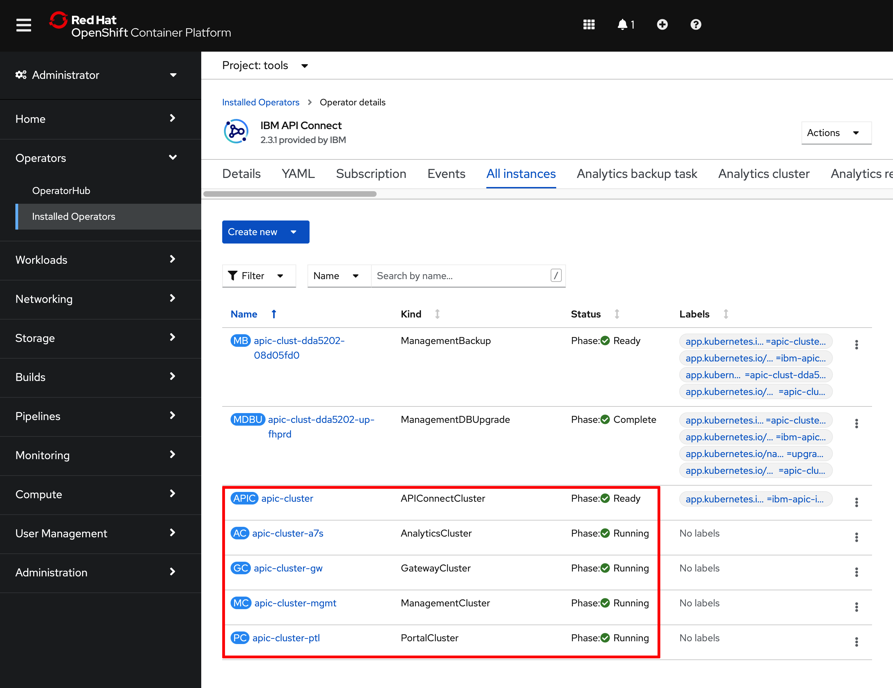{: style="max-height:1000px"}

    !!! info
        The reason why you see your IBM API Connect Cluster Custom Resource objects suffixed with the word `Cluster` is because all of these components will deploy 3 replicas, and hence form a cluster, if you select the `production n3xc14xm48` profile. For more information on the IBM API Connect on IBM Cloud Architecture [here](../../apic/architecture/ibm-cloud.md) and its high availability considerations [here](../../apic/high-availability/overview.md)

---

## IBM Cloud Pak Platform Navigator

Now, let's make sure that your new integration capability got added to the existing IBM Message Queue capabilities in your IBM Cloud Pak Platform Navigator.

1. Log into your IBM Cloud Pak Platform Navigator. In order to get such url execute the following command:

    ```bash
    oc get route cpd -n tools -o=jsonpath='{.spec.host}'
    ```

    {: style="max-height:700px"}

2. Select `IBM provided credentials (admin only)` to log in with the IBM Cloud Pak Common Services administrator OIDC credentials that were created when installing the IBM Cloud Pak Foundational Services as a result of installing IBM Message Queue and IBM Cloud Pak Platform Navigator. To retrieve such credentials execute:

    ```bash
    oc extract -n ibm-common-services secrets/platform-auth-idp-credentials --keys=admin_username,admin_password --to=-
    ```

    {: style="max-height:700px"}

3. You should be presented with the IBM Cloud Pak Platform Navigator dashboard that will display all IBM Integration capabilities that are installed on your cluster. So far, you should be able to see your IBM MQ Queue Manager (`qm1`) and your recently deployed IBM API Connect Cluster (`apic-cluster`)

    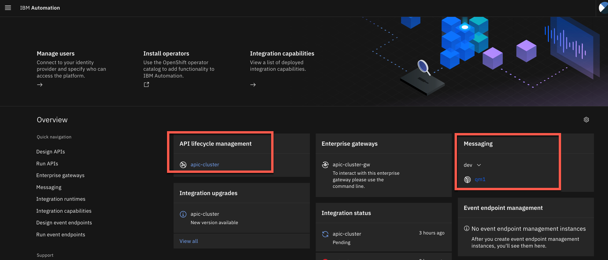{: style="max-height:900px"}

By clicking on `apic-cluster` you will get to your IBM API Connect API Manager where you can work on developing and publishing your application APIs. However, you will need to do some further configuration of your IBM API Connect API Cloud that you will see in the next chapter. That configuration is done in the IBM API Connect Cloud Manager, the other management component of IBM API Connect as depicted above.

---

## IBM API Connect Endpoints

As a reminder, this is how you can retrieve your IBM API Connect Cloud Manager and API Manager URLs to access these through your web browser.


* To retrieve your IBM API Connect API Manager endpoint, execute on your terminal:

    ```bash
    oc get apiconnectcluster <APIC_NAME> -n <PROJECT> -o=jsonpath='{.status.endpoints[?(@.name=="ui")].uri}'
    ```

where

* `<APIC_NAME>` is the name of the IBM API Connect Cluster instance you have just deployed. If you have followed the instructions as is in this chapter for your IBM API Connect Cluster deployment, the name of your IBM API Connect Cluster should be **`apic-cluster`**. Otherwise, you can find out your IBM API Connect Cluster instances with:

    ```bash
    oc get apiconnectcluster -n <PROJECT>
    ```

* `<PROJECT>` is the RedHat OpenShift Project where your IBM API Connect Cluster instance is deployed. If you followed the instructions as is in this chapter, the RedHat OpenShift Project where your IBM API Connect Cluster instance should be deployed is **`tools`**. You could also retrieve all your IBM API Connect Cluster instances on your RedHat OpenShift Cluster with:

    ```bash
    oc get apiconnectcluster -A
    ```

!!! tip "IMPORTANT"
    Remember how to get your IBM API Connect Cloud Manager and IBM API Connect API Manager endpoints as these will be heavily used throughout the remaining of this tutorial.

---

## IBM API Connect User Registries

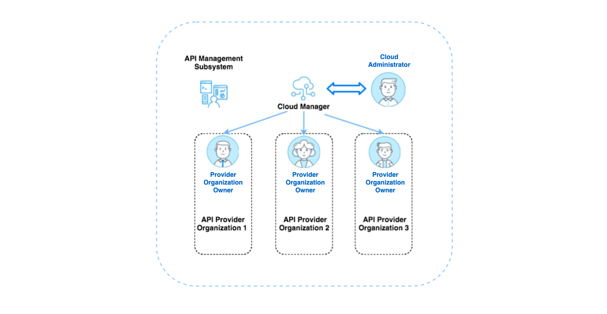{: style="max-height:600px"}

API Connect supports several types of user registries for authenticating users. The credentials for all users of IBM API Connect Cloud Manager, IBM API Connect API Manager, and the different IBM API Connect Developer Portals must be stored in a user registry.

A user registry holds unique user account credentials, primarily usernames and passwords, which are accessed during authentication for logging into IBM API Connect Cloud Manager, IBM API Connect API Manager, the different IBM API Connect Developer Portals, and also for calling APIs (if the API is configured to use Basic Authentication in the Security Definition). The Cloud Administrator configures user registries to ensure that all users are successful at logging in.

User registries that are configured in IBM API Connect Cloud Manager have the following characteristics:

* They are available to IBM API Connect Cloud Manager, IBM API Connect API Manager, the different IBM API Connect Developer Portals, and for Basic Authentication for APIs.
* They are available to provider organizations, as determined by the visibility setting.
* They can be edited and deleted only in IBM API Connect Cloud Manager.

User registries that are configured in IBM API Connect API Manager have the following characteristics:

* They are available to the different IBM API Connect Developer Portals (for Catalogs) and for Basic Authentication for APIs.
* They are available only to the Provider Organization that created them.

IBM API Connect includes two internal databases that serve as Local User Registries (or LURs). The Providers LUR supports credentials for Provider Organizations and the Admin LUR supports credentials for the Administrator organization. Multiple registries may be configured.

The following user registry types can serve as a resource in API Connect:

* Local user registry (LUR) - An internal database of usernames and passwords stored on the local server. Contains the Admin user account which may not be modified or deleted.
* LDAP - A user registry definition that points to an existing corporate LDAP directory. May be set up as case-sensitive.
* Authentication URL - Accesses a URL that points to a service for validating user credentials.
* OpenID Connect (OIDC).

When IBM API Connect is installed as part of the IBM Cloud Pak For Integration, it gets integrated with the [Identity and Access Management (IAM) Operator](https://www.ibm.com/docs/en/cpfs?topic=operator-authentication-onboarding-single-sign) provided by the IBM Cloud Pak Foundational Services so that IBM API Connect provides a single sign-on mechanism. As a result, an extra user registry is created in your IBM API Connect called Common Services User Registry. This Common Services User Registry is configured to support credentials to the Provider Organizations as well as the Administration organization. It contains, out of the box, only one user, the IBM Cloud Pak Common Services `admin` user you have already used to log into the Platform Navigator with. As a result of the single sign-on capabilities provided by the Identity and Access Management (IAM) Operator, you would not need to provide your credentials again to get into the IBM API Connect Cloud Manager or IBM API Connect API Manager if you have previously logged into the IBM Cloud Pak Platform Navigator.

However, for simplicity and best practices, you are **NOT** going to use the IBM Common Services `admin` user to manage your IBM API Connect Cloud Manager and IBM API Connect API Manager. As shown in the pic above, you will want to clearly distinguish the **`Cloud Administrator`** that will be in charge of managing your IBM API Connect API Cloud and your **`Provider Organization Owner`** that will be in charge of managing your Provider Organization. As a result, you will be using the two Local User Registries included with IBM API Connect out of the box, the admin and providers LURs, to respectively manage the authentication and authorization of your **`Cloud Administrator`** and your **`Provider Organization Owner`**. This means that you will need to register your **`Cloud Administrator`** and your **`Provider Organization Owner`** in their respective LURs.

!!! info
    IBM API Connect registers a default **`Cloud Administrator`** in the Admin Local User Registry with `admin` as username and a random password you can retrieve by executing:

    ```bash
    oc extract -n <PROJECT> secret/<APIC_NAME>-mgmt-admin-pass --keys=password --to=-
    ```

    where `<APIC_NAME>` is the name of your IBM API Connect Cluster instance and `<PROJECT>` is the RedHat OpenShift Project where it is deployed. If you followed this tutorial it should be `apic-cluster` and `tools` respectively.

You will explore the different User Registries in more detail in the next chapters.

---

!!! success "Congratulations"
    You have successfully deployed IBM API Connect and created an IBM API Connect Cluster instance on your Red Hat OpenShift cluster following the same GitOps approach and methodology. You should now be able to start working with your IBM API Connect Cluster instance. Go to the next [Configure API Connect](./configure-apic.md) chapter to make few config tweaks to your IBM API Connect Cluster instance and start working right away on publishing your Spring MQ Application APIs.

## Links

Here are some interesting links used to create this section of the tutorial:

* [Red Hat OpenShift Solution Design Guidance - API Connect](https://pages.github.ibm.com/IBMAoT/i-openshift-guides/03-cloud-paks/cloud-pak-for-integration/api-connect)
* [IBM API Economy](https://www.ibm.com/uk-en/cloud/api-economy)
* [IBM API Connect v10.x Deployment WhitePaper](https://community.ibm.com/community/user/integration/viewdocument/api-connect-deplyoment-whitepaper-v) by Chris Phillips
* [Applying API Governance Part 2 – How do I optimize my teams and infrastructure to provide the best API factory with decentralised teams?](https://chrisphillips-cminion.github.io/apiconnect/2020/08/26/APIGov2.html) blog by Chris Phillips.
* [Get the most out of your API strategy](https://developer.ibm.com/videos/get-the-most-out-of-your-api-strategy/) video by Chris Phillips.
* [IBM Cloud Pak Foundational Services - Identity and Access Management (IAM)](https://www.ibm.com/docs/en/cpfs?topic=iam).
* [IBM API Connect - User registries overview](https://www.ibm.com/docs/en/api-connect/10.0.x?topic=security-user-registries-overview)