# Promote Application APIs in IBM API Connect to Production

<!--- cSpell:ignore apic OIDC uncommented -->

## Overview

So far in this Expose MQ App APIs section of the MQ tutorial, you have successfully deployed IBM API Connect, published your Spring MQ Application APIs to a Developer Portal within your instance of IBM API Connect cluster and managed to consume those APIs from such Developer Portal as in you were a third party or external consumer of these.

However, the Developer Portal you have published to and consumed from the Spring MQ Application APIs is associated to the `dev` catalog. Similar to application development lifecycle and promotion where your application goes from development to staging and finally into production (that you should have already gone through in this tutorial), the APIs for those applications will also travel alongside. That is, you also have a development lifecycle and promotion for your APIs. And likewise you do for you applications, you want your API promotion to be as much automated through code as possible.

Automating your API promotion strategy through code means that:

1. Your API definitions and Products will get stored as code in GitHub.
2. Only through automation those APIs and Products will get published to the staging and production environments.

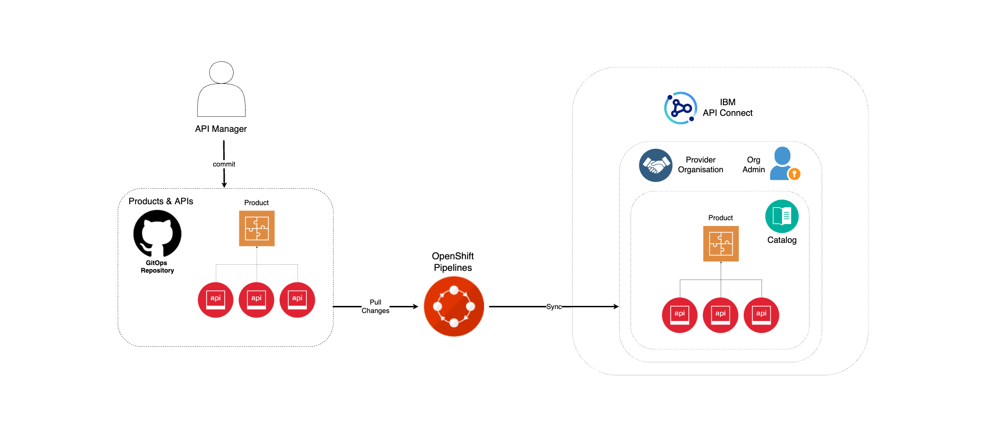{: style="max-height:700px"}

!!! info
    Given the environment limitations for running this tutorial, where you are limited to only one RedHat OpenShift cluster, you simulated your development, staging and production environments by segregating and separating your IBM Queue Managers and Spring MQ Applications using RedHat OpenShift Projects. Likewise, you will use the same IBM API Connect Cluster instance to manage, publish and socialize your development, staging and production application APIs by separating and segregating these using catalogs. Remember catalogs provide isolated API run-time environments within a pOrg. There are permission sets within a pOrg and those permissions can be scoped to the pOrg, Catalog or Space level. For more information on physical segregation of your IBM API Connect environments review the [API Cloud](../deploy-apic/#api-cloud) section. For more information on logical segregation at the Provider Organization level review the [Provider Organization](../configure-apic/#provider-organization) section. 

!!! warning "Important"
    For simplicity, the API promotion pipeline is shortened to go from development straight into production to cover the main concepts in this educational material. Of course, this is not a recommended practice for any client or enterprise and they should enhance their development lifecycle and promotion to include test, QA, staging, etc phases with their respective environments.

In this section you are going to:

1. Create a production catalog for your application APIs running in production.
2. Define your APIs and Products as code and store these in GitHub.
3. Deploy and use a Tekton pipeline that will publish your APIs and Products into the production catalog.

## Production catalog

First step in your API promotion strategy for your `mq-spring-app` API OpenAPI definition, which defines your Spring MQ Application APIs, is to have the corresponding catalogs for the APIs to be published. As explained above, you will use the same IBM API Connect Cluster instance to manage, publish and socialize the APIs of all your applications regardless of what simulated environment these applications are running on. That is, giving the resource limitations of this tutorial to only having one RedHat OpenShift cluster available, you will not have physical segregation of IBM API Connect API Clouds at all and will use catalogs for developing logical separation and segregation of environments for your APIs instead. As also explained above, you will shorten your API promotion pipeline and get the APIs from your development catalog promoted straight into your production catalog. As a result, you need to create a production catalog.

First, open up your IBM API Connect API Manager web console by pointing your browser to its url which you can retrieve with:

```bash
oc get apiconnectcluster <APIC_NAME> -n <PROJECT> -o=jsonpath='{.status.endpoints[?(@.name=="ui")].uri}'
```

where `<APIC_NAME>` is the name of your IBM API Connect Cluster instance and `<PROJECT>` is the RedHat OpenShift Project where it is deployed (review the [IBM API Connect Endpoints section](../deploy-apic/#ibm-api-connect-endpoints) for more details).

If you have not logged into your IBM Cloud Pak Platform Navigator, you will be requested to do so first:

{: style="max-height:700px"}

Select `IBM provided credentials (admin only)` to log in with the IBM Cloud Pak Common Services administrator OIDC credentials that were created when installing the IBM Cloud Pak Foundational Services as a result of installing IBM Message Queue and IBM Cloud Pak Platform Navigator. To retrieve such credentials execute:

```bash
oc extract -n ibm-common-services secrets/platform-auth-idp-credentials --keys=admin_username,admin_password --to=-
```

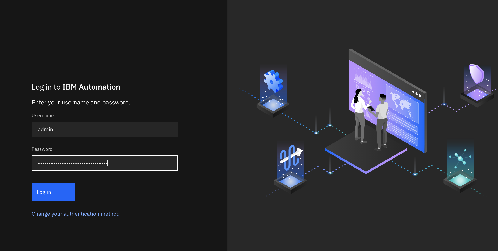{: style="max-height:700px"}

If you had logged into your IBM Cloud Pak Platform Navigator recently, you would get to the IBM API Connect API Manager login page directly.

You will use your `Provider Organization Owner` user that exists in the `API Manager User Registry`. Therefore, click on the `API Manager User Registry` button.

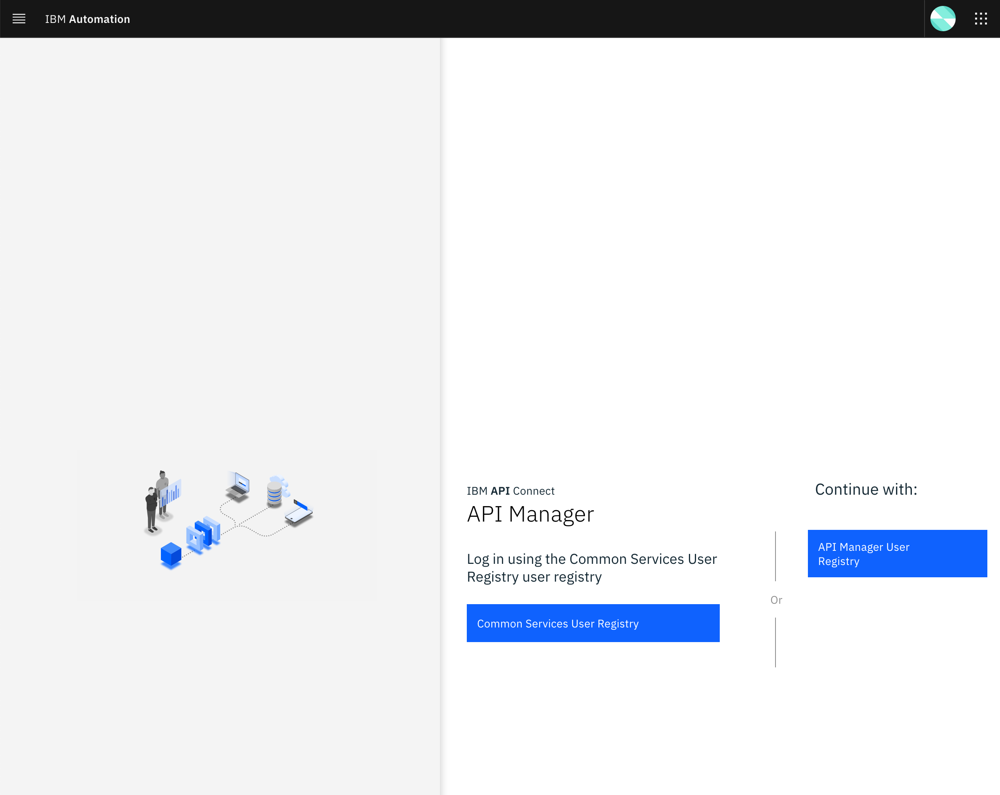{: style="max-height:1000px"}

You will be prompted to provide the credentials for the `Provider Organization Owner`. Use the `Username` and `Password` you set when creating the `Provider Organization Owner`:

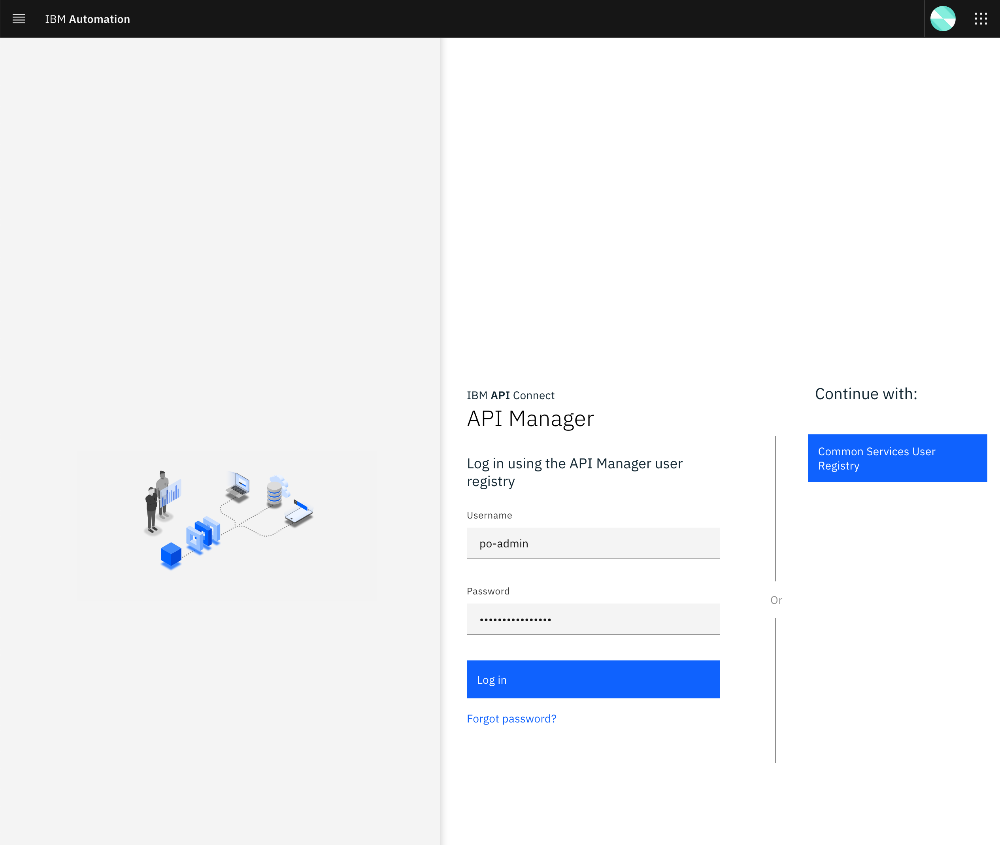{: style="max-height:1100px"}

Once you successfully get authenticated, you should get to the IBM API Connect API Manager dashboard. 

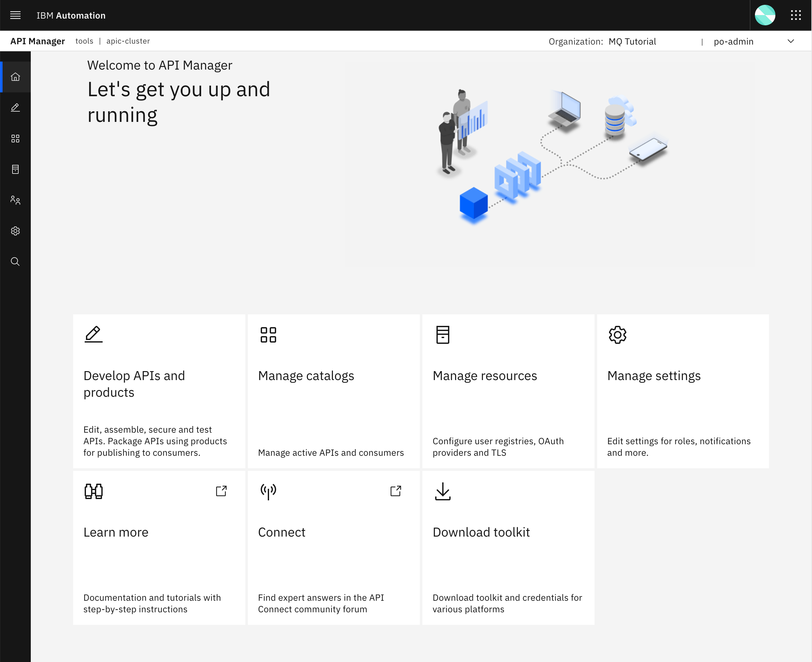{: style="max-height:1000px"}

From your IBM API Connect API Manager dashboard, select `Manage catalogs`. You should see the default `Sandbox` catalog and `dev` catalog you created in the previous chapters of this section of the tutorial.

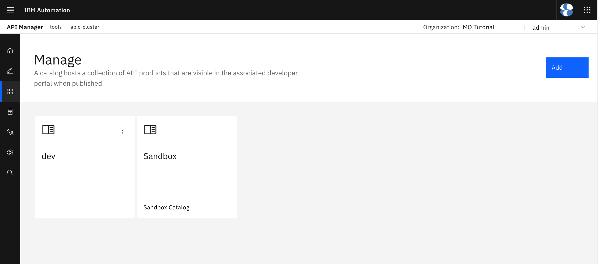{: style="max-height:500px"}

Click on the `Add` button at the top right corner and then select `Create catalog`.

In the form you are presented with, select the `po-admin` user (in fact, you can not select any other user since there should not be any other user) in order to create your new catalog. Then provide `prod` as the name for your new catalog.

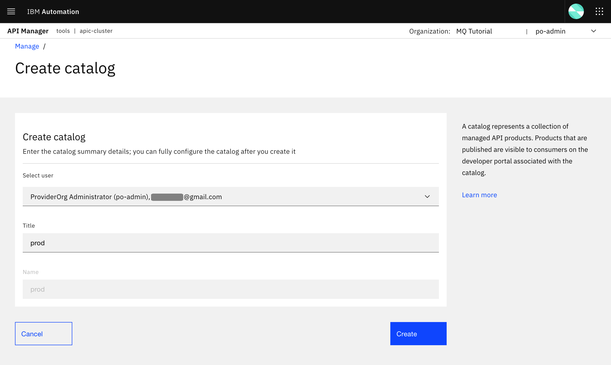{: style="max-height:700px"}

You should now see your `prod` catalog as well.

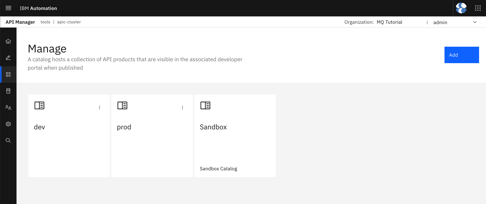{: style="max-height:500px"}

Click on your `prod` catalog. You should see there is no product yet published to the catalog.

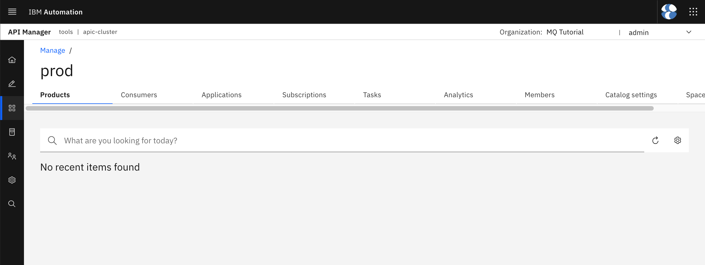{: style="max-height:450px"}

## APIs and Products as Code

Next step is to define your APIs and Products as code.

### APIs and Products GitHub Repository

In order to store your APIs and Products as code in GitHub, you first need to create a new empty repository to store your API and Product definitions as code into. In your terminal, execute

``` bash
echo https://github.com/${GIT_ORG}
```

Point your browser to the result of the above command. This should open the GitHub organization you created at the beginning of this MQ tutorial to drive GitOps from with all the different repositories you have forked or created from a template for the task.

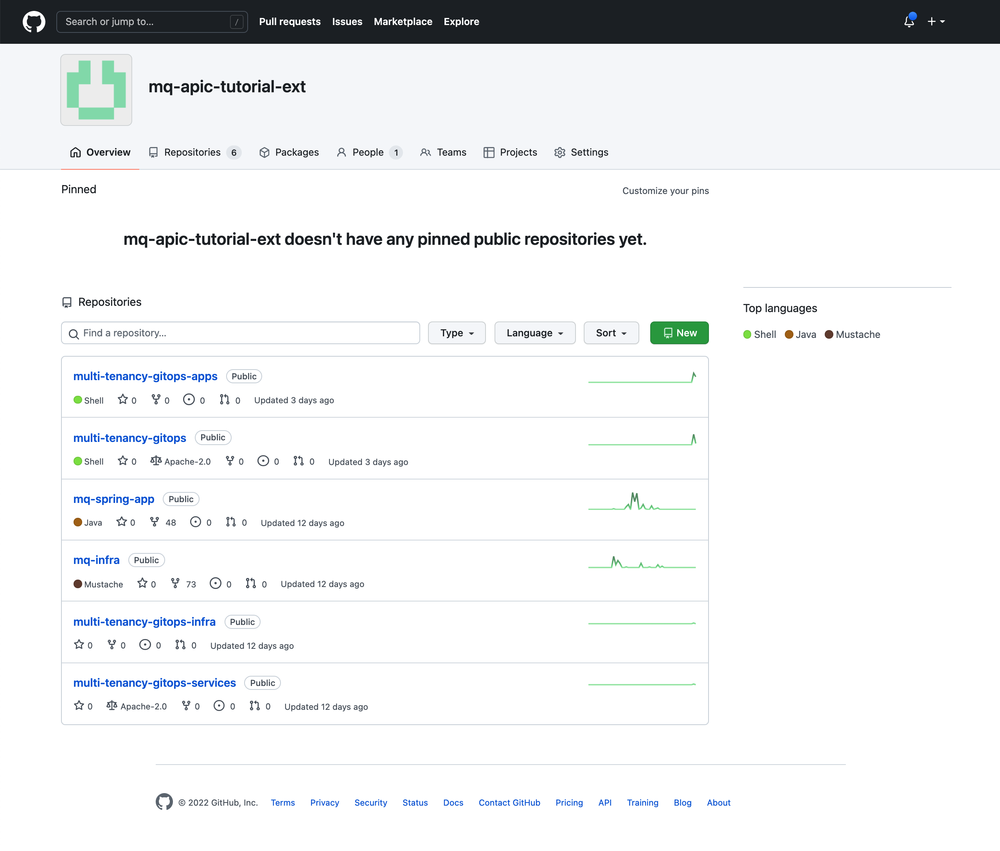{: style="max-height:1000px"}

Click on the green `New` button on top of your repository list to create your new GitHub repository that will store your API and Product definitions. Provide `api-product-definitions` for the name of the GitHub repository and a meaningful description for it if you want. Make sure you have selected **Private** (in this case, you are going to make this repository private so that your promotion pipeline requires a GitHub token in order to access your API and Product definitions for security).

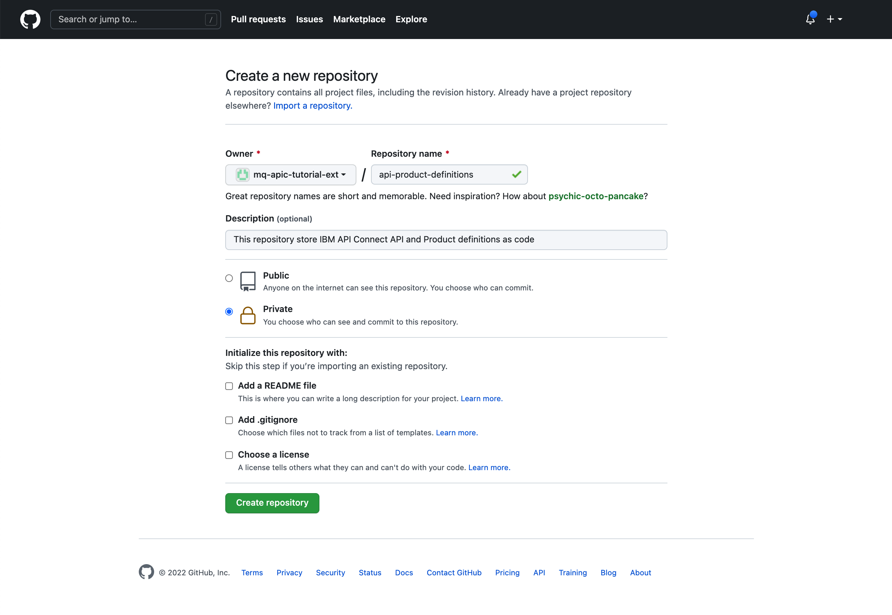{: style="max-height:800px"}

Click `Create repository`.

Clone your newly created GitHub repository to your local workstation and change directory into it (bear in mind we are using `api-product-definitions` as the name for the GitHub repository). On your terminal, execute:

``` bash
cd $HOME/git
git clone https://github.com/${GIT_ORG}/api-product-definitions
cd api-product-definitions
```

Create a folder for your `APIs` and another for your `Products`.

```bash
mkdir APIs
mkdir Products
```

!!! info
    This tutorial assumes the strategy whereby your API and Product code definitions are stored in a separate and private GitHub repository and both API and Product definitions will have their own folder in such GitHub repository. Having things as much separated as possible was believed to be the best strategy for students understanding the core concepts of an API promotion pipeline. As a result, such API promotion pipeline and has been built accordingly to the strategy explained in this chapter. However, it does not imply by any means it is the best strategy clients could implement and should align with. We believe it is one of the clearest strategies but each client can decide where to store their API and Product code definitions according to their needs and preferences building their API promotion pipeline based on their strategy. For example, there might be clients that prefer these definitions to be stored along with the application code and that is perfectly fine if that works for them. Another example could be to separate `dev`, `test`, `staging`, `prod`, etc API and Product definitions in separate GitHub repositories, or branches or folders...

### API and Product Code Definitions

Back in your IBM API Connect API Manager, you have only one Product (`MQ Spring App`) that contains one API (`mq-spring-app`). In the [Publish APIs](./publish-apis.md) chapter you went through how to develop/create an API and publish it into a Product from the IBM API Connect API Manager UI. Throughout that process, you realized that IBM API Connect API Manager provided you with a graphical interface as well as a code interface for developing your APIs and Products. Back at that time you were also advised to remember the `code` interface as that will be used during the API promotion pipeline.

Let's see how can you retrieve that code definition of your APIs and Products, once you have tested these and are comfortable that these are ready to get promoted to production, to check these into your GitHub repository that the API Publish pipeline will use to promote them into your production environment (in this case, into your `prod` catalog).

!!! warning "Important"
    Once again, you are skipping the promotion of APIs and Products through intermediate phases and their respective environments, such as test, staging, etc, and promoting these straight into production for simplicity but by any means this is a recommended practice for clients.

Go back to the `Develop` section of your IBM API Connect API Manager. For that, click on the pencil icon on the left hand side menu bar. You should see your `mq-spring-app` API.

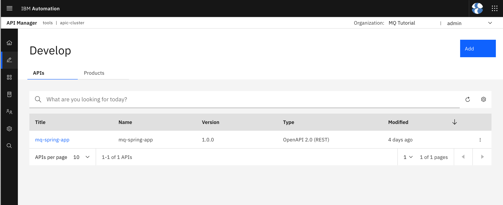{: style="max-height:500px"}

Click on your `mq-spring-app` API. The graphical view for your API should display. Click on the `Source` icon to switch to the source code view.

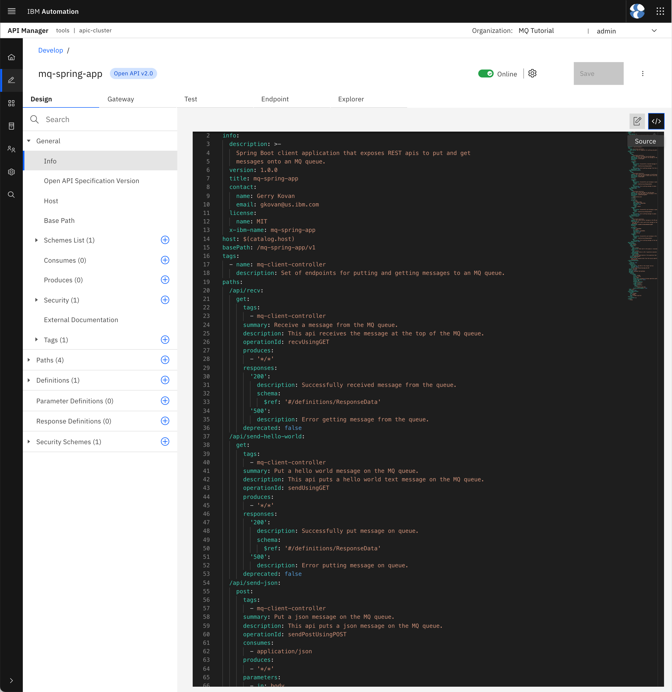{: style="max-height:1300px"}

Copy the source code definition of your API into a local file called `mq-spring-app_1.0.0.yaml` where `mq-spring-app` is the title of the API and `1.0.0` its version (this naming pattern will take special relevance during the pipeline execution as the scripts this pipeline executes expects the API definitions files to have that naming convention). Store such file in the `APIs` folder within your local `api-product-definitions` GitHub repository clone.

Go back to the `Develop` section of your IBM API Connect API Manager and click on the `Products` tab this time. You should see your `MQ Spring App` product.

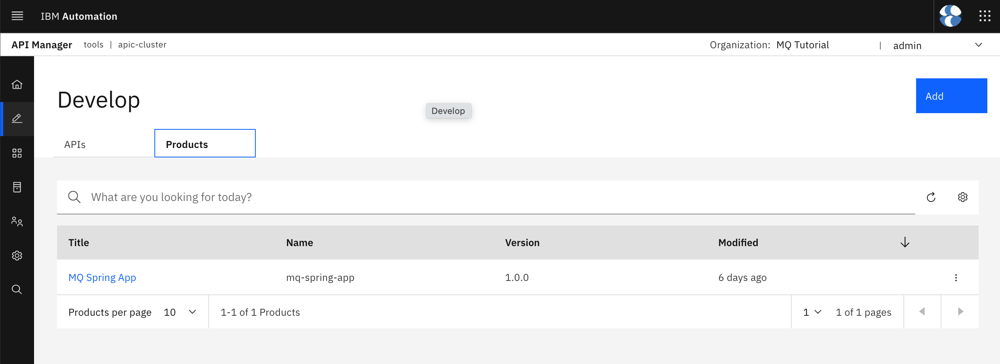{: style="max-height:450px"}

Click on the product to open its definition in the graphical view. Click on the `Source` tab to display the product code definition.

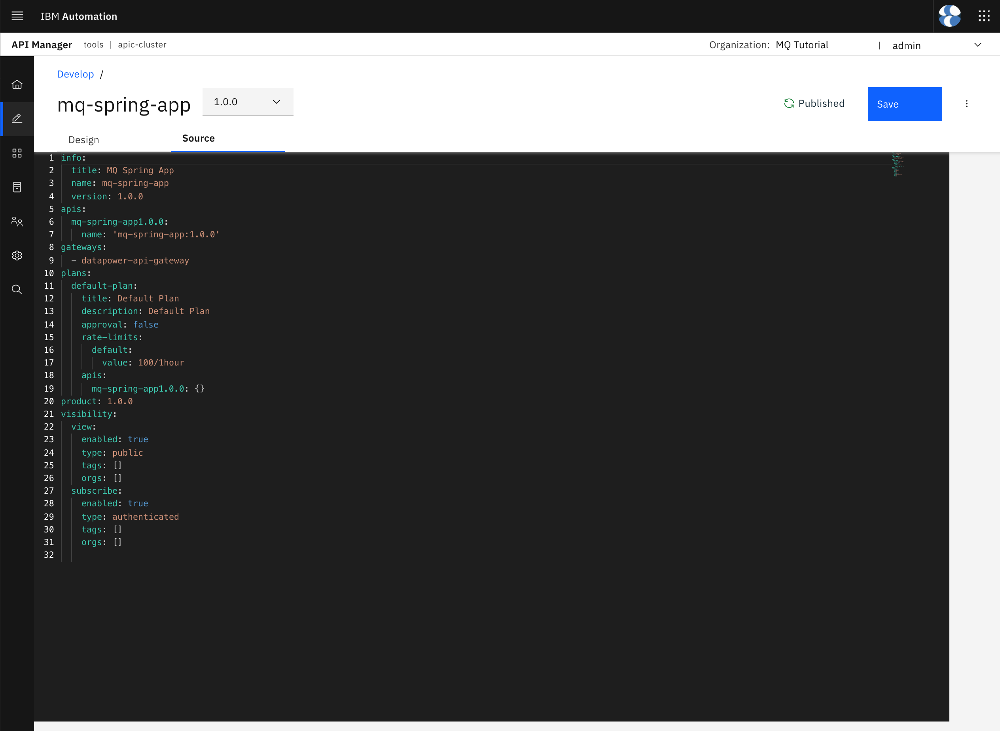{: style="max-height:900px"}

Copy the source code definition of your product into a local file called `mq-spring-app_1.0.0.yaml` where `mq-spring-app` is the title of the Product and `1.0.0` its version (this naming pattern will take special relevance during the pipeline execution as the scripts this pipeline executes expects the API definitions files to have that naming convention). Store such file in the `Products` folder within your local `api-product-definitions` GitHub repository clone.

If you execute `tree .` you should see the following structure for your `api-product-definitions`GitHub repository:

``` { .text .no-copy }
.
├── APIs
│   └── mq-spring-app_1.0.0.yaml
└── Products
    └── mq-spring-app_1.0.0.yaml

2 directories, 2 files
```

### Parametrize Environment

One may think that your API and Product code definitions are ready to be committed and delivered to GitHub. However, if you take a closer look at your API code definition, you should realize of the following value for the `target-url` property:

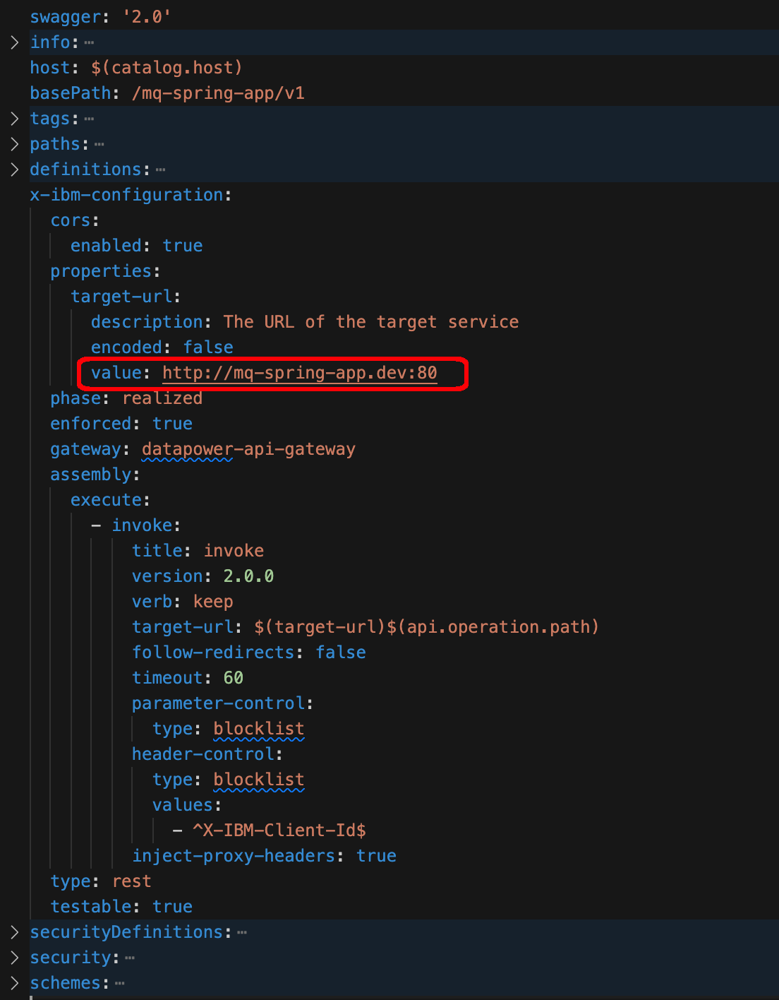{: style="max-height:800px"}

which ties your API definition to your development environment because despite this API definition being promoted and therefore published to the `prod` catalog, it would still direct the requests to the Spring MQ Application in the development environment (which is the `dev` RedHat OpenShift Project in this specific scenario of this tutorial). Because the environment separation and segregation for this tutorial has been done at the RedHat OpenShift Project level, due to the resource limitations for this tutorial already explained, the RedHat OpenShift Project for the `target-url` property value of the API needs to be parametrized. If you had completely separate environments for `dev`, `staging`, `prod`, etc you could always configure the deployment of your Spring MQ Application to the same RedHat OpenShift Project so that you would not need to parametrize it in your API definition.

Also, because of those resource limitations for this tutorials too you did not have the chance to separate or segregate your API management strategy by having separate and segregated IBM API Connect API Cloud instances. As a result, you decided to separate and segregate at the catalog level. As a result, the parametrization of the RedHat OpenShift Project value for the `target-url` property that will direct the requests to the appropriate Spring MQ Application instance, will need to be done at the catalog level. That is, depending on which catalog the API is published to, the RedHat OpenShift Project value for the `target-url` property will change.

Let's have a look at how to do such parametrization. First, open up your `mq-spring-app_1.0.0.yaml` **API definition** file within your `api-product-definitions` local GitHub repository clone and change the value of the `target-ul` property in line `129` from

``` {.yaml .no-copy }
value: http://mq-spring-app.dev:80
```

to

``` yaml
value: http://mq-spring-app.$(environment-name):80
```

where `$(environment-name)` will be a catalog property you will need to set when creating a catalog so that it gets the appropriate RedHat OpenShift Project where requests to your Spring MQ Application will need to be redirected to when poking the `mq-spring-app` API on the catalog. Save the file.

Now, go back to your IBM API Connect API Manager home dashboard by clicking on the home icon that appears on top of the left hand side menu. Then, click on `Manage catalogs` and click on the `prod` catalog. Once your `prod` catalog opens up, click on the `Catalog settings` tab at the top and then on the `Catalog properties` section on the left hand side menu. You would see that there is not catalog property defined yet.

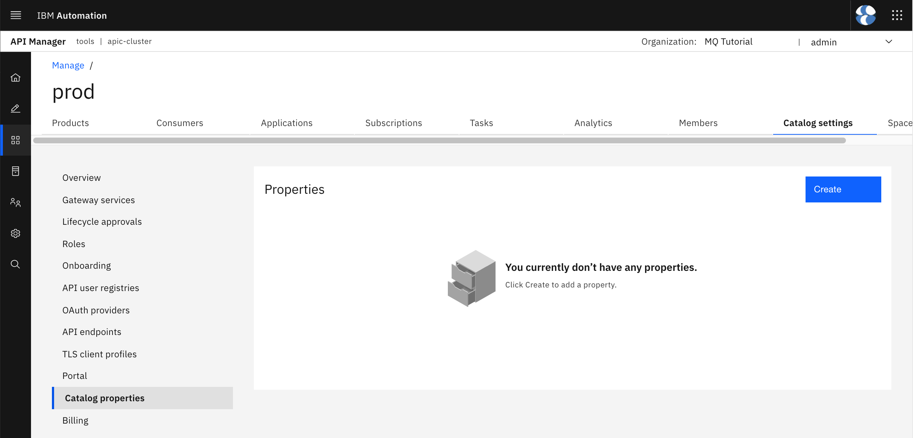{: style="max-height:600px"}

Click on the `Create` blue button on the top right corner. On the form, set the name of the catalog property to `environment-name` so that it matches with the variable you have defined above in the API code definition and set the value to `prod` so that it resolves to the `prod` RedHat OpenShift Project at runtime.

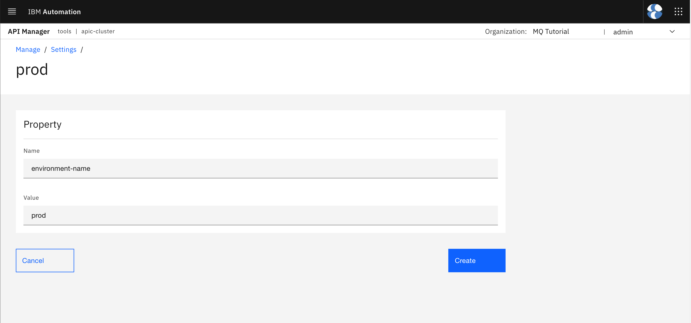{: style="max-height:600px"}

Click on `Create`. You should now see your newly `environment-name` catalog property and its default value listed.

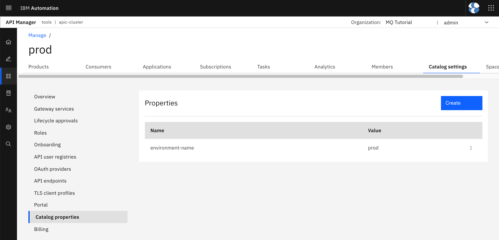{: style="max-height:600px"}

!!! info
    Create the same `environment-name` property for the `dev` catalog.

You could right now publish the API definition to the `prod` catalog and the `$(environment-name)` catalog property in the `target-url` API property should resolve correctly.

### Commit and Deliver

You should now be ready to commit and deliver your API and Product code definitions to your `api-product-definitions` GitHub remote repository so that the API promotion pipeline can take over. On your terminal, execute:

```
git add .
git commit -s -m "mq-spring-app API and Product code definitions"
git push origin master
```

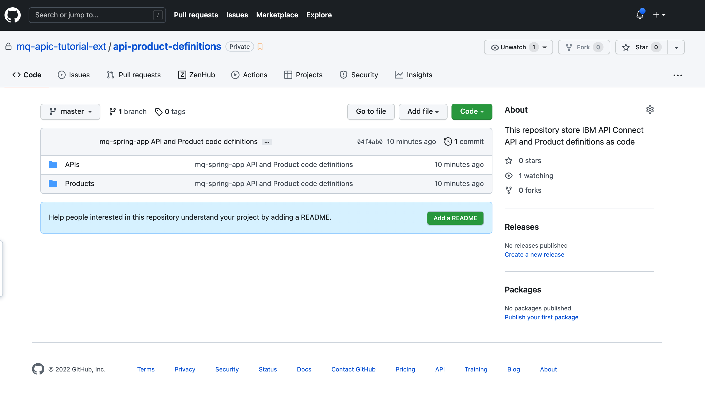{: style="max-height:700px"}

!!! info
    Again, because of the simplicity of the API promotion pipeline of this tutorial where you are promoting APIs and Products straight from development to production the strategy followed as to how and where to store those API and Product code definitions allows you to simply work with the `master` branch of your APIs and Product definitions GitHub repository. As already said, this does not need to be the strategy for all clients and each of them can accommodate to what works best for them for separating and segregating these APIs and Product code definitions for their different phases and respective environments.

## Publish APIs and Products Pipeline

So far you have:

1. Created the  `prod` catalog.
2. Created the `$(environment-name)` catalog property and set the appropriate value for it.
3. Extracted your `mq-spring-app` API and `MQ Spring APP` Product code definitions.
4. Committed and delivered those API and Product code definitions to your `api-product-definitions` private GitHub repository.

You are then all set to execute the `Publish APIs and Products Pipeline` which is a **Tekton pipeline** created as part of the in-depth [API Connect tutorial](../../apic/publish/ibm-cloud.md) that will allow you to publish APIs and Products that are defined as code in a private GitHub repository into a specific catalog of a specific Provider Organization within a specific IBM API Connect API Manager.

!!! info
    Do not confuse the `Publish APIs and Products Pipeline` technical piece with the term 'Promotion API pipeline' used throughout this IBM API Connect extension section for the in-depth MQ tutorial as the set of actions, technical pieces, processes, etc that are required to promote your APIs through the different environments (`dev`, `test`, `staging`, `QA`, `prod`, etc ).

### Deploy the Pipeline

In order to deploy the `Publish APIs and Products Pipeline` **Tekton pipeline** created as part of the in-depth [API Connect tutorial](../../apic/publish/ibm-cloud.md), you need to follow the same GitOps approach you have been following in order to deploy or create any resource in your RedHat OpenShift cluster. That means that in order to create the aforementioned Tekton pipeline you have to it through your `multi-tenancy-gitops` repository that is driving the GitOps framework for your RedHat OpenShift cluster.

As a result, open up the `kustomization.yaml` file located under `multi-tenancy-gitops/0-bootstrap/single-cluster/3-apps` and uncomment the following line:

``` { .yaml .no-copy }
#- argocd/apic/single-cluster-cp4i.yaml
```

Save the file and commit and deliver your changes:

```bash
git add .
git commit -s -m "Deploying Publish API and Products Pipeline"
git push origin $GIT_BRANCH
```

!!! tip
    Make sure your are under the `multi-tenancy-gitops` folder within your terminal.

After few minutes, you check your ArgoCD dashboard and make sure two new ArgoCD applications have been successfully created.

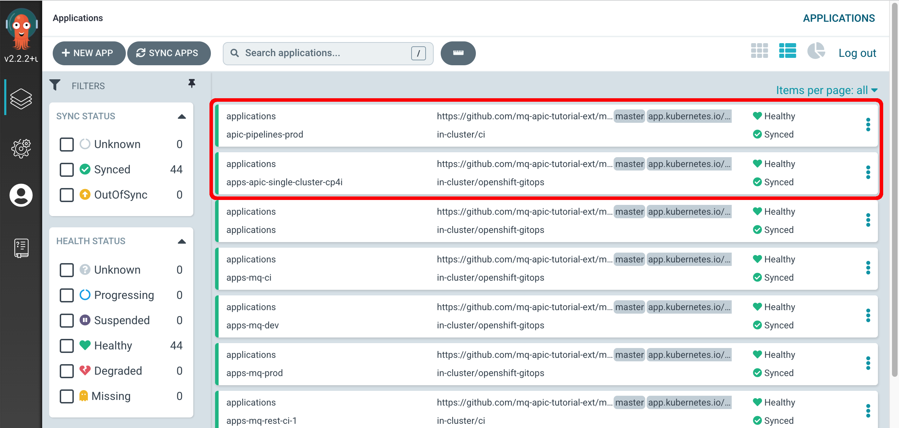{: style="max-height:600px"}

If you go to your RedHat OpenShift web console to the `Pipelines` section on the left hand side under the `ci` project, you should see one new pipeline called `apic-publish-products-apis-pipeline` which is the pipeline that will publish your API and Products based on their code definitions you have stored in GitHub.

{: style="max-height:900px"}

By now, you should also be able to navigate the `single-cluster-cp4i.yaml` along with the `kustomization.yaml` file you worked with above within the `multi-tenancy-gitops` repository to find out how the new pipeline was deployed and where this is defined. You should be able to find out this new pipeline reside within the `multi-tenancy-gitops-apps/apic/environments/single-cluster-cp4i` folder:

``` { .text .no-copy }
multi-tenancy-gitops-apps/apic/environments/single-cluster-cp4i
├── kustomization.yaml
├── pipelines
│   └── apic-publish-pipeline.yaml
├── roles
│   ├── role.yaml
│   └── rolebinding.yaml
├── secrets
└── tasks
    └── apic-publish-task.yaml
```

### Pipeline scripts

If you inspect the `apic-publish-pipeline.yaml` file located under `multi-tenancy-gitops-apps/apic/environments/single-cluster-cp4i/pipelines` that defines the Publish API and Products Tekton pipeline and review the params section for it you should notice that you already have all the information the pipeline parameters need except for one of them:

``` { .yaml .no-copy }
- name: git-apic-pipeline-git-url
  type: string
  default: 'https://github.com/<GIT_ORG>/apic-publish-pipeline.git'
  description: GitHub url where the pipeline scripts are stored. These are the python scripts the pipeline will execute
```

which as per the description is the GitHub repository where the scripts the pipeline will execute are located. So far, you have done or been told nothing about that GitHub repository. However, it is needed for the Publish APIs and Products pipeline to execute. Therefore, it must be part of the GitHub organization you created at the beginning of this in-depth MQ tutorial to contain all GitHub repos. Therefore, you need to make sure a fork of the repository containing the scripts that the Publish APIs and Products pipeline will execute is also in your GitHub organization.

The GitHub repository that contains the scripts that the Publish APIs and Products pipeline will execute is at <https://github.com/cloud-native-toolkit/apic-publish-pipeline>. Open up that GitHub repository on your browser and click on the `Use this template` green button on the top right corner to make a copy of it on your GitHub organization.

On the following form, make sure you select the appropriate GitHub organization (you might have several), you provide `apic-publish-pipeline` for the GitHub repository name, you make sure you select your GitHub repository to be **Private** and you select the **`Include all branches`** option to get all branches copied (you will use the branch called **`cp4i`** when executing the pipeline as you will see later on in the Execute the Pipeline](#execute-the-pipeline) section).

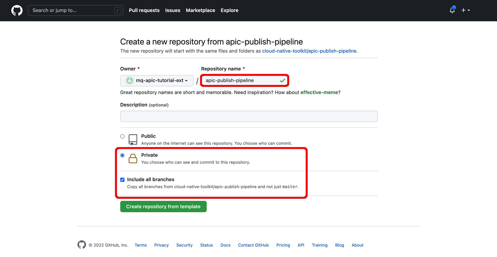{: style="max-height:650px"}

Once this GitHub repository has been copied over to your GitHub organization, this should contain all the following repositories.

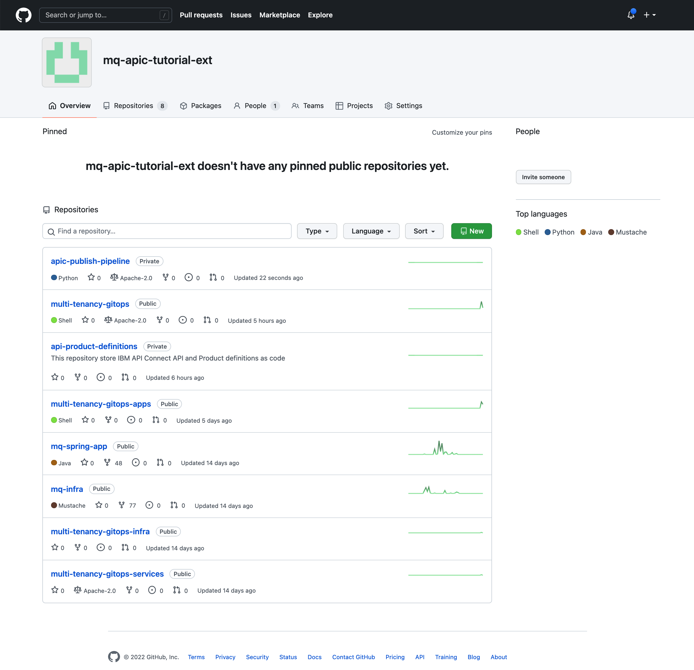{: style="max-height:1200px"}

The scripts contained in this `apic-publish-pipeline` GitHub repository under the `scripts` folder are python scripts that will use the [IBM API Connect platform REST APIs](https://apic-api.apiconnect.ibmcloud.com/v10/10.0.4.0.html#/documentation/introduction) to carry out the needed actions against your IBM API Connect Cluster instance.

!!! info 
    The platform REST APIs for IBM API Connect v10 provide complete access to the capability of the platform. They may be used to automate administration of the platform; for scripts and tools to support a continuous integration environment for API development and publishing; and for management of catalogs of APIs and their subscribers. The operations provided in the REST API also correspond directly with commands in the [Toolkit CLI](https://www.ibm.com/docs/en/api-connect/10.0.x?topic=information-toolkit-command-line-tool-reference).

Feel free to inspect the scripts within this GitHub repository for better understanding of the automation developed for the IBM API Connect Promotion Pipeline use case explained throughout this chapter.

!!! info
    The scripts the Publish APIs and Products pipeline executes are by no means a set of production ready assets. These scripts are just an educational example as to how you could work with your API and Product source code definitions and the IBM API Connect Platform REST APIs on a programmatic way. These are not intended to be used by clients and these would need to be enhanced and tailored to every client use case, standards, best practices and interests

### Provide Credentials

If you inspect again the `apic-publish-pipeline.yaml` file located under `multi-tenancy-gitops-apps/apic/environments/single-cluster-cp4i/pipelines` that defines the Tekton pipeline you should realize that such pipeline executes just one Tekton task. That Tekton task is called `apic-publish-products-apis` and it is defined in the `apic-publish-task.yaml` file under the `multi-tenancy-gitops-apps/apic/environments/single-cluster-cp4i/tasks` folder. If you take a close look at that Tekton task, you should be able to find the following lines of code:

``` { .yaml .no-copy }
envFrom:
  - secretRef:
      name: apic-pipeline-git
  - secretRef:
      name: apic-pipeline-provider-org
  - secretRef:
      name: apic-pipeline-toolkit
```

which means nothing but that the Tekton task expects to load three secrets from the RedHat OpenShift project it runs on (`ci`). That is, the Tekton task and therefore Tekton pipeline depend on those three secrets to successfully run. As a result, you need to create those secrets.

But, what are those secrets and what information do they hold?

* `apic-pipeline-git` secret will hold the GitHub personal access token credentials required for the Tekton pipeline to be able to access your `api-product-definitions` private GitHub repository where your API and Product definitions the pipeline will publish to a catalog in your IBM API Connect API Manager are.
* `apic-pipeline-provider-org` secret will hold your IBM API Connect Provider Organization details (such as admin user and credentials) so that the Tekton pipeline is allowed to interact with the [IBM API Connect API Manager management endpoints](https://apic-api.apiconnect.ibmcloud.com/v10/?_ga=2.233587928.752341463.1623867527-1939642083.1623276281#/documentation/introduction).
* `apic-pipeline-toolkit` secret will hold your IBM API Connect Toolkit default application credentials.

!!! info
    In order to use the IBM API Connect platform REST APIs or the Toolkit CLI, you first need to register a client application which will be requesting the actions on your behalf. Each client app that accesses the API Connect REST API must be registered with the API Connect cloud. The process of registering a client associates the application's client ID with a set of scopes that determine which operations the application may access.
    
    You can check what application registrations have been made within your IBM API Connect API Cloud using the following Toolkit CLI command: 
    
    ```
    apic registrations:list --server <API Connect management server endpoint>
    ```
    
    And the Toolkit is no exception. That is, the Toolkit CLI uses the IBM API Connect platform REST APIs underneath (you can check that out using the `--debug` flag). However, the Toolkit has been pre-configured so that an application for it is created out of the box. This application registration is called `toolkit-default` and you can check its details, such as its credentials and scope, with the following command: 
    
    ```
    apic registrations:get --server <API Connect management server endpoint> toolkit-default --format json --output -
    ```
    
    It should look like:
    
    ``` { .json .no-copy }
    {
    "type": "registration",
    "api_version": "2.0.0",
    "id": "11e166b4-84ac-49e8-8f43-8c973b31a8d2",
    "name": "toolkit-default",
    "title": "Toolkit Application Registration",
    "state": "enabled",
    "client_type": "toolkit",
    "client_id": "1e78b8a8-6011-4c4a-8365-c5747d0fa3ad",
    "client_secret": "********",
    "scopes": [
        "cloud:view",
        "cloud:manage",
        "provider-org:view",
        "provider-org:manage",
        "org:view",
        "org:manage",
        "product-drafts:view",
        "product-drafts:edit",
        "api-drafts:view",
        "api-drafts:edit",
        "child:view",
        "child:create",
        "child:manage",
        "product:view",
        "product:stage",
        "product:manage",
        "approval:view",
        "approval:manage",
        "api-analytics:view",
        "api-analytics:manage",
        "consumer-org:view",
        "consumer-org:manage",
        "app:view:all",
        "app:manage:all",
        "my:view",
        "my:manage",
        "webhook:view"
    ],
    "created_at": "2022-01-12T23:34:10.000Z",
    "updated_at": "2022-01-12T23:34:10.000Z",
    "url": "https://cpd-tools.xxxxx.eu-gb.containers.appdomain.cloud/integration/apis/tools/apic-cluster/api/cloud/registrations/11e166b4-84ac-49e8-8f43-8c973b31a8d2"
    }
    ```

    You will see how to retrieve your Toolkit credentials to create the secret `apic-pipeline-toolkit` above directly from your IBM API Connect API Manager dashboard.

To create these secrets, or sealed secrets to be more explicit:

#### apic-pipeline-git

As said above, this secret will hold the GitHub personal access token credentials required for the Tekton pipeline to be able to access your `api-product-definitions` private GitHub repository where your API and Product definitions the pipeline will publish to a catalog in your IBM API Connect API Manager are. The pipeline will use the GitHub personal access token to identify it as a valid user to GitHub. A Personal Access Token is used in place of a user password to authenticate with GitHub.

This token provides specific access to all repositories owned by a particular GitHub user or organization. When GitHub is accessed using this token, the only permitted operations are those defined by the specific token.

Navigate to your [GitHub Developer Settings](https://github.com/settings/tokens) to generate a new token.

Click on `Generate new token`. Provide a name for your GitHub personal access token and make the following selections:

* Select `repo` to allow the pipeline access to private repository to enable git clone.
* Select `admin:repo_hook` so the pipeline can create a web hook

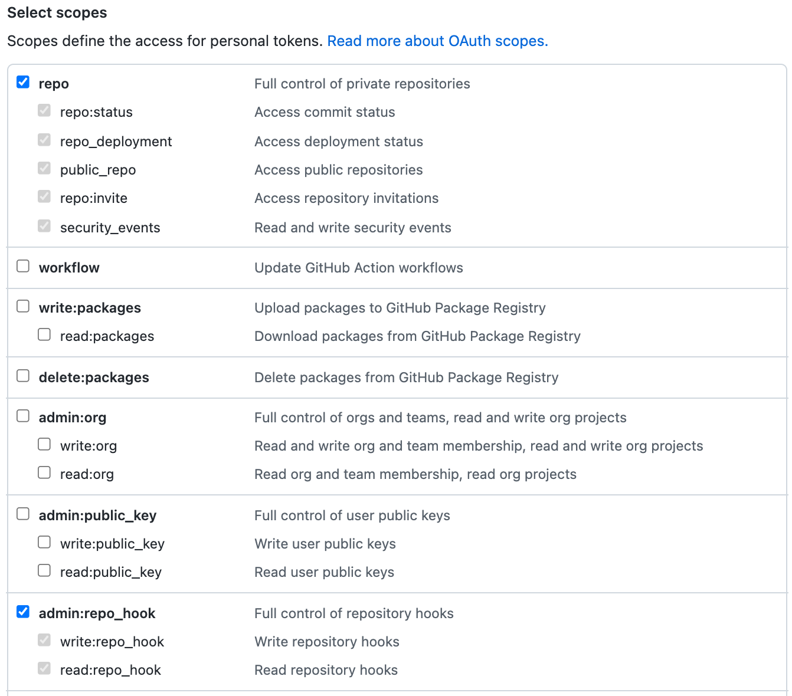{: style="max-height:800px"}

After you click `Generate token` to create the personal access token with these permissions, the GitHub UI will let you see the generated token once, but never again.

**Therefore, save the token somewhere safe -- so that you can use it later if required.**

Now, you are able to create the `apic-pipeline-git` containing your GitHub credentials (or personal access token to be more precise). On your terminal, go to `multi-tenancy-gitops-apps/apic/environments/single-cluster-cp4i/secrets` and execute the following command to create the `apic-pipeline-git` sealed secret:

```bash
oc create secret generic apic-pipeline-git \
--from-literal=GIT_USERNAME=***** \
--from-literal=GIT_PRIV_TOKEN=***** \
--dry-run=true -o yaml > delete-apic-pipeline-git.yaml \
&& \
kubeseal -n ci --controller-name=sealed-secrets --controller-namespace=sealed-secrets -o yaml < delete-apic-pipeline-git.yaml > apic-pipeline-git.yaml \
&& \
rm delete-apic-pipeline-git.yaml
```

where

* `GIT_USERNAME` is your GitHub username
* `GIT_PRIV_TOKEN` is the personal access token you have just created.

#### apic-pipeline-provider-org

This secret will hold your IBM API Connect Provider Organization details (such as admin user and credentials) so that the Tekton pipeline is allowed to interact with the [IBM API Connect API Manager management endpoints](https://apic-api.apiconnect.ibmcloud.com/v10/?_ga=2.233587928.752341463.1623867527-1939642083.1623276281#/documentation/introduction).

On your terminal, go to `multi-tenancy-gitops-apps/apic/environments/single-cluster-cp4i/secrets` and execute the following command to create the `apic-pipeline-provider-org` sealed secret:
   
```bash
oc create secret generic apic-pipeline-provider-org \
--from-literal=PROV_ORG_OWNER_USERNAME=po-admin \
--from-literal=PROV_ORG_OWNER_PASSWORD=***** \
--from-literal=PROV_ORG_NAME=mq-tutorial \
--from-literal=PROV_ORG_CATALOG_NAME=prod \
--from-literal=PROV_ORG_REALM=provider/default-idp-2 \
--dry-run=true -o yaml > delete-apic-pipeline-provider-org.yaml \
&& \
kubeseal -n ci --controller-name=sealed-secrets --controller-namespace=sealed-secrets -o yaml < delete-apic-pipeline-provider-org.yaml > apic-pipeline-provider-org.yaml \
&& \
rm delete-apic-pipeline-provider-org.yaml
```

where

* `PROV_ORG_OWNER_USERNAME` is your Provider Organization Owner username you set when creating your Provider Organization in the [Provider Organization](../configure-apic/#provider-organization) section in the Configure API Connect chapter. This is the Provider Organization Owner that was created in the API Manager User Registry that you use to log into the IBM API Connect API Manager. Set to `po-admin` by default.
* `PROV_ORG_OWNER_PASSWORD` is your Provider Organization Owner password you set when creating your Provider Organization in the [Provider Organization](../configure-apic/#provider-organization) section in the Configure API Connect chapter. This is the Provider Organization Owner that was created in the API Manager User Registry that you use to log into the IBM API Connect API Manager.
* `PROV_ORG_NAME` is the Provider Organization name. In this tutorial `mq-tutorial` was used for the name of the Provider Organization created.
* `PROV_ORG_CATALOG_NAME` is the catalog where the APIs and Products within your Provider Organization will be published to. In this tutorial, `prod` was used as the name for the catalog.
* `PROV_ORG_REALM` is the realm for the IBM Common Servicer User Registry which is `provider/default-idp-2`. You can find the realms of your IBM API Connect API Cloud with:

    ```bash
    apic identity-providers:list --scope provider --server <API Connect management server endpoint> --format yaml --output=-
    ```

#### apic-pipeline-toolkit

Last secret you need to create contains, as already explained, your IBM API Connect Toolkit default application credentials. In order for you to figure out or retrieve those credentials go to either your IBM API Connect Cloud Manager or IBM API Connect API Manager dashboard and click on the `Download toolkit` option.

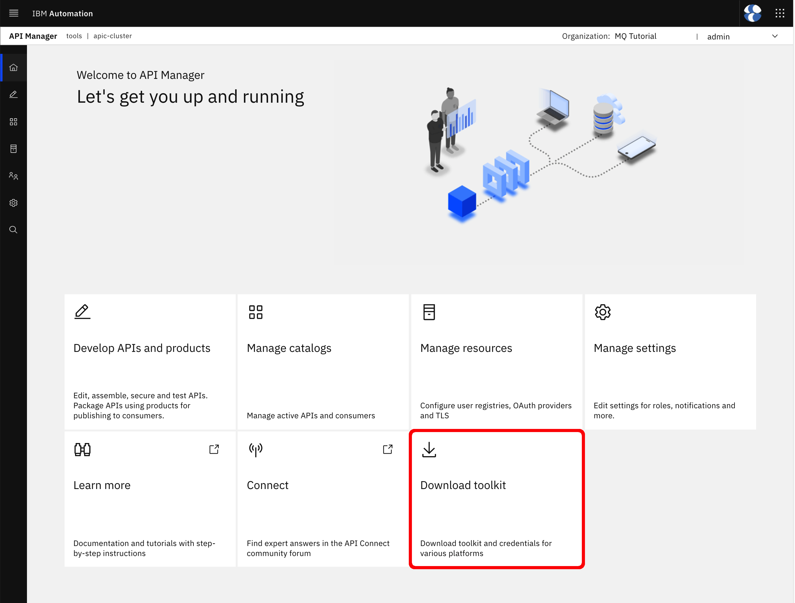{: style="max-height:900px"}

A hovering window will pop up. Click on `Download` next to `Toolkit credentials`

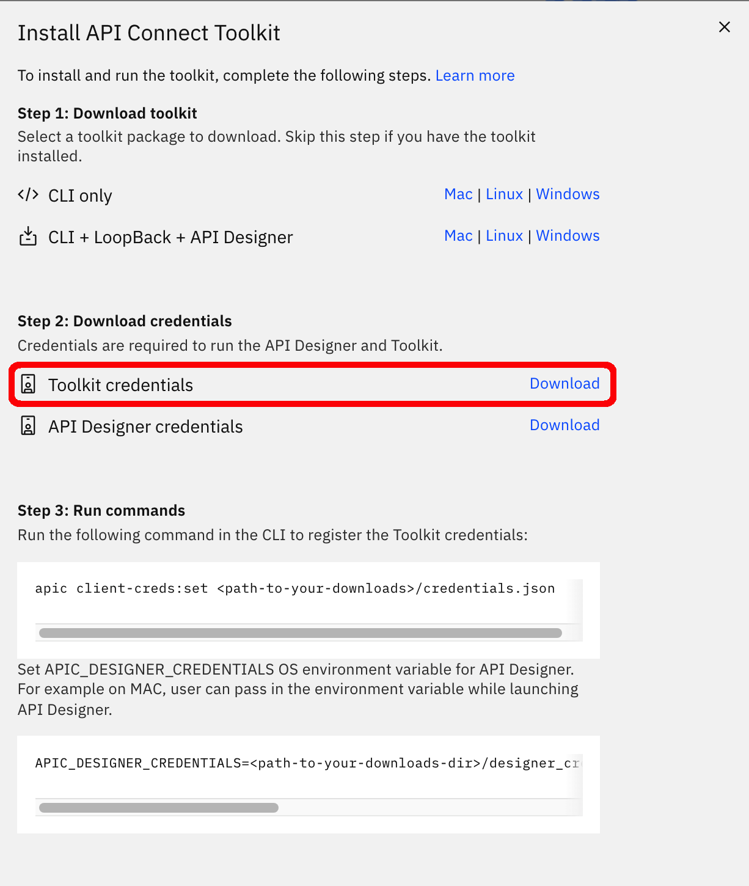{: style="max-height:800px"}

It will download a `credentials.json` file that will contain your IBM API Connect Toolkit credentials. Make sure your **DO NOT** store that file within the `multi-tenancy-gitops-apps` folder so that you **DO NOT** commit that file to GitHub at all.

If you inspect that file, it should look like the following

``` { .json .no-copy }
{
  "cloud_id": "6d5946f6-1277-45e9-8e2d-f046ce309faf",
  "toolkit": {
    "endpoint": "https://cpd-tools.xxxxx.eu-gb.containers.appdomain.cloud/integration/apis/tools/apic-cluster/api",
    "client_id": "1e78b8a8-6011-4c4a-8365-c5747d0fa3ad",
    "client_secret": "63af274c-d9a1-4471-8213-ce4b66cb130b"
  },
  "consumer_toolkit": {
    "endpoint": "https://cpd-tools.xxxxx.eu-gb.containers.appdomain.cloud/integration/apis/tools/apic-cluster/consumer-api",
    "client_id": "88e77352-948d-4996-be95-d6aec03abf80",
    "client_secret": "304a5845-fede-4f3b-8d05-1e9e1e7abe5f"
  }
}
```

**IMPORTANT:** The credentials you are interested in are `client_id` and `client_secret` for the `toolkit` and **NOT** the `consumer_toolkit`.

To create the `apic-pipeline-toolkit` secret, go to `multi-tenancy-gitops-apps/apic/environments/single-cluster-cp4i/secrets` on your terminal and execute the following command:

```bash
oc create secret generic apic-pipeline-toolkit \
--from-literal=TOOLKIT_CLIENT_ID=***** \
--from-literal=TOOLKIT_CLIENT_SECRET=***** \
--dry-run=true -o yaml > delete-apic-pipeline-toolkit.yaml \
&& \
kubeseal -n ci --controller-name=sealed-secrets --controller-namespace=sealed-secrets -o yaml < delete-apic-pipeline-toolkit.yaml > apic-pipeline-toolkit.yaml \
&& \
rm delete-apic-pipeline-toolkit.yaml
```

where

* `TOOLKIT_CLIENT_ID` is your Toolkit `client_id` value from the above `credentials.json` file.
* `TOOLKIT_CLIENT_SECRET` is your Toolkit `client_secret` value from the above `credentials.json` file.

Now that you have all the three sealed secrets that the Publish API and Products pipeline expects to successfully run locally under your `multi-tenancy-gitops-apps` repository, it is time for you to tell your GitOps processes to deploy these on your cluster. For that, open the `kustomization.yaml` file in `multi-tenancy-gitops-apps/apic/environments/single-cluster-cp4i` and make sure the three secrets are uncommented:

``` { .yaml .no-copy }
# Secrets required for IBM API Connect Pipelines
- secrets/apic-pipeline-git.yaml
- secrets/apic-pipeline-provider-org.yaml
- secrets/apic-pipeline-toolkit.yaml
```

Then, commit and deliver these changes to GitHub:

```bash
git add --all
git commit -s -m "Deploying secrets for Publish API and Products Pipeline"
git push origin $GIT_BRANCH
```

Once you do that, you can go to your ArgoCD dashboard and click on the `apic-pipelines-prod` ArgoCD application to inspect whether those three secrets have been created or not:

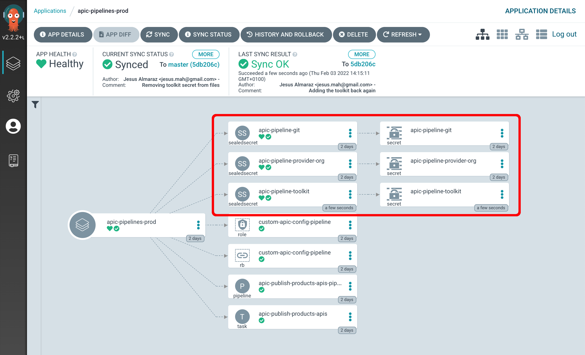{: style="max-height:750px"}

### Execute the Pipeline

So far you have successfully deployed the Publish API and Products pipeline, review its definition and scripts as well as created three secrets that will hold important information for the pipeline to successfully publish the APIs and Products you desire into the appropriate catalog. Therefore, you are now ready to execute the pipeline.

Go to `Pipelines --> Pipelines` on your RedHat OpenShift cluster dashboard. You should see the `apic-publish-products-apis-pipeline` pipeline.

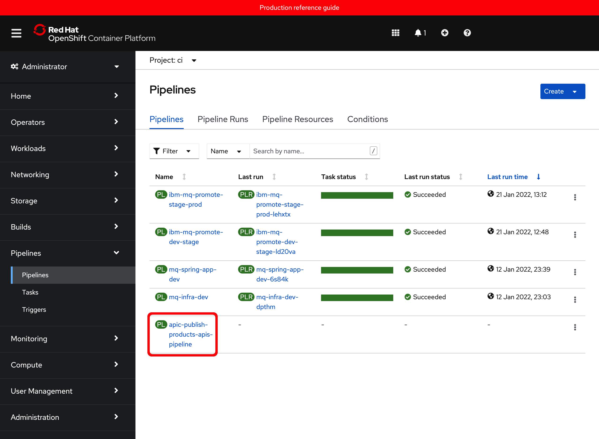{: style="max-height:900px"}

Click on it to inspect the pipeline. You should be able to see it only contains one task as already figured out earlier when looking that its source code. Also, if you hover over that task you should be able to see all the steps the task will execute.

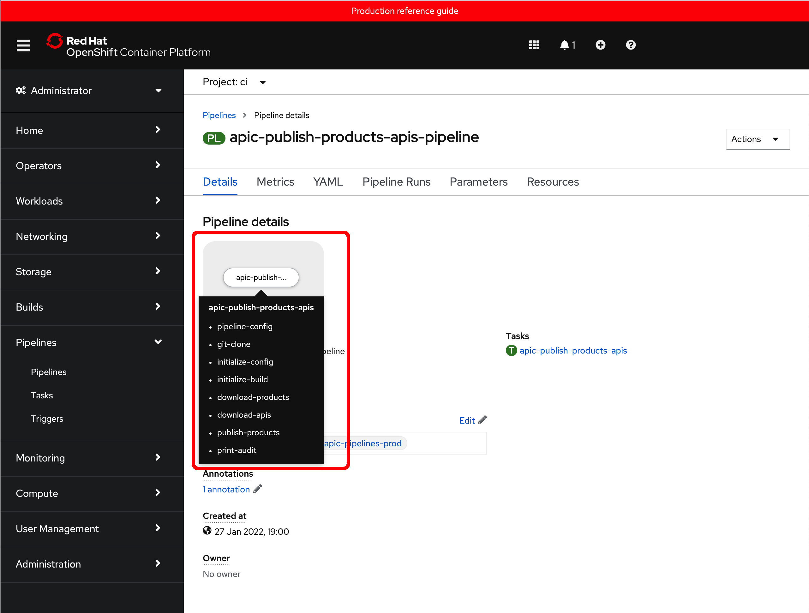{: style="max-height:900px"}

Now, click on the `Actions` button on the top right corner and click on `Start`. You will get presented with the `Start Pipeline` form you have already seen in other pipelines for this MQ tutorial where you are allowed to provide the desired values for the pipeline parameters (and, of course, these correspond and match the parameters you saw earlier in the pipeline's source code when inspecting it).

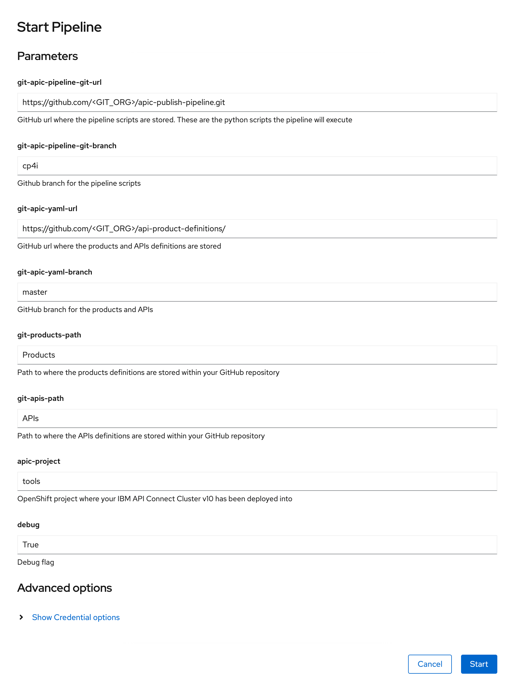{: style="max-height:1200px"}

where 

* `git-apic-pipeline-git-url` is the GitHub repository where the pipeline scripts are stored. These are the python scripts the pipeline will execute. You should have copied that GitHub repository into your GitHub organization earlier in this chapter. If you followed the naming recommendation you would only **need to replace `<GIT_ORG>` with the name of your GitHub organization** (that you should be able to retrieve by executing `echo $GIT_ORG` on your terminal). Pay attention the value of the GitHub repository that must end in `.git` since it will be cloned by the pipeline scripts.
* `git-apic-pipeline-git-branch` is the Github branch for the pipeline scripts. This **must** be **cp4i**. 
* `git-apic-yaml-url` is the GitHub url where the products and APIs definitions are stored. You should have created this GitHub repository and delivered your API and Product definitions into it earlier in this chapter. If you followed the naming recommendation you would only need to replace `<GIT_ORG>` with the name of your GitHub organization (that you should be able to retrieve by executing `echo $GIT_ORG` on your terminal). Pay attention the value of the GitHub repository url that on the contrary to the first parameter of the pipeline it must not end in `.git` since it will not be cloned by the pipeline scripts, it will be simply used to access its files through its url.
* `git-apic-yaml-branch` is the GitHub branch for the products and APIs. This **must** be **master**.
* `git-products-path` is the path to where the products definitions are stored within your GitHub `git-apic-yaml-url` repository. If you followed the recommendations in this chapter this will be `Products`.
* `git-apis-path` is the path to where the API definitions are stored within your GitHub `git-apic-yaml-url` repository. If you followed the recommendations in this chapter this will be `APIs`.
* `apic-project` is the RedHat OpenShift project where your IBM API Connect Cluster v10 has been deployed into. If you followed the recommendations in this tutorial this should be `tools`.

!!! warning "Important"
    Remember that if you followed the instructions and recommendations from all previous chapters in this tutorial, you would only need to replace `GIT_ORG` with your GitHub organization name that you can find out executing `echo $GIT_ORG` on your terminal.

Once you have replaced the `<GIT_ORG>` placeholder, click on `Start`.

You will get into the Pipeline Run for the pipeline you have just kicked off where you would see the different tasks and steps getting executed.

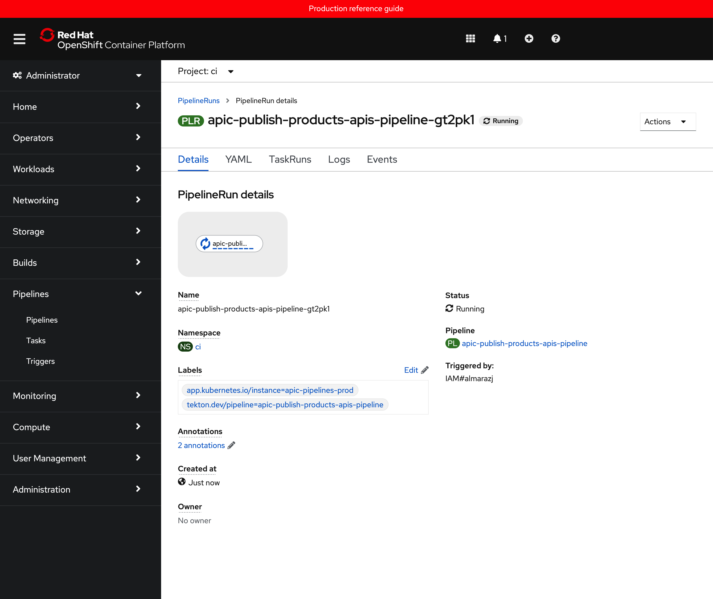{: style="max-height:1000px"}

You can click on the `Logs` tab to follow along the execution of the different scripts the pipeline has been developed to execute. After a couple of minutes, you should see that the pipeline has successfully finished and that your `mq-spring-app_1.0.0` API and Product have been successfully published.

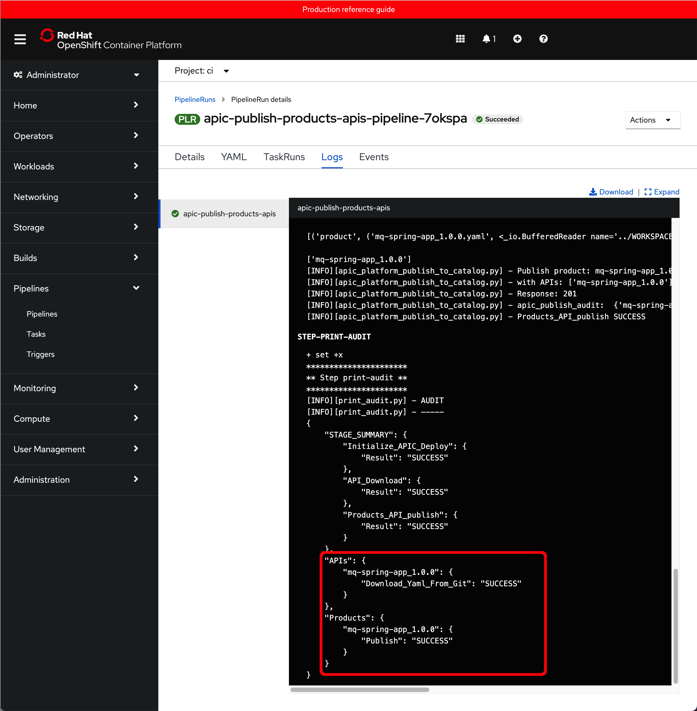{: style="max-height:1200px"}

## Consume Production APIs

In the previous section you saw how to deploy, configure and execute the Publish APIs and Products pipeline. You successfully executed the pipeline whose logs suggested that your `mq-spring-app_1.0.0` API and Product got successfully published to the production environment, which in your case is the `prod` catalog as already explained.

Now, let's see if the above is correct and you got your API and Product into your `prod` catalog.

First, if you go back to your IBM API Connect API Manager and go into your `prod` catalog you should now see the MQ Spring App product being part of your catalog.

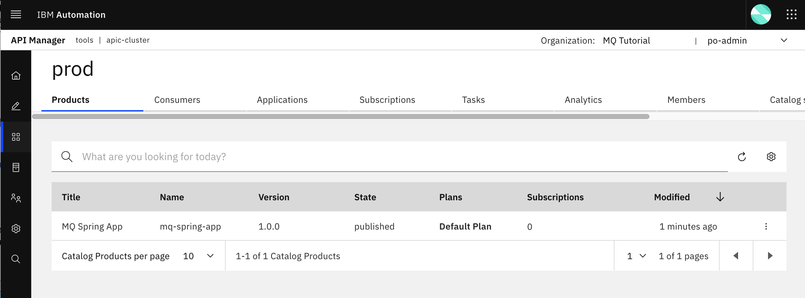{: style="max-height:450px"}

Of course, that product should not have any subscription yet.

If you click on the dots icon on the right hand side of the product, a menu with different options for your product will drop down. Click on `Manage APIs`. You should now see that the `mq-spring-app` version `1.0.0` is part of your product.

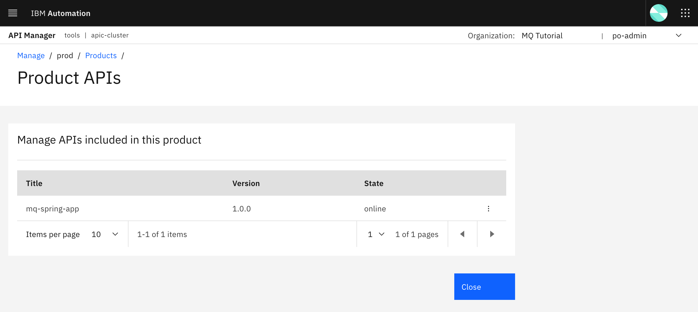{: style="max-height:550px"}

So far, it seems like the Products and APIs you have defined as code in your GitHub repository have made it to your `prod` catalog as expected thanks to the Publish APIs and Products pipeline.

However, you still need to make sure that the product and API do in fact work and you can reach the Spring MQ Application that is in production as expected. For that, follow the steps below where some of which are actions you have already done before when going through this tutorial that you are now expected to know how to complete on your own. Feel free to review any of the previous chapters and sections if you don't remember how to exactly do some of the steps below.

1. Create an IBM Developer Portal for your `prod` catalog.

    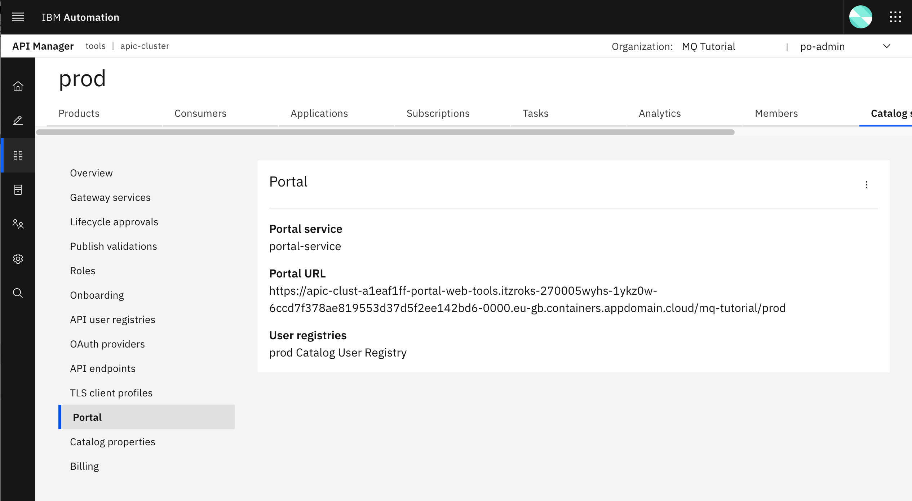{: style="max-height:650px"}

2. Complete the admin registration for that IBM Developer Portal and tailor it to display a more specific title as to what catalog it belongs to or represents.

    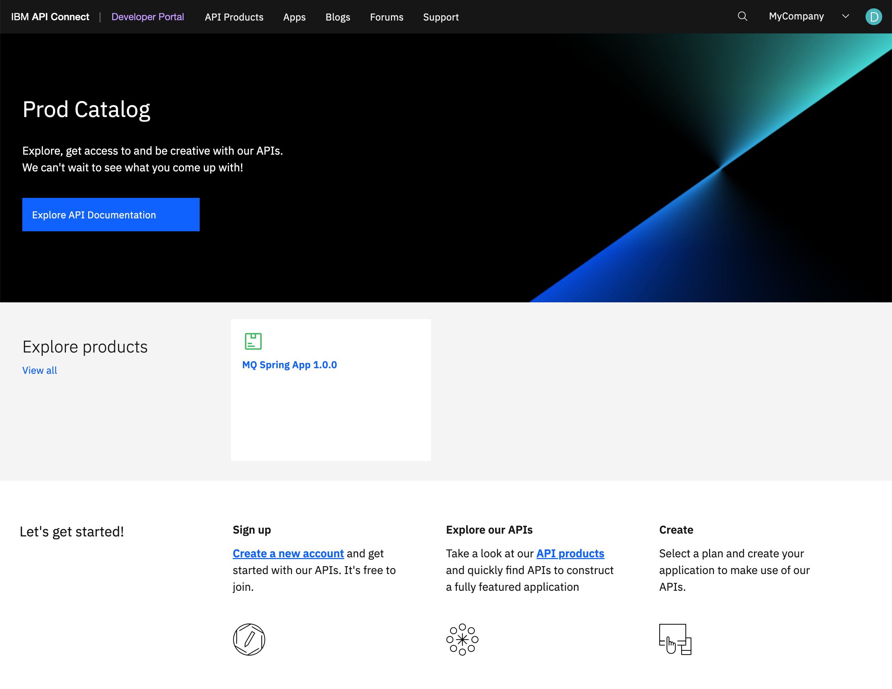{: style="max-height:900px"}

3. Create an Application Developer account for your `Prod` IBM Developer Portal so that you can use it to create an application and consume your newly promoted Product and APIs to production.
4. Make sure the `mq-spring-app` version `1.0.0` Product and API do show in the production IBM Developer Portal.

    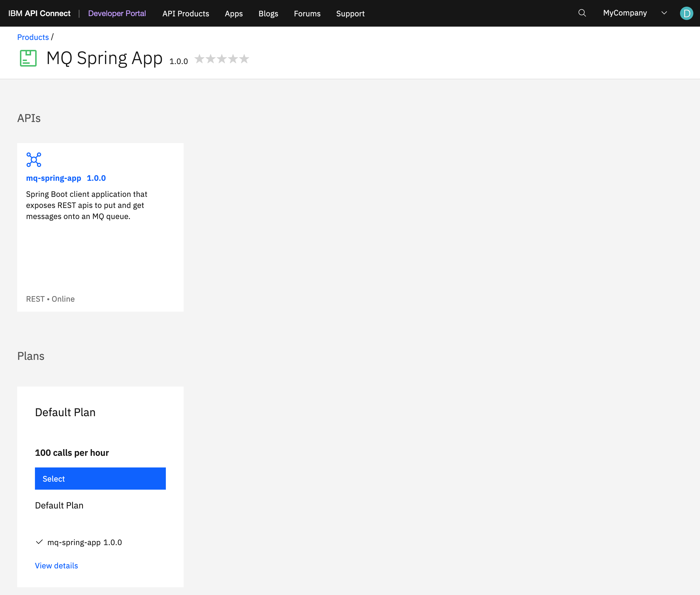{: style="max-height:1000px"}

5. Create an application that subscribes to the `MQ Spring App` product above so that you can consume its APIs.

    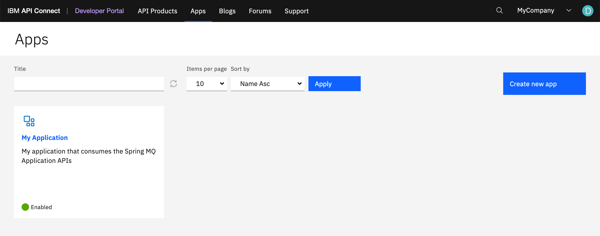{: style="max-height:450px"}

6. Make sure you subscribe to the `MQ Spring App` product.

    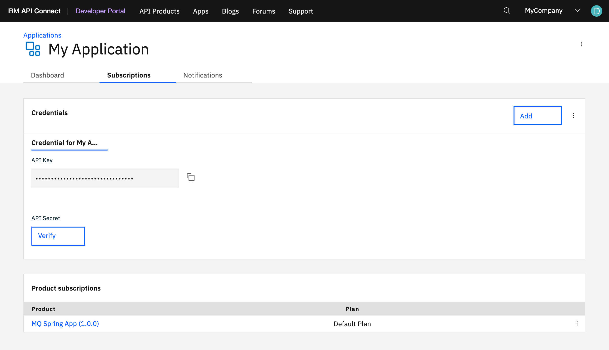{: style="max-height:700px"}

7. Go to the `MQ Spring App` product APIs and make sure you can try/test them. Use the any of the APIs that is meant to send a message to your IBM Queue Manager that is deployed in production. In our case, we have used the `POST /api/send-json` to send a specific message.

    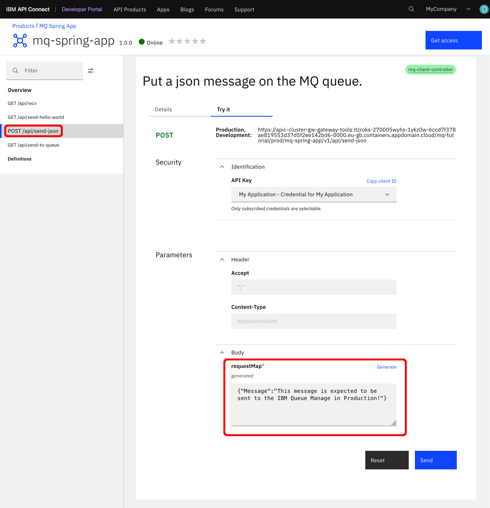{: style="max-height:1200px"}

8. You should see straight in your IBM Developer Portal that the response to the API call has been successful and that your message has apparently be sent correctly.

    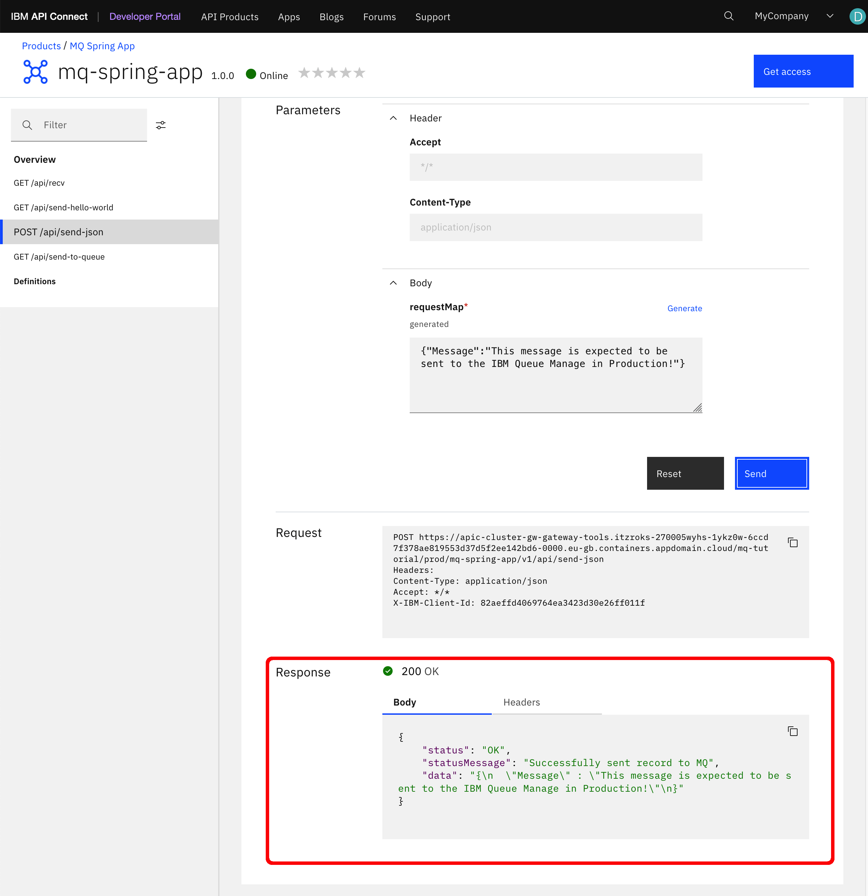{: style="max-height:1200px"}

9.  For a further check to make sure the message has been in fact sent to the IBM Queue Manager in production, let's check the actual production IBM Queue Manager.

    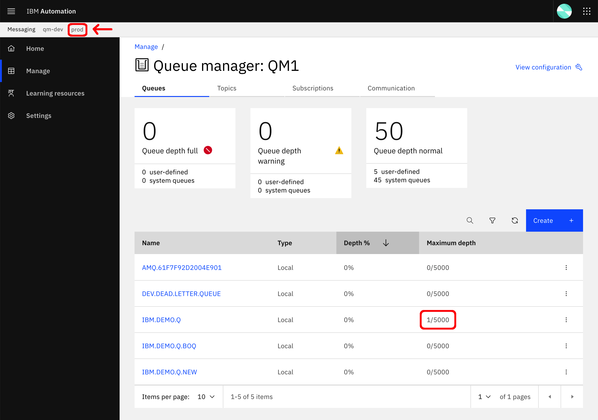{: style="max-height:800px"} 

10. Click on the hamburger icon on the right hand side of the `IBM.DEMO.Q` and select `View messages` to make sure the message has arrived as expected.

    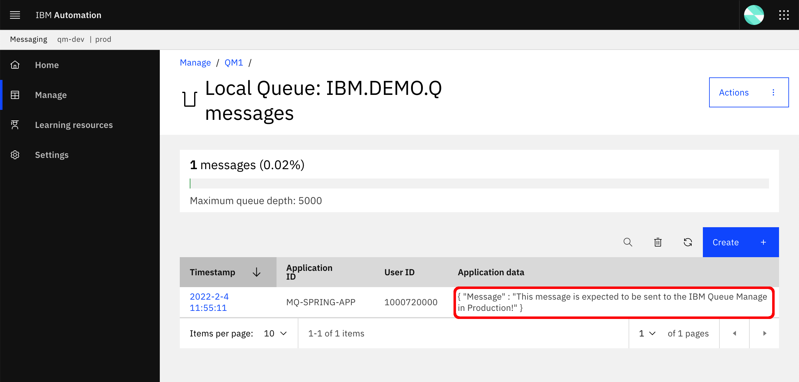{: style="max-height:550px"}

---

!!! success "Congratulations!"
    You have successfully completed this chapter where you went from extracting your API and Product definitions as code, store them in GitHub and then deploy and execute a Tekton Pipeline that would take those definitions and publish them in the production environment, hence completing the promotion process of your Products and APIs. Remember this promotion process explained in this chapter is for education purposes providing room to be improved based on client demands, requisites and standards. For example, you can use the knowledge acquired during this MQ tutorial on Event Listeners and Triggers to automate the execution of the promotion pipeline. Or implement a set of automated tests to be added to the promotion pipeline to make sure APIs and Products work as expected.

## Links

* [Variable references in API Connect](https://www.ibm.com/docs/en/api-connect/10.0.x?topic=definitions-variable-references-in-api-connect)
* [Defining Catalog specific property values](https://www.ibm.com/docs/en/api-connect/10.0.x?topic=properties-defining-catalog-specific-property-values)
* [IBM API Connect Platform REST APIs](https://apic-api.apiconnect.ibmcloud.com/v10/?_ga=2.233587928.752341463.1623867527-1939642083.1623276281#/documentation/introduction).
* [Toolkit install](https://www.ibm.com/docs/en/api-connect/10.0.x?topic=toolkit-installing)
* [Toolkit command reference](https://www.ibm.com/docs/en/api-connect/10.0.x?topic=information-toolkit-command-line-tool-reference)
* [IBM API Connect Platform REST APIs](https://apic-api.apiconnect.ibmcloud.com/v10/10.0.4.0.html#/documentation/introduction)
* [Examples for toolkit scripts](https://github.com/ibm-apiconnect/example-toolkit-scripts)
* [Determining the endpoint URL for the toolkit](https://www.ibm.com/docs/en/cloud-paks/cp-integration/2021.3?topic=connect-determining-endpoint-url-toolkit)
* [Logging in to a management server with an OIDC registry](https://www.ibm.com/docs/en/api-connect/10.0.x?topic=tool-logging-in-management-server-oidc-registry)