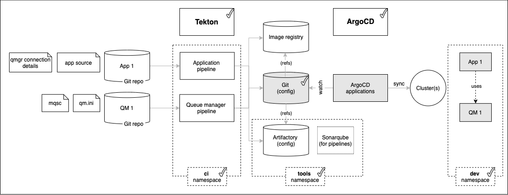

# Preparing for application components

<!--- cSpell:ignore resynched consolenotification subfolders rolebindings rolebinding CICD qube cntk autoplay allowfullscreen walkthrough Walkthrough webkitallowfullscreen msallowfullscreen -->

**Audience**: Architects, Application developers, Administrators

**Timing**: 20 minutes

## Overview

In this topic, we will:

* Explore the sample `multi-tenancy-gitops-apps` GitOps application components
  repository
* Customize this repository for our cluster

By the end of this topic we'll have a cluster ready to deploy MQ applications
and queue managers.

## Introduction

In this topic we're going to explore then customize the GitOps repository that
will store the MQ application and queue manager YAMLs. These YAMLs are built and
tested by their corresponding pipelines ready for deployment. This GitOps
repository will be accessed by ArgoCD applications that will apply these YAMLs
to the cluster, resulting in the creation of running MQ applications and queue
managers.

We'll examine these highlighted components in more detail throughout this topic;
here's an initial overview of their function:

* `Git (config)` repository stores the YAMLs built by the Tekton pipelines.
  These YAMLs will be applied to the cluster by ArgoCD applications to create MQ
  applications and queue managers.
* `ArgoCD applications` deploy their corresponding MQ applications and queue
  managers to the cluster. ArgoCD will also ensure that these MQ resources
  remain configured according to the YAML definitions -- any configuration drift
  (deliberate or accidental) will be reverted to align with the YAML in the `Git
  (config)` repository. The YAML specification for each ArgoCD application also
  resides in the `Git (config)` repository.
* `App1` and `QM1` are instances of an MQ application and queue manager that
  have been created by their corresponding ArgoCD application.  There is one
  ArgoCD application corresponding to each MQ application and each queue
  manager.

---

## Pre-requisites

Before attempting this topic, you must have completed the following tasks:

- You have completed the previous sections of this tutorial.

---

--8<-- "gitops-apps-explore.md"

---

--8<-- "gitops-apps-customize.md"

---

!!! success "Congratulations!"
    You've explored and customized the
    `multi-tenancy-gitops-apps` repository that will store the application
    component YAMLs for your cluster.

This section of the tutorial is now complete. In the following section, we're
going to use the Git repositories, pipelines and ArgoCD applications we've
configured to deploy MQ applications and queue managers to the cluster.
