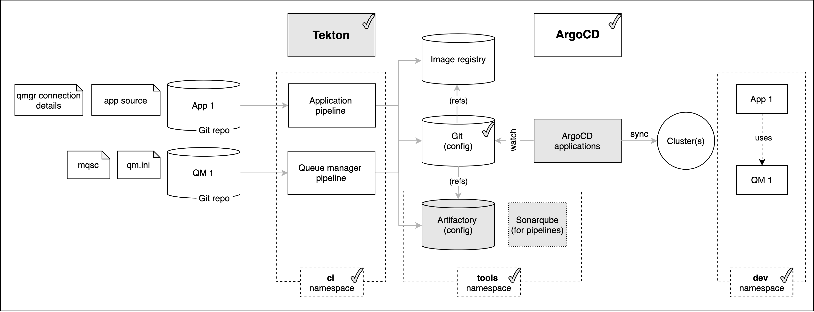

# Installing services with ArgoCD

<!--- cSpell:ignore Progesssing Artificatory resyncs rolebindings configmaps CICD qube cntk autoplay allowfullscreen webkitallowfullscreen msallowfullscreen Walkthrough walkthrough-->

**Audience**: Architects, Application developers, Administrators

**Timing**: Configuration 90 minutes - Waiting 60 minutes

## Overview

In this topic, we're going to:

* Deploy services to the cluster using GitOps
* Explore the ArgoCD applications that manage these services
* Explore how more complex services work using `Artifactory` as an example
* Review how ArgoCD projects work
* See how `infra` and `services` ArgoCD applications manage the
  **infrastructure** and **services** layers in our architecture.

By the end of this topic we'll have a fully configured cluster which is ready
for us to deploy MQ applications and queue managers.

---

## Introduction

In the [previous topic](gitops-config.md) of this chapter, we used GitOps to
create the **infrastructure**  components in our cluster.  In this topic,  we're
going complete the installation of all the necessary **services** required by
our MQ CICD process:

{: style="max-height:500px"}

We'll examine these highlighted components in more detail throughout this
section of the tutorial; here's an overview of their function.

* `Tekton` is used for Continuous Integration. Often, the Tekton pipeline will
  perform its changes under a pull-request (PR) to provide an explicit approval
  mechanism or through a push based on the requirements for cluster changes.
* `Sonarqube` is used by the MQ application pipeline for code quality and
  security scanning. It helps ensure the quality of a deployed application.
* `ArgoCD applications` will be created for each of these resources.
  Specifically, ArgoCD applications will keep the cluster synchronized with the
  application and queue manager YAML definitions stored in Artifactory and Git.

Note how these application services are installed in the `ci` and `tools`
namespaces we created in the previous topic.

This section will reinforce our understanding of GitOps. We will then be ready
to create MQ applications and queue managers that use the infrastructure we
previously created and these services we are going to install further.

---

## Pre-requisites

Before attempting this section, you must have completed the following tasks:

- You have completed all previous steps in this tutorial.

---

## Video Walkthrough

This video demonstrates how to install Tekton. It also shows how to use the
GitOps repository to set up different service related components.

<iframe width="560" height="315" src="https://www.youtube.com/embed/N7LKRTwlCR8" title="YouTube video player" frameborder="0" allow="accelerometer; autoplay; clipboard-write; encrypted-media; gyroscope; picture-in-picture" allowfullscreen></iframe>

This is a video walkthrough and it takes you step by step through the below sections.

---

--8<-- "gitops-cluster-post-tasks.md"

---

--8<-- "gitops-install-tekton.md"

---

--8<-- "gitops-deploy-services.md"

---

--8<-- "gitops-argocd-features.md"

    We'll make extensive use of `sync-wave` when we look at [High
    Availability](../high-availability/overview.md) MQ deployments.

!!! success "Congratulations!"
    You've installed tekton and configured the key services in the cluster to support continuous integration and continuous delivery. These have included services like Sonarqube. We installed them into the `tools` namespaces we created previously.
    
    This chapter is now complete. In the following chapters, we're going to use these components to deploy MQ applications and queue managers to the cluster.
