# Technology stack

<!--- cSpell:ignore qube cntk autoplay allowfullscreen -->

## Overview

**Audience**: Architects, Application developers, Administrators

Observability is a crucial aspect in any system. Our queue manager
is no exception and in this dedicated section to monitoring we are
going to review and leverage the monitoring stack provided out of
the box in OpenShift.

In this first topic, we're going to:

- Make a high-level review of the monitoring stack.
- Review the OpenShift web console for monitoring purposes.
- Review Prometheus.
- Review Grafana.

By the end of this topic you will have a view of the monitoring stack and how to 
interact with it.

---

## Introduction

In the previous section we have been learning the path to have an MQ system configured 
and deploying following GitOps principles. We also deployed an MQ application and 
promoted them between environments.

Having now a working system in the cluster, it is time to dive into its monitoring 
features. We will leverage the open source monitoring tools provided out of the box in 
an OpenShift cluster to have an understanding about what is happening in our MQ.

---
## Reviewing monitoring stack

OpenShift includes a pre-configured, preinstalled and self-updating monitoring stack 
that provides monitoring for the core platform components and for all the applications 
deployed on it. OpenShift documentation contains a section with [detailed information
about its monitoring stack][monitoring_docs] that worth reading.

[monitoring_docs]: https://docs.openshift.com/container-platform/4.10/monitoring/monitoring-overview.html

There are several components that work together to provide observability in an 
OpenShift cluster: 

- Monitoring Operators
- Prometheus
- Grafana
- Alertmanager
- Support monitoring components

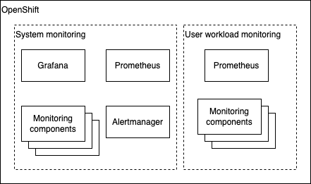

OpenShift ships several **operators** that help with the orchestration for the deployment
of the monitoring stack. By default, a set of **agents** and **support applications** are 
deployed and work together to collect and process metrics across the cluster. These
agents help to collect core kubernetes system metrics, specific OpenShift components
metrics, node metrics, adapt data so it can be used by the monitoring stack, and
aggregate and deduplicate information collected from all the metrics sources to
have a clean and clear view of what is happening in the cluster.

A set of alerts is also included by default that notify cluster administrators about 
issues with a cluster. `Alertmanager` is the component that helps with the
way alerts triggered by Prometheus are issued.

In this guide we are going to focus mainly in two components of the stack: 

- **Prometheus**: it is a time-series database and a rule evaluation engine for metrics.
This is the system that records all the metrics collected in the cluster.
- **Grafana**: it is a visualization tool that reads from Prometheus database and
where we can design monitoring dashboards.

We will explore these two components more in detail later in this section.

---

## Monitoring scopes

Before jumping to more specific topics, let's clarify the 2 differentiated monitoring scopes that OpenShift has:

- **System monitoring** focus in the observability of the core platform. When a new 
cluster is created all the monitoring stack that is preinstalled is already monitoring 
key aspects like `etcd`, nodes, networking or OpenShift core components. The default
monitoring stack is installed in the `openshift-monitoring` project. This includes 
Prometheus and Grafana instances.

- **User defined projects monitoring** focus in everything else that is deployed on the 
cluster. Any other application that is deployed goes to this category when talking about 
monitoring. This is the scope where our MQ belongs to. Once this scope in enabled, the 
monitoring components related to this scope will be installed in the 
`openshift-user-workload-monitoring` project. This project will have a dedicated 
Prometheus instance and monitoring components that will communicate with the main stack to
conform the cluster-wide monitoring system.

Note that by default, OpenShift monitoring is configured to perform system monitoring only.
Anything else that is deployed on top of a brand-new cluster is out of the system monitoring
scope and any new metrics that are produced by that new workload will not be registered
automatically.

Moreover, OpenShift Grafana instance is a read only instance and it focuses only in the 
system monitoring scope. The provided dashboards cannot be updated.

In this guide we will learn how user workloads can be included in the monitoring system and
how to use a different Grafana instance so we can work on our own dashboards.

---

## Exploring the monitoring UI

As we reviewed the monitoring stack is preinstalled and ready to use. Through the OpenShift 
UI we can access several interfaces to interact with the monitoring system. 

To reach these interfaces, from the Administrator perspective left menu, we can
unfold the `Monitoring` section that contains 3 items:

- `Alerting`
- `Metrics` 
- `Dashboards`

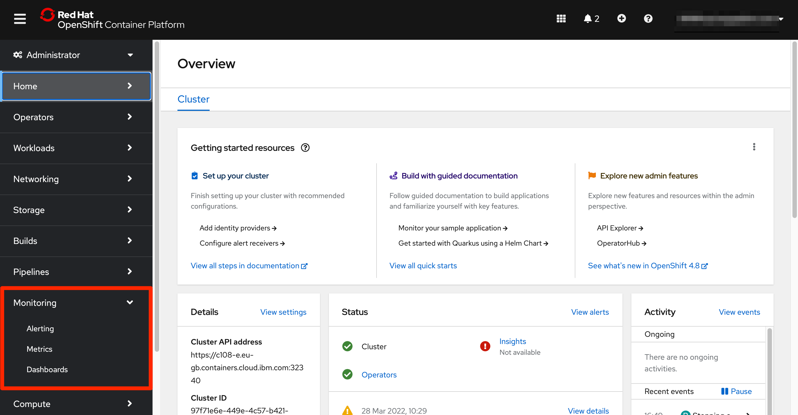

Each of these options offer a view to certain observability functionalities of the stack.

`Alerting` menu option presents the alerting screen. OpenShift ships an alert management system that as part of Prometheus. The user can visualize the alerts that are 
currently active and the list of alerting rules that are being evaluated. Another 
feature provided is the capability of silencing alerts. 

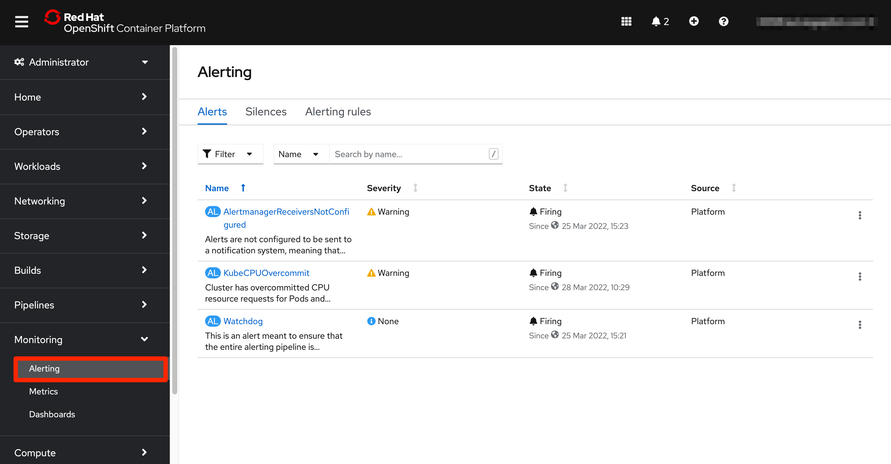

A user with the right permissions can generate [new alert rules for the user defined 
projects][alerting_docs].

[alerting_docs]: https://docs.openshift.com/container-platform/4.6/monitoring/managing-alerts.html

By default, all the notifications are kept in the OpenShift environment but receivers 
can be configured so those notifications reach to the relevant tools and teams. The `Alertmanager` component is responsible for sending the
alerts to external notification systems. 

Since our focus in the monitoring topic is around Prometheus (`Metrics`) and Grafana 
(`Dashboards`), we are going to dedicate the next two subtopics to them.

---

## Prometheus

Prometheus is a time-series database and a rule evaluation engine for metrics. Prometheus 
collects all the metrics exposed by any component that makes them available through their 
monitoring endpoints and stores them so they can be used by other tools in the system.

Prometheus can hold a set of rules that run against the stored metrics and if conditions 
are met, alerts can be fired to the alert management system. 

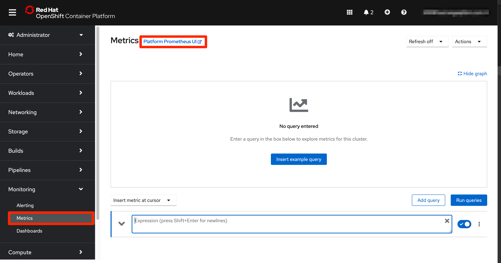

The Prometheus interface that we can reach from the OpenShift web console allow administrators 
to perform queries on the database. The query tool has an autocomplete feature so when an 
administrator starts typing, matching metric names start to appear to make the task easier. 
After a query is executed, the results are shown in table format and a graphic representation 
is also shown.

Let's try to make a query to the `etcd_request_duration_seconds_count`. Start typing it in the 
Expression text box. It will appear in the list of available metrics that starts with `etcd`. 
Select it from the list or finish typing it and click the `Run queries` button.

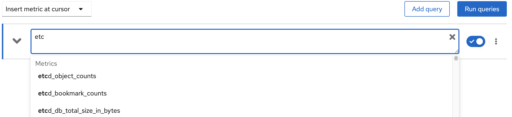

This query only includes the metric name and we will receive as a result all the time series
related to that metric in the system. These series are presented in graphical and tabular
formats.

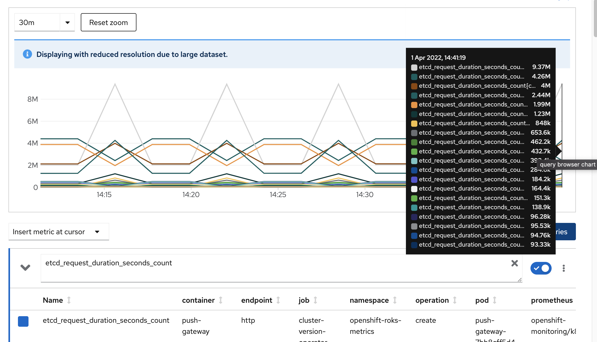

If we hover the graph, a legend appears identifying the different time series represented. In 
the table we can see the headers that are the attributes stored for this metric.
A much more complex query can be generated to narrow down the results, but we will not focus
on this. To know more you can review [Prometheus documentation][prometheus_docs].

[prometheus_docs]: https://prometheus.io/docs/prometheus/latest/querying/basics/

This view of Prometheus is the one exposed through OpenShift web console, but we can also use
Prometheus original interface that exposes many more options. To access it we can just click 
the link that appears on the right of the Metrics screen title. 

The main screen that we found is also the query interface. If we issue the 
same query as before we can check the results in the `Table` tab and then
select `Graph` tab to obtain the graphical representation of the time
series in the same way we saw in the OpenShift web UI.

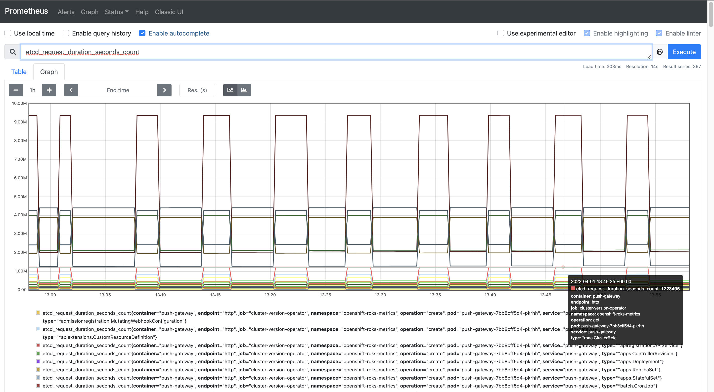

Feel free to keep doing other queries in Prometheus and explore the different options in the
top menu bar. Now that we have a basic knowledge about Prometheus and how to interact with it,
let's review Grafana. 

---

## Grafana

The last option in the monitoring left menu shows the `Dashboards` screen. Here again we access
to the view offered through the OpenShift web console. The underlying capability being used is 
Grafana, that is the analytics platform providing dashboards for analyzing and visualizing 
Prometheus metrics. 

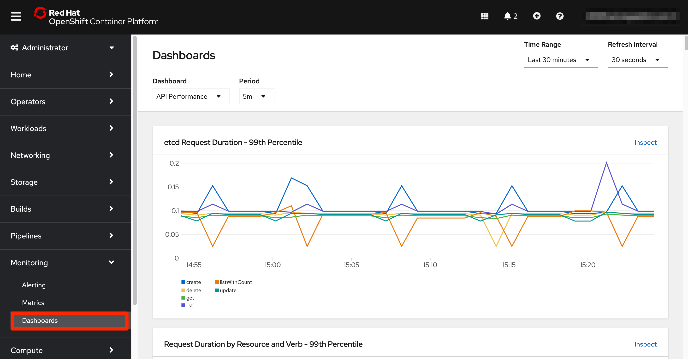

The `Dashboards` section offers a collection of graphs grouped in different 
dashboards that can be navigated through the Dashboard dropdown at the top of 
this screen. The interface also allows to select a specific time window for 
the visualizations. 

In this case we do not have an immediate link to the original Grafana UI, but 
it is still available. We can obtain it from its OpenShift route. Open a new 
terminal window that we will use during this section and make sure that you 
are logged into OpenShift.

```bash
oc login --token=<token> --server=<server>
```

And now retrieve the Grafana URL from the route.

```bash
echo "https://$(oc get route -n openshift-monitoring grafana -o jsonpath="{.spec.host}")"
```

Opening the URL in your browser will ask you to login using OpenShift.

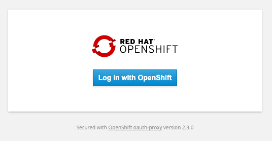

And you will need to provide access to your account to the `grafana` service account clicking
the `Allow selected permissions` button.

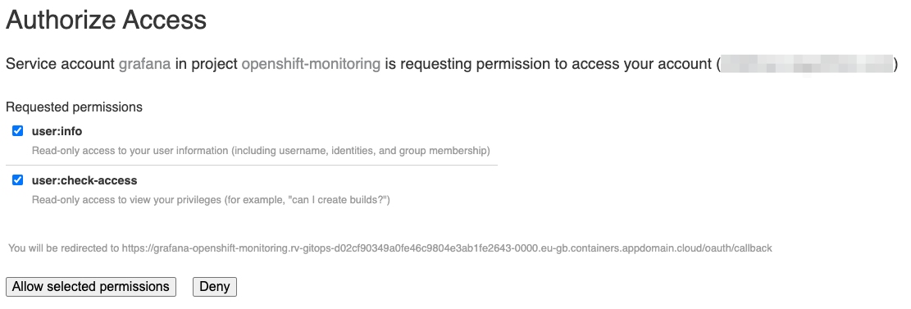

We will be then redirected to Grafana home page.

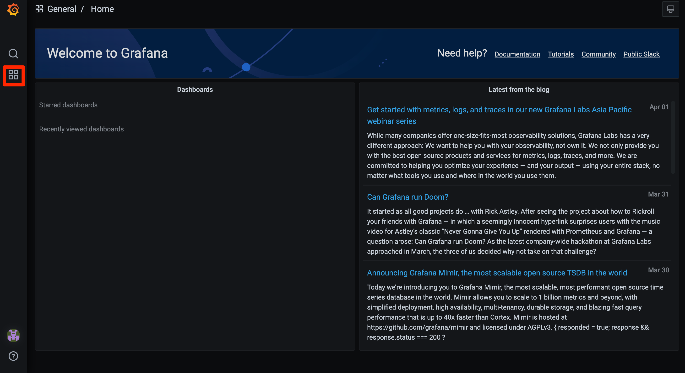

To access the dashboards, click on the four squares menu on the left-hand 
side, and select the `Manage` option.

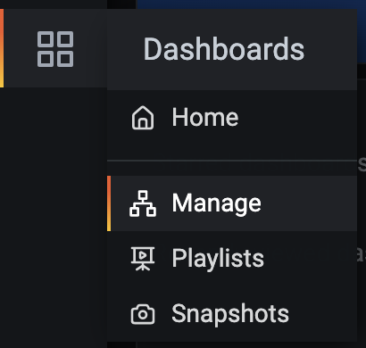

Clicking in the `Default` folder a list of dashboards will appear. 

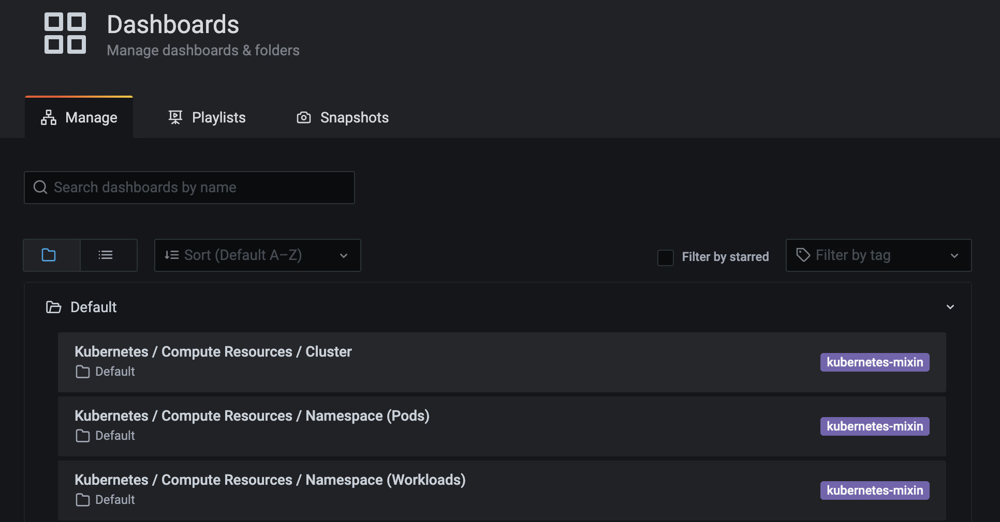

Click on any of them to access the corresponding dashboard. In the following example we can see
the first dashboard of the list about the cluster compute resources.

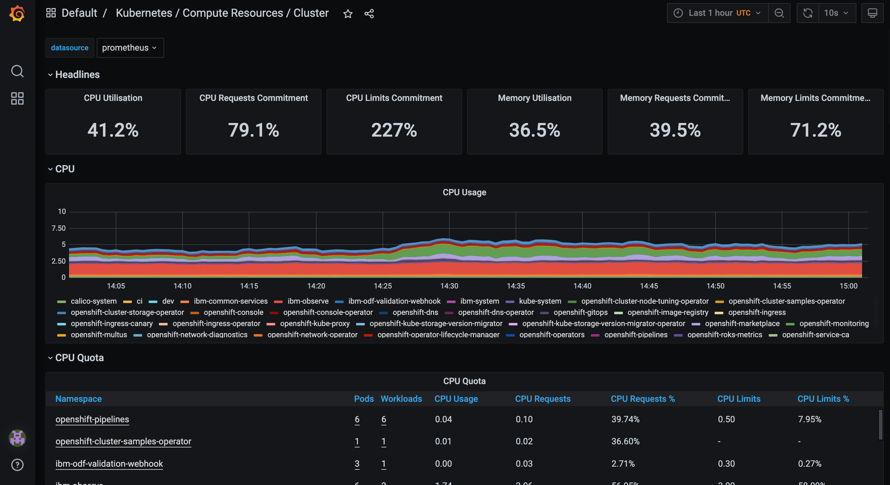

Remember that all these dashboards are read-only and we cannot update them. 

Note at the top of this dashboard how the data source is identified. Grafana is a visualization
tool and it can consume data from multiple sources. In this case the only source configured is 
Prometheus database.

We will dive deeper into Grafana towards the end of the monitoring section.

!!! success "Congratulations!"

      You've now a view of the monitoring system that will be used to monitor MQ. In the next topic 
      we are going to focus in the MQ monitoring scenario and we will configure the environment to 
      start collecting MQ metrics.