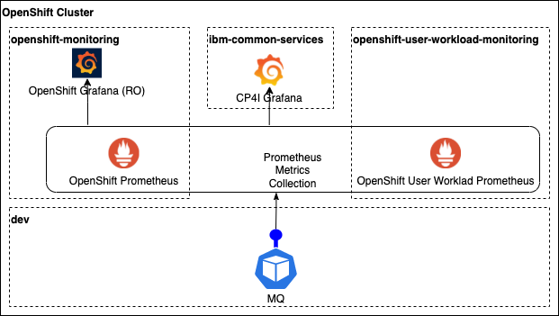
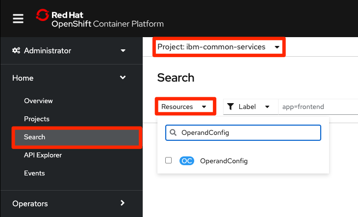
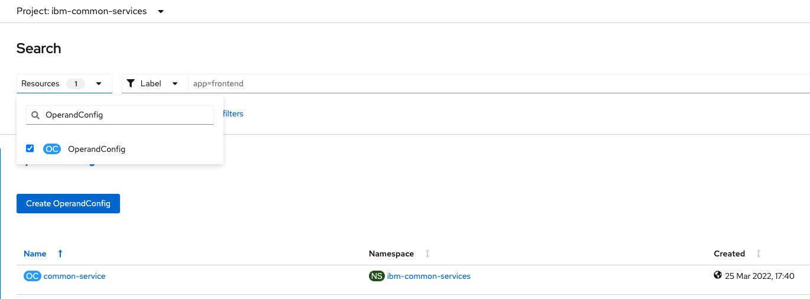
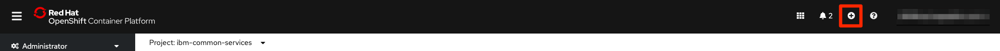
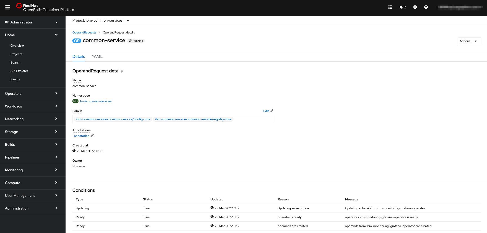
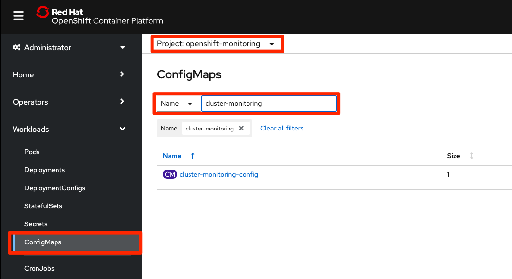
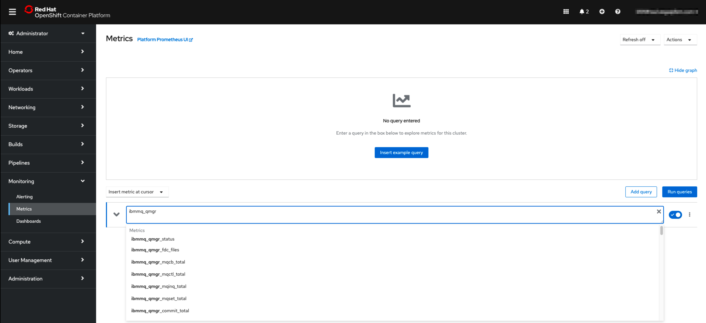
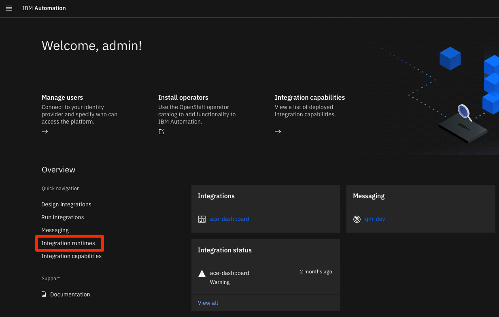
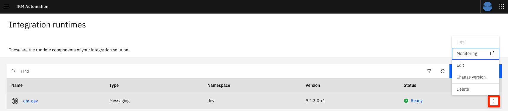
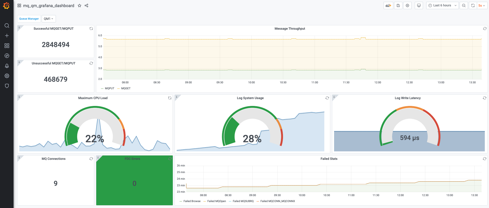

# MQ scenario

<!--- cSpell:ignore qube cntk autoplay allowfullscreen -->

## Overview

**Audience**: Architects, Application developers, Administrators

In this topic, we're going to:

- Place our MQ system in the monitoring context.
- Analyze the scenario to monitor MQ.
- Configure the cluster to collect MQ metrics.
- Access CP4I Grafana instance.

---

## Introduction

Now that we have identified OpenShift monitoring stack we are going to focus in MQ monitoring scenario.

As we saw in the previous topic, everything that is deployed on OpenShift that does not belong to
the core system belongs to the user defined projects monitoring scope. Our MQ system is already exposing
a set of metrics through a Prometheus endpoint. That is, our queue manager is already providing
information that can be ingested by the monitoring stack. We will need to configure the cluster
to start collecting these metrics.

Another element that we will need in our system will be a way to visualize these metrics. Since 
OpenShift Grafana instance is read-only, we need a different instance that we can use for that goal.
Luckily, CP4I ships its own Grafana instance that we will leverage to have our MQ dashboard.

---

## Monitoring scenario

With all that we know now let's review the monitoring scenario that we have.



As mentioned in the monitoring stack review topic, we have the core monitoring system up and
running in the `openshift-monitoring` project where we can find the system Prometheus and the
read only Grafana instances. Once user workload monitoring is enabled, a new Prometheus instance 
is created in the `openshift-user-workload-monitoring` project along other monitoring components.

In the moment user workload monitoring is enabled we will have more than one Prometheus instances
running but the monitoring components that are running in the cluster are going to create analyzing
abstraction layer. From the Prometheus external point of view, we will deal with a single 
monitoring system and all the metrics collected from the core system or from user workloads, 
can be queried from the same interface.

This scenario is completed by a new Grafana instance that is deployed as part of the CP4I common
services. This instance also provides a dashboard for our MQ system running in the `dev` project
and we will be able to access and update it.

---

## Enable monitoring for MQ

We are going to start with the configurations needed to have the user workload monitoring system
enabled so the MQ metrics can be collected and ingested in Prometheus.

The process that we are going to follow is fully documented in the  
[Cloud Pak for Integration documentation][cp_enable_ocp_monitoring], 
but we are going to review and implement it here.

[cp_enable_ocp_monitoring]: https://www.ibm.com/docs/en/cloud-paks/cp-integration/2021.4?topic=administration-enabling-openshift-container-platform-monitoring

At the end of this process, we will have new pods related to the monitoring 
stack in `openshift-user-workload-monitoring` project and  the MQ metrics 
available in Prometheus.

  1. *Edit OperandConfig custom resource* 

    The first step is about updating an existing configuration from the common services component
    deployed with CP4I.

    

    Go to the OpenShift web console and from the `Home` section select `Search` option. Select 
    `ibm-common-services` in the Project dropdown at the top of the screen to narrow down the
    search. Finally type `OperandConfig` in the `Resources` dropdown and click on the only
    option that remains in the list.

    
  
    We are looking for the `common-service` OperandConfig. Click on it and then select the `YAML`
    tab. This yaml file already contains a list of services and we need to update the existing
    `ibm-monitoring-grafana-operator` service. Look for it either inspecting the yaml or using
    the find feature as in any other browser or text editor (Win: Ctrl+F / MacOS: Cmd+F). Our 
    update is about adding the two highlighted lines:
    
    ```yaml hl_lines="12 13"
    apiVersion: operator.ibm.com/v1alpha1
    kind: OperandConfig
    metadata:
      name: common-service
      namespace: ibm-common-services
    spec:
      services:
        ### Other existing services here
        - name: ibm-monitoring-grafana-operator
          spec:
            grafana:
              datasourceConfig: ### Enable using the OCP metrics as a data source
                type: "openshift"
              dashboardConfig:
                resources:
                  limits:
                    cpu: 20m
                    memory: 80Mi
                  requests:
                    cpu: 20m
                    memory: 30Mi
              grafanaConfig:
                resources:
                  limits:
                    cpu: 150m
                    memory: 120Mi
                  requests:
                    cpu: 20m
                    memory: 40Mi
              routerConfig:
                resources:
                  limits:
                    cpu: 50m
                    memory: 50Mi
                  requests:
                    cpu: 20m
                    memory: 20Mi
            operandRequest: {}
        ### Other existing services here
    ```

    This change is telling the CP4I Grafana instance to use OpenShift Prometheus as the data source
    to consume metrics to represent them in the dashboards.

    Click `Save` button.

  2. *Create the OperandRequest resource* 
    
    Now we need to create new resources.

    We need an OperandRequest resource for just the Grafana operand in the `ibm-common-services` 
    namespace so that it only requests the Grafana operand rather than also requesting the exporters
    and Prometheus operands. 
    
    Still working with the OpenShift web console, click the import YAML button at the top of the screen.

    

    A text editor will appear in the screen. Copy and paste the following piece of code to create the 
    OperandRequest.

    ```yaml
    apiVersion: operator.ibm.com/v1alpha1
    kind: OperandRequest
    metadata:
      name: common-service
      namespace: ibm-common-services
    spec:
      requests:
        - operands:
            - name: ibm-monitoring-grafana-operator
          registry: common-service
    ```

    Click `Create` button at the bottom and you will see the new OperandRequest `common-services` 
    resource.

    

  3. *Enable user defined projects monitoring*
  
    We need to create a last resource following the same procedure we used to create the OperandRequest. In this case we are going to create a ConfigMap. Click again in the import YAML button at the
    top of the screen and copy and paste the following piece of code:

    ```yaml
    apiVersion: v1
    kind: ConfigMap
    metadata:
      name: cluster-monitoring-config
      namespace: openshift-monitoring
    data:
      config.yaml: |
        enableUserWorkload: true
    ```

    Note that now the project where the ConfigMap is going to be created is `openshift-monitoring`.
    With this configuration we are enabling the user workload monitoring in the cluster.

    Click `Save` button.

    Confirm that the ConfigMap is created. You can switch to the `Workloads > ConfigMaps` screen 
    in the OpenShift left menu. Switch to the `openshift-monitoring` project in the project
    dropdown and search for the `cluster-monitoring-config` ConfigMap.

    

  4. *Check new pods created* 
  
    Now we have the user project defined monitoring stack configured and new monitoring components
    have been created for this purpose. Let's check that all those components are running.

    Switch back to your terminal window. We are going to verify that the `prometheus-operator`, `prometheus-user-workload` and `thanos-ruler-user-workload` pods are up and running in the
    `openshift-user-workload-monitoring` project. It might take a few minutes for the pods to start:

    ```bash
    oc -n openshift-user-workload-monitoring get pod
    ```

    You should get an output similar to this:

    ```{.notext .nocopy}
    NAME                                   READY   STATUS        RESTARTS   AGE
    prometheus-operator-6f7b748d5b-t7nbg   2/2     Running       0          3h
    prometheus-user-workload-0             4/4     Running       1          3h
    prometheus-user-workload-1             4/4     Running       1          3h
    thanos-ruler-user-workload-0           3/3     Running       0          3h
    thanos-ruler-user-workload-1           3/3     Running       0          3h
    ```

    Explore all the other resources generated due to the enablement
    of the user workload monitoring.

    ```bash
    oc -n openshift-user-workload-monitoring get all
    ```
  
  5. *Check MQ metrics available*

    The cluster is now configured so the MQ metrics are being collected by Prometheus. It is now
    time to check that we can find them in Prometheus. Going back to OpenShift web console, go 
    to the `Monitoring > Metrics` screen. Start typing `ibmmq_qmgr` in the expression text box.
    Several metrics should appear now in the available metrics list meaning that Prometheus has ingested
    them and we can use them to perform searches and build our dashboards.

    

---

## CP4I Grafana

To close this section, we are going to review how to access CP4I Grafana instance and we will review
the dashboard that is provided by default.

Ensure that you are logged in your OpenShift cluster from the terminal we have been using.

```bash
oc login --token=<token> --server=<server>
```

We can access Grafana UI through the platform navigator. We can obtain its URL from the route:

```bash
PN_URL=$(oc get route integration-navigator-pn -n tools -o jsonpath="{.spec.host}")
echo "https://$PN_URL"
```

Login into the Platform Navigator using `admin` user and the password you can extract issuing the 
following command:

```bash
oc -n ibm-common-services get secret platform-auth-idp-credentials -o jsonpath='{.data.admin_password}' | base64 -d && echo
```

On the left hand side menu, select `Integration runtimes` option.



The screen then presents all the integration runtimes. Click on the three dots menu on the right hand
side and select `Monitoring` option.



A new tab will open in the browser with the Grafana UI that we can use to 
configure our dashboard. Initially there is a default dashboard provided for 
MQ with several metrics and graphs.



By now, to improve the experience set the refresh time to `5m`. In the 
upper-right corner there is a dropdown set to `5s`. Change it to `5m`
to avoid performing constant queries to Prometheus. For our
activity 5 minutes refresh will be more than enough. 

!!! caution "Launching Grafana UI"

      Sometimes we have viewed that MQ dashboard does not appear and 
      instead, we have system dashboards. In such case close the 
      Grafana tab and launch it again from the integration runtime
      monitoring link. 

---

!!! success "Congratulations!"

      You've now the monitoring stack configured and MQ metrics has started to reach Prometheus. We 
      have also seen how these new metrics are used to compose a monitoring dashboard in the CP4I
      Grafana instance. In the next topic, we're going to expand the use case to obtain new MQ 
      metrics that are not exposed by default.