# Metrics application

<!--- cSpell:ignore qube cntk autoplay allowfullscreen uncommented -->

## Overview

**Audience**: Architects, Application developers, Administrators

In this topic, we're going to:

- Revisit our monitoring scenario.
- Prepare and configure a new application to surface more metrics.
- Deploy the application.
- Verify we can see new metrics in Prometheus.

---

## Introduction

We have now metrics flowing from our queue manager to Prometheus. But those are the metrics
that MQ exposes by default. In some scenarios we would be interested in other metrics beyond 
the default set. For example, queue depth is an interesting one that many MQ admins look for.

In such scenarios we need an auxiliary application. This new application is, in simple terms, 
an MQ client that connects to our queue manager, retrieves the information of interest, process 
it and expose it in a metrics endpoint with the right format so Prometheus can read them.

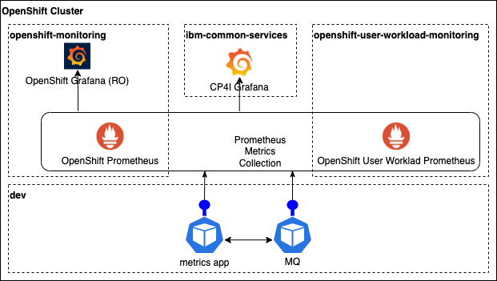

In this topic we are going to review this new application and we are going to deploy it so we 
can start seeing the new metrics in Prometheus.

---

## Creating metrics app repo

1. *Ensure environment variables are set*

    !!! Tip

        Ensure you're in the multi-tenancy-gitops-apps terminal window.

    !!! Tip

        If you're returning to the tutorial after restarting your computer, ensure that the 
        `$GIT_ORG`, `$GIT_BRANCH` and `$GIT_ROOT` environment variables are set.
    
    (Replace <your organization name> appropriately:)

    ```bash
    export GIT_BRANCH=master
    export GIT_ORG=<your organization name>
    export GIT_ROOT=$HOME/git/$GIT_ORG-root
    ```

    You can verify your environment variables as follows:

    ```bash
    echo $GIT_BRANCH
    echo $GIT_ORG
    echo $GIT_ROOT
    ```


2. *Ensure you're logged in to the cluster*

    Log into your OCP cluster, substituting the --token and --server parameters with your 
    values:

    ```bash
    oc login --token=<token> --server=<server>
    ```

    If you are unsure of these values, click your user ID in the OpenShift web console and 
    select "Copy Login Command".

3. *Go to your root folder*   

    In the terminal let's move to our root folder:

    ```bash
    cd $GIT_ROOT
    ```

4. *Fork mq-metric-samples application repository*
    
    Navigate to the `mq-metric-samples` repository that can be found in the `ibm-messaging` 
    organization at [https://github.com/ibm-messaging/mq-metric-samples][metrics_repo] and
    fork it into your organization.

    [metrics_repo]: https://github.com/ibm-messaging/mq-metric-samples

5. *Clone the fork to your local machine*

    ```bash
    git clone https://github.com/$GIT_ORG/mq-metric-samples.git
    ```

6. *Change to the local clone's folder*

    ```bash
    cd mq-metric-samples
    ```

7. *Review the application source directories*

    ```bash
    tree -L 1
    ```

    The following diagram shows the directory structure for the metrics application:

    ```{ .bash .no-copy }
    .
    ├── CHANGELOG.md
    ├── CLA.md
    ├── Dockerfile.build
    ├── Dockerfile.run
    ├── LICENSE
    ├── README.md
    ├── cmd
    ├── config.common.yaml
    ├── cp4i
    ├── dspmqrtj
    ├── go.mod
    ├── go.sum
    ├── pkg
    ├── scripts
    └── vendor
    ```

    This repository contains a collection of IBM MQ monitoring agents that utilize the IBM MQ 
    golang metric packages to provide programs that can be used with existing monitoring 
    technologies such as Prometheus, AWS CloudWatch, etc. 

    In this structure note the following folders:

    - `cmd` contains the different code bases for different solutions. The case of interest 
    here is `mq_prometheus` that will perform the export of queue manager data into a 
    Prometheus data set.
    - `cp4i` contains yaml resources and helm charts that will help us to deploy the 
    application in our cluster.
    - `scripts` contains functionality that will help to build the container images on our 
    local environments.

8. *Review the ConfigMap template*

    Let's have a look to the ConfigMap template. The ConfigMap that is provided contains 
    all the parameters that the metrics application is going to use to connect to the queue 
    manager. Issue the following command to check the template:

    ```bash
    cat cp4i/chart/base/templates/configmap.yaml
    ```

    You will see the following output:

    ```yaml
    apiVersion: v1
    kind: ConfigMap
    metadata:
    name: {{ .Values.name }}
    data:
    IBMMQ_CONNECTION_QUEUEMANAGER: {{ .Values.configmap.QM | quote }}
    IBMMQ_CONNECTION_CONNNAME: {{ .Values.configmap.CONNECTION_NAME | quote }}
    IBMMQ_CONNECTION_CHANNEL: {{ .Values.configmap.CHANNEL | quote }}
    IBMMQ_OBJECTS_QUEUES: {{ .Values.configmap.QUEUES | quote }}
    IBMMQ_OBJECTS_SUBSCRIPTIONS: {{ .Values.configmap.SUBSCRIPTIONS | quote }}
    IBMMQ_OBJECTS_TOPICS: {{ .Values.configmap.TOPICS | quote }}
    IBMMQ_GLOBAL_USEPUBLICATIONS: {{ .Values.configmap.USE_PUBLICATIONS | quote }}
    IBMMQ_GLOBAL_USEOBJECTSTATUS: {{ .Values.configmap.USE_OBJECT_STATUS | quote }}
    IBMMQ_GLOBAL_CONFIGURATIONFILE: {{ .Values.configmap.CONFIGURATION_FILE | quote }}
    IBMMQ_GLOBAL_LOGLEVEL: {{ .Values.configmap.LOG_LEVEL | quote }}
    ```

    We can see here the `CONNECTION_NAME` that is using the service string to establish 
    the connection and it is going to use `MONITORING_CHL` channel to connect. 

9. *Update values*

    Let's have a look to the `values.yaml` that will be used with the 
    Helm templates:

    ```bash
    cat cp4i/chart/base/values.yaml
    ```
    
    We will focus in the values for the ConfigMap. If we check at the 
    end of the output, we will see the default values for the Config Map:

    ```yaml
    ...
    configmap:
      QM: "QM1"
      CONNECTION_NAME: "qm-dev-ibm-mq.dev.svc.cluster.local(1414)"
      CHANNEL: "MONITORING_CHL"
      QUEUES: "!SYSTEM.*,!AMQ.*,*"
      SUBSCRIPTIONS: "!$SYS*"
      TOPICS: "!*"
      USE_PUBLICATIONS: false
      USE_OBJECT_STATUS: true
      CONFIGURATION_FILE: ""
      LOG_LEVEL: "INFO"
    ```

    We need to ensure the `CONNECTION_NAME` is correct for our cluster and we need to get 
    the `Name` of the service so we can update the configuration. In our case this is 
    `qm1-ibm-mq` so we will update the `values.yaml` file to have the following:

    ```yaml hl_lines="4"
    ...
    configmap:
      QM: "QM1"
      CONNECTION_NAME: "qm1-ibm-mq.dev.svc.cluster.local(1414)"
      CHANNEL: "MONITORING_CHL"
      QUEUES: "!SYSTEM.*,!AMQ.*,*"
      SUBSCRIPTIONS: "!$SYS*"
      TOPICS: "!*"
      USE_PUBLICATIONS: false
      USE_OBJECT_STATUS: true
      CONFIGURATION_FILE: ""
      LOG_LEVEL: "INFO"
    ```

10. *Commit and push the changes*

    ```bash
    git add .
    git commit -s -m "Update connection name"
    git push origin $GIT_BRANCH
    ```

  We have now the metrics application ready.

---

## Prepare Queue Manager

Now we need to get our queue manager ready. In the previous section we saw that 
`MONITORING_CHL` channel was going to be used by the metrics app to connect to our queue 
manager. We need to update `config.mqsc` to make this channel available.

1. *Ensure environment variables are set*

    !!! Tip

        Ensure that the `$GIT_BRANCH_QM1` environment variable is set.
    
    ```bash
    export GIT_BRANCH_QM1=qm1-$GIT_ORG
    ```

    You can verify your environment variable as follows:

    ```bash
    echo $GIT_BRANCH_QM1
    ```

2. *Go to your `mq-infra` repo*

    Switch now to the terminal where you are working with `mq-infra` repository and ensure 
    you are in the correct folder:

    ```bash
    cd $GIT_ROOT/mq-infra
    ```

3. *Switch to $GIT_BRANCH_QM1*

    We are about to make an update in MQSC configuration, so we will work in the branch we 
    created during the building of the queue manager.
    
    ```bash
    git checkout $GIT_BRANCH_QM1
    ```

4. *Update `config.mqsc`*

    The `config.mqsc` is located at `chart/base/config/config.mqsc` and it already contains 
    the configurations needed for monitoring purposes. Uncomment the lines that define the 
    `MONITORING_CHL` and the security for it removing the `*` characters.

    ```bash  hl_lines="8 9"
    DEFINE QLOCAL(IBM.DEMO.Q) BOQNAME(IBM.DEMO.Q.BOQ) BOTHRESH(3) REPLACE
    DEFINE QLOCAL(IBM.DEMO.Q.BOQ) REPLACE
    * Use a different dead letter queue, for undeliverable messages
    DEFINE QLOCAL('DEV.DEAD.LETTER.QUEUE') REPLACE
    ALTER QMGR DEADQ('DEV.DEAD.LETTER.QUEUE')
    DEFINE CHANNEL('IBM.APP.SVRCONN') CHLTYPE(SVRCONN)
    ALTER QMGR CHLAUTH (DISABLED)
    * DEFINE CHANNEL('MONITORING_CHL') CHLTYPE(SVRCONN)
    * SET CHLAUTH(MONITORING_CHL) TYPE(BLOCKUSER) USERLIST(NOBODY)
    REFRESH SECURITY TYPE(CONNAUTH)
    ``` 

3. *Push the changes*

    The configuration is ready and we need to get it into our Git repo.

    ```bash
    git add .
    git commit -s -m "Enable monitoring channel"
    git push origin $GIT_BRANCH_QM1
    ```

4. *Check`mq-infra-dev` pipeline is running*

    If you have setup the webhooks for the `mq-infra` repository following the [Continuous
    updates][webhook_section] topic, a new pipeline run is running now. If you skipped 
    that section, you will need to trigger a new run manually.

    [webhook_section]: ../qmgr-pipeline/topic4.md

    Once the pipeline finishes and the new version of the queue manager is deployed, verify 
    the new channel is available. Access the MQ console and in the `Communication` tab, 
    `App channels` section, you will see the `MONITORING_CHL` listed.

    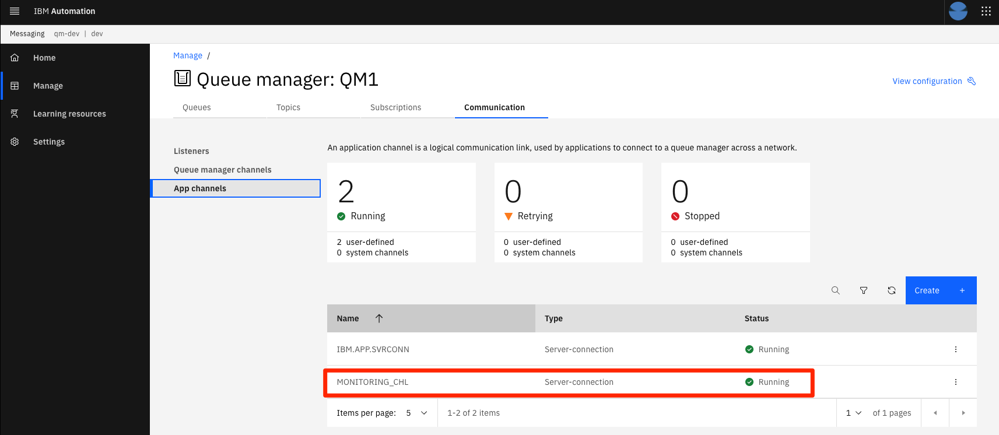

---

## Enable CI resources

Let's now enable and review the application pipeline and a task that will build our metrics 
app image in the pipeline.

1. *Go to `multi-tenancy-gitops-apps` folder*

    For this section, we return to the **terminal window** we used in previous chapters for 
    interacting with the GitOps repository. Open a new terminal window for the 
    `multi-tenancy-gitops-apps` repository if necessary.

    ```bash
    cd $GIT_ROOT/multi-tenancy-gitops-apps
    ```

2. *Check the resources*

    In this repo there are a pipeline and a task resources that we will use to deploy our 
    metrics application:

      - The pipeline resource is defined in 
      `mq/environments/ci/pipelines/mq-metric-samples-dev-pipeline.yaml`
      - The task resource is defined in 
      `mq/environments/ci/tasks/mq-metrics-build-tag-push.yaml`
    
    Feel free to review these resources in depth.

3. *Update kustomize*

    We need to get those resources deployed in our cluster. We just need to uncomment 
    the highlighted lines in `mq/environments/ci/kustomization.yaml` so ArgoCD can deploy 
    them. 

    ```{ .yaml hl_lines="9 42" .no-copy }
    resources:
    #- certificates/ci-mq-client-certificate.yaml
    #- certificates/ci-mq-server-certificate.yaml
    - configmaps/gitops-repo-configmap.yaml
    - eventlisteners/cntk-event-listener.yaml
    - triggerbindings/cntk-binding.yaml
    - triggertemplates/mq-infra-dev.yaml
    - triggertemplates/mq-spring-app-dev.yaml
    #- pipelines/mq-metric-samples-dev-pipeline.yaml
    - pipelines/ibm-test-pipeline-for-dev.yaml
    - pipelines/ibm-test-pipeline-for-stage.yaml
    #- pipelines/java-maven-dev-pipeline.yaml
    - pipelines/mq-pipeline-dev.yaml
    - pipelines/mq-spring-app-dev-pipeline.yaml
    - roles/custom-pipeline-sa-clusterrole.yaml
    - roles/custom-pipeline-sa-role.yaml
    - roles/custom-ci-pipeline-sa-rolebinding.yaml
    - roles/custom-dev-pipeline-sa-rolebinding.yaml
    - roles/custom-staging-pipeline-sa-rolebinding.yaml
    - roles/custom-prod-pipeline-sa-rolebinding.yaml
    - routes/cntk-route.yaml
    - secrets/artifactory-access-secret.yaml
    - secrets/git-credentials-secret.yaml
    - secrets/ibm-entitled-registry-credentials-secret.yaml
    #- secrets/mq-client-jks-password-secret.yaml
    - tasks/10-gitops.yaml
    - tasks/10-gitops-for-mq.yaml
    - tasks/10-gitops-promotion.yaml
    - tasks/11-app-name.yaml
    - tasks/12-functional-tests.yaml
    - tasks/13-jmeter-performance-test.yaml
    - tasks/13-cphtestp-performance-test.yaml
    - tasks/4-smoke-tests-mq.yaml
    - tasks/4-smoke-tests.yaml
    - tasks/ibm-build-tag-push-v2-6-13.yaml
    - tasks/ibm-helm-release-v2-6-13.yaml
    - tasks/ibm-img-release-v2-6-13.yaml
    - tasks/ibm-img-scan-v2-6-13.yaml
    - tasks/ibm-java-maven-test-v2-6-13.yaml
    - tasks/ibm-setup-v2-6-13.yaml
    - tasks/ibm-tag-release-v2-6-13.yaml
    #- tasks/mq-metrics-build-tag-push.yaml

    # Automated promotion process triggers

    - triggertemplates/mq-infra-dev-triggertemplate.yaml
    - eventlisteners/mq-infra-dev-eventlistener.yaml
    - routes/mq-infra-dev-route.yaml
    
    - triggertemplates/mq-spring-app-dev-triggertemplate.yaml
    - eventlisteners/mq-spring-app-dev-eventlistener.yaml
    - routes/mq-spring-app-dev-route.yaml
    
    - triggertemplates/mq-infra-stage-triggertemplate.yaml
    - eventlisteners/mq-infra-stage-eventlistener.yaml
    - routes/mq-infra-stage-route.yaml
    
    - triggertemplates/mq-spring-app-stage-triggertemplate.yaml
    - eventlisteners/mq-spring-app-stage-eventlistener.yaml
    - routes/mq-spring-app-stage-route.yaml
    ```

4. *Push the changes*

    With those lines uncommented, push the changes:

    ```bash
    git add .
    git commit -s -m "Enable monitoring application pipeline and build task"
    git push origin $GIT_BRANCH
    ```

    Wait until ArgoCD deploys them. You can check how the new resources appear in the 
    `apps-mq-rest-ci-1` ArgoCD application.

    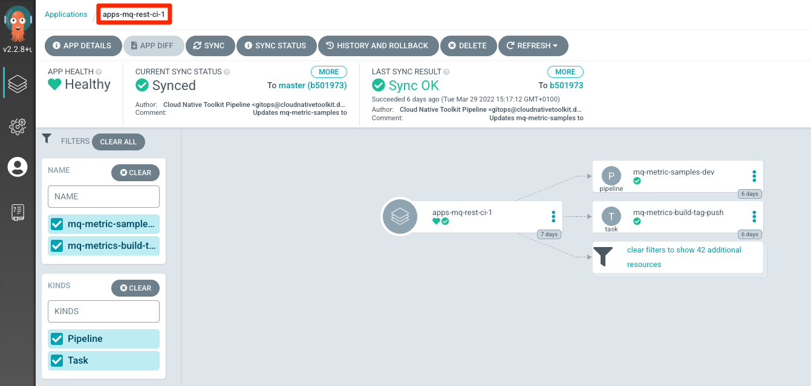

---

## Build and deploy app

The pipeline to build the metrics application is now available in OpenShift.
We are going to run it to obtain the image that will be deployed by ArgoCD.

1. *Review the pre-configured pipeline*

    Open the OpenShift console and navigate to `Pipelines > Pipelines`.

    You will want to select the `ci` Project from the dropdown at the top of the page.

    Click the `mq-metric-samples-dev` Pipeline to view the metrics application build 
    pipeline.

    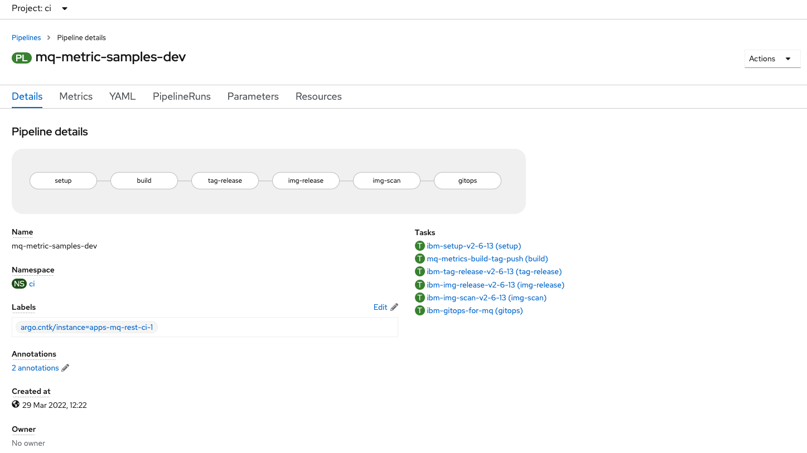

    The code is checked out and then a build task uses the code to compile the 
    application and embed it into a container image. Then the code is tagged and the 
    image released. Finally, the `multi-tenancy-gitops-apps` repository is updated to 
    reflect the new desired estate.

2. *Kickoff a pipeline run*

    From the **Actions** dropdown menu in the upper-right corner, select **Start**.

    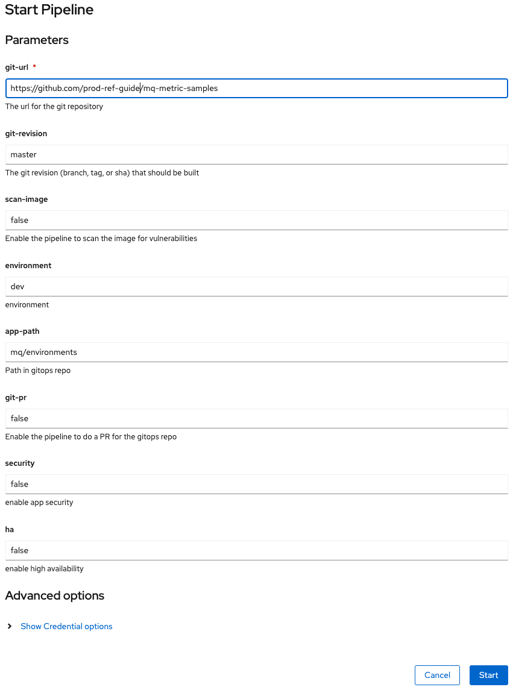{: style="max-height:900px"}

    Configure the run as follows:

    * Set `git-url` to your fork of the `mq-metric-samples` repository
    * Set `git-revision` to `master`.
    * Set `scan-image: false` (temporary fix while issues with UBI are resolved)

    Click **Start** and wait! Keep checking until all steps have completed.

4. *Re-merging local clone to view updated app resources in GitOps repository*

    The `mq-metric-samples-dev` pipeline run updated the GitOps repository with the
    application kubernetes resources. This means that our local clone of the
    GitOps repository is one commit behind GitHub. Before we can push any more
    changes to the GitOps repository, we must re-merge our local clone with GitHub.

    **Return to the terminal window** you're using for the `multi-tenancy-gitops-apps`
    GitOps apps repository. (Rather than the terminal window you're using for
    the `mq-metric-samples` source repository.)

    ```bash
    git fetch origin
    git merge origin/$GIT_BRANCH
    ```

    which shows that
    ``` { .bash .no-copy }
    Updating e3a855d..3b9a70d
    Fast-forward
    mq/environments/mq-metric-samples/overlays/dev/mq-metric-samples/configmap.yaml      | 17 +++++++++++++++++
    mq/environments/mq-metric-samples/overlays/dev/mq-metric-samples/deployment.yaml     | 40 ++++++++++++++++++++++++++++++++++++++++
    mq/environments/mq-metric-samples/overlays/dev/mq-metric-samples/role.yaml           | 10 ++++++++++
    mq/environments/mq-metric-samples/overlays/dev/mq-metric-samples/rolebinding.yaml    | 13 +++++++++++++
    mq/environments/mq-metric-samples/overlays/dev/mq-metric-samples/route.yaml          | 16 ++++++++++++++++
    mq/environments/mq-metric-samples/overlays/dev/mq-metric-samples/secret.yaml         | 10 ++++++++++
    mq/environments/mq-metric-samples/overlays/dev/mq-metric-samples/service.yaml        | 24 ++++++++++++++++++++++++
    mq/environments/mq-metric-samples/overlays/dev/mq-metric-samples/serviceaccount.yaml |  6 ++++++
    mq/environments/mq-metric-samples/overlays/dev/mq-metric-samples/servicemonitor.yaml | 19 +++++++++++++++++++
    9 files changed, 155 insertions(+)
    create mode 100644 mq/environments/mq-metric-samples/overlays/dev/mq-metric-samples/configmap.yaml
    create mode 100644 mq/environments/mq-metric-samples/overlays/dev/mq-metric-samples/deployment.yaml
    create mode 100644 mq/environments/mq-metric-samples/overlays/dev/mq-metric-samples/role.yaml
    create mode 100644 mq/environments/mq-metric-samples/overlays/dev/mq-metric-samples/rolebinding.yaml
    create mode 100644 mq/environments/mq-metric-samples/overlays/dev/mq-metric-samples/route.yaml
    create mode 100644 mq/environments/mq-metric-samples/overlays/dev/mq-metric-samples/secret.yaml
    create mode 100644 mq/environments/mq-metric-samples/overlays/dev/mq-metric-samples/service.yaml
    create mode 100644 mq/environments/mq-metric-samples/overlays/dev/mq-metric-samples/serviceaccount.yaml
    create mode 100644 mq/environments/mq-metric-samples/overlays/dev/mq-metric-samples/servicemonitor.yaml
    ```

    We're now in a consistent state with the GitOps apps repository.

5. *The ArgoCD application for `MQ metric samples application`*

    `MQ metric samples application` has its deployment to the cluster managed by a dedicated 
    ArgoCD application called `dev-mq-metric-samples-instance`. This follows the 
    **separation of concerns** pattern where one ArgoCD application manages a set of related 
    Kubernetes resources deployed to a cluster; in this case, all those resources associated 
    with `MQ metric samples application` in the `dev` namespace.

    Issue the following command to show the ArgoCD application details:

    ```bash
    cat mq/config/argocd/dev/dev-mq-metric-samples-instance.yaml
    ```

    which shows a YAML file typical of those we've seen before:

    ``` { .yaml .no-copy }
    apiVersion: argoproj.io/v1alpha1
    kind: Application
    metadata:
    name: dev-mq-metric-samples-instance
    annotations:
      argocd.argoproj.io/sync-wave: "300"
    finalizers:
      - resources-finalizer.argocd.argoproj.io
    spec:
    destination:
      namespace: dev
      server: https://kubernetes.default.svc
    project: applications
    source:
      path: mq/environments/mq-metric-samples/overlays/dev
      repoURL: https://github.com/cloud-native-toolkit-demos/multi-tenancy-gitops-apps.git
      targetRevision: master
    syncPolicy:
      automated:
        prune: true
        selfHeal: true
    ```

    See how the application resources are referenced by `path: mq/environments/mq-metric-samples/overlays/dev`:

    ``` { .text .no-copy }
    mq/environments/mq-metric-samples/overlays/dev/
    ├── configmap
    │   └── configmap.yaml
    ├── kustomization.yaml
    └── mq-metric-samples
    ```

    The ArgoCD application applies these resources to the cluster to instantiate
    `MQ metric samples application` as a set of cluster resources.

6. *Look at active `MQ metric samples application` ArgoCD application*

    Let's examine `MQ metric samples application` and its Kubernetes resources using the 
    ArgoCD UI.

    In the ArgoCD UI search the **Applications** view with the keyword 
    `mq-metric-samples`:

    (*You may need to launch the ArgoCD UI again. Refer to [these
    instructions](../cluster-config/gitops-tekton-argocd.md).*)

    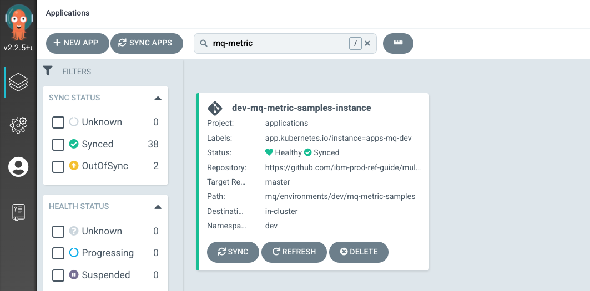{: style="max-height:600px"}

    We can now see the below ArgoCD Application:

    * A new `dev-mq-metric-samples-instance` ArgoCD application that is managing 
    `mq-metric-samples` resources deployed to the cluster.

    !!! caution "Metrics application configuration still not finished"

        At this moment the application is deployed but not healthy. This is expected. 
        Continue with the last two steps to finish the configuration.

7. *Give permissions to service account*

    As part of the set of resources deployed, the application runs as a service account 
    `mq-metric-samples`. At this moment the pod is not capable to run due to lack of 
    permissions and we need to provide them issuing the following command:

    ```bash
    oc adm policy add-scc-to-user anyuid -z mq-metric-samples -n dev
    ```

    !!! caution "First iteration"

        Take into account that this is the first iteration for the MQ monitoring where 
        security aspects has not been addressed yet.

8. *Check permissions*

    Now issue the following command to check if the pod is allowed by `anyuid`. Make 
    sure you use the right name for the pod as this name contains a component that is 
    randomized, so it will be different from the one reflected here:

    ```bash
    oc get pod mq-metric-samples-6545f985f-6jjr8-o yaml | oc adm policy scc-subject-review -f -
    ```

    You should see the following output:

    ```{ .text .no-copy }
    RESOURCE                                ALLOWED BY
    Pod/mq-metric-samples-6545f985f-6jjr8   anyuid
    ```
    

9. *Reboot the pod*

    Now that the service account has the permissions issued, let's remove the pod 
    to trigger its recreation so the new pod will run under the new permission we 
    gave in the previous steps.
    
    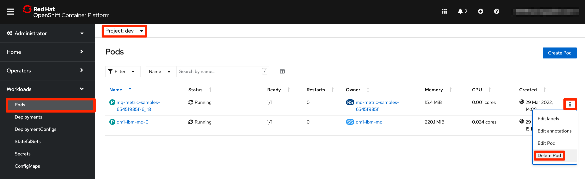{: style="max-height:900px"}
    
    Go to the OpenShift web console. Access `Workloads > Pods` section on the left 
    menu and ensure you are in the `dev` project. You will see the metrics app pod. 
    Click on the three dots menu on the right-hand side and select `Delete Pod`. 
    Immediately a new pod will be created and the new pod now shows as Running.

10. *View the new* `MQ metric samples application` *Kubernetes resources*

    Back to ArgoCD UI, we can look at the deployed instance of `mq-metric-samples` 
    and its dependent kubernetes resources.

    Click on the `dev-mq-metric-samples-instance` ArgoCD application:

    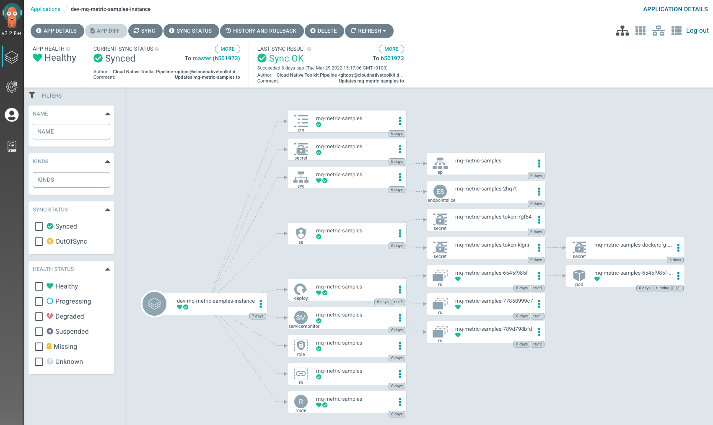{: style="max-height:900px"}

---

## Verify app deployment

1. *Review the deployed application*

    The application is deployed within the cluster using a `deployment` manifest. 
    The deployment creates a `replica set` to manage the application's pod.

    A `service` is also created to manage the port, and a `route` allows external 
    connectivity to the application via the service.

    Also a `servicemonitor` is created. This service allows the communication 
    between the application and Prometheus.

    This is the `deployment` for the application, where we can see 1 pod has been 
    created:

    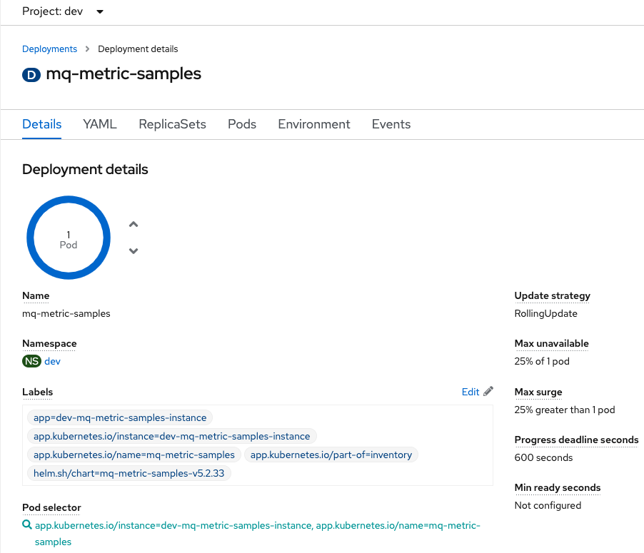

    You can also view the `deployment` from the command line:

    ```bash
    oc project dev
    oc describe deployment mq-metric-samples
    ```

    The application writes logs to stdout. These can be viewed from the command 
    line. First of all find the name of the running `mq-metric-samples` pod:

    ```bash
    oc get pods -l app.kubernetes.io/name=mq-metric-samples
    ```

    Using the name of the running `mq-metric-samples` pod, the following commands 
    displays its logs:

    ```bash
    oc logs mq-metric-samples-6545f985f-vxh82
    ```

    Note that since we deleted the firs pod, the new one has a different name.

4. *Review the application's service*

    This shows the corresponding `service`, where we can see the application's port 
    9157 (this is the metrics port) inside the application pod is being mapped to 
    `port 9157` at the cluster level:

    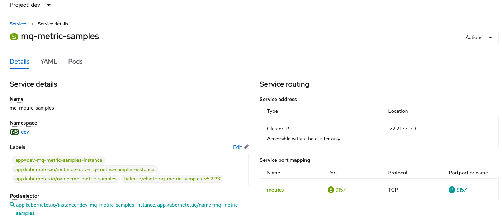

    You can also view the `service` from the command line:

    ```bash
    oc describe service mq-metric-samples
    ```

5. *Review the application's servicemonitor*

    This shows the `servicemonitor` used to map the application metrics port 
    so Prometheus is able to collect the metrics. Here, the interesting information 
    can be viewed in the yaml view:

    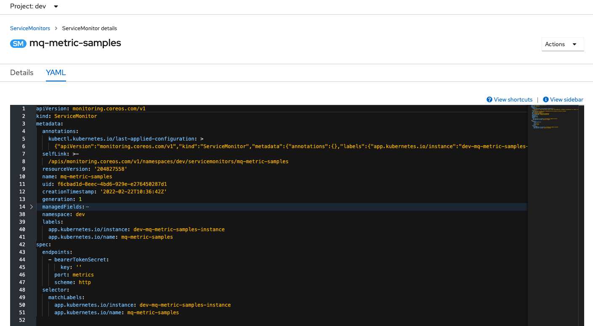

    You can also view the `servicemonitor` from the command line:

    ```bash
    oc describe servicemonitor mq-metric-samples
    ```

    Prometheus follows a *pull* approach when we talk about the way metrics 
    are collected. Servicemonitor resources is the way Prometheus monitoring 
    system can find the endpoints to collect metrics. Let's look at the 
    following lines in the servicemonitor yaml:

    ```{ .yaml .no-copy }
      selector:
        matchLabels:
          app.kubernetes.io/instance: mq-metric-samples
          app.kubernetes.io/name: mq-metric-samples
    ```

    This selector is trying to find the resources that contains the labels 
    listed. If we have a look to our deployment labels we will see:

    ```{ .yaml .no-copy hl_lines="3 4" }
      labels:
        app: mq-metric-samples
        app.kubernetes.io/instance: mq-metric-samples
        app.kubernetes.io/name: mq-metric-samples
        app.kubernetes.io/part-of: inventory
        argo.cntk/instance: dev-mq-metric-samples-instance
        helm.sh/chart: mq-metric-samples-1.0.0-rcv5.2.8
    ```

    This is the way the monitoring system is finding the endpoint exposed by the 
    metrics app.

6. *Review the application's route*

    Finally the `route` shows the external URL (location) we can use to inspect 
    the metric values exported by the application in the moment of hitting the URL:

    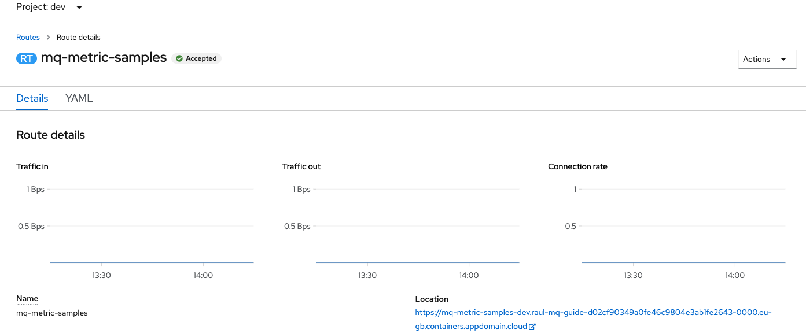

    You can also view the `route` from the command line:

    ```bash
    oc describe route mq-metric-samples
    ```

7. *Check the application is running*

    Using the `location` value from the `route` we can call the application to 
    check its exporting metrics adding `/metrics` to the route:

    ```bash
    export APP_URL=$(oc get route -n dev mq-metric-samples -o jsonpath="{.spec.host}")
    curl -X GET https://$APP_URL/metrics
    ```

    The output is similar to the following.

    ``` { .text .no-copy }
    # HELP go_gc_duration_seconds A summary of the pause duration of garbage collection cycles.
    # TYPE go_gc_duration_seconds summary
    go_gc_duration_seconds{quantile="0"} 7.465e-05
    go_gc_duration_seconds{quantile="0.25"} 8.9893e-05
    go_gc_duration_seconds{quantile="0.5"} 0.00015446
    go_gc_duration_seconds{quantile="0.75"} 0.000577563
    go_gc_duration_seconds{quantile="1"} 0.00205311
    go_gc_duration_seconds_sum 0.003462792
    go_gc_duration_seconds_count 7
    # HELP go_goroutines Number of goroutines that currently exist.
    # TYPE go_goroutines gauge
    go_goroutines 13
    # HELP go_info Information about the Go environment.
    # TYPE go_info gauge
    go_info{version="go1.16.12"} 1
    ...
    ```

    The output here has been truncated but if you examine the whole result you 
    will see that the information shown are the metrics that are being exposed 
    and you are seeing the values at the moment of visiting the URL. Further 
    down the output you will see the new MQ metrics such as `ibmmq_queue_depth` 
    or `ibmmq_queue_oldest_message_age`. 

8. *Review one of the exported metrics*

    If we examine one of these lines, we can see something like:

    ``` { .text .no-copy }
    ibmmq_queue_depth{description="-",platform="UNIX",qmgr="QM1",queue="IBM.DEMO.Q",usage="NORMAL"} 0
    ```

    The metric name is `ibmmq_queue_depth`. This metric consists in a set of 
    values. Under this metric name all the queue depths of the queue manager 
    are recorded. 
    
    Between brackets we can see a comma separated list of key-value pairs. 
    These are attributes that defines the metric for each individual queue. 
    We can highlight the queue manager `qmgr` and the queue name `queue`. 
    Last, but not least, at the end of the line the measure captured for the 
    metric with those attributes is provided. In this case `0` because the 
    queue still does not hold any messages.

9. *Check the new metrics are shown in the metrics UI*

    Now that the new metrics are being exposed, we are able to find them in
    Prometheus. Navigate to the `Monitoring > Metrics` section in OpenShift 
    web console.

    In the query textarea provide one of the new metrics like `ibmmq_queue_depth` 
    and press enter.

    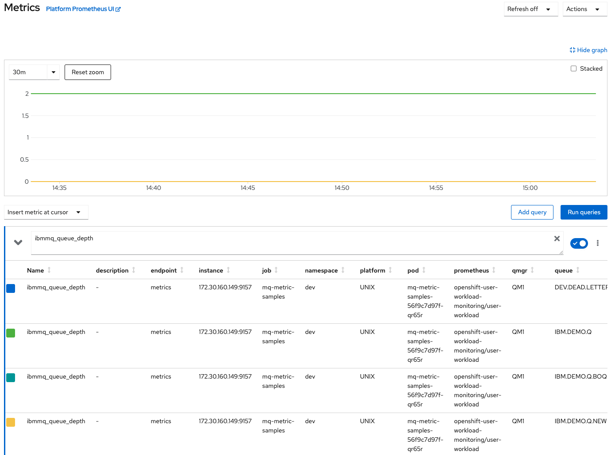

    Results appear represented in a graph and listed under it. What we have 
    done is to query using a metric name, but we have not provided any other 
    detail. Then our query is retrieving the queue depth for all the queues 
    in all the queue managers.

    Despite these metrics belongs to the user workload scope we are reaching
    it through the OpenShift metrics interface. Remember that in the previous
    topic we talked about this abstraction in the monitoring stack. We have
    two instances of Prometheus running, system workload and user defined 
    workload, but we can reach all the metrics from the same UI no matter
    in which Prometheus instance these metrics are being stored.

10. *Narrow down the query*

    If we want to have the results for a specific queue, we need to narrow
    down the query using the `queue` attribute. If we are looking for the
    queue depth of `IBM.DEMO.Q` queue, then issue the query

    ```text
    ibmmq_queue_depth{queue="IBM.DEMO.Q"}
    ```

    And you will have now only a single time series for this specific queue.

---

!!! success "Congratulations!" 

    You have successfully cloned and reviewed the metrics application source 
    code. You have configured, and deployed it obtaining new metrics from our 
    `QM1`. Finally you have been able to perform a query on Prometheus using 
    the new exposed metric. In the next topic we are going to use one of these 
    new metrics to customize the Grafana dashboard for MQ that we saw in the 
    [Monitoring stack](./topic1.md) section.