# Customizing dashboard

<!--- cSpell:ignore qube cntk autoplay allowfullscreen -->

## Overview

**Audience**: Architects, Application developers, Administrators

In this topic, we're going to:

- Access CP4I Grafana instance.
- Add a new panel to the existing MQ dashboard.

---

## Introduction

In previous topics we have reviewed the monitoring stack and we have configured the
system to ingest MQ standard metrics. On top of that, we have used an auxiliary
application to extract more information from the queue manager and expose it As
new metrics.

We are going to surface one of those new metrics, `ibmmq_queue_depth`, in the
MQ dashboard provided with the instance. We will take this measure and we are
going to build a gauge-type panel to show the depth of a queue.

---

## Build gauge panel

1. *Access CP4I Grafana Instance*

    As we have seen previously, Grafana instance provided by CP4I can be reached
    from Platform Navigator. Let's go to a terminal window to retrieve the URL 
    from the Platform Navigator route:

    ```bash
    PN_URL=$(oc get route integration-navigator-pn -n tools -o jsonpath="{.spec.host}")
    echo "https://$PN_URL"
    ```
    Login into the Platform Navigator using `admin` user and the password you can extract issuing the following
    command:

    ```bash
    oc -n ibm-common-services get secret platform-auth-idp-credentials -o jsonpath='{.data.admin_password}' | base64 -d && echo
    ```

    On the left-hand side menu select the `Integration runtimes` option.

    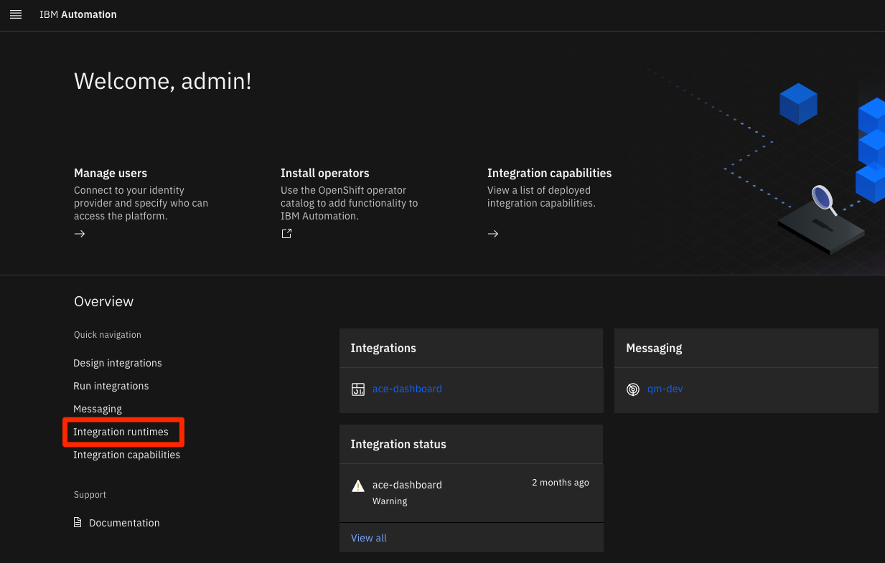
    
    The screen then presents all the integration runtimes. Click on the three dots menu on the right hand side and select `Monitoring` option.

    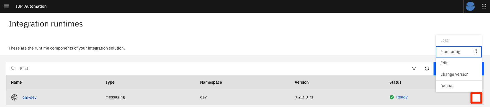

    A new tab will open in the browser with the Grafana UI that we can use to configure our dashboard.  Initially there is a default 
    dashboard provided for MQ with several metrics and graphs.

    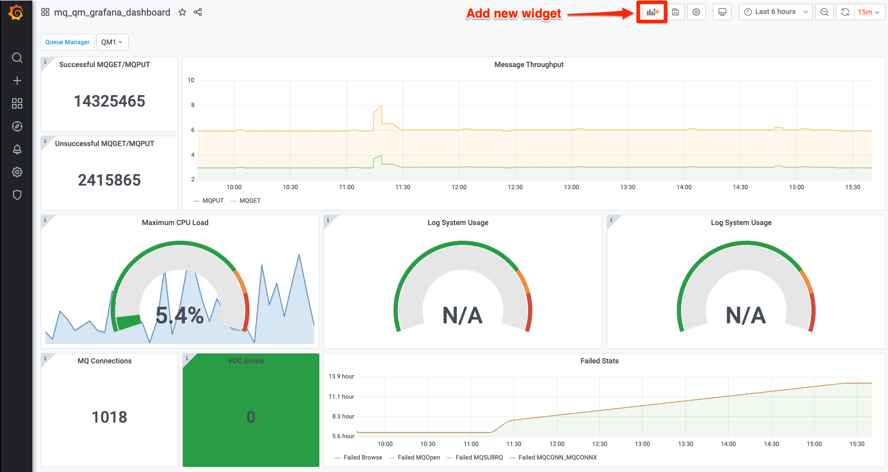

2. *Create a panel with queue depths*

    Click on the icon at the top of the screen to add a new panel.

    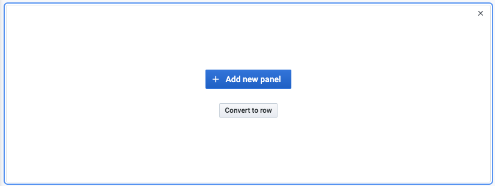

    Click the `+ Add new panel` button. A new screen will appear where we can start updating the different sections.

3. *Configure the panel*

    The central part is for the queries and graphical representation of the selected metrics. The right columns 
    contains different sections to provide all the details to build our panel.

    Let's start with the right column. In the first tab `Panel` update the `Settings` section `Panel title` field 
    with the text `IBM.DEMO.Q depth`.

    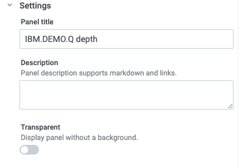

4. *Choose the visualization*

    In `Visualization` section, select `Gauge` type.

    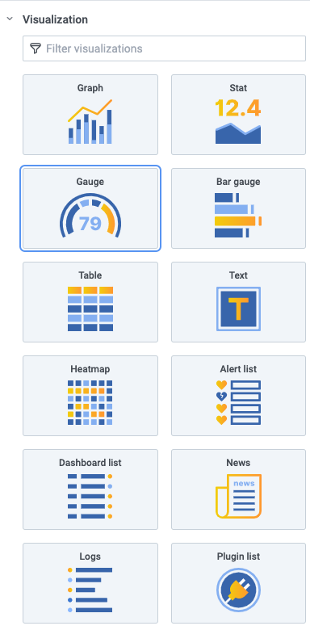

5. *Configure data display*

    In `Display` section select:
    
    - Show: `Calculate`
    - Calculation: `Last`
    - Fields: `Numeric Fields`
    - Show threshold labels: `ON`
    - Show threshold markers: `ON`

    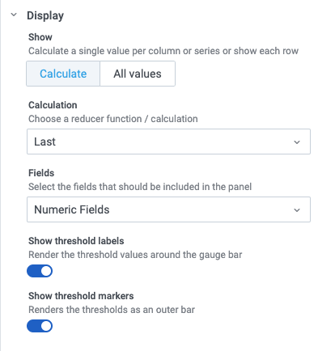

6. *Configure standard options*

    Let's switch now to the second tab `Field`. In the `Standard options` section provide:

    - Unit: `Misc > none`
    - Min: `0`
    - Max: `30` (adapt this value according with the level of messages you are planning to have)
    - Display name: `Queue depth`

    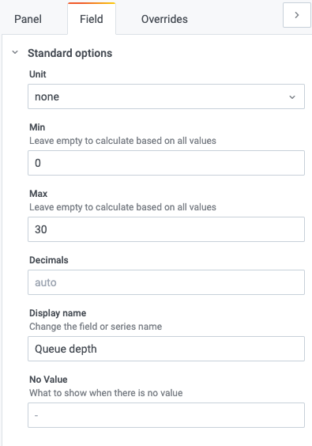

7. *Set thresholds*

    In the `Thresholds` section we can set values to define different ranges
    in our representation. By default, only two thresholds are present 
    defining the green (Base) and the red ranges (beyond the threshold). 
    Add a new one to have a yellow range. Provide the thresholds:

    - Yellow: `20`
    - Red: `25`

    Again, adapt the values to the right numbers depending on the amount of 
    messages you are expecting to have so the green area represents operation 
    in normal ranges, yellow range represents a *warning* zone and the red one
    a *danger* zone.

    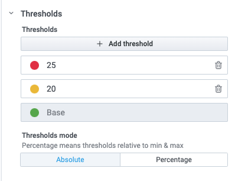

8. *Set the query*

    Finally we need to provide the query in the main area of the screen. 
    
    - Select `prometheus` as the source of data in the dropdown list.
    - Provide `ibmmq_queue_depth{queue="IBM.DEMO.Q",qmgr="QM1"}` as query.
    - Set the legend to `Queue depth`.
  
    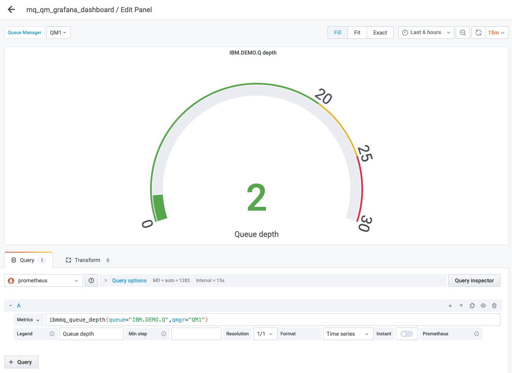

9. *Save the panel*

    We have finished the configuration of the new panel.

    Press the `Apply` button located at the top right corner. This will 
    return us to the dashboard view with our new panel configured.
    
    Save the dashboard using the floppy disk icon located on the right of the 
    new panel icon we used to create the new panel. Confirm clicking `Save` 
    in the pop-up window that appears.

10. *Organize the dashboard*

    You can resize the panel with the anchor that appears in the 
    bottom right corner when you hover with the mouse. 
    
    You can also drag and drop the panel with the anchor that appears when 
    hover the panel title. The panels will relocate trying to fill an 
    invisible grid. Just remember to save the changes when you finish making 
    changes.

    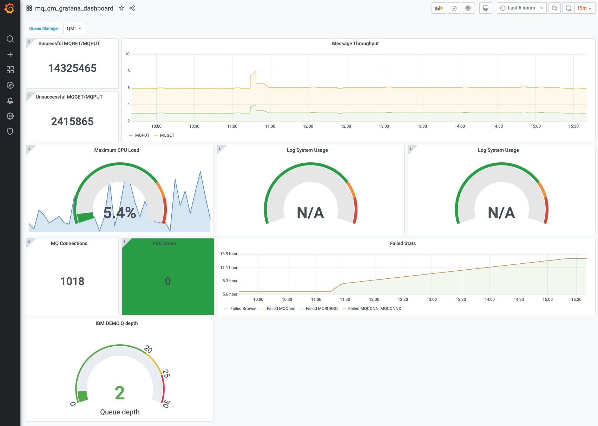

11. *Create messages*

    Only remains to go to the MQ console and add some messages to the 
    `IBM.DEMO.Q` queue. Then check the dashboard to verify that the gauge is 
    reflecting the new queue depth.

!!! success "Congratulations!"
    You've now created a panel that represents one of the new metrics exposed 
    by the auxiliary metrics application. You have now the tools to extend 
    this dashboard to your needs or create alternative ones that represent the
    measures of interest for your use cases. 


