# Running the Pipeline

<!--- cSpell:ignore  pipelinerun resyncs mqsc msqc runmqsc dockerconfigjson queuemanager QMID podman ibmgaragecloud cntk cnkt eventid gitrevision gitrepositoryurl odowdaibm MQSC replicaset eventlistener triggerbinding triggertemplate mqcicd qmgr Artifactory configmaps OIDC CHLAUTH templating sealedsecret khdmwy kustomizations -->

**Audience**: Architects, Application developers, Administrators

**Timing**: 40 minutes

## Overview

In the [previous topic](topic1.md) of this chapter, we installed and customized
the queue manager repository for `QM1` and configured the queue manager pipeline
to access it.

In this topic, we will perform our first full iteration of continuous
integration for `QM1`. We'll run the queue manager pipeline to build
and test the queue manager `QM1`. The successful pipeline run will store a new
Helm chart representing `QM1` in the the GitOps repository, ready for
deployment.

Look at the following diagram:

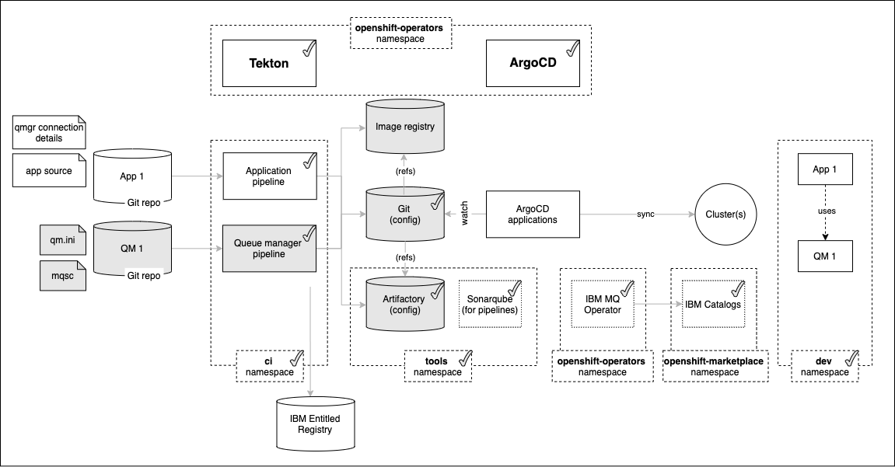

We've highlighted the components we're going to explore in this topic:

* The `QM1 Git repo` that contains the source definition for queue manager
  `QM1`. It includes the queue manager `qm.ini` and `MQSC` files, as well as
  its default Helm configuration and kustomization files.
* The `queue manager pipeline` that will use the `QM1` repository as input. It
  will perform a set of tasks to build and test `QM1`. If successful, the
  pipeline stores updated artifacts in the Image registry and GitOps apps
  repository as required.
* The `Image registry` that will store the newly built version of the queue
  manager image.
* The `GitOps apps repository` that stores the latest good build and test of `QM1`
  generated using Kustomize. These resources will be subsequently used by ArgoCD to
  deploy `QM1` to the cluster.

In this topic, we're going to:

* Run the queue manager pipeline to build and test `QM1`.
* Explore the queue manager pipeline.
* Explore the GitOps apps repository Queue manager resources.

By the end of this topic we'll have a fully built and tested queue manager `QM1`
ready to deploy to the cluster.

---

## Pre-requisites

Before attempting this topic, you should have successfully completed the
[previous topic](../qmgr-pipeline/topic1.md).

---

## Run the queue manager pipeline

As we can see in the diagram above, the queue manager pipeline is responsible
for building and testing `QM1` from a source repository. If successful, it
stores updated artifacts in the GitOps apps repository, which is
used by ArgoCD to deploy the updated `QM1` to the cluster.

It's usually the case a pipeline runs automatically whenever a source repository
changes. However, our first pipeline run is manual so that you can be in
control, making it easier to understand what's happening.

The queue manager **pipeline** performs a set of operations called **tasks**.
Each task is responsible for a specific function such as building a queue
manager image, or unit testing a queue manager. In turn, each **task** comprises
a set of individual **steps**.

For example, the build task might comprise three steps:

- Clone a source repository git,
- Build an image with `buildah` and
- Store an image in an image registry.

If you'd like to know more about Tekton pipelines, here's [an
introduction](https://tekton.dev/docs/concepts/). You will also find [this
video](https://www.ibm.com/cloud/blog/tekton) very helpful. Come back to these
later if you'd like to keep going now.

1. *Locate the* `ci` *pipelines in the web console*

      Let's find the queue manager pipeline using the OpenShift web console.

      Navigate to `Pipelines->Pipelines` in the left hand pane, and select
      `Project: ci`, to show all pipelines in the `ci` namespace:

      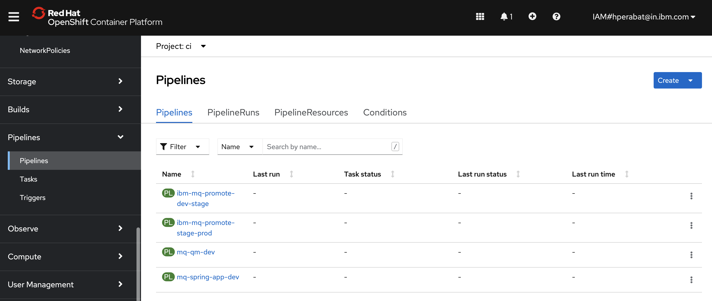{: style="max-height:600px"}

      You can see all the pipelines that we installed into the `ci` namespace in the
      previous chapter.  We'll use different pipelines for different activities
      throughout the tutorial.

      For this topic, we're going to use the `mq-qm-dev` pipeline. When applied
      to the `QM1` source repository, this pipeline will build and test a new
      instance of `QM1` ready for deployment to the `dev` namespace.

2. *The* `mq-qm-dev` *queue manager pipeline*

      Select the `mq-qm-dev` pipeline from the list of all pipelines:

      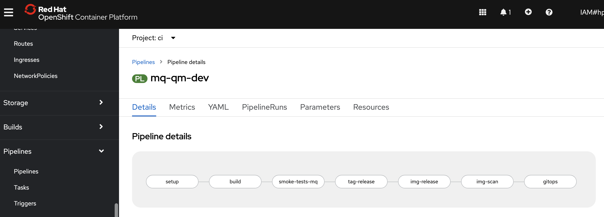{: style="max-height:500px"}

      Like all pipelines, `mq-qm-dev` is composed from a set of **tasks**:

      * `setup`
      * `build`
      * `smoke-tests-mq`
      * `tag-release`
      * `image-release`
      * `img-scan`
      * `gitops`

      The task name often provides a strong hint of each task's specific function.
      We'll examine some of these tasks in detail as the pipeline runs.

3. *The* `oc` *command as an alternative to the Web console*

      As well as using the OpenShift web console, you can also interact with
      pipeline using the `oc` or `tekton` commands.

      Ensure you're logged in to cluster, and issue the following command to list
      the `mq-qm-dev` pipeline details:

      ```bash
      oc get pipeline mq-qm-dev -n ci
      ```

      which shows a brief summary of the pipeline:

      ``` { .bash .no-copy }
      NAME        AGE
      mq-qm-dev   21h
      ```

      You can get more detail by adding the `-o yaml` option; we'll do that later.

      We use the command line and the web console in the tutorial so that you
      become familiar with both. As a general rule, you can do the same things in
      the command line as you can with the web console. The web console tends to be
      better for simple interactive tasks; the command line tends to be better for
      scripting and bulk tasks.

4. *Configure your first pipeline run*

      Every time we run the `mq-qm-dev` pipeline, we create a new **pipeline
      run**.  We can think of a **pipeline run** as an instance of a pipeline.
      `Pipeline` and `PipelineRun` are new custom resources that were added to the
      cluster when we installed Tekton.

      In `pipeline details` view above, you'll see an `Actions` button.  Select
      `Start` to configure a pipeline run.

      You'll be presented with the following dialog:

      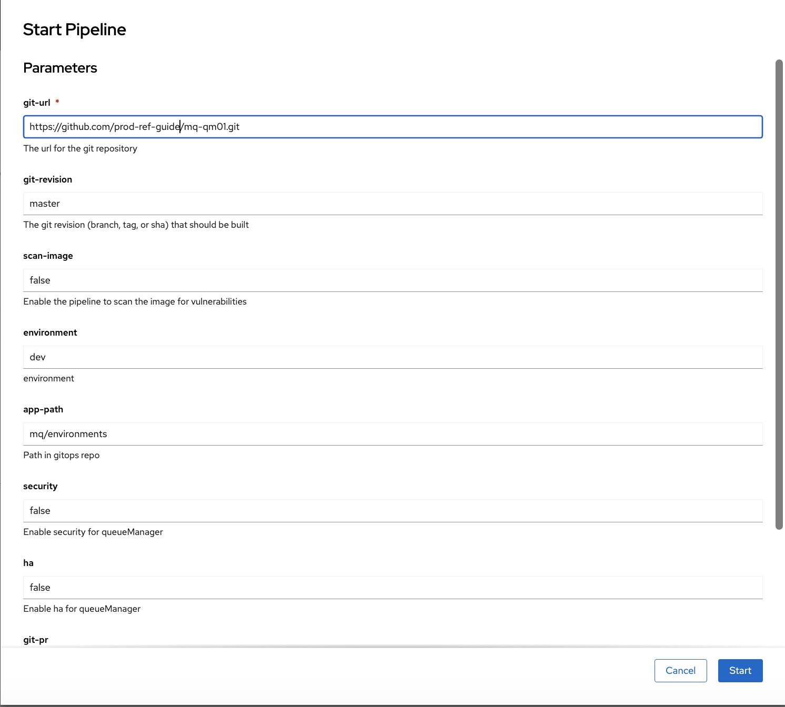{: style="max-height:900px"}

      The supplied arguments allow the user of the pipeline to configure its
      behavior. For example, a user can use this pipeline with different queue
      manager source repositories.

      Configure the run as follows:

      * Set `git-url` to your fork of the `mq-qm01` repository
      * Set `git-revision` to `master`. (Later in the tutorial, we will use a new branch.)
      * Set `scan-image: false` (temporary fix while issues with UBI are resolved)

      Hit `Start` to start the pipeline run.

      You can also use the command line to run a pipeline; we'll explore that option
      later.

5. *Watch a pipeline run executing*

      The pipeline run has now started.

      Notice how the view changes to `Pipeline Run details`:

      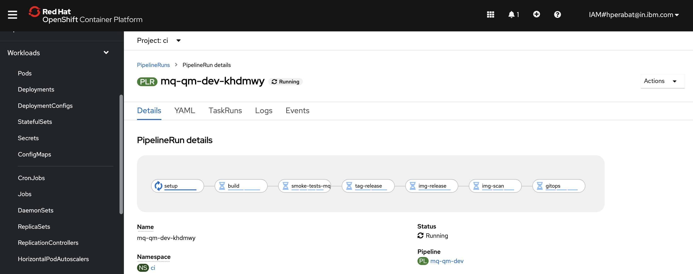

      We're now looking at the live output from a pipeline run, rather than the
      pipeline used to create the run.

      Notice that the pipeline run name `mq-qm-dev-khdmwy` is based on the
      pipeline name -- with a unique suffix. Every new pipeline run will have a
      unique name.

      See also how the first `setup` task is running, while the remaining tasks are
      waiting to start.

      Hover over `setup` or `build` task and you will see the **steps** that
      comprise it.

6. *Watch pipeline steps complete*

      As the pipeline run proceeds, notice the `build` step complete and the
      `smoke-tests-mq` step start:

      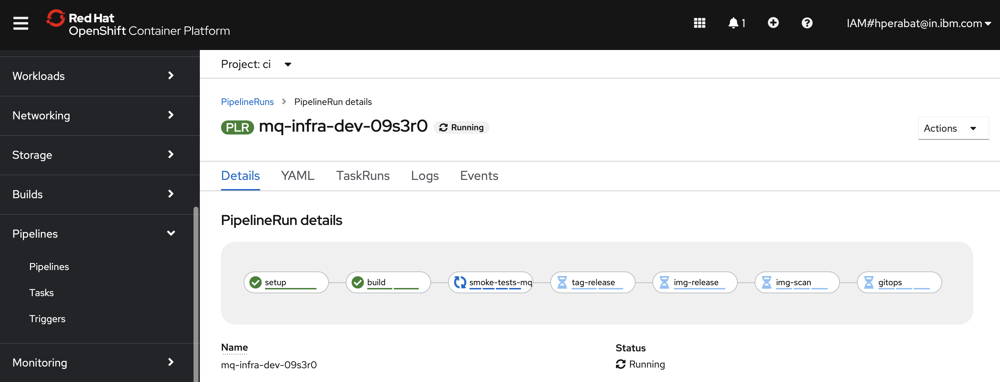

      This pipeline will take about 15 minutes to complete.  While it's doing that,
      let's explore its tasks in a little more detail.

7. *List the pipeline run from the command line*

      You can also explore the pipeline run from the command line.

      Issue the following command, replacing `mq-qm-dev-khdmwy` with your
      pipeline run name:

      ```bash
      oc get pipelinerun mq-qm-dev-khdmwy -n ci -o yaml
      ```

      which will show the details of your pipeline run:

      ``` { .yaml .no-copy }
      apiVersion: tekton.dev/v1beta1
      kind: PipelineRun
      metadata:
      ...
      spec:
         ...
         startTime: "2022-05-18T10:37:44Z"
         taskRuns:
           mq-qm-dev-khdmwy-build-l4pkp:
             pipelineTaskName: build
             status:
               completionTime: "2022-05-18T10:39:57Z"
               conditions:
               - lastTransitionTime: "2022-05-18T10:39:57Z"
                 message: All Steps have completed executing
                 reason: Succeeded
                 status: "True"
                 type: Succeeded
               podName: mq-qm-dev-khdmwy-build-l4pkp-pod-j4f8n
               startTime: "2022-05-18T10:37:57Z"
               steps:
               - container: step-git-clone
                 imageID: quay.io/ibmgaragecloud/alpine-git@sha256:4812deaa107070adda7c704c3d6fd255b4db1b1c58698b308697c9d0f196ff78
                 name: git-clone
                 terminated:
                   containerID: cri-o://4769929baab8da21f20439200991298dc839fcc3401ae8ea511b876d78fdf57d
                   exitCode: 0
                   finishedAt: "2022-05-18T10:38:07Z"
                   reason: Completed
                   startedAt: "2022-05-18T10:38:06Z"
               - container: step-build
                 imageID: quay.io/buildah/stable@sha256:04803d2144a2df5bf3aa2875f130e2b6cfc6ee45003125dc4df13f05f0898f9a
                 name: build
                 terminated:
                   containerID: cri-o://4ac24bb31f59981100a7325b20f0cd75f37828371620f5398bedab8aa07683d7
                   exitCode: 0
                   finishedAt: "2022-05-18T10:39:56Z"
                   reason: Completed
                   startedAt: "2022-05-18T10:38:07Z"
               taskSpec:
                 params:
                 - name: git-url
                   type: string
                 - default: master
                   name: git-revision
                   type: string
                 - default: /source
                   name: source-dir
                   type: string
                 - default: ""
                   name: image-server
                   type: string
                 - default: ""
                   name: image-namespace
                   type: string
                 - default: ""
                   name: image-repository
                   type: string
                 - default: ""
                   name: image-tag
                   type: string
                 - default: quay.io/buildah/stable:v1.15.0
                   name: BUILDER_IMAGE
                   type: string
                 - default: ./Dockerfile
                   name: DOCKERFILE
                   type: string
                 - default: .
                   name: CONTEXT
                   type: string
                 - default: "false"
                   name: TLSVERIFY
                   type: string
                 - default: docker
                   name: FORMAT
                   type: string
                 - default: overlay
                   description: Set buildah storage driver
                   name: STORAGE_DRIVER
                   type: string
                 stepTemplate:
                   name: ""
                   resources: {}
                   volumeMounts:
                   - mountPath: $(params.source-dir)
                     name: source
                 steps:
                 - env:
      ```

      The full output is very large; we've abbreviated it significantly.

      This output contains the same information displayed as we see in the web
      console. Indeed the web console view is graphical representation of this
      information.

      Here's just a few of the interesting things that you can see:

      * `spec.startTime:` identifies when the pipeline run started
      * `pipelineTaskName: build` holds lots of interesting information on the
        `build` task. For example, we can see the `build` start and completion
        times and that it `succeeded`.
      * `steps` identifies lots of interesting information on each of the steps
        within the `build` task. For example we can see the `git-clone` start and
        completion times, and that it also succeeded.

      There's no need to try to understand all this output right now; we're going to
      do that during this topic. Moreover, we'll make extensive use of the web
      console because it's easier to see what's happening. However, as we do this,
      you might like to link the console display back to this `PipelineRun`
      output.

      Let's continue exploring while the pipeline run completes.

---

##  Explore the pipeline

Let's look more closely at how the `mq-qm-dev` pipeline is structured as the
pipeline run proceeds. Let's also examine the tasks and steps that make up the
pipeline, and how they progressively build and test a queue manager, resulting
in the production of a kubernetes resources ready for deployment.

The `mq-qm-dev` pipeline run may still be running, so you'll be looking at a
live pipeline run. Don't worry if the run has already completed, all the
information remains available because its held in a `PipelineRun` custom
resource for that run.

1. *Pipeline, Task, Step*

      Let's start with the pipeline, its tasks and steps.

      Hover over the `smoke-tests-mq` task:

      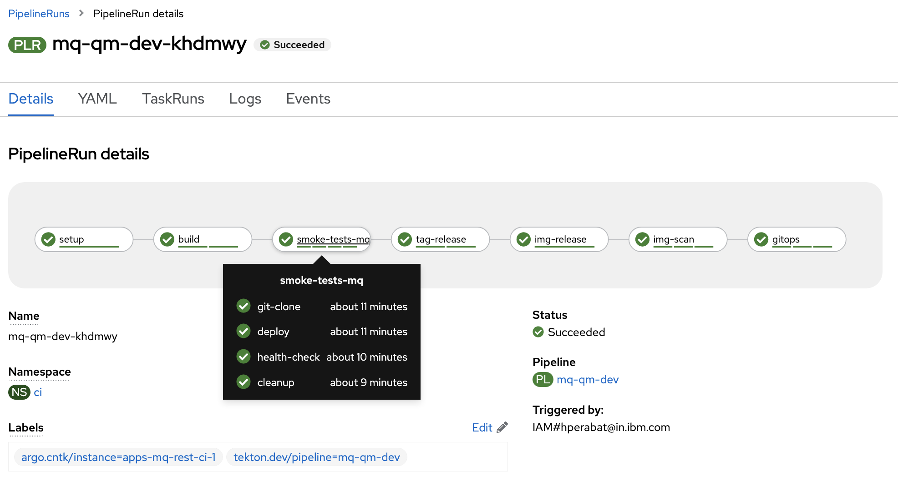

      See how our pipeline is made up of a set of tasks such as `setup`, `build` or
      `gitops`. These run in the order defined by the pipeline. Our pipeline is
      linear, though Tekton supports more sophisticated pipeline graphs if
      necessary.

      See how each task comprises a set of steps such as `git-clone` or `setup`.
      These run in the order defined by the task.

2. *The pipeline run logs*

      When a pipeline runs, all its output is captured in a set of logs, one for
      each task.

      Click on the `setup` task to show its logs:

      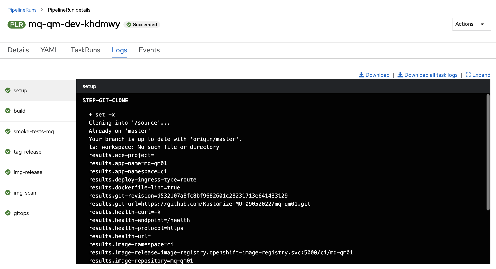

      (*Alternatively, you can select the `Logs` tab from the UI, and then select
      the tasks on the left pane within the pipeline run view.*)

      See how the `setup` task has its output in a dedicated log. You can select any
      log for any task that has completed or is executing. When a pipeline run
      completes, all its logs remain available, which can help diagnosing problems
      for example.

3. *Exploring an example task output:* `build`

      It's easy to examine a task log; you simply select the relevant task and
      scroll the log up or down. For active tasks the log will be dynamically
      updated.

      Click on the `build` task:

      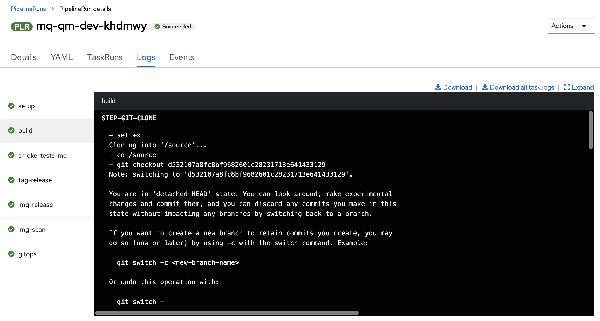

      This console window shows the output generated by `build` task.  As the task
      script proceeds, its output is captured; that's what we can see in this
      window.

      Notice that the `build` task output is from the **first step** in the `build`
      task. This step is called `STEP-GIT-CLONE`. Note how the step names are
      capitalized in the web console output.

      Let's look at another task and its steps more closely.

4. *Exploring a task step in detail*: `STEP-BUILD`

      A task is built of multiple steps. Let's explore the `build` task and its
      `step-build` step.

      Select the `build` task and scroll through its logs to see its **second
      step**, `STEP-BUILD`:

      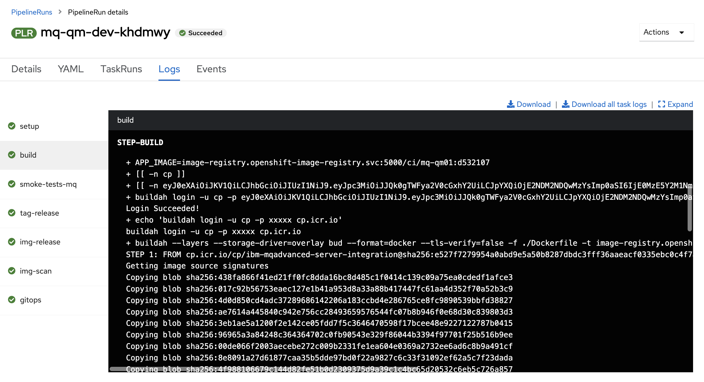

      See how the `step-build` output is captured in the same log as the previous
      step `git-clone`.

      Each step runs in a separate container -- if you re-examine the `PipelineRun`
      YAML, you'll see those containers. When you scroll through the `build` task
      output, you're seeing what's happening in those containers.

      Read some of the log output to get a feeling for what's happening.  Later,
      we'll see how `step-build` and `step-git-clone` are coded.

5. *The pipeline definition*

      Up to this point, we've examined the pipeline run and the logs it
      generates. Let's now look at how a pipeline is defined.

      Issue the following command to show the `mq-qm-dev` pipeline:

      ```bash
      oc describe pipeline mq-qm-dev -n ci
      ```

      which shows the pipeline YAML in considerable detail:

      ``` { .yaml .no-copy }
      Name:         mq-qm-dev
      Namespace:    ci
      Labels:       argo.cntk/instance=apps-mq-rest-ci-1
      Annotations:  app.openshift.io/runtime: mq
      API Version:  tekton.dev/v1beta1
      Kind:         Pipeline
      Metadata:
        Creation Timestamp:  2022-05-17T12:19:56Z
        Generation:          3
        Managed Fields:
          API Version:  tekton.dev/v1beta1
          Fields Type:  FieldsV1
          fieldsV1:
            f:metadata:
              f:annotations:
                .:
                f:app.openshift.io/runtime:
                f:kubectl.kubernetes.io/last-applied-configuration:
              f:labels:
                .:
                f:argo.cntk/instance:
            f:spec:
              .:
              f:params:
              f:tasks:
          Manager:         argocd-application-controller
          Operation:       Update
          Time:            2022-05-17T12:19:56Z
        Resource Version:  20209890
        UID:               50aea714-0568-4f35-9034-ff383e29131e
      Spec:
        Params:
          Description:  The url for the git repository
          Name:         git-url
          Type:         string
          Default:      master
          Description:  The git revision (branch, tag, or sha) that should be built
          Name:         git-revision
          Type:         string
          Default:      false
          Description:  Enable the pipeline to scan the image for vulnerabilities
          Name:         scan-image
          Type:         string
          Default:      dev
          Description:  environment
          Name:         environment
          Type:         string
          Default:      mq/environments
          Description:  Path in gitops repo
          Name:         app-path
          Type:         string
          Default:      false
          Description:  Enable security for queueManager
          Name:         security
          Type:         string
          Default:      false
          Description:  Enable ha for queueManager
          Name:         ha
          Type:         string
          Default:      false
          Description:  Enable the pipeline to do a PR for the gitops repo
          Name:         git-pr
          Type:         string
        Tasks:
          Name:  setup
          Params:
            Name:   git-url
            Value:  $(params.git-url)
            Name:   git-revision
            Value:  $(params.git-revision)
            Name:   scan-image
            Value:  $(params.scan-image)
          Task Ref:
            Kind:  Task
            Name:  ibm-setup-v2-6-13
          Name:    build
          Params:
            Name:   git-url
            Value:  $(tasks.setup.results.git-url)
            Name:   git-revision
            Value:  $(tasks.setup.results.git-revision)
            Name:   source-dir
            Value:  $(tasks.setup.results.source-dir)
            Name:   image-server
            Value:  $(tasks.setup.results.image-server)
            Name:   image-namespace
            Value:  $(tasks.setup.results.image-namespace)
            Name:   image-repository
            Value:  $(tasks.setup.results.image-repository)
            Name:   image-tag
            Value:  $(tasks.setup.results.image-tag)
          Run After:
            setup
          Task Ref:
            Kind:  Task
            Name:  ibm-build-tag-push-v2-6-13
          Name:    smoke-tests-mq
          Params:
            Name:   git-url
            Value:  $(tasks.setup.results.git-url)
            Name:   git-revision
            Value:  $(tasks.setup.results.git-revision)
            Name:   source-dir
            Value:  $(tasks.setup.results.source-dir)
            Name:   image-server
            Value:  $(tasks.setup.results.image-server)
            Name:   image-namespace
            Value:  $(tasks.setup.results.image-namespace)
            Name:   image-repository
            Value:  $(tasks.setup.results.image-repository)
            Name:   image-tag
            Value:  $(tasks.setup.results.image-tag)
            Name:   app-namespace
            Value:  $(tasks.setup.results.app-namespace)
            Name:   app-name
            Value:  $(tasks.setup.results.app-name)
            Name:   deploy-ingress-type
            Value:  $(tasks.setup.results.deploy-ingress-type)
            Name:   tools-image
            Value:  $(tasks.setup.results.tools-image)
            Name:   security
            Value:  $(params.security)
            Name:   ha
            Value:  $(params.ha)
          Run After:
            build
          Task Ref:
            Kind:  Task
            Name:  ibm-smoke-tests-mq
          Name:    tag-release
          Params:
            Name:   git-url
            Value:  $(tasks.setup.results.git-url)
            Name:   git-revision
            Value:  $(tasks.setup.results.git-revision)
            Name:   source-dir
            Value:  $(tasks.setup.results.source-dir)
            Name:   js-image
            Value:  $(tasks.setup.results.js-image)
          Run After:
            smoke-tests-mq
          Task Ref:
            Kind:  Task
            Name:  ibm-tag-release-v2-6-13
          Name:    img-release
          Params:
            Name:   image-from
            Value:  $(tasks.setup.results.image-url)
            Name:   image-to
            Value:  $(tasks.setup.results.image-release):$(tasks.tag-release.results.tag)
          Run After:
            tag-release
          Task Ref:
            Kind:  Task
            Name:  ibm-img-release-v2-6-13
          Name:    img-scan
          Params:
            Name:   image-url
            Value:  $(tasks.img-release.results.image-url)
            Name:   scan-trivy
            Value:  $(tasks.setup.results.scan-trivy)
            Name:   scan-ibm
            Value:  $(tasks.setup.results.scan-ibm)
          Run After:
            img-release
          Task Ref:
            Kind:  Task
            Name:  ibm-img-scan-v2-6-13
          Name:    gitops
          Params:
            Name:   git-url
            Value:  $(tasks.setup.results.git-url)
            Name:   git-revision
            Value:  $(tasks.setup.results.git-revision)
            Name:   source-dir
            Value:  $(tasks.setup.results.source-dir)
            Name:   image-server
            Value:  $(tasks.setup.results.image-server)
            Name:   image-namespace
            Value:  $(tasks.setup.results.image-namespace)
            Name:   image-repository
            Value:  $(tasks.setup.results.image-repository)
            Name:   image-tag
            Value:  $(tasks.tag-release.results.tag)
            Name:   app-name
            Value:  $(tasks.setup.results.app-name)
            Name:   app-path
            Value:  $(params.app-path)
            Name:   environment
            Value:  $(params.environment)
            Name:   deploy-ingress-type
            Value:  $(tasks.setup.results.deploy-ingress-type)
            Name:   tools-image
            Value:  $(tasks.setup.results.tools-image)
            Name:   security
            Value:  $(params.security)
            Name:   ha
            Value:  $(params.ha)
            Name:   dest-environment
            Value:  $(params.environment)
            Name:   git-pr
            Value:  $(params.git-pr)
          Run After:
            img-scan
          Task Ref:
            Kind:  Task
            Name:  ibm-gitops-for-mq
      Events:      <none>
      ```

      Don't be intimidated by this output -- it's actually just a more detailed
      source view of the information shown for the `mq-qm-dev` pipeline in the
      web console.

      Locate the following key structures in the `Pipeline` YAML:

      * `API Version: tekton.dev/v1beta1` and `Kind: Pipeline` identify this as
        a Tekton pipeline.
      * `Spec: Params` identifies the **pipeline input parameters**
      * `Tasks:` is a list of the tasks in this pipeline, each of which has
        * A `Name:` naming the task
        * A set of `Params:` identifying the **task input parameters**
        * An optional `Run After:` value indicating when the task is run
        * A `Task Ref:` identifying the actual task code to be run using the
          task's input

      Notice that there's **no code** in the pipeline definition; instead, the
      definition specifies the required inputs to the pipeline, as well as the set
      of required tasks and their order of execution. The code executed by each task
      is identified by `Task Ref:`, rather than in the pipeline; the pipeline
      definition merely defines the order of task execution and how parameters are
      marshaled between tasks.

      Let's now examine the pipeline definition in a little more detail.

6. *The pipeline input* `Spec: Params`

      When we configure a pipeline run, the arguments map precisely to `Spec:
      Params` in the pipeline YAML file.

      Below, we've just shown the `Spec: Params:` for the `mq-qm-dev` pipeline:

      ``` { .yaml .no-copy }
      Spec:
        Params:
          Description:  The url for the git repository
          Name:         git-url
          Type:         string
          Default:      master
          Description:  The git revision (branch, tag, or sha) that should be built
          Name:         git-revision
          Type:         string
          Default:      false
          Description:  Enable the pipeline to scan the image for vulnerabilities
          Name:         scan-image
          Type:         string
          Default:      dev
          Description:  environment
          Name:         environment
          Type:         string
          Default:      mq/environments
          Description:  Path in gitops repo
          Name:         app-path
          Type:         string
          Default:      false
          Description:  Enable security for queueManager
          Name:         security
          Type:         string
          Default:      false
          Description:  Enable ha for queueManager
          Name:         ha
          Type:         string
          Default:      false
          Description:  Enable the pipeline to do a PR for the gitops repo
          Name:         git-pr
          Type:         string
      ```

      Spend a few moments mapping each of these parameters maps to those on the
      `Start Pipeline` input dialog where you specified the pipeline run arguments.
      For example, map `Names:`, `Description:`  and `Default:` to the different
      fields in the dialog.

7. *Parameters for the first* `setup` *task*

      We can see that the first task in the pipeline is called `setup`. Let's
      examine its YAML to see how it gets its input parameters:

      ``` { .yaml .no-copy }
      Tasks:
        Name:  setup
        Params:
          Name:   git-url
          Value:  $(params.git-url)
          Name:   git-revision
          Value:  $(params.git-revision)
          Name:   scan-image
          Value:  $(params.scan-image)
        Task Ref:
          Kind:  Task
          Name:  ibm-setup-v2-6-13
      ```

      See how the `setup` task derives its `git-url` parameter using the
      **pipeline** input parameter value `$(params.git-url)`. See how `git-revision`
      and `scan-image` work in a similar way. The first task in a pipeline typically
      works like this -- its parameters are mapped from the pipeline's input
      parameters.

      Notice also that some pipeline input parameters are not referred to by the
      `setup` task; they will be used by subsequent tasks using the appropriate
      `$(params.)` value.

8. *Passing arguments between tasks*

      As each task completes, the pipeline proceeds. When a new task starts it often
      requires one or more results generated by a previous task.

      We can see a good example of this in the `build` task:

      ``` { .yaml .no-copy }
      - name: build
        taskRef:
          name: ibm-build-tag-push-v2-6-13
        runAfter:
          - setup
        params:
          - name: git-url
            value: "$(tasks.setup.results.git-url)"
          - name: git-revision
            value: "$(tasks.setup.results.git-revision)"
          - name: source-dir
            value: "$(tasks.setup.results.source-dir)"
          - name: image-server
            value: "$(tasks.setup.results.image-server)"
          - name: image-namespace
            value: "$(tasks.setup.results.image-namespace)"
          - name: image-repository
            value: "$(tasks.setup.results.image-repository)"
          - name: image-tag
            value: "$(tasks.setup.results.image-tag)"
      ```

      See how the `build` task specifies that the `image-tag` parameter should use
      value generated by the `setup` task using the syntax:
      `$(tasks.setup.results.image-tag)`.

      Also notice how the `build` tasks uses `Run After:` to specify that it should
      execute **after** the `setup` task. This follows the Kubernetes idiom of
      resources being declarative -- the order of execution is defined by
      `RunAfter:` rather than the order in which tasks appear in the YAML.

      Again, notice that the `build` task **doesn't** contain the code that the task
      executes. This is contained in `Task Ref:` which identifies
      `ibm-build-tag-push-v2-6-13` as the task to execute using the specified
      parameters.  It's the code in `ibm-build-tag-push-v2-6-13` which generates the
      log output for the task; we'll examine it later.

      The way pipelines tasks are designed makes them highly reusable. As we'll see
      later, tasks are written with defined inputs and outputs such that they can be
      re-used by different pipelines. Pipelines focus on organizing the order of
      task execution and how parameters are marshaled into and between tasks; it's
      the tasks that do the actual work.

9. *Locating the pipeline and tasks source YAMLs*

      Finally, let's locate the source for the `mq-qm-dev` pipeline and the tasks
      within it.

      It is located in the following folder:

      ```bash
      cd $GIT_ROOT
      cd multi-tenancy-gitops-apps
      tree mq/environments/ci/pipelines/
      ```

      We can see the other pipelines for the `ci` namespace in this folder:

      ``` { .text .no-copy }
      mq/environments/ci/pipelines/
      ├── ibm-test-pipeline-for-dev.yaml
      ├── ibm-test-pipeline-for-stage.yaml
      ├── java-maven-dev-pipeline.yaml
      ├── mq-metric-samples-dev-pipeline.yaml
      ├── mq-pipeline-dev.yaml
      └── mq-spring-app-dev-pipeline.yaml
      ```

      These map to the MQ-related pipelines we saw in the `Pipelines->Pipelines`
      view in the web console.

10. *Exploring the* `mq-qm-dev` *source YAML*

      View the source for the `mq-pipeline-dev.yaml` pipeline with the command:

      ```bash
      cat mq/environments/ci/pipelines/mq-pipeline-dev.yaml
      ```

      which shows the source YAML for the `mq-qm-dev` pipeline:

      ``` { .yaml .no-copy }
      apiVersion: tekton.dev/v1beta1
      kind: Pipeline
      metadata:
        name: mq-qm-dev
        annotations:
          app.openshift.io/runtime: mq
      spec:
        params:
          - name: git-url
            description: The url for the git repository
          - name: git-revision
            description: The git revision (branch, tag, or sha) that should be built
            default: master
          - name: scan-image
            description: Enable the pipeline to scan the image for vulnerabilities
            default: "false"
          - name: environment
            description: environment
            default: dev
          - name: app-path
            description: Path in gitops repo
            default: mq/environments
          - name: security
            description: Enable security for queueManager
            default: "false"
          - name: ha
            description: Enable ha for queueManager
            default: "false"
          - name: git-pr
            description: Enable the pipeline to do a PR for the gitops repo
            default: "false"
        tasks:
          - name: setup
            taskRef:
              name: ibm-setup-v2-6-13
            params:
              - name: git-url
                value: $(params.git-url)
              - name: git-revision
                value: $(params.git-revision)
              - name: scan-image
                value: $(params.scan-image)
          - name: build
            taskRef:
              name: ibm-build-tag-push-v2-6-13
            runAfter:
              - setup
            params:
              - name: git-url
                value: "$(tasks.setup.results.git-url)"
              - name: git-revision
                value: "$(tasks.setup.results.git-revision)"
              - name: source-dir
                value: "$(tasks.setup.results.source-dir)"
              - name: image-server
                value: "$(tasks.setup.results.image-server)"
              - name: image-namespace
                value: "$(tasks.setup.results.image-namespace)"
              - name: image-repository
                value: "$(tasks.setup.results.image-repository)"
              - name: image-tag
                value: "$(tasks.setup.results.image-tag)"
          - name: smoke-tests-mq
            taskRef:
              name: ibm-smoke-tests-mq
            runAfter:
              - build
            params:
              - name: git-url
                value: "$(tasks.setup.results.git-url)"
              - name: git-revision
                value: "$(tasks.setup.results.git-revision)"
              - name: source-dir
                value: "$(tasks.setup.results.source-dir)"
              - name: image-server
                value: "$(tasks.setup.results.image-server)"
              - name: image-namespace
                value: "$(tasks.setup.results.image-namespace)"
              - name: image-repository
                value: "$(tasks.setup.results.image-repository)"
              - name: image-tag
                value: "$(tasks.setup.results.image-tag)"
              - name: app-namespace
                value: "$(tasks.setup.results.app-namespace)"
              - name: app-name
                value: "$(tasks.setup.results.app-name)"
              - name: deploy-ingress-type
                value: "$(tasks.setup.results.deploy-ingress-type)"
              - name: tools-image
                value: "$(tasks.setup.results.tools-image)"
              - name : security
                value: "$(params.security)"
              - name : ha
                value: "$(params.ha)"
          - name: tag-release
            taskRef:
              name: ibm-tag-release-v2-6-13
            runAfter:
              - smoke-tests-mq
            params:
              - name: git-url
                value: "$(tasks.setup.results.git-url)"
              - name: git-revision
                value: "$(tasks.setup.results.git-revision)"
              - name: source-dir
                value: "$(tasks.setup.results.source-dir)"
              - name: js-image
                value: "$(tasks.setup.results.js-image)"
          - name: img-release
            taskRef:
              name: ibm-img-release-v2-6-13
            runAfter:
              - tag-release
            params:
              - name: image-from
                value: "$(tasks.setup.results.image-url)"
              - name: image-to
                value: "$(tasks.setup.results.image-release):$(tasks.tag-release.results.tag)"
          - name: img-scan
            taskRef:
              name: ibm-img-scan-v2-6-13
            runAfter:
              - img-release
            params:
              - name: image-url
                value: $(tasks.img-release.results.image-url)
              - name: scan-trivy
                value: $(tasks.setup.results.scan-trivy)
              - name: scan-ibm
                value: $(tasks.setup.results.scan-ibm)
          - name: gitops
            taskRef:
              name: ibm-gitops-for-mq
            runAfter:
              - img-scan
            params:
              - name: git-url
                value: "$(tasks.setup.results.git-url)"
              - name: git-revision
                value: "$(tasks.setup.results.git-revision)"
              - name: source-dir
                value: "$(tasks.setup.results.source-dir)"
              - name: image-server
                value: "$(tasks.setup.results.image-server)"
              - name: image-namespace
                value: "$(tasks.setup.results.image-namespace)"
              - name: image-repository
                value: "$(tasks.setup.results.image-repository)"
              - name: image-tag
                value: "$(tasks.tag-release.results.tag)"
              - name: app-name
                value: "$(tasks.setup.results.app-name)"
              - name: app-path
                value: "$(params.app-path)"
              - name: environment
                value: "$(params.environment)"
              - name: deploy-ingress-type
                value: "$(tasks.setup.results.deploy-ingress-type)"
              - name: tools-image
                value: "$(tasks.setup.results.tools-image)"
              - name : security
                value: "$(params.security)"
              - name: ha
                value: "$(params.ha)"
              - name: dest-environment
                value: "$(params.environment)"
              - name: git-pr
                value: "$(params.git-pr)"
      ```

      This YAML is *slightly* different to the output of the `oc get pipeline`
      command, because extra information is added during deployment such as
      `Creation Timestamp:`.

11. *Finding the ArgoCD application that manages pipelines*

      You can see how the `mq-qm-dev` and other pipeline YAMLs were deployed by
      examining the ArgoCD application that watches the folder containing the `ci`
      namespace pipelines.

      Issue the following command:

      ```bash
      cat mq/config/argocd/ci/ci-app-rest.yaml
      ```

      which shows the `apps-mq-rest-ci-1` ArgoCD application that watches for updates:

      ``` { .yaml .no-copy hl_lines="15-17"}
      apiVersion: argoproj.io/v1alpha1
      kind: Application
      metadata:
        name: apps-mq-rest-ci-1
        annotations:
          argocd.argoproj.io/sync-wave: "300"
        finalizers:
          - resources-finalizer.argocd.argoproj.io
      spec:
        destination:
          namespace: ci
          server: https://kubernetes.default.svc
        project: applications
        source:
          path: mq/environments/ci
          repoURL: https://github.com/prod-ref-guide/multi-tenancy-gitops-apps.git
          targetRevision: master
        syncPolicy:
          automated:
            prune: true
            selfHeal: true
      ```

      See how this `apps-mq-rest-ci-1` watches: `path: mq/environments/ci`. As
      we know, this folder contains the YAML for the `mq-qm-dev` and other
      pipelines under `pipelines` folder. When this ArgoCD application was made
      active in the cluster, it installed all the pipelines along with other
      resources in this folder.

      Later in the tutorial, we'll examine how tasks are coded to perform their
      tasks, but for now, you should have a good feeling for how pipelines are
      structured and how they work.

      By now, the pipeline run should have completed successfully. In the next
      section, we're going to examine the kubernetes resources that it created.


---

## Understanding the `QM1` kustomize resources

The successful completion of the `mq-qm-dev` pipeline run which used the
`QM1` source repository as input has resulted in three new objects being
produced:

* A versioned container image for `QM1` stored in the cluster image registry.
* `QM1` resources stored in the GitOps repository. These resources are
  created the first time the pipeline runs and will be managed by kustomize.

The following diagram represents this structure and process:

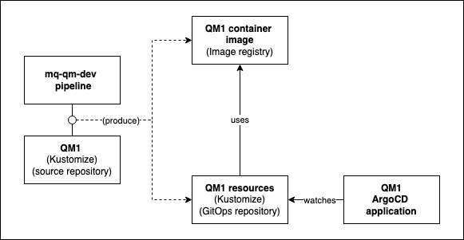

This diagram shows how:

* This `QM1` resources in the GitOps repository points to the container image used by `QM1` in the Image registry. These resources contains the default configuration for the `queuemanager` custom resource YAML for `QM1` derived
from the Kustomize resources residing in its source repository.
* Also, this YAML refers to the container that was built during the pipeline run.
* These resources will be used by ArgoCD to deploy `QM1` to the cluster.

In this topic we're going to examine the `QM1` Kustomize resources in more detail. We'll see
how they are structured and how they are used. We'll see how, in combination,
these Kustomize resources provide a well governed deployment of `QM1` to the cluster.

1. *The source repository for the Kustomize resources*

      **Return to the terminal window** you're using for the `mq-qm01` source
      repository. (*Rather than the terminal window you're using for the*
      `multi-tenancy-gitops` *GitOps repository.*)

      In the previous topic, we cloned the `mq-qm01` repository. This
      contains the source Kustomize resources for queue manager `QM1`. Let's quickly recap
      these resources.

      Ensure you're in the correct directory:

      ```bash
      cd $GIT_ROOT/mq-qm01
      ```

2. *The source Kustomize resources*

      Let's see how the source Kustomize resources for `QM1` are structured.

      Issue the following command:

      ```bash
      tree kustomize -L 2
      ```

      to show the Helm folder structure and detail:

      ``` { .text .no-copy }
      kustomize
      ├── base
      │   ├── generic-qmgr
      │   └── native-ha-qmgr
      └── components
          ├── dynamic-mqsc
          └── scripts

      6 directories, 0 files
      ```

      The key folders and files are as follows:

      * The `base` folder contains different templates that will be used to
        generate the `queuemanager` custom resource and `configmap` for `QM1`.
      * The `generic-qmgr` folder contains a set of files that are used by a
        basic queuemanager.
      * The `native-ha-qmgr` folder contains a set of files that are used by a
        queuemanager where ha is enabled.
      * The `components` folder contains reusable kustomizations allowing us to
        enable required subset of features.
      * The `dynamic-mqsc` folder contains the queue manager dynamic configurations.
      * The `scripts` folder contains the necessary scripts that will be used
        for injecting dynamic configurations.

      Feel free to learn more about [Kustomize](https://kustomize.io/) before you proceed.

3. *Examine the Kustomize base for generic-qmgr* `kustomization.yaml`

      We'll start with the `kustomization.yaml` file; it's the starting point for the `QM1`
      Kustomize resources.

      Run the below command to view the source of `kustomization.yaml`.

      ```bash
      cat kustomize/base/generic-qmgr/kustomization.yaml
      ```

      You will see something like below:

      ``` { .yaml .no-copy }
      resources:
      - ./queuemanager.yaml

      generatorOptions:
       disableNameSuffixHash: true
      # We use a configMapGenerator because it allows us to build up the mqsc from regular MQSC files.
      configMapGenerator:
      # Create an MQSC configMap using generic MQSC which will be added to all queue managers and applied during bootstrap.
      - name: mqsc-configmap
        behavior: create
        files:
        - static-definitions.mqsc

      # Add the configMap that will be used for dynamic updates, this should be used queue manager wide i.e. stay the same in each environment.
      # components:
      # - ../../components/dynamic-mqsc/generic-qmgr
      # - ../../components/scripts
      ```

      This file contains the high level information about the QM1 resources.

      * The `resources` includes all the relevant resources that should be
        enabled as part of deployment.
      * The `generatorOptions` helps us to provide options to modify the
        behavior of ConfigMap and Secret generators.
      * Using `disableNameSuffixHash` will disable appending a content hash
        suffix to the names of generated resources.
      * The `configMapGenerator` will allow us to create a configmap using the
        MQSC file provided which in our example is `static-definitions.mqsc`.
      * The `components` includes all the opt in features and corresponding
        configurations options that are required to enable dynamic configurations
        in the queue manager. This feature is optional and by default disabled. If you want to enable this feature, check out [(Optional) Enabling dynamic configurations](../qmgr-pipeline/topic5.md).

4. *Examine the Kustomize base for generic-qmgr* `queuemanager.yaml`

     The `queuemanager.yaml` contents are used by the queue manager to generate
     deployable `queuemanager`. These YAMLs are customized according by their
     corresponding variants based on the requirements.

     Run the below command to view the source of `queuemanager.yaml`.

     ```bash
     cat kustomize/base/generic-qmgr/queuemanager.yaml
     ```

     You will see something like below:

     ``` { .yaml .no-copy }
     apiVersion: mq.ibm.com/v1beta1
     kind: QueueManager
     metadata:
       name: qm1
       annotations:
         argocd.argoproj.io/sync-wave: "300"
         helm.sh/hook-weight: "300"
     spec:
       license:
         accept: true

         license: L-RJON-BZFQU2

         use: NonProduction
       queueManager:
         debug: false
         imagePullPolicy: IfNotPresent
         livenessProbe:
           failureThreshold: 1
           initialDelaySeconds: 90
           periodSeconds: 10
           successThreshold: 1
           timeoutSeconds: 5
         logFormat: Basic
         metrics:
           enabled: true
         name: QM1
         mqsc:
           - configMap:
               name: mqsc-configmap
               items:
                 - static-generic.mqsc
         readinessProbe:
           failureThreshold: 1
           initialDelaySeconds: 10
           periodSeconds: 5
           successThreshold: 1
           timeoutSeconds: 3
         resources:
           limits:
             cpu: "1"
             memory: 2Gi
           requests:
             cpu: "1"
             memory: 1Gi

         availability:
           type: SingleInstance

         image: "replace"
         imagePullPolicy: Always

         storage:
           persistedData:
             enabled: false
           queueManager:
             type: ephemeral
           recoveryLogs:
             enabled: false

       securityContext:
         initVolumeAsRoot: false
       template:
         pod:
           containers:
           - name: qmgr
             env:
             - name: MQSNOAUT
               value: "yes"
       terminationGracePeriodSeconds: 30
       tracing:
         agent: {}
         collector: {}
         enabled: false
         namespace: ""
       version: 9.2.3.0-r1
       web:
         enabled: true
     ```

     Notice how:

     * It corresponds to the different literal values in the `queuemanager`
       custom resource YAML. For example, `license:`, `resources` and
       `readinessProbe:` are  simple mappings representing the `queuemanager`
       custom resource YAML.
     * `image:` identifies the name and version of the queue manager
       container image to retrieve from the container registry. This value was
       set by the pipeline run, and corresponds to the image that was
       successfully smoke tested.

5. *Examine the Kustomize base for generic-qmgr* `static-definitions.mqsc`

      The `static-definitions.mqsc` contains the necessary configurations that are
      used by the queue manager.

      Run the below command to view the source of `static-definitions.mqsc`.

      ```bash
      cat kustomize/base/generic-qmgr/static-definitions.mqsc
      ```

      You will see something like below:

      ``` { .text .no-copy }
      DEFINE QLOCAL(IBM.DEMO.Q) BOQNAME(IBM.DEMO.Q.BOQ) BOTHRESH(3) REPLACE
      DEFINE QLOCAL(IBM.DEMO.Q.BOQ) REPLACE
      * Use a different dead letter queue, for undeliverable messages
      DEFINE QLOCAL('DEV.DEAD.LETTER.QUEUE') REPLACE
      ALTER QMGR DEADQ('DEV.DEAD.LETTER.QUEUE')
      DEFINE CHANNEL('IBM.APP.SVRCONN') CHLTYPE(SVRCONN)
      ALTER QMGR CHLAUTH (DISABLED)
      * DEFINE CHANNEL('MONITORING_CHL') CHLTYPE(SVRCONN)
      * SET CHLAUTH(MONITORING_CHL) TYPE(BLOCKUSER) USERLIST(NOBODY)
      REFRESH SECURITY TYPE(CONNAUTH)
      * optional
      * DEFINE SERVICE(APPLY_MQSC) CONTROL(QMGR) SERVTYPE(SERVER) STARTCMD('/mq-config/start-mqsc.sh') STARTARG(QM1) STOPCMD('/mq-config/start-mqsc.sh') STOPARG('') STDOUT('') STDERR('')
      ```

      This is a MQSC file, and it is converted into a configmap using Kustomize.
      Learn more about [Kustomize generatorOptions](https://github.com/kubernetes-sigs/kustomize/blob/master/examples/generatorOptions.md) if you'd like; for now it's enough to have this basic understanding.

      If you enabled dynamic configurations following [(Optional) Enabling dynamic configurations](../qmgr-pipeline/topic5.md), check out the steps from `step 6 to step 11`. Otherwise, skip to `step 12`.

6. *Examine the dynamic-mqsc component for generic-qmgr kustomization.yaml*

      Let's start with the `kustomization.yaml` file.

      Run the below command to view the source of `kustomization.yaml`.

      ```bash
      cat kustomize/components/dynamic-mqsc/generic-qmgr/kustomization.yaml
      ```

      You will see something like below:

      ``` { .yaml .no-copy }
      apiVersion: kustomize.config.k8s.io/v1alpha1
      kind: Component

      generatorOptions:
       disableNameSuffixHash: true

      # Create a configMap that will be used with a volume that is dynamically updated.
      configMapGenerator:
      - name: dynamic-mqsc-configmap
        behavior: create
        files:
        - dynamic-definitions.mqsc

      patchesStrategicMerge:
        - ./queuemanager.yaml
      ```

      This file contains the high level information about the QM1 resources.

      * The `apiVersion` is `kustomize.config.k8s.io/v1alpha1` and the `kind`
        of this definition is `Component`.
      * The `generatorOptions` helps us to provide options to modify the
        behavior of ConfigMap and Secret generators.
      * Using `disableNameSuffixHash` will disable appending a content hash
        suffix to the names of generated resources.
      * The `configMapGenerator` will allow us to create a configmap using the
        MQSC file provided which in our example is `dynamic-definitions.mqsc`.
      * The `patchesStrategicMerge` will help us to change the existing
        definition of queue manager by patching certain definitions. In this
        example, we are trying to patch the `spec.template` adding volume
        information which we will see in the next step.

7. *Examine the dynamic-mqsc component for generic-qmgr* `queuemanager.yaml`

      The `queuemanager.yaml` contents are used to patch the definition of
      existing queue manager to generate a deployable `queuemanager` with
      dynamic configurations. These YAMLs are customized according by their
      corresponding variants based on the requirements.

      Run the below command to view the source of `queuemanager.yaml`.

      ```bash
      cat kustomize/components/dynamic-mqsc/generic-qmgr/queuemanager.yaml
      ```

      You will see something like below:

      ``` { .yaml .no-copy }
      apiVersion: mq.ibm.com/v1beta1
      kind: QueueManager
      metadata:
        name: qm1
        annotations:
          argocd.argoproj.io/sync-wave: "300"
          helm.sh/hook-weight: "300"
      spec:
        template:
          pod:
            volumes:
              - name: config-volume-scripts
                configMap:
                  name: scripts-configmap
                  defaultMode: 0777
              - name: dynamic-config-volume-mqsc
                configMap:
                  name: dynamic-mqsc-configmap
                  defaultMode: 0777
            containers:
              - env:
                  - name: MQSNOAUT
                    value: 'yes'
                name: qmgr
                volumeMounts:
                - name: config-volume-scripts
                  mountPath: /mq-config
                  readOnly: true
                  #optional: true
                - name: dynamic-config-volume-mqsc
                  mountPath: /dynamic-mq-config-mqsc
                  readOnly: true
                  #optional: true
      ```

      Notice how additional definitions are added in:

      * Under the existing queue manager, we are modifying the `spec.template.pod`
        by defining the `volumes` and `volumeMounts`.
      * Initially `config-volume-scripts` volume is created and this is mapping
        to the `scripts-configmap` configmap.
      * Along with this, another volume named `dynamic-config-volume-mqsc` is
        created as well and this is pointing to the `dynamic-mqsc-configmap` configmap.
      * Corresponding `volumeMounts` are created under `spec.template.pod.containers`.
        The mountPath for `config-volume-scripts` is `/mq-config` and the mountPath
        for `dynamic-config-volume-mqsc` is `/dynamic-mq-config-mqsc`.

8. *Examine the dynamic-mqsc component for generic-qmgr* `dynamic-definitions.mqsc`

      The `dynamic-definitions.mqsc` contains the necessary configurations that
      are used by the queue manager. These configurations will be automatically
      injected into the queue manager and no restart is required for the
      configurations to show up.

      Run the below command to view the source of `dynamic-definitions.mqsc`.

      ```bash
      cat kustomize/components/dynamic-mqsc/generic-qmgr/dynamic-definitions.mqsc
      ```

      You will see something like below:

      ``` { .text .no-copy }
      * Use this file for MQSC that you want to be able to update without restarting the queue manager.
      DEFINE QLOCAL(TEST.DYNAMIC.QUEUE)
      ```

      This is a MQSC file, and it is converted into a configmap using Kustomize.
      Learn more about [Kustomize generatorOptions](https://github.com/kubernetes-sigs/kustomize/blob/master/examples/generatorOptions.md) if you'd like; for now it's enough to have this basic understanding.

9. *Examine the scripts component kustomization.yaml*

      Let's begin with the `kustomization.yaml` file.

      Run the below command to view the source of `kustomization.yaml`.

      ```bash
      cat kustomize/components/scripts/kustomization.yaml
      ```

      You will see something like below:

      ``` { .yaml .no-copy }
      apiVersion: kustomize.config.k8s.io/v1alpha1  
      kind: Component

      generatorOptions:
       disableNameSuffixHash: true

      # Create a configMap that holds scripts for the queue manager service.
      configMapGenerator:
      - name: scripts-configmap
        behavior: create
        files:
        - start-mqsc.sh
        - stop-mqsc.sh
      ```

      This file contains the high level information about the QM1 resources.

      * The `apiVersion` is `kustomize.config.k8s.io/v1alpha1` and the `kind`
        of this definition is `Component`.
      * The `generatorOptions` helps us to provide options to modify the
        behavior of ConfigMap and Secret generators.
      * Using `disableNameSuffixHash` will disable appending a content hash
        suffix to the names of generated resources.
      * The `configMapGenerator` will allow us to create a configmap using the
        bash scripts provided which in our example are `start-mqsc.sh` and
        `stop-mqsc.sh`.

10. *Examine the scripts component* `start-mqsc.sh`

      The `start-mqsc.sh` is responsible for continuously checking the queue
      manager dynamic mqsc definition. If it detects any changes in the mqsc
      file, this script injects the new changes into the queue manager
      dynamically.

      Run the below command to view the source of `start-mqsc.sh`.

      ```bash
      cat kustomize/components/scripts/start-mqsc.sh
      ```

      You will see something like below:

      ``` { .bash .no-copy }
      #!/bin/bash
      #
      # A simple MVP script that will run MQSC against a queue manager.
      ckksum=""

      # Outer loop that keeps the MQ service running
      while true; do

         tmpCksum=`cksum /dynamic-mq-config-mqsc/dynamic-definitions.mqsc | cut -d" " -f1`

         if (( tmpCksum != cksum ))
         then
            cksum=$tmpCksum
            echo "Applying MQSC"
            runmqsc $1 < /dynamic-mq-config-mqsc/dynamic-definitions.mqsc
         else
            sleep 3
         fi

      done
      ```

      This is a sh file, and it is converted into a configmap using Kustomize.
      Learn more about [Kustomize generatorOptions](https://github.com/kubernetes-sigs/kustomize/blob/master/examples/generatorOptions.md) if you'd like; for now it's enough to have this basic understanding.

11. *Examine the scripts component* `stop-mqsc.sh`

      The `stop-mqsc.sh` outputs a success message if the `start-mqsc.sh` is successfully executed.

      Run the below command to view the source of `stop-mqsc.sh`.

      ```bash
      cat kustomize/components/scripts/stop-mqsc.sh
      ```

      You will see something like below:

      ``` { .bash .no-copy }
      #!/bin/bash
      echo "done"
      ```

      This is a sh file, and it is converted into a configmap using Kustomize.
      Learn more about [Kustomize generatorOptions](https://github.com/kubernetes-sigs/kustomize/blob/master/examples/generatorOptions.md) if you'd like; for now it's enough to have this basic understanding.

12. *Re-merging local clone to view updated resources in GitOps repository*

      The `mq-qm-dev` pipeline run updated the GitOps repository with the Queuemanager resources. This means that our local clone of the GitOps repository is one commit
      behind GitHub. To allow us to view these resources locally, we must re-merge
      our local branch with GitHub.

      **Return to the terminal window** you're using for the `multi-tenancy-gitops-apps`
      GitOps apps repository. (*Rather than the terminal window you're using for the*
      `mq-qm01` *source repository.*)

      Issue the following commands to merge the local branch:

      ```bash
      git fetch origin
      git merge origin/$GIT_BRANCH
      ```

      which shows our local branch being updated:

      ``` { .text .no-copy }
      Updating f71ffd3..be5fba5
      Fast-forward
       mq/environments/dev/mq-qm01/configmap/static-definitions.mqsc | 12 ++++++++++
       mq/environments/dev/mq-qm01/queuemanager/queuemanager.yaml    | 78 +++++++++++++++++++++++++++++++++++++++++++++++++++++++++++++
       2 files changed, 90 insertions(+)
       create mode 100644 mq/environments/dev/mq-qm01/configmap/static-definitions.mqsc
       create mode 100644 mq/environments/dev/mq-qm01/queuemanager/queuemanager.yaml
      ```

      Notice how these files correspond to the new resources created in the GitOps
      repository by the `mq-qm-dev` pipeline run.

9. *Explore the resources in the GitOps repository*

      Let's examine the newly produced QueueManager resources in the GitOps repository; it was
      created by the pipeline run.

      Issue the following command:

      ```bash
      tree mq/environments/dev/mq-qm01/queuemanager/
      ```

      which shows the newly produced queuemanager resource:

      ``` { .text .no-copy }
      mq/environments/dev/mq-qm01/queuemanager/
      ├── hooks
      │   ├── post-sync-job.sh
      │   └── post-sync-job.yaml_template
      └── queuemanager.yaml
      ```

      Notice that:

      * The resources for `QM1` was created in the `mq/environments/dev/mq-qm01/queuemanager/`
        folder to reflect  the fact this queue manager is part of the **applications** layer.
      * The resources were created in the `dev` subfolder to reflect the fact that
        it's going to be deployed to the `dev` namespace.
      * The resources were created in a new folder `/mq-qm01`. This folder is
        dedicated to `QM1`.  A different queue manager would have a different
        folder.

10. *Examine the GitOps resources* `queuemanager.yaml`

      We need these resources in the GitOps repository for a few reasons:

      * ArgoCD requires a Git repository to watch for updates
      * Git is our source of truth.
      * We use kustomize to manage these resources.

      Issue the following command:

      ```bash
      cat mq/environments/dev/mq-qm01/queuemanager/queuemanager.yaml
      ```

      to see the `queuemanager.yaml` file:

      ``` { .yaml .no-copy }
      apiVersion: mq.ibm.com/v1beta1
      kind: QueueManager
      metadata:
        name: qm1
        annotations:
          argocd.argoproj.io/sync-wave: "300"
          helm.sh/hook-weight: "300"
      spec:
        license:
          accept: true

          license: L-RJON-BZFQU2

          use: NonProduction
        queueManager:
          debug: false
          imagePullPolicy: IfNotPresent
          livenessProbe:
            failureThreshold: 1
            initialDelaySeconds: 90
            periodSeconds: 10
            successThreshold: 1
            timeoutSeconds: 5
          logFormat: Basic
          metrics:
            enabled: true
          name: QM1
          mqsc:
            - configMap:
                name: mqsc-configmap
                items:
                  - static-definitions.mqsc
          readinessProbe:
            failureThreshold: 1
            initialDelaySeconds: 10
            periodSeconds: 5
            successThreshold: 1
            timeoutSeconds: 3
          resources:
            limits:
              cpu: "1"
              memory: 2Gi
            requests:
              cpu: "1"
              memory: 1Gi

          availability:
            type: SingleInstance

          image: "image-registry.openshift-image-registry.svc:5000/ci/mq-qm01:0.0.1"
          imagePullPolicy: Always

          storage:
            persistedData:
              enabled: false
            queueManager:
              type: ephemeral
            recoveryLogs:
              enabled: false

        securityContext:
          initVolumeAsRoot: false
        template:
          pod:
            containers:
            - name: qmgr
              env:
              - name: MQSNOAUT
                value: "yes"
        terminationGracePeriodSeconds: 30
        tracing:
          agent: {}
          collector: {}
          enabled: false
          namespace: ""
        version: 9.2.3.0-r1
        web:
          enabled: true
      ```

!!! success "Congratulations!"

    You've completed your first run of the queue manager pipeline.

    Feel free to run the `mq-qm-dev` pipeline more than once to get a feeling for
    how it works.

    You've used it to build and test an instance of `QM1` ready for deployment to the cluster. You've explored how the queue manager pipeline is structured as tasks and steps. You've examined a pipeline run log to understand how a pipeline works and how tasks are implemented. Finally, you've examined the Helm chart that resulted from a successful run of the pipeline.

    In the next topic of this chapter we're going to deploy this Helm chart to the cluster to instantiate `QM1` in the `dev` namespace.
