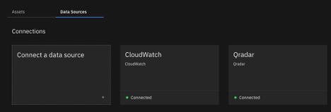
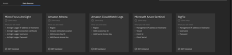
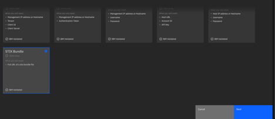
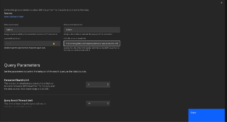
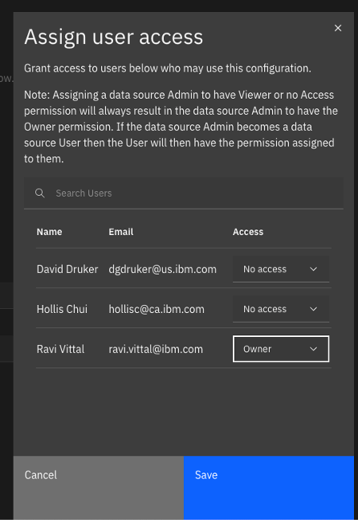
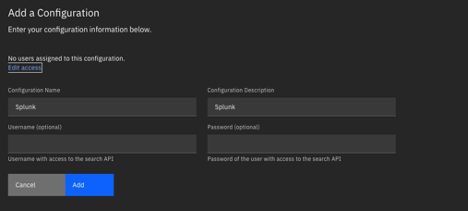
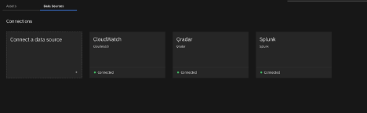
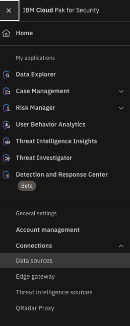
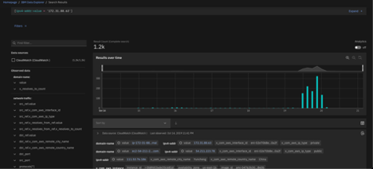

### Universal data insights connectors
A data source for IBM Cloud Pak® for Security is the source of the data that you want to work with, such as a database or XML file. Connect a data source to Cloud Pak for Security to enable your applications and dashboards to analyze security data to help your organization manage and respond to security threats.

If you install IBM Cloud Pak for Security in a Red Hat® OpenShift® Container Platform environment that is hosted on a public cloud, you must use Virtual Private Network (VPN) technology to enable communication between the IBM Cloud Pak for Security services and the data sources.

### Edge Gateway App Host
To use the Edge Gateway App Host to host the containers that are required for communication between the data sources and IBM Cloud Pak for Security, you must install the App Host software in your own environment. For more information about the Edge Gateway App Host, see [Edge Gateway App Host](https://www.ibm.com/docs/en/SSTDPP_1.9/docs/gateway/Introduction.html)

### Data sources
You can connect data sources to IBM Cloud Pak for Security by using connectors. Use a connector to configure each data source connection. IBM Cloud Pak for Security provides connectors for the following data sources.

### Amazon CloudWatch
A single service that provides centralized access to the logs from your Amazon systems, applications, and Amazon Web Services (AWS).
### HCL BigFix®
A solution for compliance, endpoint, and security management for organizations. Organizations can monitor and manage any physical and virtual endpoints through BigFix Platform and applications.
### Carbon black CB Response
A highly scalable, real-time threat hunting and incident response (IR) solution that delivers unfiltered visibility for top security operations centers and IR teams.
### Elasticsearch
A real-time, distributed storage, search, and analytics engine. It is beneficial in many use cases, but especially where the requirement is to index streams of semi-structured data, such as logs or decoded network packets.
### IBM Cloud® Security Advisor
A security dashboard that provides centralized security management. The dashboard unifies vulnerability and network data; also, application and system findings from IBM® Services, partners, and user-defined sources.
### IBM Security Guardium®
A comprehensive data protection platform that discovers and classifies data. It also monitors and audits activity to help protect sensitive data across hybrid multi-cloud environments.
### IBM QRadar®
A Security Information and Event Management (SIEM) solution that helps security teams to accurately detect and prioritize threats across the enterprise. It provides intelligent insights that enable teams to respond quickly to reduce the impact of incidents.
### QRadar on Cloud
With QRadar on Cloud, you can enjoy the benefits and customer support of IBM Security QRadar, but in a hosted deployment. In an environment where security requirements are dynamic, QRadar on Cloud provides both the security monitoring that you need, and the flexibility to modify your monitoring as your requirements change. With QRadar on Cloud, you can use the capabilities of QRadar without investing in all of the required hardware and software of an on-premises QRadar deployment.
### Microsoft Azure Sentinel
A security information event management (SIEM) and security orchestration automated response (SOAR) solution that offers security analytics and threat intelligence for the enterprise.
### Splunk Enterprise Security
A Security Information and Event Management (SIEM) solution that captures and correlates real-time machine-generated data in a searchable repository from which it can generate graphs, reports, alerts, dashboards, and visualizations.
### STIX Bundle
Structured Threat Information eXpression (STIX) is a language and serialization format that organizations can use to exchange cyberthreat intelligence. A STIX Bundle can be used in place of a data source connector to share cyberthreat intelligence by using STIX Objects. With the STIX Bundle as a data source you can search for any attack pattern, campaign, course of action, identity, indicator, intrusion set, malware, report, threat actor, tool, and vulnerability.

### Configuring a data source connection
To see the Data Sources page and configure data source connections, you must have the Data Sources Admin role.

A data source connection is a record that represents a physical box that holds information on how to connect to the source and to access its data. Different users can use the data source connection; the configuration includes setting up credentials. You can configure multiple connections to a data source.

It is important to connect to a data source during the initial setup of IBM Cloud Pak for Security. Then, when you start to use an application or a dashboard, IBM Cloud Pak for Security has a source from which to retrieve the data to be displayed.

For example, to run a query with Data Explorer, you must have data sources that are connected. Then, the application can run queries and retrieve results across a unified set of data sources. The search results vary depending on your configured data sources.

### Configuring a STIX Bundle data source connection
Structured Threat Information eXpression (STIX) is a language and serialization format. A STIX Bundle is a collection of STIX Objects and marking definitions that are grouped in a single container. Organizations can share cyberthreat intelligence (CTI) by using STIX Objects. The marking definitions are used as the requirements for handling and sharing the CTI data. With the STIX Bundle as a data source, you can search for any attack pattern, campaign, course of action, identity, indicator, intrusion set, malware, report, threat actor, tool, and vulnerability. You can also search for specific data, for example, IP address.

### Procedure
1. Log in to IBM Cloud Pak® for Security. From the menu, click Connections > Data sources

2. On the Data Sources tab, click Connect a data source.

3. Click STIX Bundle, then click Next

4. Configure the connection to allow IBM Cloud Pak for Security to connect to the data source.
    - In the Data source name field, assign a name to uniquely identify the data source connection.
You can create multiple connection instances to a data source so it would be good to clearly set them apart by name. Only alphanumeric characters and the following special characters are allowed: - . _
    - In the Data source description field, write a description to indicate the purpose of the data source connection.
You can create multiple connection instances to a data source, so it is useful to clearly indicate the purpose of each connection by description. Only alphanumeric characters and the following special characters are allowed: - . _
    - In the App Host (optional) field, specify which app host to use.
To use the Edge Gateway App Host to host the containers that are required for communication between the data sources and IBM Cloud Pak for Security, select an App Host. 

In the Full URL of a stix-bundle file field, set the URL of the STIX Bundle JSON file so that IBM Cloud Pak for Security can communicate with it. This information is required.
Alternatively, you can use the following URLs to configure a dummy data source connection that is only for demonstration purposes. The STIX Bundle URLs contain sample data for the respective data sources.

- CloudWatch: https://raw.github.com/opencybersecurityalliance/stix-shifter/develop/data/cybox/aws/aws_cloudwatch_logs_19062020.json

- QRadar: https://raw.github.com/opencybersecurityalliance/stix-shifter/develop/data/cybox/qradar/qradar_observed_2000.json

- Splunk: https://raw.github.com/opencybersecurityalliance/stix-shifter/develop/data/cybox/splunk/splunk_observed_1143.json

- CB Response: https://raw.github.com/opencybersecurityalliance/stix-shifter/develop/data/cybox/carbon_black/cb_observed_156.json

5. Set the query parameters to control the behavior of the search query on the data source.

    - In the Concurrent search limit field, set the number of simultaneous connections that can be made between Cloud Pak for Security and the data source. The default limit for the number of connections is 4. The value must not be less than 1 and must not be greater than 100.

    - In the Query search timeout limit field, set the time limit in minutes for how long the query is run on the data source. The default time limit is 30. When the value is set to zero, there is no timeout. If the query takes longer than 1 min, it is likely to indicate a problem. The value must not be less than 1 and must not be greater than 120.

    - In the Query time range field, set the time range in minutes for the search, represented as the last X minutes. The default is 5 minutes. The value must not be less than 1 and must not be greater than 10,000.

6. Configure identity and access.
    - Click Add a Configuration.
        - In the Configuration name field, enter a unique name. 
        - In the Configuration description field, 
    - Click Edit access and choose which users can connect to the data source and the type of access.
        - In the Username (optional) field, enter a username with access to the search API.
        - In the Password (optional) field, enter the password for that username.
    - Click Add.
    - To save your configuration and establish the connection, click Done.

To save your configuration and establish the connection, click Done.

Once done you should see the green connection on the data sources which states the connection was successfull. 

To test the Data Source, lets validate by searching a malicious IP address under Data Explorer 

We search for the offending IP address from an EC2 instance in AWS which is using Cloud Watch as a DataSource. 

