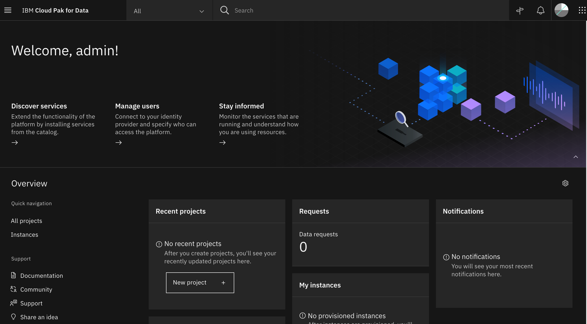
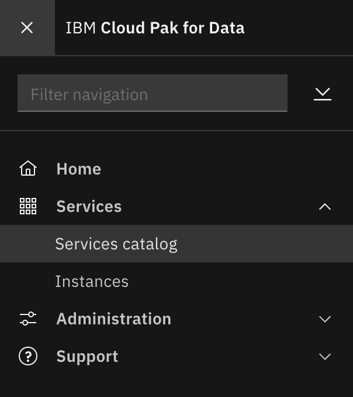
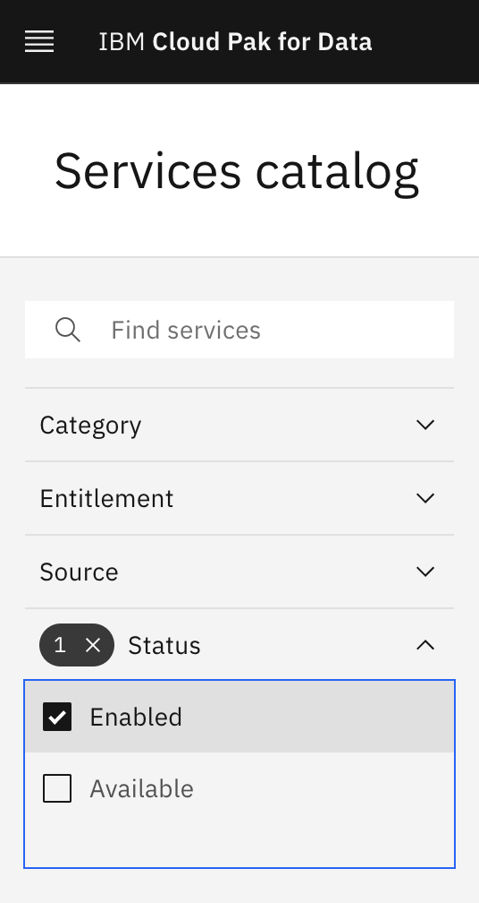
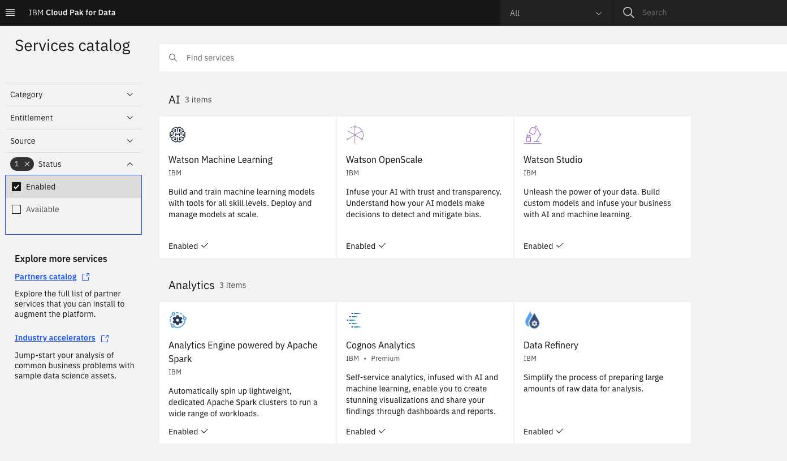

# Cloud Pak for Data - Watson Openscale Quickstart

<!--- cSpell:ignore qube WOService openscale Openscale OpenShift cntk autoplay allowfullscreen Codespaces AnalyticsEngine aespark -->


--8<-- "quickstart-overview.md"

---

--8<-- "gitops-cluster-prereq.md"

---

--8<-- "techzone-roks-bootstrapped-cluster.md"

    !!! note
        For this Cloud Pak for Data - Watson Openscale Quickstart we recommend you to request the Red Hat OpenShift on IBM Cloud cluster with GitOps Configuration with the following size:
          
          * Worker Node Count = **5**
          * Worker Node Flavor = **16 vCPU x 64 GB - 300 GB Secondary Storage**
          * NFS Size = **1 TB**

--8<-- "techzone-roks-bootstrapped-cluster-use.md"

---

--8<-- "quickstart-install-required-cli.md"

---

--8<-- "quickstart-select-resources.md"

---

### Instructions

When you made the Red Hat OpenShift on IBM Cloud cluster request in the earlier section, automation has forked [`multi-tenancy-gitops`](https://github.com/cloud-native-toolkit/multi-tenancy-gitops) GitHub repository into your GitHub organization, the name of which you provided in the cluster request form. You can execute the following steps either locally by cloning the `multi-tenancy-gitops` repository from your GitHub organization to your local workstation (and then make changes from you local workstation and commit and deliver those) or by using the new VSCode extension of GitHub Codespaces capability straight from your web browser (just open the `multi-tenancy-gitops` repository in your GitHub organization in your browser and press the ++period++ key):

!!! note
    For this guide, when following the instructions in the recipe below, consider `#!bash GITOPS_PROFILE="0-bootstrap/single-cluster"`.

1. Review the `Infrastructure` layer [kustomization.yaml](https://github.com/cloud-native-toolkit/multi-tenancy-gitops/blob/master/0-bootstrap/single-cluster/1-infra/kustomization.yaml) and un-comment the resources to deploy to match the [Cloud Pak for Data - Watson Openscale recipe](https://github.com/cloud-native-toolkit/multi-tenancy-gitops/blob/master/doc/cp4d-wos-recipe.md#infrastructure---kustomizationyaml).

1. Review the `Services` layer [kustomization.yaml](https://github.com/cloud-native-toolkit/multi-tenancy-gitops/blob/master/0-bootstrap/single-cluster/2-services/kustomization.yaml) and un-comment the resources to deploy to match the [Cloud Pak for Data - Watson Openscale recipe](https://github.com/cloud-native-toolkit/multi-tenancy-gitops/blob/master/doc/cp4d-wos-recipe.md#services---kustomizationyaml).

1. Commit and push changes to your git repository (the following code refers to the commands when you cloned the `multi-tenancy-gitops` repository locally on your workstation)

```bash
git add .
git commit -m "initial bootstrap setup"
git push origin
```

### Verifying the Installation

1. After approximately 30 minutes, get the status of the control plane (lite-cr)

    ```bash
    oc get ZenService lite-cr -n tools -o jsonpath="{.status.zenStatus}{'\n'}"
    ```

    Cloud Pak for Data control plane is ready when the command returns `Completed`. If the command returns another status, wait for some more time and rerun the command.

1. After approximately 30 minutes, Get the status of Watson Openscale (analyticsengine-sample)

    ```bash
    oc get WOService aiopenscale -n tools -o jsonpath="{.status} {'\n'}"
    ```

    Watson Openscale is ready when the command returns `Completed`.

### Cloud Pak for Data UI

1. Get the URL of the Cloud Pak for Data web client and open it in a browser.

    ```bash
    echo https://`oc get ZenService lite-cr -n tools -o jsonpath="{.status.url}{'\n'}"`
    ```

1. The credentials for logging into the Cloud Pak for Data web client are `admin/<password>` where password is stored in a secret.

    ```bash
    oc extract secret/admin-user-details -n tools --keys=initial_admin_password --to=-
    ```

1. Log into the IBM Cloud Pak for Data UI using the password from previous step.

    

1. Click on the navigation menu icon on the top left corner. Click on Services menu option to expand it, then select Services catalog.

    {: style="max-height:340px"}

1. Under Status, select "Enabled" to display only the services that are installed and enabled in Cloud Pak for Data.

    {: style="max-height:540px"}

1. Notice the `Enabled` tag next to Watson Openscale. There might be other enabled services as well.

    {: style="max-height:591px"}
    
