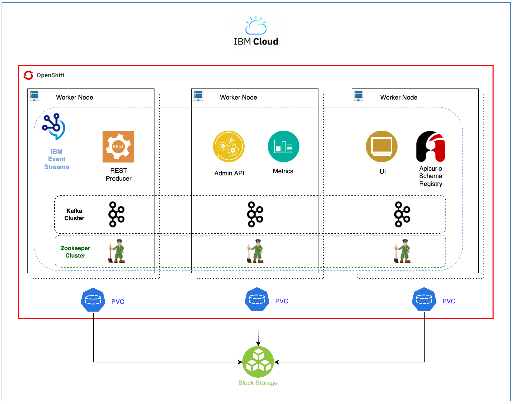

# IBM Event Streams Quickstart

<!--- cSpell:ignore qube cntk autoplay allowfullscreen Codespaces -->

--8<-- "quickstart-overview.md"

By the end of this tutorial, you should have a highly available deployment of IBM Event Streams on a Red Hat OpenShift Kubernetes Service on IBM Cloud as shown below.

{: style="max-height:800px"}

---

--8<-- "gitops-cluster-prereq.md"

--- 

--8<-- "techzone-roks-bootstrapped-cluster.md"

    !!! note
        For this IBM Event Streams quickstart we recommend you to request the Red Hat OpenShift on IBM Cloud cluster with GitOps Configuration with the following size:
          
          * Worker Node Count = **3**
          * Worker Node Flavor = **8 CPU x 32 GB**
          * NFS Size = **500GB**

--8<-- "techzone-roks-bootstrapped-cluster-use.md"

---

--8<-- "quickstart-install-required-cli.md"

---

--8<-- "quickstart-select-resources.md"

### Instructions 

1. You can execute the following steps either locally by cloning the `multi-tenancy-gitops` GitHub repository the IBM Technology Zone environment request automation has forked into the GitHub organization you created in the Pre-requisites section above for you to your local workstation (then make changes from your local workstation and commit and deliver those to GitHub) or by using the new VSCode extension of GitHub Codespaces capability straight from your web browser (just open the `multi-tenancy-gitops` repository in your Git Organization in your browser and press the `.` key):
   
    1. Review the `Infrastructure` layer [kustomization.yaml](https://github.com/cloud-native-toolkit/multi-tenancy-gitops/blob/master/0-bootstrap/single-cluster/1-infra/kustomization.yaml) and un-comment the resources to deploy to match the [IBM Event Streams recipe](https://github.com/cloud-native-toolkit/multi-tenancy-gitops/blob/master/doc/es-recipe.md#infrastructure---kustomizationyaml).
    2. Review the `Services` layer [kustomization.yaml](https://github.com/cloud-native-toolkit/multi-tenancy-gitops/blob/master/0-bootstrap/single-cluster/2-services/kustomization.yaml) and un-comment the resources to deploy to match the [IBM Event Streams recipe](https://github.com/cloud-native-toolkit/multi-tenancy-gitops/blob/master/doc/es-recipe.md#services---kustomizationyaml).
    3. Review the `storage`, `high availability` and `security` options for the [IBM Event Streams instance definition](https://github.com/cloud-native-toolkit/multi-tenancy-gitops/blob/master/0-bootstrap/single-cluster/2-services/argocd/instances/ibm-eventstreams-instance.yaml) explained in the [IBM Event Streams recipe](https://github.com/cloud-native-toolkit/multi-tenancy-gitops/blob/master/doc/es-recipe.md#storage---ibm-eventstreams-instanceyaml).
    4. Commit and push changes to your git repository (the following code refers to the commands when you cloned the `multi-tenancy-gitops` repository locally on your workstation)
    ```bash
    git add .
    git commit -m "initial bootstrap setup"
    git push origin
    ```

2. After some time, you can validate your new instance of IBM Event Streams is ready by executing:
    ```bash
    oc get eventstreams -n tools
    ```
    Expected output is
    ``` { .text .no-copy }
    NAME             STATUS
    es-inst          Ready
    ```

3. You can now access your IBM Event Streams User Interface
    ```bash
    oc get EventStreams es-inst -n tools -o=jsonpath='{.status.endpoints[?(@.name=="ui")].uri}'
    ```

4. The credentials for logging into the IBM Event Streams User Interface are `admin/<password>` where password is stored in a secret.
    ```bash
    oc get secret platform-auth-idp-credentials -n ibm-common-services -o=jsonpath='{.data.admin_password}' | base64 -D
    ```