# GItOps to deploy Instana and Grafana

## Goals

In this lab you wil learn 

* How to use Instana to monitor an OpenShift cluster 
* How to use Instana to monitor a microservices application running on the cluster.  
* How to use Grafana to display charts based on metrics captured by Instana

You will utilize GitOps to deploy the following components to an OpenShift Cluster.

* Instana Agent
* Robot Shop Application
* Grafana

## Prerequisites

Before starting this lab you should have the following environments.

* Instana Server
* Openshift 4.8 Cluster

Also before starting this lab you need the following installed locally

* [git cli](https://git-scm.com/downloads) or if you are on a mac you can use command `xcode-select --install`
* [helm cli](https://helm.sh/docs/intro/install/)
* [oc cli](https://docs.openshift.com/container-platform/4.9/cli_reference/openshift_cli/getting-started-cli.html) version 4.7 or higher

### Create an Instana server instance

1. Go to [Product Deployment Guides](https://techzone.ibm.com/collection/production-deployment-guides#tab-6) page on Techzone
1. Click on the **Try It - Get a GitOps Cluster** tab (under the top banner)
1. Click on the **Instana - self deploy on VSI** environment
1. Select **Reserve now** 
1. You can modify the **Name** if you wish. `Instana VSI` for example
1. For **Purpose** select **Practice / Self-Education**
1. Enter a **Purpose Description**
1. Select a **Preferred Geography** closest to your location
1. Extend the **End Date** for 2 weeks
1. Click **Submit**

### Create an OpenShift cluster

1. Go to [Product Deployment Guides](https://techzone.ibm.com/collection/production-deployment-guides#tab-6) page on Techzone
1. Click on the **Try It - Get a GitOps Cluster** tab (under the top banner)
1. Click on the **IBM Cloud Openshift Cluster** environment
1. Select **Reserve now**
1. You can modify the **Name** if you wish. `OpenShift GitOps Cluster` for example
1. For **Purpose** select **Practice / Self-Education**
1. Enter a **Purpose Description**.
1. Select a **Preferred Geography** closest to your location
1. Extend the **End Date** for 2 weeks
1. Select **Worker Node Count** of **3**
1. Select **Worker Node Flavor** of **8 CPU x 32 GB**
1. Select an **NFS Size** of **500 GB**
1. Select the **Openshift version** of **4.8**
1. Click **Submit**

## Bootstrap the cluster
In this section you will prepare the gitops environment

1. Log in to your Openshift Cluster from the terminal

    1. Navigate to your Openshift cluster's web console created in the Prerequisites
    1. Click the user dropdown and click on **Copy login command**

        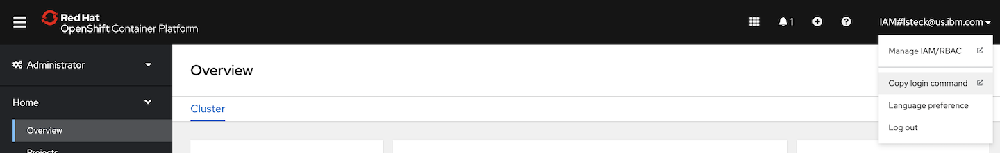

    1. Click **Display Token**
    1. Copy the **oc login** command

        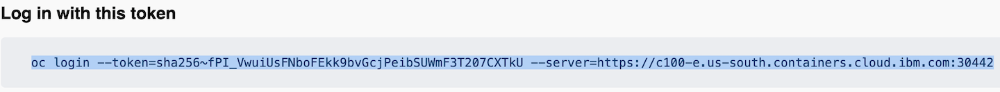

    1. Open a terminal window. Paste and execute the oc login command.

        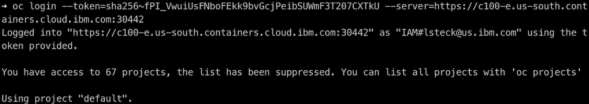


1. Clone the [multi-tenancy-gitops repo](https://github.com/cloud-native-toolkit/multi-tenancy-gitops)

    1. Create a directory and change into the new directory
    ```bash
    mkdir instana-lab &&
    cd instana-lab
    ```
    1. Clone the [multi-tenancy-gitops repo](https://github.com/cloud-native-toolkit/multi-tenancy-gitops) and change into the cloned directory
    ```bash
    git clone https://github.com/cloud-native-toolkit/multi-tenancy-gitops.git &&
    cd multi-tenancy-gitops
    ```

1. Run the bootstrap script 
    1. Create an environment variable to tell the script to use **Gitea**
    ```bash
    export USE_GITEA=true
    ```
    1. Create an environment variable to tell the script the output directory to clone the multi-tenancy-gitops repos into

        !!! important
            The **OUTPUT_DIR** will be referenced throughout the lab and if you use another value than **gitops-instana** you will have to update the commands before executing them

        ```bash
        export OUTPUT_DIR=gitops-instana
        ```

    1. Run the bootstrap script.  The script installs the Gitea operator into the cluster, clones the multi-tenancy-gitops repos and pushes them to Gitea, then bootstraps Argo CD. 

        !!! note
             The script takes around 20 minutes to run so after you start it, it would be a good time for a break :-)

        ```bash
        ./scripts/bootstrap.sh
        ```
 
    1. When the script completes it displays the URLs and commands to retrieve credentials to log in to Argo CD and Gitea.

        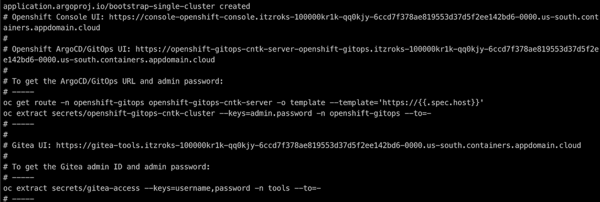

    1. Copy ArgoCD/GitOps UI URL returned from the script and open it in a browser. Click the **LOG IN VIA OPENSHIFT** button

        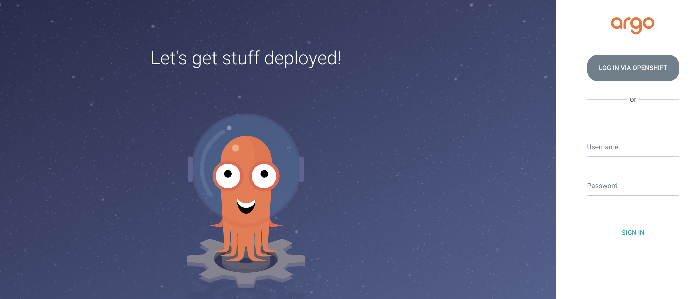


    1. Click the **Allow selected permissions** button to authorize access

        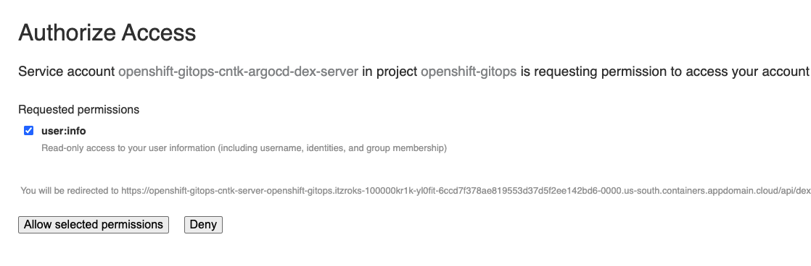

    1. The Argo CD UI displays the Argo applications. 

        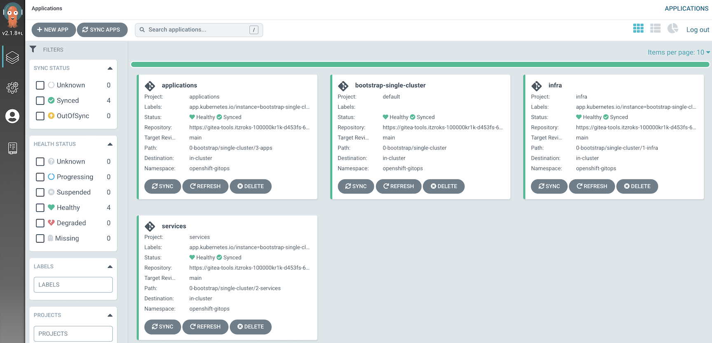

    1. Open Gitea in a browser using the Gitea URL returned from the script
    1. Run the command to retrieve the Gitea id and password.  
    ```bash
    oc extract secrets/gitea-access --keys=username,password -n tools --to=-
    ```
    1. Use the **Sign in** button in the upper right to log in and view the multi-tenancy-gitops repos.

        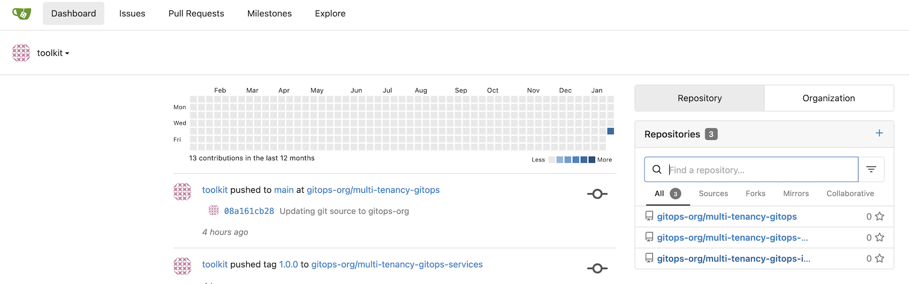

    

1. Review the gitops repositories and local file structure created by the bootstrap script

    1. The bootstrap script cloned the `multi-tenancy-gitops` repositories into the `gitops-org` organization in Gitea. Click **Organizations** then click on the **gitops-org** organization

        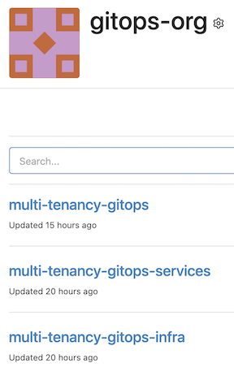

    1. The local gitops repos are under the `OUTPUT_DIR` you defined above. The structure is seen below where `gitops-0-bootstrap` is the local repo for the `multi-tenancy-gitops` repo; `gitops-1-infra` is the local repo for the `multi-tenancy-gitops-infra` repo and `gitops-2-services` is the local repo for the `multi-tenancy-gitops-services` repo.
    ```
    ➜ tree -L 1 gitops-instana
    gitops-instana
    ├── gitops-0-bootstrap
    ├── gitops-1-infra
    └── gitops-2-services
    ```
    1. In the `gitops-0-bootstrap` directory the bootstrap script configured the `single-cluster` **GITOPS_PROFILE** in the `0-bootstrap/single-cluster` directory. That directory contains the following
    ```
    ➜ tree -L 1 gitops-instana/gitops-0-bootstrap/0-bootstrap/single-cluster
    gitops-instana/gitops-0-bootstrap/0-bootstrap/single-cluster
    ├── 1-infra
    ├── 2-services
    ├── 3-apps
    ├── bootstrap.yaml
    └── kustomization.yaml
    ```  
    
    1. The `1-infra` directory contains the `yaml` files that defines references to the infrastructure objects that are deployed from the `multi-tenancy-gitops-infra` repo. 
    ```
    tree -L 1 gitops-instana/gitops-0-bootstrap/0-bootstrap/single-cluster/1-infra
    gitops-instana/gitops-0-bootstrap/0-bootstrap/single-cluster/1-infra
    ├── 1-infra.yaml
    ├── argocd
    └── kustomization.yaml
    ```
    1. The `2-services` directory contains the `yaml` files that defines references to the services objects that are deployed from the `multi-tenancy-gitops-services` repo. 
    ```
    tree -L 1 gitops-instana/gitops-0-bootstrap/0-bootstrap/single-cluster/2-services
    gitops-instana/gitops-0-bootstrap/0-bootstrap/single-cluster/2-services
    ├── 2-services.yaml
    ├── argocd
    └── kustomization.yaml
    ```

    1. The `3-apps` directory contains the `yaml` files that defines references to the application objects that are deployed from the `multi-tenancy-gitops-apps` repo.  This repo isn't used for the `single-cluster` **GITOPS_PROFILE** so it wasn't cloned and pushed to Gitea.
    ```
    tree -L 1 gitops-instana/gitops-0-bootstrap/0-bootstrap/single-cluster/3-apps
    gitops-instana/gitops-0-bootstrap/0-bootstrap/single-cluster/3-apps
    ├── 3-apps.yaml
    ├── argocd
    └── kustomization.yaml
    ```


## Install Instana Agent

In this section you will install the Instana Agent into the `instana-agent` namespace in the cluster.  The agent collects metrics data from the cluster and sends it to the Instana server.

### Infrastructure

Modify the `1-infra/kustomization.yaml` file to create a `instana-agent` namespace

1. Change directory to the `<OUTPUT_DIR>/gitops-0-bootstrap/0-bootstrap/single-cluster/1-infra` directory where `<OUTPUT_DIR>` is the value of the environment variable created above
```bash
 cd gitops-instana/gitops-0-bootstrap/0-bootstrap/single-cluster/1-infra
```
1. Edit the Infrastructure layer `${GITOPS_PROFILE}/1-infra/kustomization.yaml` with the editor of your choice.
    ```bash
    vim kustomization.yaml
    ```
1. Uncomment the following line, save and exit the editor
    ```yaml
    - argocd/namespace-instana-agent.yaml
    ```

1. Commit the changes to the `multi-tenancy-gitops` repo 
    ```bash
    git add . &&
    git commit -m "add instana-agent namespace" &&
    git push origin
    ```
1. When Argo CD detects the change it will create and deploy the new objects. Instead of waiting for the Argo polling process to detect the change you can click **Refresh** on the `infra` application to manually trigger the refresh from the `multi-tenancy-gitops` repo.

    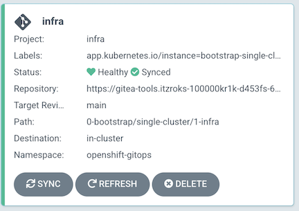

1. In Argo CD you should see the new **namespace-instana-agent** application

    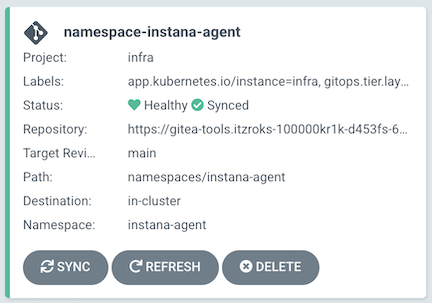

1. On the OpenShift console you should see a new `instana-agent` project namespace


### Services
In this section we will deploy the Instana agent to the `instana-agent` namespace created above.

1. Edit the Services layer `${GITOPS_PROFILE}/2-services/kustomization.yaml`
    1. Navigate to the `/multi-tenancy-gitops/gitops-instana/gitops-0-bootstrap/0-bootstrap/single-cluster/2-services` directory
    ```bash
    cd ../2-services
    ```
    1. Edit the Services layer `${GITOPS_PROFILE}/2-services/kustomization.yaml` with the editor of your choice.
    ```bash
    vim kustomization.yaml
    ```
    1. Uncomment the following line under the `# Monitoring` section, save and exit the editor
    ```yaml
    - argocd/instances/instana-agent.yaml
    ```
    1. Don't commit the changes to git yet, we have to make additional changes

1. Store your Instana Agent Key in a secret in the `instana-agent` namespace in your cluster. 

    1. The Instana agent needs the Instana Agent Key of the Instana server you created in the prerequisites. You can find your Instana Agent Key in [Techzone](https://techzone.ibm.com/my/reservations) under **My library -> My reservations**. Click on your `Instana - self deploy on VSI` reservation tile you created in the prerequisites to view the details. The Instana Agent Key is also included in the email you received from Techzone when you created the Instana server.  
 
        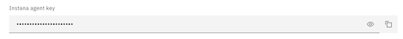

        !!! note 
            You should not share the Instana Agent Key with anyone


    1. The secret key field has to contain the value `key` and the value contains your Instana Agent Key. Run the following command, replace `<AGENT-KEY>` with your Instana Agent Key 
    ```bash
    oc create secret generic instana-agent-key -n instana-agent \
    --from-literal=key=<AGENT-KEY> 
    ```

1. Edit the Instana agent `${GITOPS_PROFILE}/2-services/argocd/instances/instana-agent.yaml`
    1. Navigate to the `/multi-tenancy-gitops/gitops-instana/gitops-0-bootstrap/0-bootstrap/single-cluster/2-services/argocd/instances` directory
    ```bash
    cd argocd/instances
    ```
    1. Edit the `instana-agent.yaml` file with the editor of your choice.
    ```bash
    vim instana-agent.yaml
    ```

    1. Modify the `spec.source.helm.values.instana-agent.agent.keysSecret` value on line 47. Update it so it matches the secret you deployed above. For example in the command above the value of the secret would be `instana-agent-key` so that should be the value.
    ```
    # the values you'd otherwise set in `.agent.key` and `agent.downloadKey`.
    keysSecret: instana-agent-key
    ```
    1. Modify the `spec.source.helm.values.instana-agent.agent.endpointHost` value on line 53. Update it to be the `Public IP` address of your Instana server.  This will be on the `Instana - self deploy on VSI` reservation details in Techzone as well as in the email. 
    ```
    # agent.endpointHost is the hostname of the Instana server your agents will connect to.
    endpointHost: 169.62.165.247
    ```
    1. Modify the `spec.source.helm.values.instana-agent.cluster.name` value on line 166. The value represents the name that will be assigned to this cluster in Instana. For example `'Onboarding cluster'`
    ```
    cluster:
      # cluster.name represents the name that will be assigned to this cluster in Instana
      name: 'Onboarding cluster'
    ```
    1. Modify the `spec.source.helm.values.instana-agent.zone.name` value on line 215. The value represents the custom zone that detected technologies will be assigned to. For example `'Onboarding zone'` 
    ```
    zone:
      # zone.name is the custom zone that detected technologies will be assigned to
      name: 'Onboarding zone'
    ```
    1. Save your changes and exit the editor

    1. Navigate back up the the `2-services` directory and commit the changes to Gitea 
    ```bash
    cd ../.. &&
    git add . &&
    git commit -m "add instana-agent" &&
    git push origin
    ```

1. In Argo CD click **Refresh** on the services application to manually trigger the changes.

    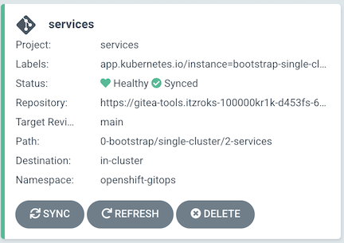


1. In Argo CD you should see the new **instana-agent-instance** application. Its status will eventually change to `Healthy/Synced`

    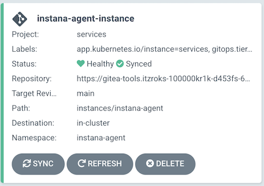


1. Review the new zone/cluster in the Instana UI
    1. Log in to your Instana Server UI.  You can find the `Instana URL`, `Instana email` and `Instana password` from your Techzone reservations email or page.  **NOTE:** Use the `Instana password` NOT the `password`  

        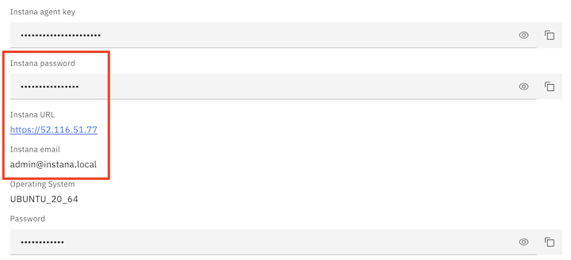

    1. Click on the "Stacks" icon on the left to open the **Infrastructure** view

        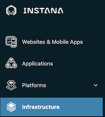

    1. Click on the **Live** button in the upper right of the screen

        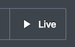

    1. It takes a few minutes for the agents to register with the server but eventually you should see your `Onboarding zone`.  FYI, the `InstanaTechnologyZone` zone is the Instana server instance itself.

        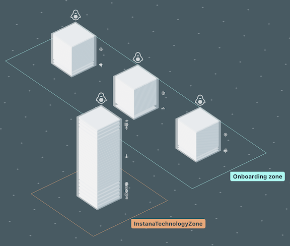

    1. Click on one of the 3 `CRI-O containers` in the `Onboarding Zone` and an info panel opens up.  Click on the **Dashboard** button to view the details.

        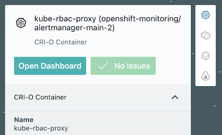

    1. On the zone dashboard click on the **Stack** button and select your `Onboarding cluster` to view the details on the cluster.

        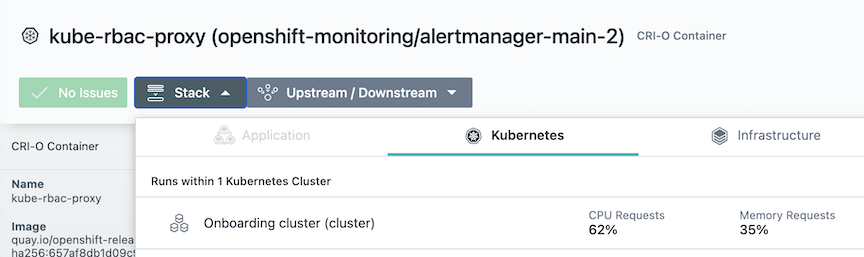

    1. You can also navigate to the `Onboarding cluster` using the **Platforms -> Kubernetes** menu.

        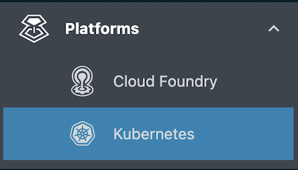

## Install Robot Shop Application
In this section you will install the Robot Shop application into the `robot-shop` namespace in the cluster.  The application is an example microservice application that can be used to learn monitoring techniques.

### Infrastructure

Modify the `1-infra/kustomization.yaml` file to create a `robot-shop` namespace

1. Navigate to the `/multi-tenancy-gitops/gitops-instana/gitops-0-bootstrap/0-bootstrap/single-cluster/1-infra` directory
```bash
cd ../1-infra
```
1. Edit the Infrastructure layer `${GITOPS_PROFILE}/1-infra/kustomization.yaml` with the editor of your choice.
    ```bash
    vim kustomization.yaml
    ```
1. Uncomment the following line, save and exit the editor
    ```yaml
    - namespace-robot-shop.yaml
    ```
1. Commit the changes to the `multi-tenancy-gitops` repo  
    ```bash
    git add . &&
    git commit -m "add robot-shop namespace" &&
    git push origin
    ```
1. In Argo CD click **Refresh** on the infra application to manually trigger the changes.

1. In Argo CD you should see the new **namespace-robot-shop** application

    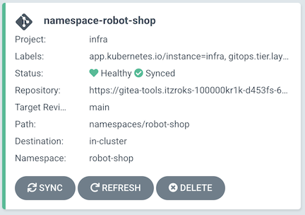

1. On the OpenShift dashboard you should see a new `robot-shop` project namespace

### Services  
In this section we will deploy the Robot Shop application to the `robot-shop` namespace created above.

1. Edit the Services layer `${GITOPS_PROFILE}/2-services/kustomization.yaml`
    1. Navigate to the `/multi-tenancy-gitops/gitops-instana/gitops-0-bootstrap/0-bootstrap/single-cluster/2-services` directory
    ```bash
    cd ../2-services
    ```
    1. Edit the Services layer `${GITOPS_PROFILE}/2-services/kustomization.yaml` with the editor of your choice.
    ```bash
    vim kustomization.yaml
    ```
    1. Uncomment the following line under the `# Monitoring` section, save and exit the editor
    ```yaml
    - argocd/instances/instana-robot-shop.yaml
    ```

    1. Don't commit the changes to git yet, we have to make additional changes

1. Edit the Instana robot shop yaml `${GITOPS_PROFILE}/2-services/argocd/instances/instana-robot-shop.yaml`

    1. The Robot Shop application has a web based UI.  You can configure it to send metric information to an Instana Server.  To do this you need to create a Website application in Instana.  In the Instana UI click **Website & Mobile Apps** menu.

        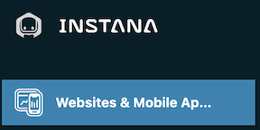
    
    1. Enter a name, such as `Robot Shop`, for you Website application and click **Add Website**. 

        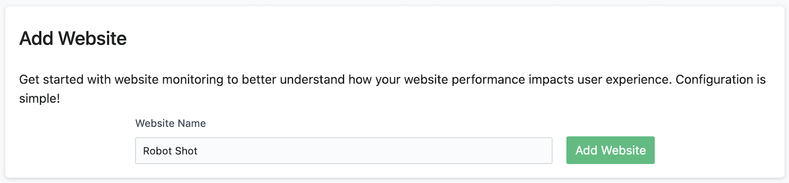
        
    1. From the JavaScript snippet you will need the **reportingUrl** and **key** values

        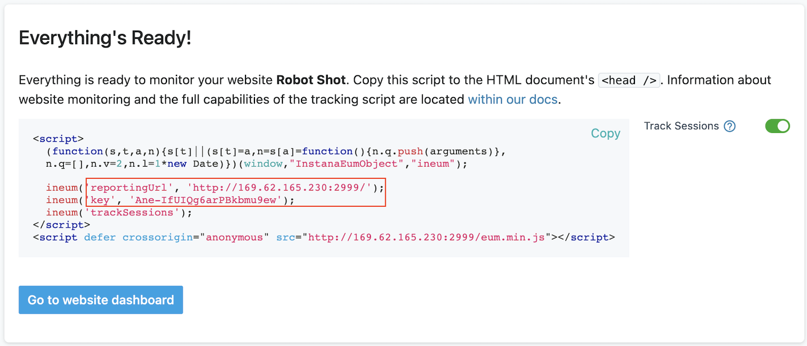

    1. Store the End User Monitoring (EUM) key value in a secret.  The secret key field has to contain the value `key` and the value contains your key value. Run the following command, replace `<EUM-KEY>` with your key value you received in the JavaScript snippet from the previous step.

        !!! note
            Do NOT enter the **'**

        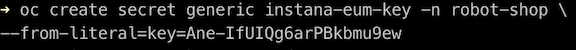

        ```bash
        oc create secret generic instana-eum-key -n robot-shop \
        --from-literal=key=<EUM-KEY> 
        ```

    1. Navigate to the `/multi-tenancy-gitops/gitops-instana/gitops-0-bootstrap/0-bootstrap/single-cluster/2-services/argocd/instances` directory
    ```bash
    cd argocd/instances
    ```
    1. Edit the `instana-robot-shop.yaml` file with the editor of your choice.
    ```bash
    vim instana-robot-shop.yaml
    ```

    1. Modify the `spec.source.helm.values.instana-robot-shop.robot-shop.eum.keysSecret` value on line 40. Update it if needed so it matches the secret you deployed above. For example in the command above the value of the secret would be `instana-eum-key` so use that as the value.
    ```
    keysSecret: instana-eum-key
    ```
    1. Modify the `spec.source.helm.values.instana-robot-shop.robot-shop.eum.url` value on line 41. Update it to be the `url` value you received in the JavaScript snippet

        !!! note
            Do not add the trailing **/** 

        ```
        url: http://169.62.165.230:2999
        ```

    1. Save your changes and exit the editor

    1. Navigate back up the the `2-services` directory and commit the changes to Gitea 
    ```bash
    cd ../.. &&
    git add . &&
    git commit -m "add robot-shop" &&
    git push origin
    ```


1. In Argo CD click **Refresh** on the services application to manually trigger the changes.

1. In Argo CD you should see the new **robot-shop** application.  After a few minutes its status will change to `Healthy/Synced`

    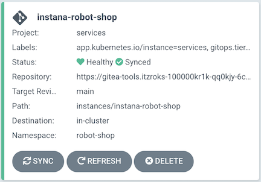

1.  Verify **End User Monitoring** configuration

    1. In the Openshift console navigate to **Workloads -> Pods**
    
    1. At the top select the Project `robot-shop` 

    1. Find the pod name that starts with **web** and click on it to view the details

    1. Click on the **Logs** tab

    1. Scroll to the top of the logs and verify you see the message `Enabling Instana EUM`

        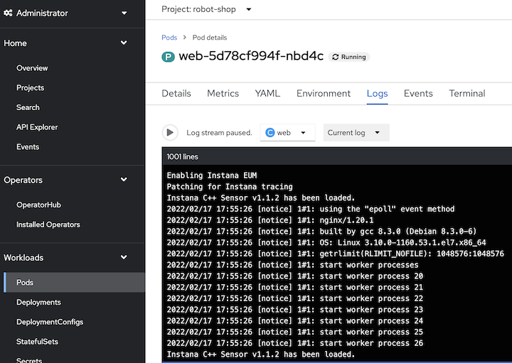

### Review Metrics
1. Navigate around the Robot Shop application to generate some metrics in Instana.  Retrieve the Robot Shop URL with the following command and open it in a browser

    !!! note
        Be sure not to include the **%** from the end of the URL returned with the following command

    ```bash
    oc get route -n robot-shop web -o template --template='http://{{.spec.host}}'
    ```

1. Select Items under the **Categories**.  **Add** them to your cart.  **Rate** them. 

    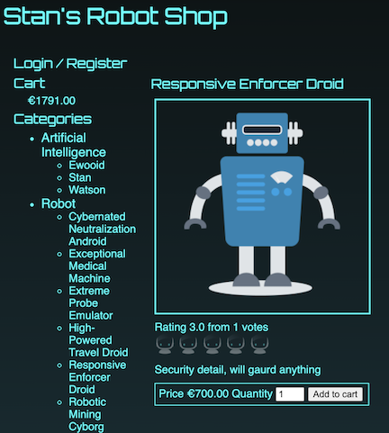

1. Click on **Cart** to view your cart.  Click **Checkout**

    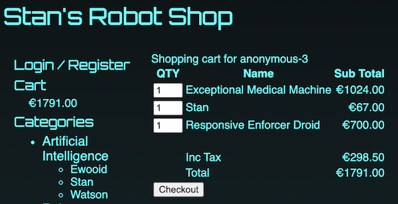

1. After the **Countries** have loaded select one, ex. `Great Britain`.  Start entering a **location**, ex. `lon` to filter the list and select one. Click **Calculate**

    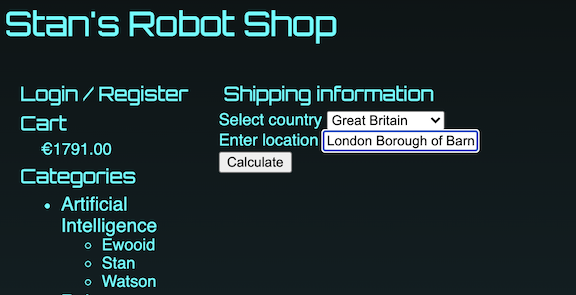

1. Click **Confirm**

    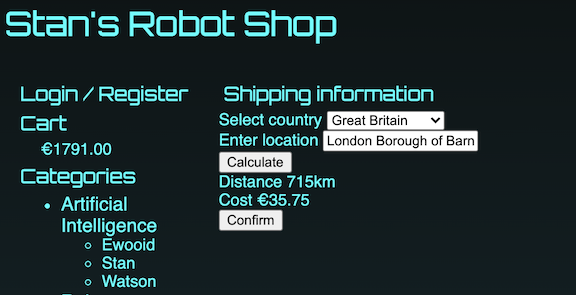

1. Click **Pay Now**

    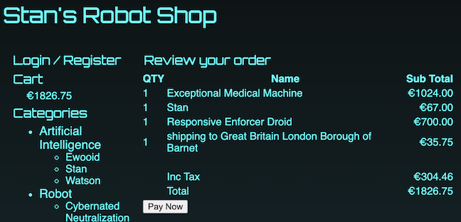

1. And your order will be complete

    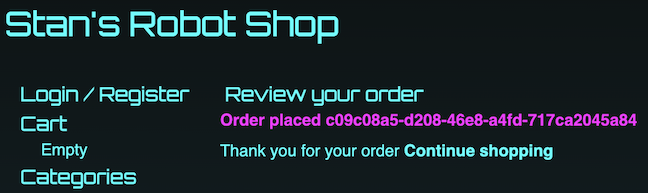

1. Switch back to your Instana browser window. Click **Go to website dashboard** from JavaScript snippet window, or navigate to **Websites & Mobile Apps** and click on your application name.

    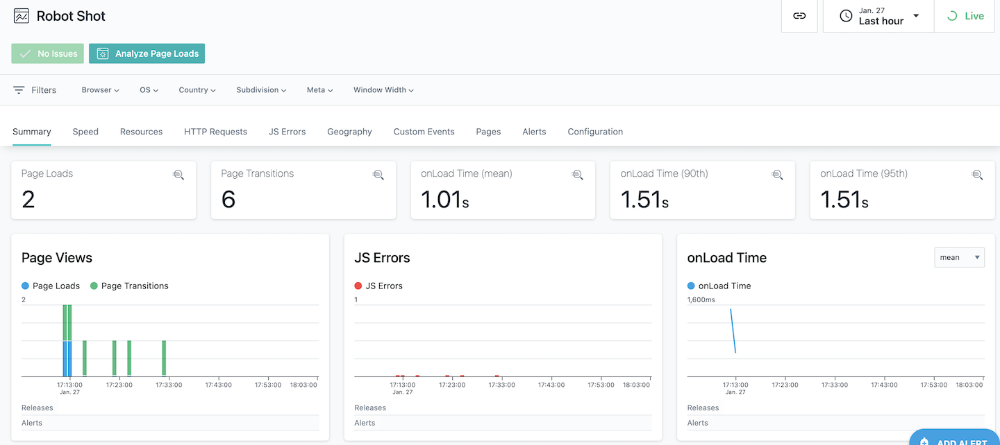

1. On the Instana menu click **Applications** from JavaScript snippet window, or navigate to **Websites & Mobile Apps** and click on your application name.

    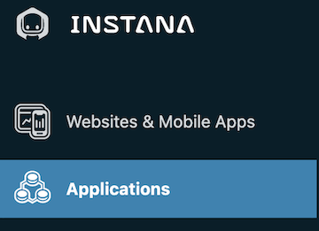

1. Click on the **Services** tab at the top to view the list of services

    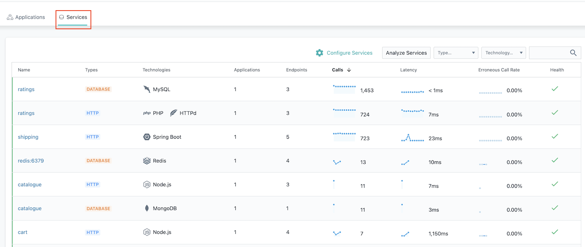

1. Click on the **Applications** tab at the top then click on **All Services** to view the summary of all services

    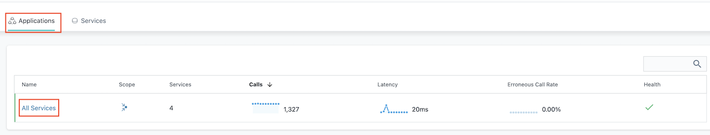

1. From the services summary page click on the **Dependencies** tab to view the services dependencies

    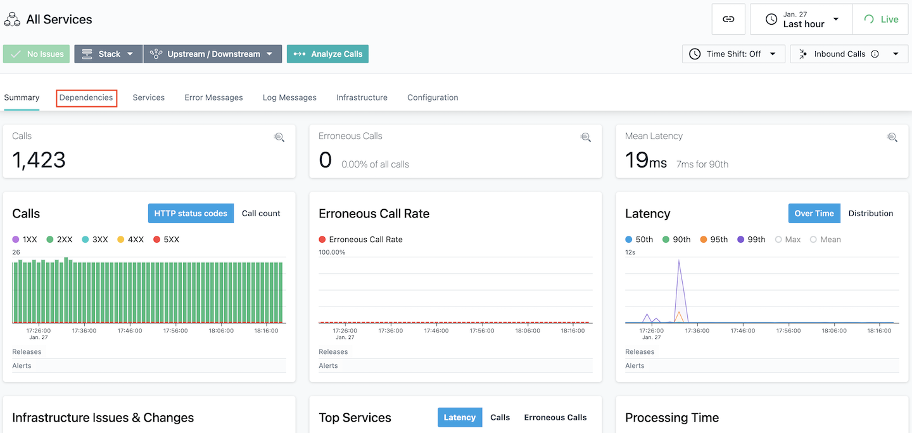

1. The Dependencies view shows the dependencies between the services 

    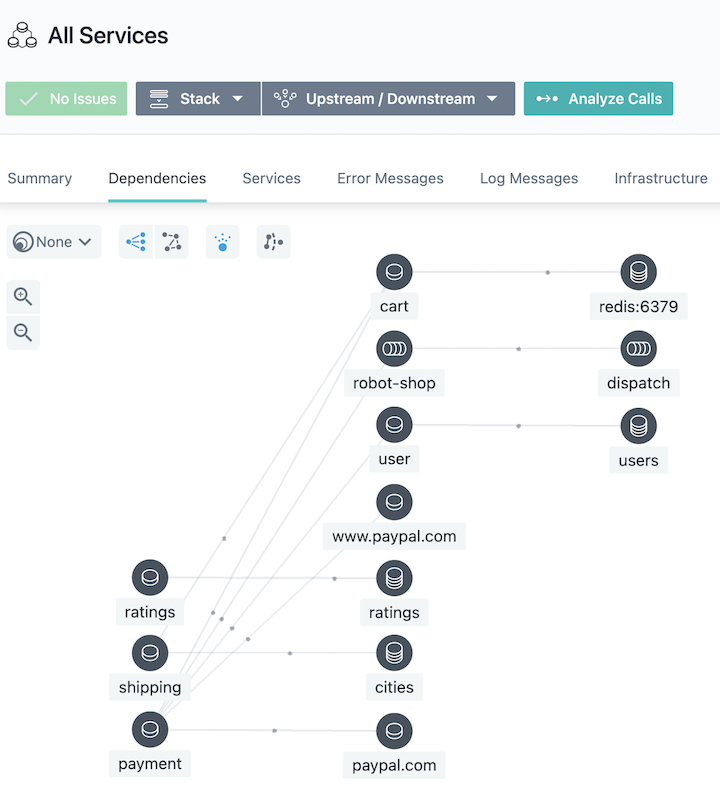

## Install Grafana
In this section you will install the Grafana operator and a Grafana instance into the `tools` namespace in the cluster.  Grafana will be used to display graphs from data in Instana

### Infrastructure

Modify the `1-infra/kustomization.yaml` file to setup the `tools` namespace.  In this case the `tools` namespace already exists because it was created by the bootstrap.sh script. We need to deploy the `tools` infrastructure objects because in addition to the namespace it also deploys an operator group needed by the Grafana operator. 

1. Navigate to the `/multi-tenancy-gitops/gitops-instana/gitops-0-bootstrap/0-bootstrap/single-cluster/1-infra` directory
```bash
cd ../1-infra
```
1. Edit the Infrastructure layer `${GITOPS_PROFILE}/1-infra/kustomization.yaml` with the editor of your choice.
    ```bash
    vim kustomization.yaml
    ```
1. Uncomment the following line, save and exit the editor
    ```yaml
    - argocd/namespace-tools.yaml
    ```

1. Commit the changes to the `multi-tenancy-gitops` repo 
    ```bash
    git add . &&
    git commit -m "add tools namespace" &&
    git push origin
    ```
1. In Argo CD click **Refresh** on the infra application to manually trigger the changes.

1. You should see the new **namespace-tools** application created in Argo with a status of "Healthy/Synced". This will update the objects in the `tools` namespace in Openshift.

    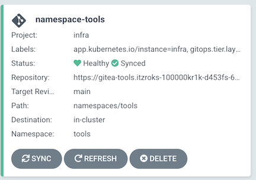


### Secret  
Before we can deploy the Grafana service we first we need to configure a secret used by Grafana to communicate with Instana

1. The Grafana service needs two pieces of information from Instana, the ***Instana host URL*** and an ***API Token***. The Instana host URL can be found on the Techzone Reservation tile as described above. To retrieve the API Token log in to the Instana server and click on the `Settings` gear on the menu

    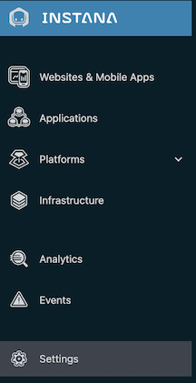

1. Under `Access Control` click on `API Tokens`

    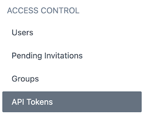

1. The Techzone `Instana - self deploy on VSI` reservation process created an `API Token`.  

    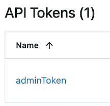

1. If you used a different process to create your Instana server you can create an `API Token`

    1. Start by clicking on `Add API Token`

        

    1. Give your API Token a name

        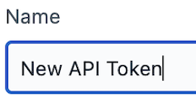

    1. Scroll to the bottom and click **Save** to save your API Token.  There is no need to give it any additional permissions

        

1. Click the **eye** to view your API Token

    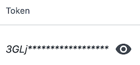

1. Click **copy** to copy your API Token

    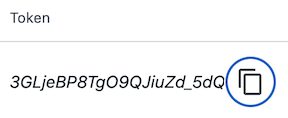

1. Execute the following command to create the `instana-backend` secret in the `tools` namespace. Be sure to replace `<API-TOKEN>` and `<INSTANA-URL>` with your values

    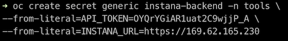

    ```
    oc create secret generic instana-backend -n tools \
    --from-literal=API_TOKEN=<API-TOKEN> \
    --from-literal=INSTANA_URL=<INSTANA-URL>
    ```

### Services  
In this section we will deploy the Grafana Service.

1. Edit the Services layer `${GITOPS_PROFILE}/2-services/kustomization.yaml`
    1. Navigate to the `/multi-tenancy-gitops/gitops-instana/gitops-0-bootstrap/0-bootstrap/single-cluster/2-services` directory
    ```bash
    cd ../2-services
    ```
    1. Edit the Services layer `${GITOPS_PROFILE}/2-services/kustomization.yaml` with the editor of your choice.
    ```bash
    vim kustomization.yaml
    ```
    1. Uncomment the following lines under the `# CICD` section,  save and exit the editor

        !!! important
            Make sure you uncomment the grafana-**instana**.yaml yaml and NOT the grafana-**instance**.yaml

        ```yaml
        - argocd/operators/grafana-operator.yaml
        - argocd/instances/grafana-instana.yaml
        ```

1. Commit the changes to the cluster 
    ```bash
    git add . &&
    git commit -m "add grafana" &&
    git push origin
    ```
1. In Argo CD click **Refresh** on the services application to manually trigger the changes.

1. In Argo CD you should see the new **grafana-operator** and **grafana-instana** applications. After a few minutes their status will change to `Healthy/Synced`

    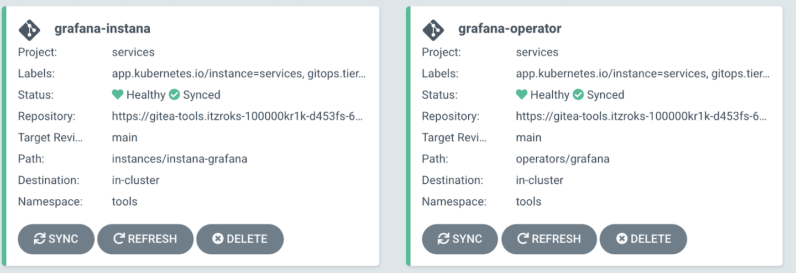

### Grafana Charts
In this section you will log in to the Grafana UI and view charts based on data from Instana

1. Run the commands below to retrieve the Grafana URL and credentials. Open the Grafana UI in a new browser tab. 

!!! note
    Be sure not to include any extra characters from the end of the URL returned with the following command

```bash
oc get route -n tools grafana-route -o template --template='https://{{.spec.host}}' &&
oc extract -n tools secrets/grafana-admin-credentials --to=-
```

1. In the lower left-hand side of the screen click **Sign In**

    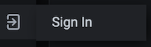

1. After logging in, on the left hover over the **4 squares**  to display the Dashboards menu and click **Manage**

    

1. Click on the **tools** folder

    

1. Click on the **Instana Sample** dashboard

    

1. The **Instana Sample** dashboard is displayed


    

!!! success "Congratulations!" 
    You have completed this lab
