# Using Instana to monitor MQ queues 
<!--- cSpell:ignore ibmmq -->
## Goals

In this lab you wil learn how Instana can be used to monitor queues in MQ.  

## Prerequisites

There are no prerequisites for this lab other than having a browser and an internet connect, without which you wouldn't be here ;-) 

We show examples of using `curl` to issue commands, but these commands can be executed via the browser as well so it isn't required that you have `curl` installed. 

## Environment Overview

The environment configured for this lab is illustrated here. You will interact with a MQ Application running on an OpenShift cluster and use Instana running in a Virtual Server Instance to view the data from MQ.

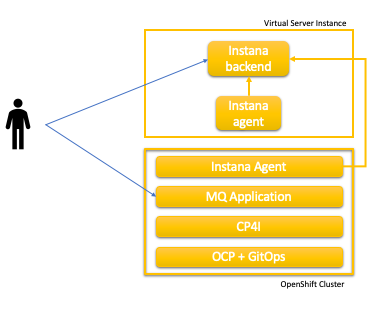

### Virtual Server Instance

The Instana backend server is installed on a Virtual Server Instance (VSI) running on the IBM Cloud. You will utilize the Instana UI to view the metrics data stored there.  This metric data is captured by Instana agents which forwards the data to the Instana backend. There is an agent running on the VSI instance as well as agents running in the OpenShift Cluster. 

### Openshift Cluster

The Openshift cluster contains the following components.

* Instana Agent
* MQ Application
* Cloud Pak for Integration (CP4I)
* OCP + GitOps

#### Instana Agent

The **Instana Agent** captures metric data from the Openshift Cluster and forwards it to the Instana backend server.

#### MQ Application

The **MQ Application** is a simple application that provides a REST interface to put and get messages on a MQ queue. 

#### Cloud Pak for Integration (CP4I)

The **CP4I** component hosts the MQ queue used by the **MQ Application**.

#### OCP + GitOps

The **OCP + GitOps** components are used to deploy components into the OpenShift cluster.

If you would like more information on the MQ Application, CP4I, and OCP + GitOps components; review [this MQ Tutorial](https://production-gitops.dev/guides/cp4i/mq/using/this-guide/) which was used to deploy the environment.  

The Instana Agent on OpenShift was deployed using [this Quick Start Demo](https://production-gitops.dev/quickstart/quickstart-instana-agent/)

## Generate metric data

In this section you will use the **MQ Application** to generate metric data for the **Instana agent** to capture and froward to the **Instana backend**

The **MQ Application** is running in Application pods on the OpenShift Cluster. It exposes a REST interface with methods to put and get messages from a queue running in Queue manager pods in the cluster.

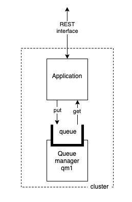

You can use the **MQ Application** UI, or `curl`, or both to generate metric data.

### Use the MQ Application UI

1. Open the [MQ Application UI](https://mq-spring-app-dev.instana-mq-6qwkjtsh-b9aa1303e037748136e24e1f282ebee9-0000.us-south.containers.appdomain.cloud/) in a new browser window.

1. Click on `mq-client-controller` to expand that section.

1. Click on `/api/send-hello-world` to expand that section.

1. Click on the **Try it out** button

1. Click on the **Execute** button. You should receive a `200` response code along with the following response body
```
{
  "status": "OK",
  "statusMessage": "Successfully sent record to MQ",
  "data": "Hello World!"
}
```

1. Scroll down and click on `/api/send-json` to expand that section

1. Click on the **Try it out** button

1. Enter the following json in the `Example Value | Model` text area.
```
{ "data": "Hola Mundo!"}
```

1. Click on the **Execute** button. You should receive a `200` response code along with the following response body
```
{
  "status": "OK",
  "statusMessage": "Successfully sent record to MQ",
  "data": "{\n  \"data\" : \"Hola Mundo!\"\n}"
}
```

1. Scroll up and click on `/api/recv` to expand that section

1. Click on the **Try it out** button

1. Click on the **Execute** button. You should receive a `200` response code along with a response body containing a message similar to the following
```
{
  "status": "OK",
  "statusMessage": "Successfully sent record to MQ",
  "data": "{\n  \"data\" : \"Hola Mundo!\"\n}"
}
```

    !!! note
        The actual message returned could be from other users of the application and not the ones you sent.

    !!! warning
        If you receive a `504` error code and an `Error: Gateway Time-out` message that indicates there are no messages on the queue.  Put a few more on the queue and try again.

1. Feel free to put and get as many messages as you wish. 

### Use `curl` 

If you have `curl` installed you can use the follow steps to get and put messages. Otherwise continue to the next section.

1. To make the following `curl` commands easier to read and understand create an environment variable for the app url  
```bash
export APP_URL="mq-spring-app-dev.instana-mq-6qwkjtsh-b9aa1303e037748136e24e1f282ebee9-0000.us-south.containers.appdomain.cloud"
```

1. Now execute the command to put the "Hello World!" message on the queue
```bash
curl -X GET https://$APP_URL/api/send-hello-world
```
You should see the response
```bash
{"status":"OK","statusMessage":"Successfully sent record to MQ","data":"Hello World!"}
```

1. Now execute the command to put a JSON message on the queue
```bash
curl -X POST -H "Content-Type: application/json" https://$APP_URL/api/send-json --data "{\"data\":\"Hola Mundo\!\"}"
```
You should see the response
```bash
{"status":"OK","statusMessage":"Successfully sent record to MQ","data":"{\n  \"data\" : \"Hola Mundo\"\n}"}
```

1. Now execute the command to get a message from the queue
```bash
curl -X GET https://$APP_URL/api/recv
```
You should see a response similar to this
```bash
{"status":"OK","statusMessage":"Successfully sent record to MQ","data":"{\n  \"data\" : \"Hola Mundo!\"\n}"}
```

    !!! note
        The actual message returned could be from other users of the application and not the ones you sent.

    !!! warning
        If you receive a **504** error code and an **Error: Gateway Time-out** message that indicates there are no messages on the queue.  Put a few messages on the queue and try again.


## Browse Instana UI

In this section you will Browse the Instana UI 

1. Log in to the Instana UI

    1. Open the [Instana UI](https://52.118.38.5/) in a browser tab.
    1. Accept the security risks.
    1. Enter the following E-mail `demos@cloudnativetoolkit.dev`
    1. Enter the following Password `xzt4fqp.pxw!MKC8pmh`
    1. Click **Sign In**
    1. You know have read-only access to the Instana Dashboard.

1. Review the Instana home page 

    1. Use the **Time Range** button in the upper right to select the range of data to be displayed.  Select **Last 30 minutes**
    1. The sections on the home page correspond with the menu on the left.  
    1. The **Websites & Mobile Apps** section displays high level metrics on registered applications.  There are no applications registered in this lab. Look at the [Instana & Grafana quick start demo](https://production-gitops.dev/quickstart/quickstart-instana-grafana/) for an example on that
    1. The **Applications** section displays high level metrics on requests too and from services
    1. The **Platforms** section displays high level metrics on platforms such as our OpenShift Cluster, named `MQ Cluster`
    1. The **Infrastructure** section displays high level metrics on lower level components.  In our case the cluster worker nodes and the VSI of the Instana backend.
    1. The **Events** section displays displays high level metrics on incidents, events and changes.  

1. Review the Applications page 
    1. Under `Applications` click on **All Services**
    1. The Summary page displays information such as the number of calls, error rate and latency
    1. Click on the **Dependencies** tab 
    1. The Dependencies page displays the interactions between the services.  The interaction of interest to this lab is between the `mq-spring-app` which is our **MQ Application** and the `IBM.DEMO.Q` which is the MQ queue running in **CP4I**

        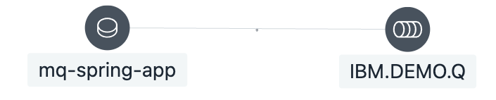

    1. Click on the **Services** tab
    1. The Services page show high level summery of the services.
    1. Click on the `mq-spring-app` service
    1. The Summary page displays detail metrics on the `mq-spring-app` service
    1. Click on the **Flow** tab
    1. Again you will see the relationship between the `mq-spring-app` and the `IBM.DEMO.Q` queue along with then number of calls, latency and errors.
    1. Click on the **Endpoints** tab
    1. This will be a list of the endpoints of our `mq-spring-app` 
    1. Click on the **GET /api/recv** endpoint
    1. This is the Summary page for the selected endpoint.  
    1. Click on the **Flow** tab
    1. Again you can see the relationship between this `mq-spring-app` endpoint and the `IBM.DEMO.Q`

        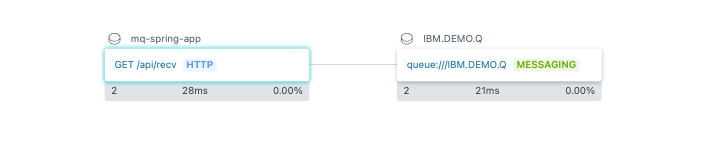

    1. Now click on the `queue:///IBM.DEMO.Q` link
    1. This is the Summary page of the queue
    1. You see how you can drill down into services to view metrics at different levels.
    1. Explore the `Application` page on your own.  Continue to the next step when you are done. 

    

1. Review the Platforms page
    1. On the side menu click on **Platforms** -> **Kubernetes**

        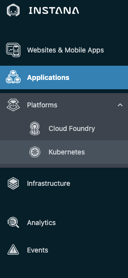

    1. A list of monitored clusters with high level metrics is displayed
    1. Click on the `MQ Cluster`
    1. The Summary page for the cluster is displayed. You see see metrics for the cluster such as CPU, Memory and Pods. 
    1. Click on the **Nodes** tab
    1. The list of cluster nodes is displayed
    1. Explore the other tabs on your own to view the lists of Pods, Deployments, etc. Feel free to click components listed to view their details. When you are done exploring click on the **MQ Cluster (cluster)** breadcrumb at the top.
    
        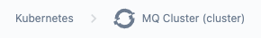
     
    1. Click on the **Namespaces** tab
    1. A list of the cluster namespaces is displayed. In the search box enter `dev`. Our services are deployed in the `dev` namespace so click on the **dev** name to view the summary page.

        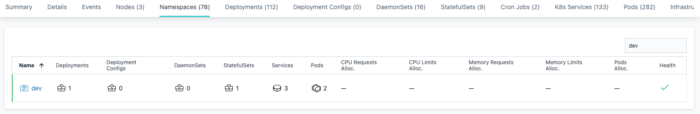

    1. The Summary page for the `dev` namespace displays information on CPU, Memory and pods for the namespace. 
    1. Click on the **Deployments** tab
    1. The `mq-spring-app` deployment is listed. Click on it.
    1. The `mq-spring-app` summary page is displayed.  Explore the tabs on your own.  Once done click on the **dev** breadcrumb at the top
    
        
     
    1. Click on the **StatefulSet** tab
    1. The MQ queue is deployed via the `qm1-ibm-mq`, click on it. 
    1. The `qm1-ibm-mq` summary page is displayed.  Explore the tabs on your own.  Once done continue to the next section.


1. Review the Infrastructure page
    1. On the side menu click on **Infrastructure**

        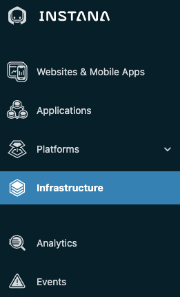

    1. A map is displayed of the Infrastructure.  The `InstanaTechnologyZone` is the zone where the the VSI is running and you can see that in contains the single VSI instance.  The `MQ Zone` is the zone where the `MQ Cluster` is running. The 3 nodes are displayed in that zone.  
    1. Click on the `MQ Zone` **NAME** on the map.  

        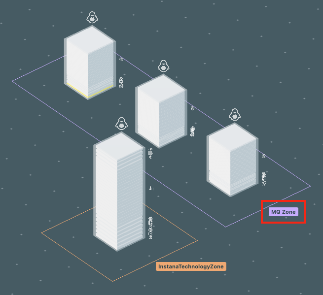

    1. On the MQ Zone pop-up window click on the **Open Dashboard** button
    1. The MQ Zone dashboard displays the Hosts, the 3 nodes, in the cluster.
    1. Click on the **Stack** button, select the **Infrastructure** tab and scroll through the list until you find the **QM1@172.30.21.221** queue manager.  *NOTE:* the IP Address might be different. 

        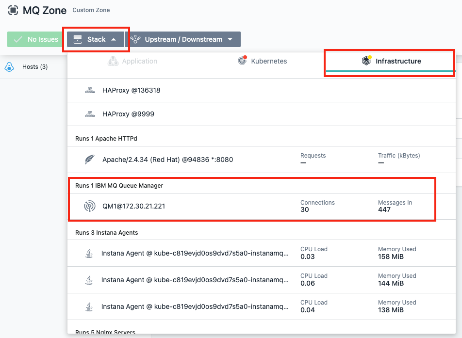

    1. The details of the `MQ1` Queue manager is displayed.
    1. Before looking at these details there is an easier way to navigate to this page.  Click on the **Map** breadcrumb at the top to return to the infrastructure map.

        

    1. You can create and use filters to find components on the map. We have created a **Queue Managers** filter that filters the map on `entity.ibmmq.qm.name:"*"` objects.  Click the **Filters** drop-down and select **Queue Managers**
    
        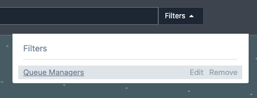
 
    1. The **QM1@172.30.21.221** queue manager is displayed on the map in the MQ Zone.  Click on the **IBM MQ Queue Manager** component 
       
        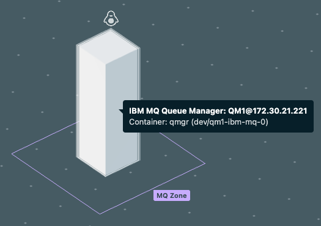
  
    1. On the `IBM MQ Queue Manager` pop-up click **Open Dashboard**
     
        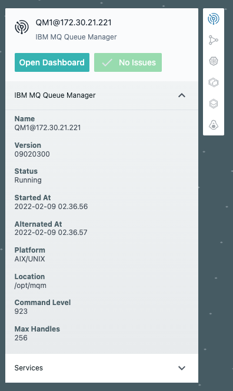
  
    1. You are back to the `MQ1` Queue manager details page.
    1. Detailed information about the queue manager, such as number of connections and number of messages, are displayed on this page.
    1. Scroll down and you will see the `MQ1` queue managers Topics, Subscriptions, Listeners, Queues, and Channels 
    1. The `IBM.DEMO.Q` is the queue used by our `mq-spring-app` so lets look at its details.
    1. In the **Queues** section, *NOT Queues Usage by application*, click on **IBM.DEMO.Q** 

        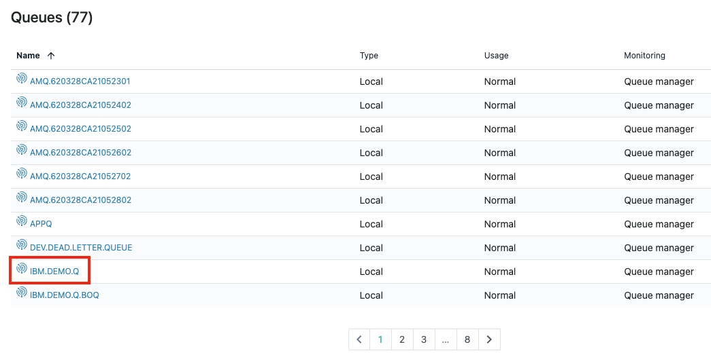
  
    1. The queue details page displays information like queue depth, number of messages in/out, message time and calls.  
    1. On the charts you can turn on/off the elements that are displayed.  For example the **Depth** chart displays the `Max` depth and the `Current` message depth.  The `max` depth is 5000 and is represented by the line at the top.  Since our `Current` message depth is so low and the value changes so little it is represented by a line at the bottom of the cart and it is difficult to see it change.  Click on the **Max** element at the top of the chart to turn it off and that makes it easier to see the `Current` message depth change.  

        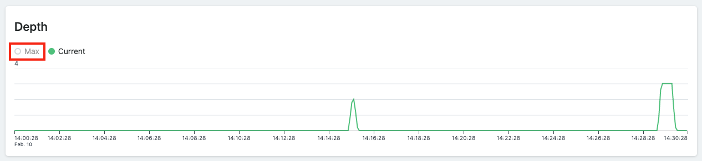
  
    1. Lets move on to the next section 

## View Live MQ Metric Data

In this section you will put and get messages from the queue and monitor them live on the Instana UI.

1. You should be on the `IBM.DEMO.Q` details page from the previous section.  If not navigate there now.
1. On the `IBM.DEMO.Q` details page click the **Live** button on the top, right of the screen.  This will toggle the charts to be update in real time. To make it easier to see the messages in the queue make sure `Max` depth element is turned off on the **Depth** chart.

    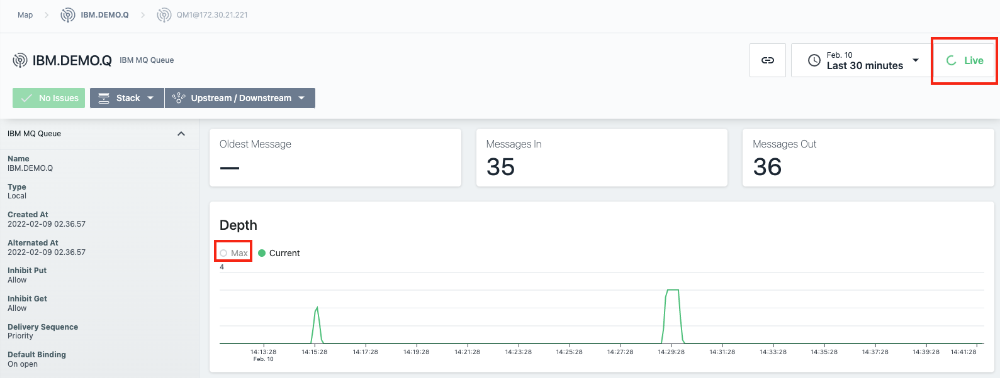
  
1. Put and get messages from the queue using either the **MQ Application** ui or **curl** as described in the [Generate metric data](#generate-metric-data) section above.
1. As messages are placed on and removed from the queue you can see the `Depth` chart and the `Messages` charts being updated. *Note:* the Instana agent is configured to send updates every 5 seconds so there is a slight delay.

    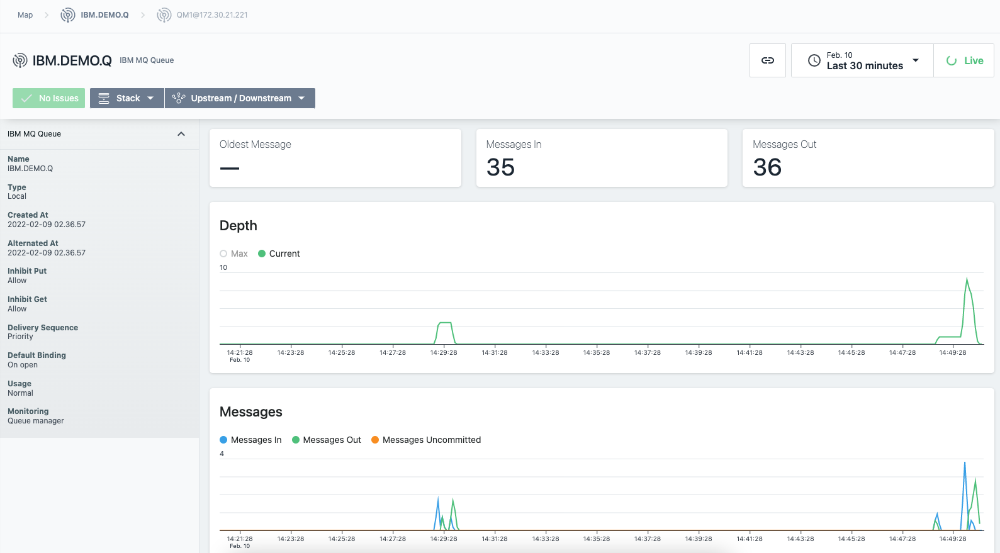
  


!!! success "Congratulations!" 
    You have completed this lab and seen how you can use Instana to monitor MQ queues.
