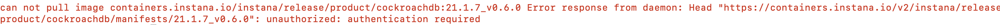

# Installing Instana on an IBM Cloud RHEL8 Virtual Machine.

## Goals

In this lab you wil learn how to install Instana in a RHEL8 Virtual Machine on IBM Cloud.

## Preliminary Steps

Obtain a RHEL8 Virtual Machine on IBM Cloud

1. Go the the Base Images in TechZone [https://techzone.ibm.com/collection/base-images](https://techzone.ibm.com/collection/base-images)
2. Click the IBM Virtual Server Instance (Classic) (dated Sep 1, 2021)
3. Click Reserve Now
4. From the Create a Reservation page, Specify the following :

    * Name: <Your Name> IBM Virtual Server Instance (Classic)
    * Purpose: Practice/Self-Education
    * Purpose Description:  Onboarding Event
    * Preferred Geography:  `Choose a geography closest to you that has relatively low disk usage`
    * End Date & Time: `Choose a date 2 weeks from the current date`
    * Open ports : No
    * CPU Cores : 16
    * RAM: 64 Gb
    * Operating System: RHEL 8
    * Secondary disk size : 500Gb
  
5. Click Schedule

    You will receive an email when the cluster is available (usually in under 15 minutes).  You can also check the reservations page as well (Status will show ready when the cluster is available to use)  [https://techzone.ibm.com/my/reservations](https://techzone.ibm.com/my/reservations)

    You will need the following information from the email:

      * Public IP
      * Hostname
      * Password for the `root` user
  
6. In order to login to Instana, you will need to add the FQDN of the server to your own machine. Edit the file `/etc/hosts` and add the following line. NOTE, there is a space between `<publicIP>` and `<hostname>`:
   ```
   <publicIP> <hostname>.dte.demo.ibmcloud.com
   ```

7. At this point you can login to the virtual machine server

    1. Open up a terminal window and SSH to your VSI Instance. Replace `<publicIP>` with the public IP of your Instana VSI Instance
    ```bash
    ssh root@<publicIP>
    ```
    
    2. When prompted with the following error enter `yes` 
    ```bash
    The authenticity of host '52.117.94.163 (52.117.94.163)' can't be established.
    ED25519 key fingerprint is SHA256:uHEPjzzbLXMr2lXwsgi0RpRj7O8E4S9o1rXu52vQQWQ.
    This key is not known by any other names
    Are you sure you want to continue connecting (yes/no/[fingerprint])?
    ```
    
    3. Enter your root password
   

## Installation Video

To assist you with the installation steps below, view the following recording to see the installation in action:
> Note that some details such a license keys are redacted in the video. For the lab you will be provided with the relevant information.

[](https://asciinema.org/a/WwCS8MA2adFsqb5wGvocyIU0i?speed=1.5)

## Server setup

1. The first step will be to install the docker environment with the following commands:

    ```bash 
    sudo dnf config-manager --add-repo=https://download.docker.com/linux/centos/docker-ce.repo
    sudo dnf install --nobest docker-ce -y
    sudo systemctl enable --now docker
    systemctl is-active docker
    sudo usermod -aG docker $USER
    ```

2. The next step is to prepare the server for Instana Installation
   
    1. Add the Instana yum repository
        ```bash
        cat >/etc/yum.repos.d/Instana-Product.repo <<EOF
        [instana-product]
        name=Instana-Product
        baseurl=https://self-hosted.instana.io/rpm/release/product/rpm/generic/x86_64/Packages
        enabled=1
        gpgcheck=1
        repo_gpgcheck=1
        gpgkey=https://self-hosted.instana.io/signing_key.gpg
        priority=5
        sslverify=1
        #proxy=http://x.x.x.x:8080
        #proxy_username=
        #proxy_password=
        EOF
        ```

    1. Prepare mount points for Instana
        ```bash
        mkdir /mnt/data
        mkdir /mnt/traces
        mkdir /mnt/metrics
        ```

    1. Update the yum cache
        ```bash
        yum makecache -y 
        ```
   
## Instana Installation

1.  Download the installation component with the command 

    ```bash
    yum install -y instana-console
    ```

2. Run the installation itself with the command 

   ```bash
   instana init
   ```

1. Use the following values to fill the form:

      * Please choose Instana installation type:
         * `single`
      * What is your tenant name?
         * `<Enter whichever value you like. This is only relevant in an environment with multiple Instana instances>`
      * What is your unit name?
         * `<Enter whichever value you like. This is only relevant in an environment with multiple Instana instances>`
      * Insert your agent key (optional). If none is specified, one is generated which does not allow downloads.
         * `<Enter your agent key>`
      * Insert your download key or official agent key (optional)
         * `<Enter your download or agent key>`
      * Insert your sales key
         * `<Enter your sales key>`
      * Insert the FQDN of the host. Your VM's hostname followed by `.dte.demo.ibmcloud.com`
         * `<your VM FQDN>`
      * Where should your data be stored?
         * `/mnt/data`
      * Where should your trace data be stored?
         * `/mnt/traces`
      * Where should your metric data be stored?
         * `/mnt/metrics`
      * Where should your logs be stored?
         * `/var/log/instana`
      * Path to your signed certificate file?
        * `<Leave empty for this tutorial>`
      * Path to your private key file?
        * `<Leave empty for this tutorial>`

      If you see the following error it means you made a mistake entering your agent key or download key. Delete the **settings.hcl** with command `rm settings.hcl` and re-run the `instana init` command.

      
      
      Due to the number of docker images which are pulled this installation takes a long time. This is normal.

      ```bash
      [root@itzvsi-pe9jhdqr ~]# instana init
      Setup host environment ✓
      ? [Please choose Instana installation type] single
      ? [What is your tenant name?] tenant01
      ? [What is your unit name?] unit01
      ? [Insert your agent key (optional). If none is specified, one is generated which does not allow downloads.] XXXXXXXXXXXXXXXXXXXXXX
      ? [Insert your download key or official agent key (optional).] XXXXXXXXXXXXXXXXXXXXXX
      ? [Insert your sales key] XXXXXXXXXXXXXXXXXXXXXX
      ? [Insert the FQDN of the host] itzvsi-pe9jhdqr.dte.demo.ibmcloud.com
      ? [Where should your data be stored?] /mnt/data
      ? [Where should your trace data be stored?] /mnt/traces
      ? [Where should your metric data be stored?] /mnt/metrics
      ? [Where should your logs be stored?] /var/log/instana
      ? [Path to your signed certificate file?] 
      ? [Path to your private key file?] 
      Handle certificates ✓
      Ensure images ✓
      Clean docker containers ✓
      Check data directories ✓
      Create configurations ✓
      Run data stores ✓
      Migrate data stores ✓
      Run components ✓
      Check components ✓
      Setup environment urls ✓
      Run nginx ✓
      Initialize tenant unit ✓

      Welcome to the World of Automatic Infrastructure and Application Monitoring

      https://itzvsi-pe9jhdqr.dte.demo.ibmcloud.com
      E-Mail: admin@instana.local
      Password: XXXXXXXXXXX
      ```

    !!! important
        Make note of your Instana E-Mail and password, you will need this to log in to the Instana server
      
   3. Activate the Instana License:
        ```bash
        [root@itzvsi-pe9jhdqr ~]# instana license download
        Download license ✓
        License is stored at /root/license
        [root@itzvsi-pe9jhdqr ~]# instana license import
        Import license ✓
        License is successfully imported
        [root@itzvsi-pe9jhdqr ~]# instana license verify
        Verifying local license status ✓

        Nr: 1
        Valid from: 2021-02-22 00:00:00 +0000 UTC
        Valid till: 2121-12-01 23:59:59.999 +0000 UTC

        [root@itzvsi-pe9jhdqr ~]# 
        ```
      
   4. Install and start the Instana agent. replace `<yourAgentKey>` and `<yourFQDM>` with your values used above. 
         ```bash
         [root@itzvsi-pe9jhdqr ~]# curl -o setup_agent.sh https://setup.instana.io/agent && chmod 700 ./setup_agent.sh && sudo ./setup_agent.sh -a <yourAgentKey> -t dynamic -e <yourFQDN>:1444 -m infra
         % Total    % Received % Xferd  Average Speed   Time    Time     Time  Current
                                          Dload  Upload   Total   Spent    Left  Speed
         100 20470  100 20470    0     0   3971      0  0:00:05  0:00:05 --:--:--  4181
         Setting up the dynamic Instana agent for GNU/Linux
         Are you sure? [y/N] y
         Setting up Instana RPM repository
         Updating YUM metadata
         Installing Instana agent
         Importing GPG key 0x9BAD82DE:
          Userid     : "stan@instana.com <stan@instana.com>"
          Fingerprint: B878 152E 2F08 4D46 F878 FA20 BED2 D096 9BAD 82DE
          From       : https://packages.instana.io/Instana.gpg
         [root@itzvsi-pe9jhdqr ~]# systemctl start instana-agent.service
         [root@itzvsi-pe9jhdqr ~]# 
         ```
      
   5. Run the following commands to configure the agent. 
         ```bash
         echo "com.instana.plugin.generic.hardware:" >> /opt/instana/agent/etc/instana/configuration.yaml
         echo "  enabled: true" >> /opt/instana/agent/etc/instana/configuration.yaml
         echo "  availability-zone: 'InstanaTechnologyZone'" >> /opt/instana/agent/etc/instana/configuration.yaml
         ```

## Open the firewall.
For security reasons the virtual machine was provisioned without incoming internet access. We will now open the HTTPS port so that you can access the Instana backend.

   1. Start the firewall daemon:
   ```bash
   systemctl start firewalld
   systemctl status firewalld
   ```
   
   2. Open access to the HTTPS service
   ```bash
   firewall-cmd --zone=public --permanent --add-service=https
   firewall-cmd --reload
   firewall-cmd --list-all
   ``` 

## Access your Instana instance

At this point you will be able to access your Instana instance using your browser at `https://<yourfqdn>`. Sign in with the `admin@instana.local` email and the password you recieved when you finished installing Instana.
   
Note: it might take a few minutes for the Instana agent to connect to the backend. If you do not see the VM in the Infrastructure dashboard, check the agent log in `/opt/instana/agent/data/log/agent.log` to see what the agent is doing.

!!! success "Congratulations!" 
    You have completed this lab
