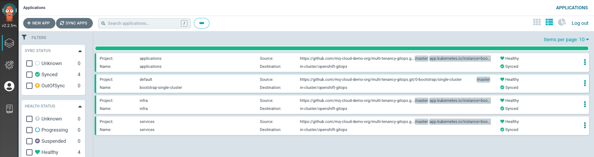
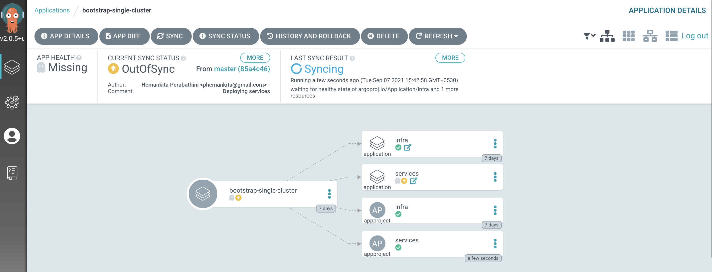
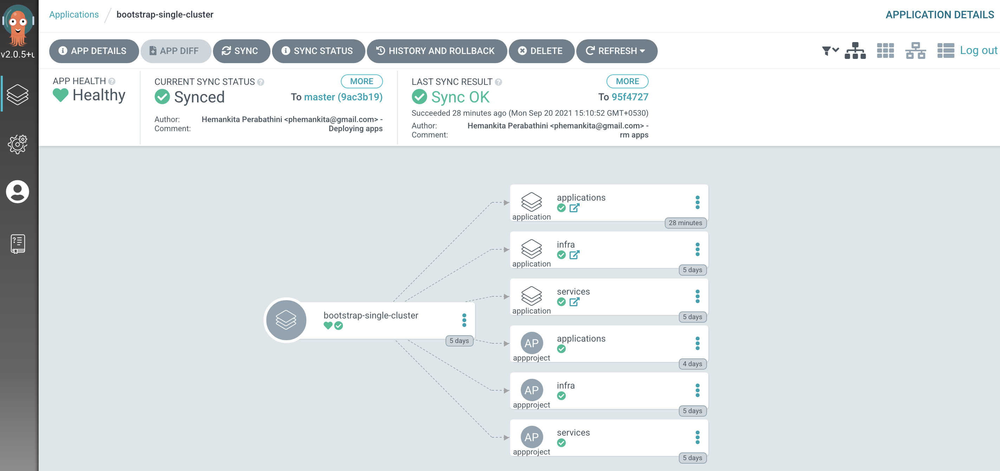
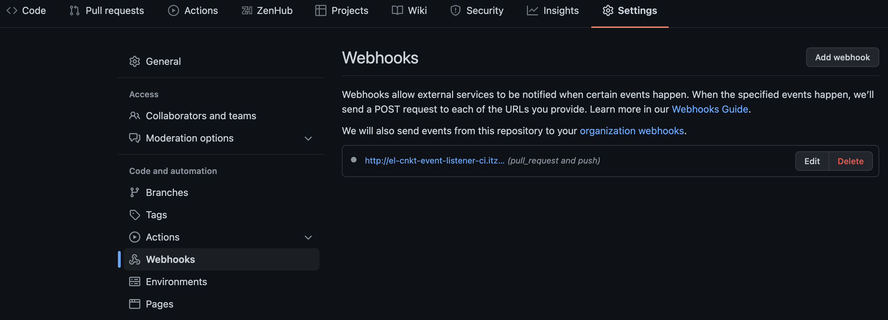
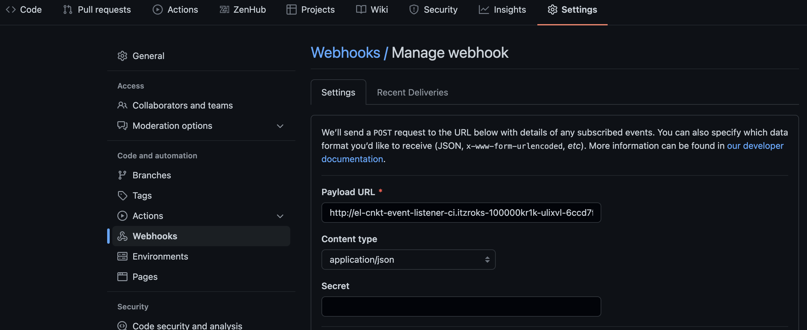
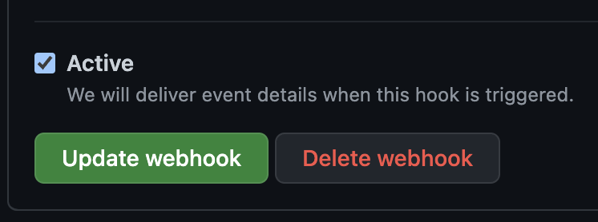

# Restoring a Cluster from a GitOps Repository

<!--- cSpell:ignore argoproj resyncs apic -->

There are times where you might want to restore a cluster based on the information stored in a GitOps repository. This might be a demo or training environment from a cluster that is no longer available. If you have a cluster configuration that you would like to restore, you can make it easier by saving some items before your cluster expires or is deleted. If you lose your original cluster before you are able to save these items, you can still restore it, but it does add a few steps.

## **On Original Cluster**

###   Saving Sealed Secret Certificate

Many clients use a **Secrets Manager** product to maintain their secrets in a vault external to the cluster. In this case, the certificates used to decrypt your secrets will be already stored in that vault, and can be restored to your new cluster. The steps are specific to your **Secrets Manager** product.

If, instead, you are using **Sealed Secrets** to store your secrets in your GitOps repo, as described in the tutorials on this site, you can make a backup of the sealed secret operator's certificate before your current cluster expires with the following command.

```bash
oc get secret -n sealed-secrets -l sealedsecrets.bitnami.com/sealed-secrets-key -o yaml >master.key
```

The command above stores the certificate in a `master.key` file. You can then deploy the certificate to your new cluster, as described [below](gitops-restore-cluster.md#if-you-saved-your-sealed-secret-certificate). Once the certificate has been deployed on your new cluster, the sealed secret operator will be able to decrypt your existing sealed secrets.  Keep the `master.key` file in a safe place. Do **NOT** store it in your GitOps repo because if someone gains access to this file they could decrypt your secrets.

If you did not create a backup of the sealed secret operator's certificate before your cluster expired, then you simply have to re-encrypt those secrets after you install the sealed secret operator in your new cluster. This process is described in [detail below](gitops-restore-cluster.md#re-encrypt-your-sealed-secrets).

## **On New Cluster**

### High Level Steps

Here are the high level steps to restore a cluster from an existing GitOps repo:

1. [Create a new cluster](#create-a-new-cluster)
1. [Install ArgoCD](#install-argocd)
1. [Deploy the Infrastructure](#deploy-the-infrastructure)
1. [Bootstrap the cluster](#bootstrap-the-cluster)
1. [Add the Secrets](#add-the-secrets)
1. [Deploy the Services](#deploy-the-services)
1. [Re-encrypt your Sealed Secrets](#re-encrypt-your-sealed-secrets)
1. [Deploy the Applications](#deploy-the-applications)
1. [Post Deployment tasks](#post-deployment-tasks)

## **Create a new Cluster**

To restore your GitOps repo you first need to create an Openshift cluster.

??? Example "Click to see details on how to use Techzone to create an OpenShift cluster on IBM Cloud"
   
    !!! Note  
        In the steps below you will need to adjust the size and settings of the cluster you create to match your original cluster settings.

    --8<-- "techzone-roks-empty-cluster-1.md"

        Specify the same settings as your original cluster:

        - Select your `Preferred Geography` such as `London 5`, `HongKong 2` or `San Jose 04`.
        - Under `End date and time`, select a date and specify the time along with its time zone.
        - Select `Worker Node Count`
        - Select `Worker Node Flavor` from the drop-down list
        - Select `NFS Size` from the drop-down list
        - Select `OpenShift Version from the drop-down-list

    --8<-- "techzone-roks-empty-cluster-2.md"


---

## **Install ArgoCD**

Once your cluster is created we now need to install ArgoCD. 

??? Example "Click to see details on how to install ArgoCD"

    Open a terminal window and navigate to the local `multi-tenancy-gitops` repository of your original cluster.

    --8<-- "gitops-install-argocd-2.md"

---

## **Deploy the Infrastructure** 

With the cluster and ArgoCD setup, we can now prepare to deploy the environment defined in our GitOps repo.  We need to rollout the environment in stages due to the fact we have to configure some things like secrets before the applications are deployed. We will start by deploying the `Infrastructure`.  This will create the namespaces where we will deploy the secrets. 

To only deploy the infrastructure, edit the `0-bootstrap/single-cluster/kustomization.yaml` and comment out the `2-services/2-services.yaml` and `3-apps/3-apps.yaml` lines.  Push the changes to your GitOps repo.

??? Example "Click to see details on how to prepare for the deployment of the infrastructure"

    1. Open `0-bootstrap/single-cluster/kustomization.yaml` and comment out the
        `2-services/2-services.yaml` and `3-apps/3-apps.yaml` as follows:

        ```{ .yaml .no-copy }
        resources:
        - 1-infra/1-infra.yaml
        #- 2-services/2-services.yaml
        #- 3-apps/3-apps.yaml
        patches:
        - target:
            group: argoproj.io
            kind: Application
            labelSelector: "gitops.tier.layer=gitops"
        ```

    1. If you used machinesets in your previous cluster then you will need to update the        `infrastructureId` in your `1-infra/argocd/machinesets.yaml` file for your new cluster

        ```{ .yaml .no-copy }
        spec:
        destination:
            namespace: openshift-gitops
            server: https://kubernetes.default.svc
        project: infra
        source:
            path: machinesets
            helm:
            values: |
                refarch-machinesets:
                infrastructureId: "UPDATE-THIS-VALUE"
                # cloudProvider.name set to aws, azure, ibmcloud or vsphere
                # cloudProvider.managed set to true for ROSA, ARO, ROKS
        ```


    1. Now commit and push changes to your git repository:

        ```bash
        git add .
        git commit -s -m "Using only infrastructure resources"
        git push origin $GIT_BRANCH
        ```

        which shows that the changes have been made active on GitHub:

        ```{ .text .no-copy }
        Enumerating objects: 9, done.
        Counting objects: 100% (9/9), done.
        Delta compression using up to 8 threads
        Compressing objects: 100% (5/5), done.
        Writing objects: 100% (5/5), 456 bytes | 456.00 KiB/s, done.
        Total 5 (delta 4), reused 0 (delta 0)
        remote: Resolving deltas: 100% (4/4), completed with 4 local objects.
        To https://github.com/tutorial-org-123/multi-tenancy-gitops.git
        e3f696d..ea3b43f  master -> master
        ```


## **Bootstrap the cluster**

Now that you have prepared to deploy the infrastructure only you can bootstrap the cluster.

??? Example "Click to see details on how to bootstrap the cluster"

    1. *Apply ArgoCD* `bootstrap.yaml` *to the cluster*

        Let's now deploy the `bootstrap-single-cluster` ArgoCD application to
        bootstrap the cluster.

        Issue the following command to apply the bootstrap YAML to the cluster:

        ```bash
        oc apply -f 0-bootstrap/single-cluster/bootstrap.yaml
        ```

        Kubernetes will confirm that the `bootstrap-single-cluster` resource has been created:

        ```{ .text .no-copy }
        application.argoproj.io/bootstrap-single-cluster created
        ```

        Notice that:

        -  `application.argoproj.io` indicates that this is an **ArgoCD
        application**.

        -  The `bootstrap-single-cluster` ArgoCD application is now watching the
        `0-bootstrap/single-cluster` folder in our `multi-tenancy-gitops`
        repository on GitHub.

        This connects your customized GitOps repository to the instance of ArgoCD running in the cluster. Once connected, ArgoCD will use the contents of this repository to create matching resources in the cluster. It will also keep the cluster synchronized with any changes to the GitOps repository.


    1. *Verify the bootstrap deployment*

        We can use the command line to verify that the bootstrap ArgoCD application
        is running.

        Issue the the following command:

        ```bash
        oc get app/bootstrap-single-cluster -n openshift-gitops
        ```

        You should see that the bootstrap application was recently updated:

        ```{ .text .no-copy }
        NAME                       SYNC STATUS   HEALTH STATUS
        bootstrap-single-cluster   Synced        Healthy
        ```

        `SYNC STATUS` may temporarily show `OutOfSync` or `HEALTH_STATUS` may
        temporarily show `Missing`; simply re-issue the command to confirm it moves
        to `Synced` and `Healthy`.


    4. *Using the UI to view the newly deployed ArgoCD applications*

        We can also use the ArgoCD web console to view the Kubernetes resources
        deployed to the cluster. Switch back to the web console, refresh the page and
        you should see the `bootstrap-single-cluster` ArgoCD application together
        with three other ArgoCD applications:

        {: style="max-height:400px"}


## **Add the Secrets**

Deploying the infrastructure recreates the namespaces for your cluster. Now you can deploy the secrets needed for the components you have installed into those namespaces.  

If you are using a **Secrets Manager** product, your secrets will already be saved there, external from your cluster, and you can restore your secrets from that product. The instructions are specific to the product and are outside the scope of this section.

If you used **sealed secrets** in your cluster, use the following instructions. The instructions are different depending on whether you saved your sealed secrets certificate before losing your original cluster, or whether you did not.

### In All Cases

In all cases, you need to recreate the IBM Entitlement Key secret for the Cloud Pak products you are about to restore. If you have Instana components installed, you will also need to recreate their secrets.

#### IBM Entitlement Key  

??? Example "The IBM Entitlement Key is required to pull IBM Cloud Pak specific container images from the IBM Entitled Registry. Click for the steps to recreate the entitlement key secret"
    
    If you do not know the value of your IBM Entitlement Key, follow these three steps to retrieve it.

    1. Log in to [MyIBM Container Software Library](https://myibm.ibm.com/products-services/containerlibrary){:target="_blank" .external} with an IBMid and password associated with the entitled software.  
    2. Select the **View library** option to verify your entitlement(s). 
    3. Select the **Get entitlement key** to retrieve the key.


    In the following command, replace `<entitlement_key>` with the value of your `IBM Entitlement Key`.

    ```bash
    export IBM_ENTITLEMENT_KEY=<entitlement_key>
    ```    
    
    Create a **Secret** containing the entitlement key in the `tools` namespace. 
    
    ```bash
    oc new-project tools || true
    oc create secret docker-registry ibm-entitlement-key -n tools \
    --docker-username=cp \
    --docker-password="$IBM_ENTITLEMENT_KEY" \
    --docker-server=cp.icr.io
    ```
    
    The response confirms that the `ibm-entitlement-key` secret has been created.

    ```{ .text .no-copy }
    secret/ibm-entitlement-key created
    ```

#### Instana Components

Skip this step if you did not have any Instana components installed in your cluster.

??? Example "Click to see details on how to recreate secrets for any Instana components you have installed"

    === "Instana Agent"
        If using the Instana Agent you need to store the agent key in a secret

        ```bash
        oc create secret generic instana-agent-key -n instana-agent \
        --from-literal=key=<AGENT-KEY> 
        ```

        !!! note
            If you have created a new instance of the Instana Server you need to update the `endpointHost` with the new IP of the server in the instana-agent.yaml

    === "Instana Robot Shop"
        If you deployed the Instana Robot Shop application you need to store the API Token and the Instana URL in a secret with the following.

        ```bash
        oc create secret generic instana-backend -n tools \
        --from-literal=API_TOKEN=<API-TOKEN> \
        --from-literal=INSTANA_URL=<INSTANA-URL>
        ```

        And you need to save the Enumeration Key in a secret

        ```bash
        oc create secret generic instana-eum-key -n robot-shop \
        --from-literal=key=<EUM-KEY> 
        ```

        !!! note
            If you have created a new instance of the Instana Server you need to update the `url` in the instana-robot-shop.yaml

### If You Saved Your Sealed Secret Certificate

If you previously stored the certificate in a `master.key` file, as described at the beginning of this section, you can restore that certificate to your new cluster with the following commands.

```bash
oc project sealed-secrets
oc apply -f master.key
```

### If You Did Not Save Your Sealed Secret Certificate   
        
If you did not store your sealed secret operator certificate in a file from your original cluster, you will need to re-encrypt the secrets and push them to the GitOps repo. These steps will be performed **after you restore the services** in the next section.

## **Deploy the Services** 

With the secrets deployed we can now deploy the `Services` in our GitOps repo.  

To deploy the services edit the `0-bootstrap/single-cluster/kustomization.yaml` and uncomment the `2-services/2-services.yaml` line.  Push the changes to your GitOps repo.

??? Example "Click to see details on how to deploy the services"

    1. Open `0-bootstrap/single-cluster/kustomization.yaml` and uncomment the
        `2-services/2-services.yaml` line as follows:

        ```{ .yaml .no-copy }
        resources:
        - 1-infra/1-infra.yaml
        - 2-services/2-services.yaml
        #- 3-apps/3-apps.yaml
        patches:
        - target:
            group: argoproj.io
            kind: Application
            labelSelector: "gitops.tier.layer=gitops"
        ```

    1. Push the changes to the GitOps repo

        ```bash
        git add .
        git commit -s -m "Deploying services"
        git push origin $GIT_BRANCH
        ```

        The changes have now been pushed to your GitOps repository:

        ```{ .text .no-copy }
        Enumerating objects: 9, done.
        Counting objects: 100% (9/9), done.
        Delta compression using up to 8 threads
        Compressing objects: 100% (5/5), done.
        Writing objects: 100% (5/5), 431 bytes | 431.00 KiB/s, done.
        Total 5 (delta 4), reused 0 (delta 0)
        remote: Resolving deltas: 100% (4/4), completed with 4 local objects.
        To https://github.com/prod-ref-guide/multi-tenancy-gitops.git
            533602c..85a4c46  master -> master
        ```

        This change to the GitOps repository can now be used by ArgoCD.

    1. *The* `bootstrap-single-cluster` *application detects the change and resyncs*

        Once these changes to our GitOps repository are seen by ArgoCD, it will resync
        the cluster to the desired new state.

        Switch to the ArgoCD UI **Applications** view to see the start of this resync process:

        {: style="max-height:500px"}

        Notice how the `bootstrap-single-cluster` application has detected the
        changes and is automatically synching the cluster.

        (*You can manually* `sync` the `bootstrap-single-cluster` *ArgoCD application in the UI if
        you don't want to wait for ArgoCD to detect the change.*)

!!! Note
    If you deploy services like artifactory that generated their own passwords and use sealed secrets to access them you will have to re-encrypt the new password and store it in your GitOps repo. 

## **Re-encrypt your Sealed Secrets**

The instructions in this section only need to be done if you **did not save** your sealed secrets certificate from your original cluster. If you did save it, your secrets have already been deployed and you can skip to the next section on your applications.

The steps to re-encrypt your sealed secrets are specific to which Cloud Pak component you have deployed. Please click and follow the appropriate section below.

??? Example "For the Cloud Pak for Integration IBM App Connect Enterprise Tutorial you will need to re-encrypt the following" 

    1. For the ***Build Configuration*** you need the `ace config deployment keys`, `ace infra deployment key`, `GitHub access token` and `Machine User's access token` sealed secretes as described in the [Create sealed secrets](../../guides/cp4i/ace/build-integration-server/build-configurations.md#create-sealed-secrets) section

    2. For the ***Build Integration Server*** you need the `create customer deployment keys` sealed secrete as described in the [Create sealed secrets](../../guides/cp4i/ace/build-integration-server/build-integration-server.md#create-sealed-secrets) section

    3. For the ***Continuous Update*** you need the `webhook token` sealed secrete as described in the [Deploy Secret Token](../../guides/cp4i/ace/build-integration-server/continuous-update.md#deploy-secret-token) section

??? Example "For the Cloud Pak for Integration IBM MQ Tutorial you will need to re-encrypt the following" 

    1. `IBM Entitlement Key` as described in the [Configure connection to the IBM Entitled Registry](../../guides/cp4i/mq/qmgr-pipeline/topic1.md#configure-connection-to-the-ibm-entitled-registry) section.

    2. `GitHub access credentials` as described in the [Configure the pipeline for QM1 source repository](../../guides/cp4i/mq/qmgr-pipeline/topic1.md#configure-the-pipeline-for-qm1-source-repository) section, starting with **Step 3**.

??? Example "For the Cloud Pak for Integration IBM API Connect Tutorial you will need to re-encrypt the following" 

    1. `IBM Entitlement Key` as described in the [Configure access to IBM Entitled Registry](../../guides/cp4i/apic/deployment/ibm-cloud.md#configure-access-to-ibm-entitled-registry) section.

    2. `GitHub Personal Access Token` as described in the [GitHub Personal Access Token](../../guides/cp4i/apic/configuration/ibm-cloud.md#2-github-personal-access-token) section.

    3. `Provider Organization` as described in the [Provider Organization](../../guides/cp4i/apic/configuration/ibm-cloud.md#4-provider-organization) section.


## **Deploy the Applications** 

With the `Services` deployed and secrets re-encrypted, we can now deploy the `Applications` in our GitOps repo.  

To deploy the applications edit the `0-bootstrap/single-cluster/kustomization.yaml` and uncomment the `3-apps/3-apps.yaml` line.  Push the changes to your GitOps repo.

??? Example "Click to see details on how to deploy the services"

    1. Open `0-bootstrap/single-cluster/kustomization.yaml` and uncomment the
        `3-apps/3-apps.yaml` line as follows:

        ```{ .yaml .no-copy }
        resources:
        - 1-infra/1-infra.yaml
        - 2-services/2-services.yaml
        - 3-apps/3-apps.yaml
        patches:
        - target:
            group: argoproj.io
            kind: Application
            labelSelector: "gitops.tier.layer=gitops"
        ```

    1. Push the changes to the GitOps repo

        ```bash
        git add .
        git commit -s -m "Deploying Apps"
        git push origin $GIT_BRANCH
        ```

        The changes have now been pushed to your GitOps repository:

        ```{ .text .no-copy }
        Enumerating objects: 9, done.
        Counting objects: 100% (9/9), done.
        Delta compression using up to 8 threads
        Compressing objects: 100% (5/5), done.
        Writing objects: 100% (5/5), 431 bytes | 431.00 KiB/s, done.
        Total 5 (delta 4), reused 0 (delta 0)
        remote: Resolving deltas: 100% (4/4), completed with 4 local objects.
        To https://github.com/prod-ref-guide/multi-tenancy-gitops.git
            533602c..85a4c46  master -> master
        ```

        This change to the GitOps repository can now be used by ArgoCD.

    4. *The `bootstrap-single-cluster` application detects the change and resyncs*

        Once these changes to our GitOps repository are seen by ArgoCD, it will resync the cluster to the desired new state.

        Switch to the ArgoCD UI Applications view to see the changes:

        {: style="max-height:500px"}

## **Post Deployment tasks**

After the applications are deployed there are some *clean-up* tasks to perform dependant on which tutorial your environment is based on.

### Update Webhooks

Any Webhook you created to trigger a process in your cluster will have to be modified for the new cluster host.  For example, in the MQ Tutorial you create a Webhook to start the Tekton pipeline anytime a change is pushed to the `MQ-Infra` repo.  

??? Example "Click to see details on how to update the webhooks"

    1. You can find the Webhook for the repo under `Settings` -> `Webhooks` 

        {: style="max-height:500px"}

    1. Click `Edit` and change the `Payload URL` to the host of your cluster.  You can find the cluster host with the command

        ```bash
        echo http://$(oc get route el-cnkt-event-listener -n ci -o jsonpath='{.spec.host}')
        ```

        Copy and paste the host into the `Payload URL` field.

        {: style="max-height:500px"}

    1. Scroll to the bottom of the page and click **Update Webhook**

        {: style="max-height:500px"}

        Now any changes to this repo triggers the webhook.


!!! success "Congratulations!"
    You've recreated the cluster from your GitOps repositories.
