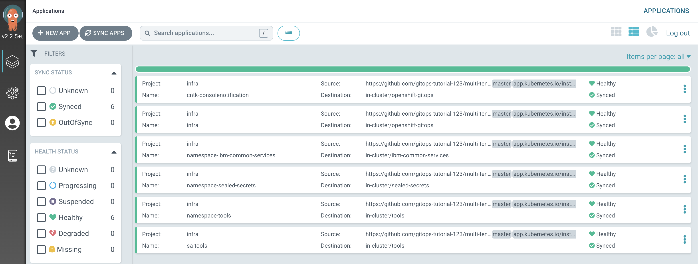
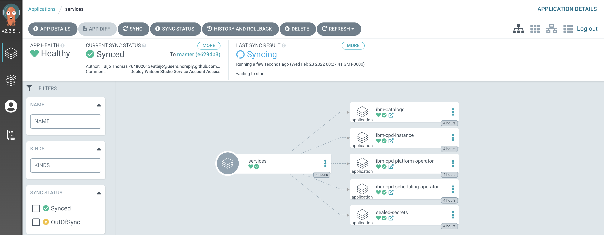
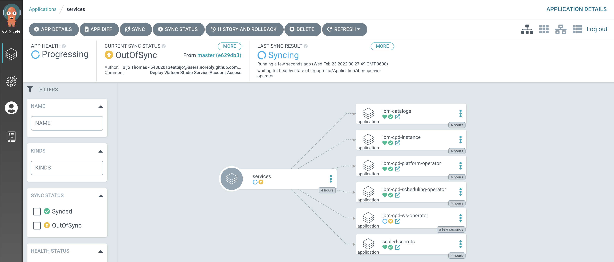
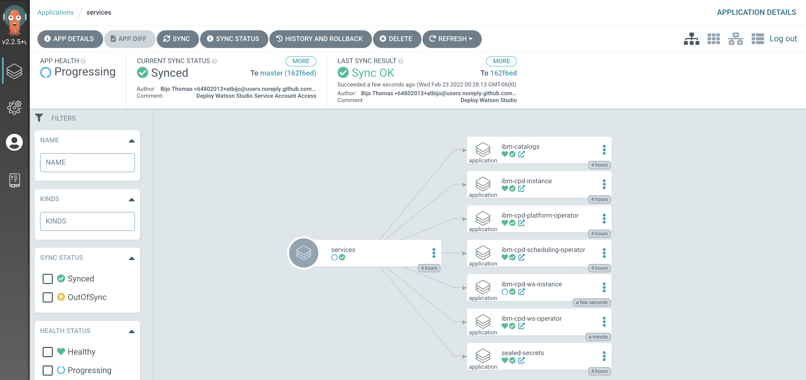
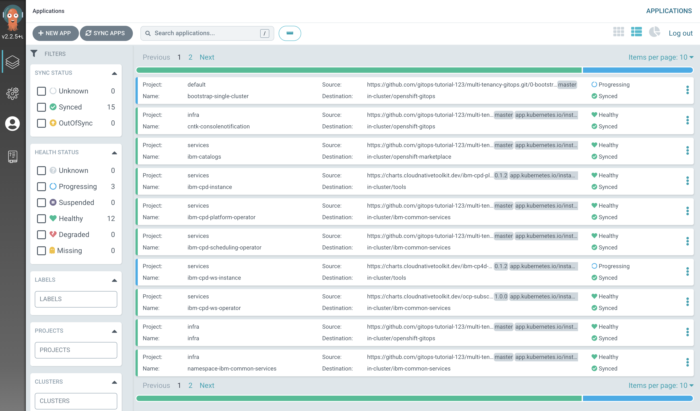
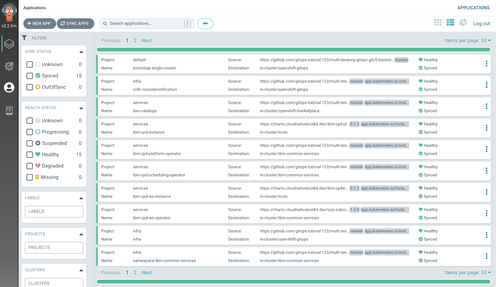
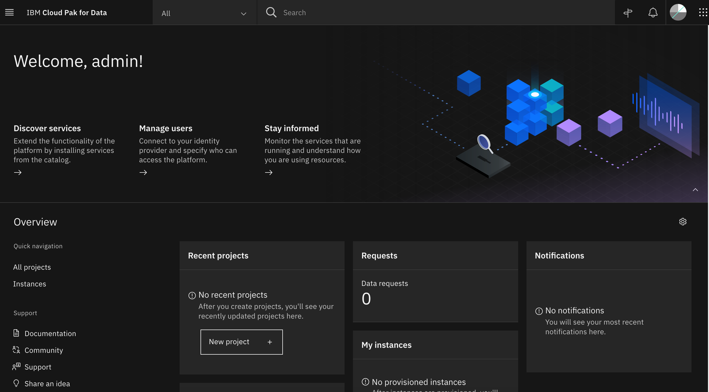
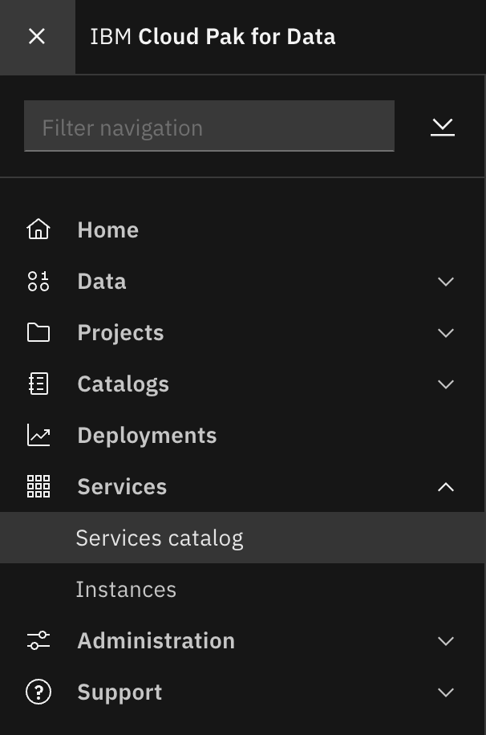
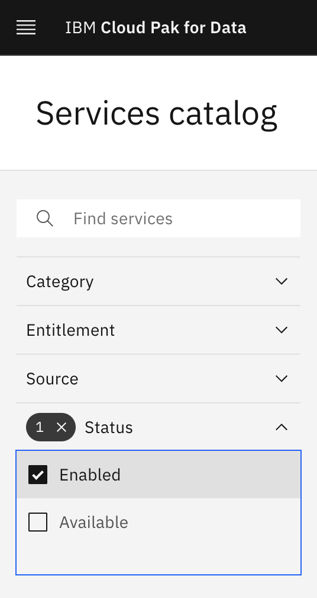
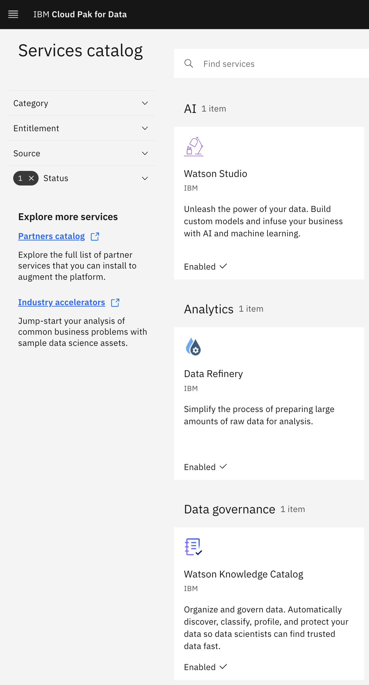

## Deploy services to the cluster

<!--- cSpell:ignore resynched resyncs norbac configmaps consolenotification subfolders rolebindings rolebinding CICD qube cntk autoplay allowfullscreen storageclass uncommented -->

We've deployed IBM Cloud Pak for Data platform using GitOps. We can install
additional services such as Watson Studio on this platform.

These components are part of the **services** layer in our architecture, and
that requires us to access `/0-bootstrap/single-cluster/2-services` within our GitOps repository.

Installing Watson Studio using GitOps requires us to provide image registry access to service accounts `zen-admin-sa`, `zen-editor-sa`, `zen-norbac-sa` and `zen-viewer-sa`. This is provided through ArgoCD `infra` application.

  1. *How to provide service account access*

      As we saw earlier, the `infra` ArgoCD application uses the contents of the
      `/0-bootstrap/single-cluster/1-infra` folder to manage infrastructure resources.

  2. *Review ArgoCD infra folder*

      Let’s reexamine the contents of `0-bootstrap/single-cluster/1-infra/kustomization.yaml`
      to see how ArgoCD manages the resources deployed to the cluster.

      Issue the following command:

      ```bash
      cat 0-bootstrap/single-cluster/1-infra/kustomization.yaml
      ```

      We can see the contents of the `kustomization.yaml`:

      ```{ .yaml .no-copy }
      resources:
      #- argocd/consolelink.yaml
      - argocd/consolenotification.yaml
      - argocd/namespace-ibm-common-services.yaml
      #- argocd/namespace-ci.yaml
      #- argocd/namespace-dev.yaml
      #- argocd/namespace-staging.yaml
      #- argocd/namespace-prod.yaml
      #- argocd/namespace-cloudpak.yaml
      #- argocd/namespace-istio-system.yaml
      #- argocd/namespace-openldap.yaml
      - argocd/namespace-sealed-secrets.yaml
      - argocd/namespace-tools.yaml
      #- argocd/namespace-instana-agent.yaml
      #- argocd/namespace-robot-shop.yaml
      #- argocd/namespace-openshift-storage.yaml
      #- argocd/namespace-spp.yaml
      #- argocd/namespace-spp-velero.yaml
      #- argocd/namespace-baas.yaml
      #- argocd/namespace-db2.yaml
      #- argocd/namespace-mq.yaml
      #- argocd/serviceaccounts-ibm-common-services.yaml
      #- argocd/serviceaccounts-tools.yaml
      #- argocd/serviceaccounts-db2.yaml
      #- argocd/serviceaccounts-mq.yaml
      #- argocd/scc-wkc-iis.yaml
      #- argocd/storage.yaml
      #- argocd/infraconfig.yaml
      #- argocd/machinesets.yaml
      patches:
      - target:
          group: argoproj.io
          kind: Application
          labelSelector: "gitops.tier.layer=infra"
        patch: |-
          - op: add
            path: /spec/source/repoURL
            value: https://github.com/tutorial-org-123/multi-tenancy-gitops-infra.git
          - op: add
            path: /spec/source/targetRevision
            value: master
      ```

  3. *Add service account permissions*

      Open `0-bootstrap/single-cluster/1-infra/kustomization.yaml` and
      make sure following resources are uncommented:  

      ```yaml
      - argocd/consolenotification.yaml
      - argocd/namespace-ibm-common-services.yaml
      - argocd/namespace-sealed-secrets.yaml
      - argocd/namespace-tools.yaml
      - argocd/serviceaccounts-tools.yaml
      ```

      If you take a diff, and just look for the added services:

      ```bash
      git diff  | grep "^\+" | grep -v "^\+++"
      ```

      You will have the following. Remember, namespaces and consolenotification were already enabled.

      ``` {.bash .no-copy}
      +- argocd/serviceaccounts-tools.yaml
      ```

      This shows the resources to be deployed for infrastructure.

      Commit and push changes to your git repository:

      ```bash
      git add .
      git commit -s -m "Deploy Watson Studio Service Account Access"
      git push origin $GIT_BRANCH
      ```

      The changes have now been pushed to your GitOps repository:

      ```{ .text .no-copy }
      [master e629db3] Deploy Watson Studio Service Account Access
       1 file changed, 1 insertion(+), 1 deletion(-)
      Enumerating objects: 11, done.
      Counting objects: 100% (11/11), done.
      Delta compression using up to 8 threads
      Compressing objects: 100% (6/6), done.
      Writing objects: 100% (6/6), 530 bytes | 530.00 KiB/s, done.
      Total 6 (delta 5), reused 0 (delta 0)
      remote: Resolving deltas: 100% (5/5), completed with 5 local objects.
      To https://github.com/tutorial-org-123/multi-tenancy-gitops.git
         b49dff5..e629db3  master -> master
      ```

  4. *The* `infra` *application detects the change and resyncs*

      Once these changes to our GitOps repository are seen by ArgoCD, it will resync
      the cluster to the desired new state.

      Switch to the ArgoCD UI **Applications** view, filter by `infra` project.

      {: style="max-height:400px"}

      Notice how the `infra` application has detected the changes and is automatically synching the cluster to create the new `sa-tools` ArgoCD application.

    !!! tip
        You can manually `sync` and `refresh` the `infra` ArgoCD application in the UI if you don't want to wait for ArgoCD to detect the change.

  5. *How to deploy services*

      As we saw earlier, the `services` application uses the contents of the
      `/0-bootstrap/single-cluster/2-services` folder to determine which Kubernetes resources should be deployed
      in the cluster.

  6. *Review ArgoCD services folder*

      Let’s reexamine the contents of `0-bootstrap/single-cluster/2-services/kustomization.yaml`
      to see how ArgoCD manages the resources deployed to the cluster.

      Issue the following command:

      ```bash
      cat 0-bootstrap/single-cluster/2-services/kustomization.yaml
      ```

      We can see the contents of the `kustomization.yaml`:

      ```{ .yaml .no-copy }
      resources:
      # IBM Software

      ## Cloud Pak for Integration
      #- argocd/operators/ibm-ace-operator.yaml
      #- argocd/operators/ibm-apic-operator.yaml
      #- argocd/instances/ibm-apic-instance.yaml
      #- argocd/instances/ibm-apic-management-portal-instance.yaml
      #- argocd/instances/ibm-apic-gateway-analytics-instance.yaml
      #- argocd/operators/ibm-aspera-operator.yaml
      #- argocd/operators/ibm-assetrepository-operator.yaml
      #- argocd/operators/ibm-cp4i-operators.yaml
      #- argocd/operators/ibm-datapower-operator.yaml
      #- argocd/operators/ibm-eventstreams-operator.yaml
      #- argocd/operators/ibm-mq-operator.yaml
      #- argocd/operators/ibm-opsdashboard-operator.yaml
      #- argocd/operators/ibm-platform-navigator.yaml
      #- argocd/instances/ibm-platform-navigator-instance.yaml

      ## Cloud Pak for Business Automation
      #- argocd/operators/ibm-cp4a-operator.yaml
      #- argocd/operators/ibm-db2u-operator.yaml
      #- argocd/operators/ibm-process-mining-operator.yaml
      #- argocd/instances/ibm-process-mining-instance.yaml

      ## Cloud Pak for Data
      - argocd/operators/ibm-cpd-scheduling-operator.yaml
      #- argocd/instances/ibm-cpd-scheduling-instance.yaml
      - argocd/operators/ibm-cpd-platform-operator.yaml
      - argocd/instances/ibm-cpd-instance.yaml
      #- argocd/operators/ibm-cpd-ws-operator.yaml
      #- argocd/instances/ibm-cpd-ws-instance.yaml
      #- argocd/operators/ibm-cpd-wkc-operator.yaml
      #- argocd/instances/ibm-cpd-wkc-instance.yaml

      ## Cloud Pak for Security
      #- argocd/operators/ibm-cp4s-operator.yaml
      #- argocd/instances/ibm-cp4sthreatmanagements-instance.yaml

      ## IBM Foundational Services / Common Services
      #- argocd/operators/ibm-foundations.yaml
      #- argocd/instances/ibm-foundational-services-instance.yaml
      #- argocd/operators/ibm-automation-foundation-core-operator.yaml
      #- argocd/operators/ibm-automation-foundation-operator.yaml
      #- argocd/operators/ibm-license-service-operator.yaml
      #- argocd/instances/ibm-license-service-instance.yaml

      ## IBM Catalogs
      - argocd/operators/ibm-catalogs.yaml

      # B2BI
      #- argocd/instances/ibm-sfg-db2.yaml
      #- argocd/instances/ibm-sfg-mq.yaml
      #- argocd/instances/ibm-sfg-b2bi-setup.yaml
      #- argocd/instances/ibm-sfg-b2bi.yaml

      # Required for IBM MQ
      #- argocd/instances/openldap.yaml
      # Required for IBM ACE, IBM MQ
      #- argocd/operators/cert-manager.yaml
      #- argocd/instances/cert-manager-instance.yaml

      # Sealed Secrets
      - argocd/instances/sealed-secrets.yaml

      # CICD
      #- argocd/operators/grafana-operator.yaml
      #- argocd/instances/grafana-instance.yaml
      #- argocd/instances/grafana-instana.yaml
      #- argocd/instances/artifactory.yaml
      #- argocd/instances/chartmuseum.yaml
      #- argocd/instances/developer-dashboard.yaml
      #- argocd/instances/swaggereditor.yaml
      #- argocd/instances/sonarqube.yaml
      #- argocd/instances/pact-broker.yaml
      # In OCP 4.7+ we need to install openshift-pipelines and possibly privileged scc to the pipeline serviceaccount
      #- argocd/operators/openshift-pipelines.yaml

      # Service Mesh
      #- argocd/operators/elasticsearch.yaml
      #- argocd/operators/jaeger.yaml
      #- argocd/operators/kiali.yaml
      #- argocd/operators/openshift-service-mesh.yaml
      #- argocd/instances/openshift-service-mesh-instance.yaml

      # Monitoring
      #- argocd/instances/instana-agent.yaml
      #- argocd/instances/instana-robot-shop.yaml

      # Spectrum Protect Plus
      #- argocd/operators/spp-catalog.yaml
      #- argocd/operators/spp-operator.yaml
      #- argocd/instances/spp-instance.yaml
      #- argocd/operators/oadp-operator.yaml
      #- argocd/instances/oadp-instance.yaml
      #- argocd/instances/baas-instance.yaml

      patches:
      - target:
          group: argoproj.io
          kind: Application
          labelSelector: "gitops.tier.layer=services,gitops.tier.source=git"
        patch: |-
          - op: add
            path: /spec/source/repoURL
            value: https://github.com/tutorial-org-123/multi-tenancy-gitops-services.git
          - op: add
            path: /spec/source/targetRevision
            value: master
      - target:
          group: argoproj.io
          kind: Application
          labelSelector: "gitops.tier.layer=applications,gitops.tier.source=git"
        patch: |-
          - op: add
            path: /spec/source/repoURL
            value: https://github.com/tutorial-org-123/multi-tenancy-gitops-apps.git
          - op: add
            path: /spec/source/targetRevision
            value: master
      - target:
          group: argoproj.io
          kind: Application
          labelSelector: "gitops.tier.layer=services,gitops.tier.source=helm"
        patch: |-
          - op: add
            path: /spec/source/repoURL
            value: https://charts.cloudnativetoolkit.dev
      - target:
          name: ibm-automation-foundation-operator
        patch: |-
          - op: add
            path: /spec/source/helm/parameters/-
            value:
              name: spec.channel
              value: v1.1
      ```

  7. *Add the services layer to the cluster*

    !!! note
        The `Watson Studio` instance requires a RWX storageclass and it is set to `managed-nfs-storage` by default in the
        ArgoCD Application `0-bootstrap/single-cluster/2-services/argocd/instances/ibm-cp4d-watson-studio-instance.yaml`.  This storageclass is available for Red Hat OpenShift on IBM Cloud cluster provisioned from IBM Technology Zone with NFS storage selected.  

      Open `0-bootstrap/single-cluster/2-services/kustomization.yaml` and
      make sure following resources are uncommented:  

      ```yaml
      # Cloud Pak for Data
      - argocd/operators/ibm-cpd-scheduling-operator.yaml
      - argocd/operators/ibm-cpd-platform-operator.yaml
      - argocd/instances/ibm-cpd-instance.yaml
      - argocd/operators/ibm-cpd-ws-operator.yaml
      - argocd/instances/ibm-cpd-ws-instance.yaml

      # IBM Catalogs
      - argocd/operators/ibm-catalogs.yaml

      # Sealed Secrets
      - argocd/instances/sealed-secrets.yaml

      ```

      If you take a diff, and just look for the added services:

      ```bash
      git diff  | grep "^\+" | grep -v "^\+++"
      ```

      You will have the following. Remember, CP4D platform resources were already enabled.

      ``` {.bash .no-copy}
      +- argocd/operators/ibm-cpd-ws-operator.yaml
      +- argocd/instances/ibm-cpd-ws-instance.yaml
      ```

      This shows the resources to be deployed for services.

      Commit and push changes to your git repository:

      ```bash
      git add .
      git commit -s -m "Deploy Watson Studio"
      git push origin $GIT_BRANCH
      ```

      The changes have now been pushed to your GitOps repository:

      ```{ .text .no-copy }
      [master 162f6ed] Deploy Watson Studio
       1 file changed, 2 insertions(+), 2 deletions(-)
      Enumerating objects: 11, done.
      Counting objects: 100% (11/11), done.
      Delta compression using up to 8 threads
      Compressing objects: 100% (6/6), done.
      Writing objects: 100% (6/6), 520 bytes | 520.00 KiB/s, done.
      Total 6 (delta 5), reused 0 (delta 0)
      remote: Resolving deltas: 100% (5/5), completed with 5 local objects.
      To https://github.com/tutorial-org-123/multi-tenancy-gitops.git
         b49dff5..162f6ed  master -> master
      ```

      The intention of this operation is to indicate that we'd like the resources
      declared in `0-bootstrap/single-cluster/2-services/kustomization.yaml` to be
      deployed in the cluster. Like the `infra` ArgoCD application, the resources
      created by the `services` ArgoCD application will manage the Kubernetes
      relevant services resources applied to the cluster.

  8. *The* `services` *application detects the change and resyncs*

      Once these changes to our GitOps repository are seen by ArgoCD, it will resync
      the cluster to the desired new state.

      Switch to the ArgoCD UI **Applications** view, click on the `services` application to see the start of this resync process:

      {: style="max-height:408px"}

      Notice how the `services` application has detected the
      changes and is automatically synching the cluster.

      {: style="max-height:449px"}

    !!! tip
        You can manually `sync` and `refresh` the `services` ArgoCD application in the UI if you don't want to wait for ArgoCD to detect the change.

  9. *The new ArgoCD applications*

      After a short while, you'll see lots of new ArgoCD applications have been
      created to manage the **services** we have deployed by modifying
      `kustomization.yaml` under `0-bootstrap/single-cluster/2-services` folder:

      {: style="max-height:494px"}

      See how most ArgoCD applications are `Synced` almost immediately, but some
      spend time in `Progressing`.

      

      Notice how many more `Synced` ArgoCD applications are now in the cluster;
      these are as a result of the newly added **services** layer in our
      architecture.

  10. *Verify that Watson Studio has been deployed successfully.*

      Switch to the ArgoCD UI **Applications** view, wait for all ArgoCD applications to become `Synced` and `Healthy`:

      

    !!! note
        The installation of Watson Studio will take approximately 2 hours.

      Alternatively, issue the following command on terminal and wait for the expected output.

      ```bash
      watch "oc get WS ws-cr -n tools -o jsonpath=\"{.status.wsStatus} {'\n'}\""
      ```

      Expected output = `Completed`

    !!! tip
        Press ++ctrl+c++ on your keyboard to exit out of watch window.

      We can now access the Cloud Pak for Data web client and see that Watson Studio is installed.

  11. *Access the IBM Cloud Pak for Data web client*
  
      Retrieve the URL for the IBM Cloud Pak for Data web client and and open it in a browser.

      ```bash
      echo https://`oc get ZenService lite-cr -n tools -o jsonpath="{.status.url}{'\n'}"`
      ```

      Retrieve the `admin` password

      ```bash
      oc extract secret/admin-user-details -n tools --keys=initial_admin_password --to=-
      ```

      Log in to the **IBM Cloud Pak for Data** web client with the `admin` credentials.

      

      Click on the navigation menu icon on the top left corner. Click on Services menu option to expand it, then select Services catalog.

      {: style="max-height:458px"}

      Under Status, select "Enabled" to display only the services that are installed and enabled in Cloud Pak for Data.

      {: style="max-height:540px"}

      Notice the `Enabled` tag next to Watson Studio. There might be other enabled services as well.

      {: style="max-height:1010px"}
