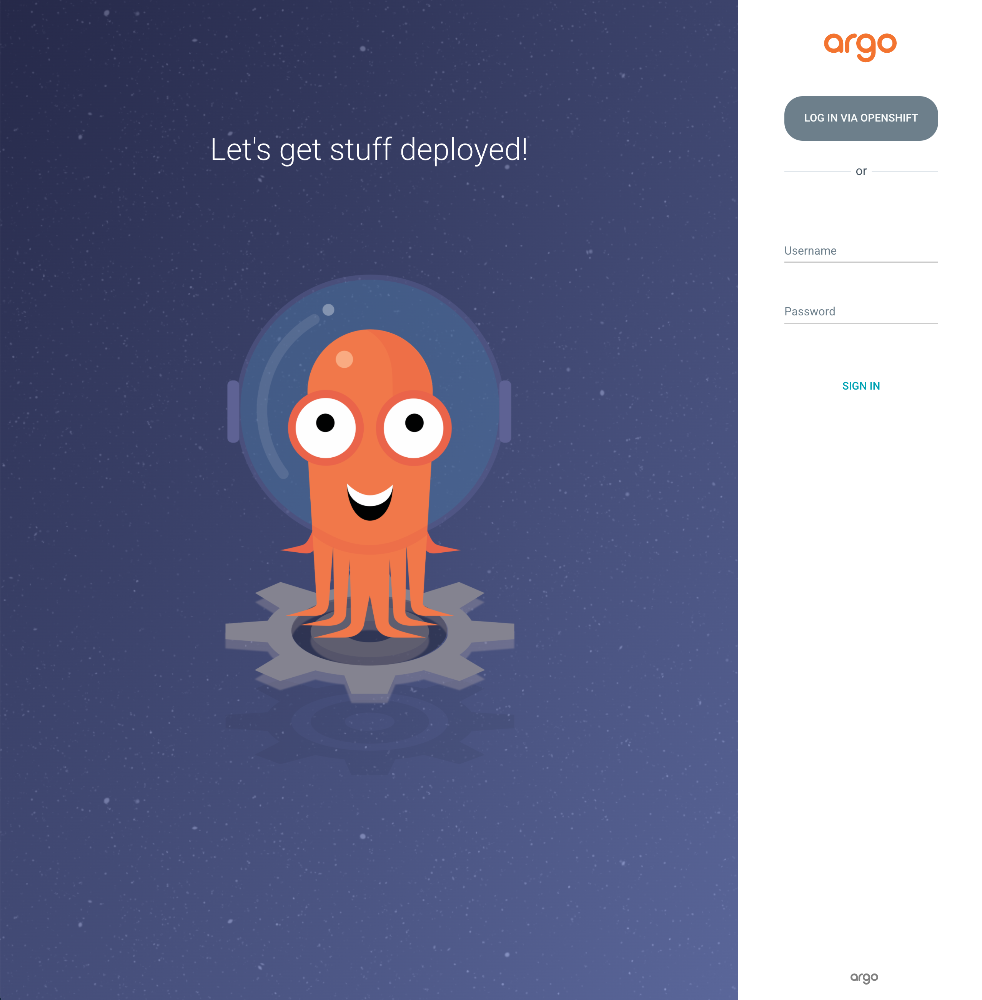
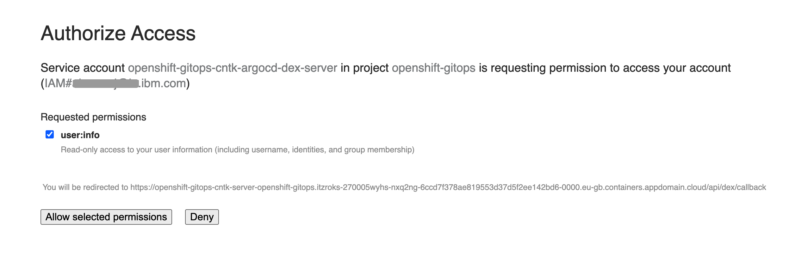
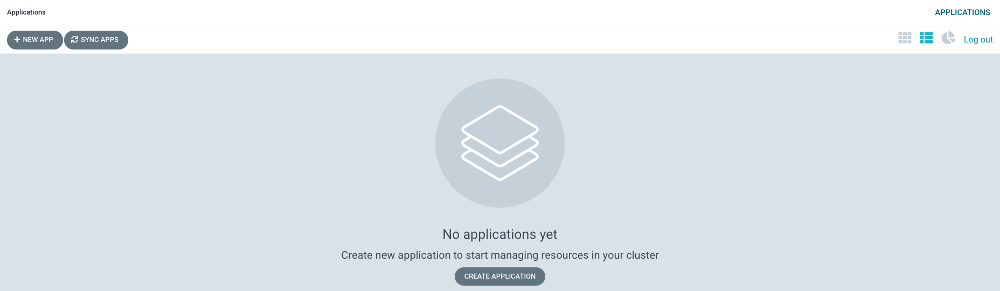

<!--- cSpell:ignore resynched clusterrole clusterrolebinding consolenotification subfolders rolebindings rolebinding CICD qube cntk autoplay allowfullscreen itzroks ingresscontroller jsonpath -->

We will install ArgoCD using the `Red Hat OpenShift GitOps` operator. We will
also configure it with the appropriate access rights to limit the resources it
can create in the cluster. In so doing, we ensure that ArgoCD acts like a
well-governed administrator of the cluster, only doing what it needs to do.
Also, we will customize our ArgoCD instance by adding necessary custom checks.

1. *Ensure you're logged in to the cluster*

    !!! tip
        Ensure your **terminal window** is in the `multi-tenancy-gitops` folder.

    Log into your OCP cluster, substituting the `--token` and `--server`
    parameters with your values:

    ```bash
    oc login --token=<token> --server=<server>
    ```

    If you are unsure of these values, click your user ID in the OpenShift web
    console and select `Copy Login Command`.

    On successful login, you'll see some basic information:

    ```{ .text .no-copy }
    Logged into "https://c100-e.jp-tok.containers.cloud.ibm.com:30749" as "IAM#hperabat@in.ibm.com" using the token provided.

    You have access to 63 projects, the list has been suppressed. You can list all projects with 'oc projects'

    Using project "default".
    ```

    This shows some details about your user within this cluster. (This user is
    different to your GitHub user.)

    <br>

2. *Install ArgoCD into the cluster*

    We use the Red Hat GitOps operator to install ArgoCD into the cluster. The
    cloned `multi-tenancy-gitops `repository contains the YAML necessary to do
    this. We’ll examine the YAML later; first let’s use it.

    Issue the following command to create an ArgoCD subscription in your cluster:

    ```bash
    oc apply -f setup/ocp4x/
    ```

    The response confirms that the below resources has been created:

    ```{ .text .no-copy }
    clusterrole.rbac.authorization.k8s.io/custom-argocd-cluster-argocd-application-controller created
    clusterrolebinding.rbac.authorization.k8s.io/openshift-gitops-argocd-application-controller created
    clusterrolebinding.rbac.authorization.k8s.io/openshift-gitops-cntk-argocd-application-controller created
    subscription.operators.coreos.com/openshift-gitops-operator created
    ```

    Most importantly, this command verifies that it has registered a
    subscription for ArgoCD to be installed in the cluster.

    <br>

3. *Wait for the ArgoCD installation to complete*

    Installation of ArgoCD is an asynchronous process; that's because while the
    previous script created the subscription for ArgoCD almost immediately, the
    installation of the ArgoCD operator takes some time, and the once the
    operator has been installed, the default instance of ArgoCD also takes a
    little time to create.

    We can now issue two commands which, in turn, will wait for the ArgoCD
    operator to be installed and for the default instance of ArgoCD to be
    started.

    Issue the following commands:

    ```bash
    while ! oc wait crd applications.argoproj.io --timeout=-1s --for=condition=Established  2>/dev/null; do sleep 30; done
    while ! oc wait pod --timeout=-1s --for=condition=Ready --all -n openshift-gitops 2>/dev/null; do sleep 30; done
    ```

    After a while, you should see the following message informing us that
    operator installation is complete (it may tale a few minutes):

    ```{ .text .no-copy }
    customresourcedefinition.apiextensions.k8s.io/applications.argoproj.io condition met
    ```

    The ArgoCD operator is now installed and the default instance has been
    successfully created.

    <br>

4. *ArgoCD `clusterrole` and `clusterrolebinding`*

    ArgoCD runs under a dedicated service account. For good governance, we use a
    custom **clusterrole** and **clusterrolebinding** to control the specific
    operations this service account can perform on different resources in the
    cluster.

    The cluster role and the cluster role binding YAMLs are also setup along
    with the subscription.

    ```bash
    oc get clusterrole custom-argocd-cluster-argocd-application-controller
    oc get clusterrolebinding openshift-gitops-argocd-application-controller
    oc get clusterrolebinding openshift-gitops-cntk-argocd-application-controller
    ```

    You'll see the resources are created in the cluster:

    ```{ .text .no-copy }
    $ oc get clusterrole custom-argocd-cluster-argocd-application-controller
    NAME                                                  CREATED AT
    custom-argocd-cluster-argocd-application-controller   2021-08-27T13:35:13Z

    $ oc get clusterrolebinding openshift-gitops-argocd-application-controller
    NAME                                             ROLE                                                              AGE
    openshift-gitops-argocd-application-controller   ClusterRole/custom-argocd-cluster-argocd-application-controller   8m43s

    $ oc get clusterrolebinding openshift-gitops-cntk-argocd-application-controller
    NAME                                                  ROLE                                                              AGE
    openshift-gitops-cntk-argocd-application-controller   ClusterRole/custom-argocd-cluster-argocd-application-controller   8m45s
    ```

    The clusterrole `custom-argocd-cluster-argocd-application-controller`
    defines a specific set of specific resources that are required by the ArgoCD
    service account and access rights over them.

    The cluster role bindings `openshift-gitops-argocd-application-controller`
    and `openshift-gitops-cntk-argocd-application-controller` binds the ArgoCD
    service account to the cluster role above.

    In combination, these definitions limit ArgoCD to perform the minimum set of
    operations required to manage the cluster. This is important; it means that
    ArgoCD behaves as a well governed administrator of the cluster.

    We'll also see later in the tutorial how ArgoCD creates resource in the
    cluster.

    <br>

5. *Delete default ArgoCD instance*

    As we'll see in a moment, the default instance of ArgoCD, created when we
    install the operator, isn't sufficient for our tutorial; we have to create a
    new one. But before we do this, we have to delete the default instance of
    ArgoCD.

    Issue the following command to delete the default ArgoCD instance:

    ```bash
    oc delete gitopsservice cluster -n openshift-gitops || true
    ```

    You will see the resources being deleted as follows:

    ```{ .text .no-copy }
    warning: deleting cluster-scoped resources, not scoped to the provided namespace
    gitopsservice.pipelines.openshift.io "cluster" deleted
    ```

    Now that we've deleted the default instance, we can create a customized
    ArgoCD instance with additional capabilities.

    <br>

---

## Creating a custom instance

The default instance of ArgoCD provides some built-in health checks for
validating standard Kubernetes resources. However, these checks are not
sufficient to check the health of the **custom resources** added by the IBM
Cloud Paks; we need to create a custom instance of ArgoCD that implements some
IBM Cloud Pak specific health checks.

1. *The custom ArgoCD instance*

    You can explore these custom health checks in the ArgoCD YAML that we'll use to
    create the new ArgoCD instance:

    ```bash
    cat setup/ocp4x/argocd-instance/argocd-instance.yaml
    ```

    Notice, for example, a custom health check for queue managers:

    ```{ .yaml .no-copy }
    mq.ibm.com/QueueManager:
      health.lua: |
        hs = {}
        if obj.status ~= nil then
          if obj.status.phase ~= nil then
            hs.message = obj.status.phase
            if obj.status.phase == "Running" then
              hs.status = "Healthy"
            else
              hs.status = "Progressing"
            end
            return hs
          end
        end
        hs.status = "Progressing"
        hs.message = "Unknown"
        return hs
    ```

    This logic is used by ArgoCD to determine when a queue manager is healthy.

    You can learn more about the ArgoCD Resource Health
    [here](https://argoproj.github.io/argo-cd/operator-manual/health/) and
    ArgoCD custom **Lua** health checks [here](https://www.lua.org/).

    <br>

2. *Create a custom ArgoCD instance*

    Now let's create the custom ArgoCD instance using this YAML.

    Issue the following command to create a custom ArgoCD instance:

    ```bash
    oc apply -f setup/ocp4x/argocd-instance/ -n openshift-gitops
    ```

    The response confirms that the below resources has been created:

    ```{ .text .no-copy }
    argocd.argoproj.io/openshift-gitops-cntk created
    ```

    Issue the below command; it will wait to complete until ArgoCD instance pod is up
    and running:

    ```bash
    while ! oc wait pod --timeout=-1s --for=condition=ContainersReady -l app.kubernetes.io/name=openshift-gitops-cntk-server -n openshift-gitops > /dev/null; do sleep 30; done
    ```

    <br>

3. *Associate a certificate with the ArgoCD instance*

    !!! Warning
        If you are using the Firefox browser, you will not be able to
        access the ArgoCD console until a valid certificate has been associated
        with it. Other browsers are unaffected; you can omit this step if you wish.

    Some browsers will not allow you to access the ArgoCD instance unless it has
    been configured with a valid certificate. The following commands will
    associate a valid certificate directly with the ArgoCD instance.

    ```bash
    mkdir $$tmp$$
    cd $$tmp$$
    ingress_secret_name=$(oc get ingresscontroller.operator default \
    --namespace openshift-ingress-operator \
    -o jsonpath='{.spec.defaultCertificate.name}')
    oc extract secret/$ingress_secret_name -n openshift-ingress
    oc create secret tls -n openshift-gitops openshift-gitops-cntk-tls --cert=tls.crt --key=tls.key --dry-run=client -o yaml | oc apply -f -
    cd ..
    rm -rf $$tmp$$
    ```

    <br>

4. *Launch ArgoCD*

    ArgoCD can be accessed via an OpenShift route. Using a browser, navigate to
    the URL returned by following command:

    ```bash
    oc get route openshift-gitops-cntk-server -n openshift-gitops -o jsonpath='{"https://"}{.spec.host}{"\n"}'
    ```

    This will list the route to the ArgoCD instance we've just created, for example:

    ```{ .text .no-copy }
    https://openshift-gitops-cntk-server-openshift-gitops.ibmcloud-roks-xxxxx.containers.appdomain.cloud
    ```

    Copy the URL from your terminal output into your browser to launch the ArgoCD web console.

    (*You can safely ignore any browser certificate warnings.*)

    You should get to the ArgoCD login page:

    {: style="max-height:1000px"}

    <br>

5. *Login to ArgoCD*

    !!! Info
        When logging into ArgoCD you can select one of two different
        authentication mechanisms. You can select either mechanism, but if you
        want to have full access to do things like synching or refreshing ArgoCD
        Applications, you should use the mechanism that uses administrator
        credentials (first option below).

    You can see that the ArgoCD login page provides two different mechanism for
    authentication:

       1. The first mechanisms uses the **ArgoCD service account credentials**
          created at installation time. If you use this mechanism, you will be
          authenticated as an administrator with all associated privileges. (You
          don't need administrator privileges to complete the tutorial.)

          To log in using the ArgoCD administrator credentials, use **admin** for the
          `username` and retrieve the **password** from the appropriate Kubernetes
          secret. Use the following command to retrieve the password:

          ```bash
          oc extract secret/openshift-gitops-cntk-cluster -n openshift-gitops --keys="admin.password" --to=-
          ```

       2. The second mechanism uses your OpenShift Single Sign On mechanism to
          authenticate you. If you use this mechanism, you will be authenticated
          as your user, rather than an administrator, with appropriate permissions.
          These permissions are sufficient to complete the tutorial, but you will
          not be able to perform a full range of ArgoCD operations.

          You may be prompted to grant the ArgoCD Service Account access your
          OpenShift user account information details.

          {: style="max-height:450px"}

          If so, grant access to retrieve your OpenShift user information.

    Once the UI launches, you'll see:

    {: style="max-height:400px"}

    See how there are no ArgoCD applications active at the moment.

    In the next section of the tutorial, we'll configure ArgoCD to create the
    **ArgoCD applications** that will in turn spin up **infrastructure**,
    **service**, and **application** resources to apply to the cluster.

    <br>