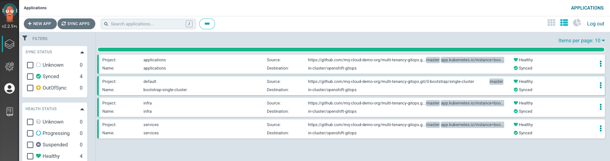
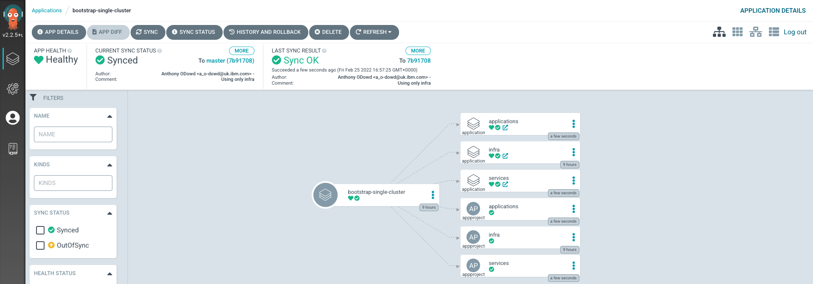
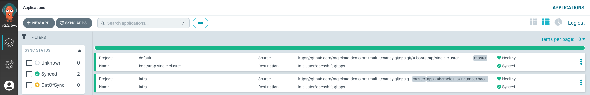
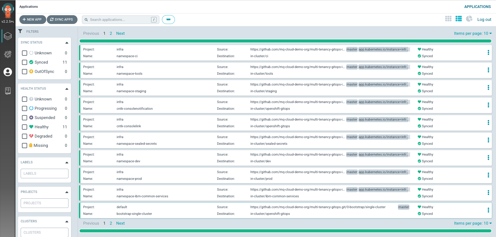
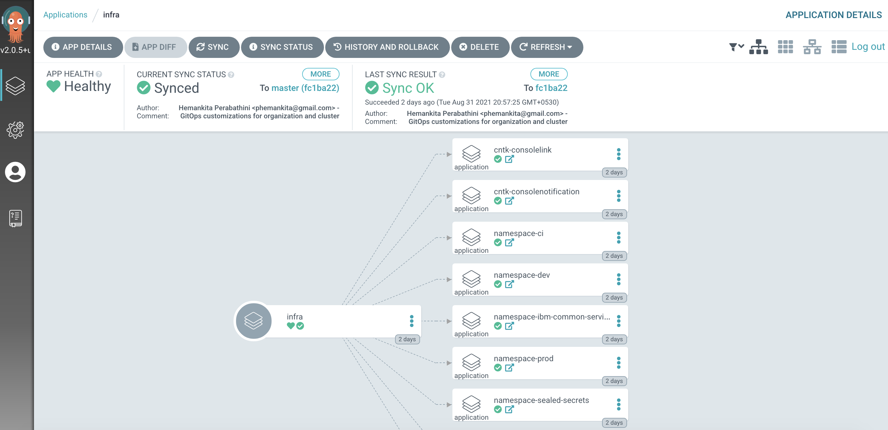
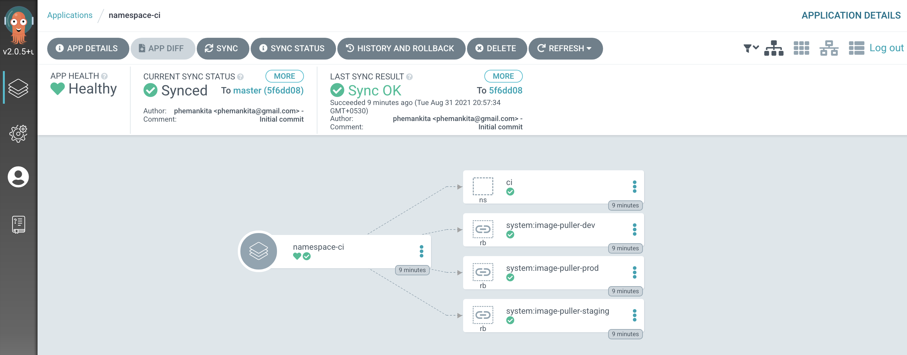
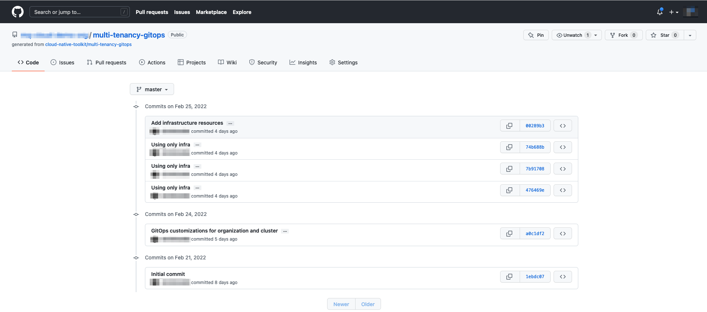

## Connect ArgoCD

<!--- cSpell:ignore resynched uncommenting clusterrole clusterrolebinding consolenotification subfolders rolebindings rolebinding CICD qube cntk autoplay allowfullscreen argoproj -->

Let's now connect your customized GitOps repository to the instance of ArgoCD
running in the cluster. Once connected, ArgoCD will use the contents of this
repository to create matching resources in the cluster. It will also keep the
cluster synchronized with any changes to the GitOps repository.

1. *Review the* `bootstrap-single-cluster` ArgoCD application

    Recall that you pushed the customized local copy of the GitOps repository to
    your GitHub account. The repository contains a `bootstrap-single-cluster`
    ArgoCD application that, when deployed to the cluster, will continuously
    watch this repository and use its contents to synchronize the cluster.

    The `0-bootstrap/single-cluster/bootstrap.yaml` file is used to create our
    first ArgoCD application called `bootstrap-single-cluster`. This initial
    ArgoCD application effectively bootstraps the cluster by create all the
    other ArgoCD applications that control the infrastructure, service and
    application resources deployed to the cluster.

    Examine the YAML that defines the ArgoCD bootstrap application:

    ```bash
    cat 0-bootstrap/single-cluster/bootstrap.yaml
    ```

    ```{ .yaml .no-copy }
    apiVersion: argoproj.io/v1alpha1
    kind: Application
    metadata:
      name: bootstrap-single-cluster
      namespace: openshift-gitops
    spec:
      destination:
        namespace: openshift-gitops
        server: https://kubernetes.default.svc
      project: default
      source:
        path: 0-bootstrap/single-cluster
        repoURL: https://github.com/tutorial-org-123/multi-tenancy-gitops.git
        targetRevision: master
      syncPolicy:
        automated:
          prune: true
          selfHeal: true
    ```

    Notice again how this ArgoCD application has been customized to use your GitOps
    repository `repoURL: https://github.com/tutorial-org-123/multi-tenancy-gitops.git`.

    Within this repository, the folder `path: 0-bootstrap/single-cluster` refers
    to a folder that contains all the other ArgoCD applications that are used to
    manage cluster resources.

    By deploying this ArgoCD application to a cluster, we are effectively
    linking our GitOps repository to that cluster.

    <br>

2. *Apply ArgoCD* `bootstrap.yaml` *to the cluster*

    Let's now deploy the `bootstrap-single-cluster` ArgoCD application to
    bootstrap the cluster.

    Issue the following command to apply the bootstrap YAML to the cluster:

    ```bash
    oc apply -f 0-bootstrap/single-cluster/bootstrap.yaml
    ```

    Kubernetes will confirm that the `bootstrap-single-cluster` resource has been created:

    ```{ .text .no-copy }
    application.argoproj.io/bootstrap-single-cluster created
    ```

    Notice that:

    -  `application.argoproj.io` indicates that this is an **ArgoCD
       application**.

    -  The `bootstrap-single-cluster` ArgoCD application is now watching the
       `0-bootstrap/single-cluster` folder in our `multi-tenancy-gitops`
       repository on GitHub.

    - This is the only direct cluster operation we need to perform; from now on,
      all cluster operations will be performed via Git operations to this
      repository.

    <br>

3. *Verify the bootstrap deployment*

    We can use the command line to verify that the bootstrap ArgoCD application
    is running.

    Issue the the following command:

    ```bash
    oc get app/bootstrap-single-cluster -n openshift-gitops
    ```

    You should see that the bootstrap application was recently updated:

    ```{ .text .no-copy }
    NAME                       SYNC STATUS   HEALTH STATUS
    bootstrap-single-cluster   Synced        Healthy
    ```

    `SYNC STATUS` may temporarily show `OutOfSync` or `HEALTH_STATUS` may
    temporarily show `Missing`; simply re-issue the command to confirm it moves
    to `Synced` and `Healthy`.

    <br>

4. *Using the UI to view the newly deployed ArgoCD applications*

    We can also use the ArgoCD web console to view the Kubernetes resources
    deployed to the cluster. Switch back to the web console, refresh the page and
    you should see the `bootstrap-single-cluster` ArgoCD application together
    with three other ArgoCD applications:

    {: style="max-height:400px"}

    (You may need to select `List` view rather than the `Tiles` view.)

    We can see that **four** ArgoCD applications have been deployed to the
    cluster as a result of applying `bootstrap.yaml`.

    The first ArgoCD application is the `bootstrap-single-cluster` ArgoCD
    application. It has created three other ArgoCD applications:

    - `infra` watches the for infrastructure components to be synchronized with the
      cluster.
    - `services` watches for service components to be synchronized with the
      cluster.
    - `applications` watches for application components to be synchronized with
      the cluster.

    As resources are added, updated or removed to the **infrastructure**,
    **service** and **application** folders watched by these applications, the
    cluster will be kept synchronized with the contents of the corresponding
    folder.

    We'll see how these applications work in more detail a little later.

    <br>

5. *The* `bootstrap-single-cluster` *ArgoCD application in more detail*

    In the ArgoCD UI **Applications** view, click on the
    `bootstrap-single-cluster` application:

    {: style="max-height:400px"}

    You can see the bootstrap application creates two types of Kubernetes
    resources, namely ArgoCD `applications` and ArgoCD `projects` for `infra`,
    `services` and `applications`.

    An ArgoCD **project** is a mechanism by which we can group related
    resources; we keep all our ArgoCD applications that manage infrastructure in
    the `infra` project, all applications that manage services in the a
    `services` project and so on.

    <br>

---

## Customizing the bootstrap

Now that the cluster is using your `multi-tenancy-gitops` repository to
synchronize the cluster, we can update this repository with some infrastructure
components that we'd like to have deployed to the cluster.

This tutorial uses [Kustomize](https://kustomize.io/) to tailor which resources
are deployed to your cluster. We're going to learn a lot about Kustomize by
using different `kustomization.yaml` files to tailor bootstrap, infrastructure,
service and application components throughout the tutorial. If you're
interested, you can learn also more about Kustomize via these
[examples](https://kubernetes.io/docs/tasks/manage-kubernetes-objects/kustomization/)

1. *Understanding* `bootstrap-single-cluster` *customization*

    The bootstrap application we deployed was customized using its
    `0-bootstrap/single-cluster/kustomization.yaml` file.

    Issue the following command:

    ```bash
    cat 0-bootstrap/single-cluster/kustomization.yaml
    ```

    to show which customizations have been applied:

    ```{ .yaml .no-copy }
    resources:
    - 1-infra/1-infra.yaml
    - 2-services/2-services.yaml
    - 3-apps/3-apps.yaml
    patches:
    - target:
        group: argoproj.io
        kind: Application
        labelSelector: "gitops.tier.layer=gitops"
      patch: |-
        - op: add
          path: /spec/source/repoURL
          value: https://github.com/prod-ref-guide/multi-tenancy-gitops.git
        - op: add
          path: /spec/source/targetRevision
          value: master
    - target:
        group: argoproj.io
        kind: AppProject
        labelSelector: "gitops.tier.layer=infra"
      patch: |-
        - op: add
          path: /spec/sourceRepos/-
          value: https://github.com/prod-ref-guide/multi-tenancy-gitops.git
        - op: add
          path: /spec/sourceRepos/-
          value: https://github.com/prod-ref-guide/multi-tenancy-gitops-infra.git
    - target:
        group: argoproj.io
        kind: AppProject
        labelSelector: "gitops.tier.layer=services"
      patch: |-
        - op: add
          path: /spec/sourceRepos/-
          value: https://github.com/prod-ref-guide/multi-tenancy-gitops.git
        - op: add
          path: /spec/sourceRepos/-
          value: https://github.com/prod-ref-guide/multi-tenancy-gitops-services.git
    - target:
        group: argoproj.io
        kind: AppProject
        labelSelector: "gitops.tier.layer=applications"
      patch: |-
        - op: add
          path: /spec/sourceRepos/-
          value: https://github.com/prod-ref-guide/multi-tenancy-gitops.git
        - op: add
          path: /spec/sourceRepos/-
          value: https://github.com/prod-ref-guide/multi-tenancy-gitops-apps.git
    ```

    Notice that:

    - the `resources:` element identifies three resources are to be customized:
        - `1-infra/1-infra.yaml` corresponds to the `infra` ArgoCD application
          that manages **infrastructure** components.
        - `2-services/2-services.yaml` corresponds to the `services` ArgoCD
          application that manages **services** components.
        - `3-apps/3-apps.yaml` corresponds to the `applications` ArgoCD application
          that manages **application** components.
    - the `patches:` element lists the full set of **customization patches**:
        -  each `patch:` identifies a `target:` resource and its corresponding `patch:`
        -  each `target:` identifies a resource using a `group:`, `kind:` and `labelSelector:`
        -  each `patch:` specifies the change such as `op: add` to add `path` and value elements to the identified target

    Feel free to examine these resources in your local clone, GitHub and/or the ArgoCD web UI.

    <br>

2. *Customizing the bootstrap application*

    Let's modify this `0-bootstrap/single-cluster/kustomization.yaml` to
    deactivate the ArgoCD applications that manage the services and application
    components deployed to the cluster -- so that ArgoCD is only watching for
    infrastructure updates.

    Open `0-bootstrap/single-cluster/kustomization.yaml` and comment out the
    `2-services/2-services.yaml` and `3-apps/3-apps.yaml` as follows:

    ```{ .yaml .no-copy }
    resources:
    - 1-infra/1-infra.yaml
    #- 2-services/2-services.yaml
    #- 3-apps/3-apps.yaml
    patches:
    - target:
        group: argoproj.io
        kind: Application
        labelSelector: "gitops.tier.layer=gitops"
    ```

    Notice how the services and applications ArgoCD applications are no longer
    resources that are in scope. Now commit and push changes to your git
    repository:

    ```bash
    git add .
    git commit -s -m "Using only infrastructure resources"
    git push origin $GIT_BRANCH
    ```

    which shows that the changes have been made active on GitHub:

    ```{ .text .no-copy }
    Enumerating objects: 9, done.
    Counting objects: 100% (9/9), done.
    Delta compression using up to 8 threads
    Compressing objects: 100% (5/5), done.
    Writing objects: 100% (5/5), 456 bytes | 456.00 KiB/s, done.
    Total 5 (delta 4), reused 0 (delta 0)
    remote: Resolving deltas: 100% (4/4), completed with 4 local objects.
    To https://github.com/tutorial-org-123/multi-tenancy-gitops.git
       e3f696d..ea3b43f  master -> master
    ```

    These changes will now be seen by the ArgoCD `bootstrap-single-cluster` application.

    <br>

4. *The updated cluster*

    Let's confirm the effect of this change in the cluster. The
    `bootstrap-single-cluster` application is watching the GitOps repository,
    and when it notices the change, it will re-apply it to the cluster.

    Switch back to the ArgoCD web console, refresh the page and you should see
    the following:

    {: style="max-height:400px"}

    (You may need to wait a few minutes for ArgoCD to detect the change. If
    you've authenticated as an `admin`, you can manually `Refresh` and `Sync`
    the bootstrap-single-cluster` application to force the detection.)

    Notice how the `services` and `applications` ArgoCD applications have been
    removed from the cluster.

    <br>

---

## Add infrastructure

Let's now add some infrastructure components, such as namespaces and service
accounts to the cluster. Again, we'll do this using a `kustomization.yaml` file,
but this time for the `infra` application rather than the
`bootstrap-single-cluster` application.

1. *Understanding* `infra` *customization*

    Let's examine the `0-bootstrap/single-cluster/1-infra/kustomization.yaml`
    that controls how your cluster infrastructure components are tailored for
    deployment.

    Issue the following command:

    ```bash
    cat 0-bootstrap/single-cluster/1-infra/kustomization.yaml
    ```

    to show the `kustomization.yaml` file that defines the **infrastructure**
    components deployed to the cluster:

    ```{ .yaml .no-copy }
    resources:
    #- argocd/consolelink.yaml
    #- argocd/consolenotification.yaml
    #- argocd/namespace-ibm-common-services.yaml
    #- argocd/namespace-ci.yaml
    #- argocd/namespace-dev.yaml
    #- argocd/namespace-staging.yaml
    #- argocd/namespace-prod.yaml
    #- argocd/namespace-cloudpak.yaml
    #- argocd/namespace-istio-system.yaml
    #- argocd/namespace-openldap.yaml
    #- argocd/namespace-sealed-secrets.yaml
    #- argocd/namespace-tools.yaml
    #- argocd/namespace-instana-agent.yaml
    #- argocd/namespace-robot-shop.yaml
    #- argocd/namespace-openshift-storage.yaml
    #- argocd/namespace-spp.yaml
    #- argocd/namespace-spp-velero.yaml
    #- argocd/namespace-baas.yaml
    #- argocd/serviceaccounts-tools.yaml
    #- argocd/storage.yaml
    #- argocd/infraconfig.yaml
    #- argocd/machinesets.yaml
    patches:
    - target:
        group: argoproj.io
        kind: Application
        labelSelector: "gitops.tier.layer=infra"
      patch: |-
        - op: add
          path: /spec/source/repoURL
          value: https://github.com/prod-ref-guide/multi-tenancy-gitops-infra.git
        - op: add
          path: /spec/source/targetRevision
          value: master
    ```

    Notice how all the ArgoCD YAMLs that control resources (e.g. namespaces) are
    commented out; these resources will not be applied to the cluster; the
    resources not active.

    <br>

2. *Deploying infrastructure resources* with `/1-infra/kustomization.yaml`

    We can deploy infrastructure resource to the cluster by un-commenting them
    and pushing that change to our GitOps repository on GitHub where it will be
    seen by the `infra` ArgoCD application.

    Open `0-bootstrap/single-cluster/1-infra/kustomization.yaml` and uncomment
    the below resources:

    ```{ .yaml .no-copy }
    argocd/consolelink.yaml
    argocd/consolenotification.yaml
    argocd/namespace-ibm-common-services.yaml
    argocd/namespace-ci.yaml
    argocd/namespace-dev.yaml
    argocd/namespace-staging.yaml
    argocd/namespace-prod.yaml
    argocd/namespace-sealed-secrets.yaml
    argocd/namespace-tools.yaml
    ```

    Your `kustomization.yaml` file will now look like this:

    ```{ .yaml .no-copy }
    resources:
    - argocd/consolelink.yaml
    - argocd/consolenotification.yaml
    - argocd/namespace-ibm-common-services.yaml
    - argocd/namespace-ci.yaml
    - argocd/namespace-dev.yaml
    - argocd/namespace-staging.yaml
    - argocd/namespace-prod.yaml
    #- argocd/namespace-cloudpak.yaml
    #- argocd/namespace-istio-system.yaml
    #- argocd/namespace-openldap.yaml
    - argocd/namespace-sealed-secrets.yaml
    - argocd/namespace-tools.yaml
    #- argocd/namespace-instana-agent.yaml
    #- argocd/namespace-robot-shop.yaml
    #- argocd/namespace-openshift-storage.yaml
    #- argocd/namespace-spp.yaml
    #- argocd/namespace-spp-velero.yaml
    #- argocd/namespace-baas.yaml
    #- argocd/serviceaccounts-tools.yaml
    #- argocd/storage.yaml
    #- argocd/infraconfig.yaml
    #- argocd/machinesets.yaml
    patches:
    - target:
        group: argoproj.io
        kind: Application
        labelSelector: "gitops.tier.layer=infra"
      patch: |-
        - op: add
          path: /spec/source/repoURL
          value: https://github.com/prod-ref-guide/multi-tenancy-gitops-infra.git
        - op: add
          path: /spec/source/targetRevision
          value: master
    ```

    Commit and push changes to your git repository:

    ```bash
    git add .
    git commit -s -m "Add infrastructure resources"
    git push origin $GIT_BRANCH
    ```

    The changes have now been pushed to your GitOps repository:

    ```{ .text .no-copy }
    Enumerating objects: 11, done.
    Counting objects: 100% (11/11), done.
    Delta compression using up to 8 threads
    Compressing objects: 100% (6/6), done.
    Writing objects: 100% (6/6), 576 bytes | 576.00 KiB/s, done.
    Total 6 (delta 5), reused 0 (delta 0)
    remote: Resolving deltas: 100% (5/5), completed with 5 local objects.
    To https://github.com/tutorial-org-123/multi-tenancy-gitops.git
       a900c39..e3f696d  master -> master
    ```

    <br>

3. *The new infrastructure resources*

    Again, let's confirm the effect of this change in the cluster. The
    `infra` application is watching the GitOps repository,
    and when it notices the change, it will re-apply it to the cluster.

    Switch back to the ArgoCD web console, refresh the page and you should see
    the following:

    {: style="max-height:400px"}

    (You may need to wait a few minutes for ArgoCD to detect the change. If
    you've authenticated as an `admin`, you can manually `Refresh` and `Sync`
    the `infra` application to force the detection.)

    Notice how many new ArgoCD applications have been added to the cluster.
    Each of these is managing a specific Kubernetes resource; for example the
    `namespace-ci` ArgoCD application is managing the `ci` namespace in the
    cluster.

    <br>

4. *The* `infra` *ArgoCD application in more detail*

    Let's examine the `infra` ArgoCD application in more detail to see how it
    works.

    In the ArgoCD UI **Applications** view, click on the `open application` icon
    for the `infra` application:

    {: style="max-height:400px"}

     The `infra` ArgoCD application continuously watches the
    `0-bootstrap/single-cluster/1-infra/argocd` folder for ArgoCD applications
    that apply infrastructure resources to our cluster.

    We can see that it has created 9 ArgoCD applications corresponding to the 9
    changes in the `kustomization.yaml` file. Each of these ArgoCD applications
    is responsible managing a specific infrastructure resource defined by a
    specific YAML. For example, the `namespace-ci` ArgoCD application manages
    the `ci` namespace.

    We'll continually reinforce these relationships as we work through the
    tutorial. You might like to spend some time exploring the ArgoCD UI and ArgoCD
    YAMLs before you proceed; though it's not necessary, as you'll get lots of
    practice as we proceed.

    <br>

---

## Understanding Kustomize

We've seen how the `bootstrap-single-cluster`, `infra`, `services` and
`applications` ArgoCD applications use Kustomize to control the
hierarchy of ArgoCD applications that manage resources deployed to the cluster.

Let's now complement these high level applications by spending a little time
examining how ArgoCD application that manages a specific infrastructure resource
-- the `ci` namespace. You may recall that the `ci` namespace is where Tekton
pipelines will run; this namespace provides a dedicated environment for
continuous integration work. Let's see how this namespace is managed.

1. *The resources managed by the* `namespace-ci` *ArgoCD application*

    Let's examine the Kubernetes resources applied to the cluster by the
    `namespace-ci` ArgoCD application.

    In the ArgoCD application list, click on `namespace-ci`:

    {: style="max-height:400px"}

    !!! tip
        You may need to `clear filters` if you've experimented with the ArgoCD web
        console.

    The directed graph shows that the `namespace-ci` ArgoCD app has created 4
    Kubernetes resources; the `ci` namespace and three role bindings.

    Clearly the `ci` namespace is the primary resource managed by the
    `namespace-ci` ArgoCD application.

    However, equally important to the `ci` namespace are the role bindings
    associated with it. These role bindings are used to grant specific rights to
    service accounts associated with the `ci` namespace. For example, Tekton
    service accounts require permissions to pull images from the image registry
    via the `system:image-puller` role.

    <br>

2. *The* `namespace-ci` ArgoCD *application*

    Let's examine the ArgoCD application `namespace-ci` to see how it created the
    `ci` namespace and three role bindings in the cluster.

    Issue the following command to examine its YAML:

    ```bash
    cat 0-bootstrap/single-cluster/1-infra/argocd/namespace-ci.yaml
    ```

    Notice how `apiVersion` and `kind` identify this as an ArgoCD application:

    ```{ .yaml .no-copy }
    apiVersion: argoproj.io/v1alpha1
    kind: Application
    metadata:
      name: namespace-ci
      labels:
        gitops.tier.layer: infra
      annotations:
        argocd.argoproj.io/sync-wave: "100"
    spec:
      destination:
        namespace: ci
        server: https://kubernetes.default.svc
      project: infra
      source:
        path: namespaces/ci
      syncPolicy:
        automated:
          prune: true
          selfHeal: true
    ```

    See how this `namespace-ci` ArgoCD application watches the folder `path:
    namespaces/ci` for Kubernetes resources which it can deploy to the local
    cluster in which ArgoCD is running i.e. `server:
    https://kubernetes.default.svc`.

    **But to which GitHub repository does `path: namespaces/ci` refer?**

    <br>

3. *A Kustomize example in practice*

    The answer lies in Kustomize!

    Recall the `0-bootstrap/single-cluster/kustomization.yaml` snippet:

    ```yaml
    resources:
    ...
    - argocd/namespace-ci.yaml
    ...
    patches:
    - target:
        group: argoproj.io
        kind: Application
        labelSelector: "gitops.tier.layer=gitops"
      patch: |-
        - op: add
          path: /spec/source/repoURL
          value: https://github.com/tutorial-org-123/multi-tenancy-gitops.git
        - op: add
          path: /spec/source/targetRevision
          value: master
    ```

    See how this adds (`op add`) the YAML element `spec/source/repoURL:
     https://github.com/tutorial-org-123/multi-tenancy-gitops-infra.git` to the
    YAML at deployment time.

    This is a good example of how Kustomize works. A specific
    `kustomization.yaml` file is used to update the `namespace-ci.yaml` file at
    **deployment time** to add the required fields to achieve a desired
    behavior.

    <br>

4. *The resultant ArgoCD* `namespace-ci` *YAML*

    The YAML for the `namespace-ci` ArgoCD YAML will be created at deployment
    time as a result of the combination of these two files:

    - `.../namespace-ci.yaml` provides the base YAML elements.
    - `0-bootstrap/single-cluster/1-infra/argocd/kustomize.yaml` adds the
      customizations for the `tutorial-123-org` organization.

    Because the full ArgoCD YAML for the `namespace-ci` application is generated
    at deployment time, we can use the `oc get` command to see the full YAML.

    Issue the following command:

    ```bash
    oc get app/namespace-ci -n openshift-gitops -o yaml
    ```

    to see the ArgoCD YAML active in the cluster:

    ```yaml
    apiVersion: argoproj.io/v1alpha1
    kind: Application
    metadata:
      ...
      labels:
        app.kubernetes.io/instance: infra
        gitops.tier.layer: infra
      name: namespace-ci
      namespace: openshift-gitops
      resourceVersion: "7820320"
      uid: 1110bf89-a032-42df-93ba-6c49e2c411e3
    spec:
      destination:
        namespace: ci
        server: https://kubernetes.default.svc
      project: infra
      source:
        path: namespaces/ci
        repoURL: https://github.com/tutorial-org-123/multi-tenancy-gitops-infra.git
        targetRevision: master
      syncPolicy:
        automated:
          prune: true
          selfHeal: true
    ...
    ```

    (We've abbreviated the output to show the relevant YAML elements.)

    Notice how:

    - This is the YAML for an **ArgoCD application** as indicated by `apiVersion:
      argo.proj.io/v1alpha` and `kind:Application`.
    - The ArgoCD application name is `namespace-ci`.
    - `repoURL:
      https://github.com/tutorial-org-123/multi-tenancy-gitops-infra.git` has
      been added (`opp add`) to `namespace-ci.yaml` by `kustomize.yaml`.
    - `repoURL` identifies the repository where for the ArgoCD application YAML
      will look for the YAML that it will apply to the cluster.
    - Note that `repoURL:` is a different to the repository containing the
      ArgoCD YAML.
    - We can think of the `multi-tenancy-gitops-infra` repository as a
      **library** to which the `Kustomize.yaml` file provides the parameters.
    - `path: namespaces/ci` is the folder within `repoURL` that contains the
      namespace YAML. (`path:...` was inherited in the base YAML file rather
      than the `Kustomize.yaml` file)
    - `SyncPolicy` of `automated` means that any changes to this folder will
      automatically be applied to the cluster; we do not need to perform a manual
      `Sync` operation from the ArgoCD UI.

   <br>

---

## More on ArgoCD

Now that we've seen how Kustomize works, let's explore a few other important
aspects of ArgoCD using the `ci` namespace.

1. *The* `ci` *namespace YAML*

    The `namespace-ci` ArgoCD application uses the YAML files in the
    `namespace/ci` folder within the `multi-tenancy-gitops-infra` repository.
    You may recall that this repository is a library repository. Let's
    examine the `ci` namespace YAML in this folder.

    Issue the following command:

    ```bash
    cat $GIT_ROOT/multi-tenancy-gitops-infra/namespaces/ci/namespace.yaml
    ```

    It's a very simple YAML:

    ```{ .yaml .no-copy }
    apiVersion: v1
    kind: Namespace
    metadata:
      name: ci
    spec: {}
    ```

    This is a YAML that we would normally apply to the cluster manually or via a
    script.

    Notice that when we use GitOps, we push the `namespace-ci` **ArgoCD
    application** to GitHub and **it** applies the `ci` namespace YAML to the
    cluster. This is the essence of GitOps;  we **declare** what we want to
    appear in the cluster using Git and ArgoCD synchronizes the cluster with
    this declaration. Think of the ArgoCD `namespace-ci` application as your
    agent for deployment; you say what you want the cluster to look like via a
    git configuration, and it creates that configuration in the cluster.

    <br>

2. *Verify the namespace using the* `oc` *CLI*

    We've seen the new namespace definition in the GitOps repository and visually
    in the ArgoCD UI. Let's also verify it via the command line:

    Type the following command:

    ```bash
    oc get namespace ci -o yaml --show-managed-fields=true
    ```

    This will list the full details of the `ci` namespace, including the `f:`
    managed fields:

    ```{ .yaml .no-copy }
    apiVersion: v1
    kind: Namespace
    metadata:
      annotations:
        kubectl.kubernetes.io/last-applied-configuration: |
          {"apiVersion":"v1","kind":"Namespace","metadata":{"annotations":{},"labels":{"app.kubernetes.io/instance":"namespace-ci"},"name":"ci"},"spec":{}}
        openshift.io/sa.scc.mcs: s0:c27,c9
        openshift.io/sa.scc.supplemental-groups: 1000720000/10000
        openshift.io/sa.scc.uid-range: 1000720000/10000
      creationTimestamp: "2021-08-31T15:27:32Z"
      labels:
        app.kubernetes.io/instance: namespace-ci
      managedFields:
      - apiVersion: v1
        fieldsType: FieldsV1
        fieldsV1:
          f:metadata:
            f:annotations:
              .: {}
              f:kubectl.kubernetes.io/last-applied-configuration: {}
            f:labels:
              .: {}
              f:app.kubernetes.io/instance: {}
          f:status:
            f:phase: {}
        manager: argocd-application-controller
        operation: Update
        time: "2021-08-31T15:27:32Z"
      - apiVersion: v1
        fieldsType: FieldsV1
        fieldsV1:
          f:metadata:
            f:annotations:
              f:openshift.io/sa.scc.mcs: {}
              f:openshift.io/sa.scc.supplemental-groups: {}
              f:openshift.io/sa.scc.uid-range: {}
        manager: cluster-policy-controller
        operation: Update
        time: "2021-08-31T15:27:32Z"
      name: ci
      resourceVersion: "2255607"
      selfLink: /api/v1/namespaces/ci
      uid: fff6b82b-6318-4828-83bb-ade4e8e3c0cf
    spec:
      finalizers:
      - kubernetes
    status:
      phase: Active
    ```

    Notice how `manager: argocd-application-controller` identifies that this
    namespace was created by ArgoCD. That's because  ArgoCD was the issuer of
    the `oc apply` command that deployed the `namespace.yaml` to the cluster.

    Let's recall the set of actions that got us to this point. We started by
    manually deploying the `bootstrap-single-cluster` ArgoCD application, which
    ultimately resulted in the creation of the `namespace-ci` ArgoCD application
    which created the `ci` namespace.

    <br>

3. *Reviewing the cluster changes using GitHub*

    Once the `bootstrap-single-cluster` ArgoCD application has been applied to
    the cluster, we never need to interact with the cluster directly to change
    its state. After this first manual step, the cluster state is determined by
    a set of ArgoCD applications which look after**application**, **service** or
    **infrastructure** resources. It's these ArgoCD applications that create and
    manage the underlying Kubernetes resources using the GitOps repository as
    the source of truth. By interacting with git using `git commit`, `git
    push` and `git merge` commands we can change the state of the cluster. Let's
    have a look at our cluster's history of updates using GitHub.

    Issue the following command to determine the URL that shows the GitHub
    updates:

    ```bash
    echo https://github.com/$GIT_ORG/multi-tenancy-gitops/commits/master
    ```

    Copy the resultant URL to your browser:

    {: style="max-height:400px"}

    You can see the list of changes made to the cluster; we have a full audit
    provided through our use of Git and GitOps.

    See how once the `bootstrap-single-cluster` ArgoCD application has been
    applied to the cluster, we never to interact with the cluster directly.
    After this first manual step, the cluster state is governed by a set of
    ArgoCD applications which look after **application**, **service** and
    **infrastructure** resources. These ArgoCD applications use the GitOps
    repository as the source of truth. By interacting with git using `commit`,
    `push` and `merge` commands we say **what** we want the desired cluster
    state to be, and ArgoCD makes it happen.

    <br>

4. *Examine the* `ci` *rolebinding YAML*

    Now that we've seen how the namespace was created, let's see how the three
    other rolebindings were created by the `namespace-ci` ArgoCD application.

    In the same folder as the `ci` namespace YAML, there is a `rolebinding.yaml`
    file. This file will be also applied to the cluster by the `namespace-ci`
    ArgoCD application which is continuously watching this folder.

    Examine this file with the following command:

    ```bash
    cat $GIT_ROOT/multi-tenancy-gitops-infra/namespaces/ci/rolebinding.yaml
    ```

    This YAML is slightly more complex than the namespace YAML:

    ```{ .yaml .no-copy }
    apiVersion: rbac.authorization.k8s.io/v1
    kind: RoleBinding
    metadata:
      name: system:image-puller-dev
      namespace: ci
    roleRef:
      apiGroup: rbac.authorization.k8s.io
      kind: ClusterRole
      name: system:image-puller
    subjects:
      - apiGroup: rbac.authorization.k8s.io
        kind: Group
        name: system:serviceaccounts:dev
    ---
    apiVersion: rbac.authorization.k8s.io/v1
    kind: RoleBinding
    metadata:
      name: system:image-puller-staging
      namespace: ci
    roleRef:
      apiGroup: rbac.authorization.k8s.io
      kind: ClusterRole
      name: system:image-puller
    subjects:
      - apiGroup: rbac.authorization.k8s.io
        kind: Group
        name: system:serviceaccounts:staging
    ---
    apiVersion: rbac.authorization.k8s.io/v1
    kind: RoleBinding
    metadata:
      name: system:image-puller-prod
      namespace: ci
    roleRef:
      apiGroup: rbac.authorization.k8s.io
      kind: ClusterRole
      name: system:image-puller
    subjects:
      - apiGroup: rbac.authorization.k8s.io
        kind: Group
        name: system:serviceaccounts:prod
    ---
    ```

    If you look carefully and you'll see that there are indeed **three**
    rolebindings defined in this YAML. This confirms why we saw four resources
    created by the `namespace-ci` ArgoCD application in the ArgoCD UI: one
    namespace and three rolebindings.

    Each of these `rolebinding`s associates different roles to the different
    service accounts associated with components that will run within the `ci`
    namespace, such as Tekton pipelines for example. We'll see later how these
    rolebindings limit the operations that can be performed by the `ci`
    namespace, creating a well governed cluster.

    Again, notice the pattern: a single ArgoCD application manages one or more
    Kubernetes resources in the cluster -- using one or more YAML files in which
    those resources are defined. All the time we're creating a more
    responsive system that is also well governed.
