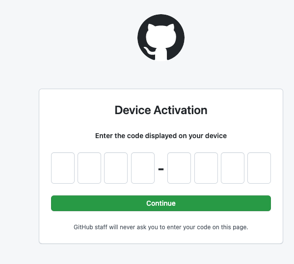
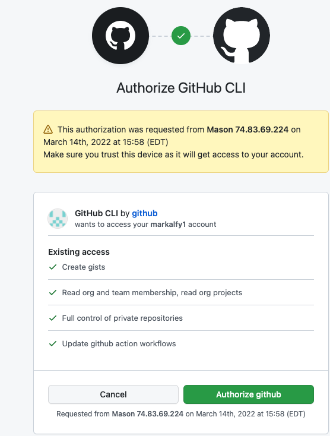
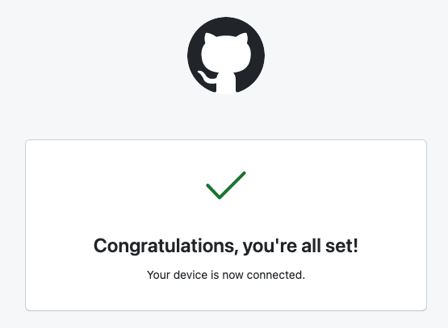
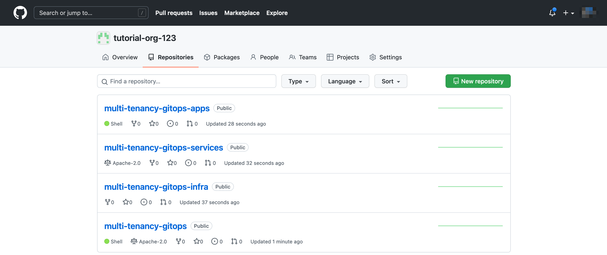

## Setting up GitHub

In this section we're going to create the GitOps organization that contains the
GitOps repositories that are used by ArgoCD to determine the state of our
cluster. We'll copy set of sample GitOps repositories as a starting point; we'll
make our own copy and review its contents. Later in the tutorial, we'll
customize it for our cluster.

(*If you'd like to re-familiarize yourself with git, GitHub or managing
repositories, you'll find the following [short
video](https://www.youtube.com/watch?v=wpISo9TNjfU) and [short
read](https://guides.github.com/activities/hello-world/) helpful.*)

1. *Create a new GitHub organization*

    We're going to create a dedicated GitHub organization for the
    repositories used in this tutorial. This is good practice as it allows you
    to keep your production reference work separate from other git work, or try out
    multiple configurations using different organizations.

    In your browser, navigate to
    [https://github.com/settings/organizations](https://github.com/settings/organizations){. target="_blank" .external}
    to create a new GitHub organization:

    {: style="max-height:400px, max-width:400px"}

    Click on `New organization` and select the `Free` plan:

    {: style="max-height:400px, max-width:400px"}

    Complete this page as follows:

    - A `Organization account name` such as `tutorial-org-123`
    - A `Contact email` such as `mquser123456@hotmail.com`
    - Select `My personal account` to associate this with your personal GitHub account
    - Click `Next` to create the GitHub organization

    <br>

2. *Set up environment variable for your GitHub Organization*

    This tutorial uses environment variables to save typing and reduce errors.
    We will use the `$GIT_ORG` environment variable to store your GitHub
    organization name. We'll use this variable in many subsequent commands.

    !!! tip
        You'll find it helpful to open a **new terminal window** for this
        topic.

    In the following command, replace
    `<git-organization>` with the GitHub organization name you've just chosen
    (e.g. `tutorial-org-123`):

    ```bash
    export GIT_ORG=<git-organization>
    ```

    You can verify your `$GIT_ORG` as follows:

    ```bash
    echo $GIT_ORG
    ```

    <br>

3. *Set the value of your working git folder*

    We recommend that you keep all repositories related to your Git organization
    under a common folder, which is usually a child folder of your home folder, e.g.
    `$HOME/git`.

    The `$GIT_ROOT` environment variable will be used to identify this folder as
    the root folder for your cloned git repositories.

    ```bash
    export GIT_ROOT=$HOME/git/$GIT_ORG-root
    ```

    You can verify your `$GIT_ROOT` folder as follows:

    ```bash
    echo $GIT_ROOT
    ```

    Feel free to use a different value for `$GIT_ROOT` if you'd like to do so.

    <br>

4. *Change to your working git folder*

    The set of repositories will be cloned under the `$GIT_ROOT`. Let's create
    this folder if required, and move to it.

    Issue the following command to create the `$GIT_ROOT` folder and move to it:

    ```bash
    mkdir -p $GIT_ROOT
    cd $GIT_ROOT
    ```

    You'll now be in your working folder, for example:

    ``` { .notext .nocopy}
    /Users/anthonyodowd/git/tutorial-org-123-root %
    ```

    <br>

---

## Clone sample repositories

 Now that we have a GitHub organization and a local folder, we can populate them
 with the sample GitOps repositories. Later, we'll customize these
 repositories for our cluster.

1. *Install and authenticate with the gh cli*

  To install [gh cli](https://production-gitops.dev/references/prerequisites/instructions/#installing-gh)

  ```bash
    brew install gh
  ```
  To validate your github authentication follow below steps:
  
  ```bash
    gh auth login -h github.com
  ```
  What is your preferred protocol for Git operations? 

  ```bash
    HTTPS
  ```
  Authenticate Git with your GitHub credentials? 

  ```bash
    yes
  ```
  How would you like to authenticate GitHub CLI? 

  ```bash
    Login with a web browser
  ```
  First copy your one-time code: ***

  Press Enter to open github.com in your browser... 

  {: style="max-height:400px, max-width:400px"}

  Enter one-time code then click on continue button

  {: style="max-height:400px, max-width:400px"}

  When you see authorize GitHub CLI page click on authorize github

  {: style="max-height:400px, max-width:400px"}


  <br>

2. *The `create-repos.sh` script*

    The production reference guide provides a script that creates the GitOps
    repositories from a set of GitHub templates and then clones them to your
    local machine under the `$GIT_ROOT` folder.

    Issue the following command to get the script:

    ```bash
    curl -O https://raw.githubusercontent.com/cloud-native-toolkit/multi-tenancy-gitops/master/scripts/create-repos.sh && chmod +x create-repos.sh
    ```

    You'll see the `create-repos.sh` being downloaded, stored on the local file system and made executable.

    ``` { .text .no-copy }
      % Total    % Received % Xferd  Average Speed   Time    Time     Time  Current
                                     Dload  Upload   Total   Spent    Left  Speed
    100  9006  100  9006    0     0  27779      0 --:--:-- --:--:-- --:--:-- 28681
    ```

    You can use the `ls` command to verify that the script is now in your local folder:

    ```bash
    ls -alt
    ```

    to show the files in your working folder:

    ``` { .text .no-copy }
    total 24
    drwxr-xr-x   3 anthonyodowd  staff    96  7 Feb 17:32 .
    -rwxrwxr-x   1 anthonyodowd  staff  8374  8 Feb 15:20 create-repos.sh
    drwxr-xr-x  17 anthonyodowd  staff   544  7 Feb 15:53 ..
    ```

    Notice that file mode for `create-repos.sh` has `x` set to indicate that it
    is executable.

    <br>

3. *Run the `create-repos.sh` script*

    Let's run the `create-repos.sh` script. It will:

      * create the repositories in your GitHub organization
      * clone those repositories to your local machine for customization

    Issue the following command to run the script:

    ```bash
    OUTPUT_DIR=. ./create-repos.sh
    ```

    You'll see four repositories created in your `$GIT_ORG` organization and
    cloned to your local machine:

    ``` { .text .no-copy }
    Client Version: 4.8.0-202111041632.p0.git.88e7eba.assembly.stream-88e7eba
    Creating GitHub repositories and local clones in folder: tutorial-org-123-root
    Github user/org is tutorial-org-123
    Repository multi-tenancy-gitops found but not cloned... cloning repository
    Cloning into 'multi-tenancy-gitops'...
    remote: Enumerating objects: 403, done.
    remote: Counting objects: 100% (403/403), done.
    remote: Compressing objects: 100% (194/194), done.
    remote: Total 403 (delta 259), reused 328 (delta 198), pack-reused 0
    Receiving objects: 100% (403/403), 3.29 MiB | 4.98 MiB/s, done.
    Resolving deltas: 100% (259/259), done.
    Already on 'master'
    Your branch is up to date with 'origin/master'.
    Repository multi-tenancy-gitops-infra found but not cloned... cloning repository
    Cloning into 'multi-tenancy-gitops-infra'...
    ...
    Repository multi-tenancy-gitops-services found but not cloned... cloning repository
    Cloning into 'multi-tenancy-gitops-services'...
    ...
    Creating repos for Cloud Pak examples
    Repository multi-tenancy-gitops-apps found but not cloned... cloning repository
    Cloning into 'multi-tenancy-gitops-apps'...
    ...
    Your branch is up to date with 'origin/master'.
    ```

    See how the output shows that the sample repositories have been successfully created
    and cloned. Let's now check that this has happened.

     <br>

4. *Verify the new repositories in your GitHub organization*

    Let's examine the newly created repositories in your GitHub organization.

    The following command will print the URL of your Git organization:

    ```bash
    echo https://github.com/orgs/$GIT_ORG/repositories
    ```

    for example:

    ``` { .text .no-copy }
    https://github.com/orgs/tutorial-org-123/repositories
    ```

    Use your browser to locate this URL. See how your organization has the
    following repositories:

    {: style="max-height:600px"}

    These are the GitOps repositories that are used to sync the cluster:

      * `multi-tenancy-gitops` contains the YAML files that describe a set of
        ArgoCD applications. It's these ArgoCD applications that synchronize the
        cluster with the following resources:
          * **infrastructure** components such as Kubernetes namespaces, whose
            YAMLs are defined in `multi-tenancy-gitops-infra`
          * **service** components such as Artifactory, Cloud Pak services or Sonarqube, whose YAMLs
            are defined in `multi-tenancy-gitops-services`
          * **application** components such as queue managers, databases,
            workflow engines, integration servers... whose YAMLs are defined in
            `multi-tenancy-gitops-apps`
      * `multi-tenancy-gitops-infra` contains a library of infrastructure
        component YAMLs that are referenced by the ArgoCD applications. There
        are a fixed number of these YAMLs and they come preloaded with this
        repository.
      * `multi-tenancy-gitops-services` contains a library of service component
        YAMLs that are referenced by the ArgoCD applications. There are a fixed
        number of these and they come preloaded with this repository.
      * `multi-tenancy-gitops-apps` contains a the set of application component
        YAMLs that are references by the ArgoCD applications. There are a
        variable number of these, corresponding to the number of application
        components that are being deployed in a given configuration. This
        repository is populated by the Tekton pipelines using the source
        repositories for these components. For example, a source repository
        containing a database configuration might be used to build the database
        YAMLs for deployment of that database to the cluster.

    Feel free to examine these repositories; we'll look at them in much more
    detail later.

     <br>

5. *Verify the new repositories cloned to your local machine*

    These repositories have also been cloned to your local machine under the
    `$GIT_ROOT` folder.

    Issue the following command:

    ```bash
    tree . -L 1
    ```

    to see the four repositories newly cloned repositories:

    ``` { .text .no-copy }
    .
    ├── create-repos.sh
    ├── multi-tenancy-gitops
    ├── multi-tenancy-gitops-apps
    ├── multi-tenancy-gitops-infra
    └── multi-tenancy-gitops-services
    ```

    <br>

6. *Review the GitOps folder structure*

    The `multi-tenancy-gitops` repository will be the focus of our attention as we configure the cluster.

    Issue the following command to show its structure:

    ```bash
    cd multi-tenancy-gitops
    tree . -L 1
    ```

    Notice the top level folders and files:

    ```{ .text .no-copy }
    .
    ├── 0-bootstrap
    ├── LICENSE
    ├── README.md
    ├── doc
    ├── scripts
    └── setup
    ```

    The main folders perform the following roles:

    * `0-bootstrap` contains different profiles that can be used to initialize
      the cluster ready. We will choose one of the available profiles --
      `single-cluster`.
    * `scripts` and `setup` contain useful scripts that we'll use during this
      tutorial.

    Feel free to explore these folders and files. We'll examine it in much more
    detail throughout this tutorial, and you'll become very familiar with it by
    trying it out.
