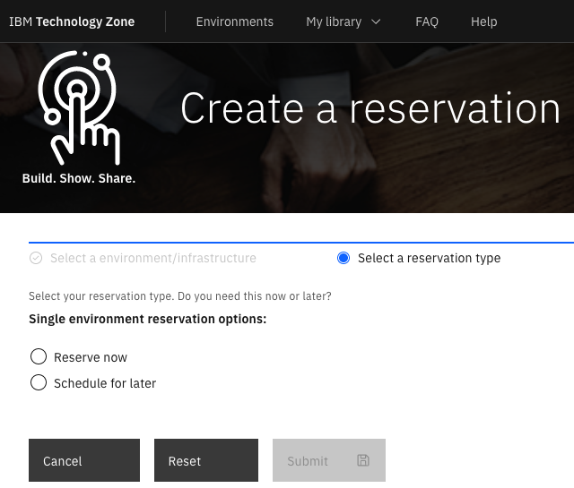
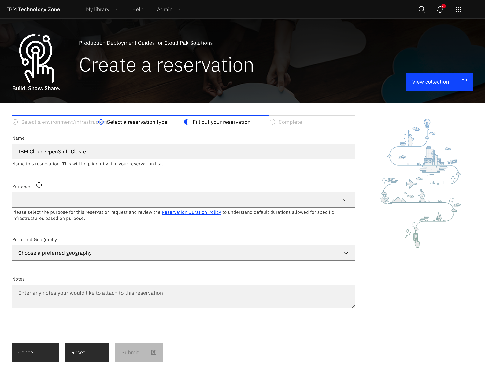
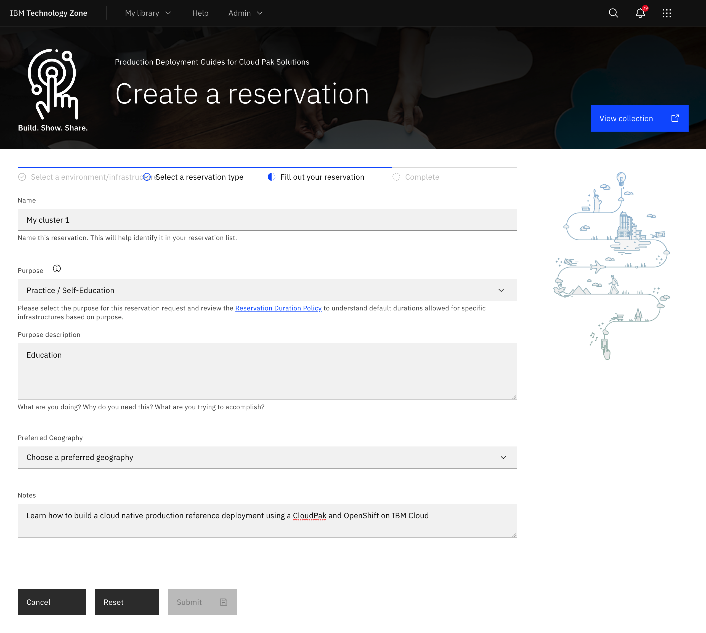
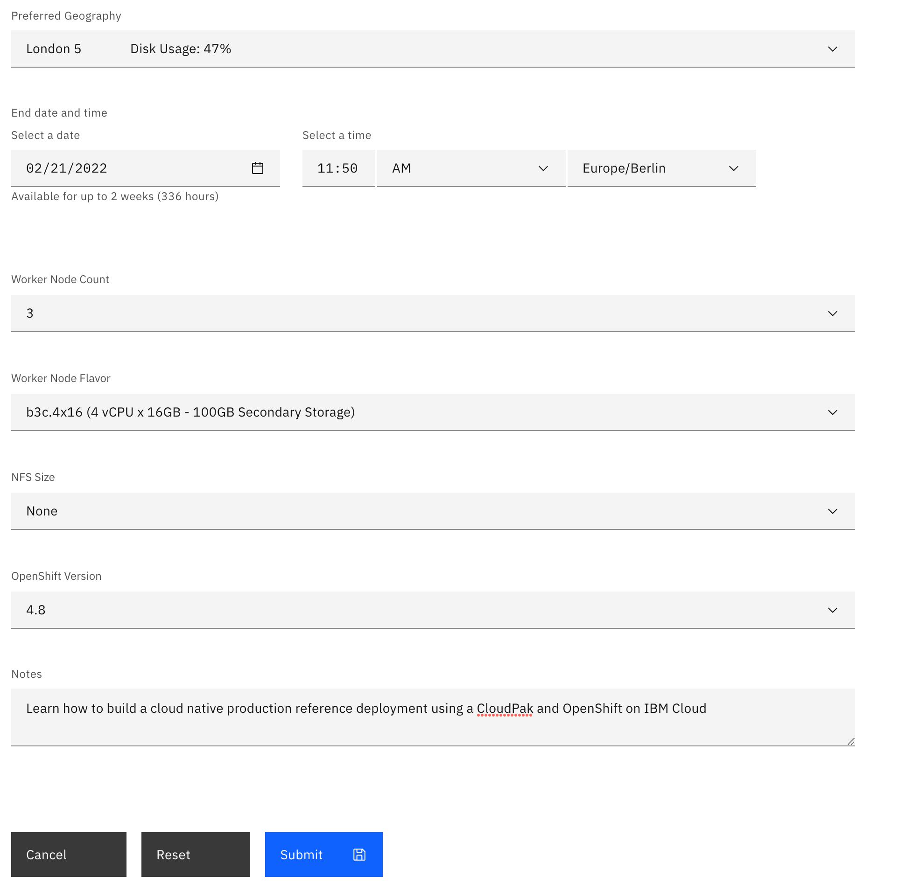

## OpenShift on IBM Cloud

1. Navigate to the [IBM Technology Zone](https://techzone.ibm.com/my/reservations/create/619e5691425423001fcc192e){:target="_blank" .external}

    In your browser, navigate to the [IBM Technology Zone](https://techzone.ibm.com/my/reservations/create/619e5691425423001fcc192e){:target="_blank" .external} to create your cluster.

    - You will need to sign-in with your IBM credentials if your browser has not authenticated.
    - You will need to read and accept `Terms and conditions` to proceed to the IBM Technology Zone.

2. Reserve a cluster

    You can reserve a cluster immediately on IBM Cloud.

    You'll see the following options:

    {: style="max-height:600px"}

    Click on the `Reserve now` radio button.

    !!! info
        It takes between 30 and 60 minutes to provision a cluster. Moreover, once a cluster has been provisioned, by default, it will be deleted after 3 days -- unless you renew it. It can therefore be helpful to schedule the environment to be created later if you are not going to be using it for a while -- such as for a future demonstration or classroom session. Come back and explore the `Schedule for later` option another time.

3. Complete reservation details *- step 1*

    You will be asked to complete your reservations details in two steps.

    Firstly, when you make a cluster reservation, you can supply a set of details that describe:

    - The cluster name
    - The purpose of the reservation from a pre-defined set
    - A description, which will appear when you set the purpose of your reservation to `Practice/Self-Education`.
    - Notes to help you identify this reservation

        {: style="max-height:800px"}

    Complete the details as follows:

    - Type a helpful `Name` such as `My cluster 1`
    - Select `Practice/Self-Education` from the `Purpose` drop-down list
    - Type a helpful `Purpose Description` such as `Education`
    - **Do not** select `Preferred Geography` yet; we will do that in a moment
    - Add some helpful `Notes` such as `Learn how to build a cloud native production reference deployment using a CloudPak and OpenShift on IBM Cloud`

        {: style="max-height:900px"}

4. Complete reservation details *- step 2*

    The second step in registration is to specify the physical details of the compute infrastructure for your cluster.

    When you make a cluster reservation, you can supply a set of details that describe:

    - The cluster's geographical location
    - The version of OpenShift Container Platform used by the cluster
    - The number of CPUs in the cluster and their memory size
    - The number of Kubernetes worker nodes in the cluster
    - The NFS storage size for the cluster
    - The End date and time for the cluster
        
        {: style="max-height:900px"}