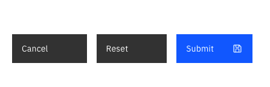
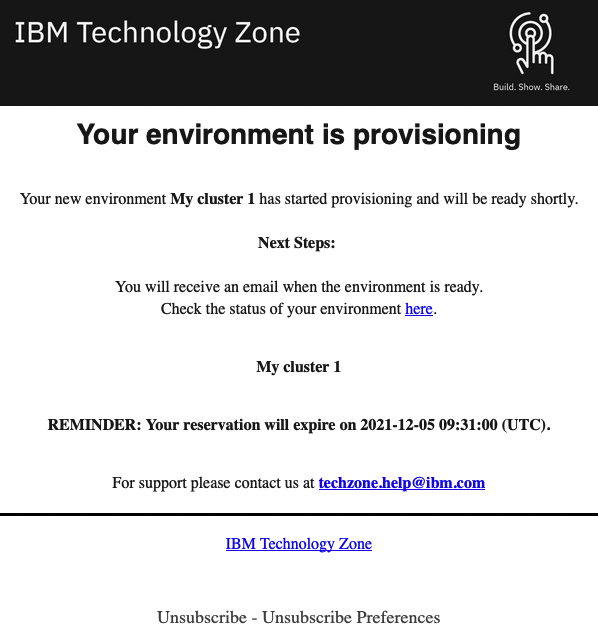
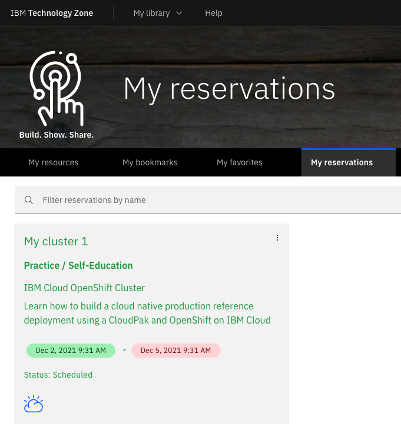
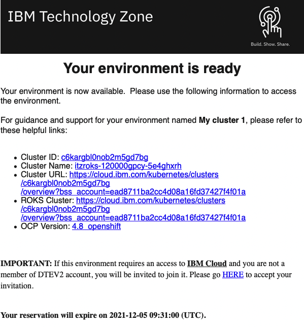
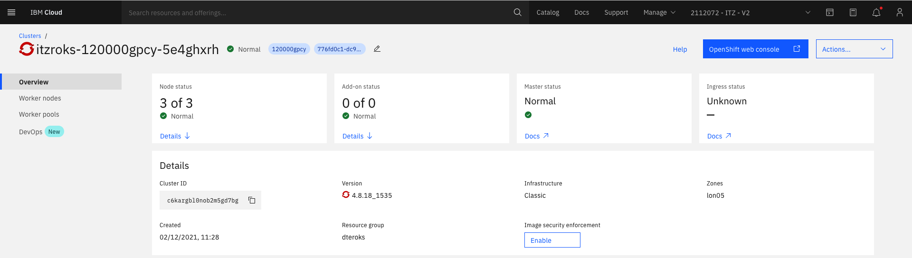
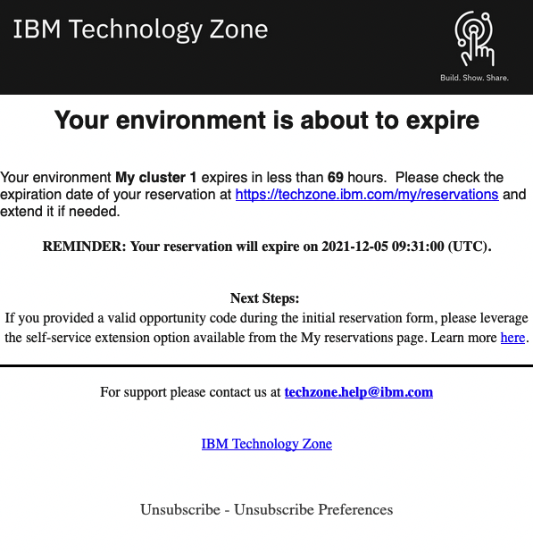

    !!! info
        By default, your cluster will be reserved for **three days**, after
        which time it will be deleted. This is more than enough time to complete
        this tutorial. If required, you can increase the cluster lifetime by
        configuring the `End date and time`. Don't do this unless you really need to
        do so; as you'll learn in the tutorial, the use of GitOps makes it quick and
        easy to provision a cluster when you need to do so.

1. Create the cluster

    Check your reservation details and press `Submit` when you're ready to create the cluster:

    {: style="max-height:400px"}

    !!! info
        The cluster provisioning process will take between **30 and 60 minutes to complete** on IBM Cloud.

2. Provisioning email

    As the provisioning process starts, you will receive an email to confirm that the provisioning process has started:

    {: style="max-height:700px"}

3. Checking the cluster provisioning status

    You can also view the status of your provisioning request on IBM Technology Zone.

    Click on [My reservations](https://techzone.ibm.com/my/reservations){:target="_blank" .external} to see:

    {: style="max-height:600px"}

    Note:

    - The `Status` field will be `Ready` when the cluster has been provisioned.
    - The creation and expiry date-time for your cluster.

    You can return to the reservation at any time to get the details of your cluster.

4. Cluster provisioned email

    You will receive another email once your cluster is ready:

    {: style="max-height:700px"}

    !!! success
        Your cluster is now provisioned and ready to use.

    !!! warning
        Note the expiry date-time.

    !!!note
        Be sure to read the **IMPORTANT:** clause at the end of the email. If your cluster has been provisioned to an IBM Cloud account you have not used before, and you have not accepted the invitation to that account, you will not be able to see your cluster when you click on the **Cluster URL** link in the following step. It is recommended to always click on the **HERE** link in the clause to see if you need to accept an invitation.

5. Navigate to your cluster

    You can use the information in the notification email to access your cluster.

    Click on the `Cluster URL` link to login to IBM Cloud and locate your OpenShift cluster:

    {: style="max-height:600px"}

    Note:

    - The `Cluster ID` that has been assigned by IBM Cloud.
    - The `Zone` matches your requested geography.
    - The OCP `Version` matches your requested version of OCP.
    - The `Node status` identifies the 3 worker nodes in the `Normal` state.

    Feel free to explore this web page.

6.  Receiving cluster deletion email and extending your cluster's lifetime

    When your cluster is within 3 days of deletion, you will receive a daily email:

    {: style="max-height:700px"}

    Note:

    - You can extend your cluster if required.
    - This option may be limited to certain types of reservations.
    - The [My reservations](https://techzone.ibm.com/my/reservations){:target="_blank" .external}
      page allows you to manage your cluster reservation
